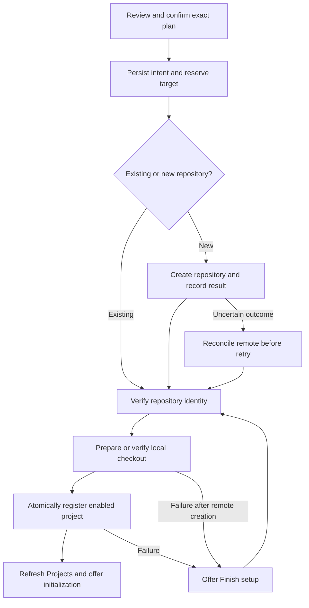

# Adding projects in the SASE Admin Center: design, architecture, and recovery

Researcher: **cdx** · Date: **2026-10-11** · Independent research for the project-creation design swarm.

## Assessment

This is a good feature. A Projects panel that can enable, disable, edit, initialize, and delete projects should also provide an obvious way to add one. Today, users have to know that resolving a new VCS macro can register a project. A visible onboarding flow would make the product easier to learn and give experienced users a useful repository picker.

I recommend an **Add project** wizard, beginning with a repository-provider choice and branching into **Use an existing repository** or **Create a repository**. The existing-repository path should be the default. Keep the common path short, expose the provider's creation settings through progressive disclosure, and make the final action describe precisely what it creates.

The difficult part is reliability, rather than drawing a modal. Remote repository creation, local cloning, project registration, and SASE initialization have different failure and authorization boundaries. Treat onboarding as a resumable operation, using the existing durable process infrastructure and a small Rust-owned operation record. Do not implement it as a sequence of modal callbacks that write files and run `gh`.

## Evidence and scope

I inspected the current workspace, independently opened the `sase-github` and `sase-core` linked repositories through `sase repo open`, and consulted official GitHub and Textual documentation. I did not read peer reports, peer transcripts, or prior swarm findings. This report proposes a design; it does not implement the feature or create any GitHub repositories.

The inspected source snapshots were:

| Repository | Observed revision |
| --- | --- |
| `sase` | `cca17731576448af3fbd3516850a97c84707351d` |
| `sase-github` | `b3f827db03e52c0fc5bde8b54bf1c250e90e2d1c` |
| `sase-core` | `96f7796d06ac7524f7ba20a76633811b7b1aa32b` |

The workspace's `sase-core-revision.txt` pins `47b28fbd473a25640a7f6990bde3c6aa0e866fb2`, which differs from the opened core checkout. These are source observations, not a claim that all three revisions have been tested together. Installed GitHub CLI was `2.100.0`; its local `gh repo create --help` corroborated the documented creation options.

Paths below are relative to the named repository, so implementation work can use another workspace. SASE reference memory was read through the audited command, including project terminology, artifacts, CLI rules, and TUI performance conventions. A later read encountered a transient import failure in the global editable installation; repeating the command with this workspace's `src` on process-local `PYTHONPATH` succeeded. No global installation was changed.

## What the code already supplies

| Finding | Source location and implication |
| --- | --- |
| Projects already have a complete management surface | `sase:src/sase/ace/tui/modals/projects_pane.py`, `ProjectsPane`, hosts Projects, Repos, and Workspaces sub-tabs. Its project actions include lifecycle management, setting the current project, and initialization; there is no add-project action. |
| Creation is currently a side effect of VCS reference resolution | `sase-github:src/sase_github/workspace/refs.py`, `_resolve_repo_path_ref`, clones when necessary, allocates a project key, writes `WORKSPACE_DIR`, and assigns a useful name. `sase:src/sase/workspace_provider/plugins/bare_git_ref.py` resolves or initializes bare-Git projects. |
| Enabled is already the default | `sase-core:crates/sase_core/src/project_spec.rs`, `read_project_lifecycle_from_content`, treats an absent `PROJECT_STATE` as enabled. Do not introduce a new lifecycle state for an onboarding job. |
| Lifecycle discovery and parsing already belong to Rust | `sase:src/sase/core/project_lifecycle_facade.py` calls `sase_core_rs`; `sase-core:crates/sase_core/src/project_spec.rs` owns records and the true-project predicate. The project instructions require shared domain behavior in Rust. |
| The existing plugin seam is promising | `sase:src/sase/workspace_provider/_hookspec.py` declares `WorkflowMetadata`, `VcsRepoEntry`, `ws_list_ref_namespaces`, `ws_list_repo_candidates`, `ws_peek_ref`, and `ws_resolve_ref`. `get_all_workflow_metadata()` in `_registry.py` inventories installed workspace plugins. |
| GitHub discovery is substantially implemented | `sase-github:src/sase_github/workspace/completion.py` gathers configured `github_orgs` and owners from enabled project keys, and lists repositories with descriptions, visibility, archive/fork status, and push time. This is reusable groundwork. |
| Completion is bounded and lacks onboarding identity | The same file caps results at 200 by default and has no pagination/completeness field. `VcsRepoEntry` has no host, stable repository ID, or permission field. These are important gaps for a project browser. |
| Existing cache scope is too narrow for the proposed browser | `sase:src/sase/macro/vcs_repo_completion.py` uses `(workflow_type, namespace)` for its memo cache and a corresponding disk path. It has a 600-second default TTL and stale-result fallback, but does not key by GitHub host or authenticated account. |
| Existing registration checks checkout paths | `sase-github:src/sase_github/workspace/projects.py`, `find_project_record_for_workspace`, compares normalized paths. Keys use `gh_<owner>__<repo>` with collision suffixes. Alternate clone locations and different hosts therefore need more explicit identity handling. |
| Remote creation plumbing exists for sidecars | `sase-github:src/sase_github/workspace/sdd_repo.py`, `create_github_sdd_repo`, runs noninteractive `gh repo create`, with host selection, timeout, and an already-exists probe. Reuse plumbing and error handling, rather than the sidecar-specific policy or description. |
| Registration and initialization are already distinct concepts | `sase:src/sase/project_management.py` uses the repository-local `is_sase_managed` authorization marker. `src/sase/main/repo_init_handler.py` can create sidecars and commit local wiring. Adding a project must not silently authorize all those effects. |
| Bare-Git initialization has material side effects | `sase:src/sase/workspace_provider/plugins/bare_git_init.py`, `init_bare_git_project`, creates a bare repository and clone, seeds SDD files, commits, and pushes; the fresh path configures a SASE author identity. It is not a registration-only helper. |
| Process lifetimes have two different adapters | `sase:src/sase/ace/tui/actions/_proc_action_submission.py`, `_submit_session_worker`, explicitly runs UI-session-local work. `src/sase/ace/tui/durable_submit.py`, `submit_durable_proc_request`, submits argv to the supervisor-owned process service. Use the latter for provisioning. |

The distinction between `sase_vcs` and `sase_workspace` also matters. Commit, diff, and PR hooks in `src/sase/vcs_provider/_hookspec.py` generally operate on an existing checkout. Choosing, locating, and provisioning the primary repository fits the workspace-provider boundary much better.

## Requirement adjustments I recommend

These are deliberate changes or clarifications to the original request, rather than assumed requirements.

1. **Call the entry action “Add project.”** A new SASE project often attaches an existing repository. Use “Create repository” only for the branch that performs that remote or local mutation. In the UI, say “Repository provider” and offer “GitHub” and “Local Git (bare repository),” since GitHub and Git are not competing version-control algorithms.
2. **Retain enabled-by-default, without making the project current automatically.** Registration should create an enabled project. Offer “Make current” after success, or an unchecked choice on review. Do not silently alter the user's active context merely because they explored onboarding.
3. **Define option parity against the plugin's documented creation contract.** Expose every applicable `gh repo create` repository setting for blank/template creation. Do not require a question for every optional field or promise parity with every GitHub API administration setting. Publishing an existing local repository (`--source`, `--push`, and custom `--remote`) should be a separate mode; I would defer that mode from the first release and explicitly document this exception.
4. **Add a manual repository-reference escape hatch.** Suggestions are a convenience, not an inventory of everything the user can access. Allow an owner/repo or supported URL even when the owner is absent from `github_orgs`, discovery is capped, or one organization cannot be listed.
5. **Separate project registration from full SASE initialization.** The final review should identify clone/local registration effects. Offer the existing initialization preview afterward. Existing repositories should not gain committed config, sidecars, or a management marker as an unannounced consequence of registration. Bare-Git creation needs a factored provisioning primitive, or an explicit review of its legacy initialization effects.
6. **Specify recovery as part of the feature.** If the remote exists but local setup failed, the UI must say so and offer “Finish setup.” Avoid remote deletion as automatic rollback and avoid a second creation request on retry.
7. **Handle already-registered disabled projects explicitly.** An enabled project should be excluded from addable suggestions. A disabled project should lead to “Enable existing project,” not another registration and not silent re-enabling. Deduplication must consider both states.
8. **Defer bulk import and recommendation learning.** Ship one project at a time, with transparent sorting based on configured owners and recent activity. An onboarding feature does not need an ML ranking system or a new generalized form framework.

The biggest tradeoff is item 3. Literal parity with all GitHub REST parameters would expand this into a repository administration product: merge policies, security settings, custom properties, and other settings go well beyond `gh repo create`. GitHub's organization-creation REST endpoint demonstrates that wider surface. Define the supported boundary before implementation. [GitHub repository API](https://docs.github.com/en/rest/repos/repos#create-an-organization-repository)

## Interaction design

### Entry and provider choice

Place a visible **+ Add project** button above the Projects list, with a configurable `n` shortcut. It must work with no rows, no selection, or a filter that matches nothing. It acts on the Projects sub-tab only. Existing `a` enables projects and `c` makes a project current, so reusing either would be confusing.

Use one modal with a persistent title, compact step indicator, and replaceable body:

`Provider → Repository → Review`

The provider screen lists installed providers that declare onboarding capability. Each row has a plain explanation and availability status. GitHub might say “Use a repository from an organization or your account.” Local Git should explain that it creates or uses a local bare repository. Still prompt for the selection when only one provider is available, with that provider preselected. A missing plugin should produce an actionable unavailable row or link to the existing plugin-management surface, rather than an inert form.

For GitHub, show the selected host and active account before repository selection. With one configured host, this can be a compact context line; with several, show a host chooser. Do not infer ownership or permissions from the configured organization list. Organization policies can restrict repository creation and available visibility even for authenticated members. [GitHub organization creation policy](https://docs.github.com/en/organizations/managing-organization-settings/restricting-repository-creation-in-your-organization)

### Existing-repository branch

Default to **Use existing** in a segmented control, with **Create new** alongside it. Keep the creation action visible even when the suggestion list is empty or loading. An owner filter and repository search occupy the top row; list rows show owner/name, one restrained visibility label, and a short description. A selected-row preview shows local destination and relevant access/archive status.

Illustrative layout, with fictitious candidates:

```text
┌ Add project ──────────────────────────────────────────────────┐
│ Provider ✓   Repository ●   Review ○                          │
│ GitHub · github.com · signed in as bryan                       │
│                                                              │
│ [ Use existing ]  [ Create new ]                              │
│ Owner [Configured owners ▾]   Search [repository name      ]  │
│                                                              │
│ > acme/widget       private   Small tools for our workflow    │
│   acme/site         public    Team website                   │
│   acme/library      private   Shared libraries               │
│                                                              │
│ widget · enabled on completion                               │
│ Clone to ~/projects/github/acme/widget                       │
│                                                              │
│ Enter repository URL…                          Refresh        │
│ [Cancel]                                         [Continue]   │
└──────────────────────────────────────────────────────────────┘
```

Do not bury “Create new” as a repository-shaped row that shifts with list sorting. Use a stable action outside the results.

A single matching repository still needs review before cloning/registering. Keep project-name editing optional: propose a useful unique display name, and put aliases and destination adjustments behind “Project settings.” Show the canonical project key only in expanded details.

### Create-repository branch

The compact form shows owner, repository name, description, and visibility. Default to **Private**, subject to known organization policy; never fall back to public after a private-creation failure. Owner must be explicit, because account defaults are easy to overlook. Show a live destination preview such as `github.com/acme/widget`.

Use a collapsible **Repository options** group for README, ignore template, license, homepage, issues, wiki, team, and template settings. Searchable selectors should also accept supported typed values where listing permissions are unavailable. A blank description and no license are legitimate choices. Preserve the draft when expanding fields or going back.

I would default README on for a new blank GitHub repository, with helper text explaining that it supplies an initial commit. The user may turn it off. An empty repository can be registered and enabled, but the result must identify that launching work may need an initial commit; do not claim operational readiness merely because a clone directory exists. Do not silently inject a commit after the user asked for an empty repository.

### Review, execution, and success

Review summarizes the selected repository or new owner/name, account/host, visibility for new repositories, local destination, project display name, enabled state, and all non-default options. Show an expandable technical detail panel, rather than making a command line the main product explanation.

The action label is **Add project** for an existing repository and **Create repository & add project** for a new one. Public visibility should be clearly labeled in the review, without introducing an additional confirmation maze. The reviewed payload becomes the operation's exact input; edits invalidate previous preflight results.

Execution shows named stages with honest status: “Creating repository,” “Preparing checkout,” and “Registering project.” Use elapsed time or output details instead of a fabricated percentage. A running operation can be viewed in Procs; closing the wizard does not pretend to undo creation. On success, return to the Projects list, select the new row by project key, refresh inventory and launchable-project discovery, and offer **Make current** and **Initialize SASE…** as explicit next actions.

If the active filter hides the result, provide a one-action “Show new project” affordance that clears the filter; preserve the existing filter until the user chooses it. Keep the prior selection and marks when onboarding is cancelled.

### Visual quality

Reuse Admin Center styling, including the Projects tab's existing `#FFAF5F` accent, focus borders, spacing, and Rich `Text` rendering. Make typography carry hierarchy: one prominent title, muted context, clear labels, and one primary button. Avoid dense all-capital metadata and decoration that competes with repository names.

Use a roomy two-column list/preview layout when the terminal permits, and stack the preview in narrower terminals. At 80×24 the essential fields and primary action should remain reachable; advanced settings scroll inside the body while the footer stays visible. Verify Tab/Shift-Tab, arrow navigation, Enter, Escape, and mouse interactions. Scope printable shortcuts away from focused inputs: typing `n` must never launch another wizard. Keep error text attached to the affected field and preserve entered values.

Descriptions and names from providers must be rendered as literal text, with control characters sanitized; repository metadata should not be treated as Rich markup. Visibility and error states need words as well as color. Beauty here means calm alignment, fast feedback, and consistent interaction under both success and failure.

## Discovery that deserves the user's trust

Start from configured owners on the chosen host, augment with owners already known locally, and offer the authenticated user's repositories. Load the selected owner first and other configured owners incrementally through a serial provider request queue. Show cached data immediately where its host/account scope matches, then refresh it. Isolate an owner's failure so another owner's results remain useful.

`gh repo list` lists repositories owned by the supplied user or organization; it does not traverse other owners, and its standard default limit is 30. Its JSON fields include stable ID, owner-qualified name, permission, and empty-repository status. The existing plugin explicitly raises its limit to 200 but does not report truncation. [GitHub CLI repository listing](https://cli.github.com/manual/gh_repo_list)

For onboarding, add a paginated provider query that returns entries, continuation cursor, completeness, freshness, and a typed error. Fetch a bounded page first, expose “Load more,” and allow exact-ref lookup. Either REST pagination or a GraphQL cursor through `gh api` works; its pagination facilities are documented. Keep this within the plugin, with no GitHub endpoint knowledge in the TUI. [GitHub CLI API command](https://cli.github.com/manual/gh_api)

Suggested sorting should be predictable: selected/configured owner priority, repositories ready for ordinary work before archived ones, recent push time descending, then owner/name as a stable tie-break. Forks remain available; show their status rather than hiding them wholesale. Archived repositories can be behind a “Show archived” toggle with an explanation that they are read-only on GitHub.

Association filtering must use **repository identity**, not a short name or expected checkout directory:

- Normalize provider and host, plus provider-native owner/repository coordinates; use a stable remote repository ID when supplied. Keep readable coordinates for display and rename handling.
- Inspect all true project records, enabled and disabled. Do not mistake internal sibling backing records for separately registered projects.
- A legacy project's checkout origin can help establish remote identity even when its key or location is unconventional. An unavailable origin should produce uncertainty requiring validation, rather than guessed exclusion.
- Distinguish “already a primary project” from “linked to another project.” A linked repository is not necessarily a separate SASE project; disclose that association rather than treating every known repository as already registered.
- Suppress known managed sidecars from default suggestions using actual inventory/config associations. Avoid assuming that every name ending in `--research` or `--agents` is a sidecar. Manual selection remains possible with an explicit explanation.

Cache keys must include provider, host, effective authenticated account or non-secret authorization-context discriminator, owner, query/filter, and page scope. Replace or bypass the completion cache for this feature until it has that contract. Never re-use private repository metadata across a host/account switch. Always revalidate the selected repository and identity before mutation.

GitHub can return 404 for a private resource without sufficient authentication, and 403/429 for rate limits. Neither is proof that a repository can safely be created. Classify missing tool, authentication, permissions/policy, not-found-or-inaccessible, rate limit, network/timeout, invalid option, and local path conflict separately. [GitHub API troubleshooting](https://docs.github.com/en/rest/using-the-rest-api/troubleshooting-the-rest-api)

Respect reset/retry headers and bounded backoff. Avoid firing a request on every keypress: filter loaded candidates locally, and debounce only explicit remote search or new-owner lookup. GitHub recommends serialized API requests to reduce secondary rate-limit pressure. [GitHub API best practices](https://docs.github.com/en/rest/using-the-rest-api/best-practices-for-using-the-rest-api?apiVersion=2026-03-10)

## GitHub creation options and the parity boundary

The provider should declare an explicit, versioned option inventory. These are the creation flags verified against the installed CLI and official manual; aliases do not require separate controls. [GitHub CLI repository creation](https://cli.github.com/manual/gh_repo_create)

| CLI input | Proposed UI treatment |
| --- | --- |
| `OWNER/REPO` | Explicit owner and name |
| `--private`, `--public`, `--internal` | Visibility selector; unavailable choices explained |
| `--description` | Optional description |
| `--homepage` | Optional URL |
| `--add-readme` | README checkbox |
| `--gitignore`, `--license` | Searchable optional selectors |
| `--disable-issues`, `--disable-wiki` | Positive enable toggles |
| `--team` | Organization team, when applicable |
| `--template` | Template source mode |
| `--include-all-branches` | Template-only checkbox |
| `--clone` | SASE-managed checkout step and destination |
| `--source`, `--push`, `--remote` | Separate publish-local mode; deferred initially |

Internal visibility is contextual, including enterprise organization support, rather than a universal third choice. [GitHub Enterprise repository visibility](https://docs.github.com/en/enterprise-cloud%40latest/repositories/creating-and-managing-repositories/about-repositories)

The table is a capability contract, not a requirement to display every control simultaneously. Blank/template/local-source modes have different valid combinations; changing modes should explain incompatible values and retain the draft for returning to the prior mode. Keep validation in the plugin and core contract, and test the actual CLI constraints instead of inferring them from help text. Do not parse `gh --help` at runtime to invent a form.

Use noninteractive argv execution, `GH_PROMPT_DISABLED`, closed stdin, an explicit host, and bounded timeouts. Create the remote separately from cloning so each outcome can be recorded. Supply an explicit visibility choice. The plugin may use `gh repo create` for creation and `gh api` or `gh repo view --json` for structured verification. Record repository identity, URLs, and actual settings after success; do not depend on localized success prose.

If template creation needs a separate settings update to achieve an option, represent that as its own stage and partial outcome. Never say creation fully succeeded while requested repository settings were dropped. Keep token storage/login in the existing `gh` environment, and recheck the effective account before side effects. In particular, `gh auth status --json` may exit zero despite authentication errors, so an exit code alone is an insufficient preflight. [GitHub CLI authentication status](https://cli.github.com/manual/gh_auth_status)

## Backend design and execution contract

### A small shared domain, with provider-specific effects

Add a project-onboarding domain to `sase_core`, with serde wire requests/results and PyO3 bindings. Rust should own validation of shared project identity/name constraints, association filtering and deterministic ordering, preflight/apply state transitions, concurrency/reservation rules, journal persistence, and atomic publication of the ProjectSpec. That behavior must match across a TUI, CLI, and eventual web frontend.

Python should remain the thin bridge for installed Pluggy providers, subprocess execution, and Textual presentation. GitHub-specific endpoints, account capabilities, option validation, and CLI arguments belong in `sase-github`. Local Git provisioning belongs behind the bundled provider adapter. Rust can return a next-effect instruction; Python performs the provider effect and submits its typed outcome back to the core coordinator. This respects the current backend boundary without requiring Rust to discover Python entry points.

Proposed contracts, with names illustrative rather than existing APIs:

| Contract | Responsibility |
| --- | --- |
| `ProjectOnboardingCapabilitiesWire` | Provider ID, modes, availability, option schema/version, readable labels |
| `RepositoryCandidatePageWire` | Host/identity, readable ref, metadata, association, cursor/completeness/errors |
| `ProjectOnboardingRequestWire` | Mode, provider context, repository input, provider options, project display name, destination |
| `ProjectOnboardingPlanWire` | Normalized identity, validated options, precise effects, readiness/blockers, plan fingerprint |
| `ProjectOnboardingResultWire` | Operation ID, phase, remote identity if known, local paths, registered project key, recovery action |

Use a modest declarative field vocabulary: text, enum, boolean, and searchable choice, plus group and conditional visibility. Do not allow arbitrary executable UI callbacks in provider schemas, and do not build a full JSON Schema form renderer for two providers. Carefully allow optional typed text for team/template/ignore/license values so UI lookup failures do not remove an otherwise supported option.

Add additive workspace hooks for capabilities, paginated discovery, read-only validation, and repository provisioning/inspection. Reuse existing namespace discovery where suitable. Keep `ws_peek_ref` strictly local/read-only: its current contract forbids network subprocesses and mutation, so a network preflight needs a different hook. Keep the current hook argument names stable, since Pluggy treats them as a cross-repository compatibility boundary.

`None` should mean “this plugin does not handle the provider”; a handled error needs a typed result. Lack of an onboarding hook in an older plugin should disable that capability with an explanation, rather than crash provider registration. Prefer existing registration infrastructure once factored into a coordinated service, but do not call the current mutating resolver during selection/preflight.

### Use durable execution, rather than a modal-owned worker

Discovery can run in cancellable read-only workers. Applying the plan should submit an argv-backed `project.onboard` operation through the existing durable process adapter, with an operation fingerprint and concurrency keys. `_submit_session_worker` is appropriate for genuinely session-local work, but does not supply the lifecycle needed for remote creation.

Textual workers are tied to the DOM node that starts them, and a thread worker cannot be cancelled like a coroutine. Those facts make a modal-scoped thread a poor owner for repository creation. Updates should reach the UI through messages or thread-safe marshaling. [Textual worker documentation](https://textual.textualize.io/guide/workers/)

A minimal operation record needs request/options hash, selected provider context, normalized target, remote outcome, local staging paths/ownership, registered project key, phase, and last error. It needs no new general-purpose job engine. Before remote creation, persist the intent. After each effect, persist its outcome. On restart, reconcile an uncertain in-flight effect against provider/local facts before choosing the next effect. Do not automatically replay a create request whose outcome is unknown.



Use a short global namespace lock to reserve project keys/display names/aliases, and target-specific concurrency keys for the remote identity and checkout destination. Do not hold a global lock while waiting for the network. Recheck the reservation and identity under the short commit lock, then publish the ProjectSpec atomically with no overwrite. Both VCS macro creation and onboarding must eventually use the same reservation path, or an agent and the wizard can race despite good TUI deduplication.

Preserve current project-key formats for compatibility. Store remote identity independently, including host and a stable remote ID when available; do not rename every existing GitHub key to add a host. Resolve legacy identity on demand and persist it during an authorized project mutation.

For a new clone, stage beside the final destination on the same filesystem, validate it, and publish with an exclusive destination operation. Existing destinations must be actual checkout roots with matching origin; do not overwrite them, reset branches, or discard changes. Reusing a dirty matching clone may be fine for registration, but its state must be preserved and downstream initialization separately previewed. Clean up only paths this operation created and owns.

Success should mean the repository identity is verified, the intended checkout is present, and the enabled project record is atomically registered. Empty repositories have separate readiness information. Initialization completion is a later result, not hidden inside that definition.

### Recovery behavior

| Situation | Required outcome and UI |
| --- | --- |
| Discovery fails or is partial | Retain scoped cached results with an explicit stale/partial label; allow manual input and retry. |
| Remote name already exists before creation | Offer “Use existing” after verification; never silently convert the user's create intent. |
| Create times out or the runner dies after sending it | Mark the remote outcome unknown, inspect it on recovery, and require an explicit attach decision if ownership of the newly observed resource cannot be established. |
| Remote created, clone failed | Say “Repository created; project setup incomplete,” show its URL, and offer “Finish setup.” |
| Clone exists, registration failed | Retain the verified owned checkout and retry registration; do not re-create the repository. |
| Duplicate click or concurrent TUI/CLI attempt | Reattach to the same operation or show the existing project/conflict; no duplicate effects. |
| User closes the modal during apply | Keep the durable operation observable in Procs. A separate stop action requests interruption at a safe boundary. |
| User stops while creation is in flight | Reconcile the outcome; do not claim cancellation erased remote effects. |
| Initialization fails after registration | Keep the project enabled and registered; retry only initialization. |

Repository creation APIs do not provide this application with proof of an exactly-once remote effect across a lost response. A journal improves recovery but cannot eliminate that uncertainty. Do not adopt a same-name repository merely because a retry probe finds it; verify identity and reviewed options, then distinguish proven completion from an explicit switch to “Use existing.”

## Alternatives and tradeoffs

| Approach | Assessment |
| --- | --- |
| Add a modal that invokes existing `resolve_ref` | Fast prototype, but preflight and mutation are mixed; path-based association, partial registration, and cancellation remain unresolved. Insufficient for the requested reliability. |
| Suspend the TUI and run interactive `gh repo create` | Strong provider-native interaction, useful as an escape hatch, but loses coherent styling, project registration, exact review, and recovery. It also does not solve Local Git onboarding. |
| Put all provider fields and subprocesses in `ProjectsPane` | Convenient initially, but every new provider needs TUI changes and other frontends diverge. Avoid. |
| Build a universal provisioning framework first | Too much machinery before there is a proven need. Avoid a plugin UI language, rollback engine, or separate job scheduler. |
| Small core coordinator, workspace-provider effects, one wizard, existing durable processes | Best fit. More work than a modal-only patch, but directly addresses the product and architectural risks with infrastructure the project already has. |

I would not start with organization auto-discovery, bulk import, automatic full initialization, or a generic API-settings editor. The intended benefit is making one project's onboarding obvious and dependable. Suggestions plus manual input achieve that without turning SASE into a source-hosting administration console.

## Implementation sequence and acceptance criteria

This is a recommended sequence for a future implementation, not a submitted SASE implementation plan.

1. **Core contract and registration boundary.** Introduce the wire types, reservation/journal/publication helpers, and readiness result in `sase-core`; expose binding tests and move `sase-core-revision.txt` past the required core commit before Python calls the new bindings. Factor the registration effect out of mutating resolvers so macro and wizard creation share constraints.
2. **Providers and durable apply.** Add capability hooks, scoped/paginated GitHub discovery, authoritative exact-ref validation, and blank/template repository creation. Factor Local Git provisioning from initialization or review all its material effects. Add a durable operation name/handler using the existing process service and a small headless `sase project add` / `create` front door over the same service. Follow CLI sorting, help, and short-alias conventions.
3. **The wizard and integration.** Add `ProjectsPane.action_add_project`, capability and repository screens, provider options, review, progress/recovery, and success selection. Update `ProjectsPaneKeymaps`, `src/sase/default_config.yml`, bindings builders, Admin Center hints, and the `?` help content. Reuse lifecycle notification and launchable-project refresh paths, while keeping “Make current” explicit.
4. **Verification and usability.** Exercise provider fixtures and local temporary repositories, recovery faults, concurrent attempts, and terminal snapshots. Complete each repository's required checks. A reviewable UI prototype should precede final field/layout polish; this report has not measured a live prototype.

The first release should include both existing-repository onboarding and new repository creation for GitHub and the bundled Local Git provider, rather than shipping a selector whose promised creation path is absent. Publishing a populated local checkout can be a separately scoped addition, as explicitly called out above.

Meaningful verification should cover:

- **Domain invariants:** all new completed registrations are enabled; existing disabled records remain disabled unless explicitly enabled; case-insensitive key/name/alias collisions; host separation; stable identity despite alternate checkout paths; true-project versus sibling/sidecar association.
- **Discovery:** more than 200 repositories; partial owner failure; stale cache; account/host changes; no private-data reuse across contexts; manual refs absent from the menu; rate-limited and inaccessible results.
- **Provider parity:** every advertised blank/template field affects argv or a recorded settings stage; visibility never downgraded; invalid mode combinations fail before creation; descriptions with quotes/newlines/markup remain safe data; a minimum supported `gh` version is documented.
- **Failure injection:** remote success followed by clone failure; settings-stage failure; disk full; registration conflict; interrupted clone; lost creation response; operation restart; double submission; a matching existing dirty checkout is preserved.
- **UI behavior:** empty Projects list; filtered list; all actions with focused inputs; back navigation preserves options; modal closure during provisioning; visible recovery; success selection by identity; narrow/wide screens; stable focus; no blocking work in key handlers/rendering.

Mock tests should not create live remote repositories. Use hermetic temporary bare repositories for Git behavior and recorded provider responses for most coverage; a disposable manual GitHub smoke test can validate the transport and policy assumptions before release. Measure initial paint and key-to-paint with slow discovery, rather than assuming a worker alone keeps Textual's message pump responsive.

Remaining uncertainties are limited and testable: which template/creation combinations the supported CLI accepts; which organization policy capabilities a normal token can inspect; whether all bare-Git legacy initialization effects should remain mandatory; and how an empty remote should be prepared for the first agent launch. The design must surface those limits instead of guessing a successful outcome.

## Recommended solution

Build **Add project** as a compact, provider-aware wizard: **Provider → Repository → Review**, with **Use existing** as the default and **Create new** always visible. Suggest unregistered repositories from configured owners, offer manual references, create new registrations enabled, and expose all applicable blank/template creation options with Private as the default visibility.

Back the wizard with a **small Rust-owned onboarding coordinator and journal**, **additive workspace-provider hooks**, and the **existing supervisor-owned durable process service**. Keep remote creation, checkout preparation, atomic project registration, and optional SASE initialization as distinct recorded effects. Reuse discovery and process infrastructure, but strengthen identity, pagination, credential scoping, and recovery before treating it as an onboarding API.

This is worth implementing. Its best version is not the shortest modal: it is the version in which adding an existing repository is easy, creating a new one feels deliberate, and an interrupted setup can be finished without duplicating or deleting anything.
