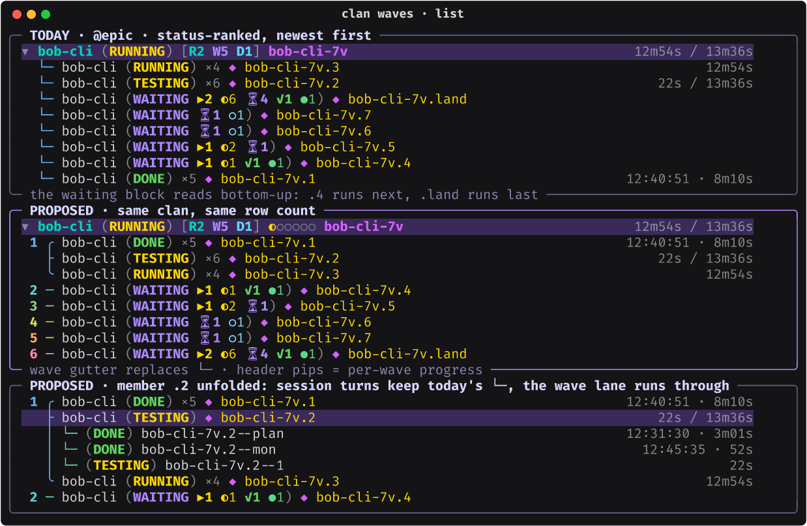
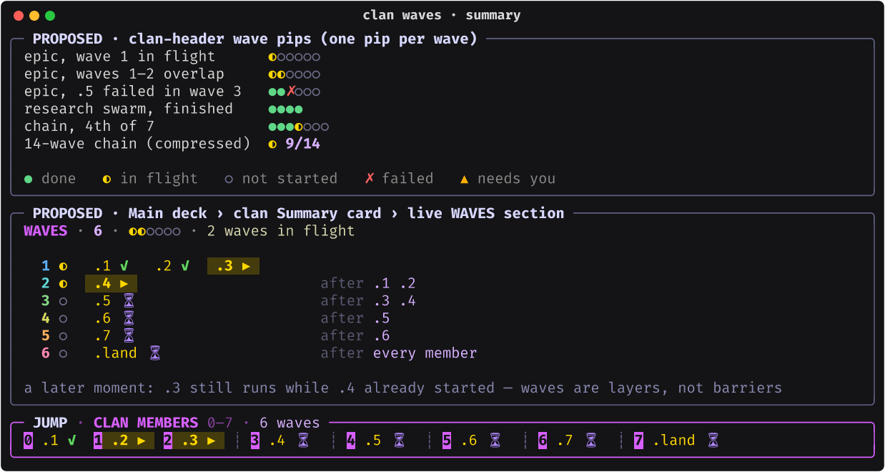
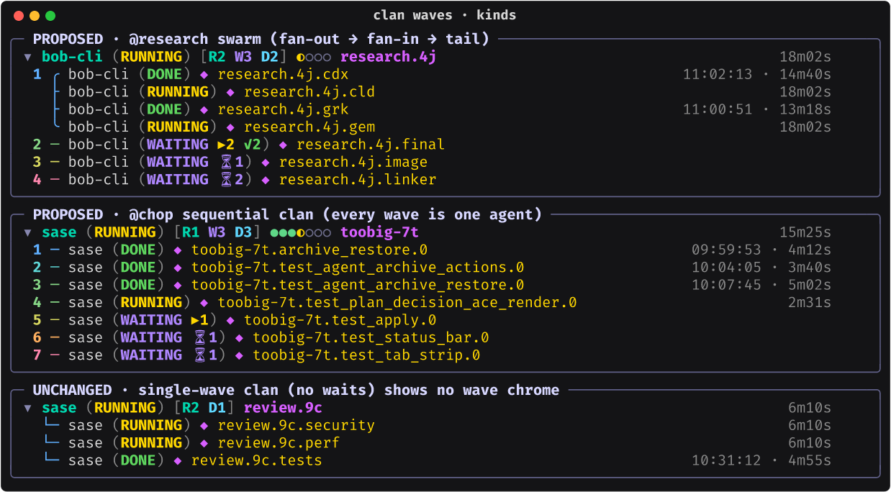

# Waves for Every Agent Clan: Derive Them From `%wait`, Draw Them in the Tree Gutter (Researcher cld)

- **Date:** 2026-10-15
- **Repo:** `sase-org/sase` @ `bc4bc3e183`. I read the Rust boundary only through its
  Python call sites.
- **Inputs:**
  - the screenshot `~/tmp/screenshots/20261015_124557.png`, showing the `@epic` panel
    with clan `bob-cli-7v`
  - a fresh read of the Agents-tab clan projection, row rendering, wait chips, the clan
    Summary card, and the jump panel
  - the real `agent_meta.json` / `waiting.json` / clan records on athena for an epic
    clan, a research-swarm clan, and a `toobig-` chop clan
- **Question:** How should the Agents tab show the waves inside agent clans, for every
  clan (epic, research, and custom), so that the display is intuitive, reliable, and
  beautiful? Is this a good idea at all?
- **Mockups:** rendered with Rich and sase's own TUI PNG renderer
  (`render_svg_to_png`, using the bundled Fira Code / DejaVu / Noto Emoji fonts), in the
  live TUI palette. The statuses and timings in the mockups are partly illustrative.
  Images sit next to this file:
  - `agent_clan_waves_wait_layers__cld_list.png`
  - `agent_clan_waves_wait_layers__cld_kinds.png`
  - `agent_clan_waves_wait_layers__cld_summary.png`

---

## 0. Bottom line

**Yes, build it, but don't invent waves; read them off the wait graph.** A clan's waves
are the dependency layers of the `%wait` edges between its own members. Every clan that
has stages already declares them that way:

- Epic phases `%w` their blockers, and `.land` waits on every phase.
- A research swarm's `final` waits on the researchers, then `image` waits on `final`,
  then `linker` waits on both.
- A `toobig-` chop clan is a `%wait` chain.

The docs even say clan membership is "execution-neutral … use `%wait` explicitly
wherever ordering is required". `%wait` is therefore the only ordering truth a clan has.
Layering it (Kahn layering, which is the same as longest-path depth) gives:

- the authored waves of an epic, exactly;
- sensible stages for swarms and custom clans;
- nothing at all for purely parallel clans.

All of it works retroactively for every clan already recorded on disk (346 on athena).
No new directive and no new metadata are needed.

**Show it in four places, adding zero extra rows to the agent list:**

1. **A wave gutter on member rows.** It replaces today's `  └─ ` connector with a
   5-cell gutter of the same width. Each wave's first row carries a right-aligned wave
   number. A bracket groups the wave's members: `╭ ├ ╰` for parallel members, `─` for a
   wave of one. The gutter is colored by a static cool→warm ramp that runs from launch
   to landing.
2. **Wave pips on the clan header row**, after the count chip. There is one pip per
   wave, showing its live state: `●` done, `◐` in flight, `○` not started, `✗` failed,
   `▲` needs you. The epic in the screenshot would read `[R2 W5 D1] ◐○○○○○`.
3. **A live WAVES section in the clan Summary card.** It is a ladder with one line per
   wave: member pills, followed by `after .3 .4` dependency notes.
4. **Wave order and `┊` dividers in the JUMP · CLAN MEMBERS legend**, so that list
   order, jump numbering, and the ladder finally agree.

A clan with a single wave shows none of this and looks exactly as it does today.

The layering itself belongs in **sase-core**: the edge-normalization rules are domain
logic that the TUI, CLI, Telegram, and any future web view must agree on. Python only
assigns presentation fields during `project_clan_tree`.

There is also a free reliability win. Within a multi-wave clan, members are ordered by
(wave, launch time) instead of by status. A member's status change therefore no longer
reorders its siblings. That removes today's forced `clan_member_order_change` panel
rebuild for epics and swarms, and it stops rows jumping around as agents finish.

---

## 1. What exists today

### 1.1 The tree orders clan members by status, so dependency order comes out upside-down

Two steps decide the order:

- `sort_and_reorder` (`src/sase/ace/tui/models/_agent_ordering.py`) sorts rows newest
  first.
- `project_clan_tree` then stable-sorts each clan's direct-member units by
  `clan_member_status_priority` (`models/_agent_clan.py:34-42, 209-224`): Failed 0,
  Stopped 1, Running/Starting 2, Queued 3, Waiting 4, Done 5. This happens in
  `models/_agent_tree_clan.py:291-327`.

Look at the waiting block in the screenshot: `.land, .7, .6, .5, .4`. **The next member
to run (`.4`) sits at the bottom, and the last (`.land`) sits at the top.** The pipeline
reads backwards, and `.1` (DONE) has dropped below all of them.

Every member gets the same `  └─ ` connector (`_CHILD_INDENT`,
`widgets/_agent_list_styling.py:210`). There is no `├─` / last-sibling logic.

### 1.2 Counts say "how many", not "how deep"

The header chip `[R2 W5 D1]` comes from `agent_count_chip.py`. **`W` means _Waiting_**
(`#AF87FF`).

"5 waiting" cannot tell five parallel agents apart from a five-deep chain. In the epic
it is the latter: `.4 → .5 → .6 → .7 → .land`.

WAITING rows show dependency status counts such as `▶2 ◐6 ⏳4 ✓1 ●1`. These come from
`wait_status_presentation.py`: agent buckets interleaved with bead statuses. They tell
you how much a member is waiting on, not where it sits in the flow.

### 1.3 Epic waves exist only as a frozen number

Waves are computed in two places:

- **At launch, in Rust:** `bead_build_epic_work_plan`, which is where
  `_PhaseAssignment.wave` comes from (`bead/work_plan.py`).
- **In Python:** `sdd/plan_waves.py::plan_phase_waves`.

Neither result is persisted per agent. `render_multi_prompt` (`bead/work_prompt.py`)
launches every phase at once as a `---` prompt, giving each phase
`%w(<blockers>, for_epic=false)` plus `%w(bead=…)`. Waves only decide segment order.

The only place the TUI shows waves is the line `Counts: 7 phases · 5 waves`. It is part
of the **static Rich markup that `sase_clan_summary_epic` captured at launch** and stored
in the clan record (`~/.sase/agent_clans/bob-cli-7v.json`). It never changes, it never
says which wave is active, and it never says which agent belongs to which wave. Waves
also show up in plan-approval toasts.

So the claim "we don't [show waves]" is accurate even for epics.

### 1.4 Three surfaces, three orders

| Surface | Order today |
|---|---|
| Agent list (clan subtree) | status priority, then newest launch first |
| JUMP · CLAN MEMBERS legend (`ordered_clan_members`) | launch order, oldest first |
| Epic Summary card phase list | authored plan order |

Waves give one canonical order, (wave, launch), that all three surfaces can share.

---

## 2. Key finding: the waves already exist, in `%wait`

### 2.1 Real clans on athena

| Clan | Kind | Declared in-clan waits (`agent_meta.json` `wait_for`) | Derived waves |
|---|---|---|---|
| `bob-cli-7v` | epic | `.1 .2 .3` none · `.4←.1 .2` · `.5←.3 .4` · `.6←.5` · `.7←.6` · `.land←.1…​.7` | **6**: `{.1 .2 .3}` `{.4}` `{.5}` `{.6}` `{.7}` `{.land}` |
| `research.4i` | research swarm | `cdx cld grk gem` none · `final←all four` · `image←final` · `linker←final image` | **4**: `{cdx cld grk gem}` `{final}` `{image}` `{linker}` |
| `toobig-7t` | chop "sequential clan" | each member ← the previous one | **N**: one member per wave |
| a plain `---` clan with no waits | custom | none | **1**: no wave UI |

Two details from the raw data matter for the algorithm:

- **Session turns carry waits.** One example is `toobig-7u.new_project_modal.0--plan`
  waiting on `toobig-7u.new_project_create.0`, and there are intra-session edges such as
  `bob-cli-7v.2--1 ← bob-cli-7v.2--plan`. Turn names must be folded to their member,
  and self-edges dropped.
- **`waiting.json` repeats the full declared list**, not the remaining one. In the
  screenshot, `.land` still lists `.1` after `.1` finished. It is deleted when the wait
  completes. Derived waves are therefore stable for the clan's whole life. The
  derivation must still read the declared set, never some "remaining waits" view.

### 2.2 Why derive instead of persist

- **One truth.** Waits are what actually gates execution. A separate `wave` field could
  drift from them: TUI wait edits rewrite `wait_for`, and late joiners and retries
  arrive later.
- **Retroactive.** It works for every recorded clan, including all past swarms and
  epics, with no migration.
- **Generic.** It covers clan kinds that don't exist yet, as long as they order work
  with `%wait`.
- **Cheap.** `Agent.waiting_for` / `waiting_for_hoods` / `waiting_for_beads` are already
  loaded on every row, Done rows included (`_meta_enrichment_wire.py:127-134`). The
  derivation is pure in-memory work with no disk access in the render path.
- **Consistent with epics.** For a fresh epic launch, the derived phase layers equal the
  Rust launch-plan waves, which a test can assert. The land agent adds one final layer
  (§5.4).

---

## 3. Critique: is this a good idea?

Mostly yes. The problem is real, and the screenshot shows it plainly: the waiting block
reads in reverse, and the header cannot tell parallel from serial. Three parts of the
request, though, should be sharpened rather than taken literally.

> **Adjustment A: "support waves for all clans" should not mean a new concept.**
> Don't add a `%wave` / `stage=` directive or a stored wave index. Define _clan wave_ as
> a pure projection of the clan's own `%wait` graph. Users who want stages in a custom
> clan already have the tool, `%wait`, and the display then always tells the truth about
> execution.

> **Adjustment B: "every clan" should mean every clan with two or more waves.** Most
> custom `---` clans are flat fan-outs. Wave chrome on a one-wave clan is pure noise, so
> a single-wave clan must look exactly as it does today, ordering included (§4.3).

> **Adjustment C: waves are layers, not barriers.** The word "wave" suggests that wave 2
> starts when wave 1 ends. That is not how sase runs. `.4` starts as soon as `.1` and
> `.2` finish, even while `.3` (wave 1) is still running. The design must never imply a
> barrier: each wave shows its own state, and two waves can be in flight at once
> (`◐◐○○○○`). That is also why I avoid a single "current wave N/M" headline except as
> a compressed fallback.

> **Adjustment D: no banner rows inside clans.** It is tempting to draw a `── wave 2 ──`
> banner row per wave. The cost is vertical space: the epic grows from 9 rows to 15 in a
> tribe panel that showed about 9 rows in the screenshot. It would also break a
> deliberate invariant: "banners are never emitted inside a clan"
> (`models/agent_groups/__init__.py`). And it ripples into rail anchors, insert/remove
> fallbacks, and j/k navigation. A same-width gutter carries the same information in
> zero rows.

> **Adjustment E: the vocabulary must not collide.** `W` already means _Waiting_ in
> `[R2 W5 D1]`, so waves never get a `W` label. Wave state uses the
> `○ ◐ ●` = not started / in progress / done idiom that bead status already uses. That
> reuse is deliberate: for an epic, a wave's state is literally the state of its phase
> beads.

**Would I take a different approach?** Only in emphasis. The real gap is not "waves are
missing" but "the clan is shown as a status bucket list when it is actually a small
DAG". Waves are the right first step: a cheap, legible, linear projection of that DAG
that fits a terminal row. I would stop at waves for v1 and consider two richer views
later (§6): dependency-cone highlighting and a Gantt card. A full ASCII DAG drawing
looks good at 5 members and becomes unreadable at 20, and chop chains already run that
long.

**Collateral fix.** The glossary defines an agent clan as a "rootless container for
agents that run in parallel". That is stale. Clans routinely contain chains. The
definition should become something like "…for related agents, which run in parallel
unless `%wait` orders them into waves", and _Clan Wave_ should get its own term. These
are memory changes, so route them through `/sase_memory_write`; this report does not
make them.

---

## 4. The design

### 4.1 Definition: clan wave

> A **clan wave** is a dependency layer of one clan generation's direct members. A
> member's wave is 1 if none of its declared waits resolves to another member of the
> same clan generation. Otherwise it is 1 + the highest wave among the members it waits
> on.

Edge rules: edge `p → m` means "m waits on p".

| Wait source on any row in member `m`'s subtree | Resolves to |
|---|---|
| `wait_for` exact member name | that member |
| `wait_for` naming a session turn `x--suffix` | the member that owns session `x` |
| `wait_for` naming a retry `x.rN` (or a retried original) | the member slot of `x` (a retry shares its original's wave) |
| `wait_for_hoods: h` | members in hood `h` launched before `m` (launch-snapshot semantics, as `docs/macros.md` defines for `hood=`) |
| `wait_for_beads: b` | the member whose `phase_bead_id == b`. This is redundant with the agent edges for fresh epics, but it rescues re-worked epics. |
| `wait_for` = the clan's own name | every other member launched before `m` |
| anything resolving outside the clan (another clan, `@tribe`, a foreign bead, `time=`) | **no edge**. The member records an _external wait_ count instead. |

Further rules:

- Self-edges are dropped (intra-session turns).
- Layering is Kahn layering in launch order.
- Members left over by a cycle get no number. They go into a trailing `?` group, so the
  function is total and never hides a member. Cycles should not occur in practice,
  because a waiting cycle would deadlock its own members, but the display must not
  depend on that.
- **Late joiners** with no waits land in wave 1, at the end of it (launch-order
  tiebreak). That is honest: they really are independent.
- Re-derivation is cheap. Waves can only change when membership or waits change, and
  both already force a panel rebuild today.

### 4.2 Wave state, one per wave and live

Precedence, worst first. It mirrors the clan container's "needs-you outranks" rule.

| State | Condition | Pip | Color |
|---|---|---|---|
| failed | any member Failed (not superseded by a retry) | `✗` | bold `#FF5F5F` |
| needs you | any member Stopped / asking / awaiting plan review | `▲` | bold `#FFAF00` |
| in flight | any member Running/Starting/Queued/Finalizing, or a mix of done and not-done members | `◐` | bold `#FFD700` (`RUNNING_COLOR`) |
| done | every member Done | `●` | `#5FD787` (bead-closed green) |
| not started | every member Waiting | `○` | `#6C6C8A` (recessive) |

### 4.3 Member order

- **Multi-wave clan:** members are ordered by (wave, launch time, name). Each member's
  descendants stay attached as one unit, exactly as `_sort_clan_member_units` does
  today.
- **Single-wave clan:** keep today's status-priority order. Behavior and goldens are
  unchanged for flat clans.

This split is a deliberate trade-off.

- **What is lost:** status ranking floated failures and running members to the top.
- **Why that is acceptable:**
  - attention is still loud through red/amber status text, the header count chip
    (`F1` / `S1`), the header pip (`✗` / `▲`), and the container mirroring a lone
    running member's status;
  - the in-flight-first selection the jump panel already uses keeps lit members visible
    when space is tight.
- **What is gained:** an order that matches execution and **does not reshuffle as
  statuses change**. On a busy epic that is the difference between a calm, readable
  pipeline and rows that jump on every transition.

If you disagree with the split, the alternative is one rule everywhere ((wave, launch)
even for flat clans). That is simpler to explain, but it changes every flat clan today.

### 4.4 Surface 1: the wave gutter (agent list)



```
 ▾ bob-cli (RUNNING) [R2 W5 D1] ◐○○○○○ bob-cli-7v           12m54s / 13m36s
  1 ╭ bob-cli (DONE) ×5 ◆ bob-cli-7v.1                     12:40:51 · 8m10s
    ├ bob-cli (TESTING) ×6 ◆ bob-cli-7v.2                      22s / 13m36s
    ╰ bob-cli (RUNNING) ×4 ◆ bob-cli-7v.3                            12m54s
  2 ─ bob-cli (WAITING ▶1 ◐1 ✓1 ●1) ◆ bob-cli-7v.4
  3 ─ bob-cli (WAITING ▶1 ◐2 ⏳1) ◆ bob-cli-7v.5
  4 ─ bob-cli (WAITING ⏳1 ○1) ◆ bob-cli-7v.6
  5 ─ bob-cli (WAITING ⏳1 ○1) ◆ bob-cli-7v.7
  6 ─ bob-cli (WAITING ▶2 ◐6 ⏳4 ✓1 ●1) ◆ bob-cli-7v.land
```

**Cell layout.** The gutter is `f"{label:>2} {bracket} "`, five cells, the same
footprint as today's `  └─ `, so no member content shifts horizontally.

- `label` is the wave number on the wave's first row and blank on the others. Two
  digits allow up to 99 waves. Unresolved members get `?`.
- `bracket` is:
  - `╭` / `├` / `╰` for the first / middle / last member of a multi-member wave, which
    reads as a curly brace around parallel siblings;
  - `─` for a single-member wave.

**Descendants.** Unfolded session turns and workflow steps keep today's `└─`
connectors. The wave's lane `│` runs through them while more same-wave members follow,
for a total of 8 cells, the same as today's depth-2 prefix. See the third panel in the
image.

**Color.** The gutter color encodes _structure, not status_. It is a static cool→warm
ramp sampled by wave position:

- the ramp is `#5FAFFF → #5FD7D7 → #87D787 → #D7D75F → #FFAF5F → #FF87AF`;
- the first wave is always sky blue and the last always rose, so any clan reads as a
  gradient "from launch to landing";
- digits are bold, and selected rows bold the brackets the same way the tree connectors
  do today.

**Why static color matters.** A status change in wave 1 never repaints the other wave-1
rows (§5.2).

**Accessibility.** Digits and bracket shapes carry all of the information. The ramp is
decoration. All gutter glyphs exist in Fira Code itself (checked with fontTools:
`╭ ├ ╰ │ ─` and digits), so terminals don't need a fallback font.

### 4.5 Surface 2: wave pips on the clan header

The pips follow the count chip and come before the lane chips and clan name:
`bob-cli (RUNNING) [R2 W5 D1] ◐○○○○○ ⚙1 bob-cli-7v`.



| Clan moment | Pips |
|---|---|
| epic, wave 1 in flight | `◐○○○○○` |
| epic, `.3` still running while `.4` started | `◐◐○○○○` |
| epic, `.5` failed | `●●✗○○○` |
| research swarm, finished | `●●●●` |
| chain, 4th of 7 | `●●●◐○○○` |
| more than 10 waves | `◐ 9/14`: the worst state's glyph plus the lowest unfinished wave and the total |

- Single-wave clans get no pips.
- Pips are the first element dropped when the row is too narrow, and they are off in
  rail mode.
- `● ○ ◐ ▲` all exist in Fira Code. `✗` does not, but it is already the TUI's Failed
  glyph everywhere, so the pips add no new font dependency.
- I rejected `▰▱`, even though `_ranking_signal_rows.py` already uses it as a meter: it
  is missing from Fira Code, and it can't show "in flight" by shape alone.
- The same pip renderer goes on each clan unit in the tribe Summary card's TRIBE MEMBERS
  roster and CLAN SUMMARIES. Selecting `@epic` then shows every epic's progress at a
  glance.

### 4.6 Surface 3: a live WAVES section in the clan Summary card

This goes in `build_clan_detail_text`, immediately after the CLAN identity block and
before the static `clan_summary` markup. It is a foldable section (`clan-waves`) using
the existing clan fold scale.

```
WAVES · 6 · ◐◐○○○○ · 2 waves in flight

  1 ◐  .1 ✓   .2 ✓  [.3 ▶]
  2 ◐ [.4 ▶]                   after .1 .2
  3 ○  .5 ⏳                    after .3 .4
  4 ○  .6 ⏳                    after .5
  5 ○  .7 ⏳                    after .6
  6 ○  .land ⏳                 after every member
```

- Member pills reuse the jump legend's styling: in-flight members are lit gold-on-olive
  (`IN_FLIGHT_RUNNING_TINT`), so the ladder and the legend look like one system.
- The `after` column is left-aligned. It shows the union of in-clan predecessors from
  earlier waves, compressed as follows:
  - `after wave k` when the predecessors are exactly wave k;
  - `after every member` when they are all earlier members;
  - an external-wait suffix such as `· +2 outside` when the wave also waits outside the
    clan. Research swarms launched with `wait=` hit this case. The suffix is plain text,
    so it needs no extra glyph.
- Long waves wrap under their first pill.
- The status line reads `2 waves in flight`, `done`, or `wave 3 failed`, in the pip
  state's color.
- Everything comes from rows already in memory: no plan reads, no disk access. It
  therefore respects the "clan panel first paint stays off disk" rule
  (`_agent_clan_sections.py`).

### 4.7 Surface 4: the jump legend

- Targets are numbered in (wave, launch) order. That already matches today's launch
  order for epics and swarms, so muscle memory survives.
- A dim `┊` divider separates waves in the collapsed legend grid.
- The title gains `· 6 waves`.
- The expanded roster sets the existing `MemberRosterEntry.group_label` (already
  rendered as a dim italic sub-heading, `_member_roster.py:240-242`) to
  `wave 2 · after .1 .2`. That is almost free.

### 4.8 Every clan kind gets something sensible



| Clan shape | What you see |
|---|---|
| research swarm | a brace around the researchers (wave 1), then `final`, `image`, `linker`; pips `◐○○○` |
| sequential chop clan | a numbered `─` ladder, one agent per wave, which works as a step counter; pips `●●●◐○○○` |
| epic | a brace around the no-dependency phases, a numbered spine down to `.land` |
| flat fan-out (`---`, no waits) | unchanged |

**Unaffected surfaces:**

- `BY_STATUS` grouping still files the whole clan under the container's status.
- Rail mode keeps today's connectors in v1: 19 cells is too tight for digits plus
  names.
- Nested sub-epic clans are separate clans with their own waves.

---

## 5. Architecture, reliability, and performance

### 5.1 Layering lives in sase-core

The litmus test from the Rust-boundary memory is: "if a web app, CLI, editor
integration, or another frontend would need the behavior to match the TUI, treat it as
core backend logic". Wave membership passes it: a Telegram clan summary, `sase agent
show`, or a future web view must report the same wave for `.5`.

The edge rules in §4.1 are domain logic, not presentation:

- session-turn folding;
- retry slots;
- hood snapshots;
- bead-to-phase mapping.

There is a close precedent: `agent_hold_deadlock_reaches` already ships a Rust wait
graph whose node wire carries `agent_name`, `clan`, `waiting_for`, and `wait_for_hoods`
(`axe/run_agent_wait_slot_candidate.py:230-260`).

Sketch:

```text
sase_core::agent::clan_waves
  project_clan_waves(members: &[ClanWaveMemberWire]) -> ClanWavesWire

ClanWaveMemberWire { identity, name, session, retry_of, start_rank,
                     phase_bead_id, waits: [String], hood_waits: [String],
                     bead_waits: [String] }        // union over the member's turns
ClanWavesWire      { waves: [[identity]], wave_of: {identity: u16},
                     preds: {identity: [identity]}, external_waits: {identity: u16},
                     unresolved: [identity] }
```

Also extract a generic `layer_dependency_waves(ids, deps)`, and make three things use
it:

- the epic launch planner;
- this new function;
- eventually `sdd/plan_waves.py`.

That lets one test pin "launch waves == displayed waves". Moving `sase-core-revision.txt`
past the binding commit is part of the work, as `docs/rust_backend.md` requires.

### 5.2 The Python model layer

**Where it runs.** In `project_clan_tree`, once per clan generation: build the wires
from the rows, call the binding, and write presentation-only fields.

- On members: `clan_wave`, `clan_wave_pos` (`solo`/`first`/`mid`/`last`), and
  `clan_wave_count`.
- On the container: `clan_wave_states: tuple[str, ...]`.

**Memoization.** Memoize the binding result by a _wave signature_: member identities,
normalized wait targets, and start ranks. Projection runs on every refilter, but
signatures almost never change, so the steady-state cost is hashing.

**Wave states** are recomputed each projection in Python from member status buckets. It
is a tiny fold, and they change exactly when the count chip changes.

**Render keys.**

- `agent_render_key` (`_agent_list_render_cache.py`) gains the member gutter tuple and
  the container's `clan_wave_states`.
- `panel_row_signature` / `_panel_content_is_unchanged` must see gutter changes.

**The patch-path payoff.** Today `_clan_row_patch_preserves_order`
(`actions/agents/_display_panel_patches.py:72-76`) refuses a single-row patch whenever
a clan member changes status bucket, and falls back to a rebuild with
`fallback_reason="clan_member_order_change"`. For multi-wave clans, replace that guard
with "order key `(wave, start_rank, name)` unchanged". The result:

- a status transition patches the member row plus the container header (counts and
  pips) instead of rebuilding the panel;
- because the gutter color is structural, no sibling row repaints.

Single-wave clans keep the old guard. Verify the gain with `SASE_TUI_TRACE=1`
fallback-reason counts and the existing clan-container benches (`docs/perf_runbook.md`).

### 5.3 Reliability rules

- **Declared waits only.** Read declared waits (`agent_meta` `wait_for`, of which
  `waiting.json` is a full copy), never a shrinking "remaining" view.
- **Total and deterministic.** Ties break by launch rank then name. Cycles and unknown
  targets degrade to a `?` group with a warning-colored label. Members are never hidden.
- **Generation-scoped.** A re-created clan generation gets its own waves.
- **No I/O in the render path.** Everything comes from rows already loaded. Epic
  phase-name enrichment (e.g. `.1 dedupe` in the ladder) is optional and must go through
  the existing associated-plan worker cache, never a render-time read.

### 5.4 Epic count reconciliation

Live epic clans have one more layer than the plan, because `.land` waits on every
phase. The ladder will show **6** while the frozen summary says **5 waves**.

Recommendation: count `.land` as a wave everywhere live (honest and generic), and change
the epic summary script's Counts line to `7 phases · 5 waves + land` for new launches.
Only `sase_clan_summary_epic` passes `include_counts=True`, so the change is contained.
The alternative is to special-case `.land` as an unnumbered `⚑` row. I'd avoid it: it
puts epic knowledge into a generic gutter.

### 5.5 Tests

- **Rust unit tests:** the four real shapes in §2.1, plus:
  - session-turn waits;
  - retries;
  - hood snapshots;
  - bead-only edges from a re-worked epic;
  - own-clan waits;
  - external waits;
  - a late joiner;
  - a forced cycle.
- **Python projection tests:** wave order versus status order, the patch-guard
  behavior, and render-key invalidation.
- **Visual goldens:**
  - epic mid-flight;
  - overlapping waves;
  - a failed wave;
  - a research swarm;
  - a chain;
  - a single-wave clan, unchanged;
  - more than 10 waves (compressed pips);
  - an unfolded session under a wave;
  - the WAVES ladder;
  - the jump legend.

  Pin the time, zone, and hostname as `tui_screenshot.md` requires.
- **Docs:** update the `?` help (a pip legend line), `docs/ace.md`, and
  `docs/agent_sessions.md`. No new keymaps are needed in v1.

---

## 6. Alternatives considered

| Option | Verdict | Why |
|---|---|---|
| **Wave gutter + header pips + Summary ladder + jump dividers** | **Recommended** | Zero extra rows. Works for every clan kind retroactively. Removes order churn. Stays quiet for flat clans. |
| Wave banner rows inside clans (`── wave 2 ──`) | Reject | +N rows per clan; breaks "no banners inside a clan"; touches rail, nav, and insert/remove paths |
| Persist a wave index at launch (`clan_wave` meta) | Reject | Only new launches and only launchers that know waves; drifts from wait edits and late joiners; duplicates truth |
| A new `%wave` / `stage=` directive for custom clans | Reject | A second ordering language beside `%wait`; a displayed wave could disagree with execution |
| Topological reorder only, no chrome | Fallback | Fixes the inverted order cheaply but never says "wave". A fine phase-1 slice if scope must shrink. |
| A global "by wave" grouping mode on `o` | Reject | Waves are per clan, not a fleet-wide key |
| ASCII DAG drawing (git-log-graph style) card | Defer | Beautiful at about 6 members, illegible for 20-member chains and wide fan-ins |
| Gantt / timeline card (bars per member, grouped by wave) | **Defer to v2** | The best post-mortem view (critical path, idle gaps between waves). The data (`start_time`, `stop_time`) is already loaded. |
| Dependency-cone highlight for a selected member (upstream / downstream markers in the gutter, plus `WAITS ON` / `BLOCKS` jump sections) | **Defer to v2** | A natural extension of agent relation jump targets. Valuable once waves exist. |

---

## 7. Risks and open questions

1. **Losing status-first order inside multi-wave clans.** Covered by the header chip,
   the pips, status colors, and the container mirror (§4.3). Confirm this matches how
   you scan epics. If not, use (wave, status, launch) inside each wave, at the cost of
   some reordering churn.
2. **Re-worked epics.** `sase bead work` re-runs drop closed phases from the new
   launch's waits. The bead-edge rule (§4.1) should keep layering sensible. Validate
   against a real re-worked epic fixture before landing.
3. **Unknown / foreign wait targets.** They become external waits, not edges. A member
   that waits only on an external agent sits in wave 1 with an external marker in the
   ladder. That is correct, but it should be documented.
4. **The `.land` off-by-one** (§5.4). Decide whether the epic summary wording changes.
5. **Feature flag?** The reorder and the gutter should land together in one phase, so
   no half-feature reaches users. If an epic splits them, per `sase_flags.md` use a
   `beta` flag only as epic scaffolding and remove it before the epic lands. Don't
   create a permanent config knob unless you actually want to choose the member order
   forever.

---

## 8. Recommended solution

Adopt **"clan waves = layers of the clan's own `%wait` graph"** and ship it in four
small phases.

1. **Core (sase-core).**
   - Add `layer_dependency_waves` and `project_clan_waves` with the §4.1 edge rules,
     the binding, and Rust tests built from the real clan shapes.
   - Point the epic launch planner at the shared layering.
   - Bump `sase-core-revision.txt`.
2. **Model plus list (sase).**
   - Wire the adapter into `project_clan_tree`.
   - Order multi-wave clans by (wave, launch). Single-wave clans stay unchanged.
   - Render the 5-cell **wave gutter** (wave number, `╭ ├ ╰ ─` brackets, static
     launch→landing color ramp) and the **header pips** (`● ◐ ○ ✗ ▲`).
   - Replace the clan patch-order guard for multi-wave clans.
   - Extend the render keys.
   - Add goldens, the `?` help line, and docs.
3. **Detail.**
   - Add the live **WAVES ladder** to the clan Summary card.
   - Add the **jump legend** wave dividers and roster `group_label`s.
   - Add pips to tribe-roster clan units.
   - Reword the epic summary Counts line to `5 waves + land`.
4. **Later (optional).** Selected-member dependency-cone highlighting with
   `WAITS ON` / `BLOCKS` jump sections, a Gantt card, phase names in the epic ladder,
   and a wave line in `sase agent show`.

In parallel, file a memory task to update the _Agent Clan_ glossary entry ("run in
parallel unless `%wait` orders them into waves") and add a _Clan Wave_ term.

The result:

- **Intuitive:** the clan reads top to bottom in execution order, with numbered stages,
  and nothing new to learn for flat clans.
- **Reliable:** derived from the only ordering truth, deterministic, total, and calmer
  under status churn.
- **Beautiful:** a curly-brace gutter flowing blue to rose from launch to landing,
  topped by a row of progress pips, with the same vocabulary repeated in the Summary
  ladder and the jump legend.
