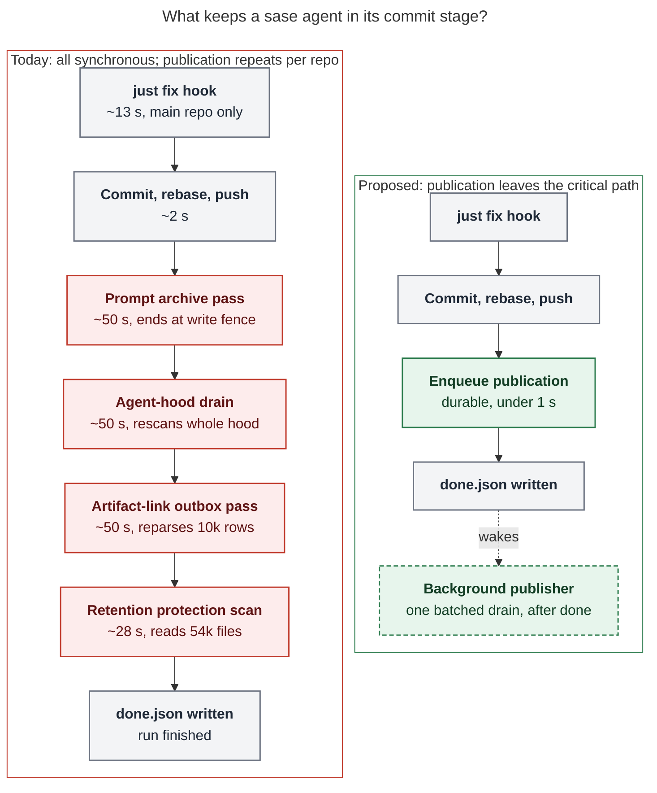

# Why sase agents spend minutes in their commit stage

> **Research query:** I suspect that it takes a very long time for sase agents to complete
> their commit stages, but I'm not sure why that is. Can you do some research with the
> goal of helping me figure this out? End your analysis with a recommended solution.

**Researcher:** cld (one of five independent researchers in this swarm).
**Host:** athena. **Code:** `sase` master at `dd59c28f44` (2026-10-29).
**Data window:** every `gh_sase-org__sase` agent run with finalizer evidence from
2026-09-27 to 2026-10-29, plus three live `sase stitch create` processes sampled on
2026-10-29.

## Bottom line

1. **Your suspicion is correct, and the cause is not the commit.** From the moment the
   model stops (`provider_done`) to the moment the run is done (`stopped_at`), the median
   agent spends **about 4.5–5 minutes** (p50 269–300 s, p90 9–17 min). The actual
   `git commit` + rebase + push takes **about 2 seconds**.
2. **About 86% of a normal commit phase is post-commit "agent publication".** That is
   bookkeeping that `sase stitch create` runs synchronously *after* the push succeeds:
   - a prompt-archive pass;
   - an agent-hood drain into the `sase--agents` sidecar;
   - an artifact-link outbox drain.
   It costs a median **184 s per committed repository**, and it runs again for every repo
   the agent commits to. Two-repo commits take a median 463 s; three or more take 835 s.
3. **Much of that publication work is wasted or scales with history, not with the
   change.**
   - The prompt-archive pass computes a full artifact-link snapshot, then fails at a
     write fence ("legacy index writes are fenced") on almost every run.
   - The hood drain rebuilds an inventory from **all 18,016** of the project's run
     records and re-runs the secret scanner over **every run in the hood**. The
     `research` hood holds 1,182 runs.
   - The artifact-link pass re-parses a **10,393-entry** outbox (backlogged since
     September) several times per commit.
4. **A further ~28 s per run is a retention scan.** After the finalizer finishes, the
   runner regex-scans about 54,000 files to protect artifacts from retention. It does
   this on every completion, even when it trashes nothing.
5. **The worst tail is different: rebase conflicts.** 9% of committing runs hit a
   conflict and spawn a repair model turn (median **40 min**). Those 133 runs account for
   more total commit-stage wall time (119 h) than the other 1,354 runs combined (96 h).
   Most conflicts are in pinned or generated files: `sase-core-revision.txt`,
   `Justfile`, PNG snapshots, and generated docs.

**Recommendation (details at the end):** take publication off the commit critical path.
`sase stitch create` should only *enqueue* the durable publication request, which takes
under a second. One background publisher per project then drains everything in a batch
**after** `done.json` is written. Land four cheap fixes first. Separately, add mechanical
resolution for pinned or generated conflict files. Expected effect: median commit stage
falls from about 4.5–5 min to about 1 min. This also fixes the open bug where published
agent pages freeze mid-run (`sase-1cc`).

## What "the commit stage" is, concretely

After the provider turn returns, `invoke_with_instructions` marks the lifecycle phase
`finalizing` and calls `run_finalizers` (`src/sase/llm_provider/_invoke.py:457`). The
`builtin@commit` finalizer then:

1. accepts the agent's `/sase_final` declaration (median 3 s);
2. runs one `sase stitch create` subprocess **per dirty repository**, sequentially. Each
   one runs:
   - the `commit_hooks.before` hook (`just fix`, main repo only);
   - `create_commit` (commit, rebase onto origin, push);
   - the `publication` step (`src/sase/workflows/commit/workflow_publication.py`).

After the finalizer returns, the runner's exec-finalize tail runs. It saves the chat,
prepares PDFs, runs default artifact capture, enforces artifact retention, and writes
`done.json` (`src/sase/axe/run_agent_exec_finalize.py:240-355`). The agent is not "done"
in the TUI until that tail finishes.

Every one of these boundaries leaves timestamps on disk:

- `agent_meta.json` `lifecycle_phases`;
- `finalizers/progress.jsonl`;
- `finalizers/commit/attempt-*.steps.jsonl`;
- `~/.sase/logs/agent_publication_drains.jsonl`.

All of the numbers below are aggregated from those files.

## Where the time goes

_Figure: the red steps are publication and retention bookkeeping. The commit needs none
of them to be correct, yet they make up most of the stage. The proposal keeps only the
durable enqueue before `done.json` and moves retention to scheduled housekeeping. The
step durations are medians: the three publication passes from the warning timestamps
inside the `publication` step, the retention scan from a direct timing._

### End-to-end span (runs that committed, `provider_done` → `stopped_at`)

| Segment                                       | Oct 1–29 p50 | Oct 20–29 p50 | Oct 1–29 p90 |
| --------------------------------------------- | -----------: | ------------: | -----------: |
| provider done → finalizer phase start         |        0.1 s |         0.1 s |        0.6 s |
| finalizer phase                               |        237 s |         211 s |        897 s |
| phase end → exec-finalize start               |        0.6 s |         0.6 s |        1.1 s |
| exec-finalize tail (chat, PDFs, retention, …) |         45 s |          47 s |        112 s |
| **total**                                     |    **300 s** |     **269 s** |   **1038 s** |

(n = 716 and 276 runs.) Nothing waits between the model finishing and the finalizer
starting. Everything happens inside the finalizer phase and the tail.

### Inside the finalizer phase

Two populations in October behave very differently:

| Population                        |     n | p50 phase | mean phase | total wall time |
| --------------------------------- | ----: | --------: | ---------: | --------------: |
| Normal commits (subprocess only)  | 1,354 |     215 s |      256 s |          96.2 h |
| Rebase conflict → repair LLM turn |   133 |  2,391 s  |    3,210 s |         118.6 h |

For normal commits, **publication is a median 86% of the phase** (mean 84%, n = 1,347).
Here is the per-repository breakdown of each `sase stitch create` op in October:

| Repo stitched      |   n | `just fix` hook | `create_commit` (incl. push) | `publication` |
| ------------------ | --: | --------------: | ---------------------------: | ------------: |
| main (sase)        | 909 |          13.4 s |                        2.3 s |     **190 s** |
| research (sidecar) | 453 |             0 s |                        1.9 s |     **173 s** |
| sase-core          | 157 |             0 s |                        1.9 s |     **238 s** |
| plans              |  69 |             0 s |                        1.7 s |     **185 s** |

Because publication runs inside *each* stitch, multi-repo commits multiply the cost:

| Stitch ops in the run |     n | p50 phase |
| --------------------- | ----: | --------: |
| 1                     | 1,238 |     206 s |
| 2                     |   103 |     463 s |
| 3+                    |    13 |     835 s |

The longer September 27 – October 29 window shows the same shape every day. Across
1,964 phases the medians are: phase 226 s, publication 184 s, `just fix` 12 s,
`create_commit` 2.2 s, declaration 3 s. No single day had a median publication step below
100 s.

### Inside `publication` (three ~50 s passes)

`_run_agent_publication_inner` prints a warning at the end of each sub-step. Those
warning timestamps split the step into three roughly equal parts (Oct 20–29, n = 181–310
per segment):

| Sub-step (code order)                                                          | p50 between markers |
| ------------------------------------------------------------------------------ | ------------------: |
| bead pages + **prompt archive** (`publish_prompt_archive`)                     |              48.9 s |
| plan-header refresh + **agent-hood drain** (`publish_committed_agent_hood`)    |              52.5 s |
| **artifact-link outbox drain** (`_drain_artifact_link_outbox_for_agent`)       |              52.5 s |

Two py-spy profiles of live `sase stitch create` processes on 2026-10-29 confirm this
split and show what each pass is doing. Treat the percentages as approximate: py-spy
fell behind under host load.

**Research-repo stitch, 157 s wall, 98.3% inside `run_agent_publication_step`:**

- **58.5% — agent-hood drain** (`drain_agent_publications`):
  - **26.9%:** `build_project_hood_inventory` → `indexed_records` →
    `query_agent_artifact_index` with `include_full_history=True`. This reads every
    project run record, then filters down to the hood.
  - **~15–22%:** `build_hood_snapshot` → `_gate_run_files` → `scan_publication_bytes`.
    For every file of every run in the hood, it writes a temp file, fsyncs it, runs the
    Rust secret scanner, re-hashes it, and records a ledger row. There is no
    clean-verdict cache, so unchanged runs are rescanned on every publish.
- **28.1% — prompt archive**. 26.3 of those points sit in
  `_drain_referenced_by_after_prompt_publish`, which calls `refresh_referenced_by` →
  `load_artifact_rows` → `artifact_link_event_snapshot` (a second full index query plus
  an event-store snapshot). The write then fails at `_upsert_sidecar` because
  `legacy_artifact_link_writes_fenced(...)` is true
  (`src/sase/sdd/_artifact_link_store_sidecar.py:40-46`).
- **10.3% — artifact-link outbox drain**: parsing and canonicalizing the outbox JSONL.

**bob-cli stitch, ~90 s, 97.2% in publication:** 59.6% was the artifact-link outbox
drain (including a full `rebuild_aggregate`), and 15% was the same failing
referenced-by refresh. The pattern is not specific to the sase project.

### Why each pass is slow: state that grows without bound

Each of these was measured read-only on athena:

- **Agent-hood inventory is O(project history).** A direct reproduction of
  `build_project_hood_inventory(requested_hoods={"research"})` took **40–41 s**. It
  selected 1,182 runs out of:
  - 18,016 artifact-index records (`indexed_records` alone: 20–23 s cold);
  - 49,545 dismissed-bundle summaries (~9.5 s);
  - a `git log` of all 16,529 primary commits. The `git log` itself takes 0.16 s;
    parsing its trailers takes 2.1 s.

  The drain log agrees: for sase, `inventory_build` has p50 28 s and mean 37 s (n = 272).
  Epic phase `sase-1nf.10.1.4` ("Load expensive inventory data only for requested hoods")
  is closed. It narrowed what gets *hydrated*, but the full-history index query and the
  dismissed scan still run on every drain.
- **Hood publication is O(hood size).** `hood_publish:research` reached 125–142 s in the
  latest drains. The same stage takes 4–10 s for a small `sase-<epic>` hood. Every
  research-swarm agent shares the single `research` hood, so research commits pay the
  most. Open bead `sase-11n` already records that hoods have no retention and that
  "index-render cost grow[s] without bound".
- **The artifact-link outbox is a 10,393-row backlog.** `artifact-link-outbox.jsonl` is
  6.6 MB, with 3,001 rows from September. Reading it takes **4.0 s** and `inspect` takes
  **4.2 s**. `drain_artifact_link_outbox` inspects it, reads it, and rewrites it, so the
  file is parsed at least three times per commit. The commit path also passes
  `drop_stale_terminal=False`, so nothing ever ages out on this path. Each drain
  publishes only the committing agent's rows and still pays to parse everyone's.
- **The referenced-by write-back cannot succeed.** In Oct 20–29, 261 steps logged
  "referenced-by write-back failed: artifact-link legacy index writes are fenced". The
  fence is checked only *after* the expensive snapshot is built.
- **The agent-publication outbox is mostly a graveyard.** 3,501 of 3,504 rows are
  quarantined: 2,847 hit "did not complete within 120s" and 436 hit "agents sync lock
  is busy". Reading it is cheap (0.04 s). The cost is that every commit prints "this
  project already has 3489 quarantined … requests", even when its own publication
  succeeded.

### The 120 s publication bound does not hold

`drain_agent_publications` bounds the drain with `SIGALRM` →
`PublicationDrainTimedOut` (`DEFAULT_PUBLICATION_DRAIN_TIMEOUT_SECONDS = 120`). However,
`PublicationDrainTimedOut` subclasses `TimeoutError`, which is an `OSError`, which is an
`Exception` (`src/sase/_interruptions.py:6`). The scanner path catches exactly those:

- `scan_publication_bytes` has `except OSError: return … scan_error`;
- `_scan_file` has `except Exception: return None, "scan_error"`.

An alarm that lands there is very likely converted into a "scan_error" verdict for one
file, and the drain carries on. The drain log shows it: four sase drains recorded
`alarm_fired: true, alarm_stage: hood_publish:research` with `outcome: published`, and
`hood_publish` lasted up to 142 s. The bound is advisory, and the file that was being
scanned is probably withheld as "unverified".

### The exec-finalize tail (~45 s)

`enforce_artifact_retention()` runs at the end of **every** completed run. It calls
`collect_protected_artifact_ids()`, which:

- walks all of `~/.sase/projects` looking for `.sase` files, including tens of thousands
  of artifact directories (about 160k directories visited);
- walks every project's sidecars;
- reads about 54,000 text files and regex-scans them for artifact IDs.

Timed directly, it took **28.0 s and 28.8 s** on two consecutive runs. In the sampled run
it logged `trashed 0 rows, reclaimed 0 bytes`. The rest of the tail (chat save, PDFs,
continuation capture, done-marker index update) accounts for the remaining ~15–20 s.

### The conflict tail (~40 min median)

When `create_commit` hits a rebase conflict, the finalizer opens one `model_turn` repair
op. Its prompt (`finalizers/commit/conflict_repair_prompt.main.md`) requires the
repository's mandatory verification gate before resuming. That means a full LLM turn
plus `just check`, with a median of 2,487 s for the op. The conflicted files in October
(146 events) were dominated by pinned or generated content:

| File                                                | Conflicts |
| --------------------------------------------------- | --------: |
| `sase-core-revision.txt`                            |        31 |
| `Justfile`                                          |        25 |
| `tests/ace/tui/visual/snapshots/png/*`              |        20 |
| `sase/memory/README.md`                             |         8 |
| `docs/README.md`, `docs/llms.txt`                   |      7, 7 |
| `mkdocs.yml`, `docs/_meta/moves.yml`, `budgets.yml` |   6, 5, 4 |

Many of these have a deterministic resolution: pick the newer pin, or regenerate the
derived file and take that output. They need neither model judgment nor a 40-minute turn.

### Smaller contributors (for completeness)

- **`just fix` before-hook:** 13 s median on main. It formats the whole repo (12,843
  files through ruff, every Markdown file through prettier) rather than the changed
  paths.
- **Declaration:** 3 s median, with a p90 of 51 s when a recovery turn is needed.
- **Lock contention** on `sase-agents-sync.lock` is bounded at about 10 s, after which
  the request defers as `lock_busy` (23 of 295 sase drains). So it causes deferrals, not
  long waits. It does mean swarms that finish together mostly defer to each other.

## Why it is built this way, and why that can change

The synchronous drain is deliberate but not load-bearing. The docstring of
`publish_committed_agent_hood` says: "The durable outbox stays on the synchronous path so
a publication that cannot complete right now is still retried later." The requirement is
that the **enqueue** is durable and synchronous. Nothing requires the **drain** to be.

No decision record pins publication to the commit path:

- `decisions:host-owned-completion` is about the commit and the declaration.
- `decisions:agents-sync-publish-only` is about deleting import machinery.
- `decisions:machine-link-writes-off-primary` already routes machine link writes to a
  host-owned hidden clone. That fits a background publisher well.

Draining synchronously also causes a correctness bug. Open bead `sase-1cc` (ready, L)
measured 8,659 of 15,457 published run states still reading `active`/`waiting` days
after the runs ended. Its likely cause: "targeted publication runs at commit time and
snapshots the committing agent's whole top-level hood … The committer itself is also
still active." Publishing after `done.json` captures terminal state.

Existing work this overlaps with, none of which takes publication off the critical path:

- `sase-1nf.10.1` "Make publication drains bounded and recoverable" (in progress) bounds
  and recovers drains.
- `sase-11n` covers hood retention.
- `sase-zu` "Agent queries stop escalating to full-archive filesystem scans".
- `sase-yy` / `sase-yy.8.6` cover the artifact-link v2 cutover, which is why legacy
  writes are fenced.

## Recommended solution

### 1. Primary fix: move agent publication off the commit critical path

**In `sase stitch create`:** after the push succeeds, record a durable publication
request and return. The request should carry:

- agent;
- revision;
- scope;
- artifacts dir;
- commit cwd;
- prompt-archive inputs.

The outbox rows already carry most of these (`AgentPublicationOutboxItem.scope`,
`primary_revision`, `local_hood`). Keep cheap, commit-coupled bookkeeping such as the
plan-header refresh synchronous only if a timing check shows it is cheap.

**Add one per-project background publisher** that drains the prompt archive, agent hoods,
artifact-link events, and referenced-by write-backs in **one batched pass**:

- **Trigger:** after `done.json` is written, for example by the runner shutdown path
  (`finalize_runner_shutdown`) spawning a detached, single-flight
  `sase agent sync --drain-pending`, or as an axe housekeeping job woken by the existing
  turn refresh pulse.
- **Concurrency:** single-flight under the existing `sase-agents-sync.lock`. A second
  wake while a drain is running just marks the drain dirty for another pass, and is
  never reported as "lock busy, quarantine". Lock-busy is not a failure here and should
  not charge attempt budgets.
- **Batching:** a 5-agent research swarm finishing together becomes one drain that
  builds the inventory once and renders the `research` hood once, instead of five drains
  that mostly defer to each other.
- **Correctness:** publishing after `done.json` publishes terminal run state, which
  addresses `sase-1cc` without a separate republish trigger.
- **Cost:** commit footer links to the agent page resolve a minute or two later rather
  than immediately. The TUI's own publication status, not the stitch, becomes the place
  that shows publication failures.

**Expected effect** (estimate from the medians above):

- Normal single-repo finalizer phase: 215 s → about 20–30 s (declaration + `just fix` +
  commit).
- Research-repo commits: about 175 s → under 10 s.
- Multi-repo commits stop multiplying the cost.
- With fix 2c below, the whole commit stage drops from about 4.5–5 min to about 1 min.

### 2. Quick wins to land first (each is small and independent)

- **a. Short-circuit the dead referenced-by write-back.** Check
  `legacy_artifact_link_writes_fenced` *before* `refresh_artifact_links_locked` builds
  its snapshot, or stop calling `_drain_referenced_by_after_prompt_publish` from the
  prompt archive once fenced. This removes about a quarter of publication time on every
  run.
- **b. Make the drain timeout real.** Derive `PublicationDrainTimedOut` from
  `BaseException`, the way `KeyboardInterrupt` is, or re-raise it explicitly in the
  scanner's broad `except` blocks. Then the 120 s bound holds, and a timed-out scan no
  longer turns into a spurious "unverified" withhold.
- **c. Take retention off the per-run tail.** Run `enforce_artifact_retention` from
  scheduled housekeeping, or cache protected IDs incrementally (by file mtime or sidecar
  HEAD). This saves about 28 s on every completed run.
- **d. Stop re-paying for history on every publish:**
  - parse the artifact-link outbox once per drain;
  - prune or compact its September backlog;
  - retire the 3,501 quarantined agent-publication rows so the commit warning means
    something again;
  - cache secret-scan verdicts by `(sha256, scanner version)` so unchanged run files are
    not rescanned;
  - query the artifact index by hood instead of `include_full_history=True`.

  Hood retention (`sase-11n`) caps the remaining O(hood) growth.

### 3. Separately: shrink the conflict tail

Before opening a repair model turn, try a **mechanical resolver** for known pinned or
generated files:

- `sase-core-revision.txt`: take the descendant pin when one side is an ancestor of the
  other.
- Generated docs (`docs/README.md`, `llms.txt`, `mkdocs.yml`, `_meta/*.yml`,
  `sase/memory/README.md`): regenerate with `just fix` / `render_docs` and take the
  result.
- Visual snapshot PNGs: take the incoming side and flag for re-snapshot.

Fall back to the model turn only when a hand-written file conflicts. That population is
9% of runs but more than half of the total commit-stage wall time.

### Suggested order

Land 2a, 2b, and 2c first. Each is a day or less, and together 2a and 2c remove about
70 s, roughly a quarter of the median stage. Then do the publisher move (1), which removes most of the rest and fixes
`sase-1cc`. Do 2d and 3 as follow-ups. I have not filed task beads. Five researchers
answered the same question in parallel, so the lead's synthesis is the better place to
create one de-duplicated set. The items above are written so they can be filed directly.

## Method and limits

- **Sources:**
  - per-run artifacts under
    `~/.sase/projects/gh_sase-org__sase/artifacts/ace-run/202609–202610`: `agent_meta.json`
    lifecycle phases, `finalizers/progress.jsonl`, and
    `finalizers/commit/attempt-*.steps.jsonl`;
  - `~/.sase/logs/agent_publication_drains.jsonl` (+`.1`), 739 drains, 295 of them for
    sase;
  - the project's outbox files;
  - runner output logs.
- **Reproductions:** read-only calls to `build_project_hood_inventory`,
  `collect_protected_artifact_ids`, and the outbox readers, timed with the installed
  `sase` interpreter. The workspace venv's Rust binding was stale for the artifact-link
  readers, so those used the uv-tool install.
- **Live profiles:** py-spy at 20–25 Hz on three `sase stitch create` processes (two
  research-repo stitches and one bob-cli stitch). py-spy reported falling behind under
  load, so read the profile percentages as relative weights, not exact shares.
- **Limits:**
  - Only athena data. Apollo and other projects were not aggregated, apart from the one
    bob-cli profile.
  - Conflict-repair durations include whatever capacity waits the repair turn hit.
  - The "~1 min" outcome is an estimate from the medians, not a measurement of an
    implemented change.
