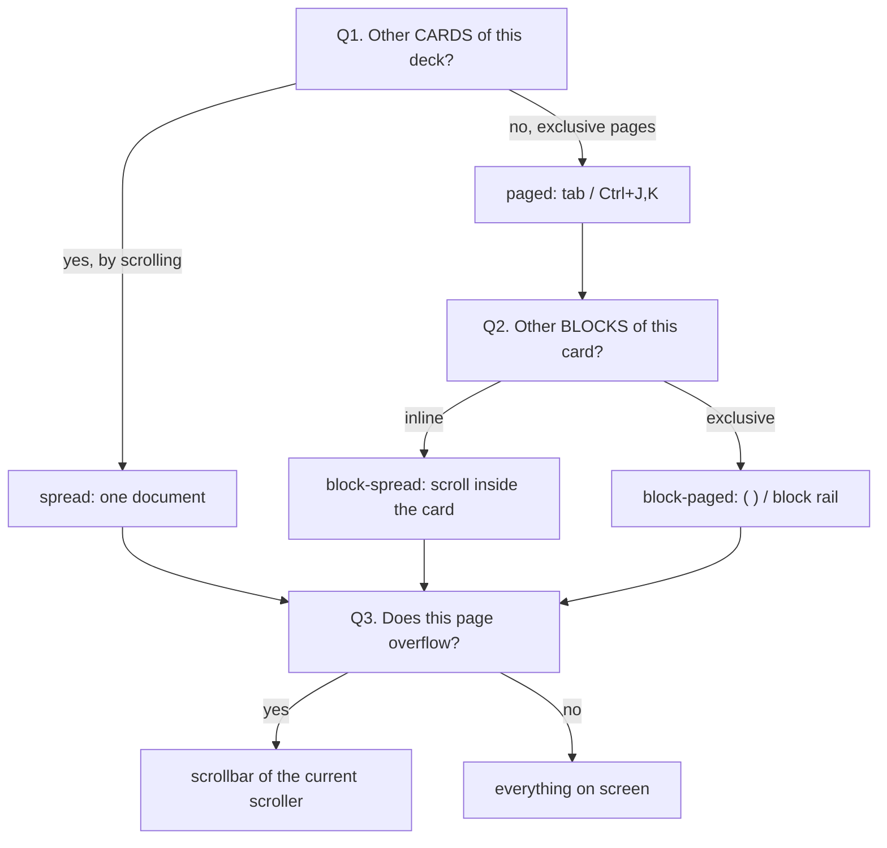

# Agent deck chrome: when can you scroll the whole deck?

> **Research query:** How should the Agents-tab deck panel make it obvious
> whether the focused deck is one scrollable document (spread: every card on
> one page) or exclusive pages (paged: cards split into sub-tabs that need
> `Ctrl+J` / `Ctrl+K`)? The sketch was: show card sub-tabs only when the
> cards are actually split out; add bright view badges; drop the words
> `auto` / `fixed` in favor of a lock icon. Critique that plan. Is it a
> good idea? Would a different approach be better? Call out justified
> requirement adjustments. End with a recommended solution.

**Researcher.** grk (`research.52.grk`). Independent report. I did not
read peer reports from this swarm.

**Evidence.** Live visual goldens under
`tests/ace/tui/visual/snapshots/png/` (especially
`agents_deck_view_*`, `agents_decks_single_main_*`,
`agents_deck_blocks_spread_*`, `agents_decks_single_files_spread_*`,
`agents_record_inbox_lifecycle_*`); chrome in
`src/sase/ace/tui/widgets/decks/{titles,view_badge,view_policy,panel_chrome,document_rail,separators}.py`;
docs in `docs/reference/tui/agent-statuses.md` § Deck Views; glossary
strands Agent Data Card / Deck / Deck Panel / Agent Tab; Nielsen Norman
Group tabs and scrolling research; Baymard Institute product-page tabs
study; lock-vs-pin iconography.

---

## Bottom line

**The first idea is right and is the highest-leverage change in the
sketch.** Exclusive-looking card tabs in the border title currently paint
in *both* spread and paged modes. That is a false affordance: tabs mean
"the rest of this deck is *not* below, it is on another page," and in
spread that is a lie. Hide the tab strip unless the deck is actually
paged. The presence of tabs becomes the paged signal; their absence plus
a live overflow chip becomes the spread signal.

**The rest of the sketch aims at the wrong object.** `auto` / `fixed` is
the *policy* (did you pin a layout). The question you asked is about the
*effective layout* (can this viewport scroll to the other cards). Shouting
policy, or swapping those words for a lock, will not answer the question.
A lock is also the wrong glyph: a lock means "cannot change / needs
auth / is secure." `P` still cycles a "fixed" view. That is a pin, and it
should appear only when the view is pinned. Automatic is the unmarked
default.

**Do not implement the sketch as written.** Implement the chrome grammar
in [Recommended solution](#recommended-solution). The short version:

1. Tabs only when paged, and only when there are two or more cards.
2. In spread, a you-are-here section name plus a live `▾` / `▴` chip that
   *names the neighbor card* (`▾ Reply`, `▴ Context`).
3. A pin mark only when the view is pinned. No `auto`, no `fixed`, no
   lock.
4. Keep `Ctrl+J` / `Ctrl+K` in both modes. They already jump-or-page;
   they are not "the paged-only keys."

---

## 1. What the chrome does today

The deck panel's top border is assembled by `deck_title()` in
`titles.py`. For Main and Files it is:

```text
<ZOOM?>  <glyph> <NAME>  <layout> · <policy>  ┃  <card tabs>  N/M
```

Worked examples from the committed goldens:

| Golden | Title as painted | What is actually true |
| --- | --- | --- |
| `agents_decks_single_main_reply_120x40` | `◆ MAIN  spread · auto ‹ 2/2 › Reply` | Spread. Reply is preferred, so Context is **above**. Scrollbar thumb is mid-track. Tabs still look exclusive. |
| `agents_decks_single_files_spread_160x40` | `■ FILES  spread · auto \| review_notes.md \| file 2  1/2` | Both files are in one document with `━━ ■ implementation_plan.md ━━` rules. Tabs still look exclusive. |
| `agents_decks_single_main_paged_120x40` | `◆ MAIN  cards · auto ‹ 1/2 › Context` | Paged. Context is the only card in the body. No scrollbar (the card fits). Footer: `Ctrl+J/Ctrl+K cards`. |
| `agents_deck_view_auto_page_blocks_120x40` | `◆ MAIN  blocks · auto \| Context \| Reply  2/2` | Paged *cards*, and the Reply card is also block-paged. Block rail under the title. Scrollbar is *this turn*, not the other card. |
| `agents_deck_view_fixed_spread_120x40` | `◆ MAIN  spread · fixed \| Context \| Reply  2/2` | Same exclusive tabs as auto-spread. `fixed` is bold accent; `auto` is `#888888`. |
| `agents_deck_view_split_narrow_120x40` | `MAIN C·F 2/2` vs `MAIN B·A 2/2` | Tiny letter soup. No legend. The one thing the user asked is not in the letters. |
| `agents_decks_single_main_context_120x40` | `◆ MAIN  spread · auto \| Context` | One-card deck. Forced spread (`decide_render_mode` returns spread when `card_count <= 1`). Badge and a lone tab for a document that cannot page. |
| `agents_record_inbox_lifecycle_120x40` | `≡ RECORD ‹ 1/4 › Lifecycle` | Compact pager chrome. RECORD *can* spread, but the title always looks paged. |

The badge is built in `view_badge.py`. Long/short form is
`{layout} · {status}` (`spread · auto`, `page cards · auto`,
`page blocks · fixed`, `page cards · spreading…`,
`page cards · spread unavailable`). Tiny form is `S·A`, `C·F`, `B·A`.
Layout uses the deck accent; `auto` is muted; `fixed` is bold accent.
Docs call this out as "never depends on color alone," which is true and
also not the problem: the problem is that the *tabs* outshout the badge.

The tab strip is painted in three tiers (`_build_full`,
`_build_compact`, `_build_micro`). Full uses reverse-bold on the active
card (`Context │ Reply  2/2`). Compact uses single guillemets
(`‹ 1/2 › Context`) — carousel/pager language. Micro drops names and
keeps `N/M`. Files and FINAL with more than four tabs skip the full
rung.

**The title tabs are not clickable.** `DeckPanel.on_click` only posts
`DeckPanelFocusRequested`. There is no hit-testing of `CardTab` ranges
in the border title. The block rail *is* clickable
(`BlockRail.BlockRailSelected`). So the thing that looks most like a
tab control is display-only paint, and the one-row timeline under it is
the real mouse target.

`Ctrl+J` / `Ctrl+K` (`next_deck_card` / `prev_deck_card`) run in
**both** modes. In spread they `scroll_to_card`; in paged they swap the
visible card. The footer shows `Ctrl+J/Ctrl+K cards` whenever
`deck_card_count > 1`, regardless of spread vs paged
(`_keybinding_bindings_agents.py`). The parenthetical in the prompt —
"when the user has to use `<ctrl+j/k>` to view other cards" — is
therefore slightly wrong. Those keys are the *jump* keys. They are
*necessary* only when the deck is paged; they are still *useful* when
it is spread.

Spread already has an in-body table of contents: titled rules from
`separators.py` (`━━ ◆ Reply ━━`, `━━ ■ implementation_plan.md ━━`).
The block rail already hides in spread ("the phase dividers already
mark each turn," `agent-statuses.md`). Card tabs did not get the same
hide rule. That inconsistency is the bug.

---

## 2. The question is three nested questions

The prompt asks one thing: can I scroll down and see the *entirety* of
the focused deck? The chrome has to answer three different overflow
questions, and today it answers none of them honestly.



**Q1 is the question you asked.** Spread vs paged at the *deck*.
Default threshold: `ace.agent_decks.spread_max_screens = 1.5`. Forced
spread when there is one card. Tools never spreads. Main and Files
honor `P` / palette. FINAL and RECORD auto-page from the same
thresholds but show **no** view badge.

**Q2 is the session-Reply turn timeline.** Only a card shown *alone*
pages its blocks. A spread deck always inlines them. The block rail
already tells the truth here (`page N/M` vs `all N`) and already hides
in spread. Do not add a second badge for Q2.

**Q3 is ordinary widget overflow.** Textual's `VerticalScroll`
scrollbar. It fires for "this scroller has more pixels," which is true
for a long Reply in page-cards *and* for a spread deck *and* for a
single paged block. It cannot say *what* is off-screen. On the dark
Monokai surface the thumb is a thin dim bar. Users miss it.

The trap case is **page-cards with block-spread**
(`agents_deck_blocks_spread_landing_120x40.png`): title
`page cards · auto │ Context │ Reply  2/2`, both turns of Reply
visible, scrollbar present. Scrolling reveals more of *this card*. It
never reveals Context. That is the exact failure Baymard measured on
product pages (see §4): the scrollbar teaches "keep going" while tabs
have hidden a sibling section.

A second trap is **sticky Reply in spread**
(`agents_decks_single_main_reply_120x40.png`,
`agents_deck_blocks_spread_deck_sticky_120x40.png`). The preferred card
lands mid-document. The rest of the deck is **above**. "Scroll down to
see the entirety" is false. The titled `━━ ◆ Reply ━━` rule at the top
of the viewport is the only honest cue, and it competes with reverse
tabs that say you are *on* the Reply page.

---

## 3. Critique of the sketch

### 3.1 "Only show card sub-tabs when we actually have split-out sub-tabs"

**Yes. This is the change.** It is the same rule the Agents tab already
uses for agent tabs: "The strip shows once two or more tabs exist"
(glossary Agent Tab; `_agent_tabs_catalog.py` R6 gate). Apply it to
*card* tabs, gated on **paged + two or more cards**, not merely on
"there are two cards."

Why it works:

- Nielsen Norman Group, *Tabs, Used Right* (Sunwall, 2024, last
  reviewed 2026-09-02): "Tabs allow users to selectively view a
  **single panel** of content from among a list of options." Clicking
  the label selects the tab. A tab control that does not exclusive-swap
  is a different control wearing tab clothes.
- Same article: use tabs "when users don't need to simultaneously see
  information presented under different tabs." Context and Reply *are*
  the pair you often want together. That is why spread exists. Painting
  tabs onto spread fights the reason spread exists.
- Baymard Institute, *Product Page UX: Avoid “Horizontal Tabs”*
  (2018, reconfirmed in later rounds): "A basic assumption relied on by
  most users while navigating any product page is that simply scrolling
  vertically will allow them to access core content sections."
  Horizontal tabs invalidate that assumption. SASE's spread deck *is*
  that product page (Context, Reply, files). The current title tabs
  invalidate the assumption even when scrolling *would* work.
- Jakob Nielsen, *Scrolling and Attention* (2010): for a long article,
  "Scrolling beats paging." Spread is the long article. Tabs in spread
  reintroduce paging chrome onto a scrolling document.
- In-body titled rules already name the cards in spread. The block
  rail already hides in spread for the same reason. Card tabs are the
  leftover.

**Correction to the parenthetical.** Do not define "split out" as "the
user has to use `Ctrl+J`/`Ctrl+K`." Those keys work in both modes.
Define it as: **the body contains only the active card; sibling cards
are not in the scroller.** That is `RenderMode.PAGED` with
`card_count >= 2`.

**Do not hide the current-section name in spread.** Hide the *tab
list*. A you-are-here (`Reply`, `implementation_plan.md`) is a
document heading, not a tab. Baymard's better-performing pattern on
desktop was expanded sections plus a sticky table of contents. A
single current-section label is the TUI version of that sticky ToC.

### 3.2 "Bright and clearly visible badges that indicate the view"

**Half-right, aimed at the wrong field.** Brightness should attach to
the thing the user might miss, not to a jargon word they have to
learn.

Today's badge already exists and is *intentionally quiet* for
automatic (`_MUTED = "#888888"`). The reverse-highlight on the active
tab is the brightest thing in the title. Making `auto` bright would
shout the default. Making `spread` a second reverse chip would compete
with the existing `ZOOM` chip (`ZOOM_CHIP_STYLE = "bold #1a1a1a on
#FFD700"` in `titles.py`) and with the tab pills.

What actually needs to be bright:

- **Overflow of the deck** (Q1): there is another *card* off-screen,
  and in which direction. This is the question you asked.
- **Pinned policy**: you overrode automatic. Mark the exception.
- **Active tab**, but only when tabs are real (paged).
- **ZOOM**, already done.

A static `SPREAD` chip still requires the user to know what "spread"
means. A live `▾ Reply` does not. SASE already speaks this language on
the identity header: `+N lines · ▾ d more` / `▴ d less`
(`agents-main-deck.md`). The Artifacts pane already uses a *visual*
mode badge (`{████}` filled cells for narrow/even/wide) rather than
the words "narrow" / "even" / "wide" (`tabs-and-panes.md`). Both
precedents beat a brighter `spread · auto`.

On narrow splits, replace `C·F` / `B·A` with something that survives
without a legend: `▾` / `▴` / `▴▾` and, if pinned, a pin mark. Letter
pairs fail the "never depends on color alone" rule the current badge
was written to satisfy: they depend on a codebook the screen does not
show.

Keep the status words that are not policy: Files `spreading…` and
`spread unavailable` are live *conditions*, not auto/fixed. They stay.

### 3.3 "Stop showing auto/fixed; use a little lock icon"

**Drop the words. Do not use a lock.**

`auto` is the default. Defaults should be unmarked. That is the same
rule as "don't show the agent-tab strip until there are two tabs" and
"don't show `1/1` on a single card" (`test_single_card_has_no_count`).
A title that says `spread · auto` on a one-card clan Summary is
noise.

`fixed` means "this panel's Main/Files view is pinned in
`~/.sase/ace_agents_deck_state.json` and `P` will not return it to
automatic; the palette entry `Deck view: automatic` will." It is a
user-owned pin. `P` still cycles the three layouts. The first press
from automatic already toasts the palette reset
(`test_deck_view_keys.py`).

A lock icon, in the interfaces this TUI's users already have, means
something else:

- Browser lock: TLS, not layout.
- macOS padlock: authentication required to change a preference.
- UX Stack Exchange consensus (lock/unlock threads): a closed padlock
  means "you cannot change this" or "this is secure," and the icon
  should show **current state**, not the action. Apple's lock in
  System Settings is exactly "auth to edit."
- "Pinning is not saving" (UX Collective): a pin "locks an item to a
  fixed, visible position" while everything else keeps moving, and
  "you pin and unpin as context shifts." That is this feature.

A lock on a view that `P` still changes is a lying control. Users will
think `P` is dead, or that the deck is read-only.

Use a **pin**, and only when the policy is not `AUTO`. Candidates that
fit the existing geometric chrome (`◆ ■ ⚒ ⊛ ≡ ▾ ▴`):

| Mark | Verdict |
| --- | --- |
| `🔒` / `🔓` | Reject. Wrong metaphor, emoji-wide, noisy against Fira Code / DejaVu deck chrome. |
| `📌` | Right metaphor, still emoji-wide. Acceptable if you want a pictogram and Noto Emoji is already in the visual renderer. |
| reverse-accent `PIN` chip | Best parallel to `ZOOM`. Readable, themeable, single-width-ish. |
| `∗` in bold accent after the deck name | Smallest. tmux-like "pinned window." Easy to miss. |

Recommendation: a small reverse-accent `PIN` chip, same family as
`ZOOM`, shown only when `policy is not AUTO`. Nothing when automatic.
Help modal: "PIN means this panel's view is pinned; palette *Deck
view: automatic* unpins; `P` cycles pinned layouts."

---

## 4. External UX, mapped onto this panel

These are the findings that change the design, not a literature
review.

**Tabs are exclusive panels, selected by clicking the label**
(NN/G *Tabs, Used Right*, 2024). SASE's title tabs fail both halves in
spread (not exclusive) and fail the click half in every mode (paint
only). If we keep tabs for paged, a justified follow-up is to make
them hit-testable. That is *not* required to land the visibility
change.

**Do not mix tab types in one control** (same article). The title
currently mixes "this is a section of one document" (spread, Ctrl+J
scrolls) with "this is another page" (paged, Ctrl+J swaps). One strip
cannot mean both.

**Users assume vertical scroll reveals every section** (Baymard 2018).
This is the empirical core of your request. The fix is to make that
assumption *true* in spread (it already is in the scroller) and
*visibly false* in paged (tabs, no deck-overflow chip). Mixed chrome
makes the assumption untestable.

**Scrolling beats paging for one article; the fold still exists**
(Nielsen 2010: ~80% of attention above the fold). Sticky Reply lands
the important card above the fold on purpose. That is why the overflow
chip must be bidirectional. A "more below" hint alone would hide
Context forever for anyone whose preferred card is Reply.

**Cut-off content is a better scroll affordance than a label that says
"scroll"** (Morgan Carter, *Affordance for Overflowing Content*; GNOME
undershoot discussion; Google Chrome *scrollability-affordance-hints*).
SASE already cuts off Reply in spread (the golden shows a mid-track
scrollbar and a titled rule). That would be enough if the title did
not also look like a tab control. Hide the tabs and the cut-off plus
`▾ Reply` does the rest. A fade/gradient undershoot is not available
in this Textual border; chevrons are.

**Unmarked default, mark the exception** (NN/G *Explicitly State the
Difference Between Options*; Apple HIG lock-as-auth). Automatic should
leave no policy mark. Pinned should.

**SASE-internal parallels, in priority order:**

1. Agent-tab strip: visible iff two or more tabs.
2. Header overflow: `▾ d more` / `▴ d less`, names the key.
3. Jump panel overflow: `+N`, `▴ . more`.
4. Block rail: hidden in spread; `page N/M` vs `all N` when paged.
5. Artifacts split badge: `{████}` cells, not the words.
6. `ZOOM` reverse chip: exceptional layout, never dropped.

The recommended chrome is those six rules applied to deck cards.

---

## 5. Justified requirement adjustments

These are changes to the prompt, not extra features. Each one is
required for the chrome to tell the truth.

1. **Replace "scroll down to see the entirety" with "scroll to the
   other cards."** Sticky Reply (and Files' preferred page) land
   mid-document. The rest of the deck is often *above*. The chip must
   be `▾`, `▴`, or `▴▾`, and it should name the neighbor when there is
   exactly one off-screen card.
2. **Define "split-out sub-tabs" as paged body, not as
   `Ctrl+J`/`Ctrl+K`.** Those keys jump in both modes. The footer
   `cards` binding stays whenever `card_count > 1`. Optional later:
   footer label `jump` in spread and `cards` in paged. Not required.
3. **Hide exclusive tabs in spread for every deck that can spread**,
   not only Main. Files goldens show the same lie. FINAL and RECORD
   auto-spread from the same thresholds and always look paged today
   (`‹ 1/4 › Lifecycle`). Tools never spreads; its tabs stay.
4. **One-card decks lose the layout badge and the lone tab.**
   `decide_render_mode` already forces spread. `◆ MAIN` is enough. A
   clan Summary that says `spread · auto │ Context` is teaching a mode
   that cannot change.
5. **Drop `auto` / `fixed` words. Use a pin, shown only when pinned.
   Do not use a lock.** See §3.3. Palette names can keep "(fixed)"
   because they are the *action* of pinning; the title shows state.
6. **Do not add a second row of badges.** Brightness goes into the
   overflow chip and the pin chip, in the existing `border_title`
   budget. A new docked row would steal a body row from every deck
   (the block rail already does that when it has work to do).
7. **Do not restyle Q3 (widget scrollbar) as the Q1 answer.** Keep
   the scrollbar. It remains the within-page overflow cue. The new
   chip is *deck-sibling* overflow, and it is absent when paged even
   if the scrollbar is present. That absence is load-bearing.
8. **Keep Files' `spreading…` / `spread unavailable`.** Those are
   not policy.
9. **Making title tabs clickable is a follow-up, not this change.**
   NN/G says the label selects the tab. Today it does not. Landing
   click-to-select on a strip we are about to hide in spread would
   mix two jobs. After this change, paged tabs *should* become
   hit-testable. File that separately.
10. **Do not change landing, thresholds, or `P` cycling** to "fix"
    visibility. Sticky newest-block, `spread_max_screens = 1.5`, and
    `page blocks → page cards → spread` are working. This is a chrome
    honesty change.

---

## 6. Alternatives considered

| Approach | Why not |
| --- | --- |
| Always spread, never page | Rejected by the 1.5-screen budget. Long Reply + Context is why paging exists. |
| Always page, never spread | Rejects the user's goal. Spread *is* "you can scroll the whole deck." |
| Keep tabs in both modes; restyle spread tabs as breadcrumbs | Still looks like a tab control. Reverse pills are the loudest title element. Weaker than hiding. |
| Brighter `spread · auto` / `page cards · auto` | Teaches jargon. Competes with tabs. Does not say *which way* to scroll. |
| Lock icon for fixed | Wrong metaphor; implies `P` is dead. |
| Toast / one-shot notice | `_agent_decks_notice.py` already fired once at the decks cut-over. Toasts do not answer an everyday question. The first-`P` toast is enough for pinning. |
| Fade / last-line `More` inside the scroller | Last-line cues scroll away. Title chips do not. Textual has no undershoot gradient. |
| Change default landing to Context so "down" is true | Fights sticky Reply, which is the triage loop. Teach direction instead. |
| New docked "view" rail under the title | Costs a body row. The block rail already occupies that slot when it has 2+ blocks. |

---

## Recommended solution

Ship a **chrome grammar**, not a brighter label. The user should be
able to answer Q1 in one glance without knowing the words "spread" or
"paged."

### The grammar

| What you see in the title | What is true |
| --- | --- |
| Card tab pills (`Context │ Reply  2/2` or `‹ 2/2 › Reply`) | Paged. Sibling cards are **not** in the scroller. `Ctrl+J` / `Ctrl+K` swap pages. Scrollbar, if any, is this card only. |
| No tab pills; a section name; `▾ Name` / `▴ Name` / `▴▾` | Spread. Sibling cards **are** in the scroller, off-screen in that direction. `Ctrl+J` / `Ctrl+K` jump by scrolling. |
| No tab pills, no chevron, just `◆ MAIN` (or `◆ MAIN  Reply` if a section is in view) | The whole deck fits, or there is only one card. |
| Reverse-accent `PIN` after the deck name | This panel's view is pinned. Palette *Deck view: automatic* unpins. `P` still cycles pinned layouts. |
| No `PIN` | Automatic. Unmarked. |
| `spreading…` / `spread unavailable` | Files probe in flight / media cannot spread. Unchanged. |
| `ZOOM` chip | Unchanged, still leads every rung. |

`spread`, `page cards`, `page blocks`, `auto`, and `fixed` leave the
title. They stay in the command palette, the help modal, and the
docs. The block rail keeps `page N/M` vs `all N` for Q2.

### Mockups

**Spread, landed on Reply (today's sticky trap):**

```text
today:     ◆ MAIN  spread · auto ┃ Context │ Reply  2/2
proposed:  ◆ MAIN  Reply  ▴ Context
```

**Spread, at the top of Context, Reply below:**

```text
today:     ◆ MAIN  spread · auto ┃ Context │ Reply  2/2
proposed:  ◆ MAIN  Context  ▾ Reply
```

**Spread, both cards on screen (short agent):**

```text
today:     ◆ MAIN  spread · auto ┃ Context │ Reply  2/2
proposed:  ◆ MAIN
           ━━ ◆ Context ━━
           …fits…
           ━━ ◆ Reply ━━
```

**Paged (need Ctrl+J for the other card):**

```text
today:     ◆ MAIN  cards · auto ┃ Context │ Reply  2/2
proposed:  ◆ MAIN  Context │ Reply  2/2
```

**Paged and pinned:**

```text
today:     ◆ MAIN  cards · fixed ┃ Context │ Reply  2/2
proposed:  ◆ MAIN PIN  Context │ Reply  2/2
```

**Page-blocks (Q2 stays on the rail):**

```text
today:     ◆ MAIN  blocks · auto ┃ Context │ Reply  2/2
           <2 older — 2 ⚙ --mon ✓  3 --code ▶
proposed:  ◆ MAIN  Context │ Reply  2/2
           <2 older — 2 ⚙ --mon ✓  3 --code ▶  page 4/4
```

**Files spread:**

```text
today:     ■ FILES  spread · auto ┃ review_notes.md │ file 2  1/2
proposed:  ■ FILES  review_notes.md  ▾ implementation_plan.md
```

**Narrow split, focused pinned page-cards vs unfocused auto page-blocks:**

```text
today:     MAIN C·F 2/2          MAIN B·A 2/2
proposed:  MAIN PIN ‹ 2/2 ›      MAIN ‹ 2/2 ›
```

(The compact pager form stays, because these panels *are* paged. The
letters go away.)

**One-card Main:**

```text
today:     ◆ MAIN  spread · auto ┃ Context
proposed:  ◆ MAIN
```

### Behavior details

- **Overflow chip source of truth.** `scroll_y` vs `max_scroll_y` on
  the deck scroller, already watched (`_watch_deck_scrolls`,
  `sync_document_spread_block_cursor` already calls `refresh_chrome()`
  on spread scroll). Name the neighbor from the same card-anchor rows
  used for `Ctrl+J`. When two or more cards are off-screen in one
  direction, `▾ 2 cards` (or `▾ files`) rather than a list.
- **Pinned chip.** `policy is not AUTO` from the existing
  `ResolvedView`. Do not show it for Tools / FINAL / RECORD (they
  cannot pin). Vacuous pins (requested layout equals automatic
  signature) still show `PIN` so the badge stays stable across cards —
  that is today's D5 rule in `resolve_view()`, and it is still right.
- **Tab gate.** `show_tabs = (render_mode is PAGED and len(tabs) >= 2)`.
  Pass it into `deck_title()`. Compact `‹ n/m ›` is paged-only. Spread
  uses the you-are-here name without reverse-pill styling (bold accent
  is enough; reverse is the tab selection indicator).
- **`P` as the teaching moment.** Spread → paged: tabs *appear*.
  Paged → spread: tabs *disappear* and `▾`/`▴` *appear*. That is
  better than a toast. Keep the existing first-pin toast that names
  the palette reset.
- **Footer.** Keep `Ctrl+J/Ctrl+K cards` for `card_count > 1`. Keep
  `P view` while the cycle is available. Optional polish, not
  required: `jump` vs `cards`.
- **Help modal.** One line under Agents › Navigation: "Tabs in the
  deck title mean one card per page. No tabs means the whole deck is
  one document; `▾` / `▴` name what is off-screen. PIN means you
  pinned the layout."
- **Click follow-up (not this change).** After tabs exist only when
  they are real, hit-test paged title tabs the way the block rail
  hit-tests entries. Spread's you-are-here is not a click target;
  `Ctrl+J` / `K` remain the jump.

### Implementation seam

This is presentation-only Python in the sase repo (TUI chrome). It
does not cross the Rust core boundary.

| File | Change |
| --- | --- |
| `widgets/decks/titles.py` | `show_tabs`, you-are-here, overflow chip, `PIN` chip; drop auto/fixed rungs |
| `widgets/decks/view_badge.py` | Replace layout·policy variants with overflow + pin (+ Files pending/blocked) |
| `widgets/decks/panel_chrome.py` | Pass paged/overflow/section into `deck_title`; compute overflow from scroller |
| `widgets/decks/view_policy.py` | Unchanged semantics; `ResolvedView` still feeds pin/pending/blocked |
| `docs/reference/tui/agent-statuses.md` § Deck Views | Rewrite the badge paragraph |
| `tests/ace/tui/widgets/decks/test_deck_titles.py` | Tab-gate, overflow chip, no `1/1`, no auto/fixed |
| `tests/ace/tui/widgets/decks/test_deck_view_policy.py` | Badge strings |
| `tests/ace/tui/visual/test_ace_png_snapshots_agents_deck_views.py` and the `agents_decks_*` goldens | Expected churn. Treat as part of the change, not unrelated. |

Performance: chrome-only `Text` rebuild on an existing scroll
listener. Do not remeasure cards on scroll. `tui_perf.md` applies only
in the "keep the refresh off the pump" sense; this path is already
synchronous and cheap.

### Why this is the best UX for *this* TUI

The Agents tab is already a grammar of "chrome appears when it does
work": agent tabs, block rail, jump panel, `P view`, `(/) blocks`,
`ZOOM`. The card tab strip broke that grammar by appearing in the mode
where the in-body rules do the work. Restoring the grammar answers
your question without a new concept. A user who has never read
`agent-statuses.md` can still see:

- pills → other cards are pages,
- `▾ Reply` → other cards are down,
- `▴ Context` → other cards are up,
- nothing extra → this is the whole deck,
- `PIN` → I asked for this layout.

That is the entire feature.

### What I would not do

I would not ship brighter `auto`/`fixed` words, a lock, a second badge
row, or a change to landing/thresholds/`P`. I would not hide
`Ctrl+J`/`K` in spread. I would not treat the widget scrollbar as the
Q1 answer. I would not leave FINAL/RECORD/Files out of the tab-gate;
the lie is the same there.

### Acceptance bar

A reviewer who has never used decks should, from a screenshot alone:

1. Point at a spread Main with sticky Reply and say "Context is
   above."
2. Point at a paged Main and say "I cannot scroll to Reply; I have to
   change pages."
3. Point at page-cards with a scrollbar and *not* conclude that
   Context is below.
4. See no policy mark on an automatic panel, and a `PIN` on a panel
   after `P`.
5. See no card pills on a one-card deck.

If any of those five fail, the chrome is still lying.

---

## Sources

### SASE (code, docs, goldens)

- `src/sase/ace/tui/widgets/decks/titles.py` — tab tiers, `ZOOM` chip, badge insertion
- `src/sase/ace/tui/widgets/decks/view_badge.py` — `spread · auto` / `S·A` variants
- `src/sase/ace/tui/widgets/decks/view_policy.py` — D5 resolve, pin-vs-effective
- `src/sase/ace/tui/widgets/decks/panel_chrome.py` — title assembly, held views
- `src/sase/ace/tui/widgets/decks/render_mode.py` — 1.5-screen decision, one-card spread
- `src/sase/ace/tui/widgets/decks/separators.py` — in-body titled rules
- `src/sase/ace/tui/widgets/decks/document_rail.py` / `block_rail.py` — rail hide-in-spread, `page N/M`
- `src/sase/ace/tui/widgets/decks/panel.py` — `on_click` focuses only
- `src/sase/ace/tui/widgets/_keybinding_bindings_agents.py` — footer `cards` on `card_count > 1`
- `src/sase/default_config.yml` `ace.agent_decks`
- `docs/reference/tui/agent-statuses.md` § Deck Views, Card Blocks
- `docs/reference/tui/agents-main-deck.md` — `▾ d more` header cue
- `docs/reference/tui/tabs-and-panes.md` — `{████}` Artifacts split badge
- Glossary: Agent Data Card, Agent Data Deck, Deck Panel, Agent Tab
- Goldens cited in §1

### External

- Evan Sunwall, Nielsen Norman Group, [*Tabs, Used Right*](https://www.nngroup.com/articles/tabs-used-right/) (2024-08-02, last reviewed 2026-09-02)
- Jakob Nielsen, Nielsen Norman Group, [*Scrolling and Attention*](https://www.nngroup.com/articles/scrolling-and-attention-original-research/) (2010-03-22)
- Baymard Institute, [*Product Page UX: Avoid “Horizontal Tabs”*](https://baymard.com/research-articles/avoid-horizontal-tabs) (2018-10-17; pattern reconfirmed in later Baymard product-page rounds)
- Morgan Carter, [*Affordance for Overflowing Content*](https://morgancarter.com.au/design-solutions/affordance-for-overflowing-content)
- Google Chrome, [*Scrollability affordance hints*](https://github.com/GoogleChrome/modern-web-guidance/blob/main/skills/modern-web-guidance/guides/user-experience/scrollability-affordance-hints.md)
- UX Stack Exchange, [*Lock/Unlock icons, current state vs action*](https://ux.stackexchange.com/questions/112153/lock-unlock-icons-should-the-icon-refer-to-the-current-state-or-the-action); [*Does a lock icon show logged in or needs login*](https://ux.stackexchange.com/questions/71638/does-a-lock-icon-show-the-user-is-logged-in-or-needs-to-log-in)
- UX Collective, [*Pinning is not saving*](https://uxdesign.cc/pinning-is-not-saving-saving-is-not-favoriting-favoriting-is-not-flagging-c3941c444bd5)
