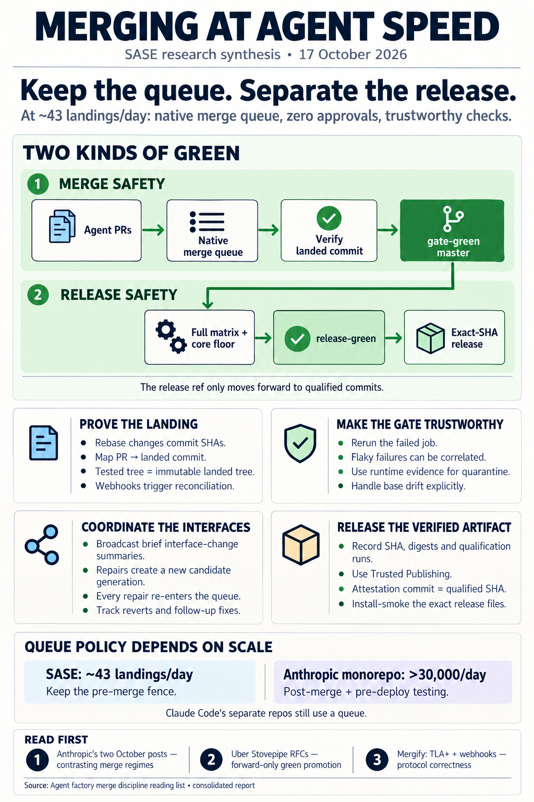

# Merging in an agent software factory: what the last year of reading says, and what to read

> **Research query:** What is the best way to handle merging for an agent software
> factory like sase, with `merge_queue_fenced_master_and_exact_sha_releases.md` in the
> research sidecar repo as context? Find recent (under one year old) articles and papers
> that can inspire or point in the right direction, and end with a ranked list of the
> ones worth reading.



## Bottom line

1. **The last year's reading backs sase's plan.** That plan is:

   - fence `master` with the native merge queue;
   - use zero approvals;
   - make the gate trustworthy before enforcing it;
   - publish exactly the SHA that was qualified.

   At about 43 landings a day, sase is firmly in the regime where a pre-merge queue is
   cheap. Nothing published in the window argues for building a custom queue or adding
   human review.
2. **The most useful new idea: keep "the trunk passed the gate" and "this SHA is safe to
   release" as two separate things.**

   - Uber's open-sourced **Stovepipe** keeps a forward-only *last-green bookmark*. It
     mirrors that bookmark to a **promotion ref** (`verified-main`) that release and
     deploy jobs read.
   - Every high-volume shop that dropped the strict pre-merge fence still kept a green
     thing to release from:

     - Anthropic's monorepo;
     - Cursor's swarm.
   - **Why it matters for sase:** build releases against a `release-green` ref from day
     one. The queue then becomes a choice you can revisit as volume grows, not a
     load-bearing wall. See
     [the queue depends on scale but the release ref does not](#the-queue-depends-on-scale-but-the-release-ref-does-not).
3. **One company shows where the queue stops paying for itself.** Two input reports read
   it in opposite directions; they were reading different repos (see
   [how the input reports compared](#how-the-input-reports-compared)).

   - **Anthropic's monorepo** went from about 2,500 to more than 30,000 merges a day
     between May and September 2026. It gave up a global-lock merge queue for post-merge
     and pre-deploy testing, plus automated bisect and revert.
   - **The separate Claude Code repos** still run a queue that "re-runs every check
     against main with the change applied".
   - **For sase:** 43 a day is nowhere near the monorepo's regime.
4. **The real engineering is the landing watcher.** Treat it as a small distributed
   protocol, not a script. The work:

   - model it;
   - key it on candidate generations;
   - reconcile instead of trusting webhooks.

   The [reassessment's](#scope-and-context) switch to rebase raises the bar. Under rebase
   the agent's commit SHA does not survive landing, so "master contains the agent's SHA"
   can no longer be the proof of merge (see
   [the landing watcher is a protocol](#the-landing-watcher-is-a-protocol)).
5. **Gate trust is still the binding constraint, and the new evidence makes it slightly
   harder than the plan assumes.**

   - Reruns are correlated, and rerunning the failed *job* beats rerunning the workflow by
     a wide margin.
   - Agent-written tests are flakier than human ones.
   - Static flake detectors collapse once trained and tested on different projects.
   - An agent-run repo documented exactly the "base drift" failure the reassessment
     added. A release-pin test ejected every queued PR on every release.

   See [gate trust and base drift](#gate-trust-and-base-drift).
6. **Most textual conflicts between agents are harmless. Semantic conflicts are rare in
   real work and nearly certain when one agent changes an interface.**

   - A September 2026 paper found that telling an in-flight agent, in about 130 tokens,
     what the other agent changed fixed most constructed failures.
   - **For sase:** have the landing watcher broadcast short summaries of the interfaces
     that just landed to sibling agents still running. Also, never let an LLM's verdict
     land a conflict repair; repairs go back through the queue.

   See [conflicts and coordination](#conflicts-and-coordination).
7. **Treat one input report with care.** gem's report contains several specific claims
   that are not in the papers it cites. Two of them are a "review comment sign-flip" and
   a ">3 files → 4× rejection" effect. It also misdates or misdescribes two older papers.
   See [Corrections](#corrections-to-the-input-reports). The other three reports held up
   well, with smaller fixes.

**If you read only three:**

- Anthropic's two October posts, read as a pair (rank 1);
- Uber's Stovepipe RFCs (rank 2);
- Mergify's TLA+ write-up (rank 3).

The full [ranked list](#ranked-reading-list) is at the end.

## Scope and context

**Consolidated report** · lead researcher · 2026-10-17 · window **2025-10-17 → 2026-10-17**

**Context:**

- [the merge-queue plan](../merge_queue_fenced_master_and_exact_sha_releases/merge_queue_fenced_master_and_exact_sha_releases.md);
- its same-day
  [reassessment](../merge_queue_fence_reassessment_and_epic_split/merge_queue_fence_reassessment_and_epic_split__final.md).

The reassessment keeps the architecture but changes three things that matter here:

- it lands with linear history (rebase), not merge commits;
- it adds handling for "base drift";
- it makes dependent work wait for landing.

The inputs and checks behind this report are listed under
[method and limits](#method-and-limits).

## What the last year adds, by theme

### The queue depends on scale but the release ref does not

**Where the regimes sit:**

- **Small teams (tens of merges a day).** Mergify's *State of Merge Queues 2026* covers
  200k+ merges from 477 teams, in a rolling 90-day window updated 2026-07-27.

  - The median private repo lands about 3 merges per active day.
  - 94% of private merges still go through one PR at a time.
  - Broken-main rate grows with team size: 0.77% at 2–5 engineers, 12.5% at 40+.
  - AI-assisted PRs broke main *less* often than other PRs (1.9% vs 4.4%).
  - Allen Hutchison's two-person, agent-heavy company (2026-09-17) also runs a merge
    queue, and agents never merge their own PRs.
- **Agent bursts (hundreds a day).** The queue stays, and the work shifts to handling
  bursts. Mergify's dynamic batch sizing (2026-07-06) gives a bounded answer, though
  weekday merges did not rise (48.4 → 45.3).

  - grk's "Super Merge" (Reason Machines, 17 → 600 merges a day) would be the best
    example here, but **none of its numbers could be verified**. The X article was
    unreachable, and no other copy exists.
- **Lab scale (thousands to tens of thousands a day).**

  - **Anthropic's monorepo**, 2026-10-13: "A proper merge queue, for example, doesn't
    make much sense at agent scale. What does CI even mean when hundreds or even
    thousands of changes can merge while tests are running? We haven't been able to
    effectively replicate the industry standard of a global repository lock on the merge
    queue, so instead, we've invested in post-merge and pre-deploy automated testing."
  - **Cursor's swarm**, peaking near 1,000 commits an hour: "the ideal efficient system
    accepts some error rate, but a final 'green' branch is needed" (2026-02-05).
  - **OpenAI's harness team** runs "minimal blocking merge gates". Its authors call that
    "irresponsible in a low-throughput environment". You have already read this one.

**The pattern.** Systems that relax the fence keep a promoted green artifact. Uber made
that a first-class object, and I confirmed the design in SubmitQueue's own RFCs
(`doc/rfc/stovepipe/workflow.md` and `steps/process.md`; the repo starts 2026-01-08):

- **A last-green bookmark.** It only moves forward, in ingest order. It is updated by
  compare-and-swap, and is "never regress[ed]".
- **A promotion ref.** For example, `verified-main` for `monorepo/main`. It is "a cache
  of the last-green URI, not a second record of greenness".
- **Incremental validation.** Stovepipe validates "already-landed, linear trunk heads". So
  validating `G0..B` already tests A and B together, and later checks can be incremental
  from the last green commit.

  That is a quiet argument *for* the reassessment's switch to linear history. It makes
  post-merge qualification and bisection incremental and simple.

**What it means for sase:**

- Add a `release-green` ref. A deterministic job moves it forward only to SHAs that are
  green on the gate, the full matrix and the core floor. release-please's release commit
  must be at or behind it.
- Write releases and dependency resolution against that ref, not against "tip of
  `master`". If volume ever jumps tenfold, relaxing the queue is then a config change,
  not a rebuild of the release path.

### The landing watcher is a protocol

Mergify's TLA+ write-up (2026-04-13) explored 468,000 states of its queue model and found
two bugs that tests had missed:

- one in freeze handling;
- one in promoting speculative entries that were not ready.

Some invariants first passed *vacuously*, because they referred to a state the model
could never reach. Its webhook incident (2026-03-25) showed a different failure: a valid
event carrying a stale empty array ejected a queued PR.

cdx turned these into invariants for sase's host layer. I endorse them as written:

- **Identity.** A candidate is identified by (repo, PR, head SHA, generation). An old
  success never authorizes a new head.
- **Accounting.** Every accepted submission stays accounted for until it reaches a
  durable terminal state. A restart neither loses it nor creates a second PR for it.
- **Idempotence.** Reprocessing an observation never repeats any of these:

  - closing a bead;
  - launching a dependent agent;
  - publishing a release.
- **Distinct outcomes.** Failed, cancelled, expired and missing checks are each
  different from success.
- **Repairs.** A repair creates a new candidate generation.
- **Webhooks.** A webhook triggers reconciliation; it is never proof by itself.

**Changes that the reassessment's rebase decision forces:**

- **Proof of merge can't rely on the agent's SHA.**

  - The original design proved a merge by checking that `master` contains the agent's
    SHA, which merge commits preserve. Rebase rewrites that SHA.
  - The watcher therefore needs a PR → landed-commit mapping, taken from the PR's merged
    state and merge commit.
  - It should then prove tree equality between the tested merge-group commit and **the
    immutable landed commit for that group**, not the moving tip of `master` (cdx's
    correction).
  - It should check separately that the landed commit is still an ancestor of `master`.
  - The pilot must establish the real SHA mapping GitHub uses under rebase.
- **The April 2026 incident is a reason to keep the post-merge proof, not a reason to
  avoid rebase.**

  - GitHub's final write-ups say only squash groups of more than one PR produced
    incorrect commits (blog, 2026-04-28: 658 repos, 2,092 PRs).
  - The status page's interim updates at 19:58 and 21:18 UTC named "squash merging or
    rebasing". The final resolved note then said rebase was not affected.
  - Trunk's analysis is the best explanation of why "CI passed" did not mean "the right
    tree landed".
- **Merge through GitHub's async merge API.**

  - The API went GA on 2026-10-01. It works as `PUT`, then poll, and GitHub calls it the
    "recommended path for programmatically merging pull requests".
  - It is also the only merge API that supports stacks.
  - Evaluate it in the pilot as the replacement for sase-github's `gh pr merge` call,
    the one that currently treats "queued" as "merged".

### Gate trust and base drift

**Reruns:**

- **Huang & Lin, *On the Reruns of GitHub Actions Workflows*** (ACM TOSEM, February 2026).

  - Rerunning only the failed job turned a failure into a pass 73.6% of the time. Rerunning
    the whole workflow did so 33.9% of the time.
  - Most of the time spent on reruns went to reruns that never changed the outcome.
- **Flaky failures are correlated** (cdx and cld independently):

  - They cluster across tests and projects.
  - The plan's "30% false reds → 9% of good changes need repair" assumes the second
    attempt fails independently of the first.
  - Measure the conditional rate on unchanged candidates instead. Run reruns in a fresh
    process, and on a different shard if possible.

**Evidence and labels:**

- **Static flake detection falls apart.** Gültekin et al. (arXiv 2607.09345, 2026-07-10)
  show that code-only detectors fall to near baseline once trained and tested on
  different projects. For end-to-end tests, source code plus logs explained only 42% of
  root causes.

  - **For sase:** quarantine only on runtime evidence, meaning a pass on rerun at the
    same SHA, recorded by failure signature.
- **Rerun budgets bias your own labels.** SCOUT (arXiv 2603.23054) points out that with a
  finite budget, a flaky test that fails twice gets labelled "real".

**Agents and the gate:**

- **Agent-written tests are flakier** (Jhanglani et al., arXiv 2607.12068, per cld).

  - **For sase:** run each test the change *adds or modifies* k times before it can enter
    the queue.
- **Agents must not edit the gate that grades them** (cld, grk):

  - Spotify's LLM judge exists partly to catch agents disabling flaky tests.
  - ImpossibleBench shows stronger models exploit contradictory tests more.
  - **For sase:** route PRs that touch `.github/workflows/`, the quarantine list or
    required-check names to `/sase_gate`.

**Base drift has a public case study.** a11ign/a11ign#5125 (2026-10-11):

- A "release-pin currency" test read external release state. "Every release turns it red
  for every PR in the queue"; three PRs were ejected and none was re-queued.
- **Their fix:**

  - Classify an ejection as "not own" by comparing the failing test with the PR's diff.
  - Re-enqueue once main's latest merge group is green.
  - Move world-state tests to nightly runs, plus PRs that touch what they check. A
    nightly failure files an incident and never fails a merge group.
- **The lesson for sase:** the re-enqueue flag shipped but was **never switched on**.
- sase's core-floor and pin checks are world-state tests of exactly this kind.

**Don't let concurrency settings eat verification runs:**

- A shared `cancel-in-progress` concurrency group once let a break on `main` go unnoticed
  (vfarcic/dot-agent-deck#513).
- GitHub Actions now supports `concurrency: {queue: max}` (2026-05-07). It holds up to 100
  runs in sequence instead of cancelling the pending one.
- Use it for post-merge and qualification runs. Ordering is not documented, so key
  results by SHA.

**Capacity grows faster than you plan for:**

- Anthropic's CI job volume rose 25× in six months, with tests up 10×, and "if a
  dependency starts flaking, then flaky reds start blocking merges" (2026-09-14).
- Linear made its test-writing agent skills respect performance limits (2026-09-21).
- **For sase:** teach the test-writing skills the gate's constraints (no real sleeps,
  deterministic Textual pilots).

### Conflicts and coordination

**How often parallel agents collide:**

- **Xu, Subramanian, Karthik** (arXiv 2607.04697; data from December 2024 to July 2025):

  - 79.4% of agent PRs overlap in time with another agent PR.
  - Replayed pairs conflict textually 41.7% of the time across agents and 19.8% within
    one agent.
  - About 42% of conflicts are structural (modify/delete or add/add).
  - Dependency manifests and lockfiles make up only 3.9% of conflicted files.

**When collisions actually break things.** *Passes Alone, Fails Together* (Xia, Wu, Park;
arXiv 2609.25396, 2026-09-21; EXPRESS '26) is the best new find. **None of the four
reports had it.**

- **Real pairs almost never interfere.** Of 834 runs on 417 real Django PR pairs, only one
  showed a test that failed only when the two were combined.
- **Interface changes almost always do.** On constructed interface-change tasks, 105 of
  108 runs interfered.
- **A short note fixes most of it.** A brief message describing the other agent's
  finished change made 82% of runs clean. In the synthetic tier, those messages averaged
  about 130 tokens.
- **Count carefully.** Their first grading overcounted interference, because the patches
  alone and the merged result were graded on different test sets. A base-red witness
  needs the same care.

**What that means for sase:**

- The merge group's CI is enough for most landings.
- The rare dangerous case is a changed interface. When an interface lands, send a short
  summary to sibling agents still in flight.
- During a wave, assign an owner to each shared interface.

**Planning the merge order:**

- **NP-Bench** (Muku, arXiv 2610.07261, 2026-10-05) splits declared scopes and orders
  merges along producer→consumer edges *before* any writing starts.

  - Clean integration went from 1/9 to 9/9 scenarios.
  - The evaluation is small and simulated. Read it as a design sketch for epic and
    clan-wave planning.
- **CAID** (Geng & Neubig, arXiv 2603.21489) supports isolate-then-integrate, but costs
  matter.

  - The abstract's +25.6 (PaperBench) and +14.7 (Commit0) are MiniMax 2.5 gains.
  - For Claude Sonnet 4.5 on Commit0-Lite, the score moves only 53.1 → 59.1, at 2.3× the
    runtime and 4.3× the cost.
- **Cursor** found that a dedicated integrator became a bottleneck (2026-01-14).

  - Later, a "neutral third-party agent" that resolves conflicts on behalf of both sides
    cut conflicts from more than 70,000 to fewer than 1,000 (2026-07-20).
  - That is a good shape for sase's repair turn: give it both sides' diffs and intents,
    not one side's context.

**LLM conflict resolution stays behind the gate:**

- **Merge-Bench** (arXiv 2605.25890). The best model, Gemini 2.5 Pro, resolves Java
  conflicts with 54.7% exact match and 62.5% code-normalized.
- **Shen** (arXiv 2607.27674). An LLM judge accepted 4 of the 5 resolutions that failed a
  deterministic structural check. The sample is small.
- **So:** repairs re-enter the queue, and no LLM verdict ever lands code.

**Unglamorous merge-path bugs at sase's scale.** Organ's postmortem (dev.to, 2026-10-13)
comes from about 15 merges a day with roughly 11-minute CI.

- **What broke:**

  - A strict "up to date" rule refused green PRs.
  - A single merge attempt gave up on transient errors.
  - A `--depth=50` fetch lost the merge base once main moved 101–283 commits ahead. At
    sase's rate, a 50-commit fetch would lose it after about a day of drift.
- **The fixes:**

  - make approvals durable;
  - allow at most 3 rebases per approval;
  - keep fetching until the merge base is found.
- **The result:** median time-to-merge fell from 22.4 h to 10.3 h. The conflicted backlog
  did not shrink.

### After landing: what zero approvals costs

**Follow-up fixes:**

- **Takerngsaksiri, Duong, Barnett** (arXiv 2609.26847, 2026-09-22):

  - merged agent PRs draw verified follow-up fixes at 1.62× the odds of human PRs;
  - **the same agent** opened 69.6% of those fixes (agents overall 72.6%);
  - the method that links a fix to its origin is reusable (κ = 0.78).
- **Xia & Miller** (arXiv 2607.09902): each +10 points of no-review rate goes with about
  +6% agent maintenance burden. This is an association, not a measured cause.

**Guardrails:**

- **Anthropic's Claude Code team** (2026-10-15):

  - open findings from the AI bug and security reviews block merge;
  - "Revert and incident rates are the guardrail";
  - merged PRs more than doubled from June to September, while the reverted share fell
    by more than 40%.
- **Revert base rates are low.** Greptile's vendor data (2026-05-05) gives 1.80 reverts
  per 1,000 merged Claude PRs and 2.72 for humans. If sase looks like that, expect
  roughly one revert a fortnight. Auto-revert can stay simple and human-gated.

**What it means for sase.** Keep zero approvals. Before enforcing the queue, add these to
the landing digest:

- revert rate and follow-up-fix rate, per agent and per model;
- duplicate landings per bead.

Meta's RADAR (arXiv 2605.30208) is the model for later risk tiers. Its reviewed diffs
show a third of the revert rate.

### Releases: make the release object stronger than a SHA

**Supply chain.** The LiteLLM compromise (Snyk, 2026-03-24) is the cautionary tale.

- **What happened:**

  - Attackers rewrote tags on `trivy-action`.
  - The poisoned action exfiltrated a long-lived PyPI token.
  - The attackers then uploaded two releases entirely outside the release workflow.
- **What it means for sase:**

  - Publish only through Trusted Publishing, from a protected environment.
  - Pin actions to SHAs.
  - Keep no PyPI token.
  - Have the watcher verify that the published attestation's commit equals the qualified
    SHA.

**Platform changes in the window:**

- **GitHub immutable releases** (GA 2025-10-28) lock tag and assets, with an attestation.
- **PyPI's 14-day file lock** (2026-07-22) means every artifact uploads in one job, with
  no later backfills.

**The release record.** The Artifact Promotion Control Model (arXiv 2609.35891) is a
case study with lower confidence. Its useful part is the control table: what a promotion
boundary *claims* versus what it *enforces*.

- cdx's release record follows from it:

  - version;
  - source SHA;
  - wheel and sdist digests;
  - qualification run IDs;
  - the resolved `sase-core-rs`.
- Install smokes consume those exact files.

**Stacked PRs** (GA 2026-10-06) enter the queue as a single merge group.

- The queue picks the merge method, and a group may exceed its maximum size by up to 50%
  to keep a stack together.
- That makes stacks a candidate shape for epic waves. One bad phase ejects the whole
  wave, though, so spike it before relying on it.

## Corrections to the input reports

Each claim was checked against the primary source. One entry corrects the context report
itself.

- **Peralta et al., arXiv 2605.22534** (gem)

  - *Claimed:* a "Review Comment Sign-Flip", and 33.1% of rejected PRs "abandoned by
    reviewers".
  - *Verified:* no sign-flip finding exists. The paper has no human comparison or
    comment-volume metric. The 33.1% is an "Unknown" category, with no visible reason
    for closing.
- **Ehsani et al., arXiv 2601.15195** (gem)

  - *Claimed:* changes touching more than 3 files have a 4× rejection rate.
  - *Verified:* no such threshold or multiplier exists. The file-count effect is tiny
    (odds ratio about 0.99 per file).
- **AgenticFlict, arXiv 2604.03551** (gem)

  - *Claimed:* conflict hotspots are manifests, shared types and routing files.
  - *Verified:* not in the paper. Its 142k PRs are open or closed-unmerged PRs only. Xu et
    al. put manifests and lockfiles at 3.9% of conflicted files.
- **Merge-Bench, arXiv 2605.25890** (gem)

  - *Claimed:* evaluated Claude 3.5 Sonnet and GPT-4o, with the best under 60%.
  - *Verified:* the commercial models were Gemini 2.5 Pro, o3 Pro, Claude Opus 4 and
    Grok 4. "Under 60%" holds only for exact match.
- **Jungwirth et al., arXiv 2508.08342** (gem)

  - *Claimed:* October 2025, TCP-style windows, and over 30% less wasted CI.
  - *Verified:* v1 is 2025-08-11 and the paper is ICSME 2025 Industry Track, both
    **outside the window**.

    - The method is XGBoost build-outcome prediction that defers likely-failing PRs.
    - Throughput rose about 7% (212 vs 199 PRs a day) in simulation.
    - TCP-style windowing is the Zuul baseline, not the paper's contribution.
- **Uber, *CI at Scale*, arXiv 2501.03440** (gem)

  - *Claimed:* an 85% speculation threshold.
  - *Verified:* no numeric threshold appears. The 53% and 37% figures are right. It is
    from January 2025, so outside the window.
- **Takerngsaksiri et al., 69.6%** (gem)

  - *Claimed:* fixes "authored by AI agents".
  - *Verified:* the figure is at PR level, for fixes **by the same agent**.
- **CAID gains** (cld)

  - *Claimed:* +25.6 on PaperBench and +14.7 on Commit0 over single agents.
  - *Verified:* those are MiniMax 2.5 gains. Sonnet 4.5 gains much less, at higher cost.
- **The 30,000 changes a day** (cld)

  - *Claimed:* reported by Anthropic's Claude Code team.
  - *Verified:* it is Anthropic's **monorepo** figure, the repo that dropped the queue.
    Claude Code lives in separate repos.
- **"A global-lock queue dies at agent scale"** (grk)

  - *Claimed:* Anthropic is the existence proof.
  - *Verified:* the quote is real and right for the monorepo. The same company keeps a
    queue for Claude Code.
- **Super Merge** (grk)

  - *Claimed:* 17 → 600 a day; 79 s of CI in a 3.4 min median.
  - *Verified:* **unverifiable**. X returned 402, and Reason Machines' site and Hacker
    News have no copy. Treat it as a lead only.
- **Mergify's dynamic batching** (grk)

  - *Claimed:* "74% size-2" batches.
  - *Verified:* "74% of checks paired up (146 of 198)" on a single busy day.
- **The async merge API** (grk)

  - *Claimed:* "recommended for agents".
  - *Verified:* GitHub says it is recommended for *programmatic* merging. Agents are not
    mentioned.
- **The April incident and rebase** (the context report)

  - *Claimed:* "The status page names rebase too."
  - *Verified:* only interim updates did. The final resolved note and the blog say squash
    only.

Two further claims stand but carry the reporting researcher's caveats, and I did not
re-verify them:

- grk's dual-scope agent-PR paper (arXiv 2610.12849);
- cld's Jhanglani flakiness rates.

## How the input reports compared

**Where they agreed (all four):**

- The queue-fenced plan fits sase's volume.
- Flakiness, not capacity, is the binding constraint.
- Concurrent agent PRs conflict often.
- LLM conflict resolution must stay behind the gate.
- The April 2026 incident is the reason the post-merge proof exists.

**Where they differed:**

- **cdx** was the most rigorous on protocol: watcher invariants, tree equality against
  the landed commit, and the non-independence of reruns.
- **cld** was the widest. It contributed Stovepipe, the rerun studies, catching flakes
  when tests are added, and the platform facts.
- **grk** contributed the three-regime frame and the newest industry posts. Some of its
  numbers rested on sources it could not fetch.
- **gem** contributed the post-merge quality literature, but with the fabrication
  problems [above](#corrections-to-the-input-reports).

**Where they genuinely disagreed:**

- **Does agent scale kill the queue?** grk said yes, citing Anthropic. cld said no, also
  citing Anthropic.

  - *Resolution:* both were right about different repos. The real question is "at what
    rate?". sase lands roughly 700 times fewer changes a day than the monorepo that
    dropped its queue.
- **Should conflicts be repaired by the original agent or a neutral one?**

  - Cursor's data favors a neutral resolver.
  - *Resolution:* spike both and measure.

## Ranked reading list

Rank reflects how much the piece should change sase's merge design now, weighted by
evidence quality and reading cost. Everything is dated inside
[the window](#scope-and-context). Preprints are not peer-reviewed, and vendor posts carry
their authors' interests.

1. **Anthropic: *Redesigning source control at Anthropic* (2026-10-13), and Osmani,
   Westlee Lunt & Wang, *How the Claude Code team does code review* (2026-10-15).**
   <https://www.anthropic.com/engineering/redesigning-source-control> ·
   <https://claude.dev/blog/solving-code-review-at-anthropic/>

   - **Why:** one company, two regimes. The monorepo dropped the global-lock queue at
     more than 30k merges a day; the Claude Code repos kept it, with blocking AI-review
     findings and revert and incident rates as the guardrail.
   - **How to read:** annotate the merge-queue paragraph as a marker for when the queue
     stops paying, not as a shopping list.
   - **Time:** about 25 minutes for both.
2. **Uber: SubmitQueue and Stovepipe design RFCs (open-sourced 2026; repo from
   2026-01-08).** Open with `sase repo open gh:uber/submitqueue` and read
   `doc/rfc/stovepipe/workflow.md` and `doc/rfc/stovepipe/steps/process.md`. The
   `doc/rfc/submitqueue/` folder is optional. Docs: <https://uber.github.io/submitqueue/>

   - **Why:** real design documents, not marketing. They cover the forward-only
     last-green bookmark, the promotion ref, CAS-updated queue state and idempotent
     recording, which is the cleanest model for sase's gate-green vs release-green split
     and its landing-record state machine (see
     [the release-ref theme](#the-queue-depends-on-scale-but-the-release-ref-does-not)).
3. **Julien Danjou (Mergify): *How We Formally Verified Our Merge Queue with TLA+*
   (2026-04-13), with Mehdi Abaakouk, *When GitHub Webhooks Lie* (2026-03-25).**
   <https://mergify.com/blog/how-we-formally-verified-our-merge-queue-with-tla-plus> ·
   <https://mergify.com/blog/when-github-webhooks-lie-how-an-empty-array-broke-our-merge-queue>

   - **Why:** this is how to review the
     [landing watcher](#the-landing-watcher-is-a-protocol) before it decides when beads
     close and dependent agents start.
   - **Note:** the vacuous-invariant lesson alone is worth it.
4. **Xia, Wu & Park: *Passes Alone, Fails Together: Benchmarking Semantic Coordination in
   Parallel LLM-Agent Development* (arXiv 2609.25396, 2026-09-21; EXPRESS '26).**
   <https://arxiv.org/abs/2609.25396>

   - **Why:** a 6-page paper that reframes semantic conflicts. They are rare in real
     pairs, near-certain for interface changes, and mostly prevented by a short note
     about what landed. It points straight at a watcher feature (see
     [conflicts and coordination](#conflicts-and-coordination)).
5. **Wilson Lin (Cursor): *Towards self-driving codebases* (2026-02-05), with *Agent
   swarms and the new model economics* (2026-07-20).**
   <https://cursor.com/blog/self-driving-codebases> ·
   <https://cursor.com/blog/agent-swarm-model-economics>

   - **Why:** the best-argued counter-position. Locks failed, an integrator became a
     bottleneck, a small constant error rate was tolerated, releases come from a green
     branch, and a neutral resolver collapsed conflicts.
6. **Huang & Lin: *On the Reruns of GitHub Actions Workflows* (ACM TOSEM, February 2026),
   with Gültekin et al., *How Far Are We from Detecting Flaky Tests?* (arXiv 2607.09345,
   2026-07-10).** <https://binlin.info/downloads/Huang2026a.pdf> ·
   <https://arxiv.org/abs/2607.09345>

   - **Why:** the evidence base for Phase 1. Rerun the failed job, quarantine only on
     runtime evidence, and expect correlated failures.
7. **Practitioner incidents at sase's scale: a11ign/a11ign#5125 (2026-10-11) and Organ,
   *AI agent pull requests stuck in merge conflicts* (2026-10-13).**
   <https://github.com/a11ign/a11ign/issues/5125> ·
   <https://dev.to/itaisagi/ai-agent-pull-requests-stuck-in-merge-conflicts-what-broke-in-our-merge-path-and-what-we-changed-4ni9>

   - **Why:** base drift ejecting a whole queue, and the boring merge-path bugs that
     strand green agent PRs. These are first-hand records, not papers. They are short
     and directly reusable as test cases for the reassessment's drift handling (see
     [gate trust and base drift](#gate-trust-and-base-drift)).
8. **Tian Pan: *The Merge Queue Is the New Bottleneck* (2026-07-02).**
   <https://tianpan.co/blog/2026-07-02-the-merge-queue-is-the-new-bottleneck>

   - **Why:** queue arithmetic at agent frequency in one sitting: "Retry loops that were
     mildly wasteful at human frequency become a denial-of-service at agent frequency."
   - **Note:** the tail is members-only.
9. **Geng & Neubig: *Effective Strategies for Asynchronous Software Engineering Agents*
   (CAID; arXiv 2603.21489, 2026-03-23).** <https://arxiv.org/abs/2603.21489>

   - **Why:** the closest academic analogue to sase's isolate-then-integrate model.
   - **How to read:** read §§2–4 and the cost table, not just the headline.
10. **Xu, Subramanian & Karthik: *AI Agent Pull Requests on GitHub: Frequency, Structure,
    and Merge Conflict Rates* (arXiv 2607.04697, 2026-07-06).**
    <https://arxiv.org/abs/2607.04697>

    - **Why:** base rates for overlap and structural conflicts. Seven pages long.
11. **Mergify: *State of Merge Queues 2026* (updated 2026-07-27).**
    <https://mergify.com/reports/state-of-merge-queues-2026>

    - **Why:** the only large public dataset. It covers broken-main rate by team size,
      AI-assisted vs other PRs, and how rarely batching is used.
12. **The April 2026 merge-queue incident: GitHub, *An update on GitHub availability*
    (2026-04-28), and Trunk, *What happens if a merge queue builds on the wrong commit*
    (2026-04-24).**
    <https://github.blog/news-insights/company-news/an-update-on-github-availability/> ·
    <https://trunk.io/blog/what-happens-if-a-merge-queue-builds-on-the-wrong-commit>

    - **Why:** the reason the tree-equality proof exists. Read it with the rebase
      decision in mind.
13. **GitHub Changelog: async merge API GA (2026-10-01) and stacked PRs GA (2026-10-06).**
    <https://github.blog/changelog/2026-10-01-github-async-merge-api-generally-available/> ·
    <https://github.blog/changelog/2026-10-06-stacked-pull-requests-generally-available/>

    - **Why:** the merge API sase's adapter should move to, and a candidate shape for
      epic waves.
14. **Post-merge fate: Takerngsaksiri, Duong & Barnett, *Who Finishes the Job?* (arXiv
    2609.26847, 2026-09-22), with Xia & Miller, *Do These Violent Delights Have Violent
    Ends?* (arXiv 2607.09902, 2026-07-10).** <https://arxiv.org/abs/2609.26847> ·
    <https://arxiv.org/abs/2607.09902>

    - **Why:** which metrics make zero approvals safe to keep.
15. **Release integrity: Snyk, *Poisoned security scanner backdooring LiteLLM*
    (2026-03-24), with Gavrilov & Ylli, *The Artifact Promotion Control Model* (arXiv
    2609.35891).** <https://snyk.io/blog/poisoned-security-scanner-backdooring-litellm/> ·
    <https://arxiv.org/abs/2609.35891>

    - **Why:** what exact-SHA publishing must also defend against, and a control table to
      check the release record against.

### If a specific pain shows up

- **Bursty agent arrivals**

  - Mergify, *How we made our merge queue lower its own quality bar* (2026-07-06)
    <https://mergify.com/blog/dynamic-merge-queue-batch-size>
- **Planning merge order for waves**

  - Muku, NP-Bench (arXiv 2610.07261) <https://arxiv.org/abs/2610.07261>
  - CoAgent (arXiv 2606.15376)
  - CooperBench (arXiv 2601.13295)
- **Designing the conflict-repair turn**

  - Merge-Bench (arXiv 2605.25890)
  - Shen (arXiv 2607.27674)
- **Risk tiers instead of a single gate**

  - Meta RADAR (arXiv 2605.30208)
- **CI capacity under agent load**

  - Anthropic, *Agentic coding is straining CI* (2026-09-14)
  - Linear, *AI coding has made CI a bottleneck* (2026-09-21)
- **Post-merge and qualification runs being cancelled**

  - GitHub, *Actions concurrency groups now allow larger queues* (2026-05-07)
- **Where agent-era version control is heading**

  - Subramanya N, *Git Was Built for 2,500 Merges a Day* (2026-10-16)
  - GitHub Engineering, *Building Git infrastructure for agent-scale development*
    (2026-10-06)
- **Culprit finding after a red nightly**

  - BISCEPTER (arXiv 2610.02995)
  - Greptile, *Rise of the overnight agents* (2026-05-05), for revert base rates
- **Whether to build your own queue**

  - Mergify, *Should you build your own merge queue?* (2026-08-05)
  - Danjou, *Merge Queues Were Built for Humans. Agents Don't Wait.* (2026-06-30)
- **A small-team analogue**

  - Allen Hutchison, *The test suite is the new code review* (2026-09-17)
- **Before-and-after numbers for a queue rollout**

  - Atlassian, *Inside Atlassian's Merge Queues* (2026-04-29)

### Already in your library

Library check: 3 of 46 candidates already in your library (1 finished).

- OpenAI, *Harness engineering* (finished). Its merge paragraph is the sharpest statement
  of the position sase rejects at its scale.
- Stripe, *Minions* (queued).
- Spotify, *Background Coding Agents, Part 3* (queued, legacy backlog).

### Outside the window, still worth knowing

- Uber, *CI at Scale* (ICSE 2025);
- Jungwirth et al., *PRioritize* (ICSME 2025);
- PEP 740 and PyPI attestations.

### Proposed captures for the top picks

Add `-L` to narrate.

```bash
bob ref create https://www.anthropic.com/engineering/redesigning-source-control
bob ref create https://claude.dev/blog/solving-code-review-at-anthropic/
bob ref create https://uber.github.io/submitqueue/
bob ref create https://mergify.com/blog/how-we-formally-verified-our-merge-queue-with-tla-plus
bob ref create https://arxiv.org/abs/2609.25396
bob ref create https://cursor.com/blog/self-driving-codebases
bob ref create https://binlin.info/downloads/Huang2026a.pdf
bob ref create https://github.com/a11ign/a11ign/issues/5125
```

## Method and limits

The window and context are under [scope and context](#scope-and-context).

- **Inputs:**

  - Four independent reports: [cdx](agent_factory_merge_discipline_reading_list__cdx.md),
    [cld](agent_factory_merge_discipline_reading_list__cld.md),
    [grk](agent_factory_merge_discipline_reading_list__grk.md) and
    [gem](agent_factory_merge_discipline_reading_list__gem.md).
  - The four reports and the context and reassessment reports were read through
    `sase artifact read`.
  - My own checks:

    - verification sweeps over every contested source;
    - a gap search for sources none of the four found;
    - a read of Uber's SubmitQueue design docs: SubmitQueue was opened as an external
      repo, and its Stovepipe RFCs were grepped directly.
- **Verification:**

  - Every arXiv paper with a contested or single-source figure was checked against its
    abstract and HTML full text.
  - Industry posts and changelogs were re-fetched.
  - WebFetch returns pages through a summarizer, so quotes are near-verbatim. The key
    Anthropic passages matched on two separate fetches.
- **Gap search.** It added the following, each dated inside the window:

  - *Passes Alone, Fails Together*;
  - the a11ign and Organ incident records;
  - GitHub Actions `queue: max`;
  - the Snyk LiteLLM analysis;
  - BISCEPTER;
  - the Greptile revert rates.

  It found no 2026 work on flake-aware culprit finding, and nothing on release promotion
  cadence for agent-written code beyond Stovepipe.
- **Lower confidence:**

  - the Super Merge numbers, which are unverified;
  - Huang & Lin's TOSEM DOI, which I couldn't find (the venue is confirmed by the
    author's site and a citing paper);
  - the Organ post's year, inferred from its data windows;
  - CodeCRDT (arXiv 2510.18893, dated 2025-10-18, the first day of the window). It is
    mentioned in cld's report but not ranked.
- **Changed:** this research directory only. Nothing in sase, its workflows or its
  memory.
