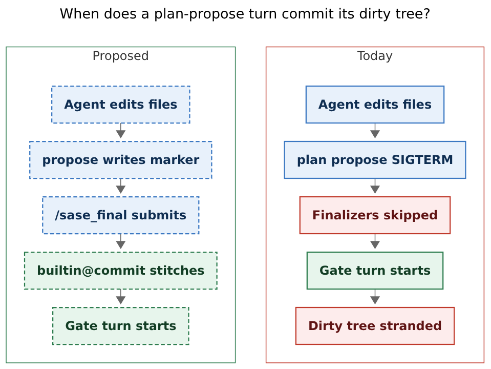
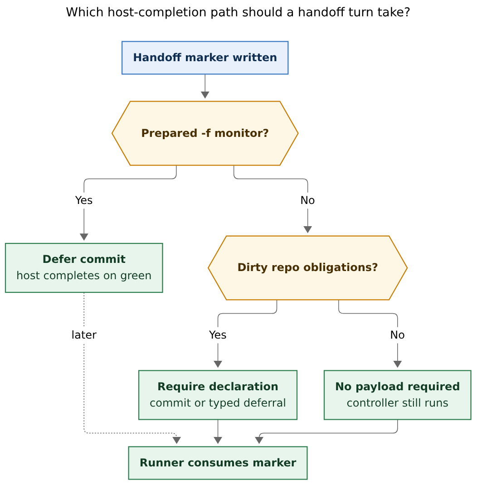

# Hand off through the commit finalizer

**Researcher:** grk (`research.5f.grk`)
**Date:** 2026-10-28
**Mermaid CLI:** `@mermaid-js/mermaid-cli@12.0.0`

## Recommendation

Do it. Closing the mechanical-handoff exemption is the right product change, and
the lander evidence from today is enough to reopen the exemption clause of
[[decisions/host-owned-completion]].

Use the existing `builtin@commit` finalizer as the turn terminator. Keep pending
markers as the handoff mechanism. Stop `sase plan propose`, `sase monitor start`,
`sase gate create --turn`, `sase questions`, and `sase pipe` from SIGTERM-killing
the runner. After the provider returns, run host completion, then consume the
marker.

Keep [[decisions/gates-never-block]] and [[decisions/single-turn-agents]]: the
agent still dies before a human answers. The change is *when* it dies and *what
runs first*.

## Adjustments to the stated requirements

These are deliberate departures from the prompt. Each one is required for the
design to stay consistent with host-owned completion.

1. **Treat "no commit specified" as the existing clean-tree case.**
   `builtin@commit` already accepts an empty `repositories` list when there are
   no dirty obligations (`trigger: not_triggered`, `submission_required: false`).
   Do not add `action: skip` / `action: none`. A dirty plan or monitor turn still
   owes a `commit` decision or a typed deferral.

2. **Always *run* the controller on a handoff turn; do not always *require an
   authored payload*.** Close the skip in
   `should_skip_finalizers` and in declaration recovery. Keep
   `submission_required` tied to dirty obligations. `/sase_final` becomes
   mandatory to *invoke*; when context says no payload is required, the skill
   still returns after reading it. Forcing empty JSON on every clean hello-world
   turn would only feed recovery loops.

3. **Keep handoff out of the declaration schema.** Do not invent a plan/monitor
   finalizer and do not put gate/monitor argv in the commit payload. The pending
   marker (`.sase_plan_pending` and siblings) is already the durable handoff
   object. Sequence: accept declaration → stitch → consume marker.

4. **Preserve prepared monitor completion as a separate order.**
   `sase final prepare` plus `sase monitor start -f <ref>` is verify-then-commit.
   A bound `-f` monitor must *not* run `builtin@commit` on the starting turn.
   That is the one remaining starting-turn exemption, and it is deferred
   completion, not a skip.

5. **Include questions and pipe.** They share the same SIGTERM and skip
   machinery. Leaving them exempt recreates the hole. For same-workspace
   successors that should inherit dirty files, the existing deferral reason
   `belongs_to_another_turn` is the pass-through valve. For plan/gate/questions,
   that reason is almost always wrong, because approval launches elsewhere.

6. **Refuse-if-dirty is the wrong alternative.** Bead `bob-cli-e0` listed it
   beside commit-then-handoff. Refusing a dirty propose forces a second turn and
   cannot express "land this fix and propose B7 together." Sequence the
   finalizer before the gate instead.

7. **No sase-core wire change.** Empty payloads are already valid when
   obligations are empty. A new action would drag the Rust pin for no benefit.

8. **No product feature flag.** This is a broken agent contract, not a beta
   capability. Land it with tests and updated skills. Keep a one-release
   rollback in git history; do not leave two completion semantics in the tree.

## Why this is a good idea

The exemption is not a small prompt footnote. It is a host skip that drops
`builtin@commit` on the floor the moment a lander does the thing the land
prompt tells it to do.

The default land prompt (`src/sase/default_config.yml`, `bd/land`) requires the
lander to set the epic plan's frontmatter `status: done` in the plans sidecar
and, when remaining work exists, to finish with `/sase_plan`'s propose loop.
Those two instructions cannot both succeed today.

`bob-cli-dw.land` (2026-10-28) made the conflict explicit. After closing epic
`bob-cli-dw` it declined to propose backlog batch B7:

> Doing that would most likely have thrown away this turn's uncommitted work
> … ending a turn with a plan proposal never commits that turn's changes. This
> turn holds the sase test fix and nine plan-file edits, so I ended it normally
> to get them committed.

It filed **bob-cli-e0** (READY, large bug): five consecutive backlog-batch
landers (`a1`, `b2`–`b5`; epics `bob-cli-d7`, `-da`, `-dd`, `-df`, `-dp`) all
closed, all still `status: wip` on plans origin. Earlier batches that ended
with an ordinary declaration are `status: done`. The same skip would have
dropped the sase test fix in `dw.land`'s own workspace.

`sase-1ou.land` took the other fork: it proposed
`202610/files_spread_ci_landing.md`, was renamed to `--plan`, produced no
model response (SIGTERM ate it; the runner synthesizes a plan-file preview),
then `--gate` and a later `--mon` ran `sase bead work` to launch `sase-1ou.6`.
Whatever landing edits lived in that workspace were subject to the same skip.

`plan_propose_handler.py` already documents the hole:

> Proposing a plan terminates the runner mechanically, so this is the only
> place a handoff can be caught at all -- a finalizer or a later
> commit-triggered hook never runs for this turn.

The same class of stranding already hit monitor continuations as **bob-cli-dn**
(CLOSED 2026-10-28, SASE `a5cb6724b2`): opened-repo obligations were not
inherited after a monitor handoff, so a continuation committed beads-sidecar
rows and left sase/sase-core edits dirty. dn fixed inheritance for the
follow-up. e0 is the sibling for *the proposing turn itself*.

Host-owned completion's own reopen clause is "after operational soak." Five
lost lander edits plus two named agents in one day is soak.

## Current architecture

A successful `sase plan propose` (and the other handoff CLIs) does four things
in order:

1. Guard (`handoff_guard`): `SASE_AGENT`, artifacts dir, no second marker, not
   a finalizer-owned turn.
2. Durable side effect (archive the plan, create the monitor member, create the
   gate bundle, and so on).
3. Write one of `.sase_plan_pending`, `.sase_monitor_pending`,
   `.sase_gate_pending`, `.sase_questions_pending`, `.sase_pipe_pending`.
4. `kill_agent_runner_group` — SIGTERM the runner process group. The function
   is `NoReturn`.

The runner's SIGTERM path treats a marker that predates the kill as an
intentional handoff (`run_agent_exec.py` `_handle_killed_iteration`). For a
plan, `handle_plan_marker` creates the `PlanApproval` / `EpicApproval` gate
turn and synthesizes a chat response from the plan file because the model
reply is gone.

Host completion never gets a vote:

| Layer | Behavior today |
| --- | --- |
| `should_skip_finalizers` | `True` when any pending marker exists |
| `ensure_final_declaration_or_recover` | returns immediately on `has_pending_handoff` |
| `run_finalizers` | journals `phase_skipped` / `handoff:plan` and returns |
| Failed-close recovery | `should_recover=False`, reason `pending_handoff` |
| VCS workspace release | skipped so the session keeps the checkout |
| `/sase_final` skill, `AGENTS.md`, `macros.md` | "plan, monitor, pipe, or questions handoff is exempt" |

Dirty files *survive in the numbered workspace* — the claim is held. They are
still lost as *commits* when the next agent is a gate, an approver, and then a
fresh epic in another workspace. That is the lander case. Monitor and pipe
follow-ups reuse the same checkout, so primary-repo dirt is visible to
`--next`; opened sidecars still need the dn inheritance, and origin still
never sees a stitch unless someone declares.

Prepared completion already walks around the skip: `sase final prepare` seals a
declaration without submitting, `-f` binds it, and monitor settlement runs
`run_finalizers(..., mode="no_model")`, which bypasses `should_skip_finalizers`.
That path is verify-then-commit. It does not help a lander who needs
commit-then-gate.

Finalizer-owned recovery turns refuse handoffs (`SASE_FINALIZER_OWNED_TURN`).
Keep that. A recovery turn that could `sase plan propose` would recurse.



**Figure 1.** Left: proposed path — marker, declaration, `builtin@commit`, then
the gate. Right: today's path — SIGTERM, skipped finalizers, stranded dirty
tree. Rendered 638.3 × 481 px, fit 100%. Mermaid CLI 12.0.0.

## Critique of "just use the existing commit finalizer"

The instinct is right. The commit finalizer is already the host's only
repository mutation path, already knows every opened repo, already adjudicates
deferrals, already closes beads. A second "handoff finalizer" would duplicate
the runner's marker machinery inside the declaration schema and reopen
host-owned completion's rejected alternative of "prompt-selected executors."

Three traps in the prompt's wording:

**"All agent turns should be required to submit a final declaration."**
Taken literally, a clean Q&A turn with no handoff authors empty JSON. The
skill already says "if `submission_required` is false, stop here and return."
Keep that. The requirement that matters is: a handoff turn is no longer exempt
from the controller, and a dirty handoff turn is no longer exempt from a
payload.

**"The commit finalizer knows that it is okay for agents that propose plans or
run monitors [to] not specify that a commit should be made."**
True for a clean tree. False for a dirty tree. Encoding "I proposed a plan, so
I may leave landing fixes uncommitted" would relabel today's bug as a feature.
Pass-through of dirty files to a *same-workspace* successor uses
`belongs_to_another_turn`, which the host can still disprove.

**"Use a finalizer for gates and monitors instead [of killing]."**
Killing is what enforces single-turn today. Replacing it with "the CLI
returns, please stop" relies on the model. The host still has a mechanical
terminator: the provider returns, the controller runs, the runner consumes the
marker and the process ends. The CLI stop-killing; the runner keeps ending the
turn. Agents that keep chatting after a descriptor waste context until the
provider hits its ceiling, which is the same failure mode as an agent that
never calls `/sase_final` today. Recovery covers the dirty case.

Keeping SIGTERM and teaching "submit, *then* propose" is worse. Models will
propose first — it is the skill's last step today — and the kill still races
the declaration. The lander prompt's last action is propose. The terminator
has to come *after* propose.

## Recommended design

### Contract

1. Handoff CLIs write the pending marker, print the descriptor, and **return**.
   They do not call `kill_agent_runner_group`.
2. The agent finishes with `/sase_final` (always invoked). Dirty obligations
   still require `action: "commit"` plus a Conventional Commit message, or a
   typed deferral. Clean trees require no payload.
3. The provider writes its last user-visible response (landers keep a real
   landing report instead of a synthesized plan preview).
4. `run_finalizers` runs. Pending markers no longer skip it.
5. On controller success, the runner consumes the marker with the existing
   `handle_plan_marker` / `handle_monitor_marker` / `handle_gate_marker` /
   questions / pipe functions, extracted so they do not depend on SIGTERM.
6. On missing declaration with dirty obligations, declaration recovery runs
   (it already exists). Recovery remains finalizer-owned, so it cannot hand
   off. If recovery fails, **fail closed**: do not create the gate. The
   archived plan stays in `~/.sase/plans`; the agent or a successor repairs
   and the marker can still be consumed after a current declaration exists.
7. Bound `-f` monitor: starting-turn controller does not execute commit; the
   sealed intent owns later `no_model` completion. The agent does not
   `sase final submit` on that path. `prepare` already sealed the declaration.



**Figure 2.** A bound prepared monitor defers commit until the check is green.
Any other handoff with dirty obligations requires a declaration; a clean tree
still runs the controller with no payload; then the runner consumes the
marker. Rendered 700.4 × 714 px, fit 93.2%. Mermaid CLI 12.0.0.

### Agent-visible order

```text
finish file work
→ sase plan propose | monitor start | gate create --turn | questions | pipe
     (writes marker, returns)
→ sase final context
→ sase final submit   # only if submission_required
→ last message
→ host stitches, then creates the gate/monitor follow-up
```

For prepared verification:

```text
sase final prepare <wrapper>
→ sase monitor start -p verify -f <ref> -- <exact argv>
→ last message
→ host completes on green, or launches recovery on red
```

Once a pending marker exists, a second handoff is already refused. Optionally
refuse mutating tools other than `sase final *` after the marker; that is
polish, not the MVP.

### Kind-specific notes

| Kind | After successful host completion | Dirty + no declaration |
| --- | --- | --- |
| Plan / custom gate / questions | Create the gate turn | Recovery, then fail closed |
| Monitor without `-f` | Adopt the already-started monitor member | Recovery, then fail closed. Pass-through of dirt uses `belongs_to_another_turn` if the follow-up should commit |
| Monitor with `-f` | Skip starting-turn commit; monitor owns completion | N/A — prepare already sealed a declaration |
| Pipe | Launch the successor in the same workspace | Same as unprepared monitor |

Workspace claim handling stays as it is: pending handoff still holds the
checkout. The new work is that origin receives the stitches *before* the
session walks off to a gate.

### Decision records

Write a new accepted record, for example "Handoff Completes Through The Host",
that:

- claims: a turn-ending handoff is host completion then marker consumption;
- supersedes only the *exemption clause* of [[decisions/host-owned-completion]]
  (the rest of that record stays — agents still never `git commit`);
- leaves [[decisions/gates-never-block]] and [[decisions/single-turn-agents]]
  in force;
- costs: one extra controller cycle on every handoff turn, and agents must
  live until `/sase_final` instead of dying at the CLI;
- reopens when a hosting platform ships true suspend/resume (same reopen as
  those two records).

Do not edit `gates-never-block.md` in place.

### Implementation surface

Python host, not sase-core:

- Stop the kill: `plan_propose_handler.py`, `monitor/start.py` +
  `monitor/handoff.py`, `gate_turn/agent_handoff.py`,
  `questions_command_handler.py`, `pipe_handler.py`, `turns/handoff.py`.
- Stop the skip: `finalizers/controller_context.py`
  `should_skip_finalizers`; `declaration_recovery.py` early return;
  `_failed_close_recovery_assess.py` `pending_handoff` short-circuit (failed
  stitch on a handoff turn must still be eligible for failed-close recovery
  *before* the gate is created).
- New sequencing: after `run_finalizers` in `llm_provider/_invoke.py` (or in
  the exec loop's normal-completion path), if a marker remains, call the
  current handle-marker functions. Today those functions only run on the
  SIGTERM path.
- `-f` guard: if the pending monitor carries a completion ref, do not execute
  commit instances on the starting turn.
- Skills and generated instructions: `sase_plan.md`, `sase_monitor.md`,
  `sase_gate.md`, `sase_questions.md`, `sase_handoff.md`, `sase_final.md`,
  `sase/memory/sase.md`, `macros.md`, `AGENTS.md` / `CLAUDE.md` projection.
- Tests that encode the skip, which must flip:
  `test_handoff_skips_generic_controller`,
  `test_controller_handoff_skip_journals_phase_skipped`,
  `test_handoff_skips_declaration_recovery`,
  `TestHandoffAndIdentity.test_pending_handoff_skips_assessment`,
  plus every handler test that asserts `kill_agent_runner_group` is the
  success path.

### Tests that would have caught e0

1. Dirty a plans-sidecar file, `sase plan propose`, submit a commit
   declaration, approve the plan. The sidecar edit is on origin. (e0's
   reproduction.)
2. Same, omit the declaration: recovery turn, then commit, then gate. Fail
   closed if recovery is skipped.
3. Clean tree, propose, no payload: gate still created.
4. `sase final prepare` + `-f` monitor: starting turn does not stitch; green
   monitor stitches.
5. Lander script: `status: done` on the current epic plan plus a successor
   propose in one turn; both the status commit and the new plan archive exist.

## Risks

- **Models ignore "stop after the descriptor."** They already ignore "you are
  about to be killed." Recovery plus fail-closed is the backstop for dirt.
  Optional: freeze mutating tools after the marker.
- **Plan already archived when finalize fails.** Propose moves the scratch
  file before today's kill. Keep that side effect; do not create the gate
  until completion succeeds. The archive is recoverable; a gate with stranded
  sidecar edits is not.
- **Commit-then-monitor of unverified work.** Agents who want verify-then-commit
  already have prepare. Skills must keep that path first for `just check`.
- **Double completion.** Submit plus `-f` must be refused or ignored on the
  starting turn.
- **Capacity.** The agent holds its runner slot until `/sase_final` instead of
  dying at propose. That is minutes, not a human-scale gate wait. The original
  reason for `gates-never-block` (do not hold a slot for a reviewer) is
  intact.
- **Instruction churn.** Every provider bundle that copies the exemption
  sentence has to change together (`sase skill init` after land, per
  `generated_skills.md`).

## Alternatives considered

| Approach | Verdict |
| --- | --- |
| Commit-then-handoff via existing `builtin@commit` (this document) | Recommended |
| New handoff finalizer / declaration payload for plan argv | Duplicates pending markers; crosses the host-owned-completion trust boundary |
| Keep SIGTERM; require submit-before-propose | Models propose first; kill still wins the race |
| Refuse propose while dirty | Two turns; cannot land+propose together |
| Pass-through forever (workspace holds dirt) | Works for monitor `--next`; fails for plan approval, which is the lander bug |
| Block on the gate (undo `gates-never-block`) | Holds runner slots for humans; already rejected with `bob-cli-15.2` evidence |

## Sources

- `bob-cli-dw.land` transcript, 2026-10-28, `sase chat show --agent bob-cli-dw.land`
- Bead `bob-cli-e0` (READY): plan-propose handoff never commits the proposer's dirty edits
- Bead `bob-cli-dn` (CLOSED): continuation opened-repo obligation inheritance, SASE `a5cb6724b2`
- `sase-1ou.land` session members `--plan` / `--gate` / `--mon`, plan
  `202610/files_spread_ci_landing.md`
- `src/sase/default_config.yml` land prompt (`bd/land`): `status: done` plus
  remaining-work propose loop
- `src/sase/main/plan_propose_handler.py` (archive, marker, SIGTERM, "finalizer
  never runs" comment)
- `src/sase/turns/handoff.py`, `src/sase/gate_turn/agent_handoff.py`,
  `src/sase/main/monitor/start.py`, `src/sase/main/utils.py` `kill_agent_runner_group`
- `src/sase/finalizers/controller_context.py` `should_skip_finalizers`
- `src/sase/finalizers/declaration_recovery.py` handoff early return
- `src/sase/finalizers/declaration_store.py` `not_triggered` / `submission_required`
- `src/sase/finalizers/declaration_manifest_commit.py` only legal action is `commit`
- `src/sase/axe/run_agent_exec.py` `_handle_killed_iteration`
- `src/sase/axe/run_agent_exec_plan.py` synthetic plan response after SIGTERM
- `src/sase/llm_provider/_invoke.py` `run_finalizers` after provider return
- `src/sase/macros/skills/sase_final.md`, `sase_plan.md`, `sase_monitor.md`, `sase_gate.md`
- `sase/memory/decisions/host-owned-completion.md`, `gates-never-block.md`,
  `single-turn-agents.md`
- `docs/reference/config/finalizers.md`, `docs/reference/automation/monitors.md`
  (Prepared host completion)
- Tests: `test_handoff_skips_generic_controller`,
  `test_controller_handoff_skip_journals_phase_skipped`,
  `test_handoff_skips_declaration_recovery`

Independent report. Peer swarm files under this request were not read.
