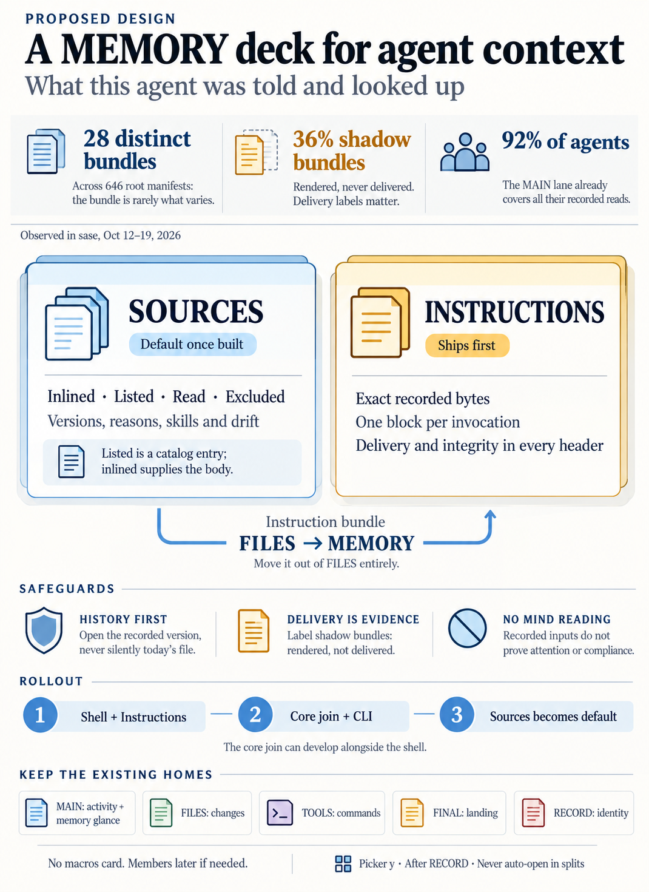

# A MEMORY Deck for What an Agent Was Told and Looked Up

> **Research query:** What is the best way to stop showing the selected SASE agent's
> instruction bundle in the file deck and show it in a new memory deck instead, one that
> also holds cards for the other memory (and maybe macros) the agent used? Which cards and
> blocks belong there, and do any of them belong in a different existing deck such as the
> record deck? Critique the plan: is it a good idea, would a different approach be better,
> which requirement adjustments are justified, and what is the recommended solution?

## Bottom line

1. **Build the deck and move the bundle out of FILES. Move it; do not copy it.** All five
   researchers agree, and the code backs them up. FILES' blurb is "Diffs and files the
   agent touched," and a bundle is neither of those things. Bundles inflate the `files N`
   count. For an agent with no diffs, the bundle becomes FILES' *default page*. For runs
   from before the delivery cutover, FILES shows a bundle that was **never delivered**
   (see [FILES shows undelivered bundles](#files-shows-undelivered-bundles)). The bundle
   landed in FILES through an optional, cheap-path decision (`files_deck` in the E4 plan,
   bead `sase-1lj.4`, 2026-10-16). Nobody weighed it as the bundle's permanent home.
2. **The literal plan puts the wrong thing at the center.** The bundle text is nearly the
   same for every agent. [Last week's 646 root manifests](#measurements) held just
   **28 distinct bundles** and **8 distinct common digests**, and the most common digest
   covered 255 runs. What changes from one agent to the next, and what you need when
   debugging, is this: which memory the agent was handed and in what form, what it looked
   up and why, at which versions, whether a retry today would see different text, and
   whether delivery worked. Three of the five researchers (`cld` Sources, `grk` Ledger,
   `gem` Coverage) separately proposed a per-agent *join* view for exactly these
   questions. That view should become the deck's default card. The bundle is the second
   card.
3. **Nothing moves into RECORD.** RECORD holds short fact sheets about what a run *is*.
   It is always available, and it must still render when an archive entry is unreadable.
   Memory content is long, varies per run, and needs artifacts-dir I/O. One correction:
   RECORD's `Bundle:` field is the *dismissed-agent archive* bundle, not the instruction
   bundle. [Two reports got this wrong](#how-i-resolved-disagreements-and-errors).
4. **No macros card.** Of the 570 `macros.json` files from last week, the references are
   571 `workflow` (mostly `#gh` VCS setup), 8 `part`, and 3 `swarm`. That is prompt
   construction, not memory. The one memory-shaped macro, `#memory/<note>`, appears in
   **zero** of the 2,341 raw prompts recorded in 2026 across all projects. Two reports
   built a special Sources row for it. That would be machinery with nothing to show, which
   the decision `corpus-before-mechanism` warns against.
5. **Ship it in [slices](#phased-plan).** First, a deck shell plus an **Instructions**
   card. This is pure presentation over readers that already exist, and it fixes FILES
   right away. Next, the **Sources** join and drift classification in `sase-core`, with
   CLI parity. That becomes the default card when it lands.

## Critique: is this a good idea?

**Yes, with a narrower definition and a different center.**

Why it is right:

- **FILES is misleading.** It reports bundle counts and default pages that say nothing
  about the agent's work, and it shows undelivered shadow bundles as if they were real
  pages. The dim `files 0` state used to mean "touched nothing," and that signal is gone.
- **The manifest has structure that a file viewer throws away**: section ids, layers,
  sources, blob OIDs, token estimates, exclusion reasons, and delivery facts.
- **"What did it know?" comes up again and again and has no home.** The answer is spread
  across a five-row lane in MAIN, a file page in FILES, pager hints, and an Admin Center
  pane organized by scope. Prior research
  (`instruction_bundles_provider_parity_and_memory_ledger.md`, 2026-10-05) designed a
  MEMORY deck (`p y`, cards Receipt / Ledger / Bundle) before RECORD existed. The tree
  built the cheap half (the lane plus the FILES pages) and skipped the deck.

What is wrong with the plan as written:

- **It treats the bundle as the main object.** The numbers in
  [Measurements](#measurements) say it is the least informative per-agent object.
- **"Cards for other types of memory" invites a card per data source.** That produces
  thin cards like Strands, Workspaces, or Macros. The cards should be organized around
  the debugging questions instead:
  - Did it have the rule (inlined, listed, or excluded)?
  - Did it look the rule up, and when and why?
  - At which version, and is that version stale now?
  - Would a retry see different text?
  - Was the bundle delivered correctly?
- **"Memory" overpromises.** The deck can show what was *recorded as supplied or
  retrieved*. It cannot show what the model attended to, obeyed, or still remembers after
  compaction (`cdx`). The wording and the badges must not imply that it can.
- **Historical fidelity is the real risk, not layout.** There are four traps:
  [shadow bundles](#files-shows-undelivered-bundles),
  [re-resolved read reports](#what-the-manifest-and-logs-already-record), catalog entries
  mistaken for bodies, and current skill definitions passed off as historical. A polished
  card that shows today's note as yesterday's input does more harm than no card.
- **A sixth deck has real costs:**
  - One more stop in a cycle that deliberately visits every deck.
  - Wider switcher chrome.
  - Roughly 280 PNG goldens to regenerate.
  - About 15 files of hard-coded deck branches.
  - A third thing named "MEMORY", next to the Context lane and the `gm` pane.

What I would do differently: define the deck as **"what this agent was told and looked
up"**. Make its default card a [per-agent sources view](#cards-for-agent-and-turn-nodes).
Keep the bundle as an exact-bytes reading card. Ship the cheap relocation first so FILES
is fixed now.

## Requirement adjustments

These are deliberate changes to the request.

- **A1. Rename the purpose** to "what this agent was told and looked up." The deck is a
  historical view of recorded inputs, not a picture of the model's mind
  - *Why:* Avoids claims about attention, compliance, or retention
- **A2. The default card becomes Sources once it exists.** Instructions is card 1 until
  then
  - *Why:* 28 distinct bundles across 646 runs; the debugging questions are about joins,
    versions, and drift
- **A3. Move, don't copy.** Remove the bundle from FILES pages, counts, the `bundle`
  source tag, and the archive and done-dispatch branches, in the same phase that ships
  Instructions
  - *Why:* Dual-homing is the bug. This also fixes shadow-bundle mislabeling in FILES
- **A4. Honest delivery labels are required in v1.** Shadow, native, and fallback runs
  show the `AGENTS.md as launched` snapshot as the delivered document. A shadow bundle
  appears only as a block labeled "rendered, not delivered"
  - *Why:* [36% of last week's manifests were shadow](#files-shows-undelivered-bundles)
- **A5. No macros card, and no `#memory/` row in v1**
  - *Why:* Macro data is prompt composition, and `#memory/` has zero recorded use
- **A6. Skills: yes, as rows. Artifacts, workspaces, plans, and beads: no**
  - *Why:* Skills are procedural instructions pulled on demand. The others are task
    context with existing homes
- **A7. RECORD does not change.** Optionally rename its `Bundle:` label to
  `Archive bundle:` once MEMORY exists
  - *Why:* Avoids a vocabulary collision with the instruction bundle
- **A8. Keep the MAIN MEMORY lane as the glance.** Add a hint that opens MEMORY (capital
  letter means the other panel)
  - *Why:* The lane fully covers 92% of agents' reads. Lane-to-deck mirrors the
    ARTIFACTS-to-FILES relationship
- **A9. The join and drift classification live in `sase-core`**, with CLI parity. The
  relocation itself is presentation-only
  - *Why:* `rust_core_backend_boundary` litmus test: a CLI must report the same states
- **A10. Inspection is read-only.** Opening the deck never appends memory-read or skill
  events, never expands macros, and never runs git or network work during navigation
  - *Why:* The deck must not pollute the audit data it displays

## Recommended solution

Add a sixth Agents-tab deck, **`MEMORY` — "what this agent was told and looked up"**.
Give it picker `y`,
[append it after RECORD in the cycle](#why-append-it-last-and-why-it-is-never-auto-chosen),
and never auto-choose it for splits. Its boundary is SASE's own instruction and memory
system: bundles, memory notes and webs, and skills. Task inputs, macros, and workspaces
stay where they are.

1. **Ship the shell and an Instructions card first, and remove the bundle from FILES in
   the same change.** Instructions shows the exact recorded bytes, one block per
   invocation, with section rules from the manifest's byte offsets. Each block header
   carries delivery, integrity, and size facts. Shadow, native, and fallback runs show the
   `AGENTS.md` snapshot as the delivered document. This is pure presentation over existing
   readers, and it makes FILES honest immediately.
2. **Build the Sources join and drift classification in `sase-core`**, with a matching
   `sase instructions show --sources`. Compute drift with an in-process render, cached by
   bundle SHA.
3. **Then add the [Sources card](#cards-for-agent-and-turn-nodes) as the default.** It is
   one version-pinned table showing inlined core, listed references and webs, audited note
   and strand reads with reasons, skill uses, and excluded sections, under a delivery and
   drift header. Every row distinguishes "catalog entry supplied" from "body supplied", and
   it never substitutes current content for historical content.
4. **Keep the MAIN Context MEMORY lane as the glance**, with a jump into the deck. Leave
   RECORD as the identity deck. Keep macros in MAIN. Defer the Members card, read-output
   snapshots, and any Timeline or References card until real usage asks for them.

The guiding split: **MEMORY is what it was told and looked up, MAIN is what it did, FILES
is what it changed, TOOLS is what it ran, FINAL is how it landed, and RECORD is what it
is.**

## Where each candidate belongs

- **Instruction bundle bytes**
  - *Home:* **MEMORY, Instructions**
  - *Notes:* One block per invocation
- **Delivery, integrity, and drift facts**
  - *Home:* **MEMORY** (block headers, Sources header)
  - *Notes:* MAIN keeps the one-line launch-row glance
- **Inlined core, listed references, web descriptors, excluded sections**
  - *Home:* **MEMORY, Sources**
  - *Notes:* Listed entries are labeled catalog-only, never "read"
- **Audited memory and strand reads**
  - *Home:* **MEMORY, Sources** rows
  - *Notes:* MAIN keeps the five-row glance
- **Legacy `glossary_reads.jsonl` events**
  - *Home:* **MEMORY, Sources** rows for old runs
  - *Notes:* Retire the GLOSSARY lane once nothing renders there
- **Skill uses**
  - *Home:* **MEMORY, Sources** SKILLS group
  - *Notes:* Metadata only; opening one says "current definition"
- **`#memory/<note>` expansions**
  - *Home:* Nowhere for now
  - *Notes:* Zero usage. If it is ever used, emit an audit event at expansion time
    (follow-up)
- **General macros (`#gh`, `#research`, swarms)**
  - *Home:* **Stay in MAIN** (raw prompt, chips, `Macros:`)
  - *Notes:* Prompt construction. RECORD Provenance could later gain one line, but this
    is optional
- **Artifact reads (plans, research, beads)**
  - *Home:* **Stay in MAIN ARTIFACTS lane and RECORD Links**
  - *Notes:* `cdx` suggested a later References card. Rejected for now: these are task
    inputs, not SASE memory, and they already have two homes
- **Opened workspaces and repos**
  - *Home:* **Stay in MAIN WORKSPACES lane**
  - *Notes:* `mus` suggested a card. Rejected: it says where the agent looked, not what
    it knew
- **Memory files the agent *edited***
  - *Home:* **FILES** (diffs)
  - *Notes:* A later "Wrote" group in Sources could cross-link history-feed provenance
- **Model, provider, workspace, timestamps**
  - *Home:* **RECORD**
- **"Did the whole swarm get the same instructions?"**
  - *Home:* **MEMORY, Members** (clan and tribe, later)

## Recommended design

### Deck identity

- **Name and blurb**
  - *Value:* `MEMORY`, "What this agent was told and looked up"
- **Picker key**
  - *Value:* **`y`** (`Y` for the other panel)
  - *Notes:* `m f t n r` are taken; `j k q p` are reserved. Four of five reports and the
    prior design chose `y`. `gem`'s `e` is the alternative
- **Cycle position**
  - *Value:* **Append after RECORD**: Main · Files · Tools · FINAL · Record · Memory
  - *Notes:* See
    [Why append it last and why it is never auto-chosen](#why-append-it-last-and-why-it-is-never-auto-chosen)
- **Auto-choice for new splits**
  - *Value:* **Never**, same as RECORD
  - *Notes:* See
    [Why append it last and why it is never auto-chosen](#why-append-it-last-and-why-it-is-never-auto-chosen)
- **View policy (`P`)**
  - *Value:* None (automatic), like Tools, FINAL, and RECORD
  - *Notes:* Instructions pages; Sources spreads when short
- **Availability**
  - *Value:* Based on content. Dimmed for procs, monitors, gates, and bash/python steps
  - *Notes:* Probe with no I/O, from cached bundle paths and lane counts
- **Switcher count**
  - *Value:* Audited reads (memory plus strand)
  - *Notes:* Reuses events the lane already loaded
- **Switcher alarm**
  - *Value:* Red `memory ⚠` on fallback, `MISMATCH`, or missing bytes
  - *Notes:* Quiet when correct, loud when wrong
- **Glyph and accent**
  - *Value:* An unused glyph (for example `◎`) and an accent distinct from TOOLS cyan
  - *Notes:* The prior design's `❖` already marks the selected tribe in the agents rail;
    `◈` is the GLOSSARY lane glyph

### Why append it last and why it is never auto-chosen

- `cycle_deck_id` wraps and visits **every** deck, empty ones included. Inserting MEMORY
  right after MAIN (`cdx`, `gem`) would put an extra stop on Main→Files for every user,
  every time, to serve a deck that is mostly used for debugging.
- `choose_new_panel` walks the cycle from the current deck and picks the first deck that
  has content (only RECORD is skipped). Nearly every agent has a bundle, so without a skip
  rule a MEMORY in second position would make `\` and `|` from MAIN open MEMORY instead of
  FILES. That would break the triage pair. Skip MEMORY the same way RECORD is skipped.
- Appending it last keeps every existing deck where it is, and it makes MEMORY one
  `Ctrl+P` from MAIN through the wrap. That gives `gem` and `cdx` the adjacency they
  wanted, without the extra hop. The cost: RECORD moves from one backward hop to two.
  `grk`'s slot between FINAL and RECORD is a fine alternative if you would rather keep
  RECORD one hop back.

### Cards for agent and turn nodes

**Instructions** (ships first, and is card 1 until Sources lands). This card is the exact
recorded bytes.

- **Blocks.** One block per recorded invocation (`00 root`, `00 helper`,
  `01 root · recovery`), stepped with `(` and `)`. It lands on the lowest-sequence root,
  the same one `launch_root_bundle` picks.
- **Block header.** Invocation, role, provider and model, time, and cache status.
  Delivery status and channel. Integrity (`bytes match`, `MISMATCH`, or missing). The
  short SHA, size, and an approximate (≈) token estimate. A one-line layer budget.
- **Body.** Section rules come from the manifest's byte `offset`/`length`, labeled with
  the section id, layer, and `source@blob`. Excluded sections follow, with their reasons.
  Opening the bundle read-only in the pager or editor keeps everything the FILES page
  offered.
- **Delivery honesty.**
  - `explicit`: the bundle is the delivered document.
  - `shadow`, `inherits_native`, or fallback: the first block is the
    `AGENTS.md as launched` snapshot, reusing the logic in `resolve_launch_row`, including
    its `vN` and `not in git` states. The bundle gets a separate block labeled "rendered,
    not delivered".
  - Missing or pruned: an explicit empty state that says why.

**Sources** (second slice; inserted as card 1 and made the default). This card is the
per-agent join.

- **Header.** The delivery and integrity chip, layer token budget, and the drift verdict
  (`≡ matches current memory`, or `⟲ N sections changed since launch`).
- **Groups.** PROJECT, HOME, WEBS, PACKAGE (collapsed to one row by default), READS of
  sources that were not listed, SKILLS, and EXCLUDED, with a one-line legend.
- **Row states.**
  - `● inlined`: the core body was supplied.
  - `◇ listed`: the catalog entry was supplied, but the body was not.
  - `◆ read`: an audited read, with time, reason, and batch marker. Shows `via link` for
    included targets.
  - `○ excluded`: with its reason.
  - `⟲ changed`: changed since launch.
- **Versions.** Read rows keep their recorded blob pins. A row's hint opens the
  memory-history pager pinned to the recorded blob (the `MemoryVersionPin` plumbing
  already exists). A `⟲` row opens the launched blob compared with now. A read of
  uncommitted content says "content not retained". It never silently opens the current
  file.
- **Skill rows.** Name, time, and reason. Opening one says "current definition."
  `sase_memory_read` uses collapse into the read rows they produced.
- **Old runs.** Legacy glossary events become ordinary read rows.
- **Coverage.** The view states its coverage when the 50-event loader cap applies
  ("showing latest 50"). A missing log reads "evidence unavailable", not "no reads".

**Members** (later, on clan and tribe nodes only). A common-digest verdict, then one row
per member: provider, bundle SHA, delivery, read count, and drift.

Not in the deck: one card per read, separate Strands, Macros, Workspaces, or Coverage
cards, a standalone manifest JSON card, token "usage" totals, and any compliance score.

### Other node types

- **Agent session:** One block per concrete member turn on both cards, landing on the
  newest, with role labels (the Reply-card precedent). Turns are never merged into one
  false union
- **Pinned attempt (`D`):** That attempt's artifacts dir (FINAL's rule). The current
  attempt's reads never leak in. (`gem`'s probe returned unavailable for pinned attempts;
  that is wrong, because instructions are per attempt.)
- **Native helper:** Its own record, labeled as a helper. Helper reads are not merged
  into the root's
- **Monitor, gate, named proc, bash/python step:** Empty state "No model invocation, so
  no instructions"; dimmed in the switcher
- **Archive (read-only):** The same cards, read from the artifacts dir; "pruned by
  artifact retention" when the files are gone. This must never block RECORD's light-row
  path
- **Remote or fleet-owned:** "Recorded on \<alias\>; not available locally" until fleet
  transport carries manifests

### Interaction with the rest of the TUI

- **MAIN Context.** Keep the MEMORY lane, including its launch row. Add a jump hint into
  MEMORY. The natural workflow is `|` with MAIN/Reply on the left and MEMORY on the right.
- **FILES.** Remove the bundle pages and the related tags and branches. Keep the
  `instruction_bundle_files` field and its cache, but move them next to the MEMORY loader,
  outside the `artifacts` enrichment lane.
- **Performance** (`tui_perf.md`):
  - Capture a frozen subject on the pump.
  - Load in a thread worker with a stale-generation guard (RECORD's `view.py` pattern).
  - Paint cached data first.
  - Never stat, glob, or hash on a render path.
  - Read bundle bodies only while MEMORY is shown.
  - Compute drift only while Sources is visible.
  - Keep the Agents-tab `j`/`k` p95 under 16 ms.

### Architecture and boundary

- **TUI (`sase`).** Add `widgets/decks/memory/{model,loader,document,view}.py`, copying
  RECORD's package shape, plus a panel mixin. Instructions is presentation over the
  existing `sase.instructions.manifests` readers (`read_run_manifests`,
  `launch_root_bundle`, `check_bundle_integrity`), so no core work is needed for slice A.
- **Core (`sase-core`).** A new join that takes manifests, read events, skill uses, and
  legacy glossary events and produces per-subject row states, blob pins, and token
  estimates. It also classifies drift by comparing recorded section `sha256` values with a
  current render. Expose it through a versioned wire plus a binding, and move the
  `sase-core-revision.txt` pin past that commit.
- **CLI parity.** Add something like `sase instructions show NAME --sources`. Read
  `cli_rules.md` first.
- **Drift computation.** Call the renderer in-process with the facts the run recorded, and
  cache by (bundle SHA, facts digest, memory change token). Do not shell out to
  `sase instructions render -a`: its agent-name lookup took 19.7 s here, while the render
  itself took about 33 ms. `cld`'s "35–78 ms" figure matches the render step's own
  timing line, not the command's wall time.
- **Bounded document-deck seam.** This is optional but recommended. While adding the
  deck, turn RECORD's hand-wired subject → worker → document → message path into one
  registry entry that RECORD and MEMORY both use. Leave MAIN, FILES, TOOLS, and FINAL
  alone. Otherwise deck six repeats RECORD's work across 15 files and 56 branches, where a
  missed arm renders one deck's content under another deck's header.

## Phased plan

1. **Shell and Instructions** (presentation only)
   - *Scope:* `DeckId.MEMORY`, spec, picker `y`, append to cycle, skip in
     `choose_new_panel`, availability probe, persistence, empty states, search; optional
     seam with RECORD migrated with no behavior change; Instructions card with
     delivery-honest blocks; remove bundles from every FILES path; lane jump hint;
     regenerate goldens once
   - *Exit proof:* Bundle-only agents show `files 0`. Explicit, shadow, native, helper,
     missing, and `MISMATCH` cases each render correctly. Unicode section slicing works.
     RECORD tests are unchanged. `j`/`k` p95 stays under 16 ms
2. **Core join and CLI** (can run in parallel with phase 1)
   - *Scope:* `sase-core` sources join plus drift classification, binding, revision pin,
     `sase instructions show --sources`
   - *Exit proof:* Rust table tests; CLI output for a Claude, a Codex, a shadow, and an
     agy run
3. **Sources card**
   - *Scope:* Render the join, version pins, the drift header, SKILLS and legacy-glossary
     rows, coverage labels; make Sources card 1 and the default
   - *Exit proof:* Goldens for clean, drifted, shadow, and session cases. Opening the deck
     appends no audit events. The drift worker never runs on the pump
4. **Docs and vocabulary**
   - *Scope:* `agent-statuses.md`, `agents-main-deck.md` (also fix the stale
     `AGENT MACRO` text), `memory/history.md`, `instruction-bundles.md`; the glossary
     `agent-data-deck` strand through `/sase_memory_write` (bead `sase-1kc` already tracks
     the stale deck list)
   - *Exit proof:* Docs build; glossary lists all six decks
5. **Later, if needed**
   - *Scope:* Members card; captured read-output snapshots (content-addressed, linked from
     the event); a "Wrote" group; a Timeline card if more than about 8% of agents overflow
     the lane; the Admin Center "Seen by" reverse view
   - *Exit proof:* Each phase has its own justification

## Open questions for you

1. **[Cycle slot](#why-append-it-last-and-why-it-is-never-auto-chosen).** Last
   (recommended), or between FINAL and RECORD?
2. **[Default card](#cards-for-agent-and-turn-nodes).** Should Sources replace
   Instructions as the default when it lands (recommended), or should Instructions stay
   first because it is what you asked for?
3. **[Seam](#architecture-and-boundary).** Extract the bounded document-deck seam now
   (recommended), or copy RECORD's wiring and refactor at deck seven?
4. **[RECORD label](#requirement-adjustments).** Rename `Bundle:` to `Archive bundle:`
   once MEMORY exists?

Two existing defects are worth fixing whatever you decide:

- [FILES shows shadow bundles with no label](#files-shows-undelivered-bundles). The move
  fixes this.
- [Memory-read reports print re-resolved current content](#what-the-manifest-and-logs-already-record)
  under `## Output` with no label. The MAIN lane hints use this path today.

## What exists today

Everything in this section was verified.

### The bundle in FILES

- `file_panel/_file_list.py::desired_file_pages` appends `instruction_bundle_pages(agent)`
  after the commit, live, linked-repo, and extra-file pages, and the default page is
  `pages[0]`. If an agent has no diffs and no extra files, its bundle is the default page.
- `decks/availability.py::probe_files_deck` counts those pages, so a research agent that
  touched nothing shows `files 2` (its root bundle and its helper bundle).
- Bundle discovery (`compute_instruction_bundle_files`) runs inside the **`artifacts`**
  enrichment lane (`_agent_display_header_summary.py:243-262`). A user who hides that lane
  also stops bundles from loading. The MEMORY deck needs its own loading path.
- Archive and done-dispatch branches in `_agent_detail_files.py` (lines 36 and 54) handle
  bundles separately, so a correct move touches selection, counts, live enrichment, done
  loaders, and the archive.

### FILES shows undelivered bundles

This is a new finding.

`run_bundle_paths()` returns every recorded bundle, whatever its delivery status. Of last
week's 646 root manifests, **235 (36%) were `shadow`**: the bundle was rendered for
comparison, but the agent actually received `AGENTS.md`. Every one of them came from
2026-10-12 through 2026-10-14, before the E3 cutover. Another 10 agy runs were
`inherits_native`.

The MAIN launch row handles this correctly. `_launch_row_from_bundle` returns `None`
unless the bundle is explicit, and it falls back to the `AGENTS.md as launched` snapshot.
FILES shows the shadow bundle with no label at all.

The explicit-delivery sunset flags (`claude_explicit_instructions` and its siblings) are
still open, so a flag-off run can fall back to native delivery again. Every
Instructions-card design has to keep "bytes recorded" separate from "bytes delivered".

### Memory surfaces outside FILES

- **MAIN Context, MEMORY lane**
  - *What it shows:* Launch row (`Instructions as launched` with channel, size,
    `bytes match`/`MISMATCH`, or the `AGENTS.md` snapshot), then up to
    `MAX_VISIBLE_READS = 5` audited reads with version chips and reasons
  - *Limits:* The loader keeps at most `MAX_KEPT_READS = 50` events
- **MAIN Context, SKILLS lane**
  - *What it shows:* `skill_uses.jsonl` events: name, time, reason
  - *Limits:* No historical skill body
- **MAIN Context, GLOSSARY lane**
  - *What it shows:* The legacy `glossary_reads.jsonl` log
  - *Limits:* Legacy only; current glossary reads arrive as `strand` events in MEMORY
- **Identity header**
  - *What it shows:* `AGENT RAW PROMPT` and macro chips
  - *Limits:* Docs still call it `AGENT MACRO`; the code does not
    (`_identity_header.py:75`)
- **RECORD Provenance**
  - *What it shows:* Project, workspace, model, …, `Bundle:`
  - *Limits:* `Bundle:` comes from `bundle_path`/`_dismissed_bundle_path`, which is the
    archive bundle (`record/facts.py:131`, `record/model.py:149-157`)
- **Admin Center Memory pane (`gm`)**
  - *What it shows:* Browse and edit memory by scope
  - *Limits:* Organized by scope, not by agent; cannot sit in a split next to Reply
- **CLI**
  - *What it shows:* `sase instructions show / render / verify / readout`
  - *Limits:* `render -a NAME` reports drift ("bundle matches recorded …")

### What the manifest and logs already record

- Each root manifest (`instructions/NN-<provider>.json`) has 30-odd `sections[]` with
  `id, layer, status (included|excluded), lifecycle, offset, length, sha256, tokens_est,
  sources[]`. `delivery` holds the status, channel, cache, `render_ms`,
  `provider_cli_version`, and subagent. `observation` is `unobserved` by default.
  Section byte offsets let a viewer slice the frozen bundle. It does not need to re-render
  anything or parse headings.
- **A listed reference note's section holds its catalog entry, not its body.** A web's
  section holds its descriptor, even though its `sources` name strand files (`cdx`).
  Seeing a source in the manifest does not prove the agent got its body.
- `memory_reads.jsonl` (schema v3) records the kind, selectors, resolved and included
  targets, the reason, `blob_oid`/`included_blob_oids`, `cwd`, and `artifacts_dir`. The
  CLI appends the event *before* it prints its output.
- **Read "reports" are not historical.** `memory_read_report.py::_resolve_report_view`
  re-resolves the selectors against the event's `cwd`, as that directory is *today*. That
  `cwd` is a reused `sase_<N>` workspace, so the `## Output` section can show another
  agent's later checkout. It carries no label saying so, even though `## Versions read`
  lists the recorded blobs. `gem`'s plan to show "reproduced output" from this path would
  present current content as if it were historical, which is what `cdx` warned against.

## Measurements

The scope is the `sase` project, 2026-10-12 to 2026-10-19, unless noted.

- **Distinct bundles across 646 root manifests**
  - *Value:* 28 SHAs, 8 common digests, top digest covering 255 runs
  - *What it means for the design:* The bundle body is boilerplate, so it should not be
    the default card. Drift results cache well per bundle SHA
- **Bundle size**
  - *Value:* 329 / 333 / 354 lines (min / median / max), about 5k tokens
  - *What it means for the design:* Pages comfortably. `gem`'s "1,000–2,500 lines" is
    wrong
- **Delivery status**
  - *Value:* 401 explicit, 235 shadow (pre-cutover), 10 `inherits_native` (agy)
  - *What it means for the design:* Delivery labeling is a v1 correctness requirement
- **Runs with a helper bundle**
  - *Value:* 66 of 562
  - *What it means for the design:* Blocks per invocation are needed, but are usually
    trivial
- **Memory-read events**
  - *Value:* 1,457 across 531 agents; median 2, p90 5, max 13; 42 agents (8%) over the
    lane's 5-row cap
  - *What it means for the design:* An uncapped read list adds little. The deck's value
    is the join, versions, and drift (matches `cld`'s 7%)
- **Read kinds**
  - *Value:* 1,260 note, 193 strand, 4 web
  - *What it means for the design:* Strand reads matter (glossary, decisions)
- **Read events with link-included targets**
  - *Value:* 122
  - *What it means for the design:* The difference between requested and included
    targets is real
- **Skill uses**
  - *Value:* 233 across 152 agents; top: `sase_new_task` 75, `sase_memory_write` 44,
    `sase_memory_read` 31, `sase_final` 21
  - *What it means for the design:* Skills belong as rows. `sase_memory_read` uses
    duplicate the read rows, so de-emphasize them
- **`#memory/<note>` macro usage**
  - *Value:* 0 of 2,501 `macros.json` and 0 of 2,341 `raw_prompt.md` (all projects, 2026)
  - *What it means for the design:* No Sources row for it in v1
- **Drift render**
  - *Value:* Render step 32–34 ms (cache hit);
    **`sase instructions render -a NAME` takes 19.7 s wall**
  - *What it means for the design:* Call the renderer in-process with recorded facts.
    Never shell out to `render -a` (see [Architecture and boundary](#architecture-and-boundary))
- **Cost of the last new deck (RECORD shell `b4dbfcd90e`)**
  - *Value:* 317 files changed, **278 PNG goldens** regenerated; 56 hard-coded
    `DeckId.RECORD` references across 15 files outside `record/`
  - *What it means for the design:* Budget a sixth deck honestly, and regenerate goldens
    once

## How I resolved disagreements and errors

- **Default card**
  - *Positions:* Bundle/Instructions (`cdx`, `grk`, `mus`, `gem`) vs. Sources (`cld`)
  - *Resolution:* **Sources, once built** ([Measurements](#measurements) data).
    Instructions until then
- **Join view**
  - *Positions:* Sources (`cld`), Ledger (`grk`), Coverage (`gem`)
  - *Resolution:* Same idea arrived at independently. Named **Sources**, because "Ledger"
    collides with `decisions:goal-ledger` and "Coverage" suggests a completeness claim the
    deck cannot make
- **Cycle slot**
  - *Positions:* After MAIN (`cdx`, `gem`), after TOOLS (`cld`), before RECORD (`grk`)
  - *Resolution:* **Last**, with before-RECORD as the alternative. After MAIN costs
    everyone a hop and breaks split auto-choice
- **Picker key**
  - *Positions:* `y` (`cdx`, `cld`, `grk`, prior design) vs. `e` (`gem`)
  - *Resolution:* `y`
- **Macros**
  - *Positions:* Card (`gem`), launch macro plus skills (`mus`), `#memory/` only (`cdx`,
    `cld`), none (`grk`)
  - *Resolution:* **None.** The `#memory/` case has zero usage. `grk`'s claim that
    `#memory/` content "already appears as an inlined section or a read" is wrong, because
    the macro bypasses the read audit
- **Artifact reads**
  - *Positions:* Later References card (`cdx`) vs. exclude (`cld`, `grk`, `mus`)
  - *Resolution:* Exclude; they already have two homes
- **Rust boundary**
  - *Positions:* None (`mus`), slice B (`grk`), phase 1 (`cld`), shared evidence in core
    (`cdx`)
  - *Resolution:* Relocation stays in Python; the join and drift go to core
- **Read content**
  - *Positions:* Reproduced output (`gem`) vs. re-resolved, not historical (`cdx`)
  - *Resolution:* `cdx` is right (verified,
    [What the manifest and logs already record](#what-the-manifest-and-logs-already-record)).
    Open the recorded blob, or say the content is unavailable
- **RECORD `Bundle:`**
  - *Positions:* Instruction bundle path (`grk`, `gem`) vs. archive bundle (`cld`)
  - *Resolution:* Archive bundle (verified)
- **Facts in `gem`**
  - *Positions:* `00-bundle.md`/`00-manifest.json`; 1,000–2,500-line bundles;
    `Ctrl+N`/`Ctrl+P` as "next/prev file"; `◈` as the memory glyph
  - *Resolution:* The real files are `NN-<provider>.md/.json`; bundles are about 330–354
    lines; `Ctrl+N`/`Ctrl+P` cycle decks; `◈` is the GLOSSARY lane glyph
- **`AGENT MACRO` header**
  - *Positions:* Cited by `grk` and `mus`
  - *Resolution:* The code renders `AGENT RAW PROMPT`/`AGENT PROMPT`; only the docs are
    stale
- **Clans and tribes**
  - *Positions:* Members card (`cld`), audience strip (`grk`), unavailable (`mus`),
    summary with links (`cdx`)
  - *Resolution:* Members card, later. It is cheap, but with only 8 common digests a week
    it is rarely surprising

## About this report

Consolidated report by the lead researcher, 2026-10-19. It merges five independent reports
(`cdx`, `cld`, `grk`, `mus`, `gem`) with my own checks against sase master `e5f2d768ea`,
plus measurements of the live `gh_sase-org__sase` artifacts and audit logs for
2026-10-12 through 2026-10-19.

> **Request.** The selected agent's instruction bundle shows in the FILES deck. Show it in
> a new MEMORY deck instead. That deck should also hold cards for the other memory the
> agent used, and maybe macros. Decide which cards and blocks belong there, and whether
> any of them belong in an existing deck such as RECORD. Critique the plan, adjust the
> requirements where that is justified, and recommend a solution.
