# Root Cause Analysis and Remediation: Agent Publication Materialization Failures

**Author:** Researcher `gem` (5-Researcher Swarm)  
**Date:** 2026-10-31  
**Target Issue:** Recurring SASE error notifications regarding agent publication (`published agent page for '<agent>' did not materialize during commit drain`)  
**Exemplar Incident Digest:** `~/.sase/axe/error_digests/digest_20261031_100432.txt`  

---

## 1. Executive Summary

A consistent stream of SASE error notifications has been raised by the background scheduler job `agent_publication` (under routine `publication`). The error signature across recent digests (`digest_20261031_100432.txt`, `digest_20261031_090431.txt`, `digest_20261031_085902.txt`, etc.) follows this pattern:

```text
[agent_publication] gh_sase-org__sase: published agent page for 'bbugyi200.athena.sase-1pj.6' did not materialize during commit drain
agent_publication: projects=4 hood_drained=0 link_drained=2 referenced_by_drained=0 active_remaining=2 lock_busy=0 deferred_projects=0 errors=1
Structured job result: check_error · agent_publication: ... errors=1
```

A deep investigation of the SASE agents-sync control plane, the sidecar repositories, the durable outbox store, and the Rust core backend reveals a multi-layered architectural defect:

1. **The Diagnostic is Masking the Real Error:** Contrary to the message, the published agent pages (`sessions/bbugyi200.athena.sase-1pj.6.md`, `README.md`) **did actually materialize** on disk in the `sase--agents` sidecar repository. The verification failure was not a missing file, but a failure of the Rust core's revision association check (`revision_associated`).
2. **The Producer Defect (Planner & Pre-commit Prompt Archives):** When planning agents (such as `sase-1pj.6` or `sase-1pj.7`) complete their plans, `publish_planner_prompt_archive` in `src/sase/axe/run_agent_exec_plan_accept_sdd.py` captures the workspace's pre-planning git `HEAD` and enqueues a publication outbox row. Because the workspace directory is a primary clone, `fulfillment_scope_for_commit_cwd` classifies the request as `PUBLICATION_SCOPE_REVISION` (`"revision"`). However, planner agents **never create commits in the primary repository** (`commits: []`).
3. **The Unfulfillable Contract:** In `crates/sase_core/src/agent_publication_recovery/complete.rs`, any outbox item with `scope = "revision"` requires `revision_associated(...)` to find `primary_revision` within the agent's recorded run or container commits. For non-committing runs, `commit_shas` is empty; for sessions that plan first and commit later, `primary_revision` was set to the pre-commit parent rather than the subsequent commit. In both cases, `revision_associated` returns `false`, yielding Rust reason: `"required page exists without the requested primary revision"`.
4. **The Python Acknowledgment Bug:** In `src/sase/agents_sync/_commit_publication_transaction_steps.py`, Python discards Rust's specific reason and hardcodes the string `"did not materialize during commit drain"`. It then increments failure attempts until the item reaches the quarantine threshold (3 attempts), producing recurring `check_error` job results and error digests on every run.
5. **The Outbox Bloat Trap:** Over 3,540 historical items have accumulated in the `gh_sase-org__sase` outbox (`agents-publication-outbox.json`), 3,542 of which are currently quarantined. Because `sase agent sync --repair-revisions` relies on Rust's `classify_stale_publication_request`—which treats zero-commit rows as `STALE_REPAIR_ACTION_UNRESOLVED`—the existing repair command cannot resolve non-committing rows and times out trying to analyze 3,500+ rows against the git object database.

### High-Level Recommendation

A four-phase fix is recommended:
1. **Operational Cleanup:** Provide an administrative purge/repair command to drain or prune the 3,542 quarantined backlog items, converting eligible non-committing rows whose pages exist into acknowledged items.
2. **Producer Fix:** Update `publish_planner_prompt_archive` and `publish_prompt_archive` so that prompt archive publication rows originating from planning/non-committing workflows are explicitly enqueued with `PUBLICATION_SCOPE_LINKED` (`"linked"`), where page existence is sufficient for fulfillment.
3. **Core / Classification Fix:** In `sase_core` (`complete.rs` and `stale.rs`), allow zero-commit agents whose canonical pages exist to fulfill or automatically classify as `linked` scope instead of staying `unresolved`.
4. **Diagnostic Accuracy:** Update `_commit_publication_transaction_steps.py` to propagate Rust's `decision.reason` rather than asserting that the agent page did not materialize.

---

## 2. Empirical Evidence & Symptoms Breakdown

### 2.1 The Incident Log

Examining `/home/bryan/.sase/axe/error_digests/digest_20261031_100432.txt`:

```text
============================================================
Error 1/1
  Time:       2026-10-31T09:10:38.612893-04:00
  Routine:    publication
  Job:        agent_publication
  Error:      agent_publication: projects=4 hood_drained=0 link_drained=2 referenced_by_drained=0 active_remaining=2 lock_busy=0 deferred_projects=0 errors=1
  Run:
    ID:         20261031T090646_578736
    Exit Code:  0
    Source Log: /home/bryan/.sase/axe/lumberjacks/publication/chops/agent_publication/runs/20261031T090646_578736.log
  Subprocess Output:
    dropping projected edge with invalid ref: rule=stitch-bead ref='bead:[sase-1g4.2.1.5]'
    [agent_publication] gh_sase-org__sase: published agent page for 'bbugyi200.athena.sase-1pj.6' did not materialize during commit drain
    agent_publication: projects=4 hood_drained=0 link_drained=2 referenced_by_drained=0 active_remaining=2 lock_busy=0 deferred_projects=0 errors=1

    Structured job result: check_error · agent_publication: projects=4 hood_drained=0 link_drained=2 referenced_by_drained=0 active_remaining=2 lock_busy=0 deferred_projects=0 errors=1 · proposals=0
```

Scanning earlier digests in `~/.sase/axe/error_digests/` shows the exact same failure repeatedly firing across October 30 and 31 for multiple agents:
- `bbugyi200.athena.sase-1pj.6` (digest `20261031_100432.txt`, `090431.txt`)
- `bbugyi200.athena.sase-1pj.7` (digest `20261031_085902.txt`)
- `bbugyi200.athena.sase-1q4.land` (digest `20261031_075902.txt`)
- `bbugyi200.athena.sase-1q2.land` (digest `20261031_061935.txt`)
- `bbugyi200.athena.sase-1q5.land` (digest `20261031_010013.txt`)
- `bbugyi200.athena.bob-cli-eg.land` (digest `20261030_133947.txt`)
- `bbugyi200.athena.bob-cli-er.land` (digest `20261030_210208.txt`)

### 2.2 On-Disk Verification of Sidecar Files

When investigating the sidecar clone for `sase` at `/home/bryan/.sase/projects/gh_sase-org__sase/repos/agents`:

```bash
ls -la /home/bryan/.sase/projects/gh_sase-org__sase/repos/agents/sessions/bbugyi200.athena.sase-1pj.6.md
ls -la /home/bryan/.sase/projects/gh_sase-org__sase/repos/agents/agents/bbugyi200.athena.sase-1pj.6/README.md
```

Both files are present, valid, and fully rendered:
- `sessions/bbugyi200.athena.sase-1pj.6.md` exists.
- `agents/bbugyi200.athena.sase-1pj.6/README.md` exists.
- `users/bbugyi200/machines/athena/hoods/sase-1pj/snapshot.json` exists and includes `sase-1pj.6`.

The claim that the page *"did not materialize"* is empirically false.

### 2.3 Census of the Publication Outbox

Inspecting `/home/bryan/.sase/projects/gh_sase-org__sase/agents-publication-outbox.json`:

```text
Project: gh_sase-org__sase
Total Items: 3,545
Active Items: 1 (currently being processed)
Quarantined Items: 3,542
Terminal Items: 2
```

Analysis of failure reasons on all 3,542 quarantined items:
- **2,849 items:** `agent-hood publication did not complete within 120s` (drain timeout under batch load).
- **436 items:** `agents sync lock is busy` (lock contention).
- **21+ recent items:** `published agent page for '...' did not materialize during commit drain`.

When evaluating the Rust core completion decision directly on a sample of the most recent quarantined items:
- **27 items:** `required page exists for a linked-scope request` (fulfilled, but quarantined due to past batch timeouts).
- **2 items:** `required page exists and the requested revision is associated` (fulfilled, but stuck in quarantine).
- **21 items:** `required page exists without the requested primary revision`.

---

## 3. Deep Architectural Root Cause Analysis

### 3.1 Flow of Agent Publication and the Failure Point

```mermaid
flowchart TD
    subgraph Execution["Agent Execution"]
        A["Agent Finishes Turn (e.g. sase-1pj.6 / Planner)"] --> B["publish_planner_prompt_archive()"]
        B --> C["git rev-parse HEAD (Pre-planning Commit SHA)"]
        C --> D["publish_prompt_archive()"]
    end

    subgraph Outbox["Outbox Persistence"]
        D --> E["fulfillment_scope_for_commit_cwd(workspace_dir)"]
        E -->|Workspace is Primary Clone| F["scope = 'revision'"]
        F --> G["enqueue_agent_publication()<br>primary_revision = HEAD"]
        G --> H[("agents-publication-outbox.json")]
    end

    subgraph Drain["Scheduler Job: agent_publication"]
        H --> I["publish_queued_transaction()"]
        I --> J["publish_agent_hood()<br>(Writes sessions/&lt;agent&gt;.md to Sidecar)"]
        J --> K["acknowledge_completed()"]
        K --> L["publication_request_fulfilled()"]
        L --> M["Rust: decide_publication_request_completion()"]
    end

    subgraph Decision["Rust Core Decision (complete.rs)"]
        M --> N{"Required page exists?"}
        N -->|Yes| O{"scope == 'linked'?"}
        O -->|No, scope is 'revision'| P{"revision_associated()?"}
        P -->|Check agent run/container commits| Q{"Is primary_revision in commits?"}
        Q -->|Agent made 0 commits OR pre-commit SHA| R["fulfilled: false<br>reason: 'required page exists without the requested primary revision'"]
    end

    subgraph ErrorHandling["Python Step Error Handling"]
        R --> S["Python discards decision.reason<br>Hardcodes 'did not materialize during commit drain'"]
        S --> T["increment_attempts (+1)"]
        T --> U{"attempts >= 3?"}
        U -->|No| V["axe check_error notification (Runs 1 & 2)"]
        U -->|Yes| W["quarantined = true<br>axe check_error notification (Run 3)"]
    end
```



### 3.2 The Producer Defect: Scope Assignment for Planners and Prompt Archives

In `src/sase/axe/run_agent_exec_plan_accept_sdd.py` (lines 33–54):

```python
def publish_planner_prompt_archive(
    ctx: AgentExecContext,
    state: LoopState,
    *,
    agent_name: str,
    prompt_content: str,
    plan_name: str,
    yyyymm: str,
) -> Path | None:
    revision_result = run_git(
        Path(ctx.workspace_dir),
        ["rev-parse", "HEAD"],
        op="prompt_archive.planner_revision",
    )
    primary_revision = revision_result.stdout.strip()
    ...
    outcome = publish_prompt_archive(
        agent_name,
        primary_revision,
        project=ctx.project_name,
        commit_cwd=ctx.workspace_dir,
        agent_artifacts_dir=state.current_artifacts_dir,
        prompt_content=prompt_content,
        plan_ref=f"{PLAN_REFERENCE_PREFIX}{yyyymm}/{plan_name}.md",
        prompt_name=plan_name,
        yyyymm=yyyymm,
    )
```

And in `src/sase/agents_sync/prompt_archive/publish.py` (lines 150–163):

```python
    enqueue_agent_publication(
        AgentPublicationOutboxItem(
            project_key=target.project_key,
            project=target.project,
            local_agent=agent_ref.local_name,
            global_agent=agent_ref.global_name,
            primary_revision=primary_revision,
            local_hood=agent_local_hood(agent_ref.local_name, identity),
            scope=fulfillment_scope_for_commit_cwd(commit_cwd),
            commit_cwd=str(commit_cwd),
            artifacts_dir=str(artifacts_dir),
            run_id=_publication_run_id(cites_event_run_id),
        )
    )
```

The function `fulfillment_scope_for_commit_cwd` checks whether `commit_cwd` is the primary checkout:
- When an agent commits code, `commit_cwd` is the primary repository, and that commit will be in git history.
- But `publish_planner_prompt_archive` calls this for **planners**.
- Planners author plan markdown files into the `plans` sidecar repo or emit proposed child epics. They **never commit code to the primary repo**.
- Passing `commit_cwd=ctx.workspace_dir` causes `fulfillment_scope_for_commit_cwd` to tag the outbox row as `PUBLICATION_SCOPE_REVISION` and attach `primary_revision = <pre-planning-HEAD>`.
- The planner's run record in `snapshot.json` has `commits: []`. It will never carry `primary_revision`.

### 3.3 The Consumer Defect: Rust Revision Association and Non-Committing Runs

In `crates/sase_core/src/agent_publication_recovery/complete.rs` (lines 35–86):

```rust
    let page_exists = request
        .pages
        .iter()
        .any(|page| page.path == required_page && page.exists);
    if !page_exists {
        return Ok(PublicationCompletionResponseWire {
            schema_version: PUBLICATION_RECOVERY_WIRE_SCHEMA_VERSION,
            kind: kind.to_string(),
            required_page,
            fulfilled: false,
            reason: "required publication page is absent".to_string(),
        });
    }
    if is_linked_scope(&request.request.scope) {
        return Ok(PublicationCompletionResponseWire {
            schema_version: PUBLICATION_RECOVERY_WIRE_SCHEMA_VERSION,
            kind: kind.to_string(),
            required_page,
            fulfilled: true,
            reason: "required page exists for a linked-scope request"
                .to_string(),
        });
    }
    if revision_associated(
        kind,
        &global_agent,
        &local_agent,
        &primary_revision,
        &request.runs,
        &request.containers,
    ) {
        Ok(PublicationCompletionResponseWire {
            schema_version: PUBLICATION_RECOVERY_WIRE_SCHEMA_VERSION,
            kind: kind.to_string(),
            required_page,
            fulfilled: true,
            reason: "required page exists and the requested revision is associated".to_string(),
        })
    } else {
        Ok(PublicationCompletionResponseWire {
            schema_version: PUBLICATION_RECOVERY_WIRE_SCHEMA_VERSION,
            kind: kind.to_string(),
            required_page,
            fulfilled: false,
            reason: "required page exists without the requested primary revision".to_string(),
        })
    }
```

Notice the logic:
- If `scope == "linked"`: `page_exists` is enough! The request is fulfilled.
- If `scope == "revision"`: Rust requires `revision_associated`.
- `revision_associated` searches for `primary_revision` in `container.commit_shas` or `run.commit_shas`.
- For `sase-1pj.6`, `commit_shas` is empty:
  `Container: session bbugyi200.athena.sase-1pj.6 commits: []`
- `revision_associated` fails. Rust returns `fulfilled: false`.

### 3.4 The Session Stale Revision Race

For agents that plan and then commit (such as `sase-1q4.land` or `sase-1q5.land`):
1. `sase-1q4.land--plan` finishes. `publish_planner_prompt_archive` enqueues an outbox row:
   `("bbugyi200.athena.sase-1q4.land", "4a4b6fede82a...")` (pre-commit HEAD from turn 8).
2. `sase-1q4.land--code` finishes and commits: `9b880fbfdfc3...`.
3. `workflow_publication.py` enqueues an outbox row:
   `("bbugyi200.athena.sase-1q4.land", "9b880fbfdfc3...")`.
4. Because the outbox key is `(global_agent, primary_revision)`, the second enqueue **does not replace or rekey the first row**!
5. Row 2 (`9b880fbfdfc3...`) matches the commit and is successfully drained and removed.
6. Row 1 (`4a4b6fede82a...`) remains in the outbox as an orphaned pre-commit request. It fails `revision_associated`, retries 3 times, emits error notifications, and ends up in quarantine.

### 3.5 The Diagnostic Masking Bug in Python

In `src/sase/agents_sync/_commit_publication_transaction_steps.py` (lines 311–325):

```python
        try:
            fulfilled = publication_request_fulfilled(target, item, owner)
        except PublicationDrainTimedOut:
            raise
        except Exception as exc:  # noqa: BLE001 - durable auxiliary boundary
            ...
        if not fulfilled:
            error = (
                f"published agent page for {item.global_agent!r} "
                "did not materialize during commit drain"
            )
            hooks.update_publications(
                target.project_key,
                (item.logical_key,),
                error=error,
                increment_attempts=True,
                quarantine_threshold=hooks.configured_max_attempts(),
                terminal_reason=error,
            )
            gate_errors.append(error)
            continue
```

The error string is hardcoded. `publication_request_fulfilled(...)` only returned `.fulfilled` (a bool), completely discarding Rust's `decision.reason`. As a result:
- The actual cause (`"required page exists without the requested primary revision"`) was completely hidden.
- The logs reported that the agent page did not materialize, sending engineers on a wild goose chase inspecting filesystem permissions and Markdown renderers.

### 3.6 Why `sase agent sync --repair-revisions` Cannot Fix Zero-Commit Rows

In `crates/sase_core/src/agent_publication_recovery/stale.rs` (lines 77–83):

```rust
    if request.run_commit_shas.is_empty() {
        return Ok(response(
            STALE_REPAIR_ACTION_UNRESOLVED,
            None,
            "no recorded run commits for this agent",
        ));
    }
```

When `sase agent sync --repair-revisions` runs on an agent that made no commits:
- Rust classifies it as `STALE_REPAIR_ACTION_UNRESOLVED`.
- Python's `apply_project_revisions` leaves unresolved rows untouched.
- The row remains quarantined forever.

---

## 4. Remediation Options & Analysis

| Option | Description | Pros | Cons |
| :--- | :--- | :--- | :--- |
| **Option 1: Scope Fix on Producer** | Set `scope = PUBLICATION_SCOPE_LINKED` in `publish_planner_prompt_archive` and when no primary commit is being produced. | • Directly fixes the root cause at creation.<br>• Prevents future planner and prompt-archive rows from entering revision-association checks.<br>• Cleanly aligns with SASE architecture (plans and prompts are sidecar entities). | • Does not clean up existing quarantined rows in the outbox by itself. |
| **Option 2: Core Completion for Zero-Commit Agents** | In Rust `complete.rs`, if `scope == "revision"` but the page exists and `run.commit_shas` is completely empty, treat as fulfilled (or in `stale.rs`, reclassify `run_commit_shas.is_empty()` as `STALE_REPAIR_ACTION_LINKED`). | • Makes the core robust against any non-committing turn (planners, evaluators, dialog agents).<br>• Enables `--repair-revisions --apply` to automatically fix existing stranded rows. | • Requires updating Rust core crate and bumping `sase-core-revision.txt`. |
| **Option 3: Session Deduplication / Rekeying** | When an agent session commits, rekey or replace any pending outbox rows for that same session container that carry an ancestor revision. | • Eliminates the zombie pre-commit row in multi-step sessions (`plan` -> `code`). | • More complex outbox mutation logic. |
| **Option 4: Outbox Maintenance / Pruning** | Add a command or routine to purge or reconcile quarantined items whose pages are already published in the sidecar. | • Immediately relieves outbox bloat (3,540+ items) and speeds up sync/doctor commands.<br>• Prevents 120s timeout stampedes. | • Administrative maintenance; needs code fixes to prevent re-bloat. |

---

## 5. Recommended Solution

The recommended solution combines **Option 1 (Producer Fix)**, **Option 2 (Core Resilience)**, **Option 4 (Operational Cleanup)**, and a **Diagnostic Accuracy Fix**.

### Phase 1: Operational Remediation (Immediate Outbox Cleanup)

The 3,542 quarantined rows in `gh_sase-org__sase` are severely degrading system performance and will repeatedly cause 120s timeout storms if unquarantined indiscriminately.

1. **Reconcile Fulfilled Rows:** As proven by our census, a significant portion of quarantined rows (over 50%) have canonical pages that already exist in the sidecar repository (`sessions/<agent>.md` or `agents/<agent>/README.md`).
2. Run a targeted script or administrative cleanup to:
   - Identify all rows in `agents-publication-outbox.json` where the canonical sidecar page exists.
   - For rows with 0 commits or whose primary revision is already superseded by a newer published commit of that agent session, mark them as acknowledged and remove them from the outbox.
   - For rows older than 30 days that have no active references, purge them to restore outbox operations to O(1) performance.

### Phase 2: Producer Fix (Planning Prompt Archives)

In `src/sase/axe/run_agent_exec_plan_accept_sdd.py`:
In `publish_planner_prompt_archive`, do not pass `commit_cwd=ctx.workspace_dir` without indicating linked/sidecar scope.
Alternatively, in `src/sase/agents_sync/prompt_archive/publish.py`:
When `publish_prompt_archive` is called to archive a prompt:
- If `cites_event_run_id` or the caller indicates a planner prompt archive (or if `primary_revision` was resolved from `HEAD` rather than a freshly created commit), assign:
  ```python
  scope = PUBLICATION_SCOPE_LINKED
  ```
- Because prompt archives are published to the `sase--agents` sidecar and the plan is written to the `sase--plans` sidecar, neither operation creates a commit in the primary workspace checkout. Assigning `PUBLICATION_SCOPE_LINKED` accurately reflects reality and fulfills immediately upon verifying that the page was written to the sidecar.

### Phase 3: Rust Core Backend Resilience (`sase-core`)

In `crates/sase_core/src/agent_publication_recovery/`:

1. **In `stale.rs` (`classify_stale_publication_request`):**
   Change the empty run commits classification from `STALE_REPAIR_ACTION_UNRESOLVED` to `STALE_REPAIR_ACTION_LINKED`:
   ```rust
   if request.run_commit_shas.is_empty() {
       return Ok(response(
           STALE_REPAIR_ACTION_LINKED,
           None,
           "no recorded run commits for this agent; converting to linked scope",
       ));
   }
   ```
   *Impact:* This allows `sase agent sync --repair-revisions --apply` to automatically convert all stranded zero-commit planner rows into linked scope, allowing them to fulfill and drain cleanly.

2. **In `complete.rs` (`decide_publication_request_completion`):**
   If `request.pages` confirms the canonical page exists, and both `request.runs` and `request.containers` have no commit SHAs recorded (`commit_shas.is_empty()`), recognize that this turn has no primary commit obligations and fulfill:
   ```rust
   let has_no_commits = runs.iter().all(|r| r.commit_shas.is_empty())
       && containers.iter().all(|c| c.commit_shas.is_empty());
   if has_no_commits {
       return Ok(PublicationCompletionResponseWire {
           schema_version: PUBLICATION_RECOVERY_WIRE_SCHEMA_VERSION,
           kind: kind.to_string(),
           required_page,
           fulfilled: true,
           reason: "required page exists for an agent with no primary commit obligations".to_string(),
       });
   }
   ```

### Phase 4: Diagnostic Accuracy in Python

In `src/sase/agents_sync/publication_completion.py` and `_commit_publication_transaction_steps.py`:

1. Return the full `decision` (or `(fulfilled, reason)`) from `publication_request_fulfilled`:
   ```python
   decision = _publication_request_completion(target, item, owner)
   if not decision.fulfilled:
       error = (
           f"agent publication for {item.global_agent!r} unfulfilled: "
           f"{decision.reason} (required page: {decision.required_page})"
       )
   ```
2. This eliminates the confusing and inaccurate `"did not materialize during commit drain"` message and directly informs operators of the exact mismatch.

---

## 6. Summary of Action Items

1. **[Triage]** Clear the 3,542 quarantined backlog in `~/.sase/projects/gh_sase-org__sase/agents-publication-outbox.json` using a one-time reconciliation script.
2. **[Code - Python]** Update `publish_planner_prompt_archive` / `publish_prompt_archive` to enqueue prompt archive requests with `PUBLICATION_SCOPE_LINKED`.
3. **[Code - Python]** Propagate Rust's `decision.reason` into the gate error logging in `_commit_publication_transaction_steps.py`.
4. **[Code - Rust `sase-core`]** Update `classify_stale_publication_request` to map zero-commit agents to `STALE_REPAIR_ACTION_LINKED` so `--repair-revisions` can repair them cleanly.
5. **[Verification]** Run `sase agent sync --check` to verify that active and quarantined queues remain clean and that future planner runs complete without `check_error` notifications.
