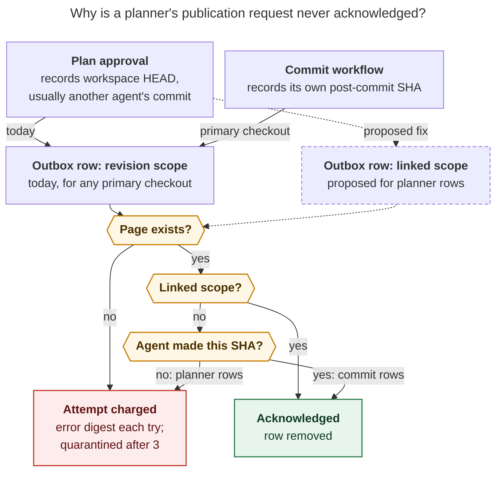

# Agent publication "did not materialize" notifications: planner rows fail a revision gate they can never pass

> **Research query:** Why am I getting consistent SASE error notifications about agent
> publication (for example, the errors in
> `~/.sase/axe/error_digests/digest_20261031_100432.txt`), and what is the best way to
> fix them? End with a recommended solution.


## Bottom line

- **The error message is wrong about what failed.** Every agent named in the recent
  `agent_publication` notifications has its session page, agent page, and prompt archive
  in the agents sidecar. The drain's acknowledgment gate refuses the request for a
  different reason: the request names a primary-repo commit that this agent did not make.
- **The bad requests come from plan approval, not from commits.**
  `publish_planner_prompt_archive()` records the workspace's current `HEAD` (usually
  another agent's landing commit) and enqueues a `revision`-scoped publication row. The
  Rust completion policy only acknowledges a revision row when that SHA belongs to the
  agent's own runs. [A planner never satisfies that](#root-cause), so its row fails three
  times (one error notification per attempt) and is quarantined. **8 of 8** plan
  approvals since the background publisher went live (6 `sase`, 2 `bob-cli`) failed this
  way.
- **No data is lost, and the existing repair tools can't clear these rows.**
  `--repair-revisions` classifies 14 of the 15 persistent `sase` rows as `unresolved`
  ([see the evidence](#where-the-researchers-disagreed-and-what-the-evidence-says)).
  Blanket `--retry-quarantined` just repeats the failure, and would also revive
  [about 3,500 unrelated historical rows](#how-big-the-problem-is).
- **Recommended fix (small, Python-only):** have the planner enqueue its prompt-archive
  row with the existing `linked` (page-only) scope. In the same change, make outbox
  merges keep the stricter `revision` scope, record the Rust decision's real reason
  instead of "did not materialize", and repair the dead "retire on repeat" path. After it
  ships, re-scope and retry only the planner rows that evidence proves are planner rows.
  Leave the older backlog as a separate effort. Details in
  [the recommended solution](#recommended-solution).

## What the notification says

The example digest `~/.sase/axe/error_digests/digest_20261031_100432.txt` reports one
`publication / agent_publication` error, from run `20261031T090646_578736` at 09:10:38:

```text
dropping projected edge with invalid ref: rule=stitch-bead ref='bead:[sase-1g4.2.1.5]'
[agent_publication] gh_sase-org__sase: published agent page for
  'bbugyi200.athena.sase-1pj.6' did not materialize during commit drain
agent_publication: projects=4 hood_drained=0 link_drained=2 ... active_remaining=2 ... errors=1
Structured job result: check_error · ...
```

- **The `did not materialize` line is the real error.** The job script sets
  `result.status = "check_error"` whenever `tick.errors` is non-zero
  (`src/sase/scripts/sase_chop_agent_publication.py:37-38`). That is why exit code 0
  still produces a digest.
- **The `dropping projected edge … bead:[…]` line is unrelated noise.** It is a WARNING
  from `src/sase/artifact_links/projection/_entry.py`. Two historical commits carry a
  bracketed `SASE_BEAD=[id]` footer that has no link definition: `sase 8c8c47f720` and
  `bob-cli cc9bd5f5`. The resulting ref `bead:[…]` fails validation, so the edge is
  dropped. Fixing this would not change the error (cld, grk).
- **Repetition pattern.** The job runs on a 15 s interval with doorbell plus
  `max_quiet: 5m` (`src/sase/default_config.yml`). The attempt cap is
  `DEFAULT_PUBLICATION_MAX_ATTEMPTS = 3`. Each affected agent produces one burst of up to
  three errors in a few minutes (`active_remaining` 1 → 1 → 0), then goes quiet until the
  next plan approval.
- **Digest counts per agent (Oct 30–31).** Three each for `bob-cli-eg.land`,
  `bob-cli-er.land`, `sase-1pj.5.1.land`, `sase-1pj.7`, `sase-1q2.land`,
  `sase-1q4.land`, and `sase-1q5.land`. Two so far for `sase-1pj.6`: its outbox row shows
  `attempts=3`, so expect its third error in the next digest.

## Root cause



_Figure 1. Both producers share one acknowledgment gate. Commit rows pass because they
name the agent's own commit. Planner rows name a commit someone else made, so they fail
the ownership check every time. Giving planner rows the existing `linked` scope routes
them through the page-only branch. Dashed edges are the proposal._

The causal chain, verified against the current tree (`sase` `d3d26a5b55`, `sase-core`
`80338d6b`):

1. **Plan approval records an unowned SHA.** `run_agent_exec_plan_accept.py:349` calls
   `publish_planner_prompt_archive()`
   (`src/sase/axe/run_agent_exec_plan_accept_sdd.py:20-60`). That function runs
   `git rev-parse HEAD` in the workspace and passes the result as `primary_revision`,
   with `commit_cwd=ctx.workspace_dir`. Nothing establishes that the planner made that
   commit.
2. **The row gets revision scope because of where it was created, not what it is for.**
   `_publish_prompt_archive()` enqueues an `AgentPublicationOutboxItem` with
   `scope=fulfillment_scope_for_commit_cwd(commit_cwd)`
   (`src/sase/agents_sync/prompt_archive/publish.py:150-163`). That function returns
   `revision` for any primary checkout (`_commit_publication_queue.py:211-219`). The
   row's intent, archiving an approved planner prompt, is never recorded. The inline step
   then archives and pushes the prompt successfully, but leaves acknowledgment to the
   drain.
3. **The drain publishes the pages and then refuses the row.**
   `prepare_publications()` publishes the whole hood, which is why the pages exist.
   `acknowledge_completed()` passes the withheld and deferred-prompt gates, then calls
   `publication_request_fulfilled()`. That wraps sase-core's
   `decide_publication_request_completion`
   (`crates/sase_core/src/agent_publication_recovery/complete.rs`). For a revision row,
   the SHA must appear in the agent's own run or session commit SHAs. It doesn't, so the
   policy returns `fulfilled=false` with reason _"required page exists without the
   requested primary revision"_.
4. **Python discards that reason.** `publication_request_fulfilled()` returns only
   `.fulfilled` (`publication_completion.py:24-31`). On false, the caller hard-codes
   _"published agent page … did not materialize during commit drain"_, charges an
   attempt, and adds the message to the tick's errors
   (`_commit_publication_transaction_steps.py:296-325`).

The planner can never satisfy this. Epic planners never make a primary commit. Tale
coders make a _new_ commit that descends from the planner's `HEAD`. Land agents that only
commit to sidecars never touch the primary repo.

### Evidence for the five October 31 rows

Every outbox row (`bbugyi200.athena.…`) in the list below has `scope=revision`,
`run_id=null`, `attempts=3`, and `quarantined=true`. Its ACE metadata (`agent_meta.json`
in the row's `artifacts_dir`) names a `--plan` turn with `plan_approved=true` and
`workspace_head` equal to the requested SHA.

- **`sase-1pj.6`**
  - *Requested SHA:* `2763a6bc58`
  - *Who made that commit (`SASE_AGENT` footer):* `sase-1pj.5.1.land`
  - *Planner metadata (`name`, `plan_action`):* `sase-1pj.6--plan`, epic
- **`sase-1pj.7`**
  - *Requested SHA:* `2763a6bc58`
  - *Who made that commit (`SASE_AGENT` footer):* `sase-1pj.5.1.land`
  - *Planner metadata (`name`, `plan_action`):* `sase-1pj.7--plan`, epic
- **`sase-1q2.land`**
  - *Requested SHA:* `eec20f6ad5`
  - *Who made that commit (`SASE_AGENT` footer):* `sase-1q2.6`
  - *Planner metadata (`name`, `plan_action`):* `sase-1q2.land--plan`, epic
- **`sase-1q4.land`**
  - *Requested SHA:* `4a4b6fede8`
  - *Who made that commit (`SASE_AGENT` footer):* `sase-1q4.8`
  - *Planner metadata (`name`, `plan_action`):* `sase-1q4.land--plan`, tale
- **`sase-1q5.land`**
  - *Requested SHA:* `cb230adb5e`
  - *Who made that commit (`SASE_AGENT` footer):* `sase-1q4.3`
  - *Planner metadata (`name`, `plan_action`):* `sase-1q5.land--plan`, tale

Commit attribution comes from cdx and cld (`git show` footers). Each row's `created_at`
also falls within about 1–2 s of that agent's sidecar commit `chore(agents): archive
prompt for <agent>--plan` (cld). A sixth `sase` row, `sase-1pj.5.1.land@c9a65d1a58`,
has the same shape, but its artifacts directory has since been cleaned up.

**Independent replay.** I ran the production completion policy, read-only, through the
installed interpreter and native binding. Under the stored `revision` scope, all six rows
return _"required page exists without the requested primary revision"_ (kind
`session`). With only the scope changed to `linked`, all six return `fulfilled=true`.
cdx and cld reported the same result.

### Why it started on October 30

The bug has been latent for weeks. The background job made it visible (cld's timeline,
spot-checked):

- **2026-08-01, `61075153cb`:** planner prompt archives are first published at `HEAD`.
- **2026-10-03, sase-core `3d406d4c`:** revision rows now need SHA association, so
  planner rows can no longer complete.
- **2026-10-24, `02cd3b39b6`:** the commit path switches to the post-commit SHA
  (`sase-1nj` / `sase-1nv.3`) and linked rows become page-only. The planner path is
  untouched.
- **2026-10-30, `66b15496f9`:** deferred prompt-archive context is preserved, so planner
  rows now pass the prompt gate and fail at the revision gate instead.
- **2026-10-30, `4356cffaa1` and `6d615680b8`:** axe now drains the outbox every 15 s,
  and every failed attempt becomes `check_error`, which means a digest and a
  notification.

Rows with the same signature exist from Oct 21–27, created by inline or manual drains.
Nobody was notified about them.

## How big the problem is

**The notification class:**

- **`sase`: 36 rows** carry the `did not materialize` error. Under their stored scope
  today:
  - **21 now pass.** These are older transient races (Oct 21–27) where the page or
    snapshot was late. They are quarantined and silent.
  - **14 fail on revision association, and all 14 pass under `linked`.** They are the six
    planner rows from [the root-cause evidence](#evidence-for-the-five-october-31-rows)
    plus eight older rows.
  - **1 has no page:** `sase-1oh.land--1--plan`, a legacy row keyed by member name.
- **`bob-cli`: 63 rows.** 61 fail on revision association and would pass under `linked`.
  2 have no page (including `bob-cli-dd.land--3--plan`).

**The older `sase` backlog** is a separate problem. All 3,544 rows are quarantined (3,542)
or retired (2); none are active. Census by stored error and today's completion
decision:

- **Hood publication exceeded 120 s:** Rows 2,912 · Pass today 782 · Fail (page exists,
  revision missing) 877 · Fail (page absent) 1,253
- **Agents-sync lock busy:** Rows 439 · Pass today 67 · Fail (page exists, revision
  missing) 180 · Fail (page absent) 192
- **Prompt archive unresolved:** Rows 124 · Pass today 59 · Fail (page exists, revision
  missing) 65 · Fail (page absent) 0
- **Did not materialize:** Rows 36 · Pass today 21 · Fail (page exists, revision
  missing) 14 · Fail (page absent) 1
- **Other / manifest / digest:** Rows 33 · Pass today 9 · Fail (page exists, revision
  missing) 17 · Fail (page absent) 7

These rows don't notify. Do not revive them in bulk:

- Each retry is a full hood publication under the shared lock, with the same 120 s
  budget that quarantined most of them.
- A full report-only `--repair-revisions -p sase` pass did not finish within 280 s here.
  It builds the hood inventory and runs ancestry checks for every row's hood.
- About 1,450 rows describe agents whose pages were never published. That needs a
  deliberate, batched recovery effort, which this fix does not provide.

## Where the researchers disagreed and what the evidence says

- **The failing rows come from the planner prompt-archive path**
  - *Source:* cdx, cld, gem
  - *Verdict:* **Confirmed**
  - *Evidence:* Planner `agent_meta.json` matches all five rows. `run_id=null` fits the
    planner path, which passes no `cites_event_run_id`. The commit path records
    `cp.run_id` or `SASE_AGENT_TIMESTAMP` (`workflow_publication.py:206-216`); the one
    currently active commit-path row (`sase-1pj.7.1.1`, `linked`) does carry a `run_id`.
- **The rows come from a later `sase stitch create` in a workspace whose `HEAD` belongs
  to someone else**
  - *Source:* grk
  - *Verdict:* **Not supported**
  - *Evidence:* The metadata and timing above point to plan approval. grk's mechanism
    (pages exist; a foreign SHA fails the gate) is right, but it names the wrong
    producer.
- **`--repair-revisions --apply`, then `--retry-quarantined`, fixes the error**
  - *Source:* mus
  - *Verdict:* **Refuted**
  - *Evidence:* I ran the Rust stale-repair classifier on the 15 persistent `sase` rows.
    14 return `unresolved` ("no recorded run commits for this agent" or "no recorded run
    commit descends…"). Only `sase-1pj.5.1.land` is repairable (→ `2763a6bc58`).
    Retrying first would replay all three failures.
- **Relax the Rust gate so zero-commit or foreign-SHA revision rows count as fulfilled,
  or map empty commits to `linked` in `stale.rs`**
  - *Source:* grk (A, C), gem (Phase 3)
  - *Verdict:* **Rejected as the primary fix**
  - *Evidence:* A real commit row whose commit hasn't yet reached the hood snapshot also
    has zero recorded commits for its run. That is exactly the case the gate exists to
    catch (cld option E). Fix the producer, which knows the row's intent; don't guess
    intent at the gate.
- **More than half of quarantined rows are already fulfilled**
  - *Source:* gem
  - *Verdict:* **Corrected**
  - *Evidence:* My full census of the 3,544 `sase` rows finds **938 (26%)** that pass
    today's completion policy. See [how big the problem is](#how-big-the-problem-is).
- **A dedicated `prompt` scope in sase-core is the durable design**
  - *Source:* cdx (primary), cld (later)
  - *Verdict:* **Right goal, wrong first step**
  - *Evidence:* `validate_publication_item` rejects unknown scopes, and the outbox loader
    rejects unsupported schema versions (`publication_outbox_models.py:108`,
    `publication_outbox_serialization.py:49-55`). One `prompt` row would make the whole
    outbox unreadable to any older reader. The change needs a schema bump, migration,
    wire, binding, and `sase-core-revision.txt` pin. `linked` already has the right
    semantics.
- **The fix needs a release plus a global reinstall**
  - *Source:* cld
  - *Verdict:* **Only for Rust changes**
  - *Evidence:* The axe tool environment installs `sase` _editable_ from
    `~/projects/github/sase-org/sase` (`uv-receipt.toml`), and the job runs as a per-tick
    subprocess. A Python-only fix goes live once that checkout contains it. Rust changes
    need the native binding rebuilt, and global install is human-only.
- **Enqueue would downgrade an existing `revision` row to `linked`**
  - *Source:* cdx
  - *Verdict:* **Confirmed hazard**
  - *Evidence:* `enqueue_agent_publication` copies `scope` from the incoming item
    (`publication_outbox_operations.py:134-191`). The repair path already merges
    "revision wins" (`_publication_revision_repair_apply.py:131-135`); enqueue should do
    the same.
- **The "retire on second identical error" path never fires**
  - *Source:* cld
  - *Verdict:* **Confirmed**
  - *Evidence:* `prepare_publications` writes `error=None` to every prepared row before
    `acknowledge_completed` charges the gate failure
    (`_commit_publication_transaction_steps.py:174-180`). The
    `item.last_error == terminal_reason` test in `update_agent_publications` therefore
    never matches. All failing rows end `terminal=false, quarantined=true` after 3
    attempts.

## Related existing work

- **`sase-1c0` (open, READY, large bug).** "Failed planner prompt-archive publications
  are silently lost." Same producer, same root mismatch: a planner's `primary_revision`
  is not one of its run's commits.
  - `66b15496f9` added an `artifacts_dir` fallback, so deferred restore can now find the
    source.
  - Restore still calls `prepare_prompt_archive` without `plan_ref`, `prompt_name`, or
    `yyyymm` (`prompt_archive/deferred.py:61-110`). A planner archive restored after lock
    contention therefore lands under the default name, without its PLAN link.
  - Fixing this report's issue makes planner rows _acknowledgeable_. It does not make a
    failed planner archive _restore correctly_. Link the fix to `sase-1c0`, or deliver it
    under that bead.
- **`sase-1nj` / `sase-1nv.3` / `sase-1nv.4` (closed).** Same symptom on the commit
  path, caused by naming the pre-commit `HEAD`. Fixed by naming the post-commit SHA and
  adding `--repair-revisions`. The planner path was never changed.
- **`sase-1pt` (commit stage ends at durable enqueue).** Introduced the background job
  that turns these refusals into notifications. The job is behaving correctly; the
  request contract is what's wrong.
- **`sase-1oh.5.1` (withheld sibling retired as "did not materialize").** Related
  wording issue, different cause.

## Options

- **Increase timeouts, retry everything, or mute the digest:** Changes nothing about an
  association that can never exist. A bulk retry also wakes the backlog.
- **`--repair-revisions --apply` today:** Leaves 14 of 15 persistent rows `unresolved`.
- **Stop enqueueing a row for planner archives:** Loses the durable retry for a planner
  archive whose inline publish fails. Makes `sase-1c0` worse.
- **Relax the Rust gate for zero-commit or foreign SHAs:** Weakens the guarantee for real
  commit rows. Rejected.
- **Planner rows enqueue `linked` scope, with "revision wins" merges:** **Recommended
  now.** Python-only, uses existing semantics, no schema change, and replay shows every
  stuck row passes.
- **New `prompt` scope in sase-core:** Good later for readability. Needs a schema and
  compatibility plan (see
  [where the researchers disagreed](#where-the-researchers-disagreed-and-what-the-evidence-says)).
- **Ownership check at enqueue (grk B):** Unnecessary once the producer states its
  intent.

## What not to do

- Don't run `sase agent sync --retry-quarantined` before the fix is live. Each revived
  planner row fails three more times. Unbounded, it revives about 3,500 historical rows.
- Don't purge rows by age (gem's 30-day proposal). About 1,450 rows describe agents
  whose pages were never published.
- Don't change the Rust completion policy to accept foreign or empty-commit SHAs.
- Don't downgrade this error class to a warning, or stop counting it in `check_error`.
  That would also hide real commit-publication losses. Fix the request contract and the
  message instead.

## Recommended solution

### Step 1: Give planner prompt-archive rows page-only (`linked`) fulfillment

Python only, in the `sase` repo:

1. **`src/sase/agents_sync/prompt_archive/publish.py`.** Add a keyword-only
   `fulfillment_scope: str | None = None` to `publish_prompt_archive` and
   `_publish_prompt_archive`. Enqueue with
   `scope=fulfillment_scope or fulfillment_scope_for_commit_cwd(commit_cwd)`.
2. **`src/sase/axe/run_agent_exec_plan_accept_sdd.py::publish_planner_prompt_archive`.**
   Pass `fulfillment_scope=PUBLICATION_SCOPE_LINKED`, with a comment explaining it:
   - the pre-plan `HEAD` is the anchor and key only;
   - the planner doesn't own that commit;
   - its obligation is the session page plus the prompt archive, and
     `acknowledge_completed` already gates the archive.
3. **`src/sase/agents_sync/publication_outbox_operations.py::enqueue_agent_publication`.**
   Merge scope so `revision` wins when either the existing or the incoming item is
   `revision`. This mirrors `_publication_revision_repair_apply.py:131-135`, so a planner
   enqueue can't weaken an existing commit row with the same `(global_agent, SHA)` key.
4. **Leave the commit path alone** (`workflow_publication.py:206`). It publishes the
   agent's own post-commit SHA, and the revision gate is correct there.

This keeps the policy in Rust, consistent with the Rust core boundary. Python only states
the request's intent through an existing wire value.

Tests:

- The planner path enqueues `linked`; the commit-path prompt archive still enqueues
  `revision`.
- **Epic planner:** a drain acknowledges a planner row when the session page and prompt
  archive exist and the hood has no run commits.
- **Tale planner:** the same, after the coder later commits a descendant SHA.
- Merge: enqueuing `linked` on top of an existing `revision` row keeps `revision`.
- A real commit row naming the wrong SHA is still refused, and a missing page is still
  refused.

Run `just check` per the repo conventions.

### Step 2: Make the failure honest, and stop it repeating

1. **Report the real reason.** Have `publication_request_fulfilled` return the Rust
   decision, or a `(fulfilled, reason, required_page)` tuple. Record a message such as
   `agent publication for 'X' not acknowledged: <reason> (page <path>, scope <scope>,
   revision <sha12>)`. Don't hard-code "did not materialize".
2. **Repair the dead terminal path.** Compare against the error recorded before
   `prepare_publications` clears it, or don't clear it until acknowledgment. Deterministic
   gate refusals then retire after two attempts, as the docstring intends, instead of
   quarantining after three. That cuts the next deterministic failure class from three
   notifications to two. It does not hide them.
3. **Optional: fix the doctor hint.** The "stale requested revisions" diagnostic
   (`publication_completion.py:34-78`) points every such row at
   `--repair-revisions --apply`. Suggest that command only for rows the classifier can
   actually repair.

### Step 3: Clean up the rows that are already stuck (optional, after Steps 1–2 are live)

The stuck rows are quarantined and silent, and their pages and archives exist. Notifications
stop with Step 1 even if you skip this step.

To clear them:

1. **Re-scope only proven planner rows to `linked`, through the outbox mutation API,**
   with an audit record. A row counts as proven when either:
   - its `artifacts_dir` metadata names a `--plan` turn with `plan_approved=true` and
     `workspace_head` equal to the requested SHA (the five Oct 31 `sase` rows); or
   - the sidecar has a matching `archive prompt for <agent>--plan` commit at its
     `created_at` (covers `bob-cli-eg.land` and `bob-cli-er.land`).
2. **Retry each one with a bounded, per-key retry.** For example:

   ```sh
   sase agent sync --project sase --retry-quarantined --retry-limit 1 \
     --retry-key 'bbugyi200.athena.sase-1pj.6@2763a6bc58cd74d4882ab97bace343de0c73fa97'
   ```

3. **`sase-1pj.5.1.land@c9a65d1a58` is the one row the existing classifier can rekey**
   (→ `2763a6bc58`). Rekey it, then retry it by key the same way.
4. **Leave everything else quarantined, or drop it deliberately:** the older eight `sase`
   rows and most of `bob-cli`'s 61 rows, which lack retained metadata. Plan the
   [120 s timeout, lock-busy, and missing-page backlog](#how-big-the-problem-is) as its
   own batched recovery.

### Step 4: Follow-ups

- **[`sase-1c0`](#related-existing-work).** Persist the planner archive inputs
  (`plan_ref`, `prompt_name`, `yyyymm`) so a deferred restore rebuilds the right archive
  after lock contention (cdx acceptance criterion 3).
- **Later: an explicit `prompt` scope in sase-core,** if self-describing names are worth
  it. It needs the scope in `complete.rs` and `stale.rs::normalize_scope`, an outbox
  schema bump with migration, the binding, and a `sase-core-revision.txt` pin bump.
- **Strip the brackets** from `SASE_BEAD=[id]` footers in the commit-footer parser, so
  the `bead:[…]` warning stops cluttering digests.

### Acceptance criteria

1. In a primary workspace whose `HEAD` belongs to another agent, approving a plan (epic
   and tale) results in a planner row acknowledged on its first drain, with no
   `agent_publication` error.
2. Real commit rows with the wrong SHA, missing pages, missing prompt bytes, and
   protection failures are all still refused.
3. Enqueuing a planner row and a commit row with the same key keeps `revision`. Repeating
   the repair or retry changes nothing further.
4. After cleanup, each targeted row disappears through verified acknowledgment, and its
   session page and archived prompt are still there. Check quarantine counts, not just
   active counts.

## Appendix: method and limits

_Lead researcher consolidation · 2026-10-31 · Merges researcher reports `cdx`, `cld`,
`grk`, `mus`, and `gem` (sibling files in this directory) with independent,
read-only verification on athena._

**Inputs and sources.** The five researcher reports, read through `sase artifact read`.
The digests in `~/.sase/axe/error_digests/`. The outboxes at
`~/.sase/projects/{gh_sase-org__sase,gh_bobs-org__bob-cli}/agents-publication-outbox.json`.
Planner `agent_meta.json` files. The `sase` source at `d3d26a5b55` and `sase-core` at
`80338d6b`. Beads `sase-1c0`, `sase-1nj`, and `sase-1oh.5.1`.

**Commands I ran (all read-only):**

- Completion-policy replay, using the installed `sase` interpreter and `sase_core_rs`
  0.43.3:
  - the stored scope compared with `linked`, for every materialize row;
  - the stored scope for all 3,544 `sase` rows.
- The stale-repair classifier, restricted to the 15 persistent rows.
- The report-only `sase agent sync -R -p sase -j`, which timed out at 280 s with no
  output and was not retried.

**Nothing was changed.** No retry, repair, drop, queue edit, notification dismissal, or
code change was made.

**Limits:**

- Commit attribution and the per-row timing against sidecar commits come from cdx and
  cld. I spot-checked them rather than re-deriving each one.
- The bob-cli planner provenance was checked only through cld's sidecar commit count.
- `sase-1pj.5.1.land`'s artifacts directory no longer exists.
