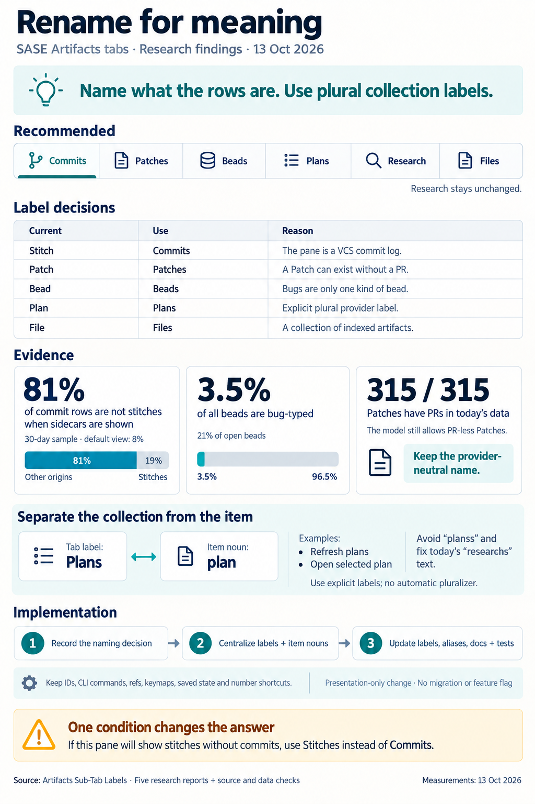

# Artifacts Sub-Tab Labels: Commits · Patches · Beads · Plans · Files

> **Research query:** Should the "Artifacts" tab's sub-tabs be renamed (Stitch →
> Commits, Patch → PRs, Bead → Bugs, Plan → Plans, File → Files) to use more common,
> pluralized terminology, or is dropping the stitch/patch/bead names the wrong call?
> Critique the plan, call out any justified adjustments to the requirements, and
> recommend the best way to implement it.

## Bottom line

| Your proposal        | Verdict                           | Why, in one line                                                                                                                                    |
| -------------------- | --------------------------------- | --------------------------------------------------------------------------------------------------------------------------------------------------- |
| Pluralize every tab  | **Yes**                           | Each tab lists many rows. The parent strip is already plural (`Agents · Artifacts · Services`). The August switch to singular never gave a reason. |
| `Stitch` → `Commits` | **Yes (one decision to confirm)** | The pane is a VCS commit log. "Stitch" is only one of three row origins. With sidecars shown, 80% of rows aren't stitches.                         |
| `Patch` → `PRs`      | **No. Use `Patches`.**            | Every row opens into a Patch. "PR" is GitHub's word in a VCS-neutral core. "Patch" is already plain developer English.                              |
| `Bead` → `Bugs`      | **No. Use `Beads`.**              | Only 3.5% of beads are bugs (21% of open ones). "Bugs" already means four other things in SASE.                                                    |
| `Plan` → `Plans`     | **Yes**                           | Give the plan provider an explicit label. Don't bring back an auto-pluralizer.                                                                       |
| `File` → `Files`     | **Yes**                           | Trivial.                                                                                                                                            |

The [tab-by-tab analysis](#tab-by-tab) gives the full reasoning for each row.

**Recommended strip:** `1 ◉ Commits │ 2 ⎇ Patches │ 3 ◈ Beads │ 4 ✎ Plans │ 5 ∴ Research │ 6 ▤ Files`

**Your hesitation is right for Patch and Bead and wrong for Stitch.** Patch and Bead name
their rows more precisely than PRs or Bugs do. Stitch is the reverse case: the common
word ("commits") is the _more_ accurate one.

**Two things the request misses:**

1. **The label is also used as a singular noun.** About 17 f-strings build text like
   `f"Refresh {label.lower()}s"` or `f"Open selected {label}"`. Pluralizing the labels
   without splitting the collection label from the item noun would print "planss" and
   "Open selected plans". This is already broken today for Research: the help modal
   says "Refresh researchs". Fix the structure, not just the strings (see
   [collection label vs item noun](#collection-label-vs-item-noun)).
2. **This is the fourth relabel of this strip since August 9.** None of those choices was
   written down, which is why the strip keeps flipping (see [History](#history)). Write a
   decision record with reopen conditions (see [Process](#process)).

The [recommended solution](#recommended-solution) turns this into three shipping steps,
with a fallback that depends on the first
[open question](#open-questions-for-you).

## Is this a good idea

**Yes for the instinct, no for the word list.** The proposal treats stitch, patch, and
bead as equally obscure. They aren't:

| Term   | Obscure?                   | Proposed common word | Common word is…                           | Do               |
| ------ | -------------------------- | -------------------- | ----------------------------------------- | ---------------- |
| Stitch | Yes (SASE coinage)         | Commits              | **More precise** for these rows           | Rename           |
| Patch  | No (plain dev English)     | PRs                  | Narrower in the model, provider-specific  | Keep (pluralize) |
| Bead   | Yes, but explained in-pane | Bugs                 | Wrong for most rows; collides four ways   | Keep (pluralize) |

**A rule worth adopting (cld's wording):** _a tab's label names what its rows are. Use
the common word when it names the rows precisely. Keep the SASE word when the common
word is narrower, wrong, or already means something else in SASE._

**Ubiquitous language is the deeper reason.** A tab label is the doorway to a domain
object. If the tab says "Bugs" but every row's detail panel, ref, CLI, and notification
says "bead", users learn both words anyway. The common label only hides the real term
until the first click. Commits is safe precisely because the rows really are commits
everywhere you look.

**What I'd do differently from the request:**

- Treat this as a _labeling policy_ with a written decision, not a one-off rename.
- Fix how labels are interpolated into prose, so this relabel and any future one is a
  table edit.

## Adjusted requirements

These are the changes from your request.

| #  | Original             | Adjusted                                                                                                                                    | Reason                                                     |
| -- | -------------------- | ------------------------------------------------------------------------------------------------------------------------------------------- | ---------------------------------------------------------- |
| R1 | `Patch` → `PRs`      | **`Patch` → `Patches`**                                                                                                                     | [Patch to Patches](#patch-to-patches)                      |
| R2 | `Bead` → `Bugs`      | **`Bead` → `Beads`**                                                                                                                        | [Bead to Beads](#bead-to-beads)                            |
| R3 | `Stitch` → `Commits` | **Keep. Label only; "stitch" stays everywhere else.** Also fix the description summary and the empty-state title.                          | [Stitch to Commits](#stitch-to-commits)                    |
| R4 | `Plan` → `Plans`     | **Keep, via an explicit provider label.** No pluralizer; `Research` unchanged.                                                             | [Plans and Files](#plans-and-files)                        |
| R5 | (implicit)           | **Leave the retired `Agent` pane alone.**                                                                                                   | [Where the five reports landed](#where-the-five-reports-landed) |
| R6 | (new)                | **Split the collection label from the singular item noun.** Route all prose through the right one; this also fixes the live "researchs" bugs. | [Collection label vs item noun](#collection-label-vs-item-noun) |
| R7 | (new)                | **Gather the hard-coded label copies into one table** next to `ARTIFACTS_ICONS` and `ARTIFACTS_ACCENTS`.                                    | [Hard-coded label copies](#hard-coded-label-copies)        |
| R8 | (new)                | **Write a decision record** (`decisions:artifacts-tab-labels`) with the rule from [Is this a good idea](#is-this-a-good-idea) and its reopen conditions. | [Process](#process)                                        |
| R9 | (new)                | **Keep the old words searchable.** Add palette aliases `stitch`/`stitches`, `bead`/`bugs`/`issues`, and `prs` (which already exists).      | [Copy and discoverability](#copy-and-discoverability)      |
| —  | (rejected add-on)    | A per-user label override (`ace.artifacts.panes.<id>.label`) is optional at most. Defer it.                                                 | [Alternatives considered](#alternatives-considered)        |

## Tab by tab

### Pluralize every tab

**Verdict: yes.**

- **Tabs name collections.** Peer tools use plural collection tabs: GitHub ("Issues",
  "Pull requests"), lazygit ("Files", "Branches", "Commits"), and Gerrit ("Changes").
  Fluent 2 asks for tab labels that are parallel grammatically. Apple's HIG and Carbon
  ask for short noun labels. The parent strip is plural, so a singular child strip is the
  inconsistent one.
- **The label matches the prose again.** "No beads", "the Beads pane", and `docs/ace.md`'s
  "Browse Stitches, Patches, Beads…" all use plurals already.
- **The best case for singular is weak.** It's that the label matches the ref kind
  (`@bead:`). But the ref kind is already visible in copy targets and detail panels.

**Do not reintroduce an auto-pluralizer.** English plurals are irregular, and "Research"
is a mass noun. Use explicit labels instead (see
[collection label vs item noun](#collection-label-vs-item-noun)).

### Stitch to Commits

**Verdict: `Stitch` → `Commits`: yes, but confirm one decision.**

**For:**

- The rows are VCS commits.
- Stitch is one origin out of three, marked by the ✦ glyph. With sidecars shown, 80% of
  rows are `auto` commits (see [Confirmed](#confirmed)).
- The empty-state body, the detail placeholder ("Select a commit…"), the description body,
  the CLI help text, and the glossary ("real Git/Mercurial commits are still called
  commits") all already say _commit_.
- Calling these rows "stitches" is the less accurate word, not the more technical one.

**The decision you must confirm.** sase-j8 deliberately put "Stitch" on this tab
_ahead of_ a planned divergence: proposal stitches like `(2a)` have no commit. Renaming
to Commits bets that this pane stays a VCS log. If you still plan to surface commit-less
stitches _in this pane_, keep the label `Stitches` instead. That is the only open fork in
this recommendation (see [open question 1](#open-questions-for-you)).

**Keep "stitch" wherever it names the concept:**

- the `stitches` id and the `stitches_*` actions
- the `ace.artifacts.stitches` config key and the `artifacts_stitches` copy group
- `@stitch:` refs and `sase stitch`
- the Patch `STITCHES:` section and the ✦ origin

**Also fix the copy:**

- The description summary says "Commits landed through SASE, each one a stitch…". That's
  false for `auto` and `manual` rows. Suggested replacement: "VCS commits across your
  projects; ✦ marks the ones SASE landed as stitches inside a Patch."
- Change the empty-state title from "No stitches" to "No commits".

### Patch to Patches

**Verdict: `Patch` → `PRs`: no; use `Patches` (and not Changes).**

Your data makes "PRs" literally accurate today (see [New evidence](#new-evidence)). It's
still the wrong label:

1. **Identity seam on SASE's most central object.** Every row opens a detail panel headed
   "Patch:" and is addressed as `@patch:`, `sase patch`, `SASE_PATCH`. A "PRs" tab whose
   rows are all Patches makes you hold two names for one thing.
2. **"PR" is one provider's word.** The VCS layer is provider-neutral: `git`/`hg`, with
   GitHub living in the `sase-github` plugin. GitLab says MR, Gerrit says change,
   Phabricator says revision, Google says CL. If you ever want forge vocabulary, have the
   active VCS provider supply the noun. Don't hard-code it.
3. **The model is broader than PRs.** Per the glossary and `docs/change_spec.md`, a Patch
   may exist with no `PR:` field. Your workflow just doesn't produce those today.
4. **"Patch" needs no translating.** It's ordinary developer vocabulary: `git
   format-patch`, Gerrit patch sets.
5. **The palette already maps `prs` → Patches.** People who think "PRs" still find the tab.

**On cdx's "Changes":**

- It would partly revert ChangeSpec → Patch.
- It's ambiguous, because commits are also changes.
- It adds a third name for the object, after Patch and PR.

Treat "Changes" as inferior to Patches, not as an alternative to it.

### Bead to Beads

**Verdict: `Bead` → `Bugs`: no; use `Beads` (Issues only later).**

**"Bugs" would mislabel at least 79% of open rows and 96.5% of all rows** (see
[Confirmed](#confirmed)). It also collides with four existing meanings of "bug":

1. the `bug` task type, so a "Bugs" tab reads like the filter `task_type:bug`
2. the `BUG:` Patch field and the historical `bug:` ref kind
3. the command-palette category **"Bugs"**, which already holds the _external-issue
   actions inside the Beads pane_ (`commands/types.py:47`; `_app_metadata_nav.py:339`
   "Beads: issue actions")
4. the retired Bugs pane, whose id now redirects to `beads` (see [History](#history))

**"Issues"** is the best common word:

- Jira and GitHub use "issue" for epics, tasks, and features, not just defects.
- beads calls itself issue tracking.
- The bead field is `issue_type`.

But the Beads pane already uses "issue" for the _linked tracker issue_:

- "External issue:" (`beads_detail.py:135,233`)
- "tracker issues" (`_artifacts_beads_issue_actions.py`)
- the provider-neutral tracker-issue edit modal

Adopt Issues only after that UI is renamed to "tracker issue" or "GitHub issue".

"Tasks" collides with the `task` issue type. "Work items" is long and vague.

**Beads is precise and ubiquitous.** It's in `sase bead`, `@bead:`, `/sase_new_task`, and
the notifications. The description brief already explains it on first contact: "plan and
epic beads, the phases beneath them, and standalone task beads".

### Plans and Files

**Verdict: `Plan` → `Plans`, `File` → `Files`: yes.**

- **Plan is a provider pane (`ref:plan`).** `_provider_label()` honors a spec `label`
  verbatim. Add `"label": "Plans"` to `builtin_plan_ref_provider_spec()`
  (`src/sase/artifact_providers/_builtin.py`).
- Also update the `"Plan"` fallbacks: `plans_data_models.py`, `plans_pane.py`,
  `plans_rendering.py`, `plans_list.py`, and `ace/testing/_startup.py`.
- **File is a fixed pane** whose rows are indexed artifact snapshots. Keep the
  description that says this is the artifact index, not a repo file browser.

### Panes the request left out

- **Agent:** leave it alone (see
  [Where the five reports landed](#where-the-five-reports-landed)).
- **Research:** provider-owned mass noun. Leave it.
- **Convention for providers:** a provider `label` should be the plural or mass noun for
  its collection.

## Implementation

### Scope and invariants

**This is presentation-only Python/Textual work in `sase`.** Nothing changes in
sase-core (verified; see [Confirmed](#confirmed)).

**Unchanged:**

- sub-tab ids, pane DOM ids, and CSS
- `show_artifacts_<id>` actions and keymap ids
- `default_config.yml` keys
- copy groups and query profiles
- persisted session state and saved queries
- `LEGACY_ARTIFACTS_SUBTABS`
- ref kinds and the CLI
- tab order, icons, accents, and digit shortcuts

Digits are positional, so `1`/`2`/`3` keep their meaning. Say so in the changelog,
because the last relabel (`b5786b57f2`) silently renumbered them.

**`sase artifact pane show <id>`** keeps its id contract. Only the `label` value changes.

### Collection label vs item noun

**The structural fix.** The descriptor `label` is used both as the tab's collection name
and as a singular adjective or noun in prose. I found these interpolations by reading the
source:

| Site                                              | Pattern                                                                                                                                             |
| ------------------------------------------------- | --------------------------------------------------------------------------------------------------------------------------------------------------- |
| `_artifact_tab_contract.py:239-240, 249-250`      | `f"No {label.lower()}s"` (plan and generic-provider empty states)                                                                                   |
| `_artifact_tab_presentation.py:366-368`           | `f"No {default_label.lower()}s"` (partial `ref.pane.empty_state`)                                                                                   |
| `help_modal/patches_artifact_bindings.py:264-303` | "Open selected {label}", "Open inline {label} filter bar", "Copy {label} reference", **"Refresh {label}s"**, "{label} Pane" / "{label} Documents" |
| `widgets/artifacts/plans_rendering.py:85,157-163` | "{label} docs", **"# {label}s"**, **"# {label}s unavailable"**, "Loading {label} documents…", "No {label} documents match…"                       |
| `widgets/artifacts/plans_list.py:170,172,332`     | "Loading {label} documents…", "{label} documents have not loaded yet."                                                                              |
| `widgets/artifacts/shell.py:203,213`              | "under the active {label} filter", "No {label} entries yet."                                                                                        |
| `widgets/artifacts/plans_navigation.py:291`       | `f"{provider_label} {basename}"`                                                                                                                    |
| `actions/clipboard/_palette_artifacts.py:270`     | **`f"{contract.label.lower()}s"`**                                                                                                                  |

**Already broken today.** The rows in bold produce, for the Research provider (label
"Research"):

- **"Refresh researchs"** in Help
- a **"# Researchs"** loading heading
- a **"researchs"** Copy-as palette context

Research's empty state only reads correctly ("No research") because the plugin supplies
its own (`sase artifact pane show ref:research --json`).

**What naive pluralization would produce.** If only the labels changed:

- "planss" (empty state, Help refresh row, loading heading)
- "Open selected plans", "Copy plans reference", "Loading plans documents…"
- "No patches entries yet", "under the active commits filter"

**The fix:**

- Add a singular **`item_noun`** to the descriptor and the compiled contract.
  - Built-ins get it from the shared table: stitches→commit, patches→patch, beads→bead,
    files→file, agents→agent.
  - Providers default to the title-cased ref kind, which is exactly today's
    `_provider_label()` fallback. Unlabeled providers therefore render the same text as
    before.
- Collection surfaces use `label` verbatim. Examples: tab, header badge, "Refresh plans",
  and empty-state default `f"No {label.lower()}"` ("No plans", "No research").
- Item surfaces use `item_noun`. Examples: "Open selected plan", "Copy plan reference",
  "Loading plan documents…", "No patch entries yet".
- **No provider schema change is required.** An optional `ref.pane.item_noun` can come
  later if a provider's kind turns out to be a bad noun.

This is cdx's "treat the collection label and single-object noun separately",
made concrete. It's the main thing that turns this relabel, and any later one, into a
table edit.

### Hard-coded label copies

These are the hard-coded label copies to gather into one table. Today the built-in labels
live in `_artifact_tab_descriptors.py:69-75` (`fixed_descriptor`). These copies don't read
from it:

| Surface                 | Location                                                                                                                                                                                                   |
| ----------------------- | ---------------------------------------------------------------------------------------------------------------------------------------------------------------------------------------------------------- |
| Help-guide onboarding   | `widgets/patch_onboarding.py:41` `_ARTIFACT_LABELS` (duplicate table)                                                                                                                                      |
| Copy-mode context label | `actions/clipboard/_artifacts.py:36-52`. This is on a key path: read the static table, never trigger provider discovery.                                                                                  |
| Pane header badges      | `commits_rendering.py:68` (`" Stitch "`), `beads_rendering.py:56` (`label="Bead"`), `files_rendering.py:69`                                                                                               |
| Help section titles     | `patches_artifact_bindings.py:80,102,146,212`; `patches_copy_bindings.py:27,69,111`; docstring in `filter_model.py:59`                                                                                    |
| Docs                    | `docs/ace.md` (for example "Stitch, Patch, and Bead are always 1, 2, 3"), `docs/artifacts_pane_contract.md`, `docs/artifacts_pane_visual_grammar.md`, `docs/configuration.md`, `docs/query_language.md` |

Put a shared `ARTIFACTS_LABELS` / `ARTIFACTS_ITEM_NOUNS` table beside `ARTIFACTS_ICONS`
and `ARTIFACTS_ACCENTS` in `_artifact_tab_model.py`. Make `fixed_descriptor()` and the
surfaces above read from it. Add a test that no other module hard-codes a tab label.

### Copy and discoverability

- **Stitches description and empty state:** see [Stitch to Commits](#stitch-to-commits).
- **Help filter:** after the flip, typing `stitch` no longer matches the "Commits Pane"
  title. Put "(stitches)" in that section's description, not its title.
- **Palette aliases (R9):** the palette search keeps the ids (`stitches`, `beads`) and
  already has `prs`. Add `stitch`, `commits`, `bead`, `bugs`, and `issues`.
- **No dual labels on the strip** (for example `Commits (stitches)`). That costs width,
  and the description brief already does the teaching.

### Strip width

These are cld's measurements with the real `PanelTabStrip`.

The strip uses the widest tier that fits: Full, then Compact, then Micro. Micro hides
inactive labels but keeps digits and icons.

| Label set (6 tabs incl. Research) | Width (full / compact / micro) | Tier at 100 · 110 · 120 · 130 · 140 · 150 · 160 · 180 · 200 cols |
| --------------------------------- | ------------------------------ | ---------------------------------------------------------------- |
| current (singular)                | 82 / 70 / 30                   | M · M · C · F · C · F · F · F · F                                |
| your proposal                     | 83 / 71 / 31                   | M · M · C · F · C · F · F · C · F                                |
| **recommended**                   | 88 / 76 / 31                   | M · M · C · F · **M · C** · F · **C** · F                        |

- The recommended set costs 6 cells.
- 120 and 130 columns don't change tier.
- With six tabs it loses one tier at 140, 150, and 180 columns. With five tabs it loses
  one tier at 100–110 columns.
- **The 140-column dip is its own bug.** At 140 columns and wider,
  `#artifacts-split-spacer` jumps from 8 to 33 cells, so the strip has _less_ room at
  140 columns than at 130. Narrowing that spacer recovers the loss.
- Accepting the cost is also fine, because Micro still shows the active label.

### Tests and goldens

- **`tests/ace/tui/test_artifact_tab_labels.py`** currently locks singular labels and
  asserts no label ends in `s`. Flip it to assert the id→label mapping, including
  `stitches`→`Commits`.
- **Add regressions** asserting that no help, empty-state, or palette text contains a
  doubled plural or "researchs".
- **About 29 test files** assert the current label strings (strip text, "Bead Pane",
  `Copy Mode · …`).
- **Goldens:** regenerate every PNG that shows the Artifacts strip or the Help panel with
  `just fix-tui-screenshots` under `/sase_monitor`, then eyeball the diffs. The last two
  relabels touched 212–228 PNGs.

### Process

- **No feature flag.** A label has no old code branch to keep reachable. Per
  `sase_flags`, a permanent user choice would be a config field, and you don't need one
  here.
- **Decision record (R8).** Write it with `/sase_memory_write`. Include:
  - the rule from [Is this a good idea](#is-this-a-good-idea)
  - reopen conditions:
    1. "this pane lists commit-less stitches", which reopens Commits
    2. "SASE adopts provider-supplied forge nouns", which reopens PRs
    3. "the external-issue UI is renamed to tracker issue", which reopens Issues
- **Verification:** `just check`. Run `just check-full` only when explicitly asked.

### Suggested phasing

| Phase | Work                                                                                                                                                                                     | Visible change? |
| ----- | ---------------------------------------------------------------------------------------------------------------------------------------------------------------------------------------- | --------------- |
| 0     | Decision record (R8)                                                                                                                                                                     | No              |
| 1     | Shared label and noun table; `item_noun` on the descriptor and contract; reroute the [interpolation](#collection-label-vs-item-noun) and [hard-coded copy](#hard-coded-label-copies) sites; fix the "researchs" bugs | Bug fixes only  |
| 2     | Flip the table values, add the plan provider `label: Plans`, update the Stitch description and empty state, palette aliases, docs, tests, goldens                                      | Yes             |

Phase 1 can land on its own. It's valuable even if you decide not to relabel.

## Alternatives considered

| Option                                                                           | Verdict                                                                                                                       |
| -------------------------------------------------------------------------------- | ----------------------------------------------------------------------------------------------------------------------------- |
| **A. Proposal as written** (Commits/PRs/Bugs/Plans/Files)                        | Reject. Bugs is wrong for most rows. PRs splits the Patch identity and hard-codes GitHub.                                     |
| **B. Plural SASE terms** (Stitches/Patches/Beads/Plans/Files), mus               | **Fallback** if you still plan to put commit-less stitches in this pane (see [Stitch to Commits](#stitch-to-commits)).        |
| **C. Hybrid** (Commits/Patches/Beads/Plans/Files), cld/gem                       | **Recommend.**                                                                                                                |
| **D. Commits/Changes/Issues/Plans/Files**, cdx                                   | Reject now. Changes reverts ChangeSpec → Patch and is ambiguous; Issues collides with tracker-issue UI.                       |
| **E. Keep singular; teach with aliases and descriptions only**, grk              | Reject. It leaves the singular/plural mismatch and the inaccurate "Stitch" label. Its alias and Help ideas are folded into R9. |
| **F. Per-user label override** (`ace.artifacts.panes.<id>.label`), cld optional  | Defer. It's cheap after Phase 1 and handy for trying "Issues" locally, but every doc and screenshot would then have to hedge.  |
| **G. Dual labels on the strip** (`Commits (stitches)`)                           | Reject. It costs width, and the description brief already teaches.                                                           |

## Open questions for you

1. **Will this pane ever show commit-less stitches?** If yes, use option B (`Stitches`).
   If no, use C (`Commits`). See [Alternatives considered](#alternatives-considered).
2. **Do you ever want forge vocabulary (PRs/MRs) in the core TUI?** If so, have the VCS
   provider supply the noun rather than hard-coding "PRs".
3. **Would you rename the Beads pane's "External issue" wording to "tracker issue"?**
   That would make `Issues` a viable tab label later.

## Recommended solution

Ship **`Commits · Patches · Beads · Plans · Files`** as a label-only change, in three steps:

1. **Record the decision.** Write `decisions:artifacts-tab-labels` with the rule "a tab's
   label names what its rows are" and the three reopen conditions in
   [Process](#process).
2. **Fix the plumbing first, with no visible change.**
   - Create one shared label and item-noun table.
   - Add a singular `item_noun` to the descriptor and contract.
   - Reroute all ~17 label interpolations and the ~8 hard-coded label copies.
   - This also fixes today's "Refresh researchs", "# Researchs", and "researchs" text.
3. **Flip the labels.**
   - `stitches`→**Commits**, `patches`→**Patches**, `beads`→**Beads**, `files`→**Files**.
   - Add `label: "Plans"` to the built-in plan provider spec.
   - Leave `Agent` and `Research` unchanged.
   - Correct the Commits description summary and change its empty-state title to "No
     commits".
   - Add palette aliases (`stitch`, `commits`, `bead`, `bugs`, `issues`; `prs` already
     exists).
   - Update docs and the label test, regenerate goldens, and run `just check`.
   - Ids, keymaps, config, refs, CLI, saved state, and digit keys stay unchanged, so no
     flag and no migration are needed.

**Fallback:** if you answer "yes" to [open question 1](#open-questions-for-you), ship
`Stitches · Patches · Beads · Plans · Files` instead. Steps 1 and 2 stay the same.

## What I verified and corrections to the reports

### Confirmed

- **Stitch-pane row origins**, last 30 days from `sase stitch list -n 0 -N -f json`
  (this matches cld's numbers):
  - Default scope: 2,750 rows. 92.4% stitch, 5.2% manual, 2.4% auto.
  - With `-S` (the pane's `sidecar:true` toggle): 18,943 rows. **79.8% auto**, 19.4%
    stitch, 0.8% manual.
- **Bead store composition** (`sase bead list -s all -f json -n 0`):
  - 7,487 beads: 999 plan, 5,283 phase, 1,205 task. 263 are `bug`-typed, which is **3.5%**.
  - Of the 666 non-closed beads: bug 140 (21%), flake 133, plan 106, phase 89, ci 83,
    feature 79, memory 22, untyped 13, flag 1.
- **The labels are presentation-only.** sase-core contains no Artifacts tab-label strings.
  The only hits were a glossary plural and test fixtures. This stays in the sase repo
  under the Rust-boundary rule.
- **The stitches pane already contradicts its own label.** Its empty state pairs the title
  "No stitches" with the body "No commits match the current project scope and filters."
  (`_artifact_tab_contract_adapters.py:164-167`). Its description says "Rows are VCS
  commits". Its collector returns a `VcsLogResult` (`commits_collection.py:195`).

### New evidence

- **Every one of your Patches has a PR today.** All 315 Patch records in
  `~/.sase/projects/*.sase` have a `PR:` field. 241 of them are `PR_ORIGIN: external`.
  Even the 6 WIP/Draft sase-core Patches carry (draft) PR URLs.
  - cdx, grk, mus, and gem all argued that "PRs" would mislabel PR-less local Patches.
    That's true of the model, but not of your data.
  - "PRs" is therefore _descriptively accurate for you right now_. The case against it
    rests on other grounds (see [Patch to Patches](#patch-to-patches)).
- **Commit origins arrived right after the Stitches rename.** sase-j8 renamed the tab
  Commits → Stitches on 2026-08-10 "before the abstraction diverges". The next day,
  `29af892b85` started classifying rows by origin (stitch / auto / manual). So the pane
  widened beyond stitches immediately after it was named for them.
- **The `sase stitch list` CLI describes its output as commits.** Its help text says "Max
  commits in the merged timeline" and "Filter by commit origin". Calling the tab Commits
  matches what the CLI says it shows.
- **Text that assumes a singular label is already broken for Research** (verified by
  reading the source; details in
  [collection label vs item noun](#collection-label-vs-item-noun)).

### Corrections

These correct claims in the individual swarm reports.

- **gem's account of the August singular rename is unsupported.** gem says it was driven
  by "Researches" and terminal width. Neither the plan nor the commit message says so.
  The old pluralizer would also have produced "Researchs", not "Researches".
- **grk overstates the August decision.** grk calls it "already decided … in favor of
  singular" by design. The plan asserts the preference without arguing for it.
- **gem's width arithmetic counts label characters only.** Use cld's measured
  strip widths in [Strip width](#strip-width) instead.
- **cdx's "Changes"/"Issues" relation-label edits become unnecessary** under the final
  recommendation. The existing relation labels "Patches", "Beads", and "Plans" already
  match.

## History

**You're relabeling this strip for the fourth time in about nine weeks.**

| Date       | Change                                                                                     | Ref                                                                   |
| ---------- | ------------------------------------------------------------------------------------------ | --------------------------------------------------------------------- |
| 2026-08-09 | ChangeSpec → **Patch** across ACE                                                          | `50f8961ac7`                                                          |
| 2026-08-10 | **Commits → Stitches** (sase-j8): "rename … now, before the abstraction diverges"          | `c69d16378c`, `9c46891c5e` (about 228 PNGs per cld)                   |
| 2026-08-11 | **Bugs pane retired; PRs → Patches** (sase-jd.8). Bugs was a _separate_ remote-issue pane. | `b5786b57f2` (`!` breaking change: digits renumbered; about 212 PNGs) |
| 2026-08-11 | Commit-origin classification (stitch / auto / manual) added to the timeline               | `29af892b85`                                                          |
| 2026-08-13 | **Plural → singular**. Plan rationale: "They should be singular."                          | `bd6167875c`, `plan:202608/singular_artifacts_subtab_names.md`        |
| 2026-10-12 | Agent pane retired behind a sunset flag                                                    | `101c853939`                                                          |

**Your proposal reverses all three August label decisions.** `Commits` was the label
before sase-j8. `PRs` was the label before sase-jd.8. Plural was the form before
`bd6167875c`.

"Bugs" was never a name for beads. It belonged to a different pane that was deleted on
purpose. Its id `bugs` still exists only as a legacy redirect to `beads` in
`LEGACY_ARTIFACTS_SUBTABS`.

The August singular plan also knowingly created a two-category rule: "name surfaces"
singular, "prose" plural. That rule forced rewording of every sentence that interpolates
the label, and it broke Help filtering (typing `beads` stopped matching "Bead Pane").
Going back to plural removes that rule.

## Where the five reports landed

| Question   | cdx                            | cld           | grk                    | mus                          | gem           | **Final**         |
| ---------- | ------------------------------ | ------------- | ---------------------- | ---------------------------- | ------------- | ----------------- |
| Pluralize? | yes                            | yes           | **no** (keep singular) | yes                          | yes           | **yes**           |
| Stitch tab | Commits                        | Commits       | Stitch                 | Stitches (Commits tolerable) | Commits       | **Commits**       |
| Patch tab  | **Changes** (Patches fallback) | Patches       | Patch                  | Patches                      | Patches       | **Patches**       |
| Bead tab   | **Issues**                     | Beads         | Bead                   | Beads                        | Beads         | **Beads**         |
| Plan / File | Plans / Files                 | Plans / Files | Plan / File            | Plans / Files                | Plans / Files | **Plans / Files** |
| Agent pane | Agents if shown                | leave as is   | —                      | Agents                       | Agents        | **leave as is**   |

**All five agree on these points:**

- Reject `PRs` and `Bugs`.
- Change display labels only. Ids (`stitches`, `patches`, `beads`, `ref:plan`, `files`),
  `@stitch:`/`@patch:`/`@bead:` refs, `sase stitch|patch|bead`, keymaps, config keys,
  copy groups, and saved state stay the same.
- Don't use a feature flag.

**Where they disagree, and how I settled it:**

- **Plural vs. singular (grk dissents).** grk argues that singular "kind-tabs" under a
  plural parent tab form a deliberate two-level grammar. The August plan doesn't say that.
  Its only stated rationale is "They should be singular" (verified; see
  [History](#history)). The two-level grammar is a reading added afterwards. → Plural.
- **Changes vs. Patches (cdx).** "Changes" would partly revert the ChangeSpec → Patch
  rename (`50f8961ac7`, 2026-08-09). It's also ambiguous, because every commit is a
  change. And "patch" doesn't need translating. → Patches.
- **Issues vs. Beads (cdx).** The Beads pane already uses "issue" for the linked
  _external tracker_ issue ("External issue:", tracker-issue actions,
  `issue_edit_modal.py`). A tab called Issues whose rows each link to "an issue" is
  muddled. → Beads, with Issues as a later option (see [Bead to Beads](#bead-to-beads)).
- **Agent pane (cdx, gem, mus vs. cld).** It's retired behind the sunset flag
  `artifacts_agent_pane_retired` (`101c853939`, 2026-10-12). Pluralizing it to "Agents"
  would duplicate the top-level Agents tab. → Leave it until the flag removal deletes it.

## Sources

_Lead researcher consolidation · 2026-10-13 · Sources: five independent reports (cdx,
cld, grk, mus, gem) plus my own checks against `sase` @ `1a638eac95`, `sase-core` @
`51969d84`, and live data on athena._

**Swarm reports (this directory):**

- [`artifacts_subtab_naming__cdx.md`](artifacts_subtab_naming__cdx.md)
- [`artifacts_subtab_naming__cld.md`](artifacts_subtab_naming__cld.md)
- [`artifacts_subtab_naming__grk.md`](artifacts_subtab_naming__grk.md)
- [`artifacts_subtab_naming__mus.md`](artifacts_subtab_naming__mus.md)
- [`artifacts_subtab_naming__gem.md`](artifacts_subtab_naming__gem.md)

**SASE source (`sase` @ `1a638eac95`):**

- `src/sase/ace/tui/_artifact_tab_descriptors.py` (`fixed_descriptor`, `_provider_label`)
- `_artifact_tab_model.py` (`LEGACY_ARTIFACTS_SUBTABS`, `artifacts_agent_pane_retired`)
- `_artifact_tab_descriptions.py`, `_artifact_tab_contract.py`,
  `_artifact_tab_presentation.py`, `_artifact_tab_contract_adapters.py`
- `widgets/artifacts/{commits_collection,commits_rendering,beads_rendering,files_rendering,plans_rendering,plans_list,plans_navigation,shell,beads_detail}.py`
- `widgets/patch_onboarding.py`
- `actions/clipboard/{_artifacts,_palette_artifacts}.py`
- `modals/help_modal/{patches_artifact_bindings,patches_copy_bindings}.py`
- `commands/{types,_app_metadata_nav}.py`
- `actions/_artifacts_beads_issue_actions.py`
- `src/sase/vcs_log/_origin_style.py`
- `src/sase/artifact_providers/_builtin.py`
- `tests/ace/tui/test_artifact_tab_labels.py`
- `docs/change_spec.md`

**History:**

- Commits `50f8961ac7`, `c69d16378c`, `9c46891c5e`, `b5786b57f2`, `29af892b85`,
  `bd6167875c`, `101c853939`
- `plan:202608/stitch_rename.md`
- `plan:202608/singular_artifacts_subtab_names.md`

**Live data (athena, 2026-10-13):**

- `sase stitch list -n 0 -N -f json -s 2026-09-13 [-S]`
- `sase bead list -s all -f json -n 0`
- `~/.sase/projects/*/*.sase` (`PR:` / `PR_ORIGIN:` counts)
- `sase artifact pane show ref:research|ref:plan --json`
- sase-core @ `51969d84` grep for label strings

**External (via the swarm reports):**

- NN/G, [Match Between the System and the Real World](https://www.nngroup.com/articles/match-system-real-world/)
- NN/G, [Tabs, Used Right](https://www.nngroup.com/articles/tabs-used-right/)
- Microsoft [Fluent 2 Tablist](https://fluent2.microsoft.design/components/web/react/tablist/usage)
- Apple HIG, Tab views
- [Carbon Tabs](https://www.carbondesignsystem.com/building-blocks/core/components/tabs/guidelines)
- GitHub, [About issues](https://docs.github.com/en/issues/tracking-your-work-with-issues/learning-about-issues/about-issues)
- Gerrit [changes and patch sets](https://gerrit.wikimedia.org/r/Documentation/concept-patch-sets.html)
- Evans, Domain-Driven Design (Ubiquitous Language)
