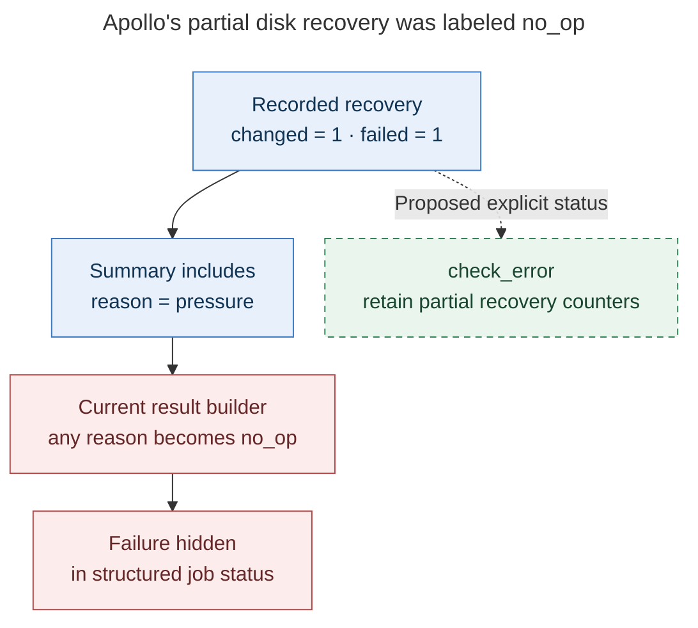
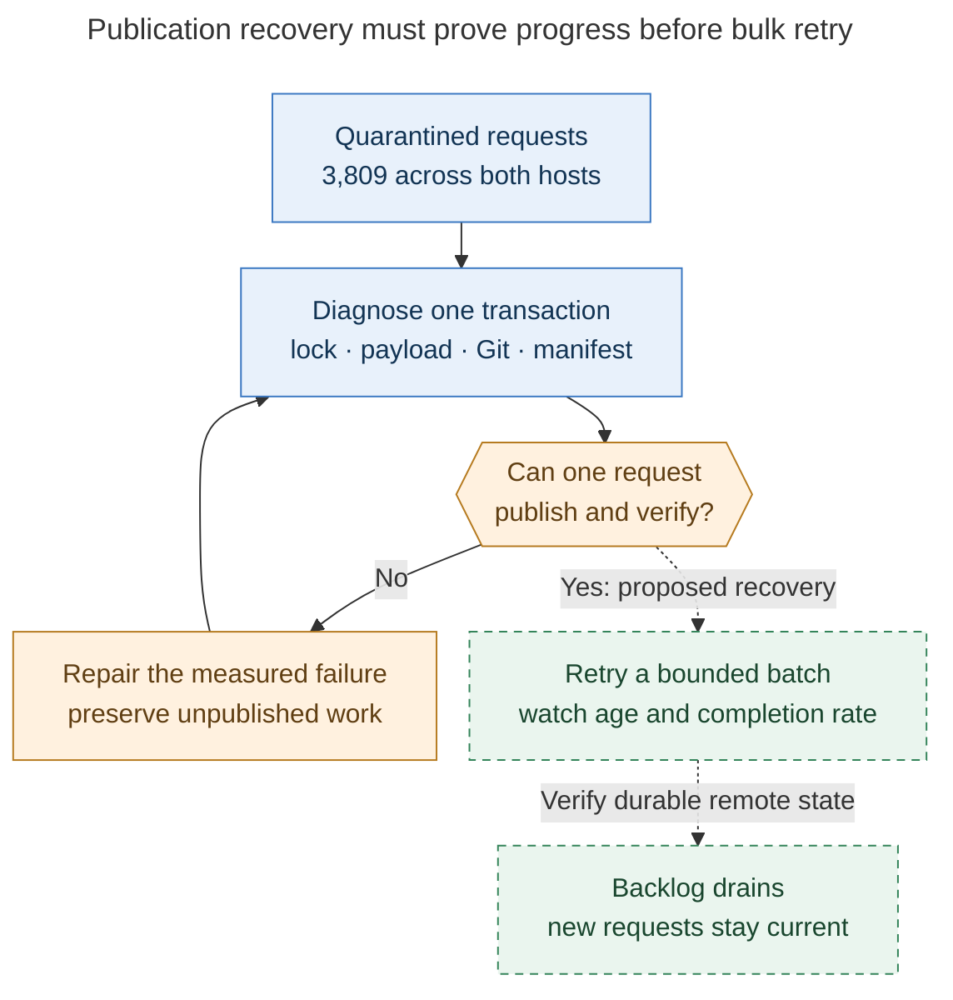
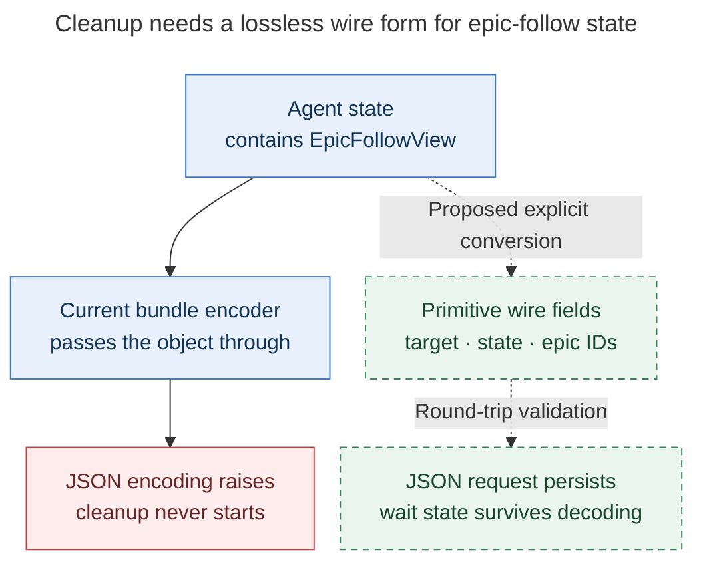

# SASE operational log audit: athena and apollo

> **Investigated:** 20 October 2026. Initial collection began at 14:17 UTC.
> **Question:** Which failures in the two machines' SASE logs still need fixing,
> what causes them, and what would demonstrate a successful repair?
> **Scope:** Read-only production diagnosis, isolated in-memory reproductions,
> source inspection, and follow-up tracking. No production service restarts,
> publication retries, cleanup operations, or runtime configuration changes were
> performed.

SASE was running on both machines, but several durable operations were unhealthy.
The strongest findings are **3,809 quarantined publication requests**, repeated
artifact-link projection failures, a reproducible cleanup serialization defect,
multi-second TUI garbage-collection pauses, and a broken default doctor command.
Apollo also exhausted disk space this morning; its recovery job reported a
structured `no_op` even though one cleanup step failed.

These are several distinct defects. A green service heartbeat, successful agent
run, successful package update, or zero process exit code does not establish that
publication, cleanup, or a structured background-job result succeeded.

## What to fix first

“P1” below means consequential operational work to prioritize; it does not mean an
ongoing fleet outage. “P2” means a bounded reliability repair. Confidence applies
to the stated finding, not every proposed explanation.

| Priority | Finding | Confidence and scope | Recommended first step |
| --- | --- | --- | --- |
| P1 | Apollo hit disk exhaustion; pressure recovery misreported partial failure as `no_op` | Disk failure and result-classification defect confirmed; space consumer incompletely attributed | Make cleanup failure observable, then identify the burst producer and validate safe recovery |
| P1 | Agent publication remains quarantined | Both hosts; current backlog confirmed, several failure classes | Recover one publication transaction with stage timing before releasing the backlog |
| P1 | Cleanup cannot encode `EpicFollowView` | Four October 20 apollo failures plus a pure reproduction | Repair the shared bundle encoder and its round trip |
| P1 | Long TUI garbage collections remain | Direct 32.449 s main-thread collection on athena; recurrent hitches on both hosts | Attribute allocation/retention growth, then reduce work before tuning GC policy |
| P2 | Artifact-link projection repeatedly fails on missing bead endpoints | Both hosts; known `sase-1c5` defect still present | Resolve endpoint ownership and isolate invalid endpoints without inventing publication receipts |
| P2 | `sase doctor -j` terminates during model-macro scanning | Independently reproduced on both hosts | Use the exception-returning expansion API and handle unbound templates explicitly |

The doctor and cleanup fixes are the smallest well-understood changes and can
restore useful surfaces quickly. Disk safety deserves immediate operational
attention. Publication recovery and TUI performance need measured work, not
larger timeouts or indiscriminate retries.

## How the investigation avoided misleading results

### Collection and coverage

I inspected the user service journal, service status snapshots, scheduler routine
logs, recent structured scheduler errors, publication diagnostics, launch failures,
run/event ledgers, update records, TUI logs, and TUI timing/GC telemetry. I compared
the findings against the source and existing tasks/plans.

The initial structured scan selected **2026-10-13 00:00 UTC through
2026-10-20 14:20 UTC**, subject to the data retained when each file was read.
The collection is a rolling observation, not an atomic filesystem snapshot.
Subsequent targeted checks establish current behavior separately.

| Evidence | Athena | Apollo | Interpretation |
| --- | ---: | ---: | --- |
| JSONL records parsed across selected active and rotated streams | 45,165 | 27,064 | All retained dates; zero malformed rows in those inputs |
| Text streams inspected | 24 / 444,085,099 bytes | 15 / 346,970,436 bytes | Canonical routine streams, service output, TUI logs, and `axe.log` |
| Agent completion rows inside the selected window | 1,110 | 815 | Logged completions, not every launch or outstanding run |
| Completion rows marked failed | 34 | 40 | Signals for investigation, not proof of 74 SASE software bugs |
| Quarantined publication requests in live diagnostics | 3,356 | 453 | Requests, not unique agents or unique lost documents |
| Retired publication requests | 2 | 284 | Separate from retryable quarantine |

I read `~/.sase/logs/*.jsonl.1` explicitly. The documented `sase logs` collector
reads active `runs.jsonl` and `events.jsonl` only. Rotation materially changes what
can be concluded: athena's retained stall data began at **October 20 01:43:43 UTC**;
apollo's began at **October 18 19:54:40 UTC**. Their raw hitch counts are therefore
not comparable rates.

Routine output is duplicated under both `axe/logs/lumberjack-*.log` and
`axe/lumberjacks/*/logs/output.log`. I counted the latter once. I also separated
actual errors from successful summaries containing `failed=0` or `errors=0`.
Detection and recovery events, loop and message-pump measurements, and overlapping
stall/hitch records must not be added together as independent freezes.

Epoch and offset-bearing timestamps were normalized to UTC. Compact
`YYmmdd_HHMMSS` run timestamps were interpreted in SASE's configured
America/New_York timezone. Raw Python logger timestamps are identified as such
below instead of silently assigning them the scheduler's timezone.

### Runtime and environment controls

Both installed hosts reported SASE **`0.18.0+46.g2648c7cdd`** and core
**`0.42.1+9.gb664b15bf`**. Athena uses Python **3.14.7**; apollo uses **3.12.3**.
The research workspace was at `1592f4dbc73ca3f4a12da58a0aafbb7094b35405`.
The key doctor, bundle, cleanup, disk-job, result-builder, GC-policy, and
bead-projection files were unchanged between that workspace and installed
`2648c7cdd`. This makes the local reproductions relevant to the installed code.

A plain noninteractive SSH command on apollo lacked the normal provider PATH.
It initially reported no usable provider. Repeating the checks in `zsh -lic`
restored provider discovery. **I reject the initial missing-provider result as an
investigation-environment artifact.** Likewise, project-dependent checks invoked
from a home directory without project context are not proof of broken project
state.

At the first live status sample, the service hosts and enabled service processes
were running, with fresh heartbeats and no reported orphan service processes.
Athena's systemd journal showed orderly update-time stops/starts; its current unit
reported `NRestarts=0`. This is evidence of process liveness, not evidence that
all background work is making progress.

## 1. Apollo ran out of disk space, and recovery hid a partial failure

### Evidence

Apollo's structured scheduler errors recorded `workflow_checks` failures at
**2026-10-20 04:36:53 and 04:36:59 EDT**—08:36 UTC—with:

```text
[Errno 28] No space left on device
proc reconciliation failed: failed to serialize proc:
No space left on device (os error 28)
```

At **04:50:03 EDT**, the canonical housekeeping log reported:

```text
pressure_available_bytes=3608576
dead_launch_removed=5
dead_launch_reclaimed_bytes=13325027447
failed=221 incomplete_observations=180

disk_pressure owner: unattributed 192.7 GiB
disk_pressure: status=1 free_percent_x100=0
observations=1 effective_warn_free_bytes=10345014067
top_owners=1 steps=3 changed=1 failed=1 reason=pressure

Structured job result: no_op · disk_pressure: ...
changed=1 failed=1 reason=pressure
```

The detailed counters and the job-level `failed=1` have different scopes; the 221
count must not be represented as 221 failed jobs. The recorded reclaim of about
12.4 GiB demonstrates partial progress, not complete recovery.

The `artifact_run_prune` run `20261020T044754_806443` also exited 1. It had found
**zero reclaimable run directories and zero reclaimable bytes**, with 134 empty
shards, then failed while writing its preview notification:

```text
ValueError: failed to serialize notification:
No space left on device (os error 28)
```

A later live `statvfs` sample showed apollo had **20,159,852,544 available bytes**
and more than 21 million free inodes on its approximately 206.9 GB filesystem.
Thus disk exhaustion was historical by the time of this sample, with continuing
capacity risk. It was not an inode shortage at the later sample. The filesystem
was not still full, and the logs do not identify the entire space consumer.

### Cause and repair

There are two separate conclusions:

1. **Capacity/retention remains an operational problem.** A sudden allocation
   burst or insufficiently reclaimed workload consumed the available reserve.
   The measured 192.7 GiB “unattributed” row is a residual filesystem bucket,
   not proof that SASE created 192.7 GiB or that logs caused the incident.
2. **Failure classification is demonstrably wrong.**
   `sase_chop_disk_pressure._run` returns `emit_summary(..., reason="pressure")`
   without setting the result status from `failed`. `ChopResultBuilder.from_summary`
   maps any nonempty reason to `no_op`. A numeric counter named `status` does not
   change the structured result's status.



*The defect is the status conversion: partial reclamation and a failed owner step
must remain visible together.*

Repair the disk job locally: set `check_error` when an owner step fails, `ok` when
authorized work changes state successfully, and `no_op` only when no work is due.
Do not globally reinterpret every summary reason without auditing callers.
Keep partial effects, failed owner names, available bytes, and required recovery
reserve in the result.

Next, inspect allocation deltas by actual filesystem and owner around 08:36 UTC,
including active/dead build scratch and retained workspaces. Collect both byte and
inode headroom. Give observation/recovery a shorter independent cadence than slow
housekeeping work, and consider admission headroom for large builds only after
measuring their burst size. Shared pressure policy and admission logic belong in
Rust core; Python should remain an adapter.

Notification persistence must not be the only way to report low-space failure.
There is also a source-level hazard: the disk job attempts notification before
`run_disk_reap`; an exception there could prevent safe reclamation. That ordering
was inspected, but this audit did **not** prove it blocked the observed recovery.
Test notification failure independently and preserve diagnostics through a
bounded stderr/journal path.

**Acceptance:** simulate a failed owner with partial effects; the structured
result must be `check_error`. Simulate notification ENOSPC; safe eligible recovery
must still be attempted or explicitly reported as blocked. Verify byte/inode
measurements, preservation of active work, and useful owner attribution under a
controlled pressure scenario. Keep artifact-run deletion preview-only under the
current safety contract. Route the failure-propagation evidence to **`sase-11h`**,
whose phase 3 explicitly owns visible owner failures.

## 2. Agent publication is still stalled behind quarantine

### Evidence

The live `state.agent_publication_outbox` check showed:

| Host | Total requests | Active | Quarantined | Retired | Stalled active |
| --- | ---: | ---: | ---: | ---: | ---: |
| Athena | 3,363 | 5 | 3,356 | 2 | 1 |
| Apollo | 742 | 5 | 453 | 284 | 0 |

“Stalled active” overlaps active; it is not another additive category.
Athena's quarantined requests were in the SASE project. Apollo's were
346 for bob-cli and 107 for SASE.

On athena, **2,832 problem rows** had the exact last error
`agent-hood publication did not complete within 120s`, and 432 had
`agents sync lock is busy`. Additional rows wrapped the timeout with a hood name
or reported Git index locks and unstaged changes. These are stored last-error
classifications, not distinct current lock owners.

This is still affecting new work: athena's `research.54.cld` request had already
reached three attempts and quarantine at an age of approximately 42 minutes;
`toobig-89.test_release_candidate.0` was approximately 33 minutes old.
Historical backlog alone cannot explain those rows.

Apollo's retained last errors included 335 rebase-conflict rows, referring to
the same failing replay commit in the inspected examples, and separate manifest
file-set mismatches and timeouts. Some of these describe older retired requests.
They must be revalidated before applying a repair to today's clone.

### Diagnosis and repair

The confirmed defect is **lack of end-to-end publication progress**. The evidence
does not establish that every timeout is caused by the old manifest byte limit.
The manifest-slimming code has already landed, while the recovery phase of
**`sase-11o`** remains in progress. Its acceptance directly covers this backlog.

A blanket `--retry-quarantined` is a poor first action: it resets attempt budgets
without proving that the publisher, lock, manifest, or Git transaction is healthy.
Likewise, a timeout increase alone can lengthen contention while concealing
unbounded work.



*Recovery is demonstrated by verified remote publication and a shrinking backlog,
not by releasing quarantine or observing a healthy scheduler heartbeat.*

Instrument or inspect one representative transaction per failure class. Separate
time spent acquiring the sync lock, building/scanning payloads, validating a
manifest, staging, fetching/rebasing, pushing, and verifying the result. Establish
whether a timed-out child is fully terminated and whether cleanup releases its
locks. Do not remove `index.lock` based only on an old error string.

For the apollo rebase family, preserve any unique unpublished content and inspect
the current transaction before resolving it. For large hoods, measure whether
publication cost grows with all historical sessions. Reuse validated immutable
payloads and publish incrementally where the measurements justify it; keep one
publisher transaction per owning clone.

**Acceptance:** a representative previously failing request publishes inside the
existing bound; the remote manifest and referenced files agree; replay is
idempotent; interrupted publication resumes; the oldest active age and quarantine
count trend downward through bounded recovery; newly completed agents publish.
Do not equate a request count with missing unique agents. Attach this evidence to
`sase-11o`; retain `sase-10x` as historical context rather than asserting its
old byte-limit diagnosis is the current cause.

## 3. Cleanup fails before its durable process can run

### Evidence and exact cause

Apollo's `~/.sase/logs/tui.log` contains four October 20 failures at raw logger
times **10:26:00, 11:00:59, 11:07:37, and 11:35:45**:

```text
ERROR sase.ace.tui.actions._proc_action_submission:
Durable proc agent.cleanup failed to submit
...
TypeError: Object of type EpicFollowView is not JSON serializable
```

Four older occurrences on October 12 establish recurrence. The October 20
tracebacks ended at lines 11263, 11304, 11345, and 11384 in the inspected file.

An isolated in-memory reproduction on the research checkout produced the same
exception from **both** `agent_state_to_bundle_dict` and `serialize_agent`:

```python
from datetime import datetime, timezone
import json
from sase.ace.tui.models.agent import Agent, AgentType
from sase.ace.tui.actions.cleanup_payload import serialize_agent
from sase.core.wait_epic_follow_view import EpicFollowView

agent = Agent(
    agent_type=AgentType.RUNNING,
    cl_name="audit-fixture",
    project_file="",
    status="DONE",
    start_time=datetime(2026, 10, 20, tzinfo=timezone.utc),
    wait_epic_follows=[
        EpicFollowView(
            target="fixture.land",
            state="following",
            epic_ids=("fixture-1",),
        )
    ],
)
json.dumps(serialize_agent(agent))
# TypeError: Object of type EpicFollowView is not JSON serializable
```

No cleanup request was submitted and no real agent was modified by that probe.

The bundle serializer handles certain known values—enums, datetimes, owner
identity, linked-repository metadata, finalizer status—but passes this list of
dataclasses through unchanged. Cleanup delegates to that serializer, so the
invalid value reaches the JSON boundary.



*The fix belongs at the shared serialization boundary, so cleanup and bundle
persistence receive the same JSON-safe representation.*

### Repair and acceptance

Add explicit encoding for `wait_epic_follows` and a compatible decoder. Preserve
all fields, including added/skipped bead IDs, members, timing, reason, detail, and
resume command. `default=str` would conceal the exception while losing structure;
dropping the field would lose wait-state information.

Track the repair in **`sase-1nb`**. Test empty and populated lists, every persisted
follow state, complete JSON encoding of a cleanup request, and decoding back into
equivalent state.
The existing `sase-104` task concerns oversized cleanup requests and was canceled;
it is adjacent, not a duplicate of this type-conversion defect. Large retained
request files are a separate allocation/performance lead, not this exception's
cause.

## 4. TUI GC policy still permits long freezes

### Measurements

The first retained-data sweep found:

| Measurement | Athena | Apollo |
| --- | ---: | ---: |
| `tui_hitch_recovered` records | 329 | 185 |
| Median recorded hitch duration | 2.750 s | 2.482 s |
| p95 recorded hitch duration | 4.513 s | 4.300 s |
| Maximum recorded hitch duration | 36.954 s | 6.897 s |
| Maximum recorded GC pause | 32.449 s | 5.757 s |

These are quantiles of logged episodes, not all UI events. The unequal retention
windows above prevent a machine-to-machine incident-rate comparison.

The strongest athena record is unambiguous:

```text
2026-10-20T11:35:03.287799Z
event=tui_gc_pause
app_instance_id=d2b7cd41  pid=2720414
generation=2  thread=MainThread  trigger=backstop
duration_s=32.44874  collected=590483  uncollectable=0
```

It was recorded in `tui_stalls.jsonl.1`, line 1876 at inspection. A nearby recovered
hitch reported **36.954 s**, with **33.138 s of GC overlap**. At 11:37:31 UTC an
`idle` collection took **23.506427 s** and collected 649,759 objects.
The first record's timestamp locates the telemetry event; the recorder's timing
semantics must be consulted before treating it as the collection's start.

Later heartbeat samples confirmed the policy was installed:
`threshold_policy=raised`, threshold2=10,000. Retained heartbeat RSS maxima were
about **4.51 GiB on athena** and **4.82 GiB on apollo**. RSS alone does not
distinguish live objects, allocator retention, and useful caches.

### Diagnosis

`GCPolicy.tick` invokes `collector.collect()` synchronously. Input-idle gating
can choose when a collection begins, but cannot promise responsiveness if input
arrives during a 32-second collection. The telemetry directly establishes
substantial GC contribution in the cited incidents.

It does **not** prove the ultimate source of the cyclic object graph. Stacks
sampled during other episodes pass through fleet response normalization, agent
refreshes, and bundle reads; a sampled frame can be interrupted by GC and is not
automatically the allocator responsible for it. Both Python versions show
symptoms, so attributing the entire problem to Python 3.14 would be premature.

The relevant prior GC epic, `sase-1ez`, closed on October 3. The October 20
measurements are new post-close evidence. Its existing measurement/soak task,
**`sase-1f3`**, should inform repair task **`sase-1nc`**. The former explicitly
asks investigators to file measured misses separately; it does not implement
their fixes.

### Repair and acceptance

Profile bounded allocation windows and object retention by app instance and
source revision. Examine repeated fleet normalization, snapshot copying, view
construction, and corpus-sized cleanup payloads; distinguish object churn from
unbounded retention. Prefer reusing immutable snapshots, replacing old keyed
entries, and avoiding duplicate full-payload conversions where measurements
confirm them.

Only then adjust collection policy. Raising thresholds without bounding allocation
can trade pause frequency for memory pressure. Moving CPython GC to a thread is
not evidence that it stops pausing the process. Preserve the existing memory
backstops while measuring alternatives.

**Acceptance:** compare matched workloads over a long-lived session on both
Python versions, including fleet refresh, active prompt input, idle/backstop
collection, and cleanup. Record loop/pump episode overlap, GC time, RSS/swap,
roster size, input age, and revision. Use the existing responsiveness contract;
do not declare success from a fresh TUI or a unit test of the idle predicate.
`sase-1f3` specifies idle-collection p95 ≤ 500 ms, total GC below 3% of wall time,
less than 0.5% of wall time in hitches, no automatic/backstop full collection
starting within two seconds of input, and less than 0.5 GB RSS growth over four
hours with approximately zero swap. The present retained slices do not constitute
that complete matched-workload acceptance run.

## 5. A missing bead endpoint keeps artifact-link publication failing

### Evidence

In the retained canonical housekeeping stream since October 13:

- Athena had **198** occurrences naming missing `sase-164`, 197 naming `sase-102`,
  76 naming `bob-cli-8s`, and one naming `bob-cli-87.3.1`.
- Apollo had **165** occurrences naming missing `bob-cli-5z`, plus two separate
  machine-mutation authorization failures.

The most recent inspected athena cycle, **October 20 09:37:25 EDT**, still said:

```text
[artifact_link_backfill] sase:
artifact-link bead event publication failed: 'Issue not found: sase-164'
artifact-link bead projection is not committed
...
1310 documents remain unswept; continuing on later ticks
```

The same cycle reported `failed_projects=0`. Apollo's 09:40:57 EDT cycle reported
the `bob-cli-5z` failure even with `sweep_remaining=0`. Thus an empty sweep queue
does not prove projection/publication convergence.

Focused doctor checks also found aggregate drift:

| Host/context | Missing rows | Extra rows |
| --- | ---: | ---: |
| Athena research workspace | 653 | 651 |
| Apollo explicit SASE project selection | 663 | 16,514 |

These are separate context-dependent comparisons. Concurrent writers and distinct
local projections mean the difference between hosts is not a count of lost data.
The drift corroborates incomplete convergence; this audit does not attribute every
row difference to the missing-endpoint defect.

### Cause and repair

`apply_events_to_beads` reduces event truth, constructs endpoint requests, then
sends chunks to `set_bead_endpoint_projections(store.beads_dir, chunk)`.
An exception returns a failed projection receipt for that operation. The caller
preserves diagnostics and withholds publication completion. That fail-closed
behavior is appropriate; repeatedly retrying an unresolvable endpoint with the
same batch is not sufficient recovery.

`sase-1c5` already names the exact `sase-164` failure and repeated sweep work.
The logs also associate some missing IDs with a different project prefix. That
is a reason to inspect owner resolution; it is not proof that those beads were
deleted or that a prefix alone is authoritative.

Resolve each endpoint against its owning store, distinguish missing-in-this-store
from truly missing and temporarily unavailable, and isolate terminal invalid
endpoints from valid independent work. Preserve the immutable event and a typed
diagnostic; do not fabricate the missing bead or mark an uncommitted endpoint
published. For a cross-owner operation, retain explicit per-owner receipts.
The shared routing/reduction behavior belongs in `sase_core`, with its binding
and SASE pin updated together.

**Acceptance:** a batch containing a valid local endpoint, a cross-project
endpoint, and a genuinely missing endpoint makes progress on valid work without
losing replayability or falsely acknowledging the invalid operation. Repeated
ticks converge, and partial projection failures appear in structured status even
when the top-level project traversal completes. Corroborate `sase-1c5` and notify
the active projection owner `sase-12y`.

## 6. Default doctor exits while scanning an unbound macro template

Both machines reproduced:

```text
$ sase doctor -C config.model_macros -j
❌ Macro '#research/audio' argument error:
Argument `edition` expects one of brief | full,
got `{{ audio_edition }}`
# exit 1; no JSON document
```

Bare `sase doctor -j` fails the same way. Focused checks excluding the config
group allowed the rest of this investigation to continue.

The precise path is:

1. `check_config_model_macros` scans the content of discovered macros.
2. `_model_preset_tokens` calls `process_macro_references(content)` on raw content.
3. The research swarm legitimately contains
   `#research/audio(edition={{ audio_edition }})`.
4. The static scan has not supplied the outer argument context, so it attempts
   enum validation on the literal template expression.
5. The processor's default error path prints and calls `sys.exit(1)`.
   Both the local handler and diagnostic registry catch `Exception`;
   `SystemExit` escapes.

Use `raise_on_error=True` at the diagnostic call site. That is already a supported
processor API. Then explicitly distinguish a parameterized non-preset that cannot
be evaluated statically from a concrete invalid model preset. The doctor should
return a structured diagnostic or skip the unevaluable case, and continue its
remaining checks.

Do not “fix” the plugin by weakening its enum or hard-coding `audio_edition`;
that would hide a valid-template diagnostic bug.

**Acceptance:** JSON remains parseable with the installed research plugin,
unbound nested enum inputs do not terminate the process, concrete bad model routes
are still reported, and a later sentinel check runs after the problematic input.
No raw status prose should precede the JSON result. Track this repair in
**`sase-1na`**.

## Signals investigated but not promoted to confirmed new defects

| Signal | What the evidence actually supports | Next discriminating check |
| --- | --- | --- |
| Update subcommands returned 1 | Prebuild `commit-mismatch` misses fell back successfully. All 56 athena update records were `updated`; apollo had 55 `updated`, four `skipped` | Inspect final update outcome and core verification, not each intermediate exit |
| Three jobs exited `-7` | Two athena `tg_outbound` runs and one apollo `stale_running_cleanup` run died with signal 7; retained excerpts were empty | Capture a core/backtrace and correlate exact mapped-library inode/build with update timing; no proven root cause yet |
| Apollo gateway HTTP 504s | 24 retained timeout error lines, typically about 4 seconds; service was live | Match request route, cache age, rebuild timing, and resource pressure; do not call it a new snapshot stampede without that evidence |
| Launch barrier timeout on athena | `bw3g8chx5pgf` failed at 07:35:03 SASE time; command was not run | Its timestamp is near the major GC incident. Correlate app/proc identity and barrier-release timings before asserting causation |
| Two forced name-reuse failures | October 16 and 19 reservations survived rebuild | Inspect ownership and generation at failure; do not remove reservations based on an old message |
| 608 retained Telegram “Message to edit not found” lines | Undated retained service output; not a weekly failure count or evidence of current inbound failure | Inspect terminal-vs-retry classification for keyboard cleanup if it recurs with fresh timestamps |
| Missing apollo workspace #14 | Registry check found its path absent | Recheck registry/occupancy before a repair preview; no destructive repair was performed |
| Large scheduler logs | Approximately 0.91 GB athena / 0.69 GB apollo in the bounded inventory, including duplicated streams | Check configured rotation and growth before labeling a retention leak; insufficient to explain 192.7 GiB |

There were also test-looking paths in old `axe.log` failures. Without dates and
production provenance, they are not reliable evidence of the present fleet state.
Provider run failures were counted as a coverage check, but this audit did not
read every provider transcript or classify every model-side failure.

## Implementation sequence and completion evidence

1. **Restore observability and the broken cleanup action.** Land the bounded doctor
   and bundle-serialization fixes with the reproductions above.
2. **Make pressure recovery truthful and resilient.** Correct result status,
   isolate notification failure, identify burst ownership, and retain safe
   reclamation rules. Confirm enough headroom under representative load.
3. **Recover durable publication deliberately.** Diagnose representative
   transactions, repair the measured cause, retry bounded work, verify remote
   receipts, and watch new requests as well as old ones.
4. **Unblock artifact-link convergence.** Repair endpoint ownership/error
   isolation and prove mixed-batch progress and idempotent replay.
5. **Finish the performance investigation with a sustained workload.** The
   collection timings already justify action; allocation/retention attribution
   determines which change will actually help.

Avoid deploying all five categories together: their acceptance signals differ.
Keep the source revision, Python version, process/app instance, exact workload,
and measurement window alongside every before/after comparison.

### Follow-up ownership

The duplicate review covered all statuses, recent task creation, relevant older
reports, and active epic scopes. New implementation tasks are:

- **`sase-1na`**, medium: doctor model-macro failure and JSON contract.
- **`sase-1nb`**, medium: lossless epic-follow bundle/cleanup serialization.
- **`sase-1nc`**, large: allocation attribution and measured repair of long GC
  freezes; related to the closed `sase-1ez` and measurement task `sase-1f3`.

Existing work receives evidence rather than duplicate tasks:
`sase-1c5` for missing endpoint projection; `sase-11o` for publication recovery;
`sase-11h` for disk-owner failure propagation; and `sase-12y` for the endpoint-batch
integration failure. `sase-1f3` receives the new GC observations as partial
measurement evidence, without claiming its four-hour or 24-hour acceptance is
complete.

## Evidence index and reproduction notes

The report preserves the useful counters, representative errors, and exact
reproductions rather than publishing raw prompts, tokens, or private command
environments. Rotating production files can change after this audit; line numbers
refer to the copies read during the investigation.

| ID | Source | Used for |
| --- | --- | --- |
| E1 | Both hosts: `~/.sase/service/status.json`; `systemctl --user show sase.service`; athena user journal | Liveness and restart context |
| E2 | Both hosts: focused `sase doctor -j` results; `state.agent_publication_outbox` | Request counts, last-error classes, current quarantine |
| E3 | `~/.sase/axe/recent_errors.json`; canonical `axe/lumberjacks/{hooks,housekeeping}/logs/output.log` | Apollo ENOSPC, partial recovery, false `no_op`, prune-notification traceback |
| E4 | Apollo `~/.sase/logs/tui.log`; in-memory bundle/cleanup reproduction | `EpicFollowView` serialization failure |
| E5 | Both hosts: `~/.sase/logs/tui_stalls.jsonl` and `.1`; agent-load telemetry | GC durations, hitches, retention bounds, heartbeat memory |
| E6 | Both hosts: canonical housekeeping output; aggregate doctor results | Missing endpoints, repeated projection failures, drift |
| E7 | Both hosts: isolated `config.model_macros` doctor invocation | JSON-breaking diagnostic error |
| E8 | Both hosts: `runs.jsonl`, `events.jsonl`, launch failures, update records, retained rotations | Coverage and false-positive control |

Useful read-only checks:

```bash
# On athena, from the SASE workspace:
sase version --json
sase doctor -C config.model_macros -j
sase doctor -C state.agent_publication_outbox -j
sase doctor -C runtime.core -C axe.health -C resources.disk_free -j

# On apollo, preserve its normal shell PATH:
ssh apollo 'zsh -lic "sase version --json"'
ssh apollo 'zsh -lic "sase doctor -C config.model_macros -j"'
ssh apollo 'zsh -lic "sase doctor -C state.agent_publication_outbox -j"'

# Use explicit project context for project-specific checks.
# Resolve the canonical project through SASE's project inventory.
# Read rotated generations as well as the active files.
```

Source anchors, verified in the local checkouts:

- SASE `1592f4dbc` / installed `2648c7cdd`:
  `src/sase/doctor/checks_config_macros.py`,
  `src/sase/diagnostics/registry.py`, `src/sase/macro/processor.py`;
  `src/sase/ace/tui/models/agent_bundle.py`,
  `src/sase/ace/tui/actions/cleanup_payload.py`,
  `src/sase/core/wait_epic_follow_view.py`;
  `src/sase/scripts/sase_chop_disk_pressure.py`,
  `src/sase/scripts/sase_chop_artifact_run_prune.py`,
  `src/sase/chops/sdk.py`;
  `src/sase/ace/tui/util/gc_policy.py`;
  `src/sase/sdd/_artifact_link_event_project.py`,
  `_artifact_link_event_publish.py`, `artifact_link_beads.py`;
  `src/sase/agents_sync/publication_outbox_operations.py`.
- Core `b664b15bf`: `crates/sase_core/src/disk_pressure.rs`.
- Research plugin `6b56e4760`:
  `src/sase_research_artifacts/xprompts/research_swarm.md:601` and
  `research_audio.md`.

Diagram design follows the audited
[recent Mermaid craft synthesis](research_swarm_mermaid_diagram_craft/research_swarm_mermaid_diagram_craft__final.md):
each figure answers a specific question, has an in-figure title and explanatory
caption, and distinguishes observed failure from proposed recovery in both words
and styling. The diagrams describe the findings and proposals in this report;
they do not imply that repairs have been deployed.

**Diagram verification:** all three final Mermaid sources rendered successfully
with Mermaid CLI 12.0.0 using a strict, neutral, DejaVu Sans configuration modeled
on the recent report's PDF guidance. I inspected the PNGs for legibility,
clipping, arrowheads, and branch meaning. The largest is approximately
583 × 812 pixels at natural scale. The full Highlights PDF pipeline and GitHub
rendering were not exercised. A first browser launch hit the documented long
temporary-path socket limit; rendering succeeded with a short temporary root.
