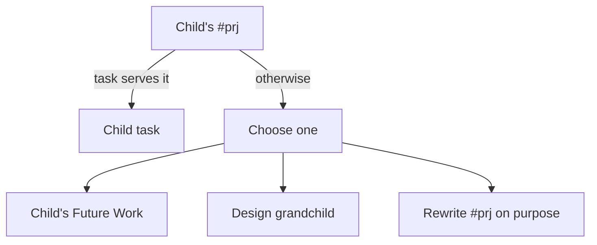

# Diagram proposals: Splitting `sase.md`: duplicates, child projects, and what the file holds

Proposals for the swarm linker, not a report. Each diagram restates only what the source
report says.

```yaml
source: research:202610/bob_sase_task_portfolio_split/bob_sase_task_portfolio_split__final.md
producer: research.51.image
check: "mmdc 12.0.0 rendered 1 of 1 Mermaid diagrams"
```

## existing-child-scope

```yaml
anchor: |-
  Send a task to an existing child only if it serves that child's `#prj`.
illustrates: |-
  Send a task to an existing child only if it serves that child's #prj; otherwise use Future Work, a design grandchild, or rewrite the #prj on purpose.
caption: Keep existing children finishable by checking task scope before choosing its home.
```


