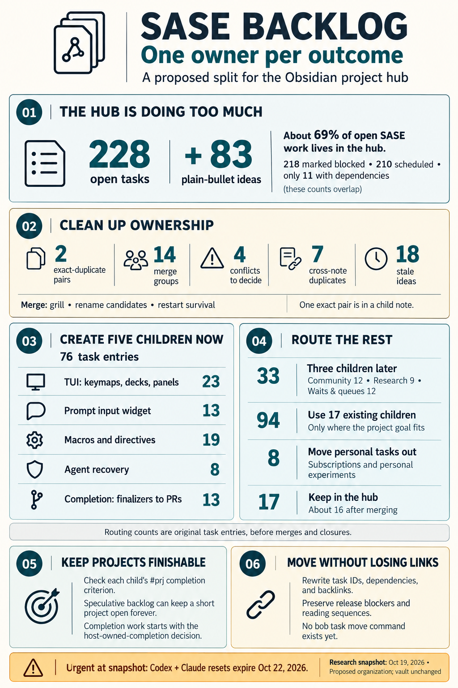
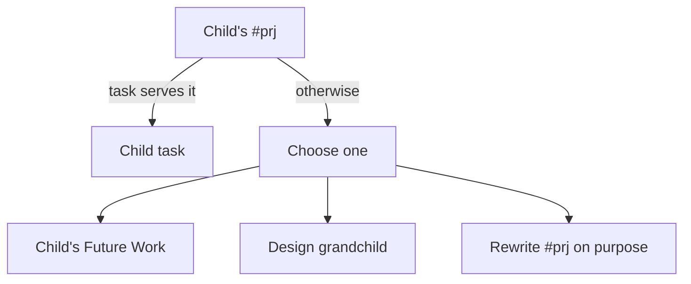

# Splitting `~/bob/sase.md`: duplicates, child projects, and what the file holds

> **Research query:** Review the Obsidian tasks in `~/bob/sase.md` to help split out some child project notes, and call out any duplicates. End with a recommended project split and an overall summary of the tasks that live in the file.

## Bottom line

- **`sase.md` holds most of the SASE backlog.** It has **[228 open tasks](#what-is-in-the-file)** (3 `[ ]`, 5 `[*]`, 2 `[/]`, 218 `[?]`) and another **83 plain-bullet ideas** under Future Work and Requirements. The 27 open child and grandchild notes hold only about **104** open tasks between them, so the hub carries about 69% of open SASE work.
- **"Blocked" mostly means "scheduled for later".** 210 of the 228 open tasks have a `scheduled::` date, and only 11 have a `dependsOn`.
- **There are few exact duplicates and a lot of split ownership.**
  - **[Exact duplicates](#exact-duplicates):** one inside `sase.md` (L1355 = L1357) and one in `sase_pre_blog.md` (its L18 = L25).
  - **[Merges](#merge-groups):** 14 groups that should each become one task.
  - **[Contradictions](#contradictions):** 4 that need a decision.
  - **[Cross-note duplicates](#cross-note-duplicates):** 7 confirmed against child notes.
  - **[Stale ideas](#done-or-stale-items):** 18 Future Work and Requirements bullets that are already done, obsolete, or duplicated.
- **[Recommended split](#recommended-project-split):**
  - **[Create 5 new child notes now](#new-children-to-create-now):** TUI, prompt input widget, macros, agent recovery, and completion.
  - **[Create 3 more when you start that work](#new-children-to-create-later):** community, research, and waits/queues.
  - **[Move 94 tasks into 17 existing children](#move-into-existing-children).**
  - **[Move 8 personal tasks out of the SASE tree](#move-out-of-the-sase-tree).**
  - **[Keep about 16 tasks in the hub](#what-stays-in-the-hub).**
- **Two items are urgent:** L59 (Codex reset) and L528 (Claude Code reset) both expire on **Oct 22, three days from now**. Deal with them before reorganizing anything.

## About this review

Lead researcher's consolidated report · 2026-10-19. It combines five independent reviews (cdx, cld, grk, mus, gem) with my own checks against the vault, the `sase` CLI, and the sase repo. The snapshot is `~/bob/sase.md` at 13:00 today: 1,432 lines, the same version every researcher read. `L123` means line 123 of that snapshot. Nothing in the vault was edited.

## What is in the file

- **`#prj` header**
  - *Items:* 1
  - *Notes:* "sase has received >=1000 stars on GitHub!" plus the Sub-projects roster: 60 links (22 open, 32 done, 6 canceled)
- **`## Tasks` (`[ ]`)**
  - *Items:* 3
  - *Notes:* L20 and L23 are reading refs. L27 is a Codex credit reminder
- **`### Next & In Progress`**
  - *Items:* 7
  - *Notes:* `[*]`: L38, L39, L43, L44, L53. `[/]`: L40 (PyPI reliability E1) and L46 (`sase project stats` epic)
- **`### Blocked` (`[?]`)**
  - *Items:* 218
  - *Notes:* Mostly date-scheduled by the 🎲 reroll, not dependency-blocked
- **`### Done & Canceled`**
  - *Items:* 9
  - *Notes:* Includes **Release v0.18.0**. These are waiting for `bob task archive`
- **`## Future Work`**
  - *Items:* 79 bullets
  - *Notes:* Not tasks, and not scheduled. Almost all are dated June–July 2026
- **`## Requirements`**
  - *Items:* 4 bullets
  - *Notes:* Two web-client ideas, the Antigravity reading, and two pieces of `sdd`/ChangeSpec-era vocabulary

**Open-task profile (228 tasks, recounted independently):**

- **Priority:** medium 144, high 33, low 32, lowest 1, unset 18
- **Created:** Jun 2, Jul 23, Aug 71, Sep 65, Oct 1–19 66, undated 1
- **Source:** 19 `#ref` reading tasks, 21 Google Keep captures

October is on pace to be the busiest month for new tasks.

The frontmatter `task_count: 237` is not drift. The plugin leaves the hidden `#prj` line out of the count, which accounts for the 238th checkbox.

**The high-priority items are mostly not product work.** Seven of the nine general reading refs are `high`, and so are five of the eight personal or billing reminders. Product tasks are mostly `medium`.

## Duplicates and conflicts

### Exact duplicates

- **`sase.md` L1355 = L1357 (Future Work)**
  - *Item:* "Materialize steps in workflow to enable replay starting at certain xprompt workflow steps?" Same Gas Town link and same `h::` hash
  - *Action:* Delete L1357. All five reports agree
- **`sase_pre_blog.md` L18 = L25**
  - *Item:* "Remove `branch_or_workspace_name` dependency!"
  - *Action:* Delete one. This is in a child note, not in `sase.md`

### Merge groups

All of these groups are inside `sase.md`. Each group below should become one task. Carry the extra details over as sub-bullets.

1. **L282 "Always grill epics" and L1183 "Grill option on tale/epic gates"**
   - *Same outcome:* L282 links to L1183's `^grill`, and L1183's own sub-bullet says "Always grill epics?!"
   - *Keep:* L1183. Fold L282's mandatory-or-optional question into it
   - *Agreement:* 5/5
2. **L126 (power/pow/po), L745 (bai), L1027 (sal), FW L1418 (sawi)**
   - *Same outcome:* Four tasks for one naming decision. "sawi" was canceled 2026-07-28 and "sasos" 2026-10-04 (`done/sase_done`)
   - *Keep:* One "SASE rename candidates" task that lists all candidates
   - *Agreement:* 5/5
3. **L244 and FW L1391**
   - *Same outcome:* Copilot-style completion in the prompt input widget (PIW). L1391 adds learning from previous prompts
   - *Keep:* L244, with that requirement added
   - *Agreement:* 4/5
4. **L918 and FW L1372**
   - *Same outcome:* Remove hidden-agent support
   - *Keep:* L918, but see [Contradictions](#contradictions)
   - *Agreement:* 4/5
5. **L664 and L1001**
   - *Same outcome:* Agents survive a machine restart: orderly shutdown, then restore with one command
   - *Keep:* One task. Shutdown, persistence, and restore become its acceptance cases
   - *Agreement:* 4/5
6. **L27, L59, and L528**
   - *Same outcome:* Codex credits, Codex reset, and Claude Code reset reminders
   - *Keep:* One subscriptions reminder outside SASE (see [Move out of the SASE tree](#move-out-of-the-sase-tree)). Keep the Oct 22 expiry
   - *Agreement:* 4/5
7. **L199 and L1278**
   - *Same outcome:* Whether to run SASE agents in interactive tmux sessions instead of headless. L199 adds a "mayor" hierarchy
   - *Keep:* L199 (it has the Gas Town bookmark). **Prior art:** "Integrate `tmux_ai_window` with sase!" was done 2026-08-28, so start from that
   - *Agreement:* 3/5
8. **L119 and L1275**
   - *Same outcome:* Hermes provider. L1275 adds the `hermes chat --oneshot` mode
   - *Keep:* Attach both to `sase_pre_blog#^hermes-llm` (see [Cross-note duplicates](#cross-note-duplicates))
   - *Agreement:* 3/5
9. **L57 and L121**
   - *Same outcome:* The MEMORY deck: an implementation task plus its design ref. Both depend on `sase_pypi_releases`
   - *Keep:* L57, with L121 attached as its reference
   - *Agreement:* 4/5
10. **L273 and L825**
    - *Same outcome:* A wait-for-load monitor versus a `%wait cpu=` kwarg. L825's own sub-bullet asks "Use `[[sase#^wait-for-load]]` instead?!"
    - *Keep:* Choose one and delete the other
    - *Agreement:* 2/5
11. **L740 and L1035**
    - *Same outcome:* Freshness notifications for macros, snippets, and memories. L1035 is a subset
    - *Keep:* L740
    - *Agreement:* 2/5
12. **L1214 and FW L1385**
    - *Same outcome:* Use SASE to land a Black feature (L1385 names string wrapping)
    - *Keep:* L1214, with the specific upstream target named
    - *Agreement:* 2/5
13. **L554 and L806**
    - *Same outcome:* `%name` for ephemeral agent names, and improving `%n:` overwrites. Same naming surface
    - *Keep:* One naming-directive task
    - *Agreement:* 1/5
14. **L46, L353, and L355**
    - *Same outcome:* Stats command, model attribution, and the Statistics tab
    - *Keep:* Close as the L46 epic lands. **Verified:** `sase stats project` exists (`a53f10f6a6`) and the TUI tab uses the shared report (`0f2052be6a`). Per-model **commit** attribution has shipped (23 models, 18,527 commits). But **plans = 0 for every model, all time**, so check the plan half of L353 before closing it
    - *Agreement:* 1/5 (I added the verification)

### Contradictions

Decide these first, then delete the losing side.

- **Hidden agents**
  - *Conflict:* L918 and FW L1372 remove hidden agents. FW L1409 adds a `%hide` keymap and a hidden-agent count
  - *Evidence and recommendation:* Record one decision in the TUI note. Don't ship both
- **`,X` keymap**
  - *Conflict:* L1039 uses `,X` to kill and edit an in-flight agent. FW L1425 uses `,X` to relaunch failed agents
  - *Evidence and recommendation:* Both already exist in `done/sase_done`: "Add `,X` keymap to kill/edit last launched agent!" (done 09-08) and "Re-launch failed sase agents!" (done 07-20). **Delete FW L1425.** All that's left of L1039 is extending it from "last launched" to any selected agent
- **`/sase_run`**
  - *Conflict:* FW L1338 says "Create `/sase_run` skill". `sase_memory.md` L42 says "Remove `/sase_run` skill!" (high priority)
  - *Evidence and recommendation:* The skill exists today. Delete FW L1338. Keep the decision in `sase_memory`
- **Skill bundles**
  - *Conflict:* L756 builds bundles on a memory web. L1281 uses semantic memory files, and its own sub-bullet says "No! Use `sase skills read`". L784 asks whether memory webs should exist at all
  - *Evidence and recommendation:* Make this one design decision in `sase_skill_bundles` and record the rejected options

Not a contradiction: **chezmoi.** cld flagged L380 "Initialize chezmoi as sase project!" (created 09-07) against a canceled "Make `chezmoi` a sase-managed project!" (created 08-25, canceled 10-09). L380 is the newer copy, so the cancellation most likely removed the older duplicate. `sase project list` still shows only actstat, tailnet, bob-cli, and sase, so chezmoi is a linked repo of sase but not a project. L380 is still live. Its sub-bullet (default `#gh:dotfiles` instead of `#git:home`) interacts with L860.

### Cross-note duplicates

All of these were verified in the child notes. Each bold line is the `sase.md` side.

- **L1105 "Migrate to `/sase_stitch` via a built-in `how_to_git_commit.md` memory"**
  - *Child note:* `sase_memory` L62 `^commit-to-stitch` "Migrate `/sase_git_commit` to `/sase_stitch`!"
  - *Keep:* The child. Carry the built-in-memory idea over as a sub-bullet
- **L117 pi `#ref`, L119 Hermes `#ref`, L1275 Hermes oneshot**
  - *Child note:* `sase_pre_blog` L33 `^pi-llm`, L35 `^hermes-llm`
  - *Keep:* The `sase_pre_blog` tasks, because they gate the blog launch. Attach the refs to them and keep the `sase_pypi_releases` dependency
- **L295 "auto-link all research files that researchers read to the final report"**
  - *Child note:* `sase_art_links` L39 "Research lead … should be told to link to related research files!"
  - *Keep:* The child. **This may already be done:** research-swarm runs now derive links from the `sase artifact read` calls an agent makes, and this run's own instructions say so. Verify, then close both
- **L472 "Use a finalizer to enforce agent output vars"**
  - *Child note:* `sase_post_blog` L27 "auto-wait for agent and validate that it sets a variable"
  - *Keep:* One outcome. Put the variable-checking half in the completion note
- **L879 "Beads specify the macro used to run them"**
  - *Child note:* `sase_better_tasks` L17 "Each task type should be able to specify a set of prompts!"
  - *Keep:* Keep one task covering both: type-level defaults with per-bead overrides
- **L1397 and Req L1429 (web client display and per-agent pages)**
  - *Child note:* `sase_art` L79 `^web-client`
  - *Keep:* `sase_art`. Don't revive the canceled `sase_sites`
- **L123 and L358 (artifact-create reason and `commit_hooks.artifacts`)**
  - *Child note:* `sase_art_links` L23 `^artifact-create` "Improve `sase artifact create`"
  - *Keep:* Fold both in as requirements. Today `sase artifact create` still has no reason flag

Related to child-note work but not duplicates: L1126 (`just check-full` always runs tests) and `sase_monitor` "Give `just check-full` good output again". L939 `/fleet` and `sase_remote`'s Machines-tab uptime. L643/L677 `max_running_agents` and `sase_remote` `^auto-dispatch`.

### Done or stale items

**Safe to delete.** Each has direct evidence:

- **FW L1333:** *Idea:* Dynamic agent families · *Evidence:* `sase_dyn_agent_fam` is done
- **FW L1335:** *Idea:* Use apollo to run remote agents · *Evidence:* `sase_remote` and `%dispatch` exist
- **FW L1338:** *Idea:* Create `/sase_run` · *Evidence:* The skill exists (see [Contradictions](#contradictions))
- **FW L1340:** *Idea:* Approve agent launches (`^launch-hitl`) · *Evidence:* The LaunchApproval flow exists
- **FW L1341:** *Idea:* Install codex and try sites · *Evidence:* `sase_sites` was canceled
- **FW L1343:** *Idea:* Sidecar approach for `sdd/` · *Evidence:* Sidecar repos shipped
- **FW L1347:** *Idea:* Single `SASE.md` · *Evidence:* Superseded by decision `readable-agents-md`
- **FW L1348:** *Idea:* pylimit to Python · *Evidence:* pylimit became `toobig` (done 07-13)
- **FW L1352:** *Idea:* Audio summaries · *Evidence:* `sase-listen` exists
- **FW L1365:** *Idea:* `pyvision.md` memory · *Evidence:* `symvision.md` exists
- **FW L1390:** *Idea:* Research in subdirs with `_cld`/`_cdx` suffixes · *Evidence:* In use; this report's folder is an example
- **FW L1418:** *Idea:* Rename to sawi · *Evidence:* Canceled 07-28
- **FW L1425:** *Idea:* `,X` relaunch · *Evidence:* Done (see [Contradictions](#contradictions))
- **Req L1430:** *Idea:* Read about Antigravity · *Evidence:* `sase_anti_gravity` is done
- **FW L1357, L1372, L1385, L1391:** *Idea:* Duplicates · *Evidence:* Merged in [Exact duplicates](#exact-duplicates) and [Merge groups](#merge-groups)

**Probably done or superseded. Check before closing:**

- **L1096**
  - *Item:* Opening a linked repo as external should fail with an error
  - *Finding:* **Superseded.** `sase repo open` now redirects to the linked checkout instead of failing
- **L295**
  - *Item:* Auto-link research reads
  - *Finding:* See [Cross-note duplicates](#cross-note-duplicates)
- **L1148**
  - *Item:* Convert `tui_perf.md` into `tui.md`
  - *Finding:* Superseded by another approach: `tui_perf.md` still exists as a referenced child of `tui.md`. Only the "tab/keymap expectations" part remains
- **L1208**
  - *Item:* `mac.md` SSH memory
  - *Finding:* The `tailnet.md` reference memory covers Mac SSH
- **L1270**
  - *Item:* Plans lost on memory confirmation
  - *Finding:* Its own sub-bullet says "This wasn't actually a big deal". Cancel it
- **L353 / L355**
  - *Item:* Stats
  - *Finding:* See [merge group 14](#merge-groups)
- **FW L1342**
  - *Item:* PR comment reading and mentors
  - *Finding:* Mentors exist. The line is also malformed: two ideas run together, with a stray `ķ` and `createdJune 08, 2026`
- **FW L1349**
  - *Item:* Commit the plan or prompt on `sase plan approve`
  - *Finding:* The `plans` sidecar may already cover this. L1152 (publish to the agents sidecar when a plan is approved) is the related live task
- **FW L1373**
  - *Item:* All external repo writes need new agent family members
  - *Finding:* Not adopted. The current design lets an agent write to an opened repo and records a commit obligation. Decide, or drop it
- **FW L1374**
  - *Item:* Hub note for `/sase_<cmd>` skills
  - *Finding:* Probably superseded by generated macro skills

**Not done, despite how they look.** cld listed L833 (replace axe/lumberjack/chop references) as "likely done". It isn't. Python files under `src/sase` still have about **1,600 lines mentioning `lumberjack`**, about 1,100 mentioning `chop`, about 2,100 mentioning `sdd`, and about 1,300 mentioning `ChangeSpec`. L833 and L1134 (remove "SDD") are large rename jobs still waiting, like the axe rename finished on 09-23.

Similarly, L80 (rename the "Files" sub-tab to "Attachments") is still open even though other Artifacts sub-tab renames finished on 10-14. The tab is still labeled "Files".

**Outdated vocabulary to rewrite or drop:**

- L1359 (ChangeSpec → patch)
- L1360 and L1363 (`sdd/decisions/`, `sdd/tales/`)
- L1397 (`sdd` repos)
- Req L1431 (the ChangeSpec analogy)
- Req L1432 (`sdd/events/` MVP)
- L1346 (`~/memory/long/`)

### Related clusters

These are not duplicates, but design each one as a whole.

- **`<ctrl+k>` in the PIW**
  - *Lines:* L560, L948, L1092
  - *Note:* Three meanings for one key: `K` behavior when the completion menu is open, prompt history, and a project filter. Write one interaction spec
- **Artifact hooks**
  - *Lines:* L358, L795, L1138
  - *Note:* Three config knobs for "run something on artifact files"
- **Annotations and comments**
  - *Lines:* L213, L229, L565, L816, FW L1367, FW L1389
  - *Note:* Same idea, different surfaces: artifacts, decisions, memory, prompts, screenshots, and agents
- **Agent messaging**
  - *Lines:* L112, L195, L927, L1227
  - *Note:* Stream bead, shared log, message board, and channel bead. **`sase_message_boards` was canceled**, so decide whether this is a revival before building it piecemeal
- **Failed-agent recovery**
  - *Lines:* L91, L405, L721, L1039, FW L1362, L1402, L1405
  - *Note:* Several entry points to one recovery workflow
- **Waiting**
  - *Lines:* L289, L426, L1179, L132, FW L1416, plus `sase_post_blog` L27
  - *Note:* `%wait`, the plan `wait` field, `%clan wait=`, and epic standalone procs
- **`+` grammar**
  - *Lines:* L657, L1235, FW L1406
  - *Note:* `+sase@foo`, `+` as the project-local separator, and `+sase` shorthand
- **Capacity**
  - *Lines:* L643 and L677
  - *Note:* Project-local versus per-machine `max_running_agents`
- **Sequences (keep the order)**
  - *Lines:* L44 → L184 → L202; L46 → L353; L218 → L945; L371 → L732
  - *Note:* Pairs like Minions part 1 and part 2 are a reading sequence, not duplicates

## Recommended project split

### Principles

1. **Use an existing child first.** The 22 open children are thin: most have only 1–4 open tasks.
2. **Check whether the child's completion criterion fits.** No report raised this. Several existing children have short, finishable objectives:
   - `sase_memory`, `sase_projects`, and `sase_better_installs` are each "…ready to be talked about!"
   - `sase_better_plans` is about one specific instruction in the `/sase_plan` skill.
   - `sase_monitor` is "Add new `/sase_monitor` skill!", and that skill already exists.

   Moving speculative backlog into these notes stops them from ever finishing. Send a task to an existing child only if it serves that child's `#prj`. Otherwise do one of three things: put it in the child's `## Future Work`, put it in a design grandchild (for example `sase_memory_plan`), or rewrite the `#prj` on purpose.
3. **Create a new child only for a cohesive cluster** of about eight or more tasks whose completion criterion fits on one line. `_templates/new_project.md` treats the `#prj` line as the completion criterion.
4. **Don't reopen done or canceled children.** `sase_decks`, `sase_research`, `sase_final_polish`, `sase_gate`, `sase_dir_xprompts`, `sase_message_boards`, and `sase_sites` stay closed. Their leftover tasks go to new notes.
5. **Get personal items out of the SASE tree**, and keep the hub small.

*Keep existing children finishable by checking task scope before choosing its home.*

### New children to create now

**5 notes, 76 tasks.** These had the broadest support across the reports. Names follow the vault's `sase_better_*` convention.

- **`sase_better_tui`**
  - *Draft `#prj` criterion:* "TUI keymaps, decks, and panels are consistent, reversible, and discoverable."
  - *First milestone:* The two live deck fixes (L39, L43), then one navigation and keymap scheme
  - *Tasks:* 23
- **`sase_better_piw`**
  - *Draft `#prj` criterion:* "Prompt completion, history, and editing make the PIW the best place to write agent prompts."
  - *First milestone:* One `<ctrl+k>` interaction spec plus the existing completion bugs
  - *Tasks:* 13
- **`sase_better_macros`**
  - *Draft `#prj` criterion:* "Macro syntax, directives, and built-in macros are consistent, composable, and self-documenting."
  - *First milestone:* Settle the `+` grammar and the escaping rules
  - *Tasks:* 19
- **`sase_agent_recovery`**
  - *Draft `#prj` criterion:* "Failed, killed, or interrupted agents, including after a machine restart, can be recovered in one action without losing work."
  - *First milestone:* Restart survival (L664 + L1001) and the Recovery panel (L91)
  - *Tasks:* 8
- **`sase_completion`**
  - *Draft `#prj` criterion:* "Every turn, including plans and monitors, ends on a defined finalizer → stitch → patch/PR path, sidecars included."
  - *First milestone:* **Make the L129 decision first:** reaffirm or supersede the accepted `host-owned-completion` decision record
  - *Tasks:* 13

**Where each task goes.** ★ = currently in Next & In Progress. Leave those in place until they finish if you'd rather not move live work.

- **`sase_better_tui` (23):**
  - L39★ main-deck scrollbar and focus · L43★ `|`/`\` reverse their own operations · L98 `,H` collapse · L157 `%` bulk copy · L249 Macros deck · L333 hide sidecar commits in folds
  - L450 `HH` collapse · L515 live tool output · L547 agent-shell folding · L587 notification grouping · L613 plan file in the `%` panel · L618 `,/` global search
  - L626 pin deck panels · L734 rename Main deck to IO · L773 sort pre-xprocs · L918 hidden agents (decision, see [Contradictions](#contradictions)) · L933 `N` options panel · L1009 condensed left pane
  - L1017 sase-mac-toasts · L1174 `M` marks · L1193 `,?` hints · L1250 `l` re-sort bug · L1259 relative line numbers
  - *Future Work ideas:* L1361, L1380, L1382, L1386, L1389, L1399, L1401, L1409
- **`sase_better_piw` (13):**
  - L244 Copilot completion (+ L1391) · L498 unused-snippet hints · L520 `<`/`>` agent completion · L560 `<ctrl+k>` as `K` · L649 fix `sase prompt search`
  - L839 sub-ordered lists · L873 dictionary definitions · L948 `<ctrl+k>` history · L954 `<ctrl+t>` strand completion · L960 sase-capture (Mac)
  - L1050 placeholder history · L1092 `<ctrl+k>` project filter · L1144 completion-source plugins
  - *Future Work ideas:* L1368, L1369, L1393, L1394
- **`sase_better_macros` (19):**
  - L317 `%auto` args · L327 link macro definitions · L439 drop `skill:`/`ref:` · L535 built-in markdown as macros · L542 workflow best practices · L554 + L806 naming directives
  - L570 subscribe to webs · L632 `#coder` · L657 `+sase@foo` · L740 + L1035 freshness · L811 bundle referenced files · L816 `<foo>` annotations
  - L854 macro query language · L951 `%{}` multi-line alternations · L988 xprocs · L1166 invoke by tag · L1235 `+` separator
  - *Future Work ideas:* L1354 (PDL), L1355 (replay), L1376, L1383, L1404, L1406, L1414
- **`sase_agent_recovery` (8):**
  - L91 Recovery/Relaunch panel · L405 restart on dismiss · L664 + L1001 restart survival · L721 better failed agents (its `#fork` part is already DONE)
  - L1039 `,X` for any selected agent · L1100 detached background tasks · L1265 faster launches
  - *Future Work ideas:* L1362, L1370, L1395 (automate the existing manual `sase agent index gc`), L1402, L1405
- **`sase_completion` (13):**
  - *Finalizers:* L129 host-owned completion (decision) · L435 gates and monitors become finalizers · L472 output vars · L578 finalize on plans and monitors · L713 `sase agent report` · L1227 message-checking finalizer
  - *Agent messaging:* L927 (decision: it would revive `sase_message_boards`)
  - *Gates:* L208 generative just-in-time gates · L1161 run gate commands directly
  - *Stitches and PRs:* L178, L262, L685, L973
  - *Future Work ideas:* L1342 (check first), L1353, L1373 (decision), L1421 (`%final`)

`sase_completion` combines finalizers with stitches and PRs because all of them build on the accepted `host-owned-completion` decision. If 13 tasks feels too broad, split it into `sase_finalizers` and `sase_stitches`.

### New children to create later

**3 notes, 33 tasks.** Create these when you start that work. Each cluster is coherent, but either there is a reasonable alternative home or the work isn't active. Until you start one, leave its tasks in the hub under a heading with the note's name.

- **`sase_community`** (12)
  - *Draft `#prj` criterion:* "An outside user can discover, install, learn, and contribute to SASE without my help."
  - *Tasks:* L38★ reply to rrimps PR#301 · L126/L745/L1027 rename (one task) · L169 fork as an outside contributor · L187 gallery · L491 Diátaxis · L598 bare-bones docs · L692 `bugyi@sase.sh` · L845 chat shares · L1198 coverage badge · L1214 Black demo (+ L1385). *FW:* L1398, L1412
  - *Alternative home:* `sase_blog`. But that note's criterion is "the post is live", so it would stop being finishable. This cluster serves the hub's 1,000-stars goal most directly
- **`sase_better_research`** (9)
  - *Draft `#prj` criterion:* "Research swarms are composable and cheap, and their outputs link and publish automatically."
  - *Tasks:* L67 sase links in research files · L143 AntennaPod feeds · L218 `#research_swarm[linker]` indexing · L295 auto-link (check first) · L299 rename sase-listen to sase-talk · L303 fix `#review_research` · L482 Muse Wonder · L607 drop `*_model` inputs · L860 `#git:home`
  - *Alternative home:* `sase_art_links` for linking only. A listen-only note (grk, gem) is too small at 2–3 tasks
- **`sase_waits_and_queues`** (12)
  - *Draft `#prj` criterion:* "Agents wait on agents, vars, artifacts, or load without holding a workspace, and capacity is configurable per machine and project."
  - *Tasks:* L273 + L825 wait for load · L289 `%wait` on vars and artifacts · L426 plan `wait` field · L504 E2E `%hold` · L601 no workspaces for queued agents · L643 + L677 `max_running_agents` · L893 `%q:0` · L957 `Queue:` field · L1075 runner override in the wait panel · L1179 `%clan wait=`. *FW:* L1381, L1416
  - *Alternative home:* Rewrite `sase_monitor`'s `#prj`. Its current objective, the `/sase_monitor` skill, has already shipped

### Move into existing children

These moves cover 94 tasks.

- **`sase_memory` (17)**
  - *Tasks (`sase.md` lines):* 57 + 121 memory deck, 86, 102, 112, 195, 308, 420, 466, 565, 784, 852, 1022, 1105, 1148, 1208, 1240
  - *Notes:* **Merge L1105** into `^commit-to-stitch`. Close or trim L1148 and L1208 (see [Done or stale items](#done-or-stale-items)). Send design questions (102, 112, 195, 420, 1022) to `sase_memory_plan` and L784 to `sase_memory_webs`, not to the "ready to be talked about" parent. Moving L852 here turns its `dependsOn sase_memory#^dynamic-agents-md` into a local link. *FW:* L1346 (rewrite)
- **`sase_art` (15)**
  - *Tasks (`sase.md` lines):* 80, 123, 204, 213, 229, 358, 670, 707, 795, 899, 1066, 1088, 1119, 1138, 1203
  - *Notes:* L123 and L358 go to `sase_art_links#^artifact-create`. If `sase_art` grows past about 25 tasks, split off grandchildren for hooks (358, 795, 1138) and sidecars (707, 1066, 1088, 1119, 1203). *FW:* L1367, L1388, L1397, L1429 (all for `^web-client`)
- **`sase_better_tasks` (11)**
  - *Tasks (`sase.md` lines):* 162, 322, 392, 411, 699, 781, 879, 914, 942, 1044, 1111
  - *Notes:* Merge L879 with the existing "task type prompts" task. Consider widening the `#prj` to cover beads in general
- **`sase_better_plans` (11)**
  - *Tasks (`sase.md` lines):* 23, 74, 132, 224, 282 + 1183, 339, 751, 983, 998, 1270 (cancel)
  - *Notes:* Rewrite the narrow `#prj` to cover plans and epics. *FW:* L1358, L1364, L1366, L1407, L1413, L1349 (check first)
- **`sase_pre_blog` / `sase_more_agent_clis` (5)**
  - *Tasks (`sase.md` lines):* L117 under `^pi-llm`; L119 + L1275 under `^hermes-llm`; L1031 ACP and L1285 Muse Code docs to `sase_more_agent_clis`
  - *Notes:* Keep the `sase_pypi_releases` dependency. *FW:* L1410 (`#m_fakey`)
- **`sase_pypi_releases` (5)**
  - *Tasks (`sase.md` lines):* 40★, 44★, 152, 184, 1126
  - *Notes:* This finishes the "Pull in tasks from [[sase]]!" task that the note canceled today. L202 (Gas City comparison) stays in the hub
- **`sase_better_installs` (5)**
  - *Tasks (`sase.md` lines):* 137, 964, 350, 459, 885
  - *Notes:* Put Docker (350), Windows (459), and multi-user (885) in its Future Work. They would block "ready to be talked about". *FW:* L1392, L1403
- **`sase_skill_bundles` (4)**
  - *Tasks (`sase.md` lines):* 639, 756, 767, 1281
  - *Notes:* One design decision for 756 and 1281 (see [Contradictions](#contradictions))
- **`sase_projects` (5)**
  - *Tasks (`sase.md` lines):* 46 / 353 / 355 (closing), 380, 1096 (superseded)
  - *Notes:* *FW:* L1396, L1408, L1411
- **`sase_better_glossary` (4)**
  - *Tasks (`sase.md` lines):* 833, 1134, 921, 1299
  - *Notes:* L833 and L1134 are large rename jobs (see [Done or stale items](#done-or-stale-items)). L1299 is self-doubted ("I don't think I like this idea")
- **`sase_polish_proc_lanes` (3)**
  - *Tasks (`sase.md` lines):* 347, 593, 1219
- **`sase_remote` (2)**
  - *Tasks (`sase.md` lines):* 939, 1080
  - *Notes:* *FW:* L1400. Move `sase_post_blog`'s "Fix remote machines!" here too
- **`sase_usage` (2)**
  - *Tasks (`sase.md` lines):* 945 (depends on L218), 1061
  - *Notes:* *FW:* L1417. `@smartest` predates the size-alias ladder
- **`sase_better_config` (2)**
  - *Tasks (`sase.md` lines):* 906, 1054
- **`sase_monitor` (1) · `sase_agents_repo` (1) · `sase_goals` (1)**
  - *Tasks (`sase.md` lines):* 582 · 1152 · 654 (eval framework)
- **`sase_toobig_symvision` (0 tasks)**
  - *Tasks (`sase.md` lines):* *FW:* L1332 `#split_file`, L1345, L1350 `pyarch`

### Move out of the SASE tree

These moves cover 8 tasks.

- **L27 + L59, L528, L488, L1292**
  - *Items:* Codex credits and reset, Claude Code reset (**expires Oct 22**), Grok Heavy → X subscription, Muse Code $20 cap
  - *Home:* One AI-subscriptions note under `[[dev]]`. `sase_usage` is the *product* feature ("Sase Usage Limits!"), not your account reminders
- **L192**
  - *Items:* Spotify playlist with Abby
  - *Home:* Personal
- **L748**
  - *Items:* Databricks NYC interview-prep `#ref`
  - *Home:* Your job-search note
- **L924**
  - *Items:* Try Opus with Blender
  - *Home:* Personal AI experiments
- **FW L1384, L1344**
  - *Items:* Mac screenshot keymap; `chezmoi apply` in chezmoi's AGENTS.md
  - *Home:* Mac/home config notes, or the chezmoi repo

### What stays in the hub

17 tasks stay, about 16 after merging.

- **`#prj` and the Sub-projects roster:** The umbrella goal. The roster is regenerated by `bob projects sync`
- **L53★ E2E test of agent history:** Leftover from the done `sase_agent_history`. Finish it here
- **L199 + L1278 tmux/mayor:** A cross-cutting architecture question (merged, see [merge group 7](#merge-groups))
- **L202 Gas City comparison:** Cross-cutting. It depends on L184 (releases) and on a *canceled* `done/sase_done` ref, so check that the dependency still makes sense
- **L367 delete `local/continuation/checkpoints`:** Small repo-wide cleanup
- **Reading lane: L20, L148, L254, L258, L371 → L732, L376, L494:** General reading that informs the whole product. 7 of the 8 are `high`, and they fill the hub's Ready lane, which is probably what you want. Don't move them into `sase_ref`: that note is a `type: [[ref]]` parent for ref notes, not a project note
- **Routines: L398, L508, L930, L1246 (+ FW L1371):** `sase_better_chops` is done and there are only 4 tasks. Create `sase_better_routines` once there are about 8

L1356 ("Fix `sase telemetry`!") is the one Future Work bullet that also stays.

### Moving tasks without breaking links

- **There is no move command.** `bob task` has only `archive`, `reconcile`, and `reroll`. A `bob task move` in bob-cli would rewrite the `[id:: sase__…]` and `[dependsOn:: sase__…]` prefixes and the `[[note#^anchor]]` backlinks. It's worth filing before moving 200+ tasks by hand.
- **Inbound links that will break:**
  - `sase_pypi_releases` L11 BLOCKS `sase#^memory-deck`, `^ref-agent-memory-deck-placement`, `^ref-hermes-agent-sase-provider`, and `^ref-pi-sase-provider-design`
  - `sase_memory` L25 BLOCKS `sase#^ref-agent-instructions-budgeted-router`
  - `sase.md` L826 links to `[[sase#^wait-for-load]]`
  - L282 links to `[[sase#^grill]]`
  - The canceled `sase_blog_blockers` embeds `![[sase#^grill]]`
- **Dependency chains to move together or relink:** L44 → L184 → L202; L46 → L353; L218 → L945; L371 → L732. Keep the `sase_pypi_releases__prj` blockers on L57, L117, L119, and L121.
- **L23's dependency is already satisfied.** It points at `done/sase_done#^post-blog-prj`, which is the *completed* "Create new sase_post_blog project note" task (done 10-13). If you meant "after the blog post", relink it to `sase_blog#^prj`. `sase_post_blog`'s own tasks have the same problem.
- **Order:**
  1. Run `bob task archive` so the 9 done tasks don't move.
  2. Make the merges and deletions from [Duplicates and conflicts](#duplicates-and-conflicts) in place.
  3. Create the notes from `_templates/new_project.md` with `parent: "[[sase]]"`.
  4. Move the in-flight tasks first.
  5. Move the rest in batches of about 20.
  6. Run `bob projects sync`.
- **Two smaller fixes:**
  - **Ready lanes:** each new note gets its own `bob ready` lane, so 5–8 new notes can show more tasks as ready at once. Moving a task doesn't change its `scheduled` date. Lower the cap on the new notes if that's too much.
  - **Dangling link:** `[[sase_v19]]` (L757) points to a note that doesn't exist. Create it as a query view or remove the link.

## Where the reports disagreed

- **How many new children?**
  - *Positions:* cdx 5; grk, mus, gem 6; cld 8 (+4 optional)
  - *Resolution:* **5 now and 3 later**, based on how many reports supported each cluster
- **Should the PIW be its own note?**
  - *Positions:* Yes: cdx, cld, mus. Folded into TUI: grk, gem
  - *Resolution:* **Separate.** 13 tasks plus 4 ideas, its own `<ctrl+k>` design question, and a precedent in the done `sase_piw_multi_prompt`
- **Where does TUI work go?**
  - *Positions:* mus: `sase_decks` and `sase_pager`
  - *Resolution:* `sase_decks` is **done**, so it needs a new note. The open `sase_pager` keeps pager-only work
- **Codex and Claude reminders**
  - *Positions:* cdx: `sase_usage`. gem: `sase_more_agent_clis`. cld, grk, mus: move out
  - *Resolution:* **Move out.** They are account reminders, not product work
- **Grill pair**
  - *Positions:* gem: `sase_goals`. Others: plans
  - *Resolution:* **`sase_better_plans`**
- **Reading tasks**
  - *Positions:* cdx: `sase_ref`. cld: optional `sase_reading`. grk: by topic plus the hub
  - *Resolution:* **Topic-specific refs go with their work. General reading stays in the hub.** `sase_ref` isn't a project note
- **Rename**
  - *Positions:* grk, mus: a `sase_rename` note. cld, gem: community or brand
  - *Resolution:* **One task in `sase_community`.** A whole note for one decision is overkill
- **chezmoi**
  - *Positions:* cld: contradiction
  - *Resolution:* **Not a contradiction** (see [Contradictions](#contradictions))
- **L833 terminology**
  - *Positions:* cld: likely done
  - *Resolution:* **Not done.** About 1,600 `lumberjack` lines remain in `src/sase` (see [Done or stale items](#done-or-stale-items))
- **Totals**
  - *Positions:* gem: "320 tasks"
  - *Resolution:* gem counted the 83 plain bullets as tasks. The open checkbox tasks are **228** (verified). gem's count of 80 `sase_*` notes with 27 `wip` is correct
- **Already implemented?**
  - *Positions:* gem: L1373 is done
  - *Resolution:* **Not adopted.** See [Done or stale items](#done-or-stale-items)

## Overall summary of the tasks

`sase.md` is the root SASE project note. Its stated goal is ">=1000 GitHub stars". In practice it does four jobs at once:

1. It's the **umbrella** for 60 child projects.
2. It's a **small active workbench** of about 10 rows:
   - PyPI release reliability E1
   - The merge-queue primer and reassessment
   - The `sase project stats` epic, mostly landed
   - Two deck keymap and focus fixes
   - The agent-history E2E test
   - Replying to rrimps's PR #301
3. It's a **date-scheduled backlog of 218 ideas**, filled at about 65 a month since August.
4. It holds an **unscheduled shadow backlog** of 83 Future Work and Requirements bullets, mostly from June and July, and many of them stale.

**What the work is about**, by recommended destination, in open tasks:

- **TUI keymaps, decks, panels:** 23
- **Macros and directives:** 19
- **Memory:** 17
- **Artifacts and sidecars:** 15
- **Prompt input widget:** 13
- **Completion: finalizers, gates, stitches, PRs:** 13
- **Community and adoption:** 12
- **Waits, queues, capacity:** 12
- **Beads:** 11
- **Plans and epics:** 11
- **Research and listen:** 9
- **Agent recovery:** 8
- **General reading:** 8
- **Personal items:** 8
- **Everything else: providers, releases, installs, skills, projects, glossary, small fold-ins, and hub cross-cutting items:** 49

Most of it is medium-priority UX polish and feature ideas, captured from Google Keep or from reading. Only 11 tasks have real dependencies, chiefly the `sase_pypi_releases` gate on the memory deck and the pi and Hermes providers.

**What's wrong with it today** is ownership, not volume:

- The same idea lives as a hub task, a child task, and sometimes a Future Work bullet (`/sase_stitch`, pi/Hermes, artifact-create, grill, `,X`, hidden agents).
- Four contradictions are waiting for decisions.
- About 18 finished ideas are still listed.
- Vocabulary has drifted (`sdd`, ChangeSpec, xprompt, lumberjack).
- High-priority personal reminders sit in a product backlog.

The fix: one owner per outcome, [five new children now](#new-children-to-create-now) and [three later](#new-children-to-create-later), existing children used only where their `#prj` fits, and a hub shrunk to the goal, the roster, and about 16 tasks.

*Per-task titles for every line are in this folder's `__cld.md` (Appendix A) and `__cdx.md` (Complete routing inventory). Where they disagree with this report, follow this report.*
