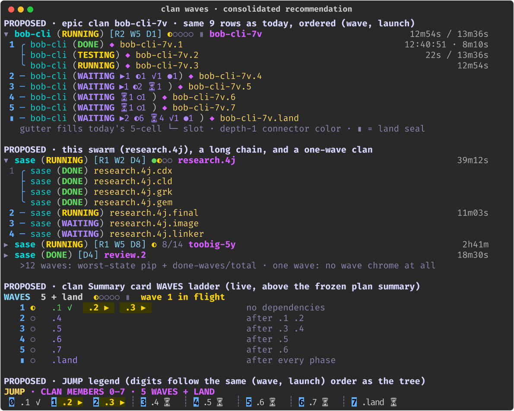

# Clan Waves in the Agents Tab: Derive Them From `%wait`, Draw Them in the Gutter

> **Research query:** How should the Agents tab in the SASE TUI visually represent the
> waves in agent clans? Today it shows none, and waves are only really supported for
> epic clans. The idea is to show the waves in every clan, research and custom
> user-defined clans included, in a way that is intuitive, reliable, and beautiful: is
> that a good idea, would a different approach be better, which requirement adjustments
> are justified (called out clearly), and what solution is recommended?


## Bottom line

**Yes, build it. Treat it as one of the higher-value Agents-tab changes available, not
a nice-to-have for epics.** Your premise is right, and it understates the case.

- Waves are already present in almost every clan.
  [87% of the clan generations recorded on athena this year](#new-evidence-on-what-clans-actually-look-like)
  have two or more dependency layers. Only the epic Summary card ever mentions them,
  and only as a frozen count (`Counts: 7 phases · 5 waves`).
- The tree actively hides the order. Clan members are
  [sorted by status](#what-is-true-today), so the waiting block in your screenshot
  reads in reverse: `.land, .7, .6, .5, .4`. The member that runs next sits at the
  bottom, and the one that runs last sits at the top.

The design all four researchers converge on, with my refinements:

1. **Waves are derived, never authored.** A clan's waves are the
   [Kahn layers](#the-wave-model) (longest-path depth) of the `%wait` edges among its
   own members. No `%wave` directive and no stored wave index. This works
   retroactively for every recorded clan: epics, research swarms, `toobig-` chains,
   and custom `---` clans.
2. **Zero extra rows.** A five-cell [**wave gutter**](#the-wave-gutter) replaces
   today's five-cell `  └─ ` connector on direct clan members. It shows the wave
   number on each wave's first row and a `╭ ├ ╰` brace around parallel members.
   Multi-wave clans order members by **(wave, launch)**, so the clan reads top to
   bottom in execution order and stops reshuffling on every status change.
3. **One state vocabulary, repeated on four surfaces.** The same per-wave pips
   (`● ◐ ○ ✗ ▲`) and numbering appear on:
   - [the clan row](#wave-pips-on-the-clan-row);
   - a live [**WAVES ladder**](#the-live-waves-ladder) in the clan Summary card;
   - **`┊` wave dividers** in [the JUMP legend](#the-jump-legend), whose digits
     follow the same (wave, launch) order as the tree.
4. **Single-wave clans look exactly like today.**
5. **The epic `.land` member is an unnumbered `∎` seal stage**, so the live view and
   the plan's "5 waves" agree (see [A6](#a6-the-epic-land-member-is-a-seal-stage)).
6. **The layering lives in `sase-core`.** It is domain logic: the editor integration
   already lists clan members, and the CLI and gateway would need the same answer. The
   TUI only adapts the result and draws it (see
   [the layering](#the-layering-lives-in-sase-core)).



## What is true today

*Verified.* I re-checked every load-bearing claim in the four reports. The ones the
design depends on, each with its evidence and consequence:

- **Direct clan members are stable-sorted by status priority: Failed 0, Stopped 1,
  Running/Starting 2, Queued 3, Waiting 4, Done 5. Ties come from the newest-first row
  order.**
  - *Evidence:* `_agent_tree_clan.py:291-326` and `_agent_clan.py:34-42`.
    `docs/ace.md` ~L1682 documents this order.
  - *Consequence:* This is why the screenshot's waiting block reads backwards. Changing
    it is a documented behavior change (see
    [A4](#a4-order-multi-wave-clans-by-wave-and-launch)).
- **A clan member whose status bucket changes cannot be patched in place. The whole
  panel is rebuilt with `fallback_reason="clan_member_order_change"`.**
  - *Evidence:* `actions/agents/_display_panel_patches.py:72-76, 463-473`
  - *Consequence:* With (wave, launch) ordering, a status change no longer moves rows.
    The row patch becomes possible (see [the patch-path payoff](#the-patch-path-payoff)).
- **Grouping banners are never emitted inside a clan or session subtree.**
  - *Evidence:* `models/agent_groups/__init__.py:41-42`
  - *Consequence:* Wave banner rows (cdx's proposal) would break a deliberate
    invariant.
- **`W` in the count chip `[R2 W5 D1]` means _Waiting_.**
  - *Evidence:* Screenshot: 5 members are WAITING. `agent_count_chip.py`
  - *Consequence:* `W1` / `[W1/5]` wave labels (gem, and grk's lowercase `w3/5`) would
    collide with it.
- **JUMP digits are _0-based_ (`CLAN MEMBERS 0–7`, `0 .1 ✓ … 7 .land`), in launch
  order. Docs promise the numbers "do not change as statuses change".**
  - *Evidence:* Screenshot; `docs/ace.md` ~L1684-1686; `ordered_clan_members` in
    `_agent_display_clan_roster.py:28`
  - *Consequence:* grk's mockup (`1–8`) is wrong. The stability promise survives
    (wave, launch) numbering, because waves do not depend on status.
- **The expanded member roster already supports dim italic group sub-headings. Clans
  pass `None`.**
  - *Evidence:* `_member_roster.py:128, 235-242`
  - *Consequence:* Wave headings in the roster are nearly free.
- **Declared waits survive completion. `agent_meta.json` `wait_for` is loaded into
  `Agent.waiting_for` for every row, Done included. `waiting.json` overrides it only
  for active statuses.**
  - *Evidence:* `_loaders/_meta_enrichment_wire.py:127-136, 259-271`
  - *Consequence:* Derivation has a durable, already-loaded source. No new persistence
    and no render-path I/O are needed.
- **Epic segments launch in wave order (`for wave in plan.waves`). `.land` comes last,
  waits on every launched phase, and carries `epic_bead_id` but no `phase_bead_id`.**
  - *Evidence:* `bead/work_prompt.py:176-221`; real `bob-cli-7v.*` metadata
  - *Consequence:* For epics, (wave, launch) order is today's launch order. Land can be
    recognized from role metadata, with no suffix heuristic.
- **Research segments launch as `researchers, final, image, linker, audio`. `linker`
  waits on `final`, `image`, and `audio`.**
  - *Evidence:* `research_swarm.md:161, 185, 269-274, 483-484`
  - *Consequence:* With audio enabled, launch order puts the last wave in the middle of
    the third. Wave ordering fixes that.
- **The tree's connector color already encodes _depth_: sky → mint → gold → rose →
  lavender → cyan.**
  - *Evidence:* `TREE_DEPTH_COLORS`, `_agent_list_styling.py:212-228`
  - *Consequence:* cld's per-wave color ramp (sky → cyan → green → yellow → orange →
    rose) would give near-identical hues a second meaning (see the color rules of
    [the wave gutter](#the-wave-gutter)).
- **`⚑` already means _monitor follow-up error_ in the agent list. It is also missing
  from Fira Code.**
  - *Evidence:* `_MONITOR_FOLLOWUP_ERROR_GLYPH`, `_agent_list_styling.py:153`; fontTools
    check
  - *Consequence:* Reject grk's and gem's `⚑` land marker. Use `∎` (present in Fira
    Code).
- **The glossary defines an agent clan as "a named, rootless container for agents that
  _run in parallel_."**
  - *Evidence:* `sase memory read glossary:"Agent Clan"`
  - *Consequence:* This is stale for 87% of clans. It needs a memory update, whatever is
    decided here.

The **rest of the code map** agrees across the reports and needs no correction:

- Rust Kahn layering already exists in `sase-core` `bead/work.rs:165-190`. It is
  fail-closed on cycles.
- The Python authored-plan layering is `sdd/plan_waves.py::plan_phase_waves`. It
  returns `None` on unknown ids.
- The epic Summary's `Counts:` line is static markup frozen into the clan record at
  launch.

## New evidence on what clans actually look like

None of the four reports measured the clan population. I layered every 2026 clan
generation on athena from its declared intra-clan waits:

- session turns `x--suffix` are folded to their member;
- waits outside the clan are ignored.

Clan generations, and how many of them have two or more waves, by population:

- **Epic clans:** Clan generations 742 · ≥ 2 waves 732 (99%)
- **Research swarms:** Clan generations 182 · ≥ 2 waves 177 (97%)
- **`toobig-` chop clans:** Clan generations 311 · ≥ 2 waves 171 (55%; 126 of the 140
  one-wave ones have a single member)
- **Other / custom:** Clan generations 6 · ≥ 2 waves 1
- **All:** Clan generations **1,241** · ≥ 2 waves **1,081 (87%)**

What this means for the design:

- **"Every clan" is the main path, not an edge case.** "Hide wave chrome on one-wave
  clans" mostly affects single-member toobig clans.
- **Depth.**
  - The median is 4 waves and the 90th percentile is 6.
  - 37 clans (3%) exceed 10 waves, and the longest toobig chain has **52**.
  - Any per-wave strip on a single row needs an overflow form (see
    [the wave pips](#wave-pips-on-the-clan-row)).
- **Width.**
  - Among multi-wave clans, **34% are pure chains**: one member per wave.
  - In **70%, no wave has more than two members.**
  - Wave banner rows (cdx) would mostly be one header per one member, which is pure
    overhead. A zero-row gutter fits the data. This is the decisive argument against
    banners.
- **Exotic edges are rare.** `wait_for_hoods` appears in 0 of 10,188 member rows, and
  waits naming the clan itself appear in 0. Keep cld's rules for them for
  correctness, but they are not design drivers.
- **Land, and the case for bead edges.** Using agent waits alone, land is alone in the
  final layer in 94% of epics with a role-identifiable land member (340 of 363).
  - **Why most exceptions happen:** they are re-worked epics. Example: `sase-z3`. Its
    `.3` and `.land` joined the same generation three days later, after `.2` had
    closed. The relaunch dropped their agent waits on closed phases and kept only
    `bead=` waits.
  - **The fix:** cld's bead-edge rule (see [edge resolution](#edge-resolution))
    repairs them. It raises the figure to **98%** (357 of 364).
  - **Fresh launches** always put land last.
- **Custom clans are rare today (6).** They come for free with generic derivation, so
  no special work is justified for them.

Caveats on the method:

- kinds are heuristics (`research.*` prefix, presence of `epic_bead_id`, `toobig-`
  prefix);
- retry `.rN` slot folding was not applied;
- the corpus covers athena only.

The numbers are directional, not exact.

**A live example: this swarm, `research.4j`**, layers as:

```text
{cdx, cld, grk, gem} → {final} → {image} → {linker}
```

That makes 4 waves, while today it shows as a flat status list.

## Critique and called-out requirement adjustments

The idea is good. The real gap is broader than "waves are missing": a clan is drawn as a
status bucket list when it is actually a small DAG. Waves are the right first
projection of that DAG: linear, legible, and one terminal row per member. A full ASCII
DAG is beautiful at 6 members and unreadable at 52.

**I would not take a fundamentally different approach.** I would take the adjustments
below. A1–A3 have unanimous or near-unanimous support. A4–A6 are contested, and I have
resolved them.

### A1 Waves are derived and never authored

**Waves are derived from `%wait`, never authored.** *(all four)*

Do not add `%wave`, `stage=`, or a stored wave index. A second ordering language can
contradict the scheduler: a member labeled "wave 2" without a `%w` would run alongside
wave 1. Authored stage *labels* such as "Research / Synthesis / Publish" can come later
as optional producer metadata. They never decide membership.

### A2 Every clan can show waves

**"Every clan" means every clan *can* show waves. Chrome appears only when a clan has
two or more waves.** *(all four)*

A one-wave fan-out keeps today's look, ordering included. Per
[the clan measurements](#new-evidence-on-what-clans-actually-look-like), this is 13% of
clans.

### A3 A wave is a dependency layer not a barrier

**A wave is a dependency layer, not a barrier, and there is no single "current
wave".** *(cdx, cld, gem; I reject grk's `wK/N` frontier chip and gem's `[W1/5]`)*

`.4` starts as soon as `.1` and `.2` finish, even while `.3` (wave 1) is still running.
Every wave shows its own state, and two can be in flight at once (`◐◐○○○`). "Wave 1 of
5" invites the barrier misreading. Queue admission (`%q`) is also not a wave: queued
members stay in their dependency layer.

### A4 Order multi-wave clans by wave and launch

**Multi-wave clans order direct members by (wave, launch time, name) instead of by
status.** *(cld; gem used (wave, status, launch); grk kept status order; cdx used
launch order within bands)*

This changes documented behavior (`docs/ace.md`). Single-wave clans keep status order.

- **What you lose:** failures and running members no longer float to the top.
- **Why that is acceptable:** attention stays loud through:
  - the `F`/`S` count chip;
  - the `✗` / `▲` wave pip, which points at the failing *wave*;
  - red/amber status text;
  - the container mirroring a lone running member;
  - the existing `,J` stopped-agent jump.
- **What you gain:**
  - the clan reads as a pipeline;
  - rows stop jumping on every transition;
  - status changes become single-row patches instead of panel rebuilds (see
    [the patch-path payoff](#the-patch-path-payoff)).

I reject gem's within-wave status sort. It brings back reordering inside a wave, which
repaints the brace shape and forces rebuilds again, for little benefit: 70% of waves
have at most two members.

### A5 JUMP digits follow wave and launch order

**JUMP digits follow the same (wave, launch) order.** *(cld; grk preferred pure launch
order)*

The documented promise, "numbers do not change as statuses change", still holds,
because waves do not depend on status.

- For epics, numbering is identical to today (launch order is wave order).
- For audio-enabled research swarms, it fixes a real misordering (`linker` before
  `audio`).
- The payoff: tree row *N*, ladder position *N*, and JUMP digit *N−1* always refer to
  the same member.

Digits can move only when membership or waits change: a late joiner or a `W` wait
edit. Update the doc sentence to say so.

### A6 The epic land member is a seal stage

**The epic `.land` member is a seal stage, `∎`, outside the numbered waves.** *(cdx
"Finish", grk/gem `⚑`; cld wanted to number it as wave 6)*

The plan's vocabulary counts phase waves, and `Counts: 7 phases · 5 waves` is already
on screen. A live view saying 6 would look wrong on day one. Keep the kernel generic:

- the epic adapter tags the member whose first turn has `epic_bead_id` and no
  `phase_bead_id` with `role = seal`;
- the presentation shows a final layer made up only of seal members as `∎` and
  excludes it from the numbered count.

If a historical land shares its layer with other members (2% of epics once bead edges
are applied), it stays a numbered member, with no special case. Research `.final` and
`.linker` are ordinary waves.

### A7 No wave rows and no wave nodes in v1

**No wave rows and no wave nodes in v1.** *(cld, grk, gem vs cdx)*

Waves are not sase nodes:

- they are not `j`/`k` stops;
- they are not fold, kill, or mark targets;
- they are not JUMP numbers.

[The clan measurements](#new-evidence-on-what-clans-actually-look-like) explain why
banner rows lose on this clan population. If folding a finished prefix of a 50-member
chain becomes a real pain, add **done-prefix compaction** later (see
[the v2 candidates](#risks-and-open-questions-including-v2)), not general wave
banners.

### A8 The collapsed clan row is in scope

**The collapsed clan row is in scope.** *(grk)*

The one-line clan container is where the pips earn their keep. Most clans in a busy
tribe panel are collapsed.

### A9 Fix the glossary definition independently

**Fix the glossary's Agent Clan definition independently of this feature.** *(cld)*

"Agents that run in parallel" is inaccurate today. Add a **Clan Wave** term only if
this ships. Route both through `/sase_memory_write`. This report makes no memory
edits.

## Recommended design

### The wave gutter

*Surface 1, in the agent list.*

```text
▾ bob-cli (RUNNING) [R2 W5 D1] ◐○○○○ ∎ bob-cli-7v              12m54s / 13m36s
 1 ╭ bob-cli (DONE) ×5 ◆ bob-cli-7v.1                          12:40:51 · 8m10s
   ├ bob-cli (TESTING) ×6 ◆ bob-cli-7v.2                          22s / 13m36s
   ╰ bob-cli (RUNNING) ×4 ◆ bob-cli-7v.3                                12m54s
 2 ─ bob-cli (WAITING ▶1 ◐1 ✓1 ●1) ◆ bob-cli-7v.4
 3 ─ bob-cli (WAITING ▶1 ◐2 ⏳1) ◆ bob-cli-7v.5
 4 ─ bob-cli (WAITING ⏳1 ○1) ◆ bob-cli-7v.6
 5 ─ bob-cli (WAITING ⏳1 ○1) ◆ bob-cli-7v.7
 ∎ ─ bob-cli (WAITING ▶2 ◐6 ⏳4 ✓1 ●1) ◆ bob-cli-7v.land
```

**Layout.**

- The gutter is `f"{label:>2} {bracket} "`. That is five cells, the same footprint as
  `  └─ `, so no member content moves horizontally.
- The label is the wave number on the wave's first row, `∎` for the seal, `?` for
  unresolvable members, and blank otherwise.
- Bracket: `╭ ├ ╰` around a multi-member wave, `─` for a wave of one.
- Unfolded session turns keep their `└─` connectors. A `│` lane runs through them
  while more members of the same wave follow (cld's third mockup panel).

**Color: structure, not a rainbow.**

- Brackets and numbers use the depth-1 connector color the row already uses today
  (`TREE_DEPTH_COLORS[0]`, sky blue).
- Numbers are **bold** for waves with unfinished work and **dim** once every member
  is Done.

I reject cld's static per-wave ramp, even though it is pretty in its mockup:

- the tree already spends exactly those hues on hierarchy depth, so a wave-3 member's
  mint number would sit beside its depth-2 children's mint connectors;
- the ramp's green and yellow stops sit next to DONE green and RUNNING gold;
- with that much color, wave 4's yellow number reads as "running".

The restrained version gets its beauty from alignment, the brace shape, and the calm
order. Brightness changes only when a wave completes, which is rare, so the
[patch-path benefit](#the-patch-path-payoff) is kept.

**Labels.** Use bare numerals in the gutter and the spelled-out word in text surfaces.
Never use `W`.

### Wave pips on the clan row

*Surface 2.*

Pips go after the count chip: one per numbered wave, plus `∎` for a seal.

Pip states, worst first:

1. **failed**
   - *Condition:* any member Failed and not superseded by a retry
   - *Pip:* `✗` red
2. **needs you**
   - *Condition:* any member Stopped, asking, or awaiting plan review
   - *Pip:* `▲` amber
3. **in flight**
   - *Condition:* any member Running, Starting, Queued, or Finalizing; or a mix of done
     and not done
   - *Pip:* `◐` gold
4. **done**
   - *Condition:* every member Done
   - *Pip:* `●` green
5. **not started**
   - *Condition:* every member Waiting
   - *Pip:* `○` dim

This is the bead `○ ◐ ●` idiom the waiting chips already use, so nothing new needs to
be learned. The precedence mirrors the clan container's "needs-you outranks" rule.

Overflow:

- **More than 12 waves** (2% of clans): render `<worst pip> <done>/<total>`, for
  example `◐ 8/14`. The fraction counts *completed waves*. It is not a "current
  wave" index, which keeps [A3](#a3-a-wave-is-a-dependency-layer-not-a-barrier)
  honest.
- Pips are the first element dropped when the row is narrow.
- They are off in 19-cell rail mode.
- The same renderer goes on clan units in the tribe Summary card's rosters (cld). The
  `@epic` tribe view then shows every epic's progress at a glance.

Font check (bundled renderer):

- `● ◐ ○ ▲ ∎ ╭ ├ ╰ ┊` are all in Fira Code.
- `✗` falls back to DejaVu, as it already does for the TUI's Failed glyph.

### The live WAVES ladder

*Surface 3, in the clan Summary card.*

The ladder goes immediately after the CLAN identity block and before the frozen
`clan_summary` markup, as a foldable section using the existing clan fold scale:

```text
WAVES  5 + land  ◐○○○○ ∎  wave 1 in flight
   1 ◐   .1 ✓  [.2 ▶] [.3 ▶]          no dependencies
   2 ○   .4                            after .1 .2
   3 ○   .5                            after .3 .4
   4 ○   .6                            after .5
   5 ○   .7                            after .6
   ∎ ○   .land                         after every phase
```

- In-flight pills reuse the JUMP legend's lit tint, so the ladder and the legend read
  as one system.
- The `after` column names in-clan predecessors. It switches to `after wave k` when
  there are more than three, adds `after every phase/member` for seals, and appends
  `· +N outside` for external waits.
- Everything comes from rows already in memory, which respects the "clan panel first
  paint stays off disk" rule. Epic phase titles are optional enrichment through the
  existing associated-plan worker cache, never a render-time read.

Gem's proposal to regroup the epic Summary's frozen *phase list* by wave is a fine
follow-up. It is unnecessary once the live ladder exists.

### The JUMP legend

*Surface 4.*

```text
JUMP · CLAN MEMBERS 0–7 · 5 WAVES + LAND
 0 .1 ✓  1 .2 ▶  2 .3 ▶ ┊ 3 .4 ⏳ ┊ 4 .5 ⏳ ┊ 5 .6 ⏳ ┊ 6 .7 ⏳ ┊ 7 .land ⏳
```

- Digits follow (wave, launch) order
  ([A5](#a5-jump-digits-follow-wave-and-launch-order)).
- Waves are separated by a dim `┊`, which costs one cell per boundary.
- The two-row packer keeps its in-flight-first overflow rule, and the selected chip is
  always shown.
- The expanded roster sets `MemberRosterEntry.group_label` to
  `wave 2 · after .1 .2`.
- `CLAN NEIGHBORS` continue on the same ladder, without clusters.

I prefer this over grk's circled-index timeline (`① 1 2 3▶ ② 4 …`). The circled digits
add a second numeric system right next to the jump digits. A divider says "boundary"
without adding anything that looks like a jump target.

### What each clan kind gets

What you see, by clan:

- **Epic:** a brace around the no-dependency phases, a numbered spine, a `∎` land
  seal; pips `◐○○○○ ∎`
- **Research swarm:** a brace around the researchers, then `final`, `image`/`audio`
  (one braced wave), `linker`; pips `●◐○○`
- **`toobig-` chain:** a numbered `─` ladder that doubles as a step counter; pips, or
  `◐ 8/14` past 12 waves
- **Flat `---` fan-out, one-member clan:** unchanged
- **Cycle or unresolvable waits:** the affected members render in a trailing `?` group
  with a warning-colored label; nobody is hidden

Unchanged surfaces:

- `BY_STATUS` grouping still files the clan under its aggregate status.
- Rail mode keeps today's connectors in v1.
- A nested sub-epic clan is its own clan, with its own waves.

## The wave model

*One definition, total and deterministic.*

> A **clan wave** is a dependency layer of one clan generation's direct members.
>
> - A member is in wave 1 if none of its declared waits resolves to another member
>   of the same generation.
> - Otherwise it is in 1 + the highest wave among the members it waits on.

### Edge resolution

This is cld's table, refined. Edge `p → m` means "m waits on p". Use the union of the
waits on every turn in `m`'s session.

What each declared wait resolves to:

- **exact member name:** that member
- **session turn `x--suffix`:** the member owning session `x`; self-edges are dropped
- **retry `x.rN`:** `x`'s slot (a retry keeps its original's wave)
- **a name inside the clan hood (`<clan>.<suffix>`) that is _not loaded_, for example
  dismissed:** a **ghost** member (see [below](#ghost-members))
- **`wait_for_beads: b`:** the member whose `phase_bead_id == b`. Measured: this
  repairs 16 of 23 misordered re-worked epics (see
  [the clan measurements](#new-evidence-on-what-clans-actually-look-like)).
- **`wait_for_hoods: h` / the clan's own name:** members in that hood launched earlier
  (launch-snapshot semantics). 0 occurrences today; implement for correctness.
- **anything else (other clans, `@tribe`, foreign beads, `time=`, `for_epic`
  follows):** **no edge**; the member counts it as an *external wait*

### Ghost members

This is my addition, and it closes cdx's strongest objection.

- **The problem:** without ghosts, dismissing the finished researchers would turn
  their waits into "external", silently re-layer `final` into wave 1, and renumber
  everything.
- **The rule:** clan members are always named `<clan>.<suffix>` (glossary), so a wait
  on an unloaded name inside the hood still marks a real intra-clan edge. Ghosts take
  part in layering and render no row.
- **How a ghost-only wave renders:**
  - the gutter skips its number, so it starts at `2`, which is honest;
  - its pip is a dim `·`;
  - the ladder shows `1 · 4 dismissed`.
- **Status:** ghosts never count as Done, so a dismissed failure cannot turn green.

This gives cdx's stability goals without a persisted manifest.

### Further rules

- Read **declared** waits, never a shrinking "remaining" view.
- Layer in launch order. Break ties by launch rank, then name.
- **Late joiners** with no waits go at the end of wave 1. That is honest: they are
  independent.
- Scope everything to the clan **generation**. A recreated clan gets fresh waves.
- Epic numbered waves come from the same wait graph as everything else. For current
  launches this equals the Rust plan's waves; one test pins that equality. Do **not**
  call `bead_build_epic_work_plan` from the TUI (grk): it reads the bead store and is
  status-blind.

### Why derive instead of persisting a manifest (cdx's proposal)?

- Declared waits are already durable and loaded for every row (see
  [what is true today](#what-is-true-today)).
- Waits are the only thing that gates execution, so they are the only truth that
  cannot drift.
- Derivation works retroactively on all 1,241 recorded clans.

cdx's remaining concerns, and how each is handled:

- **Partially hydrated swarms on first paint:** A few seconds of growing waves. JUMP
  digits may settle once. Coalesce with the existing clan-enrichment pass.
- **Dismissal:** Ghosts ([above](#ghost-members))
- **Retention:** No new store, so no new retention policy
- **Re-worked epics:** Bead-edge rule, validated on the corpus. Use `sase-z3` as the
  fixture.

## Architecture, performance, reliability

### The layering lives in sase-core

This is the majority view (cdx, cld, gem). grk argued for Python in v1. I side with the
Rust boundary memory:

- the edge rules (turn folding, retry slots, ghosts, hood snapshots, bead mapping) are
  domain logic;
- `src/sase/integrations/_agent_list_entry_build.py` already serves clan rows to the
  editor integration, so a second consumer exists today.

Implementation:

- Extract a generic, total `layer_dependency_waves(ids, deps)` from
  `bead/work.rs:165-190`. Cycles go to an `unresolved` set instead of an error. The
  epic planner keeps its fail-closed wrapper.
- Add `project_clan_waves(members: &[ClanWaveMemberWire]) -> ClanWavesWire`, which
  returns:
  - `waves`;
  - `wave_of`;
  - `preds`;
  - `external_waits`;
  - `ghosts`;
  - `unresolved`;
  - `seal`.
- Expose it through `sase_core_rs` and move `sase-core-revision.txt` past the binding
  commit.

### Python model layer

In `project_clan_tree`:

- **Call site.** Build the wires from the loaded rows once per clan generation. Then
  call the binding.
- **Memoization.** Memoize by a wave signature: member identities, normalized wait
  targets, and launch ranks. Refilters cost a hash.
- **Presentation fields.** Write only presentation-only fields:
  - `clan_wave`, `clan_wave_pos` (`solo`/`first`/`mid`/`last`);
  - `clan_wave_states` on the container.
- **Wave states.** Fold wave states in Python from status buckets. They change exactly
  when the count chip changes.

### The patch-path payoff

*(cld, verified)*

- For multi-wave clans, replace `_clan_row_patch_preserves_order` with "order key
  `(wave, launch_rank, name)` unchanged".
- A status transition then patches the member row plus the container header instead
  of rebuilding the panel.
- Extend `agent_render_key` and `panel_row_signature` with the gutter tuple and the
  pip states.
- Measure with `SASE_TUI_TRACE=1` fallback-reason counts and the clan-container
  benches. Expect `clan_member_order_change` fallbacks to disappear for multi-wave
  clans.

### Invariants

- no file I/O on the render path;
- members are never hidden;
- selection is keyed by identity, never by row index;
- waves never become nav items.

### Feature flag

If the list change ([Phase 2 below](#recommended-solution)) and the detail surfaces
(Phase 3) land as separate epic phases:

- use a `beta` flag created with `sase flag new` as epic scaffolding;
- remove the flag before the epic lands.

No permanent `ace.clan_waves` config knob (grk). Per `sase_flags`, a knob is only right
if users should choose forever, and there is no case for keeping scrambled order
forever.

## Where the reports disagreed, and the resolution

Each question, with the four reports' positions and the resolution:

- **Source of waves**
  - *cdx:* Rust topology manifest, persisted at launch
  - *cld:* derived from declared `%wait`
  - *grk:* derived (Python); epic from authored plan
  - *gem:* derived (Rust); epic from work plan
  - *Resolution:* **Derived from declared waits, in Rust, plus ghosts.** The data is
    already durable.
- **Tree structure**
  - *cdx:* foldable wave **band rows**
  - *cld:* zero-row **gutter**
  - *grk:* `wN` chip, tree unchanged
  - *gem:* `W1` chip
  - *Resolution:* [**Gutter.**](#the-wave-gutter) 70% of multi-wave clans have waves of
    at most 2 members, so bands are overhead and break the no-banner invariant. Chips
    alone leave the order scrambled.
- **Member order**
  - *cdx:* launch order within bands
  - *cld:* (wave, launch)
  - *grk:* status (unchanged)
  - *gem:* (wave, status, launch)
  - *Resolution:* **(wave, launch)**, multi-wave clans only
- **Clan-row summary**
  - *cdx:* "active W1, W2"
  - *cld:* pips
  - *grk:* `wK/N` frontier
  - *gem:* `[W1/5]`
  - *Resolution:* [**Pips**](#wave-pips-on-the-clan-row), with `◐ done/total` past 12
    waves. No single current wave.
- **Epic land**
  - *cdx:* unnumbered "Finish"
  - *cld:* numbered wave 6
  - *grk:* `⚑` seal
  - *gem:* `⚑L`
  - *Resolution:* **`∎` seal**, chosen by role metadata. `⚑` is taken and not in Fira
    Code.
- **Color**
  - *cdx:* status colors only
  - *cld:* static per-wave ramp
  - *grk:* one accent, three luminances
  - *gem:* cyan/magenta accent
  - *Resolution:* **Depth-1 connector color, bold vs dim.** The ramp collides with the
    depth palette and status hues.
- **JUMP numbering**
  - *cdx:* unchanged
  - *cld:* (wave, launch)
  - *grk:* launch order
  - *gem:* launch order
  - *Resolution:* **(wave, launch)**, which equals today's order for epics
- **JUMP clustering**
  - *cdx:* (not primary)
  - *cld:* `┊` dividers
  - *grk:* circled-index timeline
  - *gem:* `┆` + `W1 [...]`
  - *Resolution:* **`┊` dividers**, with the title suffix `· 5 WAVES + LAND`
- **Extra card**
  - *cdx:* none (defer DAG/Gantt)
  - *cld:* none (Gantt v2)
  - *grk:* none
  - *gem:* ASCII pipeline card
  - *Resolution:* **Defer.** The ladder covers it. Gantt and dependency-cone views go to
    v2.

## Risks and open questions including v2

1. **Losing status-first order** in multi-wave clans
   ([A4](#a4-order-multi-wave-clans-by-wave-and-launch)). This is the main judgment
   call for you. If it feels wrong after using the prototype, the fallback is
   (wave, status, launch) within each wave. That costs some reordering churn and the
   patch-path win.
2. **Long chains** push the running member down a 30–50-row list. The v2 remedy is
   **done-prefix compaction**: one chrome line, `✓ waves 1–28 · 28 agents`, which
   expands on demand. Prototype it only if real chains hurt.
3. **Hydration flicker** while a swarm registers its members. JUMP digits may settle
   once. Coalesce with the existing enrichment pass, not a new refresh path.
4. **Visual goldens** for the clan panel and JUMP will move. Review every group from
   `just fix-tui-screenshots`. Pin time, zone, and host.
5. **Seal glyph.** `∎` renders small in Fira Code (see the mockup). Confirm it in your
   actual terminal font. The fallback is a dim `L`.
6. **v2 candidates, in value order:**
   - **dependency-cone highlight** for the selected member: upstream and downstream
     markers in the gutter, plus `WAITS ON` / `BLOCKS` JUMP sections. This answers
     "why is this waiting?", which waves alone do not.
   - done-prefix compaction;
   - a Gantt card from the already-loaded `start_time`/`stop_time`;
   - optional producer stage labels (`Research · Synthesis · Media · Publish`);
   - a wave line in `sase agent show`.

### Tests

Merged from cdx, cld, and grk:

- **Rust:** the four real shapes:
  - the `bob-cli-7v` epic;
  - the `research.4j` swarm;
  - a `toobig` chain;
  - a flat clan.
- **Rust, additionally:**
  - diamond and asymmetric overlap;
  - session-turn and retry folding;
  - ghosts after dismissal;
  - bead-only edges from a re-worked epic;
  - external waits;
  - a late joiner;
  - a forced cycle;
  - an equality pin for "epic launch waves == displayed waves".
- **Python:**
  - (wave, launch) versus status order;
  - the patch guard;
  - render-key invalidation;
  - selection surviving refresh;
  - filters that hide blockers.
- **Visual goldens:**
  - an epic mid-flight;
  - two waves in flight;
  - a failed wave;
  - a research swarm with media;
  - a 14-plus-wave chain with compact pips;
  - an unchanged one-wave clan;
  - an unfolded session under a wave;
  - the ladder;
  - the JUMP legend at 60, 80, and 120 cells;
  - light and dark themes.
- **Docs:** `docs/ace.md` (order, JUMP numbering, pips), the `?` help pip legend, and
  `docs/agent_sessions.md`. No new keymaps are needed, so `default_config.yml` is
  unaffected.

## Recommended solution

Adopt **"clan waves = Kahn layers of the clan generation's own declared `%wait`
graph"**. Derive them in `sase-core`, treat hood-named absent members as
[ghosts](#ghost-members), and mark the epic land member as a `∎` seal by role metadata.
Draw them with zero extra rows. Ship in three phases:

1. **Core (`sase-core`).**
   - Add a total `layer_dependency_waves` shared with the epic planner.
   - Add `project_clan_waves` with the [edge rules](#edge-resolution), plus the
     binding and Rust tests on real clan shapes.
   - Bump `sase-core-revision.txt`.
2. **List (`sase`).**
   - In multi-wave clans, order members by (wave, launch).
   - Add the five-cell **wave gutter**: wave number, `╭ ├ ╰ ─` brace, depth-1 color,
     bold for open waves and dim for done.
   - Add **pips** on the clan row (`● ◐ ○ ✗ ▲`, `∎`, and `◐ done/total` past 12).
   - Replace the clan patch-order guard.
   - Update the docs and the `?` help.
   - One-wave clans stay byte-identical.
3. **Detail.**
   - Add the live **WAVES ladder** in the clan Summary card.
   - Add **`┊`-divided JUMP legend** numbering in the same order, plus roster
     `group_label`s.
   - Add pips on tribe-roster clan units.

Separately, file a memory task to fix the stale Agent Clan glossary definition (see
[A9](#a9-fix-the-glossary-definition-independently)). Add a Clan Wave term when this
ships. Defer the dependency-cone highlight, done-prefix compaction, the Gantt card, and
stage labels to v2.

The result meets your three goals:

- **Intuitive:** every multi-wave clan reads top to bottom in execution order, and the
  tree, ladder, and JUMP digits agree. Flat clans need nothing new to learn.
- **Reliable:** waves come from the one thing that gates execution. The derivation is
  deterministic and total, and stable across dismissal and status churn. It also
  removes a forced rebuild path.
- **Beautiful:** a quiet brace-and-numeral spine in the tree's own color, with a row of
  progress pips. The same vocabulary repeats in the ladder and the legend, and nothing
  is added where there is nothing to show.

## About this report

- **Date:** 2026-10-15
- **Lead researcher:** `research.4j.final`. This report consolidates four independent
  reports in this directory (`__cdx`, `__cld`, `__grk`, `__gem`) and adds my own
  research.
- **Code revisions:** `sase` @ `bc4bc3e183`, `sase-core` @ `6f422072`, and
  `sase-research-artifacts` (`research_swarm.md`).
- **Evidence I added:**
  - a measurement of every clan recorded on athena in 2026: 1,241 clan generations
    and 10,188 member-turn metadata files (see
    [the clan measurements](#new-evidence-on-what-clans-actually-look-like));
  - a re-check of the reports' code claims (see
    [what is true today](#what-is-true-today));
  - a font-coverage check of the candidate glyphs against the TUI's bundled fonts;
  - a mockup rendered with sase's own PNG renderer (`render_svg_to_png`).
- **Mockups:**
  - mine:
    [`clan_waves_in_agents_tab__final_mockup.png`](clan_waves_in_agents_tab__final_mockup.png);
  - cld's: `agent_clan_waves_wait_layers__cld_{list,kinds,summary}.png`
    ([list](agent_clan_waves_wait_layers__cld_list.png),
    [kinds](agent_clan_waves_wait_layers__cld_kinds.png),
    [summary](agent_clan_waves_wait_layers__cld_summary.png)), in this directory.
