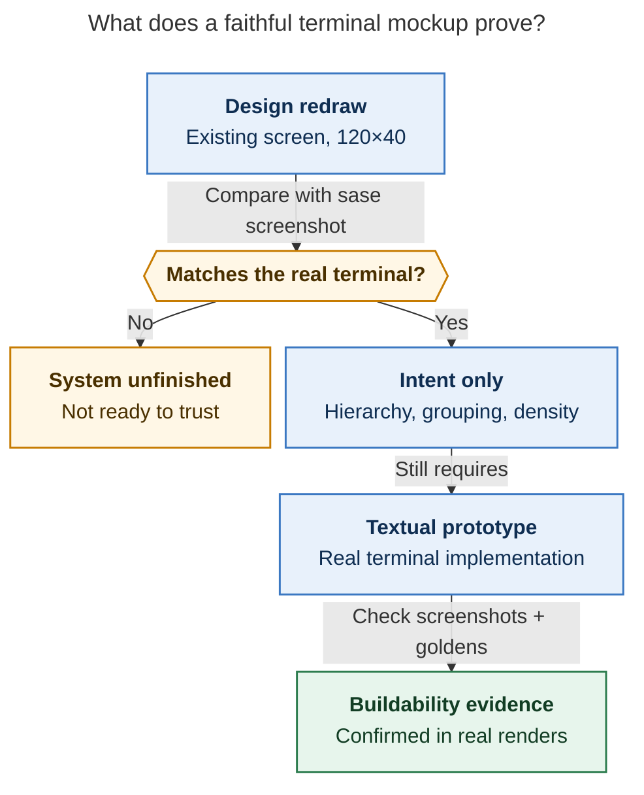
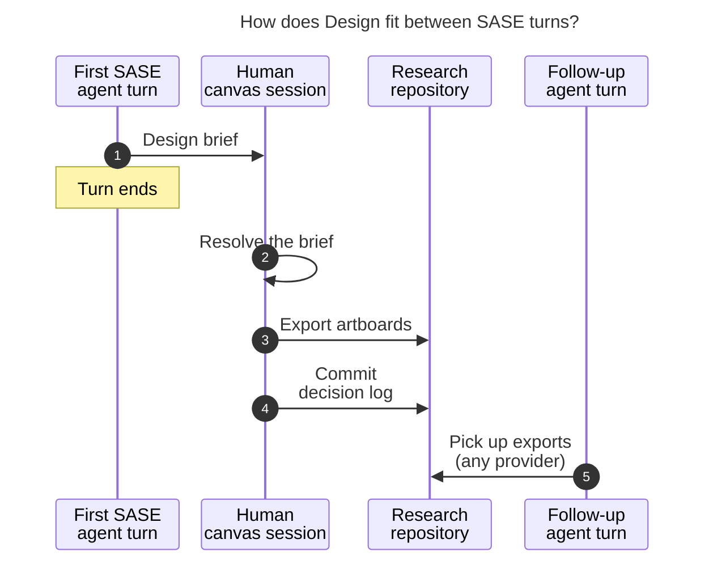

# Diagram proposals: Claude Design alongside `#research_swarm` for SASE UX

Proposals for the swarm linker, not a report. Each diagram restates only what the source
report says.

```yaml
source: research:202610/claude_design_alongside_research_swarms/claude_design_alongside_research_swarms__final.md
producer: research.5a.image
check: "mmdc 12.0.0 with the PDF-mirroring config rendered 2 of 2 Mermaid diagrams"
```

## mockup-proof

```yaml
anchor: |-
  panel at 120×40, and compare it with a `sase screenshot` PNG.
question: |-
  What does a successful redraw establish, and what still needs real Textual proof?
illustrates: |-
  A Claude Design TUI artboard specifies intent, while a Textual prototype plus sase screenshot and the goldens still proves that the design can be built.
caption: A faithful canvas redraw establishes visual intent; a real Textual prototype, screenshots, and goldens still have to prove buildability.
review: "519.875x916 px, fit 97.5%; question, source trace, labels, arrows, and visual checks passed; 1 revision, 2 visual reviews"
```



## human-design-handoff

```yaml
anchor: |-
  design brief. You resolve the brief in a canvas session, and a follow-up agent picks
question: |-
  How can a human canvas session fit between SASE turns without an agent waiting?
illustrates: |-
  A swarm or agent ends its turn with a design brief, a human resolves it in a canvas session, and a follow-up agent picks up the exports from the research directory.
caption: SASE turns end before human canvas work; saved exports and a decision log carry the result into a follow-up turn.
review: "692.5x586 px, fit 94.3%; question, source trace, labels, arrows, and visual checks passed; 1 revision, 2 visual reviews"
```



