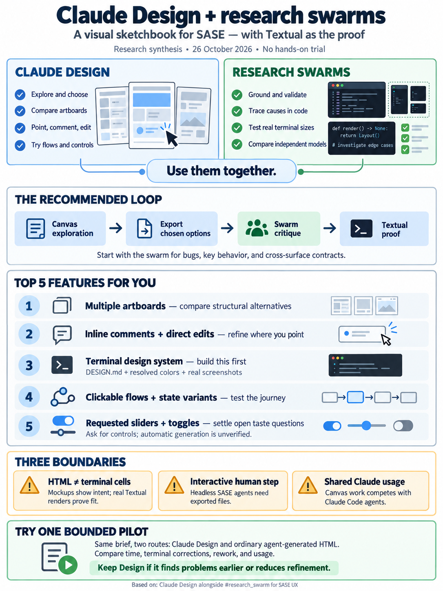
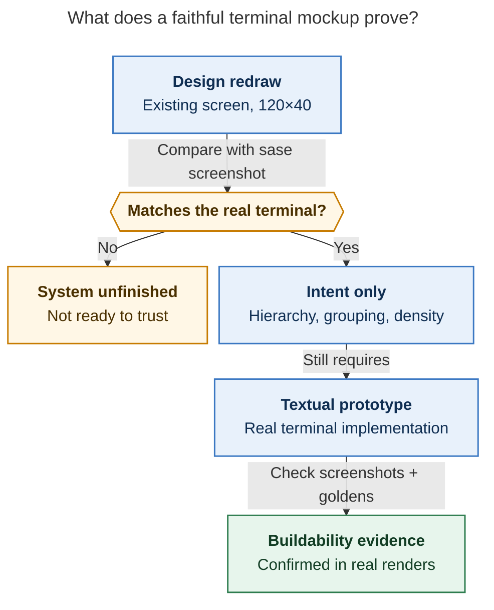
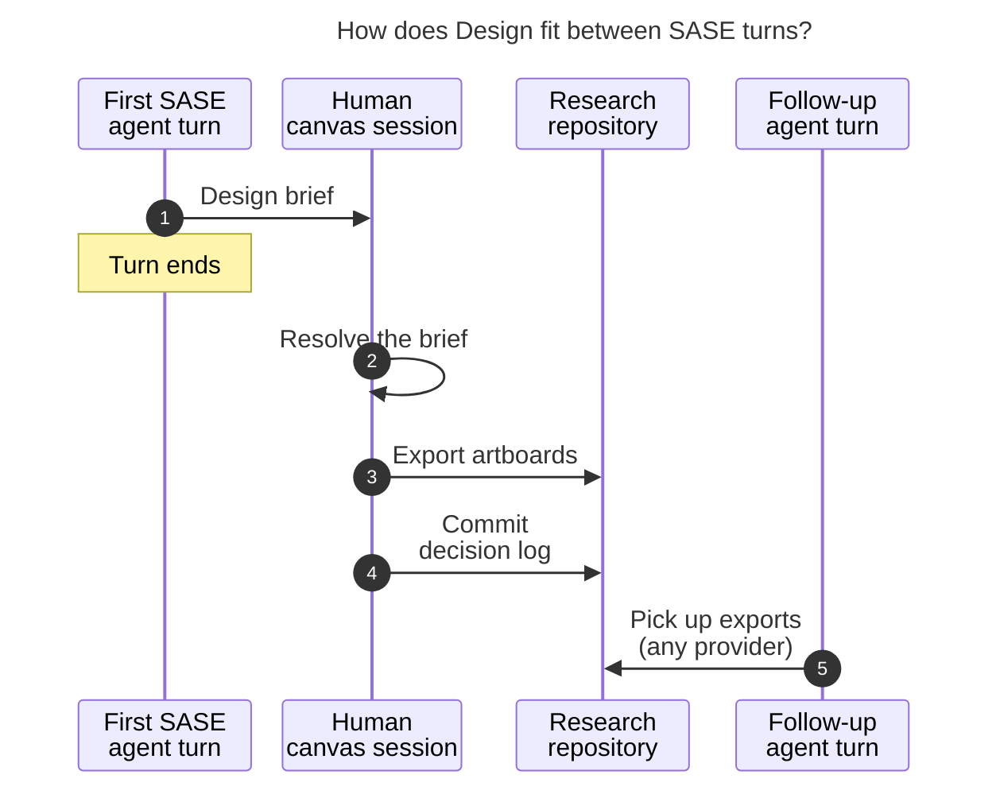
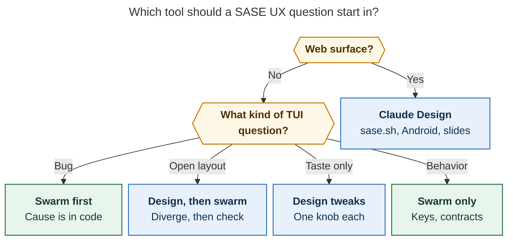

# Claude Design alongside `#research_swarm` for SASE UX

> **Research query:** I use the `#research_swarm` macro swarm to design sase's UX (for
> example, the TUI). What is Claude Design, and what would I gain from using it instead
> of, or in addition to, research swarms? End with a ranked list of the Claude Design
> features and functionality I am likely to find useful.



## Bottom line

**Use Claude Design in addition to research swarms, not instead of them.** All five
researchers reached this verdict independently, and the evidence supports it. Each tool
covers the other's weakest half of UX work:

- **Claude Design helps you diverge and decide.** It draws several directions as
  artboards on one canvas. You react by pointing: an inline comment on an element, a
  direct drag or text edit, or a control bound to a value.
  [Swarms are weakest here](#what-research-swarms-already-give-you). Their divergence
  arrives as prose, and the choices left to you come back as text ("Rail cap: 84 or
  100?").
- **Research swarms help you ground and converge.** They trace a visual bug into
  Textual's source, run censuses over real data, and render real Textual prototypes
  through `sase screenshot`'s renderer. Five model families check one another, and the
  results are committed as durable, audited artifacts. Claude Design can do none of
  that for a Textual TUI.

Three verified constraints set how far Claude Design can go for you:

1. **The medium doesn't match.** Claude Design produces HTML, CSS, and JS in a browser.
   The sase TUI is a monospace cell grid drawn by Textual (`textual==8.0.1`) and styled
   by a 10,935-line `styles.tcss`. A Claude Design TUI mockup is a *picture of intent*,
   never a buildable artifact. It is only as faithful as the terminal rules you teach it
   (see [the medium gap](#the-medium-gap-and-how-to-blunt-it)).
2. **It can't run inside your swarm.** Claude Code's docs say artifacts, which `/design`
   publishes through, are *"Off by default in the Agent SDK … when you run Claude Code
   with -p."* SASE launches Claude agents that way. This lead session confirms it
   (`CLAUDE_CODE_ENTRYPOINT=sdk-cli`): it has no `Artifact` tool. Claude Design is
   therefore a human step that you run interactively. Swarm agents see only what you
   export into the research repo (see
   [plugging into SASE](#plugging-claude-design-into-sase-agent-machinery)).
3. **Timing and cost.** The standalone `claude.ai/design` site closes on
   **[December 14, 2026](#timeline)**. Chats and comments don't migrate. Claude Design
   now lives inside ordinary Claude chats, the Artifacts tab, and Claude Code's
   `/design`. It draws on **[the same usage pool as Claude Code](#cost)**, so every
   canvas session competes with your Claude agents.

**[Recommended pattern](#recommended-workflow): diverge on the canvas, converge in the
swarm, prove in Textual.** Spend one interactive session building a "sase terminal"
design system. For an open-ended new view, explore and pick a direction on the canvas,
then hand the exported artboards to `#research_swarm` to check feasibility and cell
geometry, build a Textual prototype, and write the plan. Keep starting with the swarm
for bugs, key semantics, and cross-surface contracts. When a swarm leaves taste
questions open, settle them on the canvas. Make Claude Design your *primary* tool for
the surfaces that really are web-shaped: sase.sh, the `sase-android` client, launch
visuals, and slides.

---

## What Claude Design is today

### Timeline

- **2026-04-17:** Anthropic Labs launches Claude Design as a research preview, powered
  by Claude Opus 4.7, for paid plans.
- **2026-06-17:** Overhaul: rebuilt design-system import, new canvas editor, export
  connectors, `/design-sync` and `/design` for Claude Code. **Usage moves into the
  shared Claude pool.**
- **2026-08 (wk 34):** Claude Code ships the `/design` artboard skill as a research
  preview, built on artifacts.
- **2026-09:** Design works inside any Claude chat, the Artifacts tab, and Claude Code.
  Slides move to their own template.
- **2026-10-08:** Design, Docs, and Slides leave beta **on every plan, including Free**.
  Dashboards (paid) and Motion (Team/Enterprise) enter beta.
- **2026-12-14:** **Standalone `claude.ai/design` becomes read-only.** Chats, comments,
  and public project links do not carry over.

### Where you can use it

- **In a Claude chat:** ask for a design, or choose **Output → Design**. The canvas
  opens beside the chat.
- **From the Artifacts tab:** start from the Design template.
- **In Claude Code:** `/design <brief>` in an *interactive* CLI or Desktop session.
  *"Claude drafts the design as artboards on one canvas and publishes the canvas as a
  Claude Design artifact."* You open the link in a desktop browser, edit, and tell
  Claude which artboard to implement.
- **On iOS and Android:** you can view and edit designs. Sharing settings can only be
  changed on web or desktop.

### Capabilities and how well each is documented

The reports [disagreed on several features](#where-the-researchers-disagreed-and-what-holds-up), mostly
because launch-era reviews describe things that current docs no longer mention. The
evidence after each capability records where each claim stands as of today.

- **Multiple directions as artboards on one canvas ("show me 2–3 alternative
  layouts"):** Current help docs; `/design` docs
- **Inline comments pinned to a canvas element:** Current help docs (comments sometimes
  fail to appear)
- **Direct edits: drag, resize, align, edit text. *"Direct edits use no tokens"*
  (Parrott):** Current help docs
- **Interactive controls (sliders, toggles, input fields bound to values):** Launch
  post: *"custom sliders (made by Claude)"*. Current Claude Code docs: *"Ask for
  sliders, toggles, or input fields bound to whatever you are adjusting."* The current
  Design help page doesn't list them. **Treat them as something you request, not
  something generated automatically.**
- **Design systems built from a chat (uploads, decks, fonts, logos) or from React via
  `/design-sync`. Claude *"checks its own output against your design system"*:**
  Current help docs. Paid-plan beta; not on Free
- **Clarifying questions before drawing:** Reviewers (DataCamp, Zapier)
- **Inputs: prompt, screenshots and images, DOCX, PPTX, XLSX, a linked repo or local
  codebase:** Current help docs
- **Web-capture tool:** Launch post only. Absent from current docs
- **Exports: `.zip`, PDF, PPTX, Google Slides, standalone HTML, plus connectors (Canva,
  Gamma, Lovable, Miro, Netlify, Replit, v0, Vercel, Wix):** Current help docs
- **PNG or PDF per artboard:** `/design` docs (not listed in the claude.ai export menu)
- **Handoff to Claude Code ("Send to local coding agent" or "Send to Claude Code Web"),
  which *"continues from your existing work instead of starting over from a
  screenshot"*:** Current help docs
- **Claude Design MCP (`api.anthropic.com/v1/design/mcp`, 23 tools, pulls `.dc.html`
  artboards, pushes new projects):** Third-party write-up (wmedia, Aug 24). The help
  article mentions it; I did not test it
- **Accessibility and contrast review in chat:** Current help docs
- **Wireframe-first generation:** Parrott (Anthropic blog, Jul 24)

### Documented limitations

From the current help page:

- *"Claude Design doesn't have version history yet."* The official workaround is to say
  "Save what we have and try a completely different approach." (Claude Code artifacts do
  keep a version for each *publish*, but the Design editor itself has no history.)
- *"Inline comments occasionally don't appear on the page."* If that happens, paste the
  feedback into the chat.
- *"Two or more people editing a design project at the same time is still basic and may
  not work reliably."*
- *"Design system import is only as good as its source."*
- Placing a new layer, artboard, or note needs a mouse. Otherwise the canvas is fully
  keyboard-operable.
- An artifact is a single self-contained page of 16 MiB or less with no backend. It may
  load Google Fonts and five CDN hosts. All other external resources are blocked.
- A moved artifact *"can be deleted if nobody opens it during the retention period."*

### Where the researchers disagreed and what holds up

- **"Paid plans only, no Free tier" (`mus`):** **Outdated.** Design has been on Free
  since Oct 8. Design systems, `/design`, and Claude Code artifacts still require Pro,
  Max, Team, or Enterprise, signed in with `/login`.
- **"Metered separately with weekly caps" (`mus`):** **Launch-era only.** Design has
  drawn from the shared pool since Jun 17: *"there's no separate Claude Design
  allowance."*
- **"`/design-sync` mirrors SASE's TCSS, `default_config.yml`, and Rich themes"
  (`gem`):** **Wrong.** The setup guide scopes `/design-sync` to *"React components."*
  An open GitHub feature request (*"design-sync is React-only"*) and the `DesignSync`
  tool schema, which handles component-library preview HTML, agree. Build a TUI design
  system through a **chat**, not `/design-sync`.
- **"Handoff bundles carry layout coordinates and a component tree for Textual"
  (`gem`):** **Overstated.** The handoff lets *Claude Code* continue the HTML work.
  Nothing documents a Textual translation, and SASE's non-Claude implementers can't
  receive it.
- **"Claude-generated sliders" ranked #2 (`cld`, `gem`):** **Real but softer.** Sliders
  are documented at launch and available on request in artifacts. They are no longer
  advertised as automatic in Design. I rank them lower (see
  [the ranked list](#ranked-claude-design-features-you-are-likely-to-find-useful)).
- **"An emphatic yes, it can design the TUI" (`gem`):** **Overstated.** Nate Parrott,
  who built Claude Design, tried designing a terminal product from screenshots: *"The
  results weren't good."* What worked was moving to HTML. It works as a sketchbook for a
  TUI, not as a spec.
- **"Swarms produce about one proposal per report" (`cld`):** **Half right.** The
  gate-panel swarm produced five distinct structures (an accordion, an index plus
  inspector, a two-pane workbench, and others). Only the ones someone prototyped got
  rendered. The gap is **rendering and reacting to** alternatives, not generating them.
- **Model behind Design:** Opus 4.7 at launch. Current pages name no model.

---

## What research swarms already give you

The October gate-panel study (`gate_panel_decision_cards`) is the clearest baseline of
what `#research_swarm` already gives you:

- **Root causes in code.** The clipped decision text came from Textual's
  `Button.get_content_width()` (longest line + 2) combined with `width: auto` inside a
  scroll viewport. The ragged focus blocks came from `:focus` applying `b reverse` span
  by span (`design.py:358`). A canvas tool can't find either of these.
- **A real-data census.** The lead re-ran `cld`'s decision-size census on every plan.
  It matched exactly.
- **Terminal-faithful prototypes.** `cld` wrote a real Textual prototype and rendered it
  at 90×40, 120×40, 160×48, 200×56, and 262×72 through the same renderer `sase
  screenshot` uses. The lead built a pinned variant that proved every decision stays on
  screen at 90×40.
- **Adjudicated disagreement.** Five models proposed different structures, rail widths,
  narrow-terminal strategies, and glyphs. The lead settled each one against the code.
- **Durability and speed.** Reports, PNGs, and prototypes are committed and registered.
  `cld` measured about 70 minutes from the query screenshot to the published report,
  using git timestamps, with no attention from you along the way.

**Where swarms are weak for design, as distinct from diagnosis:**

1. **Alternatives you can't see.** Rejected structures survive as prose and tables.
2. **Text-mediated taste decisions.** "Open questions for Bryan" arrive as markdown, and
   you answer them without seeing the options side by side.
3. **A slow loop.** Each follow-up is another agent turn or another swarm. You can't
   point at a row and say "this, tighter."
4. **High cost for small questions.** Five to eight agents is overkill for "which of
   these three looks better?"

---

## Head-to-head

- **Fidelity to a Textual TUI**
  - *`#research_swarm`:* Exact: real Textual, sase's renderer, real sizes
  - *Claude Design:* Approximate: a browser imitating cells
- **Grounding**
  - *`#research_swarm`:* Reads sase and Textual source; measures; runs censuses
  - *Claude Design:* Reads a repo for tokens and nearby screens; doesn't measure layout
- **Visual breadth**
  - *`#research_swarm`:* Rendered only when someone writes a prototype
  - *Claude Design:* Many artboards, cheap to fork and remix
- **How you decide**
  - *`#research_swarm`:* Read, then answer text questions
  - *Claude Design:* Point, comment, drag, edit in place
- **Model diversity**
  - *`#research_swarm`:* Five families
  - *Claude Design:* Claude only, with one house style
- **Runs unattended**
  - *`#research_swarm`:* Yes
  - *Claude Design:* No (artifacts off in `-p`; a human edits the canvas)
- **Auth**
  - *`#research_swarm`:* Every SASE provider
  - *Claude Design:* claude.ai login on the Anthropic API only
- **Durability**
  - *`#research_swarm`:* Git plus artifact registration
  - *Claude Design:* No version history; retention can delete unopened work
- **Cross-surface (ACE, Telegram, CLI)**
  - *`#research_swarm`:* First-class
  - *Claude Design:* None
- **Best surfaces**
  - *`#research_swarm`:* TUI, CLI, Telegram, cross-surface flows
  - *Claude Design:* sase.sh, `sase-android`, slides, launch visuals

---

## The medium gap and how to blunt it

This is the fact everything else depends on. A Textual screen is a grid of cells: no
sub-cell padding, no proportional type, no shadows or rounded corners, no hover, and
keyboard-first navigation. Left alone, Claude Design *"picks one of its favorite
aesthetics"* (Parrott). Early reviewers described that default as serif headings,
accent bars, and card layouts. **A mockup that looks better because it breaks the
medium is worse than no mockup.** Browser previews also lie about the exact bugs swarms
have to measure: wrapping inside a Textual `Button`, two-cell emoji, reverse-video
focus, nested scroll gutters, and `max-height` clipping.

Build a **"sase terminal" design system in a chat** from these inputs:

1. **A literal `DESIGN.md`.** PreviousNext's October write-up on making their Mixtape
   system legible to Claude Design is the model to copy. Docs that are *"well documented
   for humans"* are not *"legible to an agent,"* because the tool *"infers an answer and
   bakes it into every design."* Their fix was to resolve every token to a concrete
   value. They also listed what to read and what to ignore, pointed at full-page
   mockups rather than isolated components, and wrote *"Nothing else exists — don't
   invent stuff."* For sase, the file should cover:
   - artboards sized in cells (90×40, 120×40, 200×56);
   - Fira Code, which sase's renderer bundles and artifacts may load from Google Fonts;
   - box-drawing borders and the width-1 glyph vocabulary;
   - focus drawn as a left accent bar, never reverse video (the gate-panel finding);
   - a key-hint footer on every screen;
   - the rule that Enter never edits a value.
2. **Palette tokens taken from the code.** `styles.tcss` relies on Textual theme
   variables (`$text-muted`, `$secondary`, `$surface`, `$primary`, `$accent`, `$error`,
   `$warning`). It also hard-codes about 50 distinct hex colors, mostly xterm-256 values
   such as `#FFD700`, `#5FD7FF`, `#00D7AF`, and `#FF5F5F`. Resolve the theme variables
   to hex for Claude Design.
3. **Real full-page references.** Use `sase screenshot` PNGs of each tab at your
   standard sizes, plus the visual goldens under `tests/ace/tui/visual/snapshots/png/`.
   *My addition:* `sase screenshot --svg` exports Textual's own SVG, which carries the
   exact cell grid, hex colors, and text. It may be a richer reference than a PNG. Test
   this; I could not verify how Design ingests SVG.
4. **Explicit anti-patterns:** no card grids, no shadows, no rounded corners, no
   proportional text, and no hover-only information.

**Verify before trusting it.** Ask for a redraw of one existing screen, such as the gate
panel at 120×40, and compare it with a `sase screenshot` PNG. If the redraw doesn't look
like your TUI, the system isn't done. PreviousNext's pass also surfaced two real bugs in
their own class names, because the tool takes documentation literally. Writing a sase
`DESIGN.md` may pay off in the same way, and swarm prototypes can reuse it.
[The mockup-proof diagram](#figure-mockup-proof) follows the redraw check: a mismatch
means the system isn't done, and even a match specifies only intent until a Textual
prototype proves it buildable.

<div id="figure-mockup-proof">



_A faithful canvas redraw establishes visual intent; a real Textual prototype, screenshots, and goldens still have to prove buildability._

</div>

Even with all of this, a Claude Design TUI artboard specifies **intent**: hierarchy,
grouping, density, copy, and what stays pinned versus what scrolls. A Textual prototype
plus `sase screenshot` and the goldens still proves that the design can be built.

---

## Plugging Claude Design into SASE agent machinery

**Not directly, today.** Here is what I verified:

- **Headless is off.** The artifacts docs list artifacts as off by default in the Agent
  SDK, the GitHub Action, MCP-server contexts, and `-p`. The docs describe no way to
  opt in. `enableArtifact` is documented only as an off switch (*"no file can turn it
  back on"*). GitHub issue #80606 (open since Jul 23) reports that `enableArtifact:
  true` doesn't load the tool under `-p`. This SASE-launched lead session has no
  `Artifact` tool.
- **Auth.** *"Sessions using an API key, gateway token, or cloud-provider credential
  cannot publish."* Bedrock, Vertex, and Foundry are out, and so are your codex, grok,
  muse, and gemini researchers.
- **Fit with SASE's turn model.** Design is inherently a pause for human taste. That
  fits the rule that a gate never blocks an agent. A swarm or agent ends its turn with a
  design brief. You resolve the brief in a canvas session, and a follow-up agent picks
  up the exports.

[The design-handoff diagram](#figure-human-design-handoff) traces the handoff in order:
an agent's turn ends with a brief, you resolve it on the canvas, and a follow-up agent
picks up the exports.

<div id="figure-human-design-handoff">



_SASE turns end before human canvas work; saved exports and a decision log carry the result into a follow-up turn._

</div>

### Bridges that work today

- Export a PNG or PDF of each artboard, a standalone HTML file, or a `.zip` into the
  topic's research directory. Every swarm member from every provider can read them
  there.
- Commit a short decision log ("chose B; rail 84; cyan focus") next to the exports. This
  makes up for the missing version history and the chats that won't migrate.

### Experiments worth a quick test

These experiments are unverified.

- **The Claude Design MCP from SASE sessions.** Claude.ai connectors evidently load in
  SASE-launched sessions: this one has the Claude Docs connector and the `DesignSync`
  tool. The Design MCP's consent (`/design-consent`) is reportedly durable once granted.
  If a SASE Claude agent can call it, an agent could push HTML artboards into a Design
  project for you to review, without the `Artifact` tool.
- **Five-family artboards.** Any provider can write HTML. Ask each swarm researcher to
  render its own structural proposal as one standalone HTML artboard in the shared cell
  grid. Then bring all five into one Design project, by upload or the MCP, and compare
  and comment on them side by side. This keeps the swarm's model diversity, which a
  single Design chat lacks, and still gains the canvas.

### Cost

Anthropic says only that Design shares the Claude pool and that *"a styled page is more
token-intensive than the same content as terminal text."* The token anecdotes are
launch-era: one user reported 120k tokens and 58% of a weekly plan allowance for one
page in April, and August coverage called `/design` "token hungry." The evidence
supports no per-prototype cost figure. Keep canvas sessions short, and lean on direct
edits, which cost no tokens.

---

## Recommended workflow



*Route by what the answer depends on. Bugs and key or contract semantics start in the
swarm. Open layouts and leftover taste choices start on the canvas. Web-shaped surfaces
can live in Claude Design.*

### One-time setup

In one interactive session, build the sase terminal design system from a chat (see
[the medium gap](#the-medium-gap-and-how-to-blunt-it)). Don't use standalone
`claude.ai/design`, which is closing, and don't use `/design-sync`. Verify it with
[the redraw test](#figure-mockup-proof).

### Running a new view or layout

1. **Frame.** Write a short brief: the user task, real sample records, the applicable
   keybindings, and the constraints you already know. If the problem itself is unclear,
   run the swarm first and use its open questions as the brief.
2. **Diverge.** In Claude Design, or with `/design` from an interactive Claude Code
   session in the sase repo so it reads `styles.tcss` and nearby screens, ask for
   **wireframes first**. Parrott says they are faster and keep Claude on structure. Then
   *"ask for ten options, then remix"*: "I like B and a little of D; give me five riffs."
   Change one organizing choice per option so each comparison teaches you something.
   Keep the data and the terminal size fixed.
3. **Refine.** Use inline comments for targeted changes and direct edits for the last
   mile. Parrott: *"small calls like sizing and alignment are better eyeballed."* Ask
   for the empty, long-label, and status-changing states rather than accepting a happy
   path.
4. **Converge.** Export the one or two winners as PNG (plus HTML if you want to click
   through) into the research directory. Run `#research_swarm` with them as shared
   input. Tell the researchers that the mock is a *proposal* and that Textual,
   `styles.tcss`, keymaps, and Telegram are the ground truth. Give them the
   alternatives before revealing your favorite, so the critique stays independent.
5. **Prove.** Implement in Textual. Check with `sase screenshot` and `just
   fix-tui-screenshots`. Never implement the HTML.

**For a swarm's leftover taste questions,** paste them into a Claude chat and ask for
one design with **a control per open question**, such as a rail-width slider, a
focus-color toggle, or a density switch. Record the chosen values in the research
directory.

### Starter brief

Adapted from `cdx`.

```text
Explore layouts for SASE's <view>. Use the attached screenshots, sample
records, keybindings, and DESIGN.md. Preserve existing status and action
meanings; label anything you assume.

Wireframes first. Give five structurally different options with the same
records at 120x40 cells, and show each at 90x40. Use a fixed Fira Code cell
grid with integer-cell spacing, box-drawing borders, and no hover-only
information. Distinguish selected row, keyboard focus, and warning status.
Show a long label, an empty result, and a status change while a row is
selected.

For each option, explain the trade-off in visible information, navigation
effort, and narrow-terminal behavior. Add a slider or toggle for each open
question I list below.
```

The cell grid and the keyboard behavior here are properties you *request*. Claude Design
has no native terminal-layout engine.

### Pilot and decision rule

Run one bounded pilot. Good candidates are the Agents list with its detail pane, or the
open questions from your most recent TUI swarm. Measure:

- active minutes to the first useful comparison;
- the number of corrections needed to enforce terminal constraints;
- rework after export;
- the share of your Claude allowance used.

Include a **control**: have an ordinary SASE agent write the same prototypes as
standalone HTML files from the same brief. A swarm agent can already do this, which is
exactly what makes it a fair control.

**Adopt Claude Design for this class of work** if it surfaces problems earlier or cuts
manual refinement. Drop it if most of the session goes to correcting impossible spacing
or translating browser behavior back into cells.

---

## Possible SASE follow-ups

These are proposals. I did not file beads for these. Each depends on whether
[the pilot](#pilot-and-decision-rule) shows Claude Design earns a place in your loop.

1. **A design-brief output for swarms.** The `#research_swarm` lead, or a small
   `#design_brief` macro, could write a Claude-Design-ready brief: artboard sizes in
   cells, constraints, and one control per open question. This works headless today.
2. **A token sheet extracted from `styles.tcss`.** It would name the hard-coded hex
   colors and map them onto theme variables. The design system needs it, and so do
   swarm prototypes.
3. **A `sase screenshot` size preset.** One call would emit the standard size set
   (90×40, 120×40, 200×56) as reference uploads.
4. **The two [experiments worth a quick test](#experiments-worth-a-quick-test).** Test
   the Design MCP from a SASE session, and five-family HTML artboards on one canvas.

---

## Ranked Claude Design features you are likely to find useful

Ranked by expected value for a solo developer whose main UX surface is a Textual TUI,
who already runs code-grounded swarms, and who also owns a docs site, an Android client,
and launch material. The ranking merges all five researchers' lists. Consensus decides
the top places; verified evidence breaks ties.

1. **Several directions as artboards on one canvas.** Every researcher ranked this at or
   near the top. You get three to ten options side by side in minutes, with no
   prototype written for each. This is the biggest gain over swarms. Ask for different
   organizing choices, not different decoration, then remix the best ones.
2. **Element-level feedback: inline comments plus direct edits.** Point at a row and say
   "tighter" instead of describing a 200-column screenshot. Direct edits cost no
   tokens. Use them for copy, key hints, alignment, and what stays pinned. *Caveat:*
   comments sometimes vanish, so paste them into the chat as a fallback.
3. **A sase terminal design system built from a chat, with self-checking.** This is
   what keeps items 1 and 2 from producing a SaaS dashboard. Claude checks its output
   against the system before showing it. Writing
   [the literal `DESIGN.md`](#the-medium-gap-and-how-to-blunt-it) also gives the swarms
   a written TUI design language. Do it first.
4. **Clickable flow prototypes and explicit state variants.** Click through Agents →
   artifact → gate, and see the empty, error, and long-label states, to answer *journey*
   questions before anyone measures a 90×40 dock. Its value drops when the real task is
   keyboard-driven, so ask for the actual keys as simulated `keydown` handlers.
5. **Interactive controls bound to values** (sliders, toggles, input fields). These turn
   a swarm's "rail cap 84 or 100?" into a knob you drag. *Confidence: medium.* The
   launch post advertised them as generated automatically. Current docs say you can ask
   for them.
6. **`/design` in Claude Code, run from the sase repo.** It reads your tokens and
   nearest screens, prints a canvas link, and lets you say "implement artboard 2" in the
   same session. *Caveats:* it is a research preview, works only in interactive
   sessions (not `-p` or SASE agents), needs a claude.ai login, and may not match the
   full Design experience.
7. **Exports: PNG or PDF per artboard, standalone HTML, `.zip`.** They carry a decision
   into the research repo, where it becomes durable and readable by every swarm member
   of every provider. They also make up for the missing version history.
8. **A primary tool for web-shaped surfaces.** For sase.sh, `sase-android` screens,
   launch and blog visuals, and talks (Claude Slides), HTML output *is* the medium, and
   Google Slides and Canva exports finish the job.
9. **Viewing and editing designs in the mobile apps.** Review and comment on mockups
   away from your desk, as you already do with Telegram gates.
10. **Accessibility and contrast review.** A cheap check of palette pairs such as
    `$text-muted` on `$surface` or the gold `#FFD700` accents. Transfer is partial,
    because terminal contrast depends on the user's palette. Confirm any finding in a
    real render.
11. **The Claude Design MCP and the Claude Code handoff bundle.** Most valuable for web
    surfaces. For the TUI, they carry design intent only. The MCP is also the most
    promising experimental route into SASE (see
    [the experiments](#experiments-worth-a-quick-test)).
12. **Shareable view, comment, or edit links.** Low value for a solo designer. Useful if
    a second person should react to a flow before you spend a swarm on it.

**Likely not useful to you:**

- **`/design-sync`:** it needs a React component library, and sase has none.
- **The web-capture tool:** it appears only in the launch post, and the TUI isn't a URL.
  `sase screenshot` is your capture tool.
- **Dashboards:** built for data warehouses.
- **Motion:** Team and Enterprise only.
- **Frontier prototypes** (voice, video, shaders, 3D).
- **Org admin locks and multi-person editing.**

If you adopt only three: **artboards (1), the terminal design system (3), and exports
into the swarm (7).** Together they make Claude Design a front end for `#research_swarm`
rather than a rival to it.

---

## What remains unverified

- **No hands-on trial.** Neither the researchers nor I ran Claude Design: artifacts are
  unavailable in SDK-launched sessions, and `DesignSync` is reserved for a user-started
  `/design-sync`. Every feature claim comes from Anthropic's pages and third-party
  reviews.
- **How faithful terminal mocks are** even with a design system. This is inferred from
  Parrott's failed screenshot attempt and from the medium itself.
- **Whether interactive controls are generated automatically** in today's integrated
  Design editor.
- **The Design MCP's tool names**, and whether it works from SASE-launched or non-Claude
  clients.
- **Conflicting version minimums.** `/design` is listed as needing v2.1.234 or v2.1.265,
  and artifacts as needing v2.1.281. The installed 2.1.310 satisfies all of them.
- **The model behind Design today**, and its real token cost per artboard.

---

## About this report

> **Question as restated by the lead:** I currently use the `#research_swarm` macro
> swarm to design the UX for sase (e.g. the TUI). I would like to learn more about
> Claude Design and what benefits I would gain from using it instead / in addition to
> research swarms. End with a ranked list of the Claude Design features and
> functionality I am likely to find useful.

**Lead researcher:** consolidated from five independent reports (`cdx`, `cld`, `grk`,
`mus`, `gem`) plus my own verification against Anthropic's current docs. Date:
2026-10-26. SASE baseline: `49b1b9088b`. Claude Code 2.1.310.

---

## Sources

**Anthropic (primary; checked 2026-10-26)**

- Introducing Claude Design by Anthropic Labs (Apr 17): <https://www.anthropic.com/news/claude-design-anthropic-labs>
- Claude Design now stays on brand for daily work (Jun 17): <https://claude.com/resources/articles/claude-design-stays-on-brand-for-daily-work>
- Get started with Claude Design (help center, updated this week): <https://support.claude.com/en/articles/14604416-get-started-with-claude-design>
- Set up your design system in Claude Design: <https://support.claude.com/en/articles/14604397-set-up-your-design-system-in-claude-design>
- Move from standalone Claude Design to Claude: <https://support.claude.com/en/articles/17440474-move-from-standalone-claude-design-to-claude>
- Build live dashboards and animate explainers with Claude (Oct 8): <https://www.claude.com/resources/articles/dashboards-and-motion>
- Claude Code artifacts docs (availability, headless default, templates, `/design`, limits): <https://code.claude.com/docs/en/artifacts>
- Claude Code what's new, week 34 (`/design`): <https://code.claude.com/docs/en/whats-new/2026-w34>
- Nate Parrott, How the product designer who built Claude Design uses it (Jul 24): <https://claude.com/blog/how-the-product-designer-who-built-claude-design-uses-it-to-explore-ideas-before-building-them>
- Artifacts overview: <https://support.claude.com/en/articles/17153992-what-are-artifacts-and-how-do-i-use-them>
- Usage and length limits: <https://support.claude.com/en/articles/11647753-how-do-usage-and-length-limits-work>

**Third-party**

- PreviousNext, What Mixtape needed to become legible to Claude Design (Oct 18): <https://www.previousnext.com.au/blog/building-ai-design-tools-what-mixtape-needed-become-legible-claude-design>
- wmedia, Claude Design MCP (Aug 24): <https://wmedia.es/en/tips/claude-code-claude-design-mcp-connect>
- wmedia, `/design-sync` requirements: <https://wmedia.es/en/tips/claude-code-design-sync-your-components>
- GitHub issue mirror, "design-sync is React-only": <https://claudeissues.com/issue/71523-feature-design-sync-is-react-only-add-support-for-svelte-non-react-design-system>
- GitHub issue mirror, #80606 Artifact tool not loaded in `claude -p`: <https://claudeissues.com/issue/80606-bug-artifact-tool-not-loaded-in-claude-p-even-with-enableartifact-true-in-user-s>
- Pasquale Pillitteri, `/design` artboards (Aug 18): <https://pasqualepillitteri.it/en/news/11689/claude-code-design-skill-artboards>
- AI Catchup, Dashboards and Motion beta: <https://aicatchup.com/news/claude-dashboards-motion-beta>
- DataCamp explainer: <https://www.datacamp.com/blog/claude-design>; Zapier guide: <https://zapier.com/blog/claude-design/>
- Launch-era reviews (April–May; predate shared limits): eesel <https://www.eesel.ai/blog/claude-design-review-2026>, Flowstep <https://flowstep.ai/blog/claude-design-review/>

**Local evidence**

- `research:202610/gate_panel_decision_cards/gate_panel_decision_cards__final.md`, plus
  its prototypes and five-size PNGs.
- `src/sase/ace/tui/styles.tcss` (10,935 lines; theme variables; about 50 distinct
  hard-coded hex colors once case is normalized) and `pyproject.toml` (`textual==8.0.1`).
- SASE memory `tui_screenshot.md` (`sase screenshot`, SVG export, Fira Code renderer,
  goldens) and `sase macro show research_swarm`.
- This session: Claude Code 2.1.310, `CLAUDE_CODE_ENTRYPOINT=sdk-cli`, no `Artifact`
  tool, `DesignSync` and the Claude Docs connector present.

**Researcher reports:** `claude_design_alongside_research_swarms__{cdx,cld,grk,mus,gem}.md`
in this directory.
