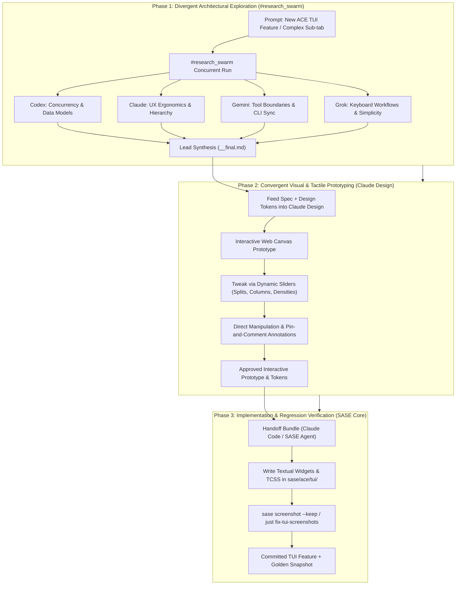

# Evaluating Claude Design for SASE UX Architecture: Complementary and Alternative Modalities to Research Swarms

**Author**: Researcher `gem` (5-Researcher Swarm)  
**Date**: October 26, 2026  
**Target Repository**: `sase-org/sase` (Research Sidecar `sase--research`)  
**Scope**: UX & TUI Design Workflows, Prototyping Systems, Multi-Agent Swarms vs. Visual Canvases  

---

## Executive Summary

The Structured Agentic Software Engineering (SASE) platform currently leverages the `#research_swarm` macro swarm to tackle complex user experience (UX) and architectural challenges—most notably the Textual-based Agent Control Environment (ACE) Terminal User Interface (TUI). While `#research_swarm` excels at multi-perspective architectural deliberation, edge-case discovery, and deep systems engineering, it possesses inherent blind spots when applied to spatial, visual, and tactile design problems.

Anthropic Labs' **Claude Design** introduces a fundamentally different paradigm: a dual-pane conversational visual workspace powered by frontier vision models (Claude Opus 4.7) that produces live, interactive, code-backed prototypes (HTML/CSS/JS and React), context-aware dynamic manipulation sliders, inline pin-and-comment reviews, and bidirectional design system synchronization (`/design-sync`).

This investigation assesses whether Claude Design should replace or augment SASE's existing `#research_swarm` workflow for UX design. Our primary finding is that **Claude Design does not render `#research_swarm` obsolete; rather, they operate at orthogonal layers of the design lifecycle**:

1. **`#research_swarm` is a divergent reasoning engine**: It excels at architectural trade-offs, state machine definitions, concurrency implications, keyboard ergonomics, and cross-model sanity checking.
2. **Claude Design is a convergent spatial execution engine**: It excels at immediate visual feedback, spatial composition, interactive state simulation, micro-layout tuning, and rapid tactile iteration.

The optimal strategy is a **hybrid pipeline**: utilizing `#research_swarm` to debate ergonomics, information architecture, and technical constraints, and then feeding the consensus specification into **Claude Design** to interactively prototype, visually fine-tune, and package structured design tokens for implementation in SASE's Textual TUI.

---

## 1. What is Claude Design?

Introduced by Anthropic Labs as a visual collaboration product within the Claude ecosystem, Claude Design bridges the gap between text-only conversational AI and production-grade interface design. Rather than producing static bitmap images or wireframe screenshots, Claude Design treats design as a **living, executable, and interactive medium**.

```
┌────────────────────────────────────────────────────────────────────────┐
│ Claude Design Architecture                                             │
├──────────────────────────────┬─────────────────────────────────────────┤
│ Left Pane:                   │ Right Pane:                             │
│ Conversational Assistant     │ Interactive Live Canvas                 │
│                              │                                         │
│ • Natural Language Prompts   │ • Runnable HTML5/CSS/React Prototype    │
│ • Semantic Direction         │ • Direct Element Manipulation & Text    │
│ • Component Logic & Events   │ • Dynamic Custom Sliders ("Tweaks")     │
│ • Architecture Inquiries     │ • Visual Pin & Comment Annotations      │
├──────────────────────────────┴─────────────────────────────────────────┤
│ Integration & Handoff Layer:                                           │
│ • /design-sync (Claude Code CLI bi-directional repository sync)        │
│ • Structured Design Tokens & Component Trees                           │
│ • Direct Canva Export & Standalone ZIP/HTML Packages                   │
└────────────────────────────────────────────────────────────────────────┘
```

### 1.1 Core Architectural Components

1. **Two-Pane Conversational Canvas**:
   The workspace pairs a conversational prompt interface on the left with a live, real-time rendering canvas on the right. Visual components render immediately upon generation, eliminating the context switch of viewing external previews.

2. **Code-First Visual Execution**:
   Unlike traditional design mockup tools (which output non-interactive vector geometry) or image generators (which produce flat raster images), Claude Design generates clean, standard web code (HTML, CSS/Tailwind, JavaScript, React, and SVG). Buttons can be clicked, menus can toggle, tabs switch state, and scroll containers behave naturally.

3. **Context-Aware Dynamic Custom Sliders ("Tweaks" Engine)**:
   A standout innovation of Claude Design is the automated generation of project-specific parametric controls. When Claude renders a layout, it dynamically synthesizes dedicated sliders in a sidebar properties panel for visual variables—such as grid spacing, panel split ratios, border radii, typography scale, pulse rates, or color tint intensity. This frees the designer from re-prompting the LLM for minor visual micro-adjustments.

4. **Direct Canvas Manipulation & Pin-and-Comment Feedback**:
   Designers can click directly on canvas elements to edit label text, drag containers, or resize layout blocks. Furthermore, users can drop visual annotation pins onto specific UI components and leave contextual critique, mirroring modern collaborative design workflows (e.g., Figma).

5. **Design System Ingestion & Bidirectional Code Sync (`/design-sync`)**:
   Claude Design can ingest brand guidelines, stylesheets, Figma tokens, or existing codebases. Through the `/design-sync` command in **Claude Code** (Anthropic's terminal-based developer harness), engineers can upload local React component libraries and design tokens directly into Claude Design. The AI then builds prototypes strictly within the constraints of those authentic components and design tokens.

6. **Structured Handoff to Engineering**:
   Finished prototypes are not discarded mockups. Claude Design packages component trees, interaction states, CSS specifications, and tokens into structured handoff bundles ready for consumption by automated coding agents or human developers.

---

## 2. Analyzing SASE's Current UX Workflow: `#research_swarm`

To evaluate what benefits Claude Design offers, we must first examine how SASE currently approaches UX design through the `#research_swarm` macro.

### 2.1 Anatomy of a SASE `#research_swarm`

When SASE invokes `#research_swarm(prompt=...)`, the macro orchestrates an asynchronous multi-agent research team:
* **Heterogeneous Model Coverage**: It concurrently launches independent researcher turns across frontier model providers—typically Codex (`cdx`), Claude (`cld`), Grok (`grk`), Muse (`mus`), and Gemini/Antigravity (`gem`).
* **Unbiased Divergence**: Swarm rules strictly forbid researchers from reading peer outputs or transcripts during their runs. Each model investigates the prompt independently, formulating distinct hypotheses and structural recommendations.
* **Lead Synthesis**: A designated lead researcher turn reviews every individual report (`__cdx.md`, `__cld.md`, `__grk.md`, `__mus.md`, `__gem.md`), reconciles conflicting viewpoints, identifies architectural consensus, and authors a definitive final report (`__final.md`).
* **Companion Artifacts**: The swarm can optionally invoke dedicated subagents for infographic generation (`#research/image`), Mermaid architectural flowcharts (`#research/diagrams`), and narrated audio editions (`#research/audio`) for consumption during walks or commutes.

### 2.2 Strengths of `#research_swarm` for SASE UX

1. **Deep Systems Architecture & Edge Cases**:
   SASE's UX is not merely visual; it is deeply tied to distributed agent coordination, async event loops, tmux harnesses, Textual serial pumps, memory web linking, and terminal window boundaries. Swarm models analyze how layout decisions impact Textual garbage collection heaps, event latency, and backend Rust boundaries (`rust_core_backend_boundary`).
2. **Cognitive Diversity**:
   Different LLMs have distinct biases. Grok may challenge CLI complexity; Claude may emphasize clean compositional abstractions; Gemini may focus on tool ergonomic boundaries; OpenAI Codex may scrutinize data models. The swarm prevents single-model blind spots.
3. **Headless, Durable Integration**:
   The entire swarm runs headlessly via CLI commands, producing audited markdown reports registered in the SASE research sidecar repository (`sase--research`) via `sase artifact create`.

### 2.3 Limitations of `#research_swarm` for Visual and Spatial UX

Despite its analytical power, `#research_swarm` has severe limitations when designing human-facing user interfaces:

1. **Spatial & Tactile Blindness**:
   Markdown reports can only describe visual interfaces abstractly or via ASCII art and Mermaid boxes. A designer reading a report that specifies *"Pane A is 30% width and Pane B is 70% width, collapsing to a single deck when terminal width is < 100 columns"* must mentally simulate how that feels in practice.
2. **High Latency for Micro-Iterations**:
   If an ASCII wireframe in a report looks cramped, tweaking padding or moving a status badge requires formulating a follow-up prompt and re-running an LLM turn (costing several minutes and substantial tokens).
3. **Absence of Interaction Testing**:
   Static reports cannot simulate interactive state transitions: hover highlights, modal overlays, scrollbar behavior, focus cycling (`Tab` / `Shift+Tab`), or collapsible accordions.

---

## 3. Comparative Matrix: Claude Design vs. `#research_swarm`

The following table contrasts the two paradigms across crucial dimensions of UX engineering:

| Dimension | SASE `#research_swarm` | Anthropic Claude Design |
| :--- | :--- | :--- |
| **Primary Output** | Synthesized Markdown reports, ASCII diagrams, Mermaid figures, audio editions | Live, runnable HTML/CSS/JS & React prototypes, visual canvases, design tokens |
| **Execution Medium** | Terminal / CLI, background agent procs, file snapshots | Interactive dual-pane web workspace, visual canvas |
| **Model Diversity** | High (5 independent frontier models: Claude, OpenAI, Gemini, Grok, Muse) | Single-family (Claude Opus 4.7 / Sonnet vision models) |
| **Feedback Loop** | Coarse / Asynchronous (minutes to read reports and iterate via follow-up prompts) | Real-time / Immediate (direct element manipulation, instant dynamic sliders) |
| **Interaction Testing** | None (purely conceptual / mental simulation) | High (stateful components, clickable buttons, active tabs, modal overlays) |
| **Spatial Fine-Tuning** | Difficult (requires prose descriptions of pixel/character counts) | Effortless (context-aware parametric sliders for padding, margins, split ratios) |
| **Systemic & Concurrency Depth**| Exceptional (deep analysis of async event loops, Textual TUI event queues, Rust core APIs) | Moderate (primarily focused on UI component structure and front-end state) |
| **Design System Ingestion** | Reads text configs (`default_config.yml`, Markdown memory notes) | Ingests live code repos, Figma tokens, CSS variables; bi-directional `/design-sync` |
| **Engineering Handoff** | High-level prose requirements, pseudo-code, architectural decisions | Structured component code, CSS/token exports, handoff bundles for Claude Code |

---

## 4. Adapting Claude Design to SASE: Bridging Web Prototypes to Terminal UIs (TUI)

A natural question arises: **Can a web-oriented prototyping tool like Claude Design effectively design a Terminal User Interface (TUI) like SASE's Textual ACE?**

The answer is an emphatic **yes**, provided the workflow is deliberately structured:

```
┌────────────────────────────────────────────────────────────────────────┐
│ Bridging Web Prototypes to SASE Textual TUI                            │
├────────────────────────────────────────────────────────────────────────┤
│ 1. Claude Design Canvas (Web)                                          │
│    • Container: Monospace font (Fira Code), Terminal Dark (#121212)    │
│    • Grid System: CSS Grid simulating character cells (80x24 / 160x48) │
│    • Borders: Unicode box-drawing characters (┌ ─ ┐ │ └ ┘)             │
│    • Interactive: JS keydown listeners capturing 'j', 'k', Tab, Esc   │
│    • Sliders: Adjust terminal col/row bounds and pane split ratios     │
├────────────────────────────────────────────────────────────────────────┤
│                                 ▼                                      │
├────────────────────────────────────────────────────────────────────────┤
│ 2. Design Token Translation                                            │
│    • CSS Flexbox / Grid   ──► Textual TCSS (dock, layout, fraction)   │
│    • Web Color Classes    ──► SASE ANSI / Rich palette (nord/monokai) │
│    • Keydown Listeners    ──► Textual Binding / Action Maps           │
├────────────────────────────────────────────────────────────────────────┤
│                                 ▼                                      │
├────────────────────────────────────────────────────────────────────────┤
│ 3. SASE ACE TUI Implementation & Visual Verification                   │
│    • Python / Textual Widget Code written by SASE Agent                │
│    • Verified via `sase screenshot` & PNG Snapshot Goldens             │
└────────────────────────────────────────────────────────────────────────┘
```

### 4.1 Simulating TUI Constraints in Web Prototypes

Textual's styling language (`TCSS`) is heavily inspired by modern web CSS, supporting flexbox, grid layouts, dock directives, margins, padding, and pseudo-classes (`:focus`, `:hover`). 

By establishing a "Terminal Persona" in Claude Design's design system:
1. **Character-Cell Simulation**: Claude Design can be instructed to style prototypes with SASE's bundled font stack (`Fira Code`, `DejaVu Sans Mono`), fixed character-aspect ratios, and standard terminal background palettes.
2. **Unicode Box-Drawing Emulation**: Prototypes can use terminal-native borders (`│`, `─`, `┌`, `┐`, `└`, `┘`, `┼`) rather than smooth CSS rounded borders, giving Bryan an authentic visualization of character-cell densities.
3. **Keyboard-Driven Interaction**: Web prototypes can bind JavaScript `keydown` handlers for Vim navigation (`h/j/k/l`), `Tab` focus cycles, and leader keys, allowing Bryan to test the tactile feel of navigation before writing a line of Python.
4. **Responsive Terminal Sizing**: Using Claude Design's custom sliders, Bryan can drag a "Terminal Columns" slider from 80 to 120 to 160 columns and instantly watch how the multi-pane layout wraps or collapses.

---

## 5. The Recommended Paradigm: The Hybrid "Swarm-to-Canvas" Workflow

Instead of viewing Claude Design as a replacement for `#research_swarm`, SASE should adopt a **phased hybrid pipeline** where each tool operates where it is strongest.



### Step-by-Step Workflow Breakdown

1. **Step 1: Architectural Ideation via `#research_swarm`**
   * *When to use*: When designing a brand-new surface (e.g., three-pane layout for Agent Deck, or restructuring the Navigation sidebar).
   * *Outcome*: A durable, multi-perspective markdown report detailing the state model, keybinding schema, event dispatch, and widget hierarchy.

2. **Step 2: Interactive Prototyping via Claude Design**
   * *When to use*: When translating the `#research_swarm` specification into spatial layouts and interactive components.
   * *Outcome*: Bryan opens Claude Design, provides the synthesized spec, and interacts with a live simulated terminal. Bryan adjusts split pane ratios and color accents using dynamic sliders, clicks through tabs, and pins comments on awkward visual densities.

3. **Step 3: Token Ingestion & Handoff via Claude Code**
   * *When to use*: When the visual design is locked.
   * *Outcome*: Claude Design packages the layout coordinates, component tree, and style tokens into a structured handoff. 

4. **Step 4: Implementation & Visual Snapshot Verification**
   * *When to use*: Coding the actual Python Textual widgets.
   * *Outcome*: A SASE coding agent implements the Textual widgets matching the prototype. The agent runs `sase screenshot` to capture live tmux PNGs, confirms alignment with the Claude Design prototype, and generates approved golden snapshots via `just fix-tui-screenshots`.

---

## 6. Ranked List of Claude Design Features Useful for SASE

Below is our ranked assessment of specific features and capabilities provided by Claude Design, ordered by their expected utility and impact on SASE UX design.

---

### Rank 1: Live Interactive Prototyping & Stateful Simulation
* **What it is**: The ability to generate fully interactive, stateful web components (HTML/CSS/JS/React) directly on a live canvas rather than static mockups.
* **Why it is useful for SASE**: SASE's TUI is highly dynamic—featuring folding logs, live proc statuses, sub-tab cycling, modal popups, and expanding agent decks. In `#research_swarm`, these states can only be described in prose. In Claude Design, Bryan can click a simulated button or press a key to watch a modal pop up, test whether a log tail obstructs the status bar, and experience the interface flow directly.
* **Expected Impact**: **Critical / Transformative**. Eliminates cognitive guesswork and reduces TUI redesign churn.

---

### Rank 2: Dynamic Custom Sliders ("Tweaks" Parametric Engine)
* **What it is**: Context-aware parametric sliders synthesized dynamically in the canvas sidebar for fine-tuning visual variables (e.g., padding, column widths, split ratios, font sizes, animation speeds, color saturation).
* **Why it is useful for SASE**: SASE TUI screens frequently suffer from dense spatial balance problems (e.g., whether the Left Node Panel should take 28, 32, or 36 characters of an 80-column terminal). In a traditional agent or chat workflow, testing five different widths requires five prompt turns. With Claude Design's dynamic sliders, Bryan can drag a slider smoothly between 20ch and 45ch in real time to visually discover the golden ratio.
* **Expected Impact**: **Very High**. Dramatically accelerates micro-layout iteration and spatial ergonomics.

---

### Rank 3: Bi-directional Design System & Codebase Synchronization (`/design-sync`)
* **What it is**: Integration with local git codebases via Claude Code's `/design-sync` command to mirror local components, design tokens, and CSS styles directly into Claude Design.
* **Why it is useful for SASE**: SASE has an established visual language defined across `src/sase/default_config.yml`, Textual `TCSS` files, and Rich console themes (ansi colors, status glyphs, borders). By feeding these tokens into Claude Design, the tool guarantees that all generated prototypes adhere strictly to SASE's existing design tokens and color schemes, preventing generic "AI web app" aesthetics.
* **Expected Impact**: **High**. Ensures design consistency and eliminates manual re-theming.

---

### Rank 4: Direct Canvas Manipulation & Pin-and-Comment Annotation
* **What it is**: The ability to click directly on canvas elements to edit copy, drag/resize layout boxes, or drop visual pins to leave targeted feedback for the model.
* **Why it is useful for SASE**: When inspecting a proposed TUI layout, Bryan might notice that a table header is truncated or that a button label should say `[Enter] Submit` instead of `Save`. Rather than typing a lengthy explanation ("In the third panel from the left, find the bottom row and change..."), Bryan simply clicks the text to edit it, or drops a pin on the widget with a 3-word note: *"Too cramped here"*.
* **Expected Impact**: **High**. Greatly lowers the cognitive friction of visual code review and iterative refinement.

---

### Rank 5: Structured Engineering Handoff Bundles
* **What it is**: Clean automated export of component trees, CSS rules, layout metrics, and interaction state models directly to Claude Code or coding agents.
* **Why it is useful for SASE**: Once a prototype is visually approved, handing it off to a SASE coding agent (e.g., an agent executing an implementation plan) currently requires the human to manually summarize the visual target. With structured handoff bundles, the exact component hierarchy and dimension ratios can be directly fed into the coding agent's prompt, making the Textual implementation fast and faithful.
* **Expected Impact**: **High**. Streamlines the handoff between design ideation and code generation.

---

### Rank 6: Side-by-Side Dual-Pane Conversational Canvas
* **What it is**: A split interface where conversational chat on the left directly mutates and explains the live visual canvas on the right.
* **Why it is useful for SASE**: SASE agents typically communicate through CLI logs or markdown files. Having a dedicated visual scratchpad side-by-side with an LLM allows conversational prompts like *"Now show me how this layout looks when an agent fails with an unhandled exception"* to immediately re-render the canvas into the failure state.
* **Expected Impact**: **Medium-High**. Enhances the exploratory prototyping experience.

---

### Rank 7: Multi-Format Asset Export & Shareable Prototypes (Standalone HTML/ZIP/URLs)
* **What it is**: Exporting prototypes as self-contained HTML/JS packages, downloadable ZIP archives, or public web links.
* **Why it is useful for SASE**: SASE research artifacts are stored durably under `sase/repos/research/`. Being able to export a standalone HTML interactive prototype and attach it as a SASE artifact (`sase artifact create`) allows future developers to open the prototype in any browser to see the interactive target without running a live server.
* **Expected Impact**: **Medium**. Improves artifact durability and documentation richness.

---

### Rank 8: Canva Ecosystem & Presentation Deck Integration
* **What it is**: Direct export of wireframes, infographics, and UI layouts to Canva's design engine and PowerPoint (PPTX) format.
* **Why it is useful for SASE**: SASE already supports infographic generation (`#research/image`) and audio edition generation (`#research/audio`). Canva/presentation export is valuable for external release announcements, blog post illustrations, and architectural presentations, but less critical for daily internal TUI development.
* **Expected Impact**: **Moderate**. Valuable for marketing, documentation, and external communication, but peripheral to core TUI engineering.

---

## 7. Strategic Synthesis: Replacing vs. Augmenting

| Scenario | Recommendation |
| :--- | :--- |
| **Complete Replacement** | **Not Recommended**. Abandoning `#research_swarm` entirely would sacrifice multi-model cross-examination, deep analysis of Textual async pumps, GC memory limits, and automated durable research archiving in SASE sidecars. |
| **Pure `#research_swarm` Status Quo** | **Sub-optimal**. Continues to force mental visualization of complex spatial layouts, leads to trial-and-error TUI coding in Python, and slows down aesthetic refinements. |
| **Augmentation / Hybrid Pipeline** | **Strongly Recommended**. Retain `#research_swarm` for architectural consensus and requirement definition; integrate **Claude Design** as the interactive prototyping workbench for visual and spatial execution. |

---

## 8. Concrete Pilot Recommendations for SASE

To validate these findings with minimal disruption, we recommend piloting Claude Design on two upcoming SASE TUI initiatives:

1. **Pilot Project 1: The Three-Pane Agent Deck Split**
   * *Problem*: Evaluating layout balance between Agent Hierarchy, Active Tool Run Output, and Prompt History across 80-column vs. 140-column terminals.
   * *Action*: Spin up a terminal-styled prototype in Claude Design. Use dynamic sliders to explore split ratios (e.g., 25/50/25 vs. 30/40/30) and simulate log streaming behavior.

2. **Pilot Project 2: Unified Macro & Decision Modals**
   * *Problem*: Designing the interaction and keyboard navigation for pop-up decision cards and macro configuration modals.
   * *Action*: Build an interactive modal overlay in Claude Design with active `Tab` and `Esc` key navigation to test ergonomic flow before writing the Textual modal classes.

---

## 9. Conclusion

Claude Design represents a major leap forward in AI-assisted interface design by treating UI as an interactive, parametric, and code-backed medium. For SASE, it solves the acute spatial blindness of text-only research swarms without compromising the deep architectural rigor that multi-agent research swarms provide. By combining `#research_swarm` for architectural strategy with **Claude Design** for visual and tactile prototyping, SASE can achieve both engineering robustness and terminal interface elegance.
