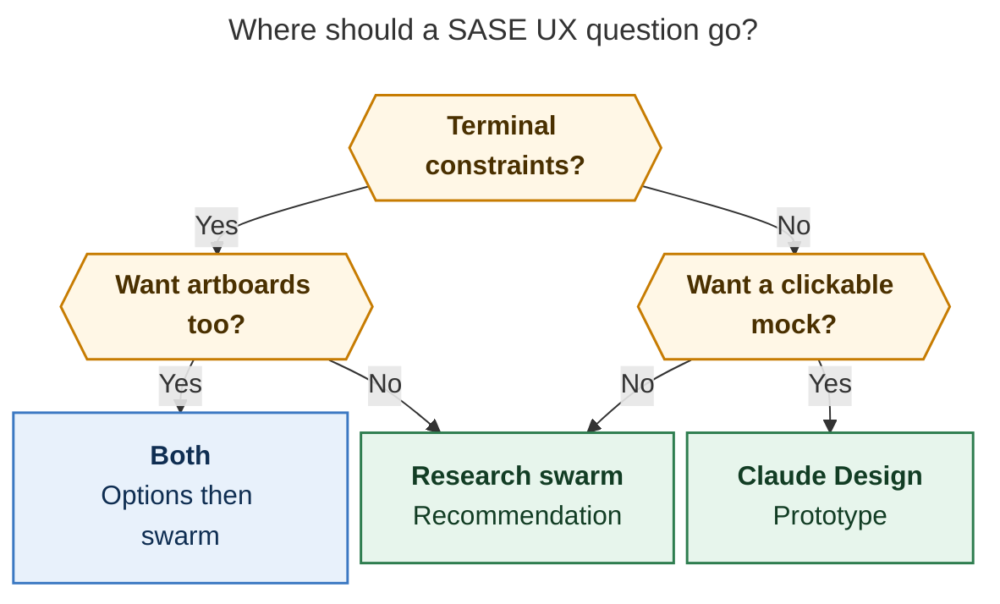
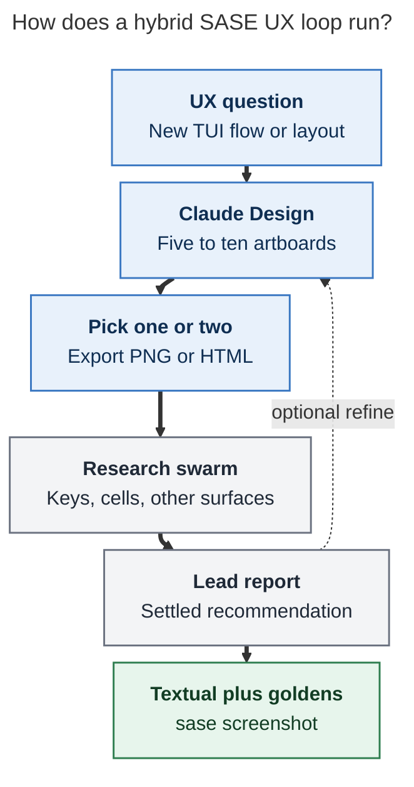

# Claude Design versus `#research_swarm` for SASE UX

**Question.** What is Claude Design, and what would Bryan gain by using it instead of, or in addition to, `#research_swarm` for SASE UX work such as the TUI?

**Researcher.** grk (`research.5a.grk`). Independent report. I did not read peer reports from this swarm.

## Bottom line

**Use Claude Design in addition to `#research_swarm`, not instead of it.** The two tools answer different questions.

`#research_swarm` is already the right instrument for SASE UX *decisions*: it reads the Textual/CSS/keymap code, measures real plans and goldens, argues across five providers, and ships a durable recommendation with disagreement tables. Recent TUI work such as `research:202610/gate_panel_decision_cards/gate_panel_decision_cards.md` and `research:202610/plan_decisions_cross_surface_ux/plan_decisions_cross_surface_ux.md` shows what that looks like in practice: cell-accurate ASCII, real Textual prototypes, PNG renders at 90×40 / 120×40 / 200×56, and a lead who settles keys, glyphs, and wire shape against the codebase.

Claude Design is the missing *visual* instrument. It is Anthropic's design surface (launched 17 April 2026, out of beta and on every Claude plan including Free as of 8 October 2026) that turns a prompt, screenshot, or codebase pointer into a canvas of editable artboards. You refine with chat, inline comments, drag/resize, and Claude-made sliders; you export PNG/PDF/HTML; you can hand a bundle to Claude Code. Its native medium is HTML. That is a genuine gain for "show me ten layouts of the Agents tab" and a genuine mismatch for "will this wrap in a 50-cell rail without clipping a Textual `Button`."

The designer who built Claude Design, Nate Parrott, already ran the experiment you would be repeating. He tried to design Claude Code's terminal UI by pasting screenshots into Claude and asking it to design the next feature. "The results weren't good." The thing that worked was giving Claude an HTML playground. SASE's TUI is the same kind of product: cells, keys, and Textual CSS, not React components. `/design-sync` "works best for product design systems in code" that already exist as React. SASE's visual language lives in `styles.tcss`, `default_config.yml` keymaps, and snapshot goldens.

**Recommended posture.** Keep the swarm as the judge. Add Claude Design as the sketchbook that feeds it.

1. For a new screen or flow, generate five to ten artboards in Claude Design from TUI screenshots plus a short `DESIGN.md` of tokens and glyphs.
2. Pick one or two, export PNG/HTML, and attach them as shared input to `#research_swarm`.
3. Let the swarm test the options against cell geometry, keys, Telegram, and the CLI.
4. Implement the settled recommendation in Textual and prove it with `sase screenshot` and visual goldens.

Do not replace the swarm with Claude Design for anything whose answer depends on a widget, a key, a cell width, or another surface. Do not expect `/design-sync` to ingest the TUI. Do not treat a pretty HTML mock as a Textual spec.

## What Claude Design is (as of 26 October 2026)

Claude Design is an Anthropic Labs product. The launch post (17 April 2026) described it as a way to collaborate with Claude on "polished visual work like designs, prototypes, slides, one-pagers, and more," originally powered by Claude Opus 4.7. By September 2026 it lived inside ordinary Claude conversations, Claude Code, and the Artifacts tab. On 8 October 2026 Anthropic took the beta label off and put it on every plan, Free included. The standalone site at `claude.ai/design` stays up until 14 December 2026; after that, work continues as Design artifacts inside Claude.

You reach it five ways:

- Any Claude chat: ask for a design, or choose **Output > Design**.
- The **Artifacts** tab, starting from a Design template.
- Claude Code, desktop or terminal: `/design [brief]`, plus `/design-sync` and `/design-login`.
- Claude for iOS and Android (view and edit; sharing settings stay on web/desktop).
- `claude.ai/design` until it closes.

The working loop is: describe or import context, get a first version on a canvas of artboards, refine, share or export. Anthropic's help article names three refinement modes and tells you when to use each:

- **Chat** for structural changes ("show me 2–3 alternative layouts").
- **Inline comments** for a targeted element ("make this button padding larger"). Comments sometimes fail to persist; the documented workaround is to paste the same text into chat.
- **Direct canvas edits** for drag, resize, align, and text. Direct edits use no tokens. Nate Parrott's advice is to do the last mile this way.

Claude also builds **custom sliders** for the current design so you can tune spacing, color, and layout live, then ask it to apply the change across the canvas.

A **design system** is the on-brand layer. You can bring in one or several from a GitHub repo, design files, raw uploads, or a local codebase. Claude "builds with your components, checks its output against your design system, and makes corrections before you see it." Chat-built systems fit brand guidelines (fonts, colors, logos). `/design-sync` in Claude Code is the code path, and Anthropic's setup guide is explicit: it "works best for product design systems in code" that already exist as **React components**. A first-time sync "verifies every component and can take a few hours on a large repo." `/design-sync` needs a `claude.ai` account; it is unavailable when Claude Code runs through Bedrock, Google Cloud, Microsoft Foundry, or an apps gateway.

Export is broad: `.zip`, PDF, PPTX, Google Slides, standalone HTML, and connectors (Adobe, Canva, Gamma, HubSpot, Lovable, Miro, Netlify, Replit, v0, Vercel, Wix, and others). **Handoff to Claude Code** offers "Send to local coding agent" and "Send to Claude Code Web," so the design is the spec instead of a screenshot. `/design` in Claude Code can also import a design into the repo or export code as a live prototype.

Usage draws from the **same pool** as the rest of Claude, including Claude Code. There is no separate Design allowance. Complex projects with large codebases or many iterations consume more. Anthropic lists these known limits (help article, updated this week):

- Design-system import is only as good as its source.
- Multi-person editing is still basic.
- Inline comments can vanish from the page (they remain in the comments view).
- Large codebases should be linked from Claude Code.
- **No version history yet.** The documented workaround is "Save what we have and try a completely different approach."
- Adding a new text layer, artboard, shape, or note with a keyboard needs a mouse; you ask Claude to add it.
- Live component previews in a design system are not keyboard-reachable.

Slides now have their own starting point, Claude Slides. Frontier toys (voice, video, shaders, 3D) exist and are not relevant to the TUI.

## What `#research_swarm` already does for SASE UX

`#research_swarm` is a macro swarm in the `sase-research-artifacts` plugin (`src/sase_research_artifacts/xprompts/research_swarm.md`). Independent researchers (Codex, Claude, optional Grok/Muse/Gemini) each write a self-named report. A lead waits on `wait.artifacts`, reads those reports through `sase artifact read`, does more research, and consolidates. Optional image, diagrams, audio, and linker agents publish a canonical `name.md` with infographic, Mermaid, and a listen card.

For TUI UX, that pipeline already produces more than prose:

| Deliverable | Example from recent UX swarms |
| --- | --- |
| Root-cause against Textual | Gate-panel clipping was `Button.get_content_width()` plus `width: auto` inside a 44-cell viewport, not a missing ellipsis |
| Census of real data | 28 plans / 47 decisions; 18 of 28 plans have one decision; `ask` p90 is 106 characters |
| Cell-accurate mock | ASCII rails at 90×40 and 200×56; `cld` Textual prototype PNGs |
| Runnable prototype | `gate_panel_decision_cards__final_pinned_prototype.py` with pinned 90×40 and 120×40 renders |
| Cross-surface contract | "Approve as shown" across ACE, Telegram, CLI, and `%auto` |
| Disagreement table | Lead picks among rail widths, Enter bindings, glyphs, wire shape |
| Durable sidecar | `research:<YYYYMM>/…` snapshots, Highlights PDF, optional audio |

The swarm's comparative advantage is **heterogeneous, codebase-grounded judgement**. Five models that cannot read each other will disagree about Enter, rail width, and whether a `RadioSet` steals keys. The lead then verifies against `styles.tcss`, `default_config.yml`, and Telegram's 64-byte `callback_data`. Claude Design cannot run that loop. It has one model family, no SASE artifact register, no `sase screenshot` contract, and no notion of a gate that must mean the same thing in ACE and on a phone.

The swarm's comparative weakness is **visual exploration speed**. A researcher who wants ten layouts writes ten ASCII blocks, or one, or none. Iteration means another agent turn or another swarm. There is no slider. There is no "click this pane and say 'tighter'." Infographics and Mermaid help a reader understand a settled design; they are a poor medium for *finding* one.

## Where a SASE UX question should go

The routing rule is the medium of the answer, not the prestige of the tool.

**Terminal constraints** here means cell geometry, Textual widget behavior, keybindings, snapshot goldens, or another surface (Telegram, CLI, mobile gateway) that must stay in contract with the TUI.

*Route by constraint first: a TUI question that still needs visual alternatives uses both tools; a clickable mock with no cell or key question can stay in Claude Design.*

Concrete placements:

| Job | Tool |
| --- | --- |
| Why does this gate row clip, and what should replace the `Button`? | Swarm only |
| What is the best cross-surface contract for plan decisions? | Swarm only |
| Show me ten information architectures for the Agents tab | Claude Design first, then swarm |
| Click through onboarding as a new user | Claude Design |
| Does `z` open a sheet or do we keep the dock at 90×40? | Both: Design for the two looks, swarm for the row census |
| One-pager / slides to explain a UX change | Claude Design or Claude Slides |
| Implement the settled rail in Textual | Neither: code + `sase screenshot` + goldens |

## The medium gap: HTML playground versus terminal cells

This is the load-bearing fact for SASE.

Nate Parrott (product designer at Anthropic, in the July 2026 first-person article) was designing Claude Code for VS Code after shipping a terminal product. His first attempt treated the terminal as text: copy output, add screenshots, ask Claude to design the feature. It failed. He then "stumbled onto the answer: Claude is really good with HTML" and built a split-view HTML playground. That prototype became Claude Design.

Two consequences follow for SASE:

1. **Claude Design will give you an HTML *picture* of a TUI**, not a Textual layout. You can ask for Fira Code, box drawing, 120×40, and the `$primary` / `$accent` / gold `#FFD700` / cyan `#5FD7FF` vocabulary from `styles.tcss`. The result can be a useful reaction surface. It will still lie about wrapping, emoji cell width (`☑️` vs `☐`), reverse-video focus, `max-height: 16`, and nested `VerticalScroll` gutters. Those lies are exactly the bugs the gate-panel swarm had to measure.

2. **`/design-sync` will not eat the TUI.** The command reference describes it as converting "your repo's React design system." The setup guide says to use a **conversation** (uploads, screenshots, decks, logos) for a brand system of fonts and colors, and `/design-sync` for React components. SASE's components are Textual widgets and `styles.tcss` classes. Pointing `/design-sync` at this repo is the wrong import path.

PreviousNext's October 2026 write-up of making their Mixtape system "legible" to Claude Design is the right import path to copy. They found that docs written for humans were not literal enough: an agent infers and then bakes the inference into every later design. They wrote a `DESIGN.md` that resolves every token to a concrete value, names what to read and what to ignore, points at full-page mockups (not isolated components), and says "nothing else exists — don't invent stuff." That pass also found real class-name bugs because the tool takes documentation at face value.

A SASE `DESIGN.md` for Claude Design would look like this, not like a React kit:

- Canvas: 80 / 90 / 120 / 200 columns × 40 / 56 rows as named artboard sizes.
- Type: Fira Code, box-drawing borders, width-1 glyphs in the TUI (`☐`/`☑`, `◉`/`○`, `★`, gold `●`).
- Tokens copied as hex, not as `$primary`: `#FFD700`, `#5FD7FF`, `#00D7AF`, `#AF87FF`, `#FF5F5F`, `$surface` / `$text-muted` resolved.
- Key contract: j/k between, h/l within, Enter never edits a value.
- "Read `styles.tcss`, `default_config.yml` `ace.keymaps`, and `tests/ace/tui/visual/snapshots/png/`. Ignore lockfiles and build config."
- Attach real goldens and `sase screenshot` PNGs as the full-page mockups.

Without that file, Claude Design will invent a tasteful web app that happens to be dark. That is the default aesthetic Parrott warns you to head off.

## Head-to-head

| Dimension | `#research_swarm` | Claude Design |
| --- | --- | --- |
| Native output | Markdown, Mermaid, infographic, optional audio, optional Textual prototype | HTML canvas of artboards; PNG/PDF/HTML export |
| Models | Codex, Claude, Grok, Muse, Gemini; lead synthesizes | Claude only |
| Grounding | Opened repos, `sase artifact read`, live code and goldens | Design system + whatever you upload or `/design-sync` (React) |
| Iteration | New agent turn or new swarm | Same canvas: chat, comments, sliders, direct edits |
| Alternatives | Five independent arguments | Ten visual riffs, then "smoosh B and D" |
| Last-mile tweaks | Another paragraph of ASCII | Drag, resize, type; zero tokens |
| Versioning | Immutable `research:` snapshots | **No version history** (save-and-fork by prompt) |
| Sharing | Sidecar + Highlights PDF + listen | Artifact link; org view/edit; group chat |
| Implementation handoff | Recommendation + sketch the lead already verified | Handoff bundle into **Claude Code** |
| Cross-surface | First-class (ACE / Telegram / CLI) | None |
| Keyboard-first product | The TUI *is* the subject | Canvas is keyboard-operable with gaps (cannot place a new layer from the keyboard) |
| Cost | Five `@xhigh` researchers + lead; SASE queue | Shared Claude usage; artboards are token-heavy |
| Lock-in | Reports live in the public research sidecar | Artifacts live on Anthropic's side until you export |

Independent cost signal, not Anthropic's: on 20 April 2026, AJ (@appariciojunior) reported 22 minutes to ingest a company design system, then **120k tokens** to generate one page with a calendar, a list, and a grid, burning 58% of plan usage, with an accumulated cost he put at about $300. Usage has since been merged into the shared Claude pool (so Design no longer has its own weekly meter), but the work is still expensive relative to a text prompt. `/design` coverage in August 2026 still called the artboard workflow "way too token hungry" compared with ordinary Claude Code.

Figma CEO Dylan Field (quoted 20 October 2026) declined to be bullish or bearish: Claude Design is "trying to do a lot of things" (product UI and posters and graphic design), and "it's hard to make good design tools for professionals." That breadth is a reason to use it as a sketchbook, not as the system of record for SASE UX.

## A hybrid loop that fits how you already work

You already attach screenshots to swarm prompts (the gate-panel request pointed at `~/tmp/screenshots/…`). Claude Design is a way to produce *better* attachments: several coherent alternatives instead of one live screenshot of a broken screen.

*Claude Design is the option generator; the research swarm is the constraint checker; Textual goldens are the landing proof. A dashed refine pass is optional after the lead settles.*

How to run it without inventing process:

1. **One-time:** write a short TUI `DESIGN.md` (tokens, glyphs, named terminal sizes, keymap rules, "do not invent widgets"). Upload current goldens and a few `sase screenshot` PNGs. Ask Claude to build a design system from those, in a conversation, not via `/design-sync`.
2. **Per question:** in Claude Design or via `/design` from a Claude Code session that already has the repo, ask for wireframes first (Parrott: faster, keeps the model on structure). Then "ten options," then "I like B and a little of D; give me five riffs."
3. **Export** the winners as PNG (and HTML if you want to click the flow). Drop those files next to the swarm prompt as shared input. The swarm macro already allows independent researchers to use shared input material.
4. **Swarm as today.** Tell researchers the HTML mock is a *proposal*, and that Textual, `styles.tcss`, and other surfaces are the ground truth.
5. **After the lead report:** if you want a clickable demo of the settled design for yourself, refine once in Claude Design. Implement in Textual. Prove with `sase screenshot` and `just fix-tui-screenshots`. Do not implement the HTML.

Skip step 1–3 when the question is a bug-with-a-screenshot (gate-panel clipping). Skip the swarm when the artifact is a one-pager or a slide explaining a decision you have already made.

## What you would lose if you replaced the swarm

- **Disagreement as a feature.** The plan-decisions lead had to choose among five wire shapes, five Telegram editors, and five choice glyphs. Averaging those, or asking one Claude canvas, would have shipped a declared-input panel that opens ACE's YAML box and Telegram's step wizard. That is a product defect, not a visual one.
- **Cell truth.** Reverse-video focus, 2-cell emoji, `max-height: 16`, nested scroll gutters.
- **Cross-surface sameness.** A beautiful ACE rail that cannot be expressed in Telegram's inline keyboard is a failed design under SASE's own gate model.
- **Durability.** Research snapshots, Highlights PDFs, and listen editions outlive a Claude artifact. Claude Design has no version history.
- **Provider diversity.** Design work would collapse onto Claude usage, which is the same pool you use for Claude Code / Claude researchers.
- **Handoff into your actual implementation loop.** Design's handoff target is Claude Code. SASE implementation is a multi-provider agent in a numbered workspace, with `sase stitch create` and visual goldens. You would still re-specify the work.

## Costs, lock-in, and honesty about quality

- **Money and quota.** Design is included on Free, but a full-deck or many-iteration canvas uses more of the plan than a typical message. Treat artboard exploration as a budgeted step, not an idle habit, especially on days you also want Claude in a swarm.
- **Hosted canvas.** Until you export, the source of truth is Anthropic. Export PNG/HTML into the research sidecar if a mock should survive the way a report does.
- **No Figma file.** If you ever wanted a traditional design-tool handoff, you do not get one. Connectors go to Canva, Miro, Lovable, Vercel, and similar. For SASE that is mostly irrelevant.
- **Output taste.** Left undirected, Claude "picks one of its favorite aesthetics." Parrott's mitigations (specify fonts and colors, upload a moodboard, ask for pairings) are mandatory for a TUI mock, or you will review a SaaS dashboard.
- **Co-editing** is not ready. You are a solo designer of this TUI; that limit is cheap.
- **I did not run Claude Design against the SASE TUI in this turn.** Feature claims below are from Anthropic's current product/help pages, the Parrott article, the PreviousNext `DESIGN.md` write-up, command-reference reporting, and published user cost reports. Visual quality on a *terminal* mock is an inference from Parrott's own failed screenshot-to-design attempt, not a screenshot I produced.

## Ranked Claude Design features you are likely to find useful

Ranked for **Bryan designing SASE (especially the TUI) with `#research_swarm` already in the loop**. Usefulness here means "closes a gap the swarm is bad at" or "makes the swarm's input better." Features that are impressive in general but weak for this TUI sit at the bottom.

1. **Multi-artboard alternatives in one canvas.** Ask for ten directions, pick B, remix with D. This is the swarm's biggest gap: it argues well and explores visually slowly. Parrott uses "15 versions of a flow" as daily work. Highest leverage if you attach the winners to the next swarm.
2. **A TUI-flavored design system built from screenshots, goldens, and a literal `DESIGN.md`.** Not `/design-sync`. Once Claude has Fira Code, named terminal sizes, glyphs, and "do not invent widgets," every later artboard starts closer to SASE and further from generic SaaS. PreviousNext's result is the evidence that this investment pays.
3. **Interactive HTML prototypes of a flow.** Click through Agents → artifact → gate without writing Textual. Useful for *journey* questions (where does focus go, what is one screen vs two) before anyone measures a 90×40 dock. Always re-check the winner in cells.
4. **On-canvas direct edits and Claude-made sliders.** Last-mile spacing and alignment with zero tokens. The swarm equivalent is another ASCII revision. Use this on the HTML mock, then freeze and export; do not slider-tune something you still need five models to judge.
5. **Inline comments on a specific pane or row.** "This rail is the problem" is faster than describing a 200-column screenshot in a swarm prompt. Paste into chat if the comment drops. The comment thread is not a substitute for the lead's disagreement table.
6. **`/design` from a Claude Code session that already has the repo.** You can ask for a mock in the same session that just read `styles.tcss`. Edits still happen in a desktop browser; the CLI is the launcher, not the canvas. Requires Claude Code ≥ 2.1.265, artifacts on, Design template on. Bedrock/cloud-gateway sessions cannot `/design-sync`.
7. **PNG / PDF / standalone HTML export.** The practical bridge into `#research_swarm` and into the research sidecar. HTML is the clickable artifact; PNG is the thing every researcher can see without a Claude login.
8. **Wireframe-first mode.** Parrott: asking for wireframes is faster and keeps Claude on structure. For TUI work this is the correct default. Raise fidelity only after the swarm (or you) has picked a structure.
9. **Handoff bundle to Claude Code.** Useful *after* the lead report, if you want a Claude implementation agent to start from the mock plus the report instead of from a screenshot. It does not replace visual goldens and it does not target non-Claude implementers.
10. **Shareable artifact links.** Private by default; view or edit for people you choose. Low urgency for a one-person TUI, high if you ever want a second human to react to a flow before spending a swarm.
11. **Contrast / accessibility review in chat.** Claude can check contrast ratios and hierarchy. Transfer is partial: TUI contrast is terminal-palette and dim/reverse spans, not WCAG on a canvas. Still a cheap pass on a mock before you commit to a gold `#FFD700` chip on `$surface`.
12. **Claude Slides / one-pagers.** For explaining a settled UX change (the "Approve as shown" sentence, a before/after of the gate rail) without burning a swarm. This is communication, not design discovery.
13. **Save-and-try-another-approach as a stand-in for version history.** You will need this. Name the saved forks in the chat so a later swarm can be pointed at "option B, the dense rail," not at a vanished canvas.
14. **Keyboard operation of the existing canvas.** F6 between chrome, Tab through layers, Option/Alt+arrows to move. You cannot *place* a new artboard from the keyboard. Ironic for a TUI designer, adequate for review.
15. **Org-scoped group chat on a design.** Documented, unreliable for two people editing at once. Skip until co-editing is real.
16. **Connectors (Miro, Canva, Vercel, Lovable, …).** Built for web/marketing handoff. They do not speak Textual. Ignore for TUI work.
17. **Web capture of a live site.** Excellent for a web app; the TUI is not a URL. `sase screenshot` is the capture tool you already have.
18. **`/design-sync` of a React design system.** Wrong shape for this codebase. Do not spend a multi-hour first sync hoping Textual CSS will round-trip.
19. **Frontier prototypes (voice, video, shaders, 3D).** Out of scope for ACE.
20. **Admin-locked default design system.** Only becomes useful if more than one person is generating SASE mocks and you need them to stop drifting. Not your current problem.

If you adopt only three: **(1) multi-artboard alternatives, (2) a screenshot-built TUI design system, (7) export into the swarm.** Those three turn Claude Design into a front-end for `#research_swarm` instead of a rival to it.

## Sources

**Anthropic (product and help, checked 2026-10-26):**

- [Claude Design product page](https://claude.com/product/design)
- [Introducing Claude Design by Anthropic Labs](https://www.anthropic.com/news/claude-design-anthropic-labs) (17 April 2026)
- [Claude Design now stays on brand for daily work](https://claude.com/resources/articles/claude-design-stays-on-brand-for-daily-work) (17 June 2026; September 2026 update in the body)
- [Get started with Claude Design](https://support.claude.com/en/articles/14604416-get-started-with-claude-design) (updated this week)
- [Set up your design system in Claude Design](https://support.claude.com/en/articles/14604397-set-up-your-design-system-in-claude-design)
- [How the product designer who built Claude Design uses it](https://claude.com/blog/how-the-product-designer-who-built-claude-design-uses-it-to-explore-ideas-before-building-them) (Nate Parrott, 24 July 2026)

**Reporting on commands, status, and cost:**

- [AI Catchup: Claude Design launch](https://aicatchup.com/news/claude-design-launch) (status as of 9 October 2026)
- [AI Catchup: `/design-sync` two-way workflow](https://aicatchup.com/news/claude-design-sync-claude-code-two-way) (command reference as of 2–9 October 2026)
- [TechCrunch launch coverage](https://techcrunch.com/2026/04/17/anthropic-launches-claude-design-a-new-product-for-creating-quick-visuals/) (17 April 2026)
- PreviousNext, [Building for AI design tools: what Mixtape needed to become legible to Claude Design](https://www.previousnext.com.au/blog/building-ai-design-tools-what-mixtape-needed-become-legible-claude-design) (18 October 2026)
- AJ (@appariciojunior), 20 April 2026, on X: 120k tokens / 58% usage for one three-feature page
- DeFAI Scope quoting Dylan Field, 20 October 2026, on X

**SASE (this turn, via `/sase_repo` and `sase artifact read`):**

- `sase-research-artifacts` `src/sase_research_artifacts/xprompts/research_swarm.md` and `docs/macros.md`
- `research:202610/gate_panel_decision_cards/gate_panel_decision_cards.md`
- `research:202610/plan_decisions_cross_surface_ux/plan_decisions_cross_surface_ux.md`
- `src/sase/ace/tui/styles.tcss` (token and chrome samples)
- SASE memory `tui.md` / `tui_screenshot.md` (`sase screenshot`, visual goldens)

**Figures.** Mermaid CLI `@mermaid-js/mermaid-cli@12.0.0` with the research PDF-mirroring config. Routing figure: 601.875×634 px, fit 100%. Hybrid figure: 389.703×702 px, fit 100%.
