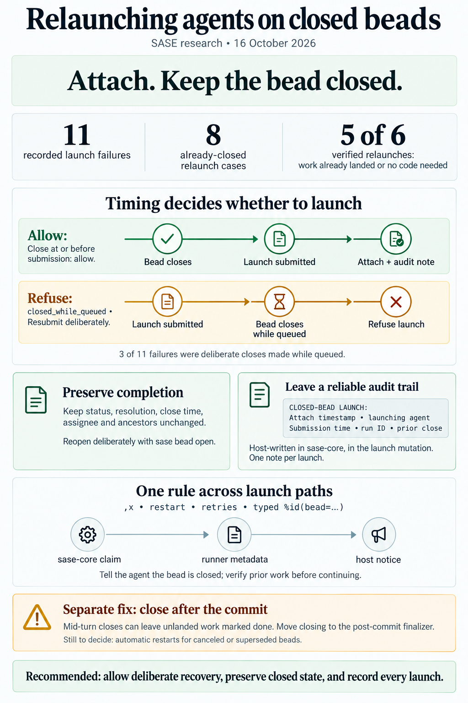

# Launching `%id(bead=…)` Agents On Closed Beads: Attach, Don't Reopen

> **Research query:** Should SASE let an agent launch with the `%id` directive's
> `bead=<bead>` input even when that bead is already closed, as often happens when a failed
> agent is restarted with the `,x` keymap on the Agents tab, while leaving a recognizable,
> timestamped audit note on the bead? Critique the plan, call out any justified changes to the
> requirements, and end with a recommended way to implement it.



## Bottom line

1. **Yes, do it.** One guard in sase-core turns a routine recovery into a hard failure, and it
   fires late. On record there are [11 real failures](#evidence-from-the-11-real-failures), and
   8 of them are exactly your scenario.
2. **Leave the bead closed. Do not reopen it.** This is the
   [main requirement change](#requirement-adjustments). The
   [four reports](#inputs-and-what-the-four-reports-concluded) split 2–2 here. The deciding
   evidence comes from my own check: in **5 of the 6** relaunches I could verify, the original
   run's work had **already landed on `master`** (or needed no code at all) before you pressed
   `,x`. Reopening would have marked finished work as `in_progress`. It would also have cascaded
   to closed ancestors, added close-history churn and needed a wire-format change (see
   [Keep closed or reopen](#keep-closed-or-reopen)). A host-written note records the relaunch.
   `sase bead open` remains the deliberate path for the rare premature close.
3. **Keep refusing closes that happened while the launch was queued.** The two "keep closed"
   reports missed this. 3 of the 11 real failures were beads closed *after* the launch was
   submitted: a phase you had just superseded, a phase another agent finished 17 h later, and a
   sub-epic you closed by hand. Under plain "keep closed, launch anyway" all three would have
   started an agent on unwanted work. **The rule:** attach only if the close happened at or
   before the moment the launch was submitted.
4. **Write the [audit note](#audit-note) in sase-core, as part of the existing launch-claim
   mutation.** Use a fixed `CLOSED-BEAD LAUNCH:` prefix and make the launching agent the author.
   The note reuses the existing `note_appended` event, so the wire format does not change.
5. **[Tell the relaunched agent](#tell-the-relaunched-agent) that its bead is already closed.**
   Today every prompt and memory promises "your bead is already `in_progress`". Without a
   notice, the agent may redo finished work.
6. **Fix a related root cause separately.** Phase and task prompts tell agents to run
   `sase bead close` during their turn, *before* the host commits their work. Any later failure
   leaves a closed bead behind, and sometimes the work is not landed
   ([sase-xe.6 below](#evidence-from-the-11-real-failures)). That needs
   [its own task](#follow-ups-worth-filing-separately).

## Critique of the plan

**Is this a good idea? Yes.** A closed bead and a failed run can both be true. The finalizer
already treats a closed assigned bead as an idempotent no-op. Only the launch claim still treats
`closed` as a lock it must take, and that makes no sense for a relaunch of the same implementer
that you chose to run.

**But "fine for any launch" is too broad, in two ways:**

- **"Fine" must not mean "claim it as if it were open".** Removing the guard naively would set
  `status=in_progress` on a bead that still has `resolution`/`closed_at`, which validation
  rejects. A proper reopen means archiving the close and reopening ancestors, which is a
  different product decision (see [Keep closed or reopen](#keep-closed-or-reopen)).
- **"Any launch" must not include launches queued before the close.** See
  [Evidence from the 11 real failures](#evidence-from-the-11-real-failures).

**What the request misses:**

- The agent must be told the bead is already closed.
- Most of these relaunches come from closing before the commit lands, so that root cause
  deserves its own fix (see [Follow-ups worth filing separately](#follow-ups-worth-filing-separately)).

## How it fails today

Each stage below was verified, with the code involved and what it does with a closed bead:

- **`%id(…, bead=X)` parse**
  - *Code:* `src/sase/macro/_directive_values.py`
  - *With a closed bead:* Accepted: only non-empty and whitespace-free are checked
- **Wait-time claim (only when the prompt has waits)**
  - *Code:* `run_claim_wait`, `claims.rs`
  - *With a closed bead:* **Declines quietly** (status ≠ `open`) and the launch continues
- **Force-reuse retention (`,x`, restart)**
  - *Code:* `issue_retains_force_reuse_owner`, `src/sase/bead/force_reuse.py`
  - *With a closed bead:* Only matches `in_progress`, so a closed bead falls through to the
    claim below
- **Launch claim, after workspace preparation**
  - *Code:* `_promote_bead_claim` (`run_agent_runner_launch.py:209`, sole call site `:319`) →
    `claim_bead_for_agent_launch` (`run_agent_runner_bead.py:43`) → `run_claim_launch`
    (`claims.rs:101`)
  - *With a closed bead:* **Hard error** `closed: cannot claim closed bead for agent launch` at
    `claims.rs:108-114`. The run fails after it has already used a workspace
- **Finalizer, `bead_action: close`**
  - *Code:* `decide_close`, `bead_action/policy.rs:142`
  - *With a closed bead:* Already idempotent (`CloseIdempotent`). `keep` leaves the status
    unchanged (`:103`)

So the launch claim is the only place that treats "already closed" as fatal.

## Evidence from the 11 real failures

cld found 11 `error_report.md` files containing the guard's message, dated 2026-07-26 to
2026-10-03. I re-derived the list and added two checks:

- **Who actually closed the bead.** Before sase-core `7677abd8` (2026-09-25), close events used
  the bead's creator as the actor, so the event history can misattribute older closes.
- **Whether the original run's work had landed** (`git log origin/master`).

The re-checked failures, one per bead (with the relaunched agent where it matters):

- **sase-av (land)**
  - *Close → relaunch:* 7 min
  - *Real closer:* owner identity (pre-attribution)
  - *Had the work landed before the relaunch?* not checked (epic land)
- **sase-ba (land)**
  - *Close → relaunch:* 62 min
  - *Real closer:* owner identity (pre-attribution)
  - *Had the work landed before the relaunch?* not checked (epic land)
- **sase-xe.6**
  - *Close → relaunch:* 37 min
  - *Real closer:* itself (its note has the same timestamp as the close)
  - *Had the work landed before the relaunch?* **No.** No commit in sase or sase-core within
    the hour. The likely matching sase-core work (`39656155`) landed the next morning.
    **Premature close**
- **sase-zt.6.4**
  - *Close → relaunch:* 94 min
  - *Real closer:* itself. History says `sase-zt.land`, but that is the creator-as-actor
    artifact
  - *Had the work landed before the relaunch?* **Yes**: `7f22623bc5`, 2 min after the close
- **sase-17x.13.1**
  - *Close → relaunch:* 10 h
  - *Real closer:* itself. Its note was written in the same second as the close; history says
    `sase-17x.land`
  - *Had the work landed before the relaunch?* **Yes**: `d0df63a234`, 2 min after the close
- **sase-1bc.5**
  - *Close → relaunch:* 19 min
  - *Real closer:* itself
  - *Had the work landed before the relaunch?* **Yes**: `aff4fc082f`, 2 min after the close
- **sase-1bc.6.1.1**
  - *Close → relaunch:* 33 min
  - *Real closer:* itself
  - *Had the work landed before the relaunch?* **Yes**: `8ad9637187`, 2 min after the close
- **sase-1ex.9**
  - *Close → relaunch:* 1 h 46 min
  - *Real closer:* itself
  - *Had the work landed before the relaunch?* **Nothing to land.** Its note says "met with
    zero new code", so the close was accurate
- **sase-96.8 (land)**
  - *Close → relaunch:* closed **52 min after** the land agent wait-claimed it
  - *Real closer:* owner
  - *Had the work landed before the relaunch?* refusing was correct
- **sase-131.4**
  - *Close → relaunch:* closed **86 s after** a queued `sase bead work` launch
  - *Real closer:* you (epic force-closed as `superseded`)
  - *Had the work landed before the relaunch?* refusing was correct
- **sase-1ae.5**
  - *Close → relaunch:* closed **17 h 43 min after** the queued launch
  - *Real closer:* a different agent (`sase-1aq.10.7.5.6`; attribution reliable after 09-25)
  - *Had the work landed before the relaunch?* refusing was correct

What this changes:

1. **In the dominant case the close is correct.** The agent closed its bead mid-turn, as the
   phase prompt instructs (`default_config.yml:2279-2302`), the host committed within about
   2 minutes, and something later failed. The relaunch mostly re-verifies. Reopening would have
   labelled landed work as unfinished in 5 of the 6 cases I could verify.
2. **Premature closes exist but are rare** (sase-xe.6). They are the case where reopening is
   right, so it should be a deliberate act, not the default.
3. **In every verifiable case the agent closed its own bead.** That corrects cld, who reported
   2 of 8 as closed by the epic land agent. None of the "keep closed vs reopen" analysis depends
   on who closed the bead.
4. **Queued closes are deliberate.** All three came from non-`,x` launches (`clan_tribe: epic`
   in `agent_meta.json`). They must still stop the launch under any design.

## Inputs and what the four reports concluded

**Lead researcher:** consolidated report, 2026-10-16. **Inputs:** four independent reports
(`__cdx`, `__cld`, `__grk`, `__gem` in this directory) plus my own checks of `sase` (HEAD
`deaa5d22dd`), `sase-core` (`1c6d5299`), the bead event history of every affected bead, and the
landing commits on `master`.

**The request:** let an agent launch with `%id(..., bead=<bead>)` even when `<bead>` is already
closed. The common case is a `,x` (kill-and-edit) relaunch from the Agents tab after a run failed
and the agent or finalizer had already closed the bead. Leave a recognizable, timestamped audit
trail on the bead. Critique the plan, adjust requirements where justified, and recommend a
solution.

Each report's position, its strongest contribution, and what I corrected or dropped:

- **cdx**
  - *Position:* Keep closed, add a note
  - *Strongest contribution:* Clean split between "retry the execution" and "resume the work".
    Live probe showing that `open_issue` also reopens the parent epic. Persistence details: the
    local SDD commit is required, and remote publish is best-effort
  - *What I corrected or dropped:* Its per-attempt dedup token is not needed (see
    [Audit note](#audit-note)). It would launch on beads closed while queued, which is wrong per
    the [evidence](#evidence-from-the-11-real-failures)
- **grk**
  - *Position:* Keep closed, add a note
  - *Strongest contribution:* Concrete status table, list of tests to invert, risks (two live
    agents, artifact GC, doctor). "Every `,x` is a new note; do not collapse them"
  - *What I corrected or dropped:* Same queued-close gap. Its worry that `bead_claim_promoted`
    would lie is resolved by checking the flag's consumers (see
    [Thin sase runner wiring](#thin-sase-runner-wiring))
- **cld**
  - *Position:* Reopen to `in_progress`, but only when the close predates the launch submission
  - *Strongest contribution:* **The only report with real failure data** (11 error reports). The
    visible-close rule. Wire-compatibility analysis (`jsonl.rs:925` hard-fails unknown event
    kinds). The root-cause observation about mid-turn closes
  - *What I corrected or dropped:* It says the epic land agent closed 2 of the 8 beads. That is
    wrong: before 2026-09-25, close events recorded the bead's **creator** as the actor (see
    [Evidence from the 11 real failures](#evidence-from-the-11-real-failures)). Its claim that
    `EpicWorkPreclaimed` already reopens at launch is also wrong: preclaim **rejects** closed
    targets (`claims.rs:352`), and the archive call is a no-op, per the code comment at `:375`
- **gem**
  - *Position:* Reopen, but only for forced-reuse (`!name`) launches, and reopen ancestors
  - *Strongest contribution:* Clear call-stack walkthrough. Points out that the finalizer already
    treats a closed bead as idempotent
  - *What I corrected or dropped:* Its claim that keep-closed "breaks `%wait`" does not hold:
    dependants were already released by the original close, and wait release is one-way. Its
    `!` gate would still reject a fresh typed `%id(bead=<closed>)`, which is your literal ask.
    Reopening a landed epic's ancestors leaves nothing to close them again

### Where all four agree

All four reports agree on these points, and I concur:

- The change belongs in sase-core's launch-claim primitive (`run_claim_launch`), with thin
  runner wiring. A TUI-only `,x` special case would leave `sase agent restart`, retries and
  auto-restart broken. It would also break the Rust-core boundary rule.
- Do not drop `bead=` on relaunch. That loses `SASE_BEAD_ID`, the `implements` link and the
  finalizer association.
- No feature flag. `sase_flags` reserves flags for betas and deprecations, and this is neither.
- No confirmation modal and no new required directive keyword.

## Keep closed or reopen

This is the central decision. For each concern, the first item is keeping the bead closed and
attaching (recommended) and the second is reopening it to `in_progress` (cld/gem):

- **Bead state for already-landed work (5/6 cases)**
  - *Keep closed and attach (recommended):* Correct: it stays `done`
  - *Reopen to `in_progress` (cld/gem):* Wrong: it says `in_progress` until the agent re-closes
    it
- **Ancestors**
  - *Keep closed and attach (recommended):* Untouched
  - *Reopen to `in_progress` (cld/gem):* `open` reopens every closed ancestor. A reopened landed
    epic has no land agent left to close it again (cld wants to refuse here; gem reopens)
- **Epic still landing**
  - *Keep closed and attach (recommended):* Unaffected
  - *Reopen to `in_progress` (cld/gem):* A reopened child **blocks the land agent's epic close**
    ("closing never cascades")
- **`%wait(bead=X)` dependants**
  - *Keep closed and attach (recommended):* Already released by the original close
  - *Reopen to `in_progress` (cld/gem):* **Same**: release is one-way, so reopening does not
    re-park them. gem's ordering argument does not apply
- **Relaunched agent declares `bead_action: keep`**
  - *Keep closed and attach (recommended):* Bead stays closed (correct)
  - *Reopen to `in_progress` (cld/gem):* Bead is stuck `in_progress` with an assignee that has
    finished
- **Close history and `↺N` badges**
  - *Keep closed and attach (recommended):* No churn
  - *Reopen to `in_progress` (cld/gem):* Every operational retry adds a reopen record
- **Wire compatibility (shared beads sidecar across athena, apollo, mac)**
  - *Keep closed and attach (recommended):* None: `note_appended` already exists
  - *Reopen to `in_progress` (cld/gem):* Needs a new reopen cause: an optional field (cld) or a
    new enum value (gem). Unknown event kinds hard-fail old cores (`jsonl.rs:925`)
- **Exclusivity between concurrent agents**
  - *Keep closed and attach (recommended):* None, because a closed bead has no claim.
    Acceptable: `,x` and restart kill the previous run first
  - *Reopen to `in_progress` (cld/gem):* Restored
- **What the agent believes**
  - *Keep closed and attach (recommended):* Needs a host notice (see
    [Tell the relaunched agent](#tell-the-relaunched-agent))
  - *Reopen to `in_progress` (cld/gem):* Matches today's "already `in_progress`" promise
- **Premature close (sase-xe.6)**
  - *Keep closed and attach (recommended):* The bead stays wrongly closed. That is not new (the
    original close did it); the agent or you run `sase bead open`
  - *Reopen to `in_progress` (cld/gem):* Fixed automatically

**Resolution:** keep-closed wins on the common case and on blast radius. Reopening wins only on
premature closes and agent framing. The agent-framing issue costs one notice
([Tell the relaunched agent](#tell-the-relaunched-agent)). Premature closes are better fixed at
the source ([Follow-ups worth filing separately](#follow-ups-worth-filing-separately)) and
handled by a deliberate `sase bead open`.

## Requirement adjustments

Each adjustment to your requirements is called out explicitly, with the reason for it:

- **R1. Launching with a closed `bead=` should be fine**
  - *Adjustment:* **Changed:** fine means the launch proceeds
    [*attached*](#core-launch-claim-change) to the closed bead. The status and close metadata
    are unchanged; nothing is reopened
  - *Why:* 5 of the 6 verifiable relaunches were of already-landed work. Avoids ancestor
    cascades, blocked land agents, beads stuck `in_progress` and wire changes
- **R2. …for any such launch**
  - *Adjustment:* **Narrowed:** only if the close happened at or before the launch's
    submission. A close made while the launch is queued still stops it, with a clearer error
  - *Why:* 3 of 11 real failures were deliberate closes made during the queue, including a
    superseded phase
- **R3. A recognizable, timestamped note**
  - *Adjustment:* **Specified:** written by the host in sase-core, in the same mutation and
    commit as the launch checkpoint, authored by the launching agent, with the fixed
    `CLOSED-BEAD LAUNCH:` prefix. One per launch (see [Audit note](#audit-note))
  - *Why:* It must not depend on the LLM remembering to write it, and every launch surface must
    produce the same note
- **R4. (not stated)**
  - *Adjustment:* **Added:** the relaunched agent gets a
    [host notice](#tell-the-relaunched-agent) that its bead is already closed
  - *Why:* Prompts and memory promise an `in_progress` bead; without the notice the agent may
    redo landed work
- **R5. (not stated)**
  - *Adjustment:* **Clarified:** this applies to every launch path (`,x`, `sase agent restart`,
    retry handoff, auto-restart, typed `%id`)
  - *Why:* All of them reach the same claim call
- **R6. (not stated)**
  - *Adjustment:* **Kept out:** no reopen-on-launch, no new reopen cause or event kind, no
    feature flag, no confirmation modal, no `reopen=true` keyword in v1
  - *Why:* Reopening already has a front door (`sase bead open`). Any of these can be added
    later on top of this primitive

## Recommended solution in detail

### Core launch claim change

**sase-core: extend `run_claim_launch` with a closed branch.** Add an optional `submitted_at`
(RFC 3339, UTC) to the launch-claim request, as an additive binding parameter. Then, under the
existing mutation lock, each current status gives this result:

- **`in_progress`, same agent:** No-op success (today)
- **`open` / `claimed` / `ready` / `snoozed`:** Promote to `in_progress` and assign (today)
- **`closed` and `submitted_at` absent:** Today's `closed` error, so older callers see no change
- **`closed` and `closed_at > submitted_at`:** **New** error, kind `closed_while_queued`. The
  message names `closed_at`, the resolution, the closer if known, and the remedy: "relaunch to
  run it against the closed bead deliberately"
- **`closed` and (`closed_at ≤ submitted_at` or no `closed_at`):** **New** attach: status,
  assignee, resolution, close reason, `closed_at` and ancestors all unchanged. Stage one
  `note_appended` event (actor = launching agent, **not** `issue.created_by`, which this function
  uses today at `claims.rs:146`). Set `updated_at`. Return `changed=true` and a disposition such
  as `closed_attached`

Notes:

- **Reuse the note staging** from the existing note-append path inside this one mutation, so the
  stored bead and the bead rebuilt from events stay identical. Do not call the public
  `append_note` while holding the lock.
- **Do not** call `archive_close_metadata`, reopen ancestors, or add a `BeadReopenCauseWire`
  variant.
- **Clock comparison.** A tailnet with NTP is fine. Treat beads with no `closed_at` (legacy data)
  as visible. A deliberate re-submission after a `closed_while_queued` failure confirms the
  intent, because the new submission time is after the close.

### Thin sase runner wiring

- `_promote_bead_claim` passes `submitted_at`, converted to UTC from the run's launch timestamp
  (`state.timestamp`), which is allocated before any `%wait`.
- `claim_bead_for_agent_launch` forwards it. It keeps the store lock, the required local SDD
  commit and the best-effort publish exactly as they are. Use a distinct commit subject when
  attaching: `chore(beads): note closed-bead launch of <id> for <agent>`.
- In `agent_meta`, add `bead_launch_disposition: "closed_attached"` plus the prior `closed_at` and
  resolution. **Keep `bead_claim_promoted = True`.** I checked its consumers:
  - the shutdown claim release (`run_agent_runner_lifecycle.py:158`);
  - the chop claim reconciler (`sase_chop_bead_claim_checks.py`);
  - doctor (`checks_beads.py:480`).

  All of them only decide whether to release or reconcile a `claimed`/`in_progress` claim, which
  is a no-op for a closed bead. The flag can keep meaning "past the launch checkpoint".
- Keep the occupancy refusal for a bead that is `in_progress` for another agent, and the
  missing-ID error. Leave epic preclaim and `sase bead work` alone: they still skip closed
  phases.

### Audit note

```text
CLOSED-BEAD LAUNCH: agent <agent> launched against this closed bead; status left closed.
Launch submitted <submitted_at>; run <artifacts_timestamp>.
Prior close: <closed_at> · <resolution> · by <closed_by, if cheaply available>.
```

- The note's own metadata supplies the **timestamp** (the attach time) and the **author** (the
  launching agent). The text adds the submission time and run ID for provenance.
- The **prefix** follows the existing `PROPOSED FOLLOW-UP:` / `DISCOVERED ISSUE:` convention, so
  it can be found with `sase bead search` and grep.
- **One note per launch, with no dedup machinery.** `_promote_bead_claim` has a single call site.
  The helper's internal retry fires only on a missing-issue `KeyError`, before anything is
  written. A `NeedsReplay` decline re-runs inside one commit. Every `,x` is a new attempt and gets
  its own line; that sequence is the audit trail. (This drops cdx's attempt-token dedup as
  unnecessary for v1.)
- **The note text is composed in core**, so the CLI, TUI, mobile and healer paths all write
  identical notes.

### Tell the relaunched agent

After a closed attach, prepend a short host notice to the prompt. There is precedent for this:
`_maybe_prepend_continuation`, `run_agent_exec_retry.py:134`. For example:

> Host notice: bead `<id>` was already closed (`<resolution>`, `<closed_at>`) when this run
> started. This run is attached to it without reopening it. First check whether the earlier
> work landed (`git log --grep <id>`, the bead's notes). If it did, verify it and finish with
> `bead_action: close` (a no-op on a closed bead) or `keep`. If the work is genuinely
> unfinished, run `sase bead open <id>` and close it yourself with `sase bead close` when done.
> If the resolution is `canceled` or `superseded`, do not redo the work unless this prompt
> explicitly asks for it.

Two details:

- `sase bead open` leaves the bead `open`, not `in_progress` (`close_remove.rs:51`). A finalizer
  `bead_action: close` on an `open` bead is refused (`INELIGIBLE_STATUS`). That is why the notice
  says to close it yourself with `sase bead close`. The phase and task prompts already do this.
- Add a matching sentence to `bd/work_phase_bead` and `bd/work_task`, for agents that read the
  `CLOSED-BEAD LAUNCH:` note without the runtime notice.

### Optional UX changes

These are optional in v1:

- The `,x` banner and the `sase agent restart` preview (`src/sase/agent/_restart_preview.py`
  already shows the bead) could say: "bead X is closed; the relaunch will attach and leave a
  note without reopening".
- A non-failure "stood down" outcome for `closed_while_queued` would be friendlier than a red
  failed agent. Make it a follow-up.

### Docs and tests

- **Docs.** Update the claim lifecycle in `docs/beads.md`, the `%id` `bead=` row in the macro
  directives reference, and the `,x` paragraph in `docs/reference/tui/agents-tab-modes.md`. Read
  the `docs_writing` memory first.
- **Tests to invert:**
  - core `claim_for_agent_launch_rejects_missing_closed_and_blank_requests`, splitting out the
    closed case;
  - facade `test_claim_for_agent_launch_maps_missing_and_preserves_specific_failures`;
  - runner `test_closed_rendered_bead_fails_before_model_callback`.
- **Tests to add:**
  - closed attach leaves status, resolution, `closed_at`, assignee and ancestors byte-identical;
  - one note per launch, two launches produce two notes, and the note's author is the launching
    agent;
  - `closed_while_queued` is refused, and an absent `submitted_at` gives the legacy error;
  - mutation and event-replay parity;
  - force-reuse with a closed prior owner;
  - the finalizer with `close`/`keep` on an attached bead;
  - the managed-store commit subject.
- **Rollout.** Land the sase-core PR first (non-breaking and additive), then move sase's
  `sase-core-revision.txt` pin past it, then land the sase PR. Gate with `just check` in each repo.

**Size:** one core branch plus a binding parameter, and the runner wiring, notice, docs and
tests. That fits a small two-phase epic (core, then sase) or two medium tasks.

## Follow-ups worth filing separately

1. **Fix premature closes at the source.** `bd/work_phase_bead` and `bd/work_task` tell the agent
   to run `sase bead close` *before* the host commits. A later commit, push or runner failure then
   leaves a closed bead with unlanded work (sase-xe.6). A plan bead's `%wait(bead=…)` dependants
   can also be released before the phase's code lands.
   - **Option:** keep the in-turn validation (epic-symbol leftovers and descendant checks need the
     agent present to fix them), but do the actual close through the finalizer's existing
     post-commit `bead_action: close` (`close_assigned_bead_after_commit`,
     `src/sase/workflows/commit/bead_hooks.py:125`).
   - **Benefit:** a failed commit would then leave the bead `in_progress`, which `,x` already
     handles through force-reuse.
   - **Cost:** a medium-sized change across prompts and the finalizer.
2. **Retry the part that failed instead of re-running the whole agent.** The original runs had
   finished their work, and a finalization-only retry would be cheaper than a relaunch.
   Existing bead **sase-1jf** ("Post-provider update-skew deaths: resume in place instead of
   notify-only") covers one large class of these failures.
3. **Two live agents on one closed bead.** Only a copied prompt can cause this (`,x` and restart
   kill the old run). If it ever bites, add a check against live `agent_meta.bead_id`.
4. **Artifact retention.** Runs attached to closed beads do not get the non-closed-bead
   retention protection. Live-run protections still apply, so this is low priority.

## Decisions left to you

1. **Healer auto-restart.** If you cancel a bead and the healer relaunches the agent afterwards,
   the visible-close rule allows the attach. The notice tells the agent not to redo
   `canceled`/`superseded` work. If that is not strong enough, limit healer-originated attaches
   to `resolution=done`.
2. **Queued-close outcome.** v1 keeps it a failure with a clearer message. A neutral "stood down"
   outcome can follow.
3. **Note prefix.** I recommend `CLOSED-BEAD LAUNCH:`. Change the wording before it ships if you
   prefer something else; renaming later breaks searches over existing notes.

## Recommended solution in one paragraph

Teach sase-core's `run_claim_launch` to accept an optional launch-submission time. When the bead
was already closed at submission, it attaches instead of failing: the bead stays closed with its
resolution, close time, assignee and ancestors untouched. In the same mutation and SDD commit it
appends one `CLOSED-BEAD LAUNCH:` note, authored by the launching agent and stating the
submission time, run ID and prior close. When the bead was closed *after* submission, it keeps
refusing, with a `closed_while_queued` error. Wire it through the runner's single promotion
checkpoint so every launch path behaves the same. Record the disposition in `agent_meta`, and
prepend a host notice telling the agent its bead is already closed and how to proceed. Reopening
stays a deliberate `sase bead open`. Separately, move phase and task closes behind the post-commit
finalizer, so fewer runs fail with their bead already closed.
