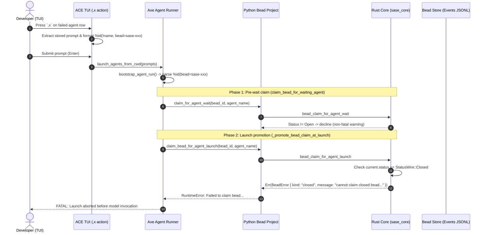

# Research Report: Relaunching SASE Agents on Closed Beads via `%id(bead=...)`

**Author:** `research.4n.gem` (Gemini)  
**Date:** 2026-10-16  
**Artifact Target:** `research:202610/relaunching_agents_with_closed_beads__gem.md`  
**Status:** Completed Investigation & Recommendations  

---

## 1. Executive Summary & Problem Statement

### 1.1 The Problem
In SASE, developers frequently monitor long-running or complex agent workflows using the interactive Textual control surface ("Agents" tab in the TUI). When an agent encounters an error late in its turn—such as a failure during git push, a post-commit hook error, a patch conflict, or a transient CI check failure—the agent run transitions to an `ERROR` or `FAILED` state. Crucially, by the time the failure occurs, either the agent itself or the host-owned completion finalizer may have already successfully closed the assigned bead (`sase bead close` or `sase final submit` with `bead_action: close`).

When the developer attempts to retry or remediate the agent using the standard kill-and-edit shortcut (`,x` on the Agents tab), SASE reconstructs the prompt preserving the agent's identity and bead association:
```text
%id(!agent_name, bead=sase-xxx) <prompt body...>
```
When this reconstructed prompt is submitted, the launch sequence aborts immediately with a fatal error:
```text
RuntimeError: Failed to claim bead 'sase-xxx' for agent 'agent_name': cannot claim closed bead for agent launch: sase-xxx
```
This forces the developer to leave their flow, drop to an external terminal, run `sase bead open sase-xxx` by hand, and then retry the launch, or manually strip `bead=sase-xxx` from the prompt (which breaks bead provenance and finalizer tracking).

### 1.2 Core Verdict
Allowing an agent to launch against an already-closed bead is a **sound and high-value improvement**, but it **must not be implemented as a silent, unconstrained bypass** and **must not leave the bead in the `closed` status during execution**. 

Specifically:
1. **The Bead Must Transition to `in_progress` (Reopened)**: Leaving the bead in `closed` while an active agent runs breaks the fundamental SASE invariant that an assigned bead is in progress, misleads LLMs into believing their task is already complete, breaks downstream `%wait(bead=...)` dependency gates, and causes false completion reporting if the relaunched agent crashes.
2. **Reopening Must Be Bound to Intentional Relaunch**: To prevent accidental prompt replay (e.g., from command history or scripts) from silently reviving stale historical beads, the automatic reopen mechanism should be authorized by **forced reuse** (`%id(!name, bead=...)`—which `,x` already emits) or an explicit launch argument (`reopen=true`), rather than applying unconditionally to arbitrary bare `%id(bead=...)` launches.
3. **Dual Audit Trail**: Reopening must move previous close metadata into `close_history` with a dedicated reopen cause (`ReopenCause.AGENT_LAUNCH` / `BeadReopenCauseWire::AgentLaunch`), reopen closed ancestor epics to maintain hierarchy invariants, and append an explicit timestamped audit note to the bead's work log.

---

## 2. Codebase Investigation: Call Stack & Architecture

To determine the exact mechanics of the failure and how SASE handles bead lifecycle transitions, we traced the launch flow across both Python (`sase`) and Rust (`sase-core`).



### 2.1 The Python Launch Sequence
1. **Directive Parsing**:
   In `src/sase/macro/_directive_extract.py` and `src/sase/macro/_directive_values.py:resolve_launch_bead_id`, SASE parses `%id(..., bead=<id>)`. At this stage, only lexical syntax is validated (non-empty, whitespace-free).
2. **Metadata & Environment Binding**:
   In `src/sase/axe/run_agent_directives_prompt.py`, `bead_id` is placed into `os.environ[SASE_BEAD_ID_ENV]`, and in `src/sase/axe/run_agent_directive_metadata_build.py`, it is recorded on `agent_meta["bead_id"]`.
3. **Pre-Wait Claiming**:
   In `src/sase/axe/run_agent_runner_bootstrap.py:_claim_bead_before_wait`, `claim_bead_for_waiting_agent` attempts an advisory wait-claim. In `src/sase/bead/claims.py`, calling `project.claim_for_agent_wait` when a bead is closed returns `held_by_us = False` and logs a warning. This step fails open/advisory and does *not* abort the launch.
4. **Launch Claim Promotion**:
   When dependency waits resolve and the agent is admitted to execute, `src/sase/axe/run_agent_runner_launch.py:_promote_bead_claim_at_launch` calls `claim_bead_for_agent_launch`.
   In `src/sase/axe/run_agent_runner_bead.py:claim_bead_for_agent_launch`:
   ```python
   if (
       force_reuse_prior_owner is not None
       and issue_retains_force_reuse_owner(
           current_issue,
           agent_name=agent_name,
           prior_owner=force_reuse_prior_owner,
       )
   ):
       claimed = current_issue
       mutated = False
   else:
       ...
       claimed = project.claim_for_agent_launch(bead_id, agent_name)
       mutated = project.mutation_changed
   ```
   Even when forced reuse is present, `issue_retains_force_reuse_owner` in `src/sase/bead/force_reuse.py` requires:
   ```python
   return (
       issue.status is Status.IN_PROGRESS
       and bool(issue.assignee)
       and same_current_owner_agent_name(prior_owner, agent_name)
       and same_current_owner_agent_name(issue.assignee, prior_owner)
   )
   ```
   Because `issue.status` is `Status.CLOSED`, `issue_retains_force_reuse_owner` evaluates to `False`. Execution falls through to `project.claim_for_agent_launch(bead_id, agent_name)`.

### 2.2 The Rust Core Chokepoint
`project.claim_for_agent_launch` invokes the Rust binding `bead_claim_for_agent_launch` implemented in `sase-core` (`crates/sase_core/src/bead/mutation/claims.rs`):
```rust
fn run_claim_launch(
    view: &mut MutationView,
    issue_id: &str,
    agent_name: &str,
    now: Option<String>,
) -> Result<MutationStep<BeadMutationOutcomeWire>, BeadError> {
    let current = view.get(issue_id)?;
    if current.status == StatusWire::Closed {
        return Err(BeadError {
            kind: "closed".to_string(),
            message: format!(
                "cannot claim closed bead for agent launch: {issue_id}"
            ),
        });
    }
    ...
```
This hard error is returned to Python, where `run_agent_runner_bead.py` wraps it in a `RuntimeError` and terminates the runner.

### 2.3 The Finalizer Stance on Closed Beads
Interestingly, the host finalizer logic already anticipated that an assigned bead might be closed. In `crates/sase_core/src/bead_action/policy.rs:138-143`:
```rust
Some(BeadActionStatusFactWire::Closed) => Ok(allow(
    BeadActionDispositionWire::CloseIdempotent,
    Some(bead_id),
    false,
    "commit; the assigned bead is already closed (idempotent)",
)),
```
The finalizer considers a closed bead to be a safe, idempotent no-op during completion! The only subsystem blocking this workflow is the launch admission/claim barrier in `run_claim_launch`.

---

## 3. Critique of the Proposed Plan

The prompt asks:
> *"Also, critique this plan in general. Is this a good idea? Would you take a different approach? Make any adjustments to the requirements that you think are justified but clearly call these out."*

### 3.1 Is It a Good Idea?
**Yes, in spirit, but with critical qualifications.**
The friction described by the user is real and occurs frequently in agentic development:
- An agent successfully completes its coding work and closes the bead.
- The finalizer runs, but a downstream transient failure occurs (e.g., git push times out, git remote rejected due to an un-pulled rebase, pre-push hook failed, or host network hiccup).
- The user sees the agent failed in the TUI, hits `,x`, and expects the agent to retry or complete the delivery.
- SASE abruptly halts with a cryptic bead-claim error.

Allowing the agent to launch without manual out-of-band intervention (`sase bead open`) is an essential developer experience improvement.

### 3.2 Should the Bead Stay Closed During the Run? (The Critical Dilemma)
One naive interpretation of "making it fine for an agent to be launched using `bead=<bead>` even when `<bead>` is already closed" is to simply bypass the claim mutation and leave the bead's status as `closed` while the agent runs.

**Leaving the bead closed is fundamentally broken.** Here is why:

| Dimension | Behavior if Left `closed` | Behavior if Reopened to `in_progress` |
| :--- | :--- | :--- |
| **Agent / LLM Instructions** | SASE instructions (`sase_beads.md`) state: *"A bead you were launched to work on is already in_progress before you read your prompt."* An agent reading a closed bead will assume its job is finished and immediately exit or declare completion without doing work. | Invariant preserved. The agent sees an active task assigned to itself. |
| **Dependency Gates (`%wait`)** | In `src/sase/agent/launch_admission_runtime.py:492`, `%wait(bead=<id>)` resolves when `status == "closed"`. If the bead stays `closed`, downstream agents will immediately dispatch and run in parallel with the relaunched agent, destroying serial dependency ordering. | `%wait(bead=<id>)` correctly pauses downstream agents until the retried work closes the bead again. |
| **Failure Semantics** | If the relaunched agent fails or is killed half-way through, the bead remains marked as `closed` (`done`), masking the failure from project status reports, backlog triage, and CI sanity checks. | If the agent fails, the bead remains `in_progress`, accurately reflecting unfinished work. |
| **Concurrency / Exclusive Claim** | SASE uses `in_progress` and `assignee` to prevent multiple parallel agents from colliding on the same issue. A `closed` bead has no active claim protection. | Claim protection is re-established. |

**Verdict**: Launching an agent on a closed bead **must transition the bead to `in_progress`** and assign it to the new agent. It must not be treated as a passive, read-only tag.

### 3.3 The Risk of Unconditional Reopening (Accidental Prompt Replay)
If *every* launch specifying `bead=<id>` unconditionally reopens closed beads:
- Developers frequently recall historical prompts from terminal history, scripts, or prompt logs (`sase prompt replay`).
- If an old prompt targeting a bead that was closed 3 months ago is rerun, an unconditional bypass would silently resurrect the archived bead, alter its historical record, and wipe out its original `closed_at` timestamp.
- **Adjustment**: Distinguish between:
  1. **Forced Reuse / Relaunch (`%id(!name, bead=<id>)`)**: The user or TUI explicitly signaled forced reuse using the `!` prefix. Reopening should be permitted automatically.
  2. **Explicit Directive Flag (`%id(bead=<id>, reopen=true)`)**: The user explicitly declared an intent to reopen a closed bead.
  3. **Bare `%id(bead=<id>)` on a Closed Bead**: Should fail with a helpful error explaining that the bead is closed and instructing the user to pass `!` (forced reuse) or run `sase bead open`.

### 3.4 Hierarchical Invariants (Parent Epics & Phases)
SASE maintains strict hierarchical integrity in `sase/memory/sase_beads.md`:
> *"Closing never cascades. A bead with any unclosed descendant is rejected... `sase bead open <id>` reopens a bead and every closed ancestor above it."*

If the bead being relaunched is a **phase bead** whose parent **epic bead** was already closed:
- Reopening the phase bead to `in_progress` while leaving the parent epic `closed` violates SASE's core invariant that an epic cannot be closed while any child phase is open or in progress.
- Therefore, any reopen operation in `run_claim_launch` **must walk and reopen closed ancestors**, exactly as `sase bead open` does via `reopen_closed_ancestors_via_view`.

---

## 4. Audit Trail & Annotation Design

The prompt specifies:
> *"We should make sure to add some kind of recognizable, timestamped note or annotation of some sort to the bead so there is a clear audit trail when we do this though."*

SASE already possesses a dual-layer audit architecture for bead lifecycle modifications. We should utilize both layers:

```
+-------------------------------------------------------------------------+
|                              BEAD RECORD                                |
|                                                                         |
|  Status: in_progress                                                    |
|  Assignee: agent.retry_1                                                |
|                                                                         |
|  +-------------------------------------------------------------------+  |
|  | [1] close_history (Structural Event Log)                          |  |
|  | - closed_at: 2026-10-16T10:15:00Z | resolution: done              |  |
|  | - reopened_at: 2026-10-16T10:20:00Z                               |  |
|  | - reopened_via: agent_launch                                      |  |
|  | - reopened_by: agent.retry_1                                      |  |
|  +-------------------------------------------------------------------+  |
|                                                                         |
|  +-------------------------------------------------------------------+  |
|  | [2] notes (Human-Readable Work Log)                               |  |
|  | 2026-10-16T10:20:00Z by agent.retry_1:                            |  |
|  | "[AGENT_RELAUNCH] Reopened closed bead (previously closed at      |  |
|  |  2026-10-16T10:15:00Z as 'done') for agent launch 'agent.retry_1'"|  |
|  +-------------------------------------------------------------------+  |
+-------------------------------------------------------------------------+
```

### Layer 1: Structural Audit Metadata (`close_history`)
In `crates/sase_core/src/bead/wire.rs`, `IssueWire` maintains `close_history: Vec<BeadCloseRecordWire>`. When a bead is reopened, `archive_close_metadata` transfers `closed_at`, `close_reason`, and `resolution` into `close_history`, stamping `reopened_at`, `reopened_via`, and `reopened_by`.

Currently, `BeadReopenCauseWire` supports:
- `PlusOne`
- `Open` (`sase bead open`)
- `Update`
- `EpicPreclaim`

We must add a new variant:
```rust
pub enum BeadReopenCauseWire {
    PlusOne,
    Open,
    Update,
    EpicPreclaim,
    AgentLaunch, // <-- NEW
}
```
And mirror it in Python (`src/sase/bead/model.py`):
```python
class ReopenCause(Enum):
    PLUS_ONE = "plus_one"
    OPEN = "open"
    UPDATE = "update"
    EPIC_PRECLAIM = "epic_preclaim"
    AGENT_LAUNCH = "agent_launch"  # <-- NEW
```
And update `src/sase/bead/reopen_presentation.py`:
```python
if record.reopened_via == ReopenCause.AGENT_LAUNCH:
    author = f" by @{record.reopened_by}" if record.reopened_by else ""
    return f"Reopened {record.reopened_at} for agent launch{author}"
```

### Layer 2: Human-Readable Bead Note (`notes`)
While `close_history` is queried by internal tools and TUI badges (`↺1`), developers and agents inspect human-readable history through `sase bead show <id>` or `sase bead read <id>`.

When `claim_for_agent_launch` reopens a closed bead, it should automatically append an attributed note:
```text
[AGENT_RELAUNCH] Reopened closed bead (previously closed at 2026-10-16T10:15:00Z with resolution='done') for agent launch 'my_agent.1'.
```
- **Author**: Stamped with the launching agent's name (`agent_name`).
- **Timestamp**: Exact UTC ISO timestamp matching the mutation event.
- **Event**: Staged as a `BeadEventOperationWire::NoteAppended` or integrated into the atomic `IssueUpdated` transition event.

---

## 5. Architectural Comparison of Approaches

We evaluated four candidate approaches for implementing this functionality:

| Approach | Where Logic Lives | Safety Against Stale Replay | Invariant Preservation | Implementation Complexity | Recommendation |
| :--- | :--- | :--- | :--- | :--- | :--- |
| **Approach 1: Unconditional Reopen in `claim_for_agent_launch`** | Rust Core (`sase-core`) | ❌ Low (Replays of old prompts reopen completed beads) | ✅ High (Reopens properly) | Low | Feasible, but risky for unforced launches |
| **Approach 2: Force-Reuse Bound Reopen (`!name`)** | Rust Core + Python Facade | ✅ High (Only explicit retries/relaunches trigger reopen) | ✅ High (Matches `,x` workflow precisely) | Moderate | **Recommended** |
| **Approach 3: Explicit Keyword (`%id(bead=..., reopen=true)`)** | Directive Parser + Rust Core | ✅ High (Explicit intent required) | ✅ High | High (Requires changing prompt syntax & `,x` generator) | Over-engineered for `,x` |
| **Approach 4: TUI Client-Side Pre-Open on `,x`** | Textual UI (`_entry_relaunch.py`) | ❌ Low (Bypasses CLI; race conditions) | ❌ Violates Rule 1.3 (Rust Core Boundary) | Low | **Rejected** |

### Why Approach 4 is Rejected
Implementing this by having the TUI run `sase bead open` before launching violates Rule 1.3 of the SASE Agent Instructions:
> *"Litmus test: if a web app, CLI, editor integration, or another frontend would need the behavior to match the TUI, treat it as core backend logic."*

A developer running `sase run "%id(!foo, bead=sase-1)"` from bash or a script should receive identical behavior to pressing `,x` in the TUI. The domain logic belongs strictly in `sase-core`.

---

## 6. Recommended Solution: Detailed Implementation Blueprint

### 6.1 Rust Core Changes (`sase-core`)

#### 1. Wire Types (`crates/sase_core/src/bead/wire.rs`)
Add `AgentLaunch` to `BeadReopenCauseWire`:
```rust
#[derive(Debug, Clone, PartialEq, Eq, Serialize, Deserialize)]
#[serde(rename_all = "snake_case")]
pub enum BeadReopenCauseWire {
    PlusOne,
    Open,
    Update,
    EpicPreclaim,
    AgentLaunch,
}

impl BeadReopenCauseWire {
    pub fn as_str(&self) -> &'static str {
        match self {
            Self::PlusOne => "plus_one",
            Self::Open => "open",
            Self::Update => "update",
            Self::EpicPreclaim => "epic_preclaim",
            Self::AgentLaunch => "agent_launch",
        }
    }
}
```

#### 2. Mutation Logic (`crates/sase_core/src/bead/mutation/claims.rs`)
Update `claim_for_agent_launch` to accept `allow_reopen: bool`:
```rust
pub fn claim_for_agent_launch(
    beads_dir: &Path,
    issue_id: &str,
    agent_name: &str,
    allow_reopen: bool,
    now: Option<String>,
) -> Result<BeadMutationOutcomeWire, BeadError>
```

In `run_claim_launch`:
```rust
fn run_claim_launch(
    view: &mut MutationView,
    issue_id: &str,
    agent_name: &str,
    allow_reopen: bool,
    now: Option<String>,
) -> Result<MutationStep<BeadMutationOutcomeWire>, BeadError> {
    let current = view.get(issue_id)?;
    let was_closed = current.status == StatusWire::Closed;

    if was_closed && !allow_reopen {
        return Err(BeadError {
            kind: "closed".to_string(),
            message: format!(
                "cannot claim closed bead for agent launch without forced reuse: {issue_id}"
            ),
        });
    }

    if current.status == StatusWire::InProgress && current.assignee == agent_name {
        let mut result = outcome("claim_for_agent_launch", false, vec![current.id.clone()]);
        result.issue = Some(current);
        return Ok(MutationStep::Done(result));
    }

    let now = now.unwrap_or_else(now_utc);
    let mut issue = current.clone();
    issue.status = StatusWire::InProgress;
    issue.assignee = agent_name.to_string();
    clear_snooze_record(&mut issue);

    let prior_closed_at = issue.closed_at.clone();
    let prior_resolution = issue.resolution.as_ref().map(|r| r.as_str().to_string());

    if was_closed {
        archive_close_metadata(
            &mut issue,
            &now,
            BeadReopenCauseWire::AgentLaunch,
            Some(agent_name.to_string()),
        );
    }

    // Append audit note if reopened
    if was_closed {
        let note_text = format!(
            "[AGENT_RELAUNCH] Reopened closed bead (previously closed at {} with resolution='{}') for agent launch '{}'",
            prior_closed_at.as_deref().unwrap_or("unknown"),
            prior_resolution.as_deref().unwrap_or("unrecorded"),
            agent_name
        );
        let note = BeadNoteWire {
            id: format!("note_{}_{}", issue.id, issue.notes.len() + 1),
            timestamp: now.clone(),
            author: agent_name.to_string(),
            text: note_text,
            edited_at: None,
            edited_by: None,
            attachments: Vec::new(),
        };
        issue.notes.push(note);
    }

    issue.updated_at = now.clone();
    issue.validate()?;
    view.stage_issue(issue.clone());

    // Reopen closed ancestors (e.g. parent epic if this is a phase)
    let reopened_ancestors = if was_closed {
        reopen_closed_ancestors_via_view(view, &issue.id, &now)?
    } else {
        Vec::new()
    };

    // Stage events for issue and ancestors...
    // (commit and return outcome)
}
```

#### 3. Python Bindings (`crates/sase_core_py/src/beads/mod.rs`)
Update `py_bead_claim_for_agent_launch` signature to accept `allow_reopen: bool = false`.

---

### 6.2 Python Host Changes (`sase`)

#### 1. Core Facade & Bead Project
- In `src/sase/core/bead_mutation_facade.py:claim_for_agent_launch`, add `allow_reopen: bool = False`.
- In `src/sase/bead/_project_mutations_claims.py:claim_for_agent_launch_outcome`, forward `allow_reopen`.

#### 2. Model & Presentation
- In `src/sase/bead/model.py`, add `AGENT_LAUNCH = "agent_launch"` to `ReopenCause`.
- In `src/sase/bead/reopen_presentation.py`, add formatting for `ReopenCause.AGENT_LAUNCH`.

#### 3. Agent Runner Launch (`src/sase/axe/run_agent_runner_launch.py`)
In `_promote_bead_claim_at_launch`:
```python
is_force_reuse = bootstrap.force_reuse_bead_association is not None
claim_bead_for_agent_launch(
    agent_name=state.agent_name,
    bead_id=bead_id,
    workspace_dir=state.workspace_dir,
    workspace_num=state.workspace_num,
    artifacts_dir=state.artifacts_dir,
    force_reuse_prior_owner=(
        bootstrap.force_reuse_bead_association.owner_name
        if is_force_reuse
        else None
    ),
    allow_reopen=is_force_reuse,  # <-- Automatically authorizes reopen for ,x
)
```

#### 4. Pre-Wait Claim Softening (`src/sase/axe/run_agent_runner_bootstrap.py`)
In `_claim_bead_before_wait`, when `force_reuse_bead_association` is present and the bead is currently `Closed`, allow `claim_for_agent_wait` to succeed by reserving the bead in `Claimed` status (or cleanly pass through to launch time).

---

## 7. Edge Cases & Verification Plan

1. **Phase Bead in a Closed Epic**:
   - *Scenario*: Epic plan `sase-10` is closed because all phases finished. Phase `sase-10.2` agent is restarted via `,x`.
   - *Verification*: `sase-10.2` transitions `closed -> in_progress`. `sase-10` transitions `closed -> open`. `sase-10` `close_history` records `reopened_via: open`.
2. **Dependent Agents with `%wait(bead=...)`**:
   - *Scenario*: Agent B has `%wait(bead=sase-10.2)`. Agent A is relaunched on `sase-10.2`.
   - *Verification*: Agent B's admission check sees `sase-10.2` is `in_progress`, not `closed`. Agent B remains queued until Agent A completes and closes the bead.
3. **Completion Finalizer Interaction**:
   - *Scenario*: Relaunched agent finishes successfully with `bead_action: close`.
   - *Verification*: Finalizer closes `sase-10.2` normally. If the relaunched agent did not change code and submitted `bead_action: close`, `policy.rs` handles it idempotently.
4. **Accidental Prompt Replay**:
   - *Scenario*: User runs `sase run "%id(random_worker, bead=sase-old)"` without `!`.
   - *Verification*: Fails with `cannot claim closed bead for agent launch without forced reuse: sase-old. To retry this bead, use %id(!random_worker, bead=sase-old) or run sase bead open.`.

---

## 8. Conclusion

The user's proposal addresses a genuine daily annoyance in agent workflows. By:
1. Transitioning the closed bead to `in_progress`,
2. Gating the reopen permission on forced reuse (`!name`),
3. Walking closed ancestor epics, and
4. Emitting both structural `close_history` metadata and an explicit work-log note,

SASE will solve the `,x` restart friction completely while strengthening rather than compromising the integrity of its core bead state machine.
