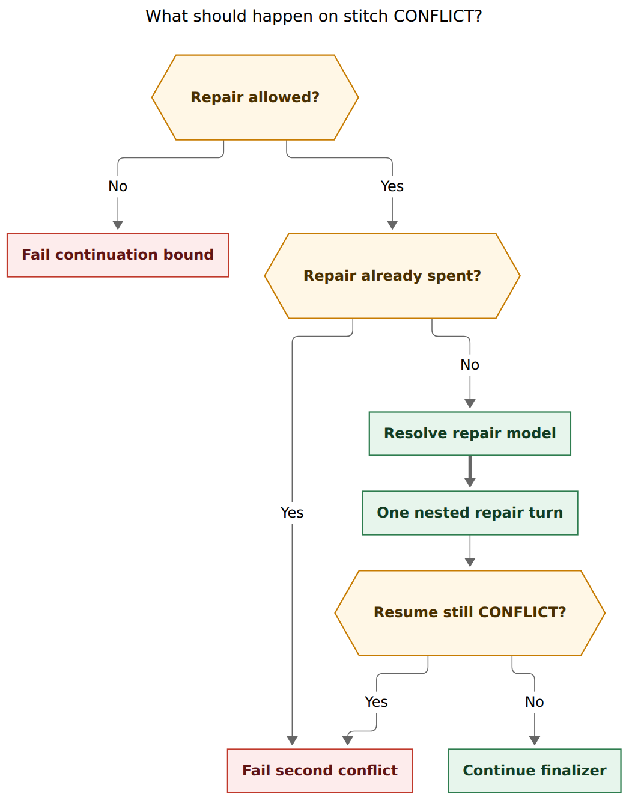

# Escalate stitch conflict-repair to `@xlarge`

**Date:** 2026-10-27 · **Researcher:** grk · **Scope:** `builtin@commit` merge-conflict
repair, size-alias routing, host-owned finalizers

> **Questions this report answers.** Should SASE always escalate to the `@xlarge` model
> alias when the stitch/commit finalizer hits a merge conflict that needs another model
> turn? How should that be implemented? Is the idea sound, and which requirements
> should change?

## Bottom line

Escalate. Treat conflict repair as a **host-owned, one-shot nested invoke**, not as a
new SASE agent, and select its model by **re-resolving `@xlarge`** rather than by
reusing the worker's provider object.

The naive reading of the request — set `model_override="@xlarge"` on the existing
provider, or pipe the repair to a fresh `@xlarge` agent session — is a bug. Repair
already runs as `purpose="conflict_repair"` inside the worker's finalizer
(`src/sase/finalizers/commit_repair_conflict.py`). That invoke is a new provider
process with a new instruction bundle. It is not a SASE session member. Passing the
alias string into Grok or Codex would send a literal `@xlarge` model id. Launching a
new agent would fight host-owned completion, the workspace claim, and the one-repair
budget.

Do this instead: resolve a dedicated repair expression (shipped default `@xlarge`)
through `resolve_launch_selection` + `get_provider`, with one admission change versus
ordinary launches: **treat usage-sparing providers as unavailable** so a paused rebase
does not sit on a depleted Claude window. Keep the nested invoke, the
`finalizer_owned_turn` guard, and the one-repair-per-repo bound.

This is a permanent routing policy, so it belongs in config, not a feature flag.

## Verdict on the idea

The idea is good once the target is named correctly.

Conflict repair is already filtered to **content** conflicts. `sase stitch create`
rebases onto `origin/<default>`, then
`sase.sdd._semantic_conflict_resolver.resolve_semantic_conflicts` folds bead-store,
artifact-link, and plan-header conflicts without a model
(`src/sase/vcs_provider/plugins/_git_commit_dispatch.py`). The LLM turn fires only
when that chain cannot continue the rebase. The commit skill says the same:
bead-store conflicts are mechanical; exit code 2 is a real paused rebase
(`src/sase/macros/skills/sase_git_commit.md`).

That remaining turn is high-stakes and bounded. `_conflict_repair_spent` allows
exactly one repair per repository per instance; a second `CONFLICT` is
`second_unresolved_conflict` and fails the run. Continuation-bound dispatches refuse
repair entirely (`repair_handoff_continuation_bound` in
`src/sase/finalizers/commit_dispatch.py`). Spending that single shot on a weak or
mid-size worker model is the wrong economy: a failed run plus a paused rebase costs
more than one Opus-class invoke.

The repair prompt is also a **cold start**. `run_conflict_repair_turn` calls
`provider.invoke` with a host-written prompt. Claude's adapter mints a new
`--session-id` per `invoke()` (`src/sase/llm_provider/claude.py`). Codex `exec` and
Grok Build do the same. The worker's conversation is gone. Filesystem state remains.
A stronger model is the compensation for lost conversational context, not a
continuation of it.

So: escalate the repair invoke. Do not escalate "to xlarge" as a bead size, a
`#plan` handoff, or a new agent in the session.

## Critique of the raw plan

### 1. `@xlarge` the alias is not `xlarge` the size

`sase/memory/sase_sizes.md` reserves bead/phase size `xlarge` for work that should
author an epic plan. `@xlarge` the size alias is a maximum-effort selector
(`claude/opus@xhigh || codex/gpt-6.1-sol@xhigh || grok/grok-4.7@xhigh` in
`src/sase/llm_provider/models.yml`). Conflict repair must not grow a `#plan` handoff
or an xlarge task bead. Use the **alias**, never the size.

### 2. "Another agent turn" is already a nested invoke

Glossary: an agent turn is one provider run shown by `sase agent list`. Conflict
repair is a second `provider.invoke` inside the **same** SASE turn, marked
`SASE_FINALIZER_OWNED_TURN=1`, with instruction `purpose="conflict_repair"`. It does
not appear as a session member. Handoffs (`/sase_plan`, `/sase_monitor`,
`/sase_handoff`, `/sase_questions`) are refused in that env
(`src/sase/finalizers/owned_turn.py`). Keep it that way. A new session member would
need a workspace-claim transfer while `builtin@commit` is already executing, which
contradicts `decisions:host-owned-completion` and `decisions:single-turn-agents`.

### 3. Reusing the worker provider cannot spell `@xlarge`

By the time finalizers run, `model_override` is the **resolved** model id (`opus`,
`grok-4.7`, …), not `@large`. `run_conflict_repair_turn` forwards that string and the
original `provider` object into `invoke_with_instructions`. Adapters then do
`model = model_override or resolve_model_name(tier)` and pass it to the CLI. Feeding
`@xlarge` to Grok Build would request a Grok model named `@xlarge`. Feeding
`claude/opus@xhigh` to a Grok provider is the same class of error.

Escalation requires a **new launch selection** and, when the alias lands on a
different backend, a **new provider instance**.

### 4. Ordinary `@xlarge` `||` will not leave a usage-sparing Claude

Shipped `@xlarge` is an ordered fallback, not a `|` pool. `fallback_availability_mask`
maps both `PREFERRED` and `SPARING` to available, so a soft-disabled Claude is still
the first candidate (`src/sase/llm_provider/load_balancing.py`). That is reasonable
for a launch you are willing to queue. It is a bad idea during finalization: the
runner slot is held, a rebase is paused, and the one repair shot can burn down
waiting on a depleted window. The original worker may already be Grok **because**
Claude was sparing.

**Adjustment:** resolve the `@xlarge` expression, but for this path treat SPARING as
unavailable so `||` can fall through to Codex, then Grok.

### 5. "Always" should mean "always re-resolve", not "always switch"

If the worker already is `claude/opus@xhigh` (or whichever member `@xlarge` would
pick after the SPARING skip), keep that provider object. Re-resolution is then a
no-op. If the worker is `grok/grok-4.7@xhigh` from the `@large` pool and Claude is
truly available, switching to Opus is the point of using `@xlarge` rather than
"bump effort in place".

### 6. Do not flag it

`sase/memory/sase_flags.md`: flags are for unfinished or sunset behavior. Users who
should choose forever get a config field. Repair-model policy is a config field.
Rollback is `conflict_repair_model: inherit` (keep today's reuse).

### 7. Do not piggyback declaration recovery

`ensure_final_declaration_or_recover` is "submit the form you forgot"
(`src/sase/finalizers/declaration_recovery.py`). It should keep the worker model.
Semantic merge is the expensive case.

## Current architecture

```
worker invoke_agent
  → launch_selection (alias → provider + model + effort)
  → provider.invoke(purpose=ordinary)
  → run_finalizers (same provider, model_override, options)
       → builtin@commit
            → sase stitch create
                 → rebase onto origin/<default>
                 → SDD semantic resolver (beads, links, plan headers)
                 → else RunResult.CONFLICT (exit 2)
            → resolve_commit_conflict
                 → run_conflict_repair_turn
                      → invoke_with_instructions(purpose=conflict_repair,
                            same provider, same model_override, same options)
                 → sase stitch create --resume
                 → second CONFLICT → fail
```

Evidence:

- Model passthrough: `resolve_commit_conflict` → `run_conflict_repair_turn`
  (`commit_repair.py`, `commit_repair_conflict.py`).
- Instruction purpose is already first-class:
  `ordinary | declaration_recovery | conflict_repair`
  (`src/sase/llm_provider/_instruction_boundary.py`,
  `docs/contribute/instruction-bundle-internals.md`).
- One-shot per repo: `_conflict_repair_spent` looks for
  `conflict_repair_prompt.<repo>.md`.
- Repair is `kind="model_turn"` in operation records
  (`src/sase/finalizers/operation_records.py`).
- `max_attempts: 2` on the commit instance retries the executor; it does not grant a
  second repair once the prompt artifact exists.
- There is no `conflict_repair_model` config today. The closest analog is
  `llm_provider.big_epic_lander_model: "@xlarge"`, which is a **launch** role for
  epic land agents, not a finalizer nested invoke.

Shipped aliases (`src/sase/llm_provider/models.yml`):

| Alias     | Selector | Typical landing                                      |
| --------- | -------- | ---------------------------------------------------- |
| `@large`  | `\|` pool | `claude/opus@high`, `codex/gpt-6.1-sol@xhigh`, or `grok/grok-4.7@xhigh` |
| `@xlarge` | `\|\|` fallback | `claude/opus@xhigh`, else Codex, else Grok        |

`@large` Grok is already at `xhigh` on `grok-4.7`. Escalating that worker to `@xlarge`
is a **provider switch**, not an effort bump. `@large` Claude is `opus@high`;
escalation is an effort bump on the same model. `@medium` Claude is `sonnet@xhigh`;
escalation is a model upgrade to Opus.

Muse, Antigravity, Qwen, and OpenCode have **no** `@xlarge` member. Those workers
must cross providers to honor `@xlarge`.

**Figure 1.** Who chooses the conflict-repair model?


*Today the repair invoke reuses the worker's provider object and resolved model. The
proposal re-resolves `@xlarge`, skips usage-sparing backends, and runs the same nested
invoke on the matching provider. Mermaid CLI 12.0.0; 590×501 px; fit 100%.*

**Figure 2.** What should happen on stitch `CONFLICT`? (finalizer side; SDD resolver
already failed inside `stitch create`.)



*Repair is allowed only for original-repo dispatch, only once per repo, and only as a
nested invoke. A second `CONFLICT` fails the run. Mermaid CLI 12.0.0; 697×888 px; fit
93.7%.*

## Adjusted requirements

Call-outs versus "always escalate to `@xlarge` when a merge conflict needs another
agent turn":

1. **Keep a nested finalizer invoke.** Do not create a SASE agent, session member, or
   pipe successor. Instruction purpose stays `conflict_repair`.
2. **Escalate by re-resolving an expression**, default `@xlarge`. Do not assign
   `model_override="@xlarge"` on the worker provider.
3. **Repair admission skips SPARING.** Hard-unavailable providers still skip. This is
   deliberately stricter than launch `||`.
4. **Reuse the worker provider** when re-resolution yields the same
   `(provider, model, effort)`.
5. **Config, not a flag.**
   `finalizers.instances.commit.config.conflict_repair_model`, shipped `"@xlarge"`.
   `"inherit"` or empty restores today's reuse. Do not add a fourth launch-model
   setting next to `default_model` / `epic_lander_model` / `big_epic_lander_model`;
   those are launch roles and would show up in Launch Control as if conflict repair
   were a kind of agent launch.
6. **Do not change declaration recovery.**
7. **Do not attach `#plan` or bead size `xlarge`.**
8. **Do not classify conflict difficulty.** Mechanical work is already gone. Remaining
   conflicts are rare enough that a heuristic is not worth the miss.
9. **Record the resolved repair model** on the `model_turn` operation record and as
   outcome evidence (`conflict_repair_model`, `conflict_repair_provider`).
10. **Same one-shot budget.** Provider switching does not earn a second repair.

## Options considered

| Option | What it does | Verdict |
| ------ | ------------ | ------- |
| A. `model_override="@xlarge"` on the worker provider | One-line, wrong CLI id | Reject |
| B. Re-resolve `@xlarge`, maybe `get_provider`, SPARING skip | Host-owned max model, operationally safe | **Recommend** |
| C. Provider-sticky ceiling (Opus on Claude, 6.1-sol on Codex, 4.7 on Grok; `@xlarge` only if the worker's backend is absent from the chain) | Avoids surprise switches | Runner-up |
| D. New SASE agent `%model:@xlarge` | Real session member, claim/finalizer conflict | Reject |
| E. Effort-only bump, same model | Helps `opus@high` → `xhigh`; leaves Sonnet and Grok-4.6 workers underpowered | Too weak as the only change |
| F. Feature flag | Temporary boolean for a permanent policy | Reject; use `inherit` |

Option C is the right fallback if Option B's provider switches prove noisy in soak
(Claude rate limits, instruction-channel differences). It is worse as the first
landing because a Grok `@large` worker already sits on Grok's `@xlarge` member; C
would never give that conflict to Opus, which is the quality bet the request is
making.

Option B with the SPARING skip still prefers Opus when Claude is actually usable, and
falls through when it is not. That matches "always `@xlarge`" better than C.

## Recommended solution

**Land Option B in `run_conflict_repair_turn`.**

### Selection helper

Add something like `resolve_conflict_repair_invocation(...)` next to the repair
module (Python `llm_provider` / `finalizers`, not sase-core: this is invocation
routing, not shared domain state).

1. Read `instance.config["conflict_repair_model"]`, default `"@xlarge"`.
2. If the value is missing, empty, or `"inherit"`, return the worker
   `(provider, model_override, options)`.
3. Else build `PromptDirectives(model=<expr>)` and call
   `resolve_launch_selection(..., consume=True, routing_context=capture_provider_routing_context())`
   with a repair admission mask that treats `SPARING` as unavailable.
4. `get_provider(selection.provider, routing_context=...)`. Honor
   `resolve_execution_provider_name` the same way `invoke_agent` does, so
   `SASE_LLM_EXEC_PROVIDER` cannot pair a Claude model id with a Grok binary.
5. Build `LLMInvocationOptions(reasoning_effort=selection.reasoning_effort, explicit=True)`
   because alias-supplied effort is explicit
   (`decisions:size-alias-effort-ladder`).
6. If `(provider, model, effort)` equals the worker's, reuse the worker provider
   object.
7. Invoke through `invoke_with_instructions(..., purpose="conflict_repair")` so the
   bundle re-renders for the repair provider.

Do not send this nested invoke through `invoke_agent`. That path re-resolves
finalizer plans, continuation budgets, and ordinary purpose. Repair already has its
own purpose, owned-turn guard, and artifacts. If continuation-budget coverage is
desired later, call `enforce_continuation_budget` explicitly; do not inherit the
full launch pipeline.

### Config shape

```yaml
finalizers:
  instances:
    commit:
      use: builtin@commit
      config:
        conflict_repair_model: "@xlarge"   # or inherit
```

Validate the value with the same model-expression grammar as `%model` (alias, `provider/model`,
optional `@effort`, `|` / `||`). `sase final doctor` should name a bad expression.
A temporary Launch Control override of the **`@xlarge` alias** already retargets this
path, because the expression points at the alias. That is enough operator control
without a fourth launch-setting row.

### Why not `llm_provider.conflict_repair_model` as a launch setting

`default_model`, `epic_lander_model`, and `big_epic_lander_model` launch agents.
Conflict repair does not. Putting it in that Literal would force TUI, doctor, and
override-key work for a nested finalizer policy. Instance config is the local
trusted knob (`ConfiguredFinalizerInstance.config` already exists and is digested
onto the plan wire).

### Observability

- Operation record label already says `conflict repair {repo}`; add
  `model` / `provider` / `alias_trail` fields to the JSON.
- Outcome evidence: `conflict_repair` success values stay; add
  `conflict_repair_provider` and `conflict_repair_model`.
- Metric sibling of `FINALIZER_RECOVERIES`:
  `FINALIZER_CONFLICT_REPAIRS{result,provider,escalated}` where `escalated` is
  whether the provider differed from the worker.

## Implementation sketch

Primary files:

- `src/sase/finalizers/commit_repair_conflict.py` — selection + invoke
- `src/sase/finalizers/commit_dispatch.py` — thread instance config through
  `resolve_commit_conflict` (it already has `instance_id`)
- `src/sase/finalizers/providers.py` — validate `conflict_repair_model` on
  `builtin@commit` (today only `builtin@command` has a closed config key set)
- `src/sase/default_config.yml` — shipped default on the commit instance
- `src/sase/llm_provider/load_balancing.py` or a tiny repair-specific wrapper —
  SPARING-skip mask; do not change launch `||` globally
- Docs: `docs/contribute/commit-workflow-orchestrator.md`,
  `docs/reference/config/finalizers.md`

Keep the prompt text. Scope, verification, and "no second repair" wording are
already load-bearing (`tests/test_finalizers_commit_repair_prompt.py`).

Suggested landing size: **medium**. The behavior is local, but it touches routing,
provider construction, config validation, and several protocol-harness tests. It is
not `large`: there is no planning fork, and the one-shot bound stays.

## Tests that should exist

1. Worker Grok + available Claude → repair invoke uses Claude `opus` at `xhigh` on a
   Claude provider instance.
2. Worker Grok + SPARING Claude → repair falls through to Codex, then Grok; does
   **not** wait on Claude.
3. Worker already `claude/opus@xhigh` → same provider object, no extra
   `get_provider`.
4. `conflict_repair_model: inherit` → today's reuse (Grok stays Grok).
5. Raw `@xlarge` is never the `model_override` argument to a Grok/Codex/Claude
   `invoke`.
6. Existing bounds still hold: second conflict fails; continuation-bound dispatch
   does not repair; prompt artifact still keys the spent bit; owned-turn env still
   wraps the invoke.
7. Muse/Agy worker (no `@xlarge` member) still resolves onto the `@xlarge` chain.
8. Bad config expression is a doctor/config diagnostic, not a late CLI failure.
9. Instruction manifests for the repair invoke record `purpose=conflict_repair` and
   the **repair** provider, not the worker provider.

Reuse `tests/test_finalizers_commit_repair_prompt.py` and the protocol harness under
`tests/test_finalizers_protocol_harness_multi_repo_*.py` as the fixture home.

## Risks

- **Runner-slot occupancy.** Nested Opus `xhigh` can run for minutes while the
  original agent still holds its slot. That is the existing nested-invoke cost, made
  larger. It is still cheaper than a failed paused rebase. Do not hand the repair to
  a monitor; monitors are command-shaped.
- **Instruction-channel change.** Switching providers re-renders the bundle. That is
  correct (`purpose` and `provider` are facts). Codex vs Claude child-channel
  differences should not matter: repair is a root invoke, and helpers are refused.
- **`SASE_LLM_EXEC_PROVIDER`.** Must follow the same exec-provider resolution as
  launches, or a Claude selection executes on the wrong binary.
- **Cost.** Rare (post-SDD), one per repo, fails closed. Acceptable. `inherit` is
  the cost brake.
- **Alias retargeting.** If someone sets `model_aliases.builtin.xlarge` to a joke
  model, repair follows. That is consistent with "the alias is the policy". Document
  it.

## What I would not do

- Spawn `%model:@xlarge` repair agents.
- Escalate declaration recovery "for consistency".
- Use `@large` for repair. `@large` is a load-balanced pool; repair wants the
  ordered maximum, not a random large member.
- Pre-classify trivial vs semantic conflicts in the finalizer. The SDD chain is the
  classifier.
- Put this in sase-core. Routing and provider construction live in Python
  `llm_provider`.

## Recommended next step

Implement Option B as a medium task on `builtin@commit`: config key, repair
admission mask, `resolve_launch_selection` + `get_provider`, tests above, two doc
pages. Soak with `escalated` metrics. If provider switches dominate failures, fall
back to Option C without changing the nested-invoke shape.
