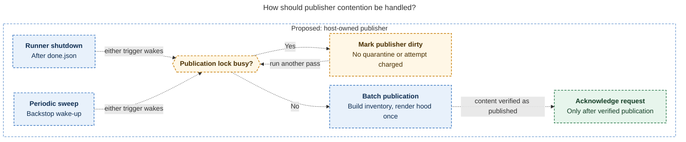
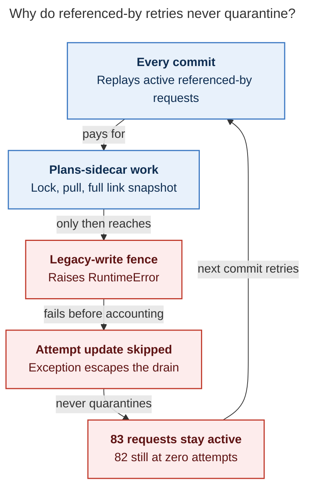
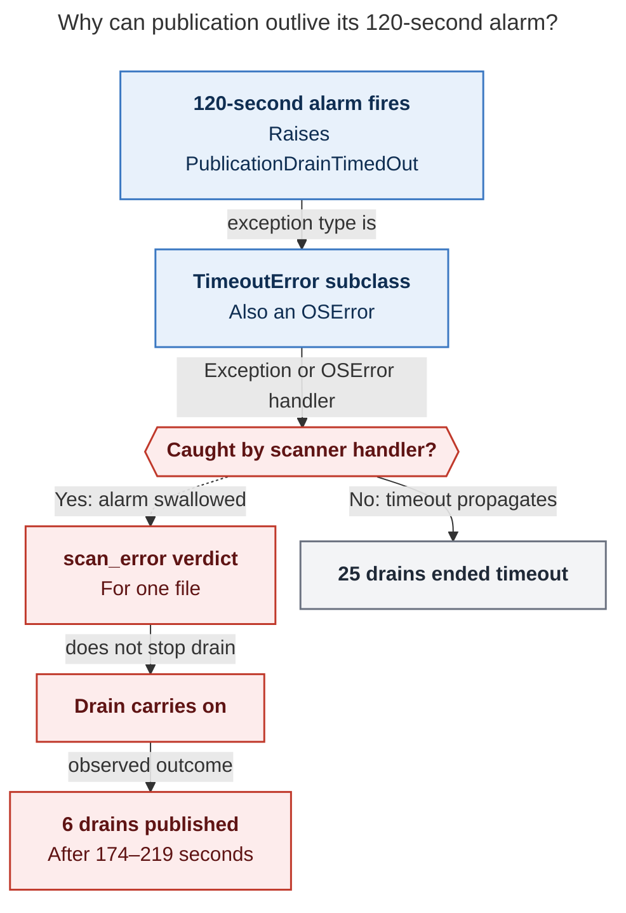

# Diagram proposals: Why SASE agent commit stages take minutes, and sometimes hours

Proposals for the swarm linker, not a report. Each diagram restates only what the source
report says.

```yaml
source: research:202610/commit_stage_latency_synchronous_publication/commit_stage_latency_synchronous_publication__final.md
producer: research.5h.image
check: "mmdc 12.0.0 with the PDF-mirroring config rendered 3 of 3 Mermaid diagrams; negative parse test exited nonzero"
```

## publisher-contention

```yaml
anchor: |-
  If the lock is busy, mark
question: |-
  How should a host publisher handle concurrent publication requests?
illustrates: |-
  The proposed host-owned publisher batches publication, marks itself dirty on lock contention without charging an attempt, and acknowledges requests only after verified publication.
caption: "Proposed: either trigger wakes one host publisher; lock contention schedules another pass without quarantine or charging an attempt."
review: "638x851 px, fit 100.0%; question, source trace, labels, arrowheads, crossings and reading-direction checks passed; 0 revisions"
```



## referenced-by-retry

```yaml
anchor: |-
  The `RuntimeError` escapes `drain_referenced_by_requests` before
question: |-
  Why do failed referenced-by requests never leave the retry loop?
illustrates: |-
  The referenced-by write-back fails after the lock, pull, and snapshot but before the attempt counter updates, so every commit replays requests that never quarantine.
caption: "Fenced link write-back fails before attempt accounting, so active requests repeat the expensive work on every commit and never quarantine."
review: "450.25x870 px, fit 100.0%; question, source trace, labels, arrowheads, crossings and reading-direction checks passed; 0 revisions"
```



## swallowed-drain-timeout

```yaml
anchor: |-
  An alarm that lands there becomes a
question: |-
  Why can a drain publish after its 120-second alarm fires?
illustrates: |-
  The scanner can turn PublicationDrainTimedOut into a scan_error for one file, allowing the locked drain to carry on and end published after the alarm.
caption: "The locked drain's alarm can become a per-file scan error; six drains still published. Passes A and C remain outside its scope."
review: "515.508x1092 px, fit 81.8%; question, source trace, labels, arrowheads, crossings and reading-direction checks passed; 0 revisions"
```


