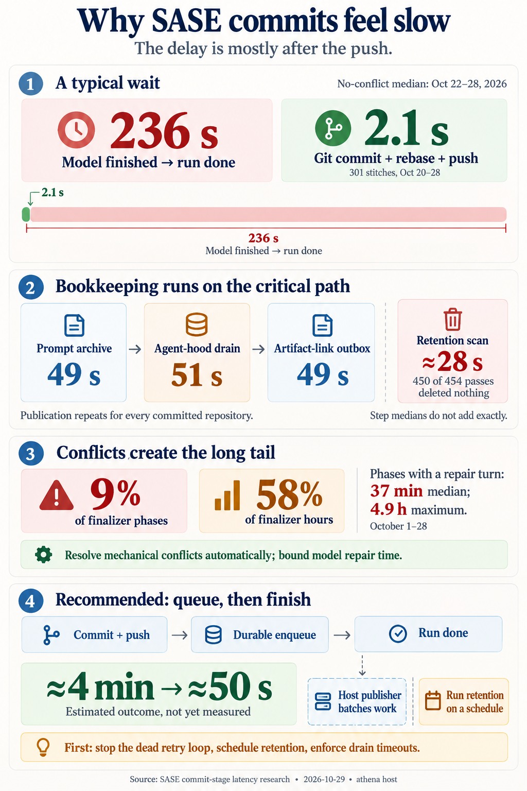
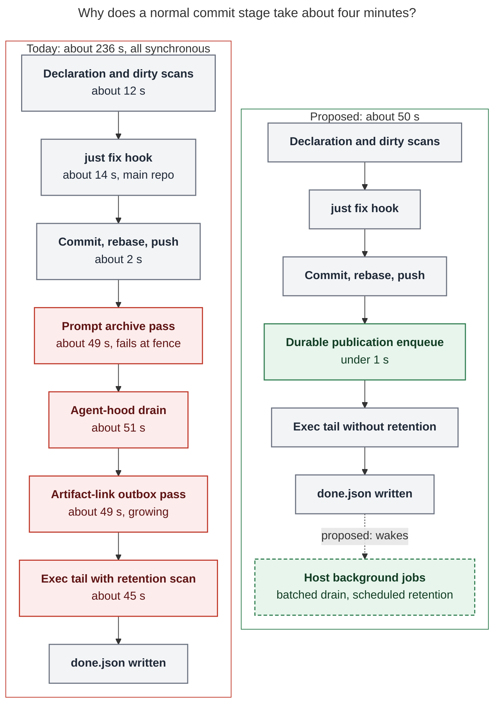
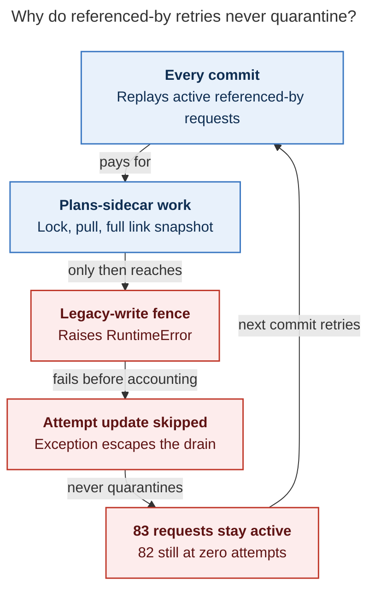
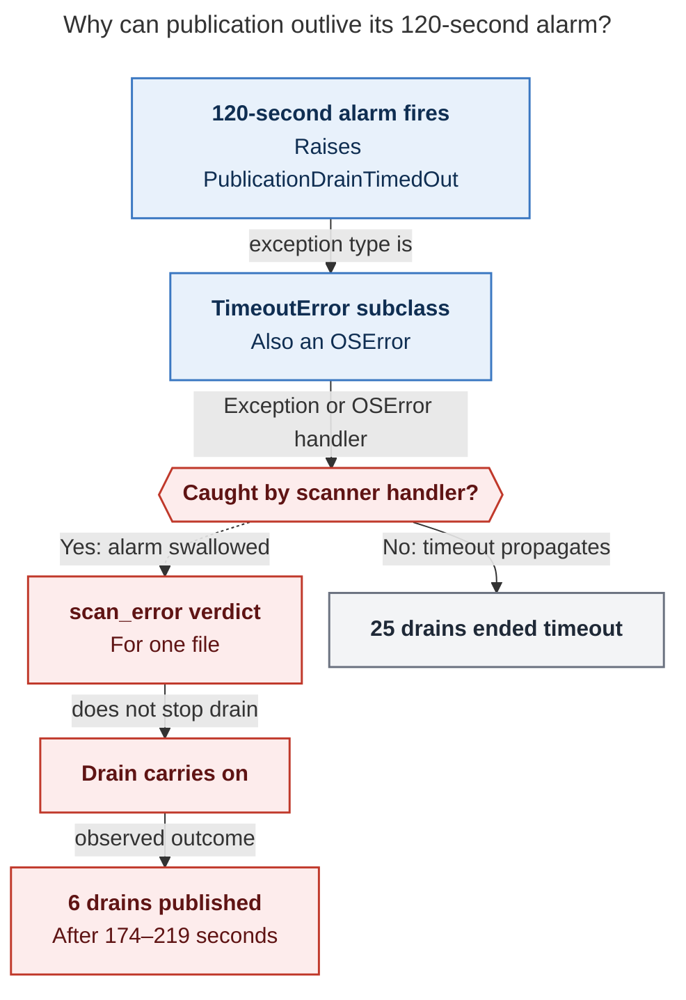
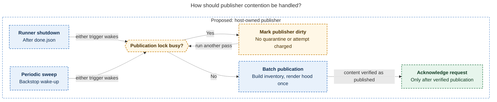

# Why SASE agent commit stages take minutes, and sometimes hours

> **Research query:** The requester suspects that sase agents take a very long time to
> complete their commit stages but is not sure why. Research the cause to help figure it
> out, and end the analysis with a recommended solution.

## Bottom line

1. **Your suspicion is right.** In a run with no conflict, the time from "model finished"
   (`provider_done`) to "run done" (`done.json` / `stopped_at`) has a median of **236 s**
   for Oct 22–28 (p90 389 s, n = 220). For all of October the median is **273 s**
   (p90 484 s, n = 768). See [where the time goes](#where-the-time-goes).
2. **The commit itself is not slow.** `git commit` + fetch/rebase + push takes a median
   of **2.1 s** (p90 2.8 s, max 11.3 s, over 301 stitches). See
   [what is not the cause](#what-is-not-the-cause).
3. **About 80–85% of the wait is bookkeeping that the commit doesn't need.**
   - After the push, `sase stitch create` runs
     [three publication passes](#why-each-pass-is-slow) back to back, about 50 s each:
     prompt archive, agent-hood drain, and artifact-link outbox. That is a median
     **156 s per committed repository**.
   - After the finalizer, the runner spends about **28 s** on an artifact-retention scan.
     In 99% of runs it deletes nothing.
4. **The cost repeats for every repo the agent committed.** No-conflict finalizer phases
   take a median of 205 s for one repo, **459 s** for two, and **792 s** for three or
   more.
5. **The hours-long cases are something else.**
   - About 9% of committing runs hit a rebase conflict. The host then runs a
     [full LLM repair turn](#the-tail-is-conflict-repair) *inside* the commit stage
     (median 37 min, max 4.9 h).
   - Those 145 phases are **58% of all October finalizer hours**.
   - About a quarter of them involve only mechanical files: the `sase-core-revision.txt`
     pin, generated docs, or screenshot snapshots.
6. **Recommendation:**
   - End the commit stage at commit + push + a
     [**durable publication enqueue**](#enqueue-only-publication-on-the-commit-path).
   - Let [one host-owned, single-flight publisher](#one-single-flight-publisher-per-project-run-by-the-host)
     drain the queue in batches after `done.json`.
   - Run retention on a schedule instead of once per run.
   - Land [three small fixes](#three-quick-wins-first) first. They are worth about 70 s
     on their own.
   - Treat conflict repair as a [separate track](#a-separate-track-for-the-conflict-tail):
     resolve pin, generated-file, and snapshot conflicts mechanically.
   - Expected result: a typical commit stage drops from about 4 min to about 50 s.

## What "the commit stage" is

When the provider turn returns, the runner marks the run `finalizing` and runs the
`builtin@commit` finalizer (`src/sase/llm_provider/_invoke.py`). The finalizer:

1. accepts the `/sase_final` declaration and reconciles dirty state in every repo;
2. runs one `sase stitch create` subprocess per dirty repo, **in sequence**
   (`dispatch_commit_decisions`). Each one runs:
   - the before hook (`just fix` on the sase primary);
   - `create_commit` (commit, fetch, rebase, push);
   - `run_agent_publication_step`;
3. on a rebase conflict, runs a model repair turn and then `stitch create --resume`.

The runner's exec-finalize tail then saves the chat, captures default artifacts, enforces
artifact retention, and writes `done.json` (`src/sase/axe/run_agent_exec_finalize.py`).
The run stays in `finalizing` until that tail ends. In the Agents tab, the visible
"commit" step is the whole stitch subprocess, including publication (grk).

## Where the time goes

The breakdown below covers a no-conflict, single-repo commit to the sase primary. Values
are medians, mostly from Oct 20–28 finalizer journals and stitch step files. Medians do
not add exactly.

- **Model done → finalizer start**
  - *Median:* 0.1 s
  - *Evidence:* lifecycle phases
- **Declaration + reconciliation / dirty scans (time in the phase outside stitch ops)**
  - *Median:* 11–14 s
  - *Evidence:* `progress.jsonl`
- **Stitch startup, gates, bookkeeping**
  - *Median:* ~9 s
  - *Evidence:* stitch remainder, main repo
- **`just fix` before hook**
  - *Median:* 13–15 s
  - *Evidence:* `*.steps.jsonl`, `commit_hooks/*.json`
- **Commit + fetch/rebase + push**
  - *Median:* **2.1 s**
  - *Evidence:* `create_commit` step
- **Pass A:** bead pages + prompt archive
  - *Median:* **49 s**
  - *Evidence:* step-channel warn markers
- **Pass B:** plan header + agent-hood enqueue + drain
  - *Median:* **51 s**
  - *Evidence:* warn markers; drain log
- **Pass C:** release evidence + artifact-link outbox drain
  - *Median:* **49 s**
  - *Evidence:* warn markers
- **Exec tail** (retention scan is ~28 s of it)
  - *Median:* **43–49 s**
  - *Evidence:* `stopped_at` − phase end
- **Total, model done → `done.json`**
  - *Median:* **236 s**
  - *Evidence:* Oct 22–28, n = 220

The A/B/C split comes from the warnings `_run_agent_publication_inner` prints at each
boundary. All 301 successful stitches from Oct 20–28 printed both boundary warnings.
cld got the same three ~50 s passes independently. The split also accounts for a
residual cdx could not explain:

- cdx measured an outer publication median of 146 s, against 46 s of timed hood-drain
  work, which left 101 s unattributed.
- That 101 s is passes A and C.

_Figure: the red steps are publication and retention bookkeeping that a correct commit
does not need. Together they make up about 80–85% of today's median wait. The proposal
keeps a durable enqueue on the critical path and moves everything else to host-owned
background jobs (dashed). Step values are Oct 20–28 medians for a sase-primary commit.
Rendered size: 734 × 865 px; fit scale: 88.9%._

The cost per repository is similar everywhere (repos stitched Oct 20–28):

- **main (sase):** n 178 · Stitch p50 186 s · Publication p50 158 s · Everything else p50 26 s
- **research sidecar:** n 61 · Stitch p50 126 s · Publication p50 122 s · Everything else p50 4 s
- **sase-core:** n 35 · Stitch p50 172 s · Publication p50 166 s · Everything else p50 5 s
- **plans sidecar:** n 18 · Stitch p50 137 s · Publication p50 130 s · Everything else p50 5 s

A research sidecar commit is 97% publication. Research swarms commit to `research`, and
every member shares the one `research` hood, so swarms pay the most.

## Why each pass is slow

Fixing one pass has not fixed the stage.

- Through Oct 21, pass B hit the 120 s alarm almost every day.
- The scoped-inventory work in epic `sase-1nf.10.1` (closed phase
  `sase-1nf.10.1.4`, around Oct 20–22) cut B to about 50 s.
- Passes A and C were untouched, and C has since doubled.
- Lesson: speeding up individual drains is whack-a-mole while every drain stays on the
  commit path.

Daily medians of the three passes show the cost moving around:

- **Oct 02:** Publication p50 206 s · A (prompt archive) 59 s · B (hood drain) 122 s · C (link outbox) 49 s
- **Oct 12:** Publication p50 220 s · A (prompt archive) 59 s · B (hood drain) 122 s · C (link outbox) 65 s
- **Oct 20:** Publication p50 224 s · A (prompt archive) 53 s · B (hood drain) 122 s · C (link outbox) 73 s
- **Oct 24:** Publication p50 123 s · A (prompt archive) 29 s · B (hood drain) 51 s · C (link outbox) 45 s
- **Oct 27:** Publication p50 165 s · A (prompt archive) 58 s · B (hood drain) 49 s · C (link outbox) 54 s
- **Oct 28:** Publication p50 197 s · A (prompt archive) 37 s · B (hood drain) 48 s · C (link outbox) **118 s**

### Pass A (~49 s): a write-back that can never succeed, retried forever

After publishing the prompt archive, `publish_prompt_archive` calls
`_drain_referenced_by_after_prompt_publish`, which calls `refresh_referenced_by`. That
function:

1. takes the plans-sidecar write lock;
2. pull-rebases the sidecar;
3. builds the full artifact-link snapshot. In cld's py-spy profile this step was 26 of
   the prompt archive's 28 profile points.

Only then does it reach `_upsert_sidecar`, which raises `artifact-link legacy index
writes are fenced; use link events` (`src/sase/sdd/_artifact_link_store_sidecar.py`).
This fence comes from the link-v2 cutover (`sase-yy.8.6`). It has fired on about 75–90%
of stitches every day since at least Sep 27.

**New lead finding: the failure never quarantines.**

- The `RuntimeError` escapes `drain_referenced_by_requests` before
  `update_referenced_by_requests` can increment the attempt count. The commit path only
  sees it as `referenced-by write-back failed: …`.
- The live `referenced-by-outbox.json` holds **83 active plans-role requests, 82 of them
  at `attempts = 0`**, created between Sep 18 and Oct 28.
- So every commit replays all 83 requests, pays for the lock, the pull, and the snapshot,
  and fails again.
- A loop that never quarantines can never get cheaper.

[The referenced-by retry diagram](#figure-referenced-by-retry) shows why the loop never
ends: the lock, pull, and snapshot are paid before the fence fails, and the failure skips
attempt accounting.

_Fenced link write-back fails before attempt accounting, so active requests repeat the expensive work on every commit and never quarantine._

### Pass B (~51 s): work that scales with project history

- **Inventory is O(project history).** It queries the artifact index with full history,
  about 18k records. cld reproduced 40 s for the `research` hood; `inventory_build` p50
  is 28 s.
- **Rendering is O(hood size).** `hood_publish:research` (1,170–1,320 runs) took 106–142 s
  in the latest drains, against 4–10 s for a small epic hood. Hoods have no retention
  (`sase-11n`).
- **Every file of every run in the hood is rescanned for secrets on every publish**, with
  no clean-verdict cache (cld profile).
- **Already fixed:** requested-hood filtering exists (`1f107c4a89`, `sase-1nf.10.1.4`).
  Don't propose it again (cdx).

**The 120 s alarm is not a real bound.**

- `PublicationDrainTimedOut` subclasses `TimeoutError`, which is an `OSError`
  (`src/sase/_interruptions.py`).
- In the scanner, `_scan_file` wraps the Rust call in `except Exception`, and
  `scan_publication_bytes` catches `OSError`. An alarm that lands there becomes a
  `scan_error` verdict for one file, and the drain carries on.
- The drain log shows it: of 303 sase drains in the retained window, **6 recorded
  `alarm_fired` yet ended `published`**, after 174–219 s. Another 25 ended `timeout` and
  6 ended `no_requests`/`failed`.
- The bound also wraps only the locked drain. It never covered passes A and C, so the
  "120 s" was never a bound on the commit stage (cdx).

[The swallowed-timeout diagram](#figure-swallowed-drain-timeout) follows the alarm's
exception type into the scanner's handlers, where it can become a one-file `scan_error`
and let the drain finish as published.

_The locked drain's alarm can become a per-file scan error; six drains still published. Passes A and C remain outside its scope._

### Pass C (~49 s, growing): a 10,574-row outbox parsed on every commit

`_drain_artifact_link_outbox_for_agent` calls `drain_artifact_link_outbox` with
`drop_stale_terminal=False` and no `deadline`.

- The outbox `~/.sase/projects/gh_sase-org__sase/artifact-link-outbox.jsonl` now holds
  **10,574 rows (6.9 MB)**, the oldest from Sep 9. It grew by about 200 rows on Oct 29
  alone.
- Read-only timing: `_inspect_artifact_link_outbox` takes **4.6 s** and
  `_read_artifact_link_outbox_entries` takes **4.0 s**. That is 8.6 s before any work.
  The drain then rewrites the file and rebuilds the link aggregate.
- It selects only the committing agent's rows but parses everyone's.
- Nothing ages out on this path, so the cost rises every day.

### Exec tail (~45 s): retention scan on every run

`enforce_artifact_retention()` runs at the end of every completed run. Its
`collect_protected_artifact_ids()` walks all project artifact trees and sidecars and
regex-scans text files. cld counted about 54k files.

- The lead timed it read-only at **52.9 s cold and 28.5 s warm** (load average about 23).
- Of 454 retention passes in Oct 22–28 runner logs, **450 trashed nothing**.
- This is housekeeping, not completion.

## What is not the cause

- **Git / network** (mus's top-ranked cause): **Refuted by measurement.** `create_commit`
  p50 is 2.1 s and max 11.3 s. The 600 s fetch/rebase timeouts, 4 push attempts, and
  1,800 s stitch cap are a latent risk, not a present cost.
- **Repeated dirty-state scans** (mus): Real but small. Time in the phase outside stitch
  ops is p50 11–14 s, p95 42–66 s, including declaration (p50 2.5 s). Worth caching later.
- **`just fix`:** 13–15 s median on warm athena. gem's 20–40 s came from seven hand-picked
  runs. It formats the whole repo. On a cold or small host it can reach about 20 min,
  because `fmt-py` re-enters `_setup` (September apollo evidence, grk). Secondary on
  athena.
- **Agents-lock stampede** (gem): Waits are capped at 10 s (lock-wait p95 10 s), and 26 of
  303 drains ended `lock_busy`. Contention causes deferrals and quarantines, not minutes of
  waiting.
- **The 3,501 quarantined hood requests:** They are not re-rendered on each commit: the
  drain takes active rows only, batch cap 25. They are evidence of past 120 s timeouts and
  make every commit print a warning that means nothing. gem's "vicious cycle" overstates
  their direct cost.
- **The model:** Nothing waits between `provider_done` and the finalizer start (0.1 s).

## The tail is conflict repair

Conflict repair runs inside "commit". Phases by population (Oct 1–28):

- **No-repair phases:** n 1,434 · p50 206 s · p90 364 s · Max 2,324 s · Finalizer-hours 90.5 h
- **Phases with a repair turn:** n 145 · p50 2,240 s (37 min) · p90 6,008 s · Max 17,466 s (4.9 h) · Finalizer-hours 123.6 h

Repair phases are 9% of phases but 58% of finalizer-hours. For Oct 22–28 the share is
66%. All five reports agree here: cld 133 runs, median 40 min; grk 128 ops, median
41 min; cdx 17 phases, median 57 min.

- **Why repairs take so long.** The repair prompt (`commit_repair_conflict.py`) requires
  the repository's mandatory verification gate even for JSON or one-line repairs.
  "Single repair turn" limits the number of turns, not the elapsed time, and the 1,800 s
  stitch timeout does not wrap the provider call (cdx).
- **What conflicts** (lead classification of 146 October conflict events; approximate,
  because some file lists were line-wrapped):
  - 47% involve only hand-written source;
  - **18% involve only `sase-core-revision.txt`**;
  - 12% involve only the `Justfile`;
  - **25% involve only mechanical files** (pin, generated docs, `docs/_meta`,
    `sase/memory/README.md`, visual snapshot PNGs).
  - cld's "dominated by pinned/generated files" overstates the share. The opportunity
    is still large.
- **Pin-only repairs are the slowest.** Their median is **60 min** (20 runs, 21 h total),
  against 34 min for other conflicts. Repairs in the mechanical classes add up to about
  30 h of roughly 114 h of repair time.
  - Plausible but unverified mechanism: after a pin change, the mandatory gate rebuilds
    or retests against the new sase-core.
- **Sequential multi-repo dispatch** publishes each repo before starting the next. This
  lengthens the window in which another agent can move `master` underneath the run
  (cdx; plausible, not measured).

## Where the reports disagreed, and how it resolves

- **Main cause**
  - *Positions:* cdx, cld, grk, gem: post-commit publication. mus: network retries and
    sequential fan-out (code reading only).
  - *Resolution:* Publication. The telemetry measures git at about 2 s. mus's
    retry-budget and observability points survive as secondary hardening.
- **What fills cdx's 101 s residual**
  - *Positions:* cdx: unknown.
  - *Resolution:* Passes A (prompt archive / referenced-by) and C (link outbox), about
    49 s each.
- **What happens when the alarm fires**
  - *Positions:* gem: the drain fails. cld: the alarm is swallowed.
  - *Resolution:* Both happen: 25 ended `timeout`, 6 ended `published` after 174–219 s.
- **Achievable latency**
  - *Positions:* gem: ~5 s. grk: 15–20 s. cld: ~1 min. cdx: p95 < 60 s.
  - *Resolution:* About 50 s end to end for a main-repo commit (`just fix`, scans, and
    the chat tail remain); about 35 s for sidecar-only commits. gem leaves out the hook
    and the tail.
- **Mechanically resolvable conflicts**
  - *Positions:* cld: most. cdx: 7 of 17 pin-only.
  - *Resolution:* About 25% of events, about 27% of repair-hours.

## Recommended solution

**Make the commit stage finish when the commits are pushed and their publication
obligations are durably queued. Have a host-owned publisher do the rest after
`done.json`, and move retention off the per-run path.**

This fits the design rules. `decisions:host-owned-completion` requires that the host
verify finalizer postconditions, and for the commit finalizer the postcondition is
commit + push. The `publish_committed_agent_hood` docstring says only the *enqueue*
must be synchronous. `decisions:machine-link-writes-off-primary` already gives
background link writes a host-owned clone to work in.

### Enqueue-only publication on the commit path

This is the primary fix.

- In `run_agent_publication_step`, durably record one publication obligation per stitch
  and return. The obligation carries:
  - agent;
  - immutable revision;
  - scope / hood;
  - prompt-archive inputs;
  - pending link events.

  The current outbox rows already carry most of these (`primary_revision`, `scope`,
  `local_hood`).
- **Durability before return** (cdx):
  - Snapshot any input that lives in the evictable workspace. Most inputs already live
    under `~/.sase`; 21 recent stitches already reported a missing `raw_prompt.md`.
  - If the enqueue fails, completion fails. `stitch create --resume` keeps its current
    meaning.
- Keep `refresh_committed_plan_header` synchronous only if timing shows it is cheap.

### One single-flight publisher per project run by the host

- **Trigger:** wake it from runner shutdown after `done.json`, and keep a periodic
  chop / lumberjack sweep as a backstop.
  - The runner should only wake the publisher, not own its lifetime. A subprocess
    started by a finishing provider cannot guarantee retries (cdx).
  - An existing pattern to copy is `sase_chop_artifact_link_backfill.py` (grk).
- **Concurrency:** use the existing `sase-agents-sync.lock`. If the lock is busy, mark
  the publisher dirty and run another pass. Don't quarantine, and don't charge an attempt.
- **Batching:** a five-member swarm then builds the inventory and renders the `research`
  hood once instead of five times. A multi-repo run drains once instead of once per repo.
- **Correctness bonus:** publishing after `done.json` captures terminal run state. That
  fixes the mechanism behind `sase-1cc` (8,659 of 15,457 published run states stuck at
  `active`/`waiting`).
- **Visibility:**
  - Show "committed; publication pending" in the UI, with queue age.
  - Set a freshness target, for example queue-age p95 under 10 min.
  - Acknowledge a request only after the content is verified as published.
  - Test termination right after enqueue, worker restart, duplicate delivery, push
    rejection, and missing sources.

[The publisher-contention diagram](#figure-publisher-contention) traces the proposed
publisher's loop: a busy lock marks it dirty for another pass without charging an attempt,
and requests are acknowledged only after verified publication.

_Proposed: either trigger wakes one host publisher; lock contention schedules another pass without quarantine or charging an attempt._

### Three quick wins first

These fixes are small, independent, and useful before
[the enqueue-only change](#enqueue-only-publication-on-the-commit-path) lands.

- **a. Stop the dead referenced-by loop.** Check `legacy_artifact_link_writes_fenced`
  before the lock, pull, and snapshot. Fix the exception path so failures increment
  `attempts` and quarantine. Move the caller to link events (`sase-yy.8.6`).
  - *Saves:* ~40–45 s, most of pass A
  - *Work:* S
- **b. Run retention on a schedule** (or keep an incremental protected-ID cache keyed by
  mtime or sidecar HEAD) instead of on every run.
  - *Saves:* ~28–50 s from the tail
  - *Work:* S
- **c. Make the drain bound real.** Derive `PublicationDrainTimedOut` from
  `BaseException`, or re-raise it in the scanner's broad `except` blocks. Pass a
  `deadline` to the link-outbox drain.
  - *Saves:* Caps the p90 tail; stops spurious "unverified" withholds
  - *Work:* S

Fixes a and b together remove about 70 s, roughly 30% of today's median, before any
architectural change.

### Shrink what the background publisher has to do

These are follow-ups once publication is off the critical path:

- Compact the artifact-link outbox: age out terminal rows from September and parse it
  once per drain.
- Retire the 3,501 quarantined hood rows through the existing bounded retry
  (`sase-1nf.11`), so the warning means something again.
- Cache secret-scan verdicts by `(sha256, scanner version)`.
- Query the index per hood instead of with full history.
- Add hood retention (`sase-11n`).

### A separate track for the conflict tail

- Before starting a repair turn, try **deterministic resolvers**, then run a narrow
  check:
  - `sase-core-revision.txt`: if one side's pin is an ancestor of the other, take the
    descendant.
  - Generated docs and catalogs: rerun the generator and take its output.
  - Visual snapshot PNGs: take the incoming side and flag them for re-snapshot.
- Fall back to the model turn for hand-written source.
- Show "conflict repair" as its own state, with elapsed time, so a 40-minute repair is
  not read as a stuck commit.
- Give it an explicit time budget that ends in a visible, recoverable state.
- Keep the in-flight rebase gate (`sase-1pm.5`) cheap and conditional on the base
  actually moving, as designed, so it doesn't become the next fixed cost on the commit
  path.

### Measure the change

- Fix the journal defect where `op_started` is written *after* the stitch subprocess
  exits (cdx). Today those event timestamps sit milliseconds apart while the subprocess
  ran for minutes.
- Add timers for each publication sub-step.
- Success criteria for at least 100 no-conflict single-repo commits:
  - finalizer phase p95 under 60 s;
  - model done → `done.json` median under 60 s;
  - publication queue-age p95 under 10 min;
  - no lost obligations.

### Why it matters more now

Staged handoffs (`sase-1pj`, landed in `dd59c28f44`) wait for finalizer settlement
before the successor runs. Every minute of commit-stage bookkeeping is therefore added
to every plan, monitor, or pipe handoff chain, not just to a slow status line. The lead
did not verify whether `%wait` dependencies release at finalizer settlement or at
`done.json`. If it is `done.json`, research swarm stages pay the retention tail too.

## Method and limits

**Consolidated report**, 2026-10-29. It merges five independent researcher reports
([cdx](commit_stage_latency_synchronous_publication__cdx.md),
[cld](commit_stage_latency_synchronous_publication__cld.md),
[grk](commit_stage_latency_synchronous_publication__grk.md),
[mus](commit_stage_latency_synchronous_publication__mus.md),
[gem](commit_stage_latency_synchronous_publication__gem.md)) with the lead's own
measurements. Code: sase `dd59c28f44`. Data: athena, project `gh_sase-org__sase`.

The original request:

> I suspect that it takes a very long time for sase agents to complete their commit
> stages, but I'm not sure why that is. Can you do some research with the goal of helping
> me figure this out? End your analysis with a recommended solution.

- **Lead's own analysis** (read-only, athena, 2026-10-29):
  - phase, operation, and step timings from
    `~/.sase/projects/gh_sase-org__sase/artifacts/ace-run/202609–202610/*/finalizers/`
    and `agent_meta.json`: 1,579 October phases, 301 Oct 20–28 successful stitches, and
    daily series from Sep 27;
  - the drain log `~/.sase/logs/agent_publication_drains.jsonl` and its `.1` rotation
    (303 sase drains);
  - live outbox files;
  - runner logs (retention outcomes);
  - read-only timings of the outbox readers and `collect_protected_artifact_ids` with
    the installed `sase` interpreter;
  - a code trace of the referenced-by, scanner, alarm, link-drain, and retention paths.
- **Researcher evidence relied on:**
  - cld's py-spy profiles and inventory reproduction;
  - cdx's publication residual join and journal-defect finding;
  - grk's hook-command breakdown and the September cold-`just fix` evidence;
  - gem's lock-contention step trace;
  - mus's timeout and retry inventory.
- **Limits:**
  - Data comes from athena only, and from installed versions that changed over the
    window.
  - Times are wall-clock under a heavily loaded host, so contention inflates them.
  - Conflict classification parsed wrapped stdout and is approximate.
  - Repair durations include whatever capacity waits the repair turn hit.
  - The "about 50 s" outcome is an estimate from medians, not a measurement of an
    implemented change.
