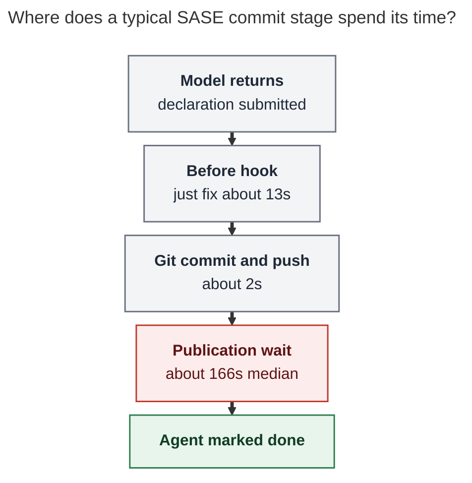
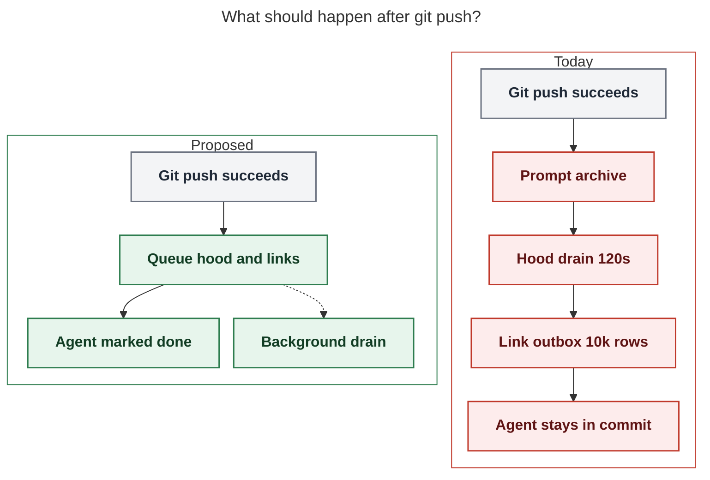

# Why SASE agent commit stages take so long

**Question.** Bryan suspects SASE agents spend a very long time in their commit
stages. What actually holds the host there, and what should change?

**Researcher.** grk. Independent report. I did not read peer reports from this
swarm.

**Method.** Code path for `builtin@commit` → `sase stitch create` →
`CommitWorkflow`; October 2026 host evidence from
`~/.sase/projects/gh_sase-org__sase/artifacts/ace-run/` (1,801 stitch
`*.outcome.json` files, 1,674 commit-hook records, 400 recent
`*.steps.jsonl` files, `finalizers/progress.jsonl`); the rotated drain log
`~/.sase/logs/agent_publication_drains.jsonl` (197 rows); live outbox files
on this host. Prior independent research on the same machinery:
[Publication drain measurement](../pub_drain_measurement.md) (2026-10-20) and
[Ending stitch_timeout agent failures](../../202609/stitch_timeout_hardening/stitch_timeout_hardening.md)
(2026-09-04).

## Bottom line

The git commit is not slow. On this host a typical `sase stitch create` spends
about **two seconds in `git commit` + `git push`**, about **thirteen seconds in
`just fix`**, and about **three minutes waiting after the push** while the
commit workflow tries to publish agent hoods, prompt archives, and artifact
links. The Agents tab keeps the turn in ⊛ FINAL / `commit` / `publication`
until that wait ends, so the agent looks stuck in its commit stage.

The wait often fails to publish anything useful. Athena's sase project outbox
currently holds **3,501 quarantined hood-publication requests** (2,907 last
failed with `agent-hood publication did not complete within 120s`). The
durable queue already exists. The commit path still blocks on a 120-second
drain plus a 10,354-row artifact-link outbox, then marks the agent done
anyway.

**Recommended solution:** enqueue publication and return as soon as git push
and the commit result marker land. Drain hoods and artifact links on a
background job. Keep conflict repair as its own visible turn. Details in
[Recommended solution](#recommended-solution).

## What "commit stage" is

After the model submits `/sase_final`, the host-owned `builtin@commit`
finalizer runs `sase stitch create` for every dirty repository in declaration
order. `CommitWorkflow` then walks this sequence (from
`docs/contribute/commit-workflow-orchestrator.md` and
`src/sase/workflows/commit/workflow.py`):

1. Subject and bead-action gates, bead sync, plan handling.
2. **Before hook** (`commit_hooks.before`: `just fix` on the sase primary,
   `sase_git_fix` elsewhere — that script execs `just fix` when a Justfile
   defines it).
3. Stage, `git commit`, fetch + rebase onto origin, `git push`.
4. File-hook capture.
5. After hook (empty on sase).
6. Result marker, then **publication** (bead pages, prompt archive, agent-hood
   drain, artifact-link outbox).
7. STITCHES entry, optional `-B close`.

The Agents-tab ⊛ FINAL receipt shows the live step from
`SASE_FINALIZER_STEPS_FILE`. While publication runs, that step is
`publication`, so the human-visible "commit stage" is the whole stitch
subprocess, not the git commit.

The subprocess itself is allowed to run for **1,800 seconds**
(`HARD_MAX_SUBPROCESS_TIMEOUT_SECONDS` in
`src/sase/finalizers/bounded_subprocess.py`). That cap exists because this
path has already overflowed a 600-second budget (see the September
stitch-timeout research). Hooks have **no timeout of their own**.

**Caption.** After the model returns, git commit and push take about two
seconds. Publication work after the push holds the agent in the commit stage
for minutes. Rendered size: 531 × 566 px; fit scale: 100%.

## Where the minutes go on this host

All times are wall-clock on athena, October 2026, project `gh_sase-org__sase`.

### Whole `sase stitch create` subprocess

1,801 `finalizers/commit/*.outcome.json` records:

| Bucket | Count | Share |
| --- | ---: | ---: |
| 0–30 s | 149 | 8% |
| 30–120 s | 216 | 12% |
| 120–180 s | 377 | 21% |
| 180–300 s | 791 | 44% |
| 300–600 s | 129 | 7% |
| 600–1,800 s | 55 | 3% |
| over 1,800 s | 84 | 5% |

Median **192.5 s**. p90 **336 s**. Mean **402 s** (pulled up by conflict
repair). **80% of stitches take more than two minutes.** Zero of these 1,801
records set `timed_out: true`; the 1,800 s cap is no longer the common
failure, but the wait is still long.

By stitch label (`finalizers/progress.jsonl` `op_finished`):

| Op | n | median | mean | max |
| --- | ---: | ---: | ---: | ---: |
| stitch main | 910 | 191 s | 193 s | 954 s |
| stitch research | 451 | 176 s | 164 s | 854 s |
| stitch sase-core | 157 | 243 s | 228 s | 652 s |
| stitch plans | 69 | 186 s | 168 s | 266 s |
| **conflict repair main** | **128** | **2,487 s** | **3,160 s** | **17,406 s** |
| stitch sase-telegram | 6 | 968 s | 831 s | 1,496 s |

A healthy one-repo commit is a three-minute event. A rebase conflict turns
the same finalizer into a 40-minute to 5-hour LLM repair. Several dirty
repos add.

### Time inside one stitch (last 400 `*.steps.jsonl`)

| Step | n | median | p90 | max |
| --- | ---: | ---: | ---: | ---: |
| publication | 376 | **166 s** | 273 s | 646 s |
| before_hook | 397 | 13 s | 20 s | 419 s |
| create_commit | 397 | **2.1 s** | 2.8 s | 11 s |
| after_hook | 2 | 2.5 s | — | 2.5 s |

`create_commit` in the step channel covers VCS dispatch through push. Git
itself is fine.

### Before-hook commands (1,674 records)

| Command | n | median | p90 | max |
| --- | ---: | ---: | ---: | ---: |
| `just fix` | 911 | 13.4 s | 17.3 s | 53.6 s |
| `sase_git_fix` | 744 | 0.0 s | 0.1 s | 6.1 s |
| `chezmoi update -a --force` | 13 | 2.5 s | 4.4 s | 7.6 s |
| `just fmt` | 6 | 777 s | 1,096 s | 1,287 s |

On this warm athena checkout, `just fix` is real and bounded. It is not the
three-minute wait. `sase_git_fix` is a no-op unless the repo has a `fix`
recipe; research-sidecar commits pay almost nothing here. `just fmt` as a
before hook (seen on a handful of non-sase repos) can burn 10–20 minutes by
itself.

September research on apollo measured `just fix` at **19 m 40 s** on a cold
tree because `fmt-py` re-enters `_setup` and can rebuild `sase-core`. That
landmine is still in the recipe. It is the secondary cause, and it is the
primary cause on a cold or small machine.

### Several repositories, no conflict

116 October runs committed two or more repos without entering conflict
repair. Median **sum of stitch durations: 447 s** (~7.5 minutes). Examples:
sase-core + main + plans ≈ 11–14 minutes; four plugin repos including
sase-telegram ≈ 22–37 minutes. Each repo reruns publication. The finalizer
dispatches repositories **one after another**
(`dispatch_commit_decisions` in `src/sase/finalizers/commit_dispatch.py`).

## Cause 1: the commit path waits on a 120-second hood drain

`docs/reference/agents/hood-sync.md` states the policy in the open:

> `publish_committed_agent_hood` enqueues the committing hood's request and
> **immediately drains every active request for the project** under the
> bounded agents lock, so a healthy commit publishes and pushes before it
> returns.

That drain is `drain_agent_publications` in
`src/sase/agents_sync/_commit_publication_drain.py`:

- Global lock `sase-agents-sync.lock`, default wait **10 s**, then
  `lock_busy`.
- Then a **120 s** `SIGALRM` bound (`SASE_AGENTS_PUBLICATION_DRAIN_TIMEOUT`,
  default `DEFAULT_PUBLICATION_DRAIN_TIMEOUT_SECONDS = 120`).
- The drain rebuilds hood inventory, prepares payload, commits, and pushes
  the agents sidecar.

October 20 measurement (before the scoped-inventory fix) showed a
**209 s inventory** against a 120 s alarm, which is why thousands of
requests quarantined as `timeout`. pub-fix helped: recent drains scan
~6–1,200 runs instead of 19,517, and `inventory_build` is now 4–40 s
(median 4.6 s across 188 timed drains).

The commit stage is still slow, for three remaining reasons:

1. **A large hood still exceeds 120 s.** Tonight's `research` swarm drains
   recorded `hood_publish:research` at 106 s, 142 s, and 125 s with
   `alarm_fired: true` and 1,174–1,192 runs scanned. One of those still
   returned `timeout`; two returned `published` after the alarm. The alarm
   does not make stitch create return at 120 s.
2. **Concurrent commits serialize on one lock.** A code agent
   (`sase-1pj.1.1.2`) spent its publication step waiting on
   `agents sync lock is busy; lock holder: pid … operation
   'commit-publication-drain', agent 'research.5g.mus', age 88s`. The lock
   wait itself is capped at 10 s; prompt-archive and later steps still
   waited out the other agent's drain.
3. **The outbox is already poisoned.** Live
   `~/.sase/projects/gh_sase-org__sase/agents-publication-outbox.json`:
   **3,504 items, 3,501 quarantined, 2 retired, 1 active.** Quarantine last
   errors: **2,907 timeout, 439 lock_busy, 155 other.** A successful commit
   still prints "this project already has 3501 quarantined …" and keeps
   waiting.

Worked example, `research.5g.gem` tonight (`20261029002951`):

| Clock | Event |
| --- | --- |
| 0.04 s | before hook `sase_git_fix` ok |
| 2.1 s | `create_commit` + push ok (`c2a0abbf`) |
| 36 s into publication | prompt archive deferred: `referenced-by write-back failed: artifact-link legacy index writes are fenced` |
| 177 s into publication | hood drain: `did not complete within 120s` |
| **311 s** | stitch create exits 0 |

Git had finished at t=2 s. The remaining **five minutes** were publication.
The agent still completed `success`. The hood request joined the 3,501.

## Cause 2: the artifact-link outbox is drained on the same call

After hood publication, `CommitWorkflow._drain_artifact_link_outbox_for_agent`
reads and replays
`~/.sase/projects/gh_sase-org__sase/artifact-link-outbox.jsonl`.

Live file: **6.7 MiB, 10,354 rows**, oldest `created_at` 2026-09-09 (agent
`0hv`). `drain_artifact_link_outbox` loads **every** row, then partitions
by `agent_name`. Push after commit is `"async"`, but the read, partition,
event publish, and JSONL rewrite are synchronous on the stitch.

In the gem example, publication continued **130 s after** the hood-timeout
warning before the `publication` step flipped to `ok`. That tail sits in
this drain plus bead-page / plan-header work. I did not have a dedicated
timer on the link outbox, so treat the 130 s as a measured remainder of the
publication step, not a line-item benchmark.

Prompt-archive publication also writes referenced-by edges. Tonight those
writes failed closed with `artifact-link legacy index writes are fenced;
use link events`, then retried on the hood drain. That is extra work on
every commit, and it still does not clear the fence.

## Cause 3: conflict repair is a second, rarer, much longer commit stage

When fetch/rebase hits a conflict, `resolve_commit_conflict` launches a
**one-shot LLM repair turn** and then `sase stitch create --resume`, still
under the commit finalizer. October evidence: **128 conflict-repair-main
ops, median 41 minutes, max 4.8 hours.** Those are the 84 outcome files
above 1,800 s (the conflict-repair subprocess is recorded separately from
the original stitch, so the 1,800 s stitch cap does not cut the LLM turn).

This is not the everyday three-minute wait. It is why a commit stage
sometimes appears to last all afternoon. The TUI still shows the same
`commit` instance.

## Cause 4: `just fix` can dominate on a cold tree

sase `commit_hooks.before` is `just fix`, which runs `fmt-py`, `fmt-docs`,
`docs-gen`, `fmt-md` (`prettier --write "**/*.md"`), `fix-keep-sorted`,
`fix-docs-budgets`, and `sync-footprint-catalog`. `fmt-py` depends on
`_setup-format-tools`; `docs-gen` depends on `_venv`. On a warm athena
tree this is ~13 s. On apollo in early September the same hook spent
almost twenty minutes inside `_setup` / cargo. Hooks still have no
timeout. If Bryan is watching a freshly cloned workspace or a small
machine, this cause can outrun publication.

`vcs_provider.default_hooks` (`just lint`, `just test`) are **Patch hook
defaults for new Patches**, not a per-commit test run. They do not explain
the typical wait.

## What this is not

- **Not the model.** The declaration is already accepted before stitch
  starts (`progress.jsonl` `declaration_finished` / `accepted`).
- **Not `just test` / `just check` on the commit path.** Those are not
  `commit_hooks`. Agents may have run `just check` earlier in the turn;
  that time belongs to the model stage.
- **Not git hooks.** The sase checkout's `.git/hooks` are sample hooks
  only.
- **Not file-hook PDF rendering.** `markdown_pdfs/` in the agent artifacts
  dir is completion-notification capture, not a stitch stage.

## Recommended solution

Change the completion contract so a commit is done when **the primary git
push and the result marker** have landed. Publication is already a durable
outbox problem. Stop making the agent wait on it.

**Caption.** Today each `sase stitch create` waits on prompt-archive, a
120-second hood drain, and a 10,000-row artifact-link outbox. Queue those
jobs and mark the agent done when git push succeeds; drain in the
background. Rendered size: 837 × 481 px; fit scale: 78%.

### Do this in the product

1. **Enqueue and return.** In
   `publish_committed_agent_hood` /
   `CommitWorkflow._run_agent_publication_step`, write the outbox row and
   return success once `write_result_marker` has the SHA. Keep
   `sase stitch create --resume` as the retry for a drain that never
   queued. The outbox already keys `(global_agent, primary_revision)`.
2. **Drain in a service job, not inside stitch.** Reuse the existing
   lumberjack/chop path that already calls `drain_artifact_link_outbox`
   (`src/sase/scripts/sase_chop_artifact_link_backfill.py`). Add a sibling
   chop for `drain_agent_publications` (or one job that does both). Bound
   that job with the 120 s alarm; a timeout there retries later and does
   not hold ⊛ FINAL.
3. **One drain per finalizer pass.** A run that commits main + sase-core +
   research currently pays publication three times. Queue three hood rows;
   drain once.
4. **Fail fast when the outbox is already quarantined.** If
   `quarantined_count` is above a small threshold, or the lock is held,
   skip the in-process drain. Tonight every sase commit already prints
   "3501 quarantined" and then waits anyway. That wait cannot heal a
   2,907-timeout backlog inside 120 s.
5. **Split conflict repair out of the commit instance in the TUI.** Keep
   the one-shot repair turn; label it `conflict repair` so a 41-minute LLM
   pass is not mistaken for a stuck git commit. Cap or escalate it the way
   other owned turns are capped.

### Do this on the machine today

These do not replace the product change. They stop the current backlog from
taxing every new commit:

- Inspect: `sase doctor -C state.agent_publication_outbox -j`.
- Stop retrying timeout rows on the commit path. A bounded background
  `sase agent sync --retry-quarantined --retry-limit 25 --retry-error-class timeout`
  is the documented recovery; a bulk drain on the stitch path is how the
  3,501 rows got there.
- Age out or park the 10,354-row artifact-link outbox. Rows from 2026-09-09
  are not needed to finish tonight's research commit.
- Leave `just fix` on the sase primary. Thirteen seconds is cheap insurance
  on a warm tree. If apollo-style `_setup` storms return, give the hook its
  own timeout and stop `fmt-py` from re-entering a full venv/core rebuild.

### Why not only raise the 120 s / 1,800 s caps

Raising the stitch cap from 600 s to 1,800 s already stopped
`stitch_timeout` from failing agents whose commit had landed. Raising it
again, or raising the drain alarm, makes the agent sit in ⊛ FINAL longer
and still contends for one agents-sidecar lock. The outbox is the
completion mechanism. Use it.

### Expected result

A typical one-repo sase commit should leave ⊛ FINAL in **~15–20 s**
(`just fix` + git + queue). Multi-repo commits should add git time, not
another three minutes of publication each. Hood pages and artifact links
catch up in the background, which they already do whenever the 120 s alarm
fires today — minus the minutes of waiting.

## How to confirm a fix

1. Median `duration_seconds` on `finalizers/commit/*.outcome.json` for
   `stitch main` / `stitch research` falls from ~180–190 s to under 30 s
   on a warm tree with a dirty markdown or Python file and no rebase
   conflict.
2. `*.steps.jsonl` `publication` span is milliseconds (queue) rather than
   minutes; drain rows continue to appear in
   `~/.sase/logs/agent_publication_drains.jsonl` from a service pid, not
   the stitch pid.
3. Concurrent swarm members no longer log `lock holder: … age 88s` on each
   other's commit path.
4. Conflict-repair runs still exist, but the Agents tab names them
   separately, and they no longer dominate the "commit is slow" report.

## Gaps

- I did not time `drain_artifact_link_outbox` in isolation; the 130 s tail
  after hood timeout is a remainder.
- I did not reproduce apollo's 20-minute `just fix` tonight; that claim
  rests on the September stitch-timeout research and the still-present
  `_setup` edge in `Justfile`.
- sase-telegram's 10–25 minute stitches were not bisected; they are few
  (n=6) and likely a heavy `just fmt` / plugin hook, not the sase-primary
  path.
- I did not read this swarm's other researcher reports.
