# Diagram proposals: Escalating the commit finalizer's conflict-repair turn to `@xlarge`

Proposals for the swarm linker, not a report. Each diagram restates only what the source
report says.

```yaml
source: research:202610/conflict_repair_xlarge_routing/conflict_repair_xlarge_routing__final.md
producer: research.2k.image
check: "mmdc 12.0.0 with --no-sandbox and the PDF-mirroring config rendered 1 of 1 Mermaid diagrams"
```

## repair-quota-attribution

```yaml
anchor: |-
  a Claude quota error in a repair escalated from a muse worker is checked against
question: |-
  Why must quota attribution follow the repair provider?
illustrates: |-
  Usage-limit detection against the repair provider hard-disables Claude so the next repair skips it instead of routing back into the exhausted window.
caption: For Muse-to-Claude escalation, Claude-specific quota detection lets the next repair skip hard-disabled Claude instead of reentering its exhausted window.
review: "607.188x649 px, fit 100.0%; question, source tracing, labels, arrowheads, reading direction and PNG visual checks passed; 1 revision; batch render passed; broken-source rejection passed"
```

Both columns consider proposed cross-provider routing from a Muse worker to a Claude
repair. The left shows the specific undetected-limit failure described in the report;
the right shows the proposed attribution fix. Dashed arrows follow error handling into
the next repair's routing. The next repair is a later eligible repair, never a second
attempt for the spent repair.

```mermaid
---
title: "Why fix quota attribution before escalation?"
accTitle: "Quota attribution for a proposed Muse-to-Claude repair"
accDescr: "For a Muse worker whose repair switches to Claude, worker-pattern detection can leave a Claude quota limit undetected. The proposed fix detects against Claude and hard-disables it so the next repair skips it. These are different repairs, not a retry of the spent repair."
config:
  flowchart:
    rankSpacing: 22
    nodeSpacing: 20
    wrappingWidth: 220
---
flowchart TD
  subgraph AFTER["Escalation with proposed fix"]
    B1["`**Claude repair**<br/>Quota error`"]
    B2["`**Quota detection**<br/>Repair's Claude patterns`"]
    B3["`**Claude hard-disabled**<br/>Limit detected`"]
    B4["`**Next repair**<br/>Skips disabled Claude`"]
    B1 -.->|"uses repair identity"| B2
    B2 -.->|"detects Claude limit"| B3
    B3 -.->|"routes next repair"| B4
  end
  subgraph BEFORE["Escalation before fix: risk"]
    A1["`**Claude repair**<br/>Quota error`"]
    A2["`**Quota detection**<br/>Worker's Muse patterns`"]
    A3["`**Claude still available**<br/>Limit goes undetected`"]
    A4["`**Next repair**<br/>Exhausted Claude again`"]
    A1 -.->|"uses worker identity"| A2
    A2 -.->|"misses Claude limit"| A3
    A3 -.->|"routes next repair"| A4
  end
  classDef focus fill:#E8F1FB,stroke:#3B78C2,stroke-width:1.5px,color:#0F2E52
  classDef risk fill:#FDECEC,stroke:#C0392B,stroke-width:1.5px,color:#5F1414
  classDef outcome fill:#E7F5EC,stroke:#2E7D4F,stroke-width:1.5px,color:#123D24
  classDef proposed stroke-dasharray:5 3
  class A1,A2,B1,B2 focus
  class A3,A4 risk
  class B3,B4 outcome
  class A1,A2,A3,A4,B1,B2,B3,B4 proposed
  style BEFORE fill:none,stroke:#C0392B
  style AFTER fill:none,stroke:#2E7D4F
```


