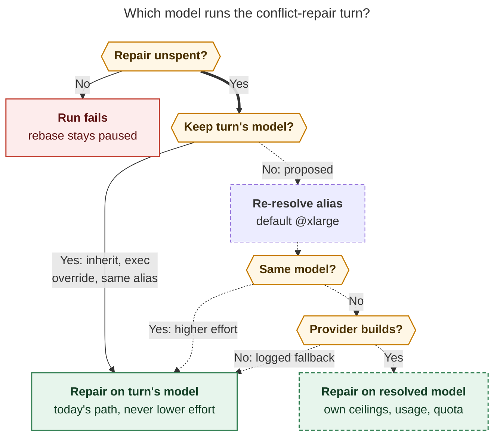

# Escalating the commit finalizer's conflict-repair turn to `@xlarge`

_Consolidated report · 2026-10-27 · Lead researcher merging five independent reports
([cdx](conflict_repair_xlarge_routing__cdx.md), [cld](conflict_repair_xlarge_routing__cld.md),
[grk](conflict_repair_xlarge_routing__grk.md), [mus](conflict_repair_xlarge_routing__mus.md),
[gem](conflict_repair_xlarge_routing__gem.md)) with my own code and artifact checks
against `sase` at `e7d9f7a479`._

> **Question.** Should the stitch/commit finalizer always escalate to the `@xlarge`
> model alias when a merge conflict needs another agent turn? How should it be built,
> is it a good idea, and which requirements should change?

## Bottom line

**Yes, build it, with the default as `@xlarge` rather than a hard-coded "always".** The
conflict-repair turn is the one model call that decides what lands on `master`. It runs
only after the deterministic resolvers have given up, it gets exactly one attempt per
repository, and it starts with no conversational context. Today it runs on whatever
model the worker used, and in practice that is almost never a frontier model: of 94
repairs I found (cld found 101), **none ran on Opus**, and 47% ran on `muse-spark`.

Three of the five researchers (cdx, cld, grk) reached the same verdict independently.
The two dissents do not hold up against the code and data:

- **mus proposed a same-provider effort boost.** About 70% of today's repairs already
  run at `xhigh`, so that boost would change almost nothing.
- **gem proposed an `@large` ceiling plus a complexity heuristic.** Its supporting cost,
  latency and success-rate figures have no source.

Treat the request as a **routing policy for one nested invoke**, not as "spawn a bigger
agent". Concretely:

1. Add `finalizers.instances.commit.config.conflict_repair_model`, defaulting to
   `"@xlarge"`, with `"inherit"` as the opt-out.
2. When a conflict actually needs the model, re-resolve the full
   provider/model/effort tuple through the normal launch-selection machinery.
3. Run the existing finalizer-owned `conflict_repair` invoke on that provider, with that
   provider's ceilings, instruction label, usage accounting and quota attribution.
4. Keep the one-shot bound, the deterministic resolvers and the host postcondition
   checks unchanged.

Ship it together with two things the escalation needs to be worth paying for:

- **Give the repair turn the context it lacks today:** the conflicted files, the
  incoming commits, the declared message, and a pointer to the original task.
- **Fix a quota-attribution gap none of the reports found.** A usage-limit error raised
  inside a cross-provider repair would be charged to the *worker's* provider, so Claude
  would never be disabled.

## 1. How conflict repair works today (verified)

```
worker invoke_agent ─ launch selection resolves alias → provider/model/effort
  └ provider.invoke(purpose=ordinary)
  └ run_finalizers(same provider object, model_tier, resolved model_override, options)
      └ builtin@commit → sase stitch create → rebase onto origin/<default>
          ├ deterministic resolvers (bead store, artifact links, plan headers) settle it → done
          └ otherwise RunResult.CONFLICT, exit 2
      └ resolve_commit_conflict
          ├ prompt artifact already exists → second_unresolved_conflict (run fails)
          ├ continuation-bound dispatch → repair_handoff_continuation_bound (run fails)
          └ run_conflict_repair_turn → invoke_with_instructions(provider, purpose=conflict_repair,
                                       same model_tier / model_override / options)
          └ sase stitch create --resume, host checks markers and checkpoints
```

These facts drive the design. All five reports agree on them, and I re-checked each in
code:

- **The repair inherits the worker's provider object and resolved model.** See
  `src/sase/finalizers/commit_repair_conflict.py:540-550` and
  `src/sase/llm_provider/_invoke.py:460-469`. By finalization, `model_override` is a
  concrete model id such as `opus` or `grok-4.7`, not an alias.
  - Passing `model_override="@xlarge"` to a Grok, Codex or Agy adapter would send the
    literal string to that CLI (grk, gem).
  - `ModelTier` only allows `large` and `small`, and the plugin manager wraps one
    provider (cdx).
  - **Escalation therefore means a new launch selection, and often a new provider
    instance.**
- **The one-shot "spent" bit is the prompt artifact itself.**
  `_conflict_repair_spent` checks for `conflict_repair_prompt.<repo>.md`
  (`commit_repair_conflict.py:433-444`). So model selection and provider construction
  must finish **before** that file is written. Any pre-spend fallback has to happen
  there.
- **The repair is already a fresh provider session.** The Claude adapter mints a new
  `--session-id` per invoke and uses `--resume` only for in-invoke wait states. Codex
  has no session persistence. Switching models therefore loses no conversation, because
  none carries over today (cld, grk). The flip side is that the repair runs blind (§5).
- **Repair is a nested, finalizer-owned invoke, not a SASE agent turn.**
  `finalizer_owned_turn()` refuses handoffs, monitors and gates inside it. "Another
  agent turn" in the request must mean this invoke. Spawning an `@xlarge` agent or
  piping to a successor would fight host-owned completion and the workspace claim
  (grk, cdx).
- **`@xlarge` is an ordered fallback; `@large` is a pool.**
  - `@xlarge` resolves `claude/opus@xhigh || codex/gpt-6.1-sol@xhigh ||
    grok/grok-4.7@xhigh` in order.
  - `@large` is a `|` pool of `claude/opus@high`, `codex/gpt-6.1-sol@xhigh` and
    `grok/grok-4.7@xhigh` (`src/sase/llm_provider/models.yml`).
  - Muse, Agy, Qwen and OpenCode have no `@xlarge` member, so their workers must cross
    providers to escalate.
- **Hard and soft disables are treated differently in `||` chains.**
  - `fallback_availability_mask` treats `SPARING` (soft-disabled or priority-backup)
    members as available, by design (`load_balancing.py:603-611`).
  - Usage-limit auto-disables are **hard** (`provider_disable.py:250`, default mode
    `hard`), so a Claude that has been *detected* as depleted is already skipped.
- **The ceilings are exported once, for the worker.** `invoke_agent` sets the
  synchronous and soft provider ceilings for the worker's provider around the whole
  call, finalizers included (`_invoke.py:366-383`). A repair on a different provider
  would inherit the wrong ceilings (cdx, cld).

## 2. Evidence: what reaches the model today

cld mined local run artifacts. I re-ran an independent scan of
`~/.sase/projects/*/artifacts/ace-run/**/finalizers/commit/conflict_repair_prompt.*.md`.
The two scans agree on the shape:

| Measure | cld (2026-09-02 → 10-26) | My re-scan (2026-09-12 → 10-26) |
| --- | --- | --- |
| Conflict-repair turns | 101 | 94 |
| Rate | ~5.1% of commit-finalizer runs; ~1.8/day | ~2.1/day; peak of 4 in one hour |
| Repairs on Opus, or via `@large`/`@xlarge` | **0** | **0** |
| Most common repair model | muse-spark-1.3-contributor (44) | muse-spark-1.3-contributor (44, 47%) |
| Turn alias | 62 `@medium`, 7 `@small` | 58 `@medium`, 7 `@small` |
| Outcomes | 91 success; 7 infra/host failures; 2 `second_unresolved_conflict` | 84 success; 8 `controller_exception`; 2 `second_unresolved_conflict` |

More findings from cld that bear on the decision:

- **Already at `xhigh`.** About 72 of 101 repairs ran at `xhigh` (muse-spark, gpt-5.5,
  gpt-6-luna, and some grok-4.6 and sonnet).
- **Loud failures don't need a bigger model.**
  - The two model-attributable failures (2026-10-04) came from the repair handing its
    gate to a monitor. That has since been refused mechanically (`9e5cc41598`).
  - Every later loud failure was infrastructure: exit-143 kills, a vanished workspace,
    or a host bug.
- **Duration is gate-dominated.** The median repair took ~11 minutes and the p90 ~58
  minutes, mostly running the target repo's gate.
- **Judgment calls are common.** 59% of repair transcripts had to judge whether a red
  gate was pre-existing or unrelated.
- **What reaches the model.** Mostly single-file conflicts (67%): `Justfile`,
  `README.md`, `sase-core-revision.txt` (9 of 98), `package.json`, then `.rs`/`.py`
  sources.
- **A confound in the Opus numbers.** Opus runs showed 0% conflicts, but 346 of 362 Opus
  runs committed only to sidecars. So there is **no local evidence about Opus's repair
  quality**; this change would be its first exposure.

**What the data says about the decision:**

- Escalation will not reduce loud failures.
- Its target is **silent merge quality** (dropped hunks, duplicated entries, the wrong
  side of a pin, a "pre-existing" failure that was really ours) and **gate
  adjudication**. Nothing measures either today.
- The cost is bounded by frequency: about 2 extra Opus-class sessions a day, roughly
  +28% on the window's Opus session count.
- Because repairs are gate-dominated, the extra model latency is a small share of
  repair wall time.

## 3. Is this a good idea?

### For

1. **The asymmetric payoff is real.**
   - A loud failure strands a paused rebase, which is recoverable.
   - A silent bad merge lands on `master`, attributed to an agent that never saw it.
     This is the worst place in the pipeline to economize (cld, cdx, grk).
2. **The population is already filtered toward hard cases.**
   - Deterministic resolvers remove the structured conflicts first, so no classifier
     is needed to find the "real" ones.
   - The size of the original task is a weak proxy for how hard the integration is: a
     small edit can collide with a broad refactor (cdx).
3. **There is only one attempt, and it starts cold.** Escalate-on-retry is impossible
   without loosening the bound. A model reconstructing intent from git alone is exactly
   where capability pays.
4. **It follows existing precedent.** `big_epic_lander_model: "@xlarge"` already says
   "spend the most where integration risk concentrates". Conflict repair is the
   per-commit version of that risk.

### Against, and what escalation cannot fix

1. **The benefit is unproven.** External evidence shows capability is no proof of a
   correct merge. In Merge-Bench's 7,938 hunks the best model matched developers'
   resolutions only 52.6% of the time (cdx). Keep the verification-heavy prompt and the
   host checks. Measure the outcome rather than assert it.
2. **Cost lands on the scarcest quota.** About 2 more Opus `xhigh` sessions a day hit
   Claude's five-hour and weekly usage windows. `@xlarge` still falls back to Codex and
   Grok when Claude is hard-disabled.
3. **A provider switch has real plumbing costs:**
   - provider construction;
   - per-provider ceilings;
   - instruction-bundle label;
   - usage hot hint;
   - usage, metrics and quota attribution (§4, gap 1);
   - remote `%dispatch` hosts that may not have the Claude CLI installed (gem, cld).
4. **It treats only one of three problems.** The repair is also under-informed (§5), and
   some conflict classes (revision pins) should never reach a model. Escalating without
   fixing those spends `opus@xhigh` on blind or trivial work.

**Verdict: worth doing**, as a configurable, observable default, paired with context
enrichment and the attribution fixes.

## 4. Where the reports disagreed, and how I resolved it

| Issue | Positions | Resolution |
| --- | --- | --- |
| **Target** | cdx, cld, grk: `@xlarge`. mus: same provider, effort first, never switch provider. gem: `@large` ceiling, step up relative to the worker's size, gate by a complexity heuristic | **`@xlarge` by default.** mus's boost is a near no-op: ~70% of repairs already run at `xhigh`, and muse-spark's only larger model is `muse-wonder-1.0`, which is in no shipped alias. mus also reads the effort-ladder decision backwards: it says capability is bought "through the *model*", which supports a model upgrade. gem's figures have no source (~75/92/94% success rates, $15–30 per three repairs, 2–5 minutes per turn, "98% of `@large`'s capability"). Its file-extension and marker-count heuristic misjudges in both directions, which cdx and cld also note. `@large` is still a good cheaper value for the config knob. |
| **Config home** | cdx, grk, gem: finalizer instance config. cld: a fourth `llm_provider` launch-model field. mus: a new `commit_finalizer` key | **Finalizer instance config.** It is sealed into the finalizer plan digest (`ConfiguredFinalizerInstance.config` → `config_digest`), so the policy is fixed per run and drift is diagnosed. It is scoped to the policy owner. It does not make conflict repair look like a kind of agent launch in Launch Control. A temporary override of the `@xlarge` alias already retargets it. **Runner-up:** cld's launch field, if Models-panel visibility and a `setting:` override turn out to matter more than sealing. |
| **Rust vs Python** | cdx: pure policy in `sase_core`. cld: Python for now. grk: Python, not `sase_core` | **Small pure policy in `sase_core`; invocation stays in Python.** The direct precedent is `select_epic_land_model`, a selection rule no more complex than this one, which is Rust-owned (`src/sase/core/model_route_facade.py:40`). `sase final doctor` and agent views will want to preview or explain the choice. Provider construction, environment scoping and invocation are host I/O and stay in Python. |
| **Target can't be built** | cdx: typed failure, never silently substitute. cld: before spawning, fall back to the worker's model. gem: graceful fallback | **Before the spend bit, fall back loudly. After it, never.** Failing the run over a config or installation gap strands a paused rebase for reasons unrelated to the conflict, which is worse than today. Record `source=fallback_after_error` in evidence and as a warning, which meets cdx's audit concern. Once the repair provider has started, its failure is the repair's failure. Never replay it on another model, because the tree may be partly staged. |
| **Soft-disabled (SPARING) providers** | grk: treat SPARING as unavailable for repair. Others: normal alias rules | **Normal alias rules.** grk's real worry is a depleted Claude, and usage-limit disables are already *hard*, so `||` skips them. The actual gap is that a usage limit hit *inside the repair* is never recorded against Claude (gap 1 below). Fix that instead of adding a repair-only admission mask that contradicts the documented `||` semantics. A user who soft-disables Claude and wants repairs to spare it can set `conflict_repair_model` to a chain without Claude. |
| **Turn already strong** | cdx: re-resolve normally. cld: reuse if the alias trail has the alias; same model keeps the higher effort. grk: reuse if the tuple is identical | **Adopt cld's rule.** It prevents `opus@max` → `opus@xhigh` downgrades and switches to a different fallback member mid-run, and it avoids building the same provider twice. Make no other cross-model "stronger than" comparisons. |
| **`SASE_LLM_EXEC_PROVIDER`** | cld: inherit. grk: honor execution-provider resolution | **Inherit while it is set.** The override means "run this provider", for test harnesses (`fakey`) and provider pinning. Re-routing around it would break both. |
| **Context enrichment** | cld (concrete), cdx (bounded evidence brief); others silent | **Do it, in the same effort.** See §5. |

### Gaps no report covered

1. **Usage-limit attribution.**
   - When a provider error escapes `run_finalizers`, the controller records
     `controller_exception` and re-raises (`controller_run.py:451-484`).
   - `invoke_agent` then calls `handle_possible_usage_limit(provider=execution_provider_label, ...)`
     (`_invoke.py:517, 546`), and the axe retry backstop does the same with
     `tracker.execution_provider`. Both name the **worker's** provider.
   - Detection uses that provider's own patterns (`usage_limit_config.py:215-243`). So
     a Claude quota error in a repair escalated from a muse worker is checked against
     muse's patterns. Claude is never hard-disabled, and the next repair routes straight
     back into the exhausted window. If the patterns are generic, the worker's provider
     is disabled instead.
   - The same mislabeling affects `LLM_INVOCATIONS` and the token metrics
     (`_invoke.py:474-488`) and the merged per-run usage blob (`merge_usage` in
     `run_conflict_repair_turn`).
   - **This must be fixed before any cross-provider repair ships.**
2. **The effort-only alternative is mostly a no-op**, as the data in §2 shows.
3. **Ordering constraint.** Selection, provider construction and any pre-spend fallback
   must all happen before `write_text_artifact(conflict_repair_prompt...)`, because
   that file *is* the one-shot budget.

## 5. Complementary fix: give the repair turn context

The repair prompt (`commit_repair_conflict.py:461-517`) names the repository and
checkout path and gives good resolution and verification rules. It does **not** include:

- the conflicted files and incoming upstream commits. `_format_rebase_conflict` already
  computes these and prints them to the stitch's stderr, which is in scope at the
  `resolve_commit_conflict` call site;
- the **declared commit message** for that repo, which is the intent of "our" side;
- a pointer to the original task: the run's raw prompt artifact, the bead id, or the
  worker's final response.

Declaration recovery already builds this kind of brief (`build_recovery_evidence` in
`src/sase/finalizers/declaration_recovery_evidence.py`). Conflict repair is the one
finalizer-owned turn that runs blind.

Also reword "every repository you changed this turn". With escalation, the repair model
did not make those changes; "the original agent turn changed" is accurate.

Two cautions: rebase reverses the intuitive "ours"/"theirs" roles, so the brief should
name revisions rather than sides (cdx). And this fix helps every model, so it is worth
landing even if escalation is later dialed back.

## 6. Adjusted requirements

Each item is labeled **[Adjustment]** (changes the request), **[Clarification]** (pins
down an ambiguity), or **[New]** (adds a requirement).

1. **[Adjustment] "Always" becomes "by default, for every eligible repair invoke".**
   - Shipped default is `@xlarge`.
   - `conflict_repair_model: "inherit"` restores today's behavior.
   - A worker's `%model` or `%effort` does **not** opt out implicitly.
   - Use the `inherit` string, not an empty string or YAML `null`; both are too easy to
     produce by accident.
2. **[Clarification] "Another agent turn" means the nested `conflict_repair` invoke.**
   It is not a new SASE agent, session member, handoff or `#plan`. It is the `@xlarge`
   *alias*, never the bead size `xlarge` (grk).
3. **[Clarification] Scope is conflict repair only.**
   - Declaration recovery keeps the worker's model.
   - Continuation-bound conflicts still fail closed.
   - Escalation never earns an extra repair turn, so the per-repo, per-run bound is
     unchanged.
4. **[Clarification] Escalation re-resolves the whole provider/model/effort tuple**
   through `resolve_launch_selection`. The alias-supplied effort is explicit. It is
   never a string override on the bound provider.
5. **[Adjustment] Never downgrade or switch for no reason.** If the worker's alias trail
   already contains the target alias, reuse the worker's selection. If the resolution
   lands on the worker's provider and model, keep the higher effort.
6. **[Adjustment] While `SASE_LLM_EXEC_PROVIDER` is set, inherit.**
7. **[Adjustment] Fall back before the spend bit, never after.** If the target can't be
   resolved or its provider can't be built (unknown provider, missing CLI on a dispatch
   host), run on the worker's selection and record `fallback_after_error`.
8. **[New] The repair provider gets correct attribution:**
   - its own sync and soft ceilings, restored afterwards;
   - its own instruction-bundle `provider_name`;
   - a usage hot hint;
   - usage-limit detection and auto-disable against **its** provider;
   - metrics and usage recorded per invocation.
9. **[New] Record the selection on every repair**, including `inherit`. Capture:
   - requested expression and policy source;
   - alias trail;
   - selected provider, model and effort;
   - the worker's selection;
   - escalated or not;
   - elapsed time and status;
   - the conflicted file list.

   Persist it **before** the invoke, so failed repairs can still be explained.
10. **[New] Context enrichment** (§5) ships with this work.
11. **[New, follow-up] Shrink the set of conflicts that reach the model.** Start with a
    deterministic `sase-core-revision.txt` resolver that picks the descendant revision,
    which the host can verify. That is 9 of 98 recent conflicts (cld).

## 7. Recommended solution

**Figure 1.** How the repair model is chosen under the recommended policy.



_Only a conflict that survives the deterministic resolvers, with its one repair unspent,
reaches model selection. The configured alias is re-resolved unless an opt-out, an
execution override, or an earlier same-alias turn keeps the worker's selection.
Fallback happens only before the repair is spent. Dashed nodes and edges are proposed.
Every path ends in exactly one finalizer-owned repair invoke, followed by stitch resume
and the host checks._
_Render: Mermaid CLI 12.0.0, 792×1090 px, fit 81.9%. The PNG export of this revision
failed twice with Puppeteer `ConnectionClosedError`. I checked the layout visually on
the previous, larger draft (same structure, 61% fit), and checked this revision by
measured size and a label-text check. Source: `figures/repair-model-selection.mmd`._

grk's two figures, `figures/who-chooses-repair-model.png` and
`figures/what-happens-on-conflict.png`, still show today's flow accurately. Note that
grk's proposal path includes the SPARING skip, which this report does not adopt.

### 7.1 Config

```yaml
finalizers:
  instances:
    commit:
      use: builtin@commit
      config:
        conflict_repair_model: "@xlarge"   # any %model expression, or "inherit"
```

- **Shipped default in two places.** Put the value in `src/sase/default_config.yml`, per
  the gotcha about keeping defaults there. Also apply `@xlarge` in code when the key is
  absent, so a user layer that redefines the instance still gets the default.
- **Validation.** Add commit-finalizer config validation in `src/sase/finalizers/providers.py`,
  next to the `builtin@command` parser. Unknown keys and invalid expressions should
  become diagnostics that `sase final doctor` names, not late CLI failures.

### 7.2 Policy (`sase_core`, next to `select_epic_land_model`)

Two pure functions with Python bindings and round-trip tests:

- `select_conflict_repair_route(configured, exec_override_active, turn)` →
  `{action: inherit | resolve(expr), source}`.
  - `source` is one of `configured`, `shipped`, `inherit`, `exec_override`, or
    `same_alias`.
- `reconcile_conflict_repair_selection(turn, resolved)` → the final tuple, applying the
  same-provider+model → higher-effort rule.

Then move sase's `sase-core-revision.txt` pin past the core commit.

### 7.3 Invocation adapter (Python, `src/sase/finalizers/`)

Pass the sealed instance config from `execute_commit_finalizer` through
`dispatch_commit_decisions` and `resolve_commit_conflict` into
`run_conflict_repair_turn`. Then, in this order:

1. **Before the prompt artifact is written:**
   - call the policy;
   - if it says resolve, call `resolve_launch_selection(PromptDirectives(model=expr), active_launch_alias_overrides(), consume=True, routing_context=capture_provider_routing_context())`
     **without** `provider_name`, which would otherwise pin the worker's provider (cdx);
   - reconcile the result against the worker's selection;
   - build the provider with `get_provider`. On any exception, use the worker's
     selection with `fallback_after_error`.
2. **Persist the selection** in the operation record or evidence.
3. **Write the prompt artifact.** This consumes the one repair.
4. **Inside `finalizer_owned_turn()` and a small scoped context manager:**
   - export the repair provider's hard and soft ceilings, and restore them afterwards;
   - emit its usage hot hint;
   - call `invoke_with_instructions(..., purpose="conflict_repair", provider_name=<repair provider>, model_override=<concrete model>, options=LLMInvocationOptions(reasoning_effort=<effort>, explicit=True))`.
   - Lift `_provider_sync_ceiling_seconds` and `_mark_usage_hot_for_launch` out of
     `_invoke.py` into a shared module rather than importing private names (Symvision).
5. **On a provider error inside the repair:** call `handle_possible_usage_limit`
   against the **repair** provider before re-raising. Record the repair's usage and
   metrics under its own provider before merging totals.
6. **Do not:**
   - call `invoke_agent` recursively, which would re-run finalizer plans and budgets;
   - spawn an agent;
   - retry on another model after spawning.

### 7.4 Prompt context

Pass `stitch.stderr` (conflicted files, incoming commits), the declared message for the
repo, and the artifact paths of the original prompt and response into the repair prompt
as a bounded "Conflict context" section. Fix the "you changed" wording. Existing prompt
tests in `tests/test_finalizers_commit_repair_prompt.py` pin the load-bearing rules, so
extend them rather than rewrite.

### 7.5 Tests

Use the `fakey` provider and the protocol harness `tests/test_finalizers_protocol_harness_multi_repo_*.py`:

- **Routing:**
  - a Grok or muse worker plus an available Claude → the repair invokes a Claude
    provider with `opus` at `xhigh`;
  - Claude hard-disabled → falls through to Codex;
  - `inherit` → today's reuse;
  - exec override → stays `fakey`;
  - a worker already on `@xlarge` → same provider object, no new resolution;
  - `opus@max` worker → keeps `max`;
  - raw `@xlarge` never reaches any adapter's `model_override`.
- **Fallback:** a `get_provider` failure → worker selection with
  `fallback_after_error`, and the prompt artifact is written only after selection.
- **Attribution:**
  - ceilings restored after both success and exception;
  - the instruction manifest records `purpose=conflict_repair` and the repair provider;
  - a Claude quota error raised in a repair disables **Claude**, not the worker's
    provider.
- **Bounds unchanged:**
  - a second conflict fails;
  - a continuation-bound conflict does not repair;
  - another originally obligated repo still gets its own repair;
  - declaration recovery keeps the worker's model.
- **Config:** a bad expression produces a doctor diagnostic; custom instance names work.

### 7.6 Rollout, success criteria, reopen condition

- **Soak.** Ship with the default `@xlarge` and watch for about 4 weeks (~55 repairs at
  the current rate).
- **Track:**
  - loud failure rate (expected unchanged, because it is infrastructure-dominated);
  - repair duration (expected roughly flat, because it is gate-dominated);
  - Claude usage-window pressure;
  - a **silent-quality proxy**: commits or beads within 7 days that touch the recorded
    conflicted files with fix, restore, dedupe or revert subjects (cld).
- **Reopen condition.** If the proxy does not improve and Claude quota pressure becomes
  material, set `conflict_repair_model: "@large"` (cheaper, still frontier-class) or
  `"inherit"`. If the soak is ambiguous, cdx's offline replay of recorded conflict
  checkpoints, inherit vs. `@xlarge` from identical states, is the rigorous next step.
- **Decision record.** Consider recording the outcome as a `decisions:` record ("Conflict
  repair re-resolves a configured alias, default `@xlarge`"), through
  `/sase_memory_write`. It sets precedent for model routing in finalizer-owned turns.

### 7.7 Work split

1. **Change A (medium):**
   - per-provider attribution fixes (gap 1, ceilings, instruction label, usage and
     metrics);
   - repair-prompt context enrichment;
   - selection evidence.

   It helps today's repairs and is a prerequisite for B.
2. **Change B (medium):**
   - the `sase_core` policy plus binding;
   - config and validation;
   - the adapter;
   - tests;
   - docs: `docs/contribute/commit-workflow-orchestrator.md` and the finalizer config
     reference. Read `docs_writing` memory first.
3. **Follow-up (small):** a deterministic `sase-core-revision.txt` conflict resolver.

## 8. What I would not do

- **Hard-code `@xlarge`**, put it behind a feature flag, or add a "fourth launch role".
  This is a permanent config choice, and flags are for unfinished or sunset behavior
  (grk).
- **Escalate only on a second attempt.** That violates the one-shot bound, and a
  clean-but-wrong first resolution leaves nothing to escalate from.
- **Gate on a conflict-difficulty classifier.** The deterministic resolvers already are
  the classifier. Extend them instead.
- **Escalate declaration recovery "for consistency".**
- **Couple this to shared `git rerere` caches across ephemeral workspaces.** That would
  need its own correctness and lifecycle design (cdx).

## 9. Confidence and limitations

- **High confidence** in the control-flow, inheritance, spend-bit, alias, disable-mode
  and attribution findings. I re-read each in code at `e7d9f7a479`.
- **Medium confidence** in the frequency and model-mix data. Two independent scans
  agree, but artifact retention trims the early tail, which explains 94 vs. 101.
- **No evidence either way on repair quality.** Neither scan can measure silent merge
  correctness, and there is no local Opus repair history. The benefit is a reasoned bet
  backed by the asymmetric-risk argument, not a measured gain. That is why §6 item 9 and
  §7.6 exist.
- **Not verified:** whether runner-slot or provider-capacity admission should count a
  nested repair on a different provider. Check this during Change B.
- **Disregarded:** gem's quantitative tables (cost, latency, success rates). They cite
  no source. Its absolute file links point into another workspace.
