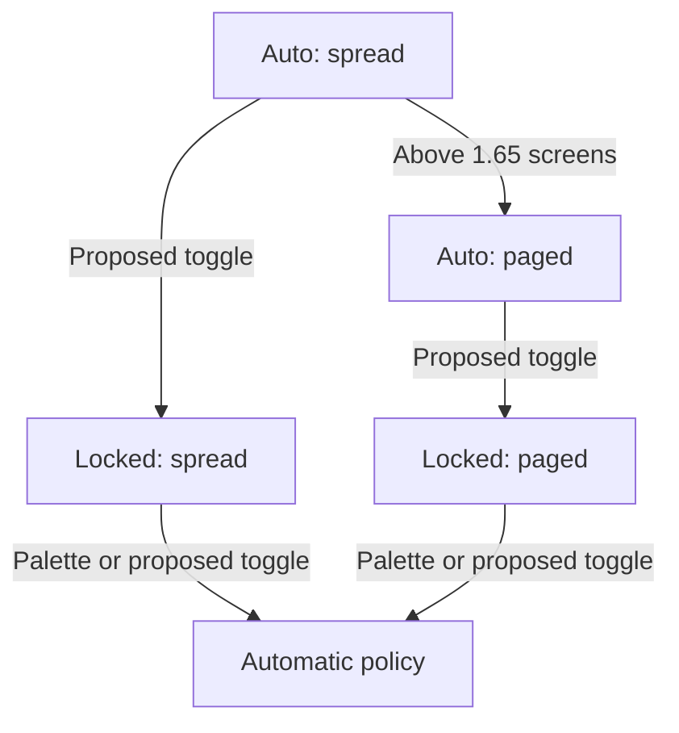
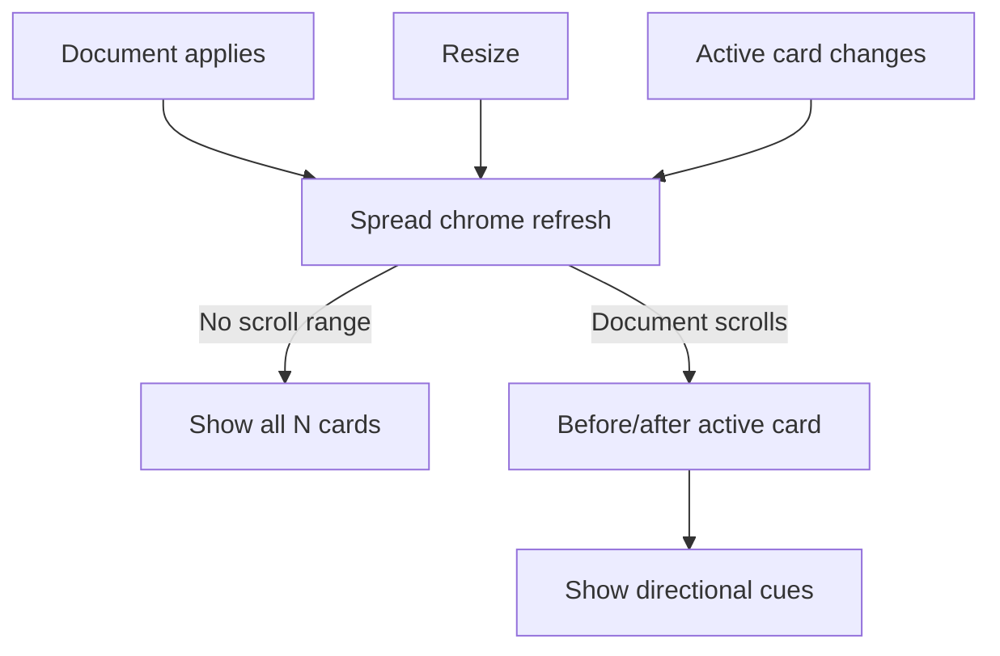
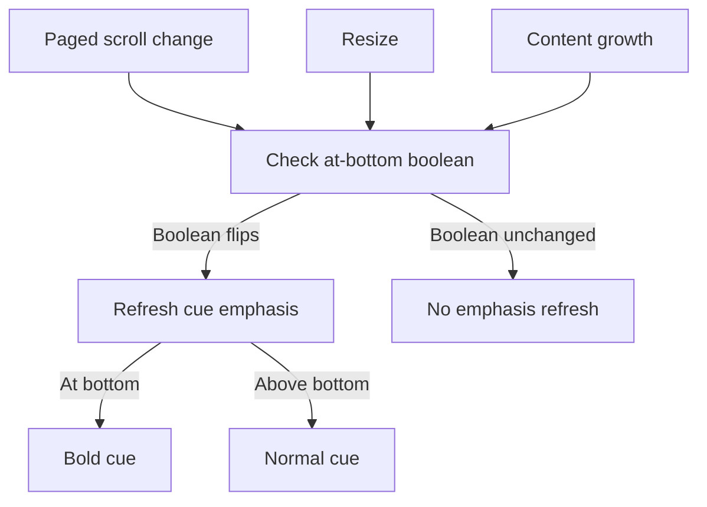

# Diagram proposals: Deck scroll scope: tabs only when paged, a view chip, and a layout lock

Proposals for the swarm linker, not a report. Each diagram restates only what the source
report says.

```yaml
source: research:202610/deck_scroll_scope_tabs_and_layout_lock/deck_scroll_scope_tabs_and_layout_lock__final.md
producer: research.52.image
check: "mmdc 12.0.0 rendered 3 of 3 Mermaid diagrams"
```

## streaming-layout-lock

```yaml
anchor: |-
  gap is why a **lock toggle** (§6.6) fits this design better
illustrates: |-
  Auto changes a same-subject spread to paged above 1.65 screens; the proposed lock toggle holds the current effective layout and returns locked layouts to auto.
caption: The proposed toggle holds either layout; automatic streaming can change spread to paged.
```



## spread-direction-cue

```yaml
anchor: |-
  hooks already compute the active card and refresh chrome only when it changes, so the
illustrates: |-
  Phase 1 lists cards before the scroll-spy active card as above and after it as below, showing all N cards instead when the document does not scroll.
caption: Phase 1 reuses chrome refreshes to show all cards or neighbor directions.
```



## bottom-emphasis-refresh

```yaml
anchor: |-
  Refresh only when that boolean flips, never per scroll tick (per `tui_perf.md`).
illustrates: |-
  Optional at-bottom emphasis refreshes when the at-bottom boolean flips and recomputes on resize and content growth because streaming does not move scroll_y.
caption: Optional bottom-cue emphasis checks growth and resize as well as scrolling.
```


