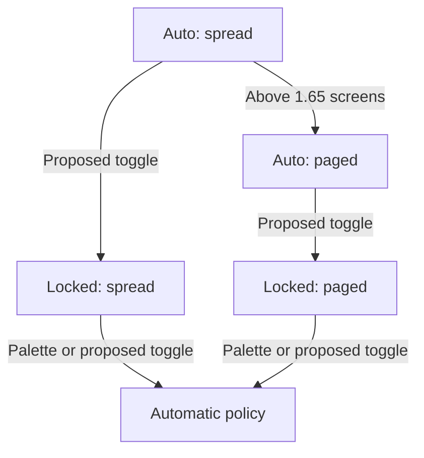
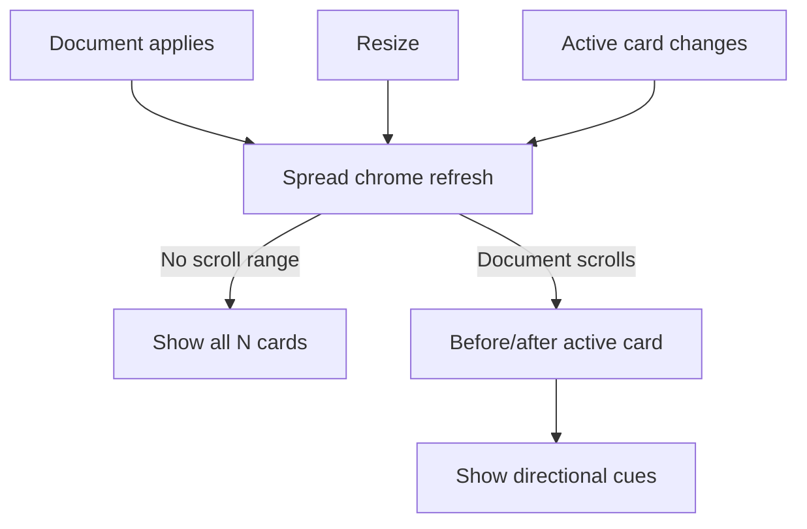
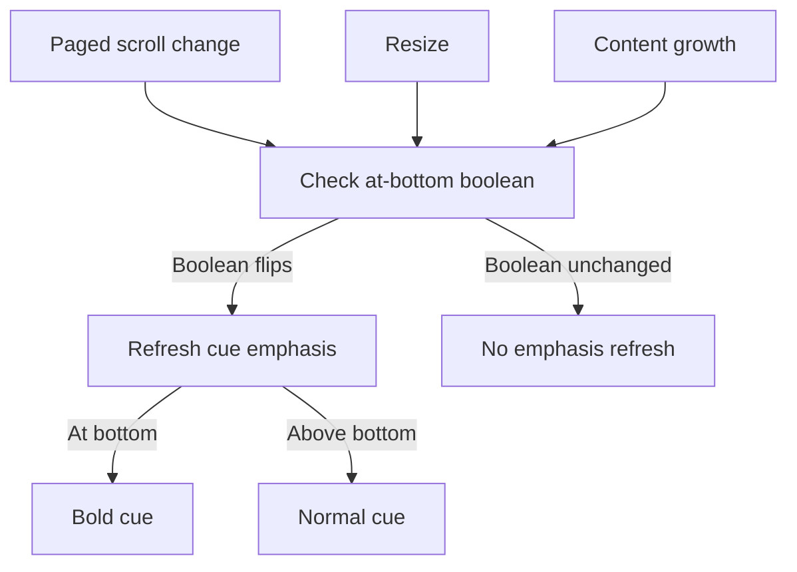

# Deck scroll scope: tabs only when paged, a view chip, and a layout lock

> **Research query:** How should SASE make it much clearer whether a user can scroll down
> to see the entire focused agent deck, which is only possible when its cards are not
> split out into sub-tabs? Evaluate the proposed approach (show card sub-tabs only when
> the cards are actually split out and need `<ctrl+j/k>`, add bright and clearly visible
> view badges, and replace "auto" and "fixed" with a lock icon), critique the plan, call
> out any justified requirement adjustments, and end with a recommended solution for the
> best UX.


## Bottom line

**Your plan is a good idea, and its first item is the fix.** Showing card tabs only when
a deck is actually paged is the change that makes the question answerable at a glance.
Four of five researchers agree, and so do I. The current design fails for a structural
reason, not a brightness reason. The loudest element in the deck title is the tab strip:
a reverse-video active tab plus a `2/2` counter, and `‹ 2/2 › Reply` in narrow panels.
That strip says "paged" in every mode. The only thing that says "spread" is one muted
word.

The other two items are right in spirit but need
[adjustments](#requirement-adjustments):

- **Bright badges: yes, but brightness is not what carries the meaning.** If both states
  get an equally bright badge, the brightness itself says nothing. Once tabs appear only
  when paged, the shape of the title answers the question. The badge (a solid **chip**)
  then does three jobs. It is a fixed place to look. It gives `P` visible feedback. It
  carries the lock.
- **Lock instead of `auto`/`fixed`: yes, with conditions.** The camera AE-L and iOS
  rotation-lock precedents both use a lock to mean "stop auto-adjusting and hold the
  value". That is exactly what `fixed` means here. But `🔒` already means *read-only* and
  *private* elsewhere in this TUI. So put the lock **inside the view chip**, rename
  "fixed" to "locked" everywhere, and give users a
  [real way to unlock](#unlocking-with-a-lock-toggle-key). Today only the command
  palette can unlock.

The plan also misses two things that every careful researcher found:

1. **"Scroll down to see the entirety" is often false even in spread.** When a spread
   deck lands on Reply, `scroll_to_card()` adds a trailing layout reserve and puts Reply
   at the top. That hides Context **above**, with blank space below. The golden
   `agents_decks_single_main_reply_120x40` shows exactly this case, under the title
   `◆ MAIN spread · auto ┃ ‹ 2/2 › Reply`. The cue must therefore
   [show direction](#top-border-title-grammar), not just "more below".
2. **Paged decks need a cue where the reader decides they are done.** That is the bottom
   of the panel, not the top border. A paged card ends at the border with nothing
   saying "1 more card". That is the costly failure, because content gets missed (see
   the [bottom border continuation cue](#bottom-border-continuation-cue-for-paged-decks-only)).

The [rule](#the-rule) to teach, in one sentence:

> **Tabs mean pages.** A deck panel shows card tabs only when other cards are on other
> pages. With no tabs, the whole deck is one scrollable document. The arrows tell you
> which way the rest of it is.

## What is on screen today (verified)

Each verified fact below lists its evidence and why it matters.

- **Card tabs are built for every deck in every mode and always passed to
  `deck_title()`.**
  - *Evidence:* `panel_chrome.py` `refresh_chrome()`; `titles.py`
    `_build_full/_build_compact/_build_micro`
  - *Why it matters:* The strip looks like exclusive tabs even when every card shares
    one scroll.
- **In spread, the "active" tab follows the scroll position. Chrome refreshes only when
  the derived card changes.**
  - *Evidence:* `panel_interaction.py` `_on_main_scroll_y()`, `_on_files_scroll_y()`
  - *Why it matters:* Spread tabs act as a scroll-spy styled as real tabs. The same
    cheap hook can drive a direction cue.
- **The badge is `{layout} · {status}`, and it is quiet on purpose: `auto` is muted
  `#888888` and only `fixed` is bold.**
  - *Evidence:* `view_badge.py`; plan D5 ("quiet by default, loud only when the user has
    changed it")
  - *Why it matters:* A bright badge reverses D5 on purpose. D5 assumed the rest of the
    title was neutral, and it was not.
- **Narrow panels show `MAIN C·F 2/2` and `MAIN B·A 2/2`.**
  - *Evidence:* golden `agents_deck_view_split_narrow_120x40`
  - *Why it matters:* You can only decode these letters if you have read the docs.
- **Only Main and Files get a badge.**
  - *Evidence:* `_chrome_view()` returns `None` for other decks
  - *Why it matters:* FINAL and RECORD have no scope label at all.
- **FINAL and RECORD pick their mode by card count on their main show path: one card
  spreads, two or more page. The measured decision can also run on them through the
  redecision path.**
  - *Evidence:* `final/document.py` `decide_final_mode()`; `record/document.py`
    `decide_record_mode()`; `document_transitions_apply.py`
    `_refresh_document_mode_for_shown()`
  - *Why it matters:* The researchers disagreed here ("auto-switch by height" vs "always
    spread"). Both were partly wrong. Derive tab visibility from the mode actually
    applied (`is_spread(deck)`), never from the deck type.
- **The Tools Runs document is always paged.**
  - *Evidence:* `tool_runs/widget.py` (`mode=RenderMode.PAGED`)
  - *Why it matters:* Tools keeps its tabs under the new rule.
- **`Ctrl+J`/`Ctrl+K` work in both modes. They jump between card anchors in spread and
  swap cards when paged. The footer says `cards` whenever there is more than one
  card.**
  - *Evidence:* `panel_navigation.py` `cycle_card()`; `_keybinding_bindings_agents.py`
  - *Why it matters:* "Has to use Ctrl+J/K" is not the right test for showing tabs. The
    footer wording should change with the mode.
- **`P` cycles only the three fixed layouts. Only the palette's *Deck view: automatic*
  returns to auto.**
  - *Evidence:* `view_policy.py` `next_view()`; `commands/catalog.py`
  - *Why it matters:* A visible lock invites "how do I unlock?", and today the answer is
    hidden.
- **A page-cards deck whose blocks are inline shows tabs and a scrollbar. Scrolling
  covers this card only and never reaches Context.**
  - *Evidence:* golden `agents_deck_blocks_spread_landing_120x40`
  - *Why it matters:* A scrollbar cannot tell you that sibling cards exist (cdx, grk).
- **Auto flips a same-subject spread to paged once its content passes 1.65 screens (1.5
  plus 10% hysteresis).**
  - *Evidence:* `render_mode.py` `decide_render_mode()`
  - *Why it matters:* A streaming agent's deck changes layout under the reader. That is
    a real use for a "hold this layout" lock.
- **`🔒` already means read-only and private. `📌` already marks pinned stash prompts.**
  - *Evidence:* `_prompt_input_bar_title.py:145`, `existing_definition_finder_modal.py:41`,
    `bead/attachment_presentation.py:23`, `prompt_stash_row.py:15`
  - *Why it matters:* Neither glyph is free of meaning. Where the glyph sits and what the
    copy says matter.
- **Title tabs are not clickable. `DeckPanel.on_click` only requests focus.**
  - *Evidence:* `panel.py`
  - *Why it matters:* Hiding tabs in spread removes no mouse target.
- **Spread already marks each card in the body with titled rules (`━━ ◆ Reply ━━`). The
  block rail already hides in spread.**
  - *Evidence:* `separators.py`; `agent-statuses.md`
  - *Why it matters:* Card tabs are the one piece of chrome that does not follow the
    "hide when the body already does the work" rule.

There are three nested questions, not one (grk's framing, which I adopt):

1. **Deck level:** Are the other *cards* in this scroller? (spread vs paged)
2. **Card level:** Are the other *blocks* of this card in this scroller? (page cards vs
   page blocks)
3. **Viewport level:** Does this scroller overflow right now, and in which direction?

Today's chrome answers none of them reliably. The plan as written answers question 1
only. The recommended design answers all three, mostly with chrome that already exists.

## Critique of each proposal

### Show card sub-tabs only when split out

*"Show card sub-tabs only when they are actually split out": adopt and generalize.*

Why it is right:

- **Tabs mean "one panel at a time."** The W3C WAI-ARIA tabs pattern defines tabs as
  showing one associated panel at a time. NN/g's *Tabs, Used Right* says tabs let users
  view a single panel from a set of options, and warns against mixing tab types in one
  control. Today's strip mixes "section of one document" with "another page".
- **Users assume that vertical scrolling reaches every section.** Baymard's product-page
  research found this assumption, and that horizontal tabs break it. A spread deck is
  that product page. Tab styling breaks the assumption even where scrolling would work.
- **SASE and its tools already hide the strip when it has nothing to switch.** The Agent
  Tab strip appears only once two or more tabs exist. Vim (`showtabline=1`), WezTerm, and
  libadwaita do the same.

Three corrections to how you phrased it:

- **Define "split out" by what is rendered, not by the key.** `Ctrl+J`/`Ctrl+K` work in
  both modes. Show tabs when the deck's **applied** render mode is paged **and** it has
  two or more cards. Derive this from the same held view as the chip, so the strip
  doesn't flicker during partial `j`/`k` paints.
- **Apply the rule to every deck.** That means Main, Files, FINAL, and RECORD. Tools is
  always paged, so it keeps its tabs. Because FINAL usually pages, its status-glyph tabs
  survive in most cases.
- **Hide all pagination chrome in spread**: the tabs, `N/M`, and the compact `‹ N/M ›`.
  But keep a plain **you-are-here** card name. That name is a heading, not a tab (grk,
  cdx).

**The dissent (mus) and how I answer it.** mus wanted to keep the strip in spread and
restyle it as an anchor map. The worries were lost orientation, a jolt on each auto flip,
and `Ctrl+J`/`Ctrl+K` pointing at invisible targets. Each worry has a cheaper answer:

- **Orientation:** the body has titled rules, and the title keeps a plain you-are-here
  name and the direction cue (see [top border title grammar](#top-border-title-grammar)).
  Under auto, a spread deck is at most about 1.5 screens long.
- **Jolt:** the strip is border text, so hiding it changes no body geometry. Hysteresis
  already damps flips. When a flip does happen, tabs appearing is the right signal, and
  no toast is needed (cld).
- **Ctrl+J/K:** the footer label changes to `jump` in spread, and the you-are-here name
  confirms where you landed.

A restyled strip still reads as tabs at a glance (cld, grk). You asked for "much
clearer", and a restyle is not that.

### Bright clearly visible badges

*"Bright, clearly visible badges": adopt with adjustments.*

- **The chip is not the main signal. Structure is.** The deck-views plan had an
  acceptance test: "with the body covered, the title alone tells … spread or paged". The
  current design passes it on paper. It still fails in practice, because a correct word
  cannot outvote a contradicting structure. Raskin's Caps Lock LED example makes the same
  point: a correct indicator outside the user's locus of attention still produces mode
  errors.
- **Make the chip solid on the focused panel only.** Use uppercase bold text on a fill.
  Unfocused panels keep dim text with no fill, so focus stays readable in splits. Fill
  and reverse attributes survive monochrome capture, so the meaning never depends on
  color alone.
- **Do not color-code the state.** gem proposed amber for paged. I reject it, with cld
  and cdx. Paged is the *common* state for real agents, so a permanent warning color
  becomes noise and competes with the deck accents and the gold `ZOOM` chip.
- **Keep the chip visually distinct from the active-tab pill.** The active tab is
  `reverse bold {accent}`, and an accent-filled chip next to it reads as two selected
  tabs. Default to a neutral light fill, for example `bold #1a1a1a on #D0D0D0`. That
  makes three distinct pills: the gold ZOOM chip, the neutral view chip, and the
  accent-colored active tab. Settle the exact color with `sase screenshot`.
- **Show the chip only where a choice exists**: Main and Files with two or more distinct
  layouts. Do not invent a `PAGED` chip for Tools, FINAL, or RECORD. The tab rule and the
  edge cues already make them honest. A one-card deck gets no chip and no tabs.
- **Keep the existing layout words, uppercased.** Use `SPREAD` / `PAGE CARDS` /
  `PAGE BLOCKS`, then `SPREAD` / `CARDS` / `BLOCKS`, then `S` / `C` / `B`. They match `P`,
  the palette, persistence, the docs, and the glossary. With the tab rule in place, the
  short word `CARDS` always sits next to visible tabs, which removes gem's "both modes
  have cards" ambiguity. Scope words such as cdx's `Scroll: deck/card/block` answer the
  question more literally. Keep them as the fallback if the structural fix plus the
  chip still confuses people (cld agrees).
- **Keep the D5 label rule.** A vacuous fixed request, such as page blocks on a
  blockless card, still shows the requested name. cdx worried this misstates the scroll
  scope. On a blockless card, though, "one block" is the whole card. The bottom cue
  (see [bottom border continuation cue](#bottom-border-continuation-cue-for-paged-decks-only))
  carries the literal truth (`+1 card`, with no `+N blocks`), so the chip can stay
  stable.

### Replace auto and fixed with a lock icon

*"Replace `auto`/`fixed` with a lock icon": adopt, with conditions.*

Four of five researchers accept a lock in some form. grk argued for a pin instead,
because "a lock means you cannot change this, and `P` still changes it". That is the
strongest objection, and I weighed it carefully. I side with the lock for three reasons:

- **The closest precedents use a lock to mean exactly "auto-adjust off".** A camera's
  AE-L (auto-exposure lock) holds the exposure the camera metered so that it does not
  change when the light shifts. iOS Portrait Orientation Lock keeps the screen from
  changing when the phone rotates, and it shows a lock icon only while it is on. Both
  match `fixed`: the layout stops following content height. In both, the user can still
  unlock or change the setting deliberately.
- **A pin is not free either.** `📌` already marks pinned stash prompts in this TUI.
  "Pinned" usually means "kept in a position while other things move", which is a weaker
  match for "auto-adjust off".
- **Absence means default.** Auto shows nothing, and the common case loses 5–8 cells
  (`· auto`). Never show `🔓`: an open padlock reads as insecure or broken (gem).

Conditions, all required:

1. **Put the lock inside the chip** (`SPREAD 🔒`), so it modifies the layout word and not
   the deck. A bare padlock after `◆ MAIN` would read as "this deck is read-only" (cld).
2. **Rename "fixed" to "locked" everywhere**: the palette, the first-use toast, the help
   row, and the docs. Otherwise users meet three names for one state.
3. **Make unlocking discoverable now, and easy later.** The first-lock toast and the help
   row must name the unlock path. The [unlocking section](#unlocking-with-a-lock-toggle-key)
   recommends a lock-toggle key as the follow-up.
4. **Do not use icon-only lock chrome in narrow panels without a fallback.** `🔒` is two
   cells wide and has emoji presentation, so it cannot be dimmed in unfocused panels.
   That is acceptable, because a locked layout is sticky state worth seeing on every
   panel. Check it in kitty and tmux. If it renders badly, fall back to the word `LOCK`
   inside the chip.
5. **Keep pending and blocked states as words.** `spreading…` and `spread unavailable`
   describe a pending or blocked request, not the policy. A blocked view shows a lock only
   if the user also locked the layout.

**An insight the plan did not state.** The lock metaphor implies *holding what auto
chose*, which is what AE-L does. `P` does something different: it moves to a wider layout
and locks it as a side effect (plan D2: "it never just pins the current picture"). That
gap is why a **lock toggle** ([see below](#unlocking-with-a-lock-toggle-key)) fits this
design better than making `P` wrap through auto. A toggle also fixes a real annoyance: a
streaming agent's spread deck flips to paged under the reader at 1.65 screens.



*The proposed toggle holds either layout; automatic streaming can change spread to paged.*

## Requirement adjustments

These are the adjustments to your requirements, called out one by one. Each item starts
with its ID and your requirement, followed by the adjustment and why.

- **A1. Show sub-tabs only when split out (when Ctrl+J/K is needed).**
  - *Adjustment:* Show tabs, `N/M`, and `‹ ›` only when the **applied** mode is paged and
    the deck has two or more cards. Use this rule for Main, Files, FINAL, and RECORD.
    Keep `Ctrl+J`/`Ctrl+K` working in spread.
  - *Why:* The keys work in both modes. FINAL and RECORD have the same ambiguity.
- **A2. Make "scroll down to see everything" obvious.**
  - *Adjustment:* Make it "scroll to the *other cards*, in the direction shown". Spread
    shows a you-are-here name plus `▴`/`▾` neighbor cues.
  - *Why:* Landing on Reply in spread hides Context above (verified in code and golden).
- **A3. (Not in the plan.)**
  - *Adjustment:* Paged decks get a bottom-border continuation cue: `+1 card · Ctrl+J`,
    and `+N blocks · ( )` in page blocks.
  - *Why:* Fights the illusion of completeness where the reader decides they are done.
    Reuses the TUI's `+8 lines · ▾ d more` idiom.
- **A4. Bright badges indicating the view.**
  - *Adjustment:* Use one solid chip, on the focused panel only, with no state colors,
    and distinct from the active-tab pill. Show it only where a layout choice exists.
  - *Why:* Equal brightness in both states carries no information. Structure does.
- **A5. Lock icon instead of `auto`/`fixed`.**
  - *Adjustment:* Put `🔒` inside the chip, show nothing for auto, and never show `🔓`.
    Rename "fixed" to "locked" everywhere. Keep pending and blocked as words.
  - *Why:* Avoids the read-only/private collision. Keeps icon and words consistent.
- **A6. (Implied: the lock is a display change.)**
  - *Adjustment:* Add an unlock path users can find now, and decide on a lock-toggle key
    next (see [unlocking](#unlocking-with-a-lock-toggle-key)).
  - *Why:* `P` never returns to auto. A visible lock makes "how do I unlock?" a daily
    question.
- **A7. (Not in the plan.)**
  - *Adjustment:* Relabel the footer's `Ctrl+J/Ctrl+K` as `jump` in spread and keep
    `cards` when paged. Source key names from the keymap registry.
  - *Why:* Once tabs hide in spread, the footer must not imply pages.
- **A8. Fix the focused deck.**
  - *Adjustment:* Keep every visible panel truthful. The focused panel is just the
    loudest.
  - *Why:* You should be able to read a neighboring panel before focusing it.
- **A9. (Scope guard.)**
  - *Adjustment:* Do not change auto thresholds, landing, the `P` order, or block paging
    in this work.
  - *Why:* This is a chrome-honesty change. Behavior changes need their own decisions.

## Where the researchers disagreed and how I resolved it

Each question lists the researchers' positions and the resolution.

- **Hide tabs in spread?**
  - *Positions:* Yes: cdx, cld, grk, gem. No, restyle as a map: mus.
  - *Resolution:* **Hide** them, but keep a plain you-are-here name and direction cues
    (see [the critique](#show-card-sub-tabs-only-when-split-out)).
- **What the badge says**
  - *Positions:* Layout words (cld, gem, mus); scope words `Scroll: deck/card/block`
    (cdx); no badge, structure plus arrows only (grk).
  - *Resolution:* **Layout words in an uppercase chip** for consistency, with structure
    doing the main work. Scope words are the fallback if testing shows confusion.
- **Lock or pin?**
  - *Positions:* Lock: cld, gem, mus, cdx (as `🔒 Manual`). Pin chip: grk.
  - *Resolution:* **Lock inside the chip**, renamed "locked" (see
    [the critique](#replace-auto-and-fixed-with-a-lock-icon)). The AE-L and rotation-lock
    precedents match.
- **Direction or overflow cue**
  - *Positions:* Bidirectional `▴`/`▾` (grk, cdx); bottom `+N cards` when paged (cld);
    `(3 cards · scroll ↕)` (gem); none (mus).
  - *Resolution:* **Both:** neighbor arrows in the spread title, and a `+N` continuation
    cue in the paged bottom border. Each sits at the edge where the reader needs it.
- **Color-code the states?**
  - *Positions:* Amber/teal/purple pills: gem. No state colors: cld, cdx, grk.
  - *Resolution:* **No state colors.** Paged is the common state.
- **How to unlock**
  - *Positions:* `P` wraps to auto (mus); a dedicated key later (cld); no new key now
    (cdx); leave `P` alone (grk).
  - *Resolution:* **No new key in phase 1.** Make the palette path visible. Then decide on
    a lock-toggle key (see [unlocking](#unlocking-with-a-lock-toggle-key)).
- **D5 vacuous-request label**
  - *Positions:* Show the effective layout (cdx); keep D5 (cld, grk).
  - *Resolution:* **Keep D5.** The bottom cue carries the literal scope.
- **FINAL/RECORD behavior**
  - *Positions:* "Auto-switch by height" (cld, grk); "always spread" (mus).
  - *Resolution:* **Count-based on the main path, with a measured redecision path.**
    Drive the chrome from `is_spread(deck)`.

## Recommended solution

### The rule

> **Tabs mean pages.** Card tabs, `N/M`, and `‹ ›` appear only when the deck is paged and
> has two or more cards. With no tabs, the deck is one document, and `▴`/`▾` show where
> the rest of it is. A `+N` cue at the bottom of a paged deck says what is on other
> pages. `🔒` in the view chip means auto is off for this panel's layout.

### Top border title grammar

In the mockups below, `[SPREAD]` is the solid chip (the brackets are not drawn) and
`«Reply»` is the active-tab pill. Widths are measured in cells, without the brackets.

**Spread (two or more cards).** Show no tabs, no `N/M`, and no `‹ ›`. Show a plain
you-are-here name, then the cards off-screen in each direction:

```text
◆ MAIN  [SPREAD]  Reply · ▴ Context              33 cells   landed on Reply; Context above
◆ MAIN  [SPREAD]  Context · ▾ Reply                         at the top
◆ MAIN  [SPREAD 🔒]  Reply · ▴ Context           36 cells   locked
◆ MAIN  [SPREAD]  all 2 cards                    27 cells   whole document fits (max_scroll_y == 0)
▤ FILES  [SPREAD]  b.py · ▴ 1 · ▾ 3              33 cells   more than one card in a direction: counts
◆ MAIN  [S]  ▴                                   12 cells   micro tier
```

Today's equivalent is `◆ MAIN spread · auto ┃ Context │ Reply  2/2`, which is 43 cells.
Every spread rung gets **shorter**.

**Phase 1 cue source:** list the cards before the scroll-spy's active card as above and
the cards after it as below. The existing `_on_main_scroll_y` and `_on_files_scroll_y`
hooks already compute the active card and refresh chrome only when it changes, so the
cue adds no per-tick work. Show `all N cards` instead when the document does not scroll.
A Phase 2 refinement can drop arrows for cards that are already fully in view, using the
cached card anchors and the viewport height.



*Phase 1 reuses chrome refreshes to show all cards or neighbor directions.*

**Paged.** Tabs appear, and now they always mean pages:

```text
◆ MAIN  [PAGE CARDS]  ┃ Context │ «Reply»  2/2           42 cells
◆ MAIN  [PAGE BLOCKS 🔒]  ┃ Context │ «Reply»  2/2       46 cells   (today: 49 for "page blocks · fixed")
◆ MAIN  [CARDS]  ┃ ‹ 2/2 › Reply                         30 cells   compact
MAIN [C] 2/2   /   MAIN [B🔒] 2/2                        10 / 12    micro
```

Dropping `· auto` and `· fixed` pays for the chip padding, so `deck_title()`'s width
ladder keeps its shape. Only the spread branch needs new rungs: chip + name + cue, then
chip + cue, then micro.

**Other decks:**

- **One card in any deck:** `◆ MAIN  Summary`. No chip, no tabs, nothing to choose.
- **FINAL and RECORD:** follow the tab rule from `is_spread(deck)`. They get no chip and
  no lock, because they have no policy. A paged FINAL keeps its status-glyph tabs.
- **Tools:** unchanged. It is always paged and always tabbed.
- **Files pending/blocked:** `[CARDS] spreading…` and `[CARDS 🔒] spread unavailable`.
  The lock describes the policy. The words explain why the picture differs.
- **ZOOM:** unchanged. It still leads every rung, and the gold chip wins as the rarer
  state.

### Bottom border continuation cue for paged decks only

Put a status segment first in the subtitle. `deck_subtitle()` already keeps `status`
and drops switcher counts, then the switcher, when space runs short:

```text
└─ +1 card · Ctrl+J   main 2 · files 0 · tools · final 0 · record ─┘          page cards
└─ +3 blocks · ( ) · +1 card · Ctrl+J   main 2 · … ─┘                         page blocks
└─ +4 files · Ctrl+J   1-400 of 2000 lines · E editor ─┘                       Files paged
```

- **Counts:** count only items not on this page: `len(cards) - 1`, plus the other blocks
  of the active card in page blocks. Key names come from the keymap registry
  (`next_deck_card`, `next_card_block`), as `_deck_switch_hint()` already does.
- **Spread gets no bottom cue.** Its absence is part of the signal.
- **Optional:** bold the cue when the paged scroller reaches the bottom
  (`scroll_y >= max_scroll_y`), so at the "am I done?" moment the panel says "not yet".
  Refresh only when that boolean flips, never per scroll tick (per `tui_perf.md`).



*Optional bottom-cue emphasis checks growth and resize as well as scrolling.*

I put the paged cue at the bottom, not in the title. The reader's attention is at the
bottom of the body when they decide whether they are done. A badge in the top border has
the Caps Lock LED problem (cld). The spread cue goes in the title, because content above
is the case it most needs to explain.

### Chip and lock styling

- **Focused panel:** a filled chip with uppercase bold dark text. Default to the neutral
  `#D0D0D0` fill so it differs from both the gold ZOOM chip and the accent-colored active
  tab. Tune it by screenshot.
- **Unfocused panel:** dim text, no fill. The lock stays visible, because emoji cannot be
  dimmed.
- **Lock:** `🔒` inside the chip when `policy is not DeckView.AUTO`. Nothing for auto.
  Never `🔓`. If the terminal check fails, fall back to the word `LOCK`.
- **No state colors and no animation.** Keep `#D7AF5F` only for `spread unavailable`.

### Copy

*Covers the footer, help, palette, toast, and docs.*

- **Footer:** `Ctrl+J/Ctrl+K jump` in spread and `Ctrl+J/Ctrl+K cards` when paged, keyed
  off the focused panel's applied mode. `P view` is unchanged.
- **Palette:** `Deck view: automatic (unlock)`, `Deck view: spread (locked)`,
  `Deck view: page cards (locked)`, `Deck view: page blocks (locked)`. Keep the old
  strings searchable as aliases.
- **First-lock toast:** `Main view locked 🔒 · palette "Deck view: automatic" unlocks`
  (about 60 cells; the limit is 70).
- **Help rows:** `P  Lock a wider deck view (palette unlocks)`, and
  `Ctrl+J/K  Next/prev card (jumps in spread, pages when paged)`. Add one line: *"Tabs in
  a deck title mean one card per page. No tabs means one document. `▴`/`▾` show where the
  rest is."*
- **Docs:** update `docs/reference/tui/agent-statuses.md` § Deck Views (badge, lock, tab
  rule, cues) and the `Ctrl+J`/`Ctrl+K` paragraph in
  `docs/reference/tui/agents-main-deck.md`. Read the `docs_writing` memory note first.
- **Glossary:** the Agent Data Card strand describes spread and paged. Add the "tabs mean
  pages" sentence through `/sase_memory_write`. Do not hand-edit it.

### Unlocking with a lock-toggle key

*Phase 2, your decision.*

Today only the palette unlocks. With a visible lock, I recommend a dedicated
**lock-toggle** action next, with AE-L semantics:

- **From auto,** the key locks the *current effective* layout. It holds what auto chose.
  This stops a streaming agent's deck from flipping from spread to paged under you.
- **From locked,** the key returns to auto.
- **`P` is unchanged.** It still picks a wider layout and locks it, as plan D2 decided.

This beats making `P` wrap through auto, which mus proposed. That option makes the cycle
longer, and passing through auto can change the picture to something you did not
choose. Plan D2 itself named a dedicated reset key as the reopen condition "if resets
prove frequent", and a visible lock makes that likely. Pick a key that is free on the
Agents tab. Add it to the keymap section of `src/sase/default_config.yml`, the help
modal, the palette, and the footer (show it only while a layout choice exists). If you
would rather not spend a key, the fallback is `P`-wraps-through-auto. Either way, decide
it before the docs are rewritten.

### Implementation map

All of this is presentation-only Textual chrome, so it stays in this repo. It does not
cross the `sase_core` boundary.

Each item gives a file (under `src/sase/ace/tui/`) and its change.

- **`widgets/decks/view_badge.py`:** Return chip variants (long/short/tiny) without the
  `auto`/`fixed` words. Add `🔒` when locked. Keep the PENDING/BLOCKED words.
- **`widgets/decks/titles.py`:** `deck_title(..., paged: bool, spread_cue: ...)`. Add
  spread rungs (chip + you-are-here + `▴`/`▾` or `all N cards`, with no `│`, `N/M`, or
  `‹ ›`). Paged rungs stay the same apart from the chip. The one-card case renders name
  plus card title.
- **`widgets/decks/panel_chrome.py`:** Compute `paged` per deck in `refresh_chrome()`.
  Main and Files use the **held** view, so the chip and tabs never disagree during
  partial paints. FINAL and RECORD use `is_spread(deck)`. Tools is always `True`. One
  card means `False`. Build the continuation status and pass it to
  `deck_subtitle(status=…)`, joined with the Files line status.
- **`widgets/decks/panel_interaction.py`:** Give the existing spread scroll-spy refresh
  the before/after card sets. If you adopt the optional bottom emphasis, add a paged
  at-bottom watcher that refreshes only when the value flips. Also recompute on resize
  and on content growth, because streaming does not move `scroll_y`.
- **`widgets/_keybinding_bindings_agents.py` (+ `actions/agents/_display_detail_footer.py`):**
  `jump` vs `cards`, based on the focused panel's mode.
- **`commands/catalog.py`, `actions/agents/_panel_detail.py`, `modals/help_modal/agents_main_sections.py`:**
  "locked"/"unlock" copy (see [copy](#copy)).
- **`src/sase/default_config.yml`:** Only if the
  [toggle key](#unlocking-with-a-lock-toggle-key) is adopted.

**Performance.** Every new cue piggybacks on chrome refreshes that already happen:
scroll-spy changes, document applies, resize, and the at-bottom flip. Add no
filesystem reads, no card measurements, and no `refresh_chrome()` calls per scroll tick.

### Tests and acceptance

- **Unit:** in `test_deck_titles.py`, spread rungs have no `│`, `N/M`, or `‹`, and the
  cue strings match. Test the lock only when locked, the width ladder, and the one-card
  rendering. `test_deck_chrome.py` covers the paged derivation, the held view during
  partial paints, and FINAL/RECORD/Tools. Also update `test_deck_view_policy.py`, the
  footer bindings, and the palette, help, and toast copy.
- **Pilot:** an auto flip from spread to paged makes the tabs appear with no flicker
  during `j`/`k`. `Ctrl+J`/`Ctrl+K` still reach card anchors in spread. A spread landing
  on Reply shows `▴ Context`.
- **Visual:** most `agents_deck_view_*` and `agents_decks_*` goldens re-baseline. That is
  expected churn, so follow the `tui_screenshot` inspection contract. Add goldens for
  spread and paged side by side in a split, for the narrow micro tier, and for the
  landed-on-Reply spread.
- **Acceptance (adapted from grk).** From a screenshot alone, a reviewer who has never
  used decks should be able to:

  1. say "Context is above" for a spread Main landed on Reply;
  2. say "I have to change pages" for a paged Main;
  3. *not* conclude that Context is below in a page-cards deck with a scrollbar;
  4. see no policy mark on an auto panel and see `🔒` after `P`;
  5. see no tabs and no chip on a one-card deck.

### Phasing

1. **Phase 1 (small; fixes the contradictory signal):** the tab rule for all decks (A1),
   the spread you-are-here name and scroll-spy neighbor cue (A2), the chip with the lock
   (A4, A5), the footer `jump`/`cards` labels (A7), and the copy and docs.
2. **Phase 2 (small):** the paged bottom continuation cue (A3) with optional at-bottom
   emphasis, the precise in-view spread arrows, and the
   [lock-toggle key](#unlocking-with-a-lock-toggle-key) if you approve it.
3. **Deferred, each with its own reopen condition:**

   - Clickable paged title tabs: worth doing once tabs are always real.
   - Landing a spread deck at the top when the whole document fits in one viewport,
     instead of top-aligning Reply over a trailing reserve. This is a behavior change;
     reopen it if `▴ Context` still gets missed.
   - Scope-worded chips: reopen if testing still shows confusion.
   - An in-body "end of card" marker: reopen if the border cue proves insufficient.
   - A modeless single document: reopen if Textual virtualization meets the D10 paint
     budgets for 14k-line Replies.

### Decisions for you

1. **Accept the "fixed" → "locked" rename** across the palette, toast, help, and docs?
   I recommend yes, because the icon implies it.
2. **Unlock path:** add a lock-toggle key (recommended), make `P` wrap through auto, or
   keep palette-only?
3. **Chip fill:** neutral light (recommended) or the deck accent? Decide by screenshot.
4. **Bottom cue emphasis:** a static muted `+N` cue, or bold when you reach the bottom of
   a paged card?

### What I would not do

- **Brighter `auto`/`fixed` words.** That brightens the half of the badge that matters
  least.
- **A bare padlock** outside the chip, or **`🔓` for auto**.
- **State-colored chips.**
- **A new docked badge row.** It costs a body row and shifts the auto-paging threshold
  it is trying to explain.
- **Restyled tabs in spread.**
- **Hiding `Ctrl+J`/`Ctrl+K` in spread.**
- **Treating the scrollbar as the answer to "are other cards here?"**
- **Changing thresholds, landing, or the `P` order to fix a visibility problem.**

## About this report

Consolidated report · lead researcher · 2026-10-19 · sase master `4e5b7d2eb6` (the
researchers read `a9046529ca`; the commits since then do not touch the deck code)

**Sources.** Five independent reports in this directory (`__cdx`, `__cld`, `__grk`,
`__mus`, `__gem`) plus my own checks. I re-read the deck chrome, spread, policy, footer,
and FINAL/RECORD/Tools code. I inspected the visual goldens. I re-read the decisions in
`plan:202609/deck_views.md` (D1–D10) that produced today's badge. I measured every
proposed title string with Rich `cell_len`. I also checked external precedents for the
lock-versus-pin question, which was the one point the researchers split on.

**Input note.** `research.52.cdx` was registered twice. Both registrations carry the same
canonical label (`research:202610/agent-deck-scroll-scope-tabs-and-layout-policy__cdx.md`),
and the two snapshots differ only in a link header. I treated them as one report.

## Sources

**SASE (code, plans, goldens):** `src/sase/ace/tui/widgets/decks/` (`titles.py`,
`view_badge.py`, `view_policy.py`, `panel_chrome.py`, `panel_interaction.py`,
`panel_navigation.py`, `panel_spread.py`, `render_mode.py`, `document_view.py`,
`document_transitions_apply.py`, `final/document.py`, `record/document.py`,
`tool_runs/widget.py`, `separators.py`); `src/sase/ace/tui/widgets/_keybinding_bindings_agents.py`;
`src/sase/ace/tui/commands/catalog.py`; `src/sase/default_config.yml` (`ace.agent_decks`,
keymaps); goldens `agents_decks_single_main_reply_120x40`,
`agents_deck_blocks_spread_landing_120x40`, `agents_deck_view_split_narrow_120x40`,
`agents_deck_view_fixed_spread_120x40`; `plan:202609/deck_views.md` (D2, D5, D6, D9);
glossary: Agent Data Card, Agent Data Deck, Deck Panel, Agent Tab.

**External (from the researchers, spot-checked where load-bearing):**

- W3C WAI-ARIA APG, [Tabs Pattern](https://www.w3.org/WAI/ARIA/apg/patterns/tabs/)
- NN/g, [Tabs, Used Right](https://www.nngroup.com/articles/tabs-used-right/);
  [Scrolling and Attention](https://www.nngroup.com/articles/scrolling-and-attention/);
  [Icon Usability](https://www.nngroup.com/articles/icon-usability/);
  [The Illusion of Completeness](https://www.nngroup.com/videos/illusion-completeness/)
- Baymard Institute, [Avoid "Horizontal Tabs"](https://baymard.com/research-articles/avoid-horizontal-tabs)
- Raskin Center, [Modes are still harmful](https://www.raskincenter.org/ideas/modes-are-harmful/)
- Adam Silver, [Avoiding tab styles for navigation](https://adamsilver.io/blog/avoiding-tab-styles-for-navigation/)
- WezTerm [`hide_tab_bar_if_only_one_tab`](https://wezterm.org/config/lua/config/hide_tab_bar_if_only_one_tab.html);
  libadwaita [`TabBar:autohide`](https://gnome.pages.gitlab.gnome.org/libadwaita/doc/1.3/property.TabBar.autohide.html)
- WCAG 2.2, [Use of Color](https://www.w3.org/WAI/WCAG22/Understanding/use-of-color.html),
  [Non-text Contrast](https://www.w3.org/WAI/WCAG22/Understanding/non-text-contrast.html);
  Unicode [UAX #11](https://www.unicode.org/reports/tr11/)
- Lock semantics (my check): [Photography Life, Nikon AE-L/AF-L button](https://photographylife.com/nikon-ae-l-af-l-button);
  [Wex, What is AE Lock and AF Lock?](https://www.wexphotovideo.com/blog/tips-and-technique/what-is-ae-lock-and-af-lock/);
  [How-To Geek, lock iPhone screen orientation](https://www.howtogeek.com/657244/how-to-lock-your-iphone-or-ipads-screen-orientation/);
  [BGR, the lock icon next to the battery](https://bgr.com/2204821/what-does-the-lock-icon-next-to-battery-mean-iphone/)
- Pin semantics (grk): UX Collective, [Pinning is not saving](https://uxdesign.cc/pinning-is-not-saving-saving-is-not-favoriting-favoriting-is-not-flagging-c3941c444bd5);
  UX Stack Exchange, [lock/unlock icon state vs action](https://ux.stackexchange.com/questions/112153/lock-unlock-icons-should-the-icon-refer-to-the-current-state-or-the-action)
