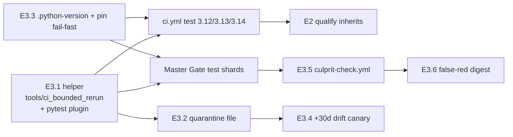

# E3 trustworthy-signal readiness and starting design

> Independent researcher `grk` in the 2026-10-23 swarm. Primary shared input:
> [the converged PyPI release reliability design](pypi_release_reliability_design_and_work_split/pypi_release_reliability_design_and_work_split.md).
> Live state re-checked on 2026-10-23 against sase `master` `35e593bcc0` and
> sase-core `db2ce637`.

## Bottom line

1. **The E3 epic can be planned now.** Track 0 shipped `sase` 0.18.0. E1
   (`sase-1my`) closed. E2 (`sase-1n6`) has landed the train's shape, the
   exact core pin on `master`, the observe-only steward, the N1 inventory, and
   a `FLAKY:` evidence contract that nothing yet emits. Those are the inputs
   E3 needs to exist as a plan.
2. **The E3 epic is not ready to land into `ci.yml`'s test steps this week.**
   Two other owners are still rewriting the same workflows: E2's qualification
   live-proof chain (`sase-1n6.5` and children) and a same-day firefight epic
   (`sase-1nn`) that is trying to green Master Gate / Full CI and ship 0.18.1
   through the *legacy* `ci_watch` path. E3.1 belongs in a new helper that
   Master Gate can adopt first; `ci.yml` adoption waits until those two
   stop colliding on the test jobs.
3. **Today's reds are the design's working example, and they are mostly not
   flakes.** Master Gate at HEAD failed one of eight shards on four
   deterministic tests. Full CI has been dying in under a minute on a
   `setup-uv` cache glob that runs before the core checkout. A whole-workflow
   rerun — the retry `sase-1nn` just authorized for its watcher — would burn
   another 70–100 minutes and still miss both. Node-level rerun plus typed
   labels are the point of E3.
4. **Name collision: three different "E3"s.** This epic is *trustworthy
   signal* for PyPI reliability. It is not instruction-migration E3
   (`sase-1ko`, closed) and it is not ToolRun failure-triage E3 (`sase-18j`,
   closed). The decision record must say so in the first paragraph.

**Readiness verdict:** approve and file the E3 epic plan. Sequence
implementation so E3.1 lands as a standalone helper, Master Gate adopts it
first, and `ci.yml` inherits it after E2.5's deployed proofs. Do not wait for
E2 to close; do not start by editing `ci.yml` test steps.

## Live snapshot (2026-10-23, ~16:00Z)

| Surface | Observation | Implication for E3 |
| --- | --- | --- |
| PyPI `sase` | 0.18.0, requires `sase-core-rs>=0.42.0,<0.43.0`; 0.18.1 absent; 0.1.0 yanked | Installable promise holds for the *released* window, not yet for the exact pin on `master` |
| PyPI `sase-core-rs` | 0.42.1 newest, 53 versions, 4.09 GiB of 10 GiB, five files complete | Retention pressure is still low; 0.42.2 is not on PyPI |
| `master` pin | `sase-core-rs==0.42.0` in `pyproject.toml`; `sase-core-revision.txt` is `246e2874…`; no published tag contains that SHA | Exact pin is a *dev/release-PR* fact. Source pin is in `CORE_LAG`. E2.2 landed the pin; E2.3 cannot honestly qualify it |
| sase-core #333 | OPEN, `chore: release v0.42.2`, since 2026-10-20 | Three days of core lag. `sase-1nn.2` is now the cut owner |
| sase #321 | OPEN, `chore(master): release 0.18.1`, `UNSTABLE`; `release-core-floor-smoke` FAILURE; lint/test SKIPPED | Legacy Publish still owns 0.18.1. Floor smoke is red because the published core does not contain the source pin |
| Master Gate | Last eight completed runs all red. HEAD `35e593bcc0` run `39977879162`: 7/8 shards green; shard 8 failed four tests | Per-SHA never-cancelled gate already exists (E3.5's baseline). The red is one shard, four nodes |
| Full CI | Last six completed runs fail in 52–58s at `build-core` / `setup-uv`: "No file matched to `[sase-core/**/pyproject.toml]`" | Setup/harness failure. E3.1 must *refuse* to rerun it. `sase-1nn.3` owns the fix |
| Install smoke | Four consecutive scheduled greens (20–23 Oct) on ubuntu + macOS; the 19 Oct probe with `sase==0.0.0` was red | E1 canary is live. The declined 7-day soak is four days in and still green |
| Release steward | `release-steward.yml` ticks every 15 minutes, observe-only, recent runs success | E2.7 observe-mode is live. Merge authority is off |
| `release.yml` rehearsals | 20 Oct green/probe dispatches `39495874381` / `39495879106` failed in identity before artifacts | Identity syntax fix `ba7ab4e96b` later landed; deployed qualification proof is still missing |
| Publish (legacy) | Scheduled runs fail at `sync-release-metadata` (exit 3); build/publish skipped | E2.9 has not cut `publish.yml` over. 0.18.1 is still on the five-cron chain |
| E3 files | No `culprit-check.yml`, no `.python-version`, no CI quarantine file | E3.2–E3.5 are greenfield |

Shard 8 at HEAD failed:

- `tests/monitor/test_monitor_diagnostics.py::test_supervisor_freezes_stage_manifest_and_retained_log_metadata`
- `tests/ace/tui/test_custom_gate_modal_sizing.py::test_compact_width_scales_and_caps_at_120`
- `tests/ace/tui/test_custom_gate_modal_sizing.py::test_compact_scroll_refits_after_resize`
- `tests/ace/tui/test_custom_gate_modal_sizing.py::test_custom_preview_rail_grows_and_stacks_at_narrow_breakpoint`

`sase-1nn.4` already exists to make the modal-sizing tests deterministic.
`sase-1nk` (monitor follow-up excerpts) closed two hours before this snapshot.
Those four nodes are the kind of red E3 must label `culprit` or `unknown`, not
recover with a rerun.

## What this E3 is

From the design's landable promise:

> Every report agrees on this content: one shared bounded-rerun helper;
> escalating quarantine; parity (`.python-version` = 3.12, fast fail on a
> core-revision mismatch, `if: always()` only on reporting steps); drift
> canaries with injected time; culprit attribution; a false-red digest.

Decision record to file with `/sase_memory_write` at epic exit (not during
planning unless the reviewer opts in):

> **CI reruns a failed node once and quarantines with an escalating expiry**,
> next to `triage-annotates-does-not-change-exit-codes`. It does not change
> ToolRun triage or receipts.

That last sentence is load-bearing. Host `sase tool run` already classifies
`KNOWN` / `FLAKY` / `NEW` against `tests/reproducible_flake_baseline.txt`
(83 entries today) and must keep its own exit code. E3's `FLAKY:` lines are a
*GitHub Actions* evidence format that qualification already knows how to
parse.

### The other two E3s, so nobody files the wrong epic

| Bead | Title | Status | Relation |
| --- | --- | --- | --- |
| `sase-1ko` | E3 (instruction migration): Explicit instruction delivery cutover | closed | Unrelated. Prior research under `e3_delivery_cutover_readiness_and_bundle_inspection/` is about this epic |
| `sase-18j` | E3: failure triage — every failure labeled, no KNOWN failure hides the rest | closed | Adjacent vocabulary (`FLAKY`, receipts). Host ToolRun path. E3-trustworthy-signal must not edit it |
| *(none)* | E3: Trustworthy signal | **not filed** | This research |

## Track 0 — ship 0.18.0 (`sase-1mk`, closed 2026-10-19)

The design's T0 was "ship 0.18.0 through the existing owner." It closed.

**What landed**

- `sase` 0.18.0 is on PyPI. Release PR #299 merged at
  `4b7b981532`. Publish run `39242329155` succeeded.
- Exact-build patch `457dd728d5`: `publish.yml` checks out
  release-please's `sha` output, so 0.18.0's bytes are the tagged commit
  rather than whatever `master` was when the three-hourly cron fired.
- `sase-core-rs` 0.42.0 (then 0.42.1) published as the floor.
- Stale overlapping release epics `sase-1lh`, `sase-1kx`, `sase-1c1` were
  superseded. `sase-1jz` was kept open for golden scope.

**What users and developers felt**

- `uv tool install sase` (and `just install`) resolves 0.18.0 instead of
  silently falling back to 0.1.0. That was the outage Track 0 existed to
  end.
- The *released* 0.18.0 wheel still declares a **window**,
  `sase-core-rs>=0.42.0,<0.43.0`. Exact pinning is an E2.2 `master`
  change that has not yet shipped.
- Attestation for 0.18.0 still names the Publish *trigger* commit. The
  design accepted that once. E2.1's `release.yml` at the tag is what
  makes tag SHA = build SHA = attestation SHA, and that cutover has not
  happened.

**What T0 left for later**

- Family canary on macOS (E1.2 added it).
- The five-cron chain is still how 0.18.1 will publish, unless E2.9
  lands first. `sase-1nn` is currently betting on the old chain.

## E1 — installable family (`sase-1my`, closed 2026-10-19)

Approved plan: `plan:202610/e1_installable_family.md`. Reviewer branches:
shared floor check, include `sase-research-artifacts`, propose yanking
0.1.0, keep TestPyPI drill tooling, **do not** write
`decisions:installable-releases`.

All six phases closed. Landing tale
`plan:202610/land_e1_installable_family.md` repaired the first-pass
defects (wrong `setup-uv` tag, canary alert with no `GH_REPO`, green
artifacts from red jobs).

### What E1 built

| Phase | Surface | Status |
| --- | --- | --- |
| E1.1 | sase-core `.github/scripts/pypi_retention.py` protected set: consumers `sase`, `sase-github`, `sase-telegram`, `sase-research-artifacts`; `SUPPORT_HORIZON = 10`; complete file sets from `EXPECTED_DIST_SUFFIXES`; fail closed; `pypi_delete.py` refuses the set before credentials | Live. V-E1a: `plan --keep 30` protects 0.42.0 and 0.42.1 for sase 0.18.0; planted deletes refused; unreachable PyPI refuses |
| E1.2 | `.github/workflows/install-smoke.yml` + `tools/check_family_install`: ubuntu + macOS, newest *and* exact version assertions, plugin entry-point load, `sase core health` | Live. Scheduled greens 20–23 Oct; probe `sase==0.0.0` red |
| E1.3 | `tools/check_release_dependency_floor` + reusable `.github/workflows/release-dependency-floor.yml@master` | Live. sase-github probe `sase>=99` → `DEPENDENCY_UNPUBLISHED`; normal run green. Schedule reruns a failed check up to 50 attempts so a sibling publish can clear it without a new push |
| E1.4 | `pypi-headroom.yml` + runway line in sase-core `docs/pypi-retention.md`; size request already [pypi/support#12339](https://github.com/pypi/support/issues/12339) | Live. Red run is the alert; optional sase issue if the token can write |
| E1.5 | `docs/contribute/release-safety.md`; core-backfill section; TestPyPI drill workflow dispatch-only and **unrun** | Docs live. Drill not executed. 0.1.0 confirmed yanked |

### Developer-facing behavior E1 changed

These are things a person (or an agent installing sase) actually hits.

1. **`uv tool install sase` / `just install` installs 0.18.0, and 0.1.0 no
   longer silently wins.** Yanking 0.1.0 turns a broken window into a loud
   resolver error. `sase-1m4` still tracks blog posts that show the bare
   command as if 0.1.0 were acceptable.
2. **Family install is a documented, single-sourced command.**
   `tools/render_applicability --install-command` / `--install-family-command`
   is what the canary runs. The family form is `INSTALL.md`'s
   `--with sase-github --with sase-telegram` plus
   `--with sase-research-artifacts`. A docs/code split now fails the canary
   instead of looking green.
3. **Plugin release PRs cannot name an unpublished sase.**
   `ci_watch` already treats a `FAILURE` check as
   `release_pr_checks_not_green`. E1 added the check; it did not change
   `ci_watch`. A plugin author whose floor is `sase>=0.19.0` while 0.18.0
   is newest sees `DEPENDENCY_UNPUBLISHED` and waits; the scheduled rerun
   clears it after 0.19.0 publishes, without a new plugin push.
4. **Core deletion is consumer-blind no longer.**
   `pypi_retention.py plan` / `check` and `pypi_delete.py` refuse any list
   that would remove a core version (or one platform wheel) a supported
   sase/plugin release still needs. Humans still delete; the tool now
   fails closed rather than proposing a plan that uninstalls 0.18.0.
5. **A red public install opens an `install-canary` GitHub issue** (mirrored
   into a task bead). It does **not** block a recovery release. That is the
   detector E2.6's `INSTALL_BROKEN` will consume.
6. **Recovery is written down.** Yank-then-fix-forward, core backfill from
   an old tag, and "recovery is never blocked" live in
   `docs/contribute/release-safety.md`. Agents do not yank.

### E1 caveats that E3 should not pretend are done

- The reviewer declined `decisions:installable-releases`. The installable
  promise has no memory-web record yet.
- The 7-day scheduled-canary soak was declined as a task. Four scheduled
  greens exist; three more would complete the original exit bar. E3 should
  treat the canary as a *detector to wrap*, not as a soak it must finish.
- TestPyPI drill tooling is in-tree and unrun. Out of E3's scope.
- `sase-telegram` 0.4.29 and `sase-research-artifacts` 0.2.0 still declare
  `sase>=0.17.0` on PyPI. The canary asserts newest-installed ==
  newest-published, so this is fine today; a future plugin floor that
  names an unpublished sase is what E1.3 blocks.

## E2 — exact-candidate release train and steward (`sase-1n6`, in progress)

Approved plan: `plan:202610/e2_release_train_steward.md`. Reviewer
branches: steward host = **workflow** (not an axe chop), cadence =
**daily**, memory record authorized only at the exit phase.

```text
Closed:  .1 core-cut resilience
          .2 release.yml identity + sealed manifest
          .3 exact core pin + core-ensure
          .4 exercise Linux/macOS wheel+sdist
          .7 observe-only steward
          .8 release-green / release_metrics
Open:     .5 qualify vs published core          (live proofs outstanding)
          .6 digest-checked publish             (blocked on .5)
          .9 cut publish.yml over, hand merges  (blocked on .6)
          .10 first steward release + decision  (blocked on .9)
```

The original design's E2.1–E2.8 map onto those phases with one extra:
`.1` absorbed core-cut resilience (design E2.7) up front.

### What E2 has already changed for developers

These are in `master` *right now*, even though the train has not shipped a
release.

1. **`pyproject.toml` pins `sase-core-rs==0.42.0`.**
   This is the largest developer-facing change in the whole program.
   - `just install-venv` / `just rust-install` treat a local sase-core
     checkout *ahead* of that pin as normal: they build from the checkout
     and print that the release-branch reconciler owns the published pin.
   - A checkout *behind* the pin is an error (`SASE_ALLOW_STALE_CORE=1` to
     override, bisects only).
   - `tools/validate_sase_core_rs_version` understands `==`. "Ahead of the
     window" is the expected daily state, not a prompt to edit
     `pyproject.toml`.
   - Dev installs still override the pin through the local wheel. Users of
     `just install` (PyPI) still get 0.18.0's *window*. The next sase
     release is what makes `uv tool install sase` pin exactly.
2. **New tools, all repo-local, not `sase <cmd>`:**
   - `tools/release_watch --once|--tick|--tick --live|--until-released`
     — one stateless tick. Policy lives in `sase_core_rs`; Python is
     transport. Exit 0 for every well-formed blocked state.
   - `tools/release_candidate` — seal / observe / verify / evaluate /
     qualify / core-files / core-suffixes.
   - `tools/release_metrics green --json` — exact-SHA release-green
     evidence. This is the bookmark E3.5 and E4 consume.
   - `tools/exercise_release` — isolated-home fakey launch, host/worker
     crossing, headless screenshot, upgrade from N−1, `sase core health`.
   - `tools/ratchet_core_pin` (replaces window-ratchet at release time).
3. **`release.yml` exists** with modes `release` / `resume` / `rehearse`.
   Developers do not invoke it. Rehearse is how agents prove the train
   without uploading.
4. **`ci.yml` is now a reusable workflow** with `ref`, `core-source:
   source|published`, `core-version`, `probe-core-version`. Qualification
   uses concurrency group `qualify-<sha>` and never cancels. Ordinary PRs
   still cancel. This is the seam E3.1 must inherit, not fork.
5. **N1 inventory is `.github/release-qualification.json`.**
   Blocking: lint, test 3.12/3.13/3.14, release-exercise (four
   os×artifact legs). Advisory: visual-test, perf-floors, tutorial-tests,
   ace-page-group-isolation. E3.7 (visual promotion) is the only later
   edit of this file, and the default is no.
6. **Pytest already has a `FLAKY:` socket that nothing writes.**
   `-p tests._pytest_qualify_evidence` records `flaky_lines` that must
   start with `FLAKY:`. The evaluator classifies `tests` / `collection` /
   `zero` / `harness` / `missing`. Job-level `gh run rerun --failed` is
   eligible only when every failing blocker is `tests`. That is E2's
   substitute for E3.1, and it is the backstop E3 should keep.
7. **Docs:** `docs/contribute/release-train.md` is the developer map of
   the train. `docs/contribute/rust-backend.md` "Watching a release" now
   points at the steward. `docs/contribute/release-safety.md` still
   describes legacy Publish recovery via `publish_existing` in places the
   E2.9 docs pass has to rewrite.
8. **Observe-only steward is on a 15-minute cron.**
   `RELEASE_STEWARD_MERGE_ENABLED` must be the literal `true` to merge.
   It is not. `ci_watch` still owns sase release merges. Two deciders
   will exist the moment someone flips the switch before E2.9's chezmoi
   apply. That is an E2.9 human gate, not E3.

### What E2 has not yet changed (and E3 must not assume)

- `release-please-config.json` still has no `draft: true` and no
  `force-tag-creation: true`. Tags still appear the old way.
- `publish.yml` still has `build`, both install smokes, `publish`, and
  `publish_existing`. Scheduled Publish is still the 0.18.1 path, and it
  is red at `sync-release-metadata`.
- Qualification has no retained green or wrong-core rehearsal that
  produced a candidate manifest. The 20 Oct rehearsals died in identity;
  the identity fix landed later; the source pin is still untagged, so a
  green qualification of 0.42.0 still would not prove containment.
- `decisions:exact-release-pair` is authorized and unwritten (exit
  phase).
- Plugins still merge through `ci_watch`. Out of E2's required scope.

### E2 discovered issues that E3 should reuse, not rediscover

1. **Containment gap (still open on `sase-1n6`).** Seal used to take the
   core source pin from the `pyproject.toml` requirement, not
   `sase-core-revision.txt`. Evaluate's public-dependency clause did not
   prove the selected tag contains the source pin. A green 0.42.0
   qualification is not proof the pin is in that tag. E3.5's release-lane
   bisection from `release_metrics green` is only honest after this
   clause is real.
2. **Suffix parser** (fixed): `EXPECTED_DIST_SUFFIXES` is a YAML block
   scalar in sase-core. `release_candidate` now shares `_release_core`'s
   parser.
3. **Evidence transport** (mostly fixed, proofs outstanding): reusable
   `ci.yml` cannot use `${{ runner.temp }}` at job-level env; artifact
   download must use run-scoped APIs; observation asset names must match
   what the steward reads. E3.1's helper must follow the same
   `if: always()` reporting-step contract the inventory already names.

## Adjacent work that is not E1/E2 but changes the E3 start line

- **`sase-1ig` (closed): `just install` / `install-dev` / `install-venv`.**
  Three honest commands. `just install` is PyPI; `just install-dev` is
  this checkout plus paired sase-core as the `sase` on PATH, refused
  inside agents; `just install-venv` is the checkout `.venv` for tests.
  This is how developers *experience* the installable promise locally.
  E3 does not own it.
- **`sase-1nn` (in progress, created 2026-10-23 11:30 EDT):** "Green
  master's release gates and ship sase v0.18.1 to PyPI through
  `ci_watch`." Phases: repair release-plz filter (closed), cut 0.42.2 and
  raise the exact pin (in progress), restore Full CI `build-core`, make
  gate-modal sizing tests deterministic, fix UTC screenshot drift, green
  Full CI, watch 0.18.1 through the *legacy* chain. Reviewer auto-picked
  **`gate_rerun = yes`**: the watcher reruns a failed Master Gate at HEAD
  once per run. That is the whole-workflow retry the design called the
  worst available strategy. E3 exists to replace it with node-level
  rerun plus labels.
- **Host flake baseline** (`tests/reproducible_flake_baseline.txt`, 83
  nodes) and **ToolRun triage** (`sase-18j`) already exist. They are the
  *agent* signal. E3 is the *GitHub* signal. Mixing the files would make
  `just check-full`'s flake-baseline gate and Master Gate admission share
  a list they do not mean the same way.

## Are we ready for E3?

### Ready

- The design is stable. E3's content did not change between the swarm
  reports and the approved E1/E2 plans. E2's plan already describes the
  E3.1 handoff: qualification inherits node-level reruns automatically
  once they live in `ci.yml` test steps; the steward's job-level rerun
  stays as a backstop; E3 owns the `FLAKY:` format that E2 copies
  verbatim.
- File ownership is written down. E3 owns: test infrastructure, Master
  Gate *test steps*, `ci.yml` *test steps*, the quarantine file,
  `culprit-check.yml`. E2 owns `ci.yml` inputs/checkouts/concurrency/core
  source/evidence-reporting steps. The collision is real and bounded.
- Master Gate is already grouped by SHA and never cancelled. Culprit
  attribution's "first red SHA with a green parent" predicate can be
  evaluated today.
- Qualification evidence schema already demands `FLAKY:` lines, pytest
  counts, collection-failed, and first-failing node ids. E3.1 is filling
  a socket, not inventing a format.
- E1's canary is a detector E3 may later wrap. E2.8's
  `release_metrics green` is the release-lane bookmark E3.5 bisects from.
- E4's entry bar is "E3.1 and E3.5 live." Starting E3 now is what
  unblocks revert-first. Waiting for E2.10 would put E4 behind the first
  steward release, which the design explicitly did not want.

### Not ready (do these first, or sequence around them)

1. **Do not edit `ci.yml` test steps while `sase-1n6.5` is still proving
   deployed qualification.** The last live rehearsals failed before
   evidence existed. A parallel rewrite of the same `Run tests` /
   `Write qualification evidence` steps will produce another landing
   tale. E3.1's *helper* can land without touching those steps.
2. **Do not fight `sase-1nn` for Master Gate and Full CI this week.**
   `sase-1nn.4` owns the modal-sizing failures that are reddening HEAD.
   `sase-1nn.3` owns the Full CI `setup-uv` glob. `sase-1nn.2` owns the
   0.42.2 cut that unblocks both E2 qualification and #321's floor
   smoke. E3 should adopt Master Gate *after* those three land, or land
   the helper in parallel with a freeze: E3.1 does not change assertions,
   only how a red node is retried.
3. **Do not treat current Master Gate red as a flake sample.** Four
   failed nodes at HEAD look deterministic. A planted-flake verification
   for E3.1 needs an injected flake, not these four.
4. **File the epic under a title that cannot be confused with
   instruction-migration E3 or triage E3.** Suggested title: `E3:
   Trustworthy CI signal — bounded node rerun, quarantine, drift,
   attribution`.

### Start-now vs start-after-E2

The original design said E1–E3 start now, in parallel. E2's approved plan
repeated that it would not wait for E3.1. Both were right *as of 19 Oct*.
On 23 Oct the collision is no longer theoretical: E2 has already written
the `ci.yml` test-job evidence path, and `sase-1nn` is rewriting Master
Gate's failing tests.

Independent conclusion: **start the *epic* now; start *adoption* on
Master Gate as soon as `sase-1nn.4` is no longer in the same files; start
`ci.yml` adoption after E2.5's green/probe artifacts exist.** That is
still "E3 starts now." It is not "E3 waits for E2 to close."

## Starting the E3 design

Keep the design's seven phases. Tighten the contracts against what E1/E2
actually shipped, and against today's reds.



### Decision record (draft claim)

**Claim.** A GitHub required check reruns at most three failed *pytest
nodes* once, keeps the first attempt, and emits `FLAKY:` on recovery.
Collection errors, harness/setup errors, zero-test runs, and named
safety-critical nodes are never rerun. An isolated pass is diagnostic,
not exoneration: recovered signatures that recur escalate. Quarantine
expiry fails a non-required hygiene check and raises a bead; it never
fails admission. Every Master Gate red is labeled `recovered`,
`culprit=<sha>`, `drift`, or `unknown` within one gate run plus one
`culprit-check.yml`. This does not change ToolRun triage, receipts, or
`tests/reproducible_flake_baseline.txt`.

**Why this, not the alternatives**

- Whole-workflow rerun (what `ci_watch` and `sase-1nn`'s `gate_rerun`
  do): recovers 33.9% in the reading-list data, costs a full Master Gate
  or Full CI, and erases attribution.
- Job-level `gh run rerun --failed` alone (what E2 qualify already
  does): right backstop, wrong first move. A 450-second shard that
  failed four nodes should rerun four nodes, not 6,926.
- Host flake baseline as the CI quarantine: different population
  (ephemeral workspaces vs GitHub runners), different gate
  (`just check-full` vs admission), different owner.

**Cost.** A recovered flake still spent the first attempt. Safety-critical
nodes that are actually flaky stay red until fixed. Quarantine can hide a
real red from *hygiene* (intentional) and must never hide it from
admission.

**Reopens when.** Recovered signatures exceed about 10% of Master Gate
reds after two weeks of the helper being live (the design's E6 delay
trigger). Or when node-level rerun starts recovering order-dependent
failures (the isolated-pass-is-not-exoneration rule failed).

### E3.1 — shared bounded-rerun helper

**New files, so E2 and `sase-1nn` can keep editing workflows:**

- `tools/ci_bounded_rerun.py` — classifies a pytest session: count failed
  nodes, refuse collection/harness/zero/safety-critical, rerun the failed
  node ids once via `pytest --failed-first` / explicit node-id list,
  write `FLAKY: <nodeid>` on recovery, keep the first-attempt report.
- `tests/_pytest_bounded_rerun.py` — pytest plugin that *emits* the
  `FLAKY:` lines the existing `_pytest_qualify_evidence` plugin already
  harvests. Do not add `pytest-rerunfailures` as a dependency unless it
  can be made to emit that exact prefix and to skip the refuse classes.
- `tests/ci_no_rerun.txt` — safety-critical node ids that get no rerun
  (start empty except for a couple of planted names in tests).
- Contract tests with planted flakes, planted collection errors, planted
  order-dependent failures, and a four-node deterministic failure (the
  HEAD-shaped case).

**Rules, copied from the design and pinned to today's evidence classes:**

| First attempt | Action | Evidence |
| --- | --- | --- |
| 1–3 failed nodes, class `tests`, not in `ci_no_rerun.txt` | Rerun those node ids once in-process | Recovered → `FLAKY:` + first attempt kept; still fail → red, no second rerun |
| ≥4 failed nodes | No rerun | Today's shard 8 (4 failures) stays red. Correct |
| `collection` / `zero` / `harness` / setup-uv glob / missing matrix | No rerun | Full CI's current death is this row |
| Safety-critical node | No rerun | Listed in `ci_no_rerun.txt` |
| Isolated pass on rerun, fail in suite order | Still red | Order defect is not a flake |

**Adoption order**

1. Helper + tests, no workflow change. Verification: local planted cases.
2. Master Gate `Run sharded fast suite` becomes
   `python tools/ci_bounded_rerun.py -- just test` (or `just test`
   grows a flag the helper wraps). One workflow file, eight shards, 20
   minute ceiling — the helper must fit in that ceiling, so the rerun
   budget is the failed nodes only.
3. `ci.yml` `Run tests` / `Run tests (coverage leg)` after E2.5 has a
   retained green rehearsal. Qualification then inherits it. E2's
   job-level rerun remains the backstop for a job that failed for a
   non-`tests` reason on attempt 1 and a `tests` reason on a later
   attempt — actually no: E2 already says second-attempt failures are
   never rerun-eligible. Keep that.

**Verification (design E3.1, plus one live case):** a planted flake
recovers with `FLAKY:`; a deterministic failure, a collection error, and
an order-only failure stay red. Optional live check: re-dispatch Master
Gate at `35e593bcc0` through the helper and show the four nodes still
red (proves we do not launder `sase-1nn.4`'s bugs).

### E3.2 — escalating quarantine

**New file:** `tests/ci_quarantine.yml` (not the host flake baseline).

Each entry: node id, bead, opened-at, expiry, reason. Hygiene job (non-required)
fails when an entry is expired, comments `+1` on the bead, and raises
priority. Admission ignores the file. Expiry is excluded from the
shifted-clock run (E3.4), so a time bomb cannot be hidden by a quarantine
that also expired.

Start with **zero** production entries. The first candidates people will
want to add are the modal-sizing tests; refuse them — `sase-1nn.4` is
already the owner, and they failed 4 of 4 at HEAD.

### E3.3 — parity

- Add `.python-version` containing `3.12`. `requires-python = ">=3.12"`
  and mypy `python_version = "3.12"` already agree; the file is the
  missing runner pin. Master Gate, `ci.yml`, install-smoke, and
  `release.yml` already `uv python install 3.12`. The file makes local
  `uv` / `mise` / `pyenv` match.
- Fast-fail when the installed `sase-core-rs` does not match the
  expected source (Master Gate / source-mode CI) or the sealed published
  version (qualification). `tools/validate_sase_core_rs_version` and
  `write_qualification_evidence`'s binding diagnostics are the seeds;
  the fail must happen *before* a 450-second shard.
- `if: always()` only on reporting steps. E2 already did this for
  qualification evidence. Audit Master Gate: the sharded test job has no
  evidence upload today. E3.1 should add one, with `if: always()`, so
  E3.5 can read node ids without scraping logs.

No `.python-version` exists today. This phase is small and unblocked.

### E3.4 — drift canaries

Nightly: one Master Gate-shaped run on the tip, plus one with **time
injected +30 days into the relevant tests** (not the machine clock — TLS,
OIDC, and caches would lie). A planted time bomb fails the +30-day run
while the gate stays green.

Do not put this on the admission path. Do not let quarantine expiry
participate.

### E3.5 — culprit attribution

Master Gate already runs once per SHA and is never cancelled. The first
red SHA with a green parent is the suspect.

**New workflow:** `.github/workflows/culprit-check.yml`, dispatchable
with `suspect` and `parent`. Confirms k of k failing at the suspect and
k of k passing at the parent. Labels: `recovered` (E3.1 rerun succeeded),
`culprit=<sha>`, `drift` (E3.4), `unknown`.

Release lane: bisect commits since `tools/release_metrics green --json`
for the last confirmed release. Do not claim containment until E2's
source-pin clause is real; until then the release-lane bisect may stop
at `CORE_LAG` and say so.

Verification: a planted break is labeled `culprit=<sha>` within one gate
run plus the check. A flake is `recovered`. A time bomb is `drift`.

This is E4's entry bar, together with E3.1.

### E3.6 — false-red digest and DORA-style metrics

Publish a baseline with numerators and denominators:

- escape rate = confirmed-culprit releases that reached PyPI / releases
- red minutes per day = Master Gate red minutes / (24 × 60)
- recovered / culprit / drift / unknown counts
- node-rerun recovery rate (recovered ÷ eligible first-attempt reds)
- job-level backstop firings (should fall after E3.1)

E2.8 already reports release-green p90, core-lag hours, burned versions.
Do not duplicate those. E3.6 is the *signal quality* dashboard E6's
go/no-go reads.

### E3.7 — visual promotion study

After E2.3/E2.5 (both touch `ci.yml`). Default is **no**: visual-test
stays advisory in `.github/release-qualification.json`. A recorded
decision is the exit, not a promotion.

### File ownership, restated for the 23 Oct tree

| Owner | Files | Freeze vs E3 |
| --- | --- | --- |
| E3 | `tools/ci_bounded_rerun.py`, `tests/_pytest_bounded_rerun.py`, `tests/ci_quarantine.yml`, `tests/ci_no_rerun.txt`, `.python-version`, `.github/workflows/culprit-check.yml`, Master Gate `Run sharded fast suite` step, `ci.yml` *test run steps only* | Helper files have no freeze. Master Gate test step: after `sase-1nn.4` or with a no-assertion-change rule. `ci.yml` test run steps: after E2.5 proofs |
| E2 | `ci.yml` inputs, checkouts, concurrency, core-source, evidence-reporting steps, `release.yml`, `publish.yml`, `tools/release_*` | E3 does not edit evidence-reporting. It emits `FLAKY:` that those steps already parse |
| `sase-1nn` | Master Gate failing *tests*, Full CI `build-core` glob, exact pin ratchet to 0.42.2, UTC screenshots | E3 does not fix those tests. It classifies them |
| Host triage | `tests/reproducible_flake_baseline.txt`, `src/sase/tool/triage_*.py` | Untouched |

Two agents must never rewrite the same workflow at the same time. That
rule is already in the design. On 23 Oct it is the reason E3.1 is a
helper first.

### Suggested epic shape

- **Title:** E3: Trustworthy CI signal — bounded node rerun, quarantine, drift, attribution
- **Bead size:** L (the design said M–L; the helper + Master Gate adoption
  + culprit-check is the M; quarantine + drift + digest push it to L)
- **Phases:** helper, master-gate-adopt, parity, quarantine, drift,
  culprit, digest, visual-study (optional last)
- **Entry:** none. E1 closed, E2 moving, `sase-1nn` in flight is a
  sequencing constraint, not an entry bar.
- **Exit:** helper live on Master Gate and `ci.yml` test jobs; quarantine
  mechanism live with an empty production list; `.python-version` present;
  `culprit-check.yml` proven on a planted break; baseline published. The
  under-3% soak is E6's entry bar, not E3's exit.
- **Non-goals:** ToolRun triage, receipts, `just check-full`'s flake
  baseline, auto-revert (E4), queue (E5/E6), fixing `sase-1nn`'s
  deterministic reds, flipping steward merge authority.

### Acceptance cases (design 9, plus today's)

1. **Flake versus order defect:** a transient failure recovers and the
   first attempt is kept. An order-dependent failure is not erased by an
   isolated pass.
2. **Four-node deterministic red:** a shard that fails four nodes does
   not rerun. Matches HEAD `35e593bcc0` shard 8.
3. **Setup death is not a flake:** Full CI's `setup-uv` glob failure is
   `harness`, never rerun, never `FLAKY:`.
4. **Incomplete evidence:** cancel a shard, drop a matrix entry, collect
   zero tests. Neither admission nor publication reports success. (Shared
   with E2; E3 supplies the node-level half.)
5. **Quarantine expiry:** hygiene red, gate still green, bead escalates.
6. **Planted culprit:** labeled `culprit=<sha>` within one gate run plus
   `culprit-check.yml`.
7. **No ToolRun change:** `sase tool run check` triage JSON on a
   fixture run is byte-identical in the classification fields before and
   after E3 lands.

## What I would tell the person deciding whether to start E3

Start it. File the epic this week. Put E3.1 in new files and adopt it on
Master Gate as soon as the modal-sizing tests are out of that shard (or
adopt it anyway, with the four-node refuse rule protecting you). Do not
open a second landing tale on `ci.yml` until E2.5 has a green rehearsal
artifact on a SHA whose core pin is inside a published tag — which is
`sase-1nn.2`'s 0.42.2 cut, not E3's job.

The landable promise is the one that is currently broken: Master Gate is
red at HEAD, Full CI is red on setup, and the retry the 0.18.1 watcher
is about to grow is the retry this epic exists to make unnecessary. E1
gave users an installable 0.18.0. E2 is building the train that will
make 0.18.1 (or 0.18.2) an exact pair. E3 is what makes "green" mean
something those two can trust.

## Method, confidence, limits

**Inputs (audited):**

- `research:202610/pypi_release_reliability_design_and_work_split/pypi_release_reliability_design_and_work_split.md`
- `research:202610/pypi_release_reliability_track0_remaining_work.md`
- `plan:202610/e1_installable_family.md`, `plan:202610/e2_release_train_steward.md`
- Beads `sase-1mk`, `sase-1my`, `sase-1n6` (+ open children), `sase-1nn` / `sase-1nn.2`
- sase `master` `35e593bcc0` workflows, tools, docs, N1 inventory, qualify plugin
- sase-core linked checkout: `pypi_retention.py`, `docs/pypi-retention.md`, `release-plz.yml`
- PyPI JSON for `sase`, `sase-core-rs`, `sase-github`, `sase-telegram`, `sase-research-artifacts`
- `gh run list/view` for Master Gate, Full CI, Install smoke, Release, Publish, Release steward
- `gh pr view` #321 (sase 0.18.1) and sase-core #333 (v0.42.2)

**High confidence:** PyPI versions and yank flags; HEAD SHA and pins;
workflow file contents; bead statuses; Master Gate shard 8 node ids;
Full CI setup-uv annotation; install-smoke scheduled greens; steward
observe-only cron; absence of `.python-version` and `culprit-check.yml`.

**Medium confidence:** that the four HEAD failures are deterministic
(they match in-flight `sase-1nn.4` / recent `sase-1nk` work, but I did
not rerun them locally); that identity fix `ba7ab4e96b` fully unblocks
rehearsal (it landed after the failed 20 Oct runs; no new rehearsal
since); cld's original 85% core-lag and 15–38 h chain figures (not
re-measured).

**Not verified:** GitHub cache-400 annotations' effect on pass/fail
(they appear on green jobs too); whether `release-please-action@v5`
honors `force-tag-creation` (still E2.9); plugin-repo caller workflows
byte-for-byte (E1.3 was proven on sase-github probes; I did not re-open
the plugin checkouts).

**Not done:** no workflow, bead, memory, or config was changed. No
dispatch, merge, yank, or epic was filed.
