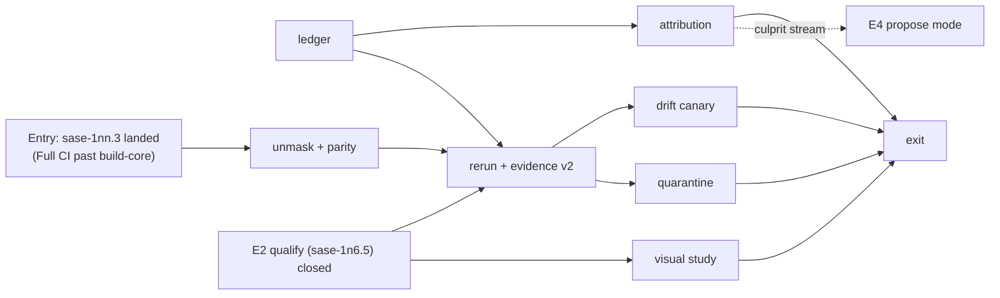

# E3 "Trustworthy signal": readiness, what E1 and E2 changed, and a revised design

> **Research query:** I'm thinking about moving forward with the E3 epic described by
> the `pypi_release_reliability_design_and_work_split.md` file in the research sidecar
> repo. Can you do some research with the goal of making sure we are ready for this
> epic, describing the work that has been done so far (e.g. E1 and E2) and what
> developer-facing behavior has been changed by that work, and starting the design for
> the E3 epic?

Researcher: cld · 2026-10-23 · surveyed sase `origin/master` = `35e593bcc0`

**Naming note.** "E3" also names an epic in the unrelated instruction-migration program
(`sase-1ko`, "E3 (instruction migration): Explicit instruction delivery cutover"). Title
the new epic bead **"E3: Trustworthy signal (PyPI release reliability)"** so plan, bead
and research searches don't collide.

## Bottom line

1. **E1 is done. E2 is about 60% landed but has shipped nothing.**
   - **E1** (`sase-1my`, installable family) closed on 2026-10-19 with live proofs.
   - **E2** (`sase-1n6`, exact-candidate release train and steward) has landed six
     phases: the tag build, the exact core pin, the exercise legs, the qualification
     code, an observe-only steward and release metrics.
   - E2 has never released anything. Still to do: digest-checked publish and confirm,
     the cutover, and the first steward release.
   - Releases still flow through the legacy `ci_watch` → `publish.yml` path. A new
     epic, `sase-1nn` (opened today), is pushing 0.18.1 through that legacy path.
2. **We are ready to *plan* E3 and start its read-only phases. We are not ready to start
   its workflow-editing phases.** Three gates stand in the way:
   - **Full CI** has been 100% red since 2026-10-20, failing in `build-core` setup
     (`sase-1nn.3`). E3 cannot baseline, qualify or canary anything on Full CI until
     that lands.
   - **Master Gate** has been deterministically red since 2026-10-21 on
     `test_custom_gate_modal_sizing.py` (`sase-1nn.4`).
   - **E2's evidence contract conflicts with E3.1** (bounded rerun) as designed. E2's
     evaluator calls any `failed > 0` red. E3.1 promises to "keep the first attempt", so
     a recovered flake would still block qualification. E3.1 must ship an evidence
     schema v2 and edit two E2-owned files. That needs an explicit ownership handoff.
3. **The design's premise for E3 is half wrong, and the data says so.**
   - **Mostly real breaks, not flakes.** Over the last 200 Master Gate runs
     (2026-10-16 → 10-23), 162 were red and master was red **82% of wall-clock time**.
     Only **9 red runs (5.6%) were flake-only**, worth **3.2% of wall-clock time**.
     The other 94% contain a deterministic failure: a node that fails on two or more
     consecutive SHAs, or a lint or docs failure.
   - **A perfect rerun barely moves the red time.** It would cut master's red time from
     about 82% to about 79%. It is still needed, but for qualification robustness and
     honest labeling, not for a green `master`.
   - **The planned culprit rule misses most breaks.** "First red SHA with a green
     parent" fits only 10 of 63 deterministic failure episodes. The other 53 began while
     `master` was already red. Attribution has to work **per failure signature**.
   - **Per-signature attribution is cheap and exact.** Every Master Gate run in the
     window is exactly one first-parent commit (199 of 199). All eight shards run with
     fail-fast off, so a signature that is absent in run *i−1* and present in run *i*
     names commit *i*.
4. **Revised E3 shape:**
   - Lead with a **signal ledger** and **per-signature attribution**. Those are what E4
     (revert-first) and E6's go/no-go actually consume.
   - Then **parity and unmasking**, then **bounded rerun with evidence v2**, then
     **quarantine**, a **drift canary under its own workflow name**, and the **visual
     study**.
   - Decouple E4's entry from E3.1. The `culprit-check` k-of-k confirmation already
     filters flakes, so E4 can start in propose mode right after attribution.
5. **E3 will not make `master` green by itself.**
   - The dominant failure mode is deterministic breaks landing, then lingering. Per
     failing node, median episode is **2.5 h** and p90 is **9.3 h**. The longest red
     streak was **33 consecutive runs**. About 12.6% of commits started a new
     deterministic test-node episode.
   - That is a landing-policy problem, which belongs to E4 and the "red-HEAD refusal"
     idea from `master_ci_red_why_and_how_to_stay_green`. No epic owns that idea today.
   - E3's job is to make every red *mean something and name its owner*.

## 1. Where the program stands (2026-10-23)

- **T0 Ship 0.18.0** (`sase-1mk`)
  - *State:* closed 10-19
  - *Notes:* 0.18.0 is on PyPI and the family resolves cleanly (sase 0.18.0, core
    0.42.1, github 0.2.24, telegram 0.4.29, research-artifacts 0.2.0). Track 0's exit
    said to supersede the stale epics, but `sase-16p` (0.17.1 uninstallable, now moot)
    is still *ready* and `sase-1jz` (green gates with host-independent TUI goldens) is
    still *in progress*.
- **E1 Installable family** (`sase-1my`)
  - *State:* closed 10-19
  - *Notes:* All six phases closed. V-E1a/b/c were proven live. The seven-day canary
    soak and the TestPyPI drill were declined by the owner.
- **E2 Release train + steward** (`sase-1n6`)
  - *State:* in progress
  - *Notes:* .1 .2 .3 .4 .7 .8 closed. .5 (qualify) is open on live proof; .6, .9 and
    .10 are open (details below).
- **`sase-1nn` Ship 0.18.1 via `ci_watch`**
  - *State:* opened today
  - *Notes:* Core merge filter fixed (.1). Still open: core 0.42.2 and the pin raise
    (.2), build-core and Publish token (.3), the modal-sizing tests (.4), the visual
    lane (.5), the remaining Full CI reds (.6), and the watch (.7).
- **E3 Trustworthy signal**
  - *State:* no bead
  - *Notes:* This report.
- **E4–E6**
  - *State:* no beads
  - *Notes:* E4's entry depends on E3.

### E2 phase by phase

The audit was done by a helper agent; I spot-checked the CLI, workflows, pin and runs.

- **.1 Core-cut resilience, in-flight retention source**
  - *Landed:* sase-core `3f0920f8`. It introduced the `release_plz_merge.py` jq-escape
    bug that `sase-1nn.1` fixed in `db2ce637`.
- **.2 `release.yml` builds once at the tag, seals the manifest**
  - *Landed:* `110214f51c`. Modes `release`, `resume` and `rehearse`; the
    `tools/release_candidate` CLI.
- **.3 Exact core pin and core-ensure**
  - *Landed:* `befa41b575`. `pyproject.toml:48` is `"sase-core-rs==0.42.0"`;
    `tools/_release_core.py`; `ratchet_core_pin`.
- **.4 Exercise the exact files**
  - *Landed:* `cc59e6f114`. `tools/exercise_release`; Linux and macOS × wheel and sdist.
- **.5 Qualify against the published core**
  - *Landed:* `443fba33d9`, `9edbacd4ef`, `8afb1b7e57`, `54a9c14d23`, `400572eab6`,
    `e10fa95c0d`, `3db3b51d53`, `ba7ab4e96b`.
  - *Still open:* no rehearsal has produced evidence yet. The 10-20 runs failed before
    evidence; the identity syntax fix landed later and has not been re-run. The
    source-containment gap is also still open: the current pin is in no sase-core tag.
- **.6 Digest-checked publish, confirm, un-draft**
  - *Landed:* nothing. `release.yml` still ends in a deliberate "not yet qualified" red
    job.
- **.7 Stateless steward (observe mode)**
  - *Landed:* sase-core `dd817d56` (Rust `release_steward_decide`); sase `5003ef69bd`,
    `23cccbc969`, `112a5f4757`, `dab5776583`, `812cdd9e21`.
  - *Open:* none in code, but scheduled ticks are observe-only. The latest tick reports
    `CORE_CUT_RED check=release-plz`.
- **.8 Release-green record and metrics**
  - *Landed:* `b15cc3fb5b`. `tools/release_metrics` with a `green <sha> --json` subcommand.
- **.9 Cutover and handover**
  - *Landed:* nothing.
  - *Still pending:*
    - release-please `draft` and `force-tag-creation` are unset;
    - `publish.yml` still builds and publishes;
    - `RELEASE_STEWARD_MERGE_ENABLED` is unset;
    - the chezmoi `ci_watch` config still lists sase.
- **.10 First steward release and decision record**
  - *Landed:* nothing; blocked on .9.

## 2. What E1 changed for developers

Everything here is live on `master` and in the plugin repos.

- **Bare `uv tool install sase` now fails loudly instead of installing February's
  build.** `sase` 0.1.0 is yanked, confirmed live twice on `sase-1my.6`. If every newer
  window ever breaks again, resolvers error out rather than silently picking 0.1.0.
- **A daily family install canary, `install-smoke.yml`.** It is now an ubuntu and macOS
  matrix with `fail-fast: false`. It runs:
  - isolated `uv tool install`s of sase plus the plugins, using the documented commands
    single-sourced in `tools/render_applicability`;
  - an assertion that each package resolved to the *newest* PyPI version, plus an exact
    reinstall (`tools/check_family_install`);
  - `sase core health`, completion, doctor, and a load of every recognized plugin entry
    point (9 today).

  An alert job opens, comments on, or closes **one `install-canary` issue**, which the
  issue mirror turns into a task bead. For developers: a red canary arrives as a bead,
  not a cron email.
- **Plugin release PRs carry a `release-dependency-floor` check.**
  - The logic lives in sase's `tools/check_release_dependency_floor` and the reusable
    `.github/workflows/release-dependency-floor.yml`. sase-github, sase-telegram and
    sase-research-artifacts call it at `@master`.
  - A floor naming an unpublished, yanked or prerelease sase fails with
    `DEPENDENCY_UNPUBLISHED …`, and `ci_watch` then refuses the release PR.
  - It also reruns on a schedule (hourly on the first day, then every four hours, capped
    at 50 attempts) so that it clears once the sibling publishes.
- **sase-core retention is consumer-driven and fails closed.**
  - `pypi_retention.py plan` derives a protected set that today includes 0.42.0 and
    0.42.1, five files each, protected "by sase 0.18.0".
  - `pypi_delete` canonicalizes package names and refuses protected versions before it
    touches credentials.
  - `verify --min-runway-days` and a weekly `pypi-headroom.yml` act as the storage
    detector. PyPI support request #12339 is filed.
- **New docs:**
  - `docs/contribute/release-safety.md` covers yank-then-fix-forward, the core backfill
    pointer, "recovery is never blocked", and the canary, floor and retention safety
    nets;
  - sase-core's `docs/pypi-retention.md` gained a core-backfill runbook.
- **Dormant tooling.** `testpypi-drill.yml` and `tools/check_testpypi_drill` exist but
  are dispatch-only and have never run. The owner declined the drill.

## 3. What E2 changed for developers, and what it hasn't changed yet

**Changed now:**

- **The core requirement is an exact pin.** `pyproject.toml` declares
  `sase-core-rs==0.42.0` instead of a `>=X,<Y` window.
  - `tools/validate_sase_core_rs_version` now classifies `==` as *behind* (exit 3) or
    *ahead* (exit 4).
  - So `just install-venv`, `rust-install` and `rust-dev-install` still stop with
    "behind the sase-core-rs pin" unless `SASE_ALLOW_STALE_CORE=1`. That guard predates
    E2 (`5a039ef149`); E2 kept it working under `==`.
  - An *ahead* checkout, the normal case when you work on core and sase together, only
    prints a note. Dev installs still build the core from the linked `sase-core`
    checkout.
- **`just ratchet-core-window` is gone; use `just ratchet-core-pin`.**
  - The tool is `tools/ratchet_core_pin`, with `--report-only`, `--check` and apply
    modes.
  - It writes `==X.Y.Z` using the core-ensure rule: the newest *complete* published core
    whose tag contains `sase-core-revision.txt`.
  - It refuses backwards moves. When no published core contains the pin, it reports
    `CORE_LAG` and changes nothing.
- **`tools/release_watch` is a different tool now: a stateless steward client.**
  - **New flags:**
    - `-o/--once` is the read-only default;
    - `-t/--tick` takes one decision, and `-l/--live` lets it act;
    - `-j/--json`;
    - `-u/--until-released [VERSION]` with `-d/--deadline` and `-p/--poll`, for
      `/sase_monitor` polls;
    - `-r/--repo`.
  - **Removed:** `--version`, `--fixed-sha`, `--dry-run`, `--no-dispatch` and
    `--close-bead`.
  - **It needs a core binding.** Without `sase_core_rs.release_steward_decide`, a tick
    returns `WATCHER_BROKEN`. A source-built dev venv has the binding. **No published
    core has it**, since 0.42.1 predates `dd817d56`.
  - **Watching a release:** `release_watch --until-released` under `/sase_monitor` is the
    pattern. Ad-hoc release watchers in plans (`sase-1nn.7`'s `watch.sh`) still exist
    only because the legacy path isn't steward-driven yet.
- **`ci.yml` is a parameterized, reusable qualifier.**
  - **New `workflow_call` inputs:** `ref`, `core-source` (`source` or `published`),
    `core-version`, `manifest-artifact`, `caller-job` and `probe-core-version`.
  - **Concurrency:** called with `ref`, it uses `qualify-<ref>` with no cancel;
    otherwise `ci-<ref>` with cancel.
  - **Permissions:** `contents: read, actions: read`, and `full.yml` must grant
    `actions: read`. A contract test enforces this.
  - **Test steps** now set `PYTEST_ADDOPTS=-p tests._pytest_qualify_evidence`, and lint
    and test upload `qualify-evidence-<job>-attempt-<n>` artifacts under `if: always()`.
  - **For test authors:** a nested pytest inside a test cannot overwrite the outer
    session's evidence, because the plugin claims its output path exclusively, and xdist
    workers never write.
- **`setup-sase` gained `expected-core-version`.** It refuses a mismatched installed
  core.
- **New release tooling** (no Justfile recipes): `release_candidate` (`seal`, `verify`,
  `observe`, `show`, `evaluate`, `download`, `core-files`, `core-suffixes`,
  `published-core`, `qualify`), `exercise_release`, `write_qualification_evidence`,
  `collect_qualification_jobs` and `release_metrics`.
- **New and changed docs:**
  - `docs/contribute/release-train.md` is new: modes, the identity rule, the manifest
    schema, exercise, qualify, the promotion predicate, inspecting the steward, and
    metrics;
  - `docs/contribute/rust-backend.md` now describes the exact pin and the steward,
    replacing the old "Watching a release" verdict table.
- **New workflows:**
  - `release.yml` is dispatch-only, with modes `release`, `resume` and `rehearse`;
  - `release-steward.yml` runs on a 15-minute cron that in practice fires every 3–6 h,
    and stays observe-only unless dispatched with `live=true`;
  - `.github/release-qualification.json` is the N1 inventory: lint plus tests on Python
    3.12, 3.13 and 3.14 are release-blocking; visual, perf, tutorial and page-group are
    advisory.

**Not changed yet (still the old behavior):**

- `ci_watch` still merges sase's release PR, on a green Master Gate, a green Full CI no
  older than 6 h, and green PR checks where SKIPPED counts as green.
- `publish.yml` still builds and publishes from its own cron with `skip-existing`.
- The Full CI freshness rule still gates releases.
- No release has gone through `release.yml`. PyPI's attestation for 0.18.0 names the
  legacy path.
- `decisions:exact-release-pair` has not been written. `ci-two-speed-split`'s release
  clause still stands in memory.

## 4. Readiness: is the ground ready for E3?

### Ready

- **E3's own surfaces are untouched by E2 and free of in-flight edits.** That covers:
  - `master-gate.yml`, last touched 10-16 and not by E2;
  - `tools/run_pytest`, last touched 09-30;
  - the test steps' commands in `ci.yml` (E2 only wrapped them with an env var and
    evidence steps).

  No quarantine file, `culprit-check.yml` or drift canary exists.
- **E2 delivered the handoff seams the design promised:**
  - a `FLAKY:` pass-through in `tests/_pytest_qualify_evidence.py` and
    `tools/write_qualification_evidence`, with the validator requiring the prefix
    (`tools/_release_qualification_evidence.py:134-137`);
  - the N1 inventory file, so E3.7 changes classes only by editing it;
  - `release_metrics green <sha> --json` for E3.5;
  - the steward's job-level backstop rerun (`rerun_eligible`,
    `tools/_release_qualification.py:76-95`);
  - the Rust `GATE_RED` policy, which reruns failed, non-lint, test-class Master Gate
    jobs once at HEAD.
- **Reusable machinery already exists:**
  - **Failure signatures:** `tool_run_triage_extract` (Rust, exposed in
    `src/sase/core/tool_run.py:96-161`) already turns pytest `FAILED <node>` output into
    `{extractor, extractor_version, signature}`.
  - **Flake detection rule:** selection health
    (`tests/_test_selection_health_correlation.py:284-361`).
  - **Bounded recapture:** the visual lane already has one (2 attempts, at most 25 nodes,
    `tests/ace/tui/visual/_visual_maintenance_verify_check.py:36-37`). It is a working
    precedent for E3.1's policy shape.
  - **Culprit-keyed episodes:** sase-core's `agent_auto_restart` already groups episodes
    by culprit commit (`episode.rs`).
- **The data for a baseline exists.** GitHub keeps run logs for 90 days, and §5 below
  is already a usable preliminary baseline.

### Not ready, with what to do about each

1. **Full CI produces no evidence** (`sase-1nn.3`).
   - Since `9edbacd4ef` moved `setup-uv` (with a `sase-core/**` cache glob) ahead of the
     core checkout, every Full CI run dies in about 55 s. Telemetry, which reuses
     `build-core.yml`, does too.
   - E3 cannot measure the 3.13/3.14 lanes, qualification or the drift canary until
     this lands.
   - **Entry gate:** `sase-1nn.3` landed, and one Full CI run has completed past
     `build-core`.
2. **Master Gate is red on a deterministic failure** (`sase-1nn.4`, modal sizing in
   shard 8 since `50ef6ba498`).
   - It does not block E3's mechanics.
   - It does pollute any "soak" or before/after comparison. Don't start E3's
     measurement clock until it's green.
3. **The evidence contract conflict.**
   - `_valid_pytest_evidence` returns class `tests` (red) whenever
     `failed + errors > 0` (`tools/_release_qualification_evidence.py:148-163`).
   - E3.1's rule is to "keep the first attempt and emit `FLAKY:`". If attempt 1's
     counts stay in the same fields, every recovered flake still fails qualification.
     If they are overwritten, the first attempt is lost.
   - **Fix:** E3.1 owns a schema v2 (see §6, phase `rerun`), with a written handoff
     that it edits two E2-owned files: `tools/_release_qualification_evidence.py` and
     `tests/_pytest_qualify_evidence.py`.
   - Serialize with `sase-1n6.5`. Its remaining work is live proof only, so the risk of
     a conflicting edit is low.
4. **An E2 executor bug weakens the backstop E3 leans on.**
   - The Rust policy proposes rerunning only failed, non-lint test jobs
     (`checks.rs:89-122`).
   - The Python executor ignores `job_ids` and runs `gh run rerun <id> --failed`, which
     reruns lint too (`tools/_release_watch_actions.py:89-90`).
   - This belongs to E2 (`sase-1n6`), not E3. File it as an E2 discovered issue before
     E3 starts.
5. **Stale overlapping owners.**
   - `sase-1jz` ("Green Master Gate and Full CI with host-independent TUI goldens") is
     still in progress. It overlaps E3.7 and the visual lane.
   - `sase-16p` is moot.
   - Supersede or close both, as Track 0's exit already directed. Otherwise E3 starts
     with a sixth co-owner of "make CI green".
6. **The design text for E3.3's `if: always()` rule is garbled.**
   - The design says "`if: always()` only on reporting steps".
   - Its sources say the opposite: *unmask* the gating steps that a red `just lint`
     skips. See the merge-queue reassessment's B3 and §5D of the master-CI-red report.
   - Today no step in Master Gate's `lint` job has an `if:` (`master-gate.yml:181-196`).
     A red format check hides `lint`, and a red `just lint` hides `validate`,
     `validate-committed-plans` and `build-check`.
   - `ci.yml` has 10 `always()` steps that gate, and the perf-floors ones are
     intentional and contract-tested (`tests/_github_actions_ci_workflow_lanes.py:57`).
   - §6 restates the rule precisely.

## 5. What the signal actually looks like (preliminary E3.6 baseline)

**Method:**

- Window: the last 200 Master Gate runs (`gh run list --workflow master-gate.yml`,
  2026-10-16 03:20Z → 10-23 15:23Z, 180 h).
- I parsed `gh run view --log-failed` for all 162 red runs into failing jobs, failing
  pytest nodes, and the failing lint recipe.
- An **episode** is a maximal run of consecutive Master Gate runs in which one node
  fails.
- **Deterministic** means an episode of two or more runs. **Flake candidate** means a
  one-run episode.
- **Limits of the heuristic:** a break fixed by the very next commit reads as a flake,
  and a flake that hits two consecutive runs reads as deterministic. Both are rare at
  about 27 commits a day.
- I verified this independently; a helper's 60-run sample agreed in direction.

- **Master Gate runs: 200 (38 green, 162 red)**
  - *Notes:* one run per commit; 199 of 199 consecutive pairs differ by exactly one
    first-parent commit
- **Wall-clock time with `master` red: 82%**
  - *Notes:* about 1,180 red minutes a day
  - *Deterministic or lint/docs reds:* 78.6% of wall time
  - *Flake-only reds:* **3.2%** of wall time
- **Longest consecutive red streak: 33 runs**
- **Red runs by class**
  - 142: a deterministic node, plus lint or docs
  - 11: lint or docs only
  - **9: flake-only, all with ≤ 3 failing nodes and so rerun-eligible**
- **Failing nodes per red test run:** 1 node in 58 runs, 2–3 in 35, 4–9 in 51, ≥ 10 in 6
- **Failure episodes: 118 across 86 distinct nodes**
  - 55 one-run episodes (flake candidates)
  - 63 deterministic episodes (2–24 runs)
- **Deterministic episode duration:** median **2.5 h**, p90 **9.3 h**, max 15.2 h
  - *Notes:* over the 60 episodes that ended inside the window, each measured to the
    first run where the node passed again
- **Deterministic episodes whose start had a fully green parent run: 10 of 63**
  - *Notes:* the other 53 started on an already-red base
- **New deterministic episode starts per commit: 25 of 199 (12.6%)**
  - *Notes:* a lower bound on change-fail; it excludes lint-only breaks
- **Lint failures, by failing recipe (67 runs):**
  - `_lint-toobig`: 21
  - `_lint-mypy`: 18
  - `validate`: 13
  - `fmt-docs-check`: 10
  - `docs-lint`: 5
- **Recurring flakes (several separate one-run episodes)**
  - `test_beads_sync_reports_visible_and_missing`: 10 episodes
  - `test_mounted_arrival_then_clear_name_keeps_selection`, `test_name_collision_blocks_review…`
    and `test_archived_plan_reveals…`: 4 each
  - Link-follow TUI tests: 2–3 each
- **Full CI, last 100 runs:** 6 green, 89 red, 5 startup failures
  - *Notes:* since 10-20, every run is red in `build-core` setup
- **Master Gate reruns (attempt > 1): 8 in the window**
  - *Notes:* according to the helper's sample, 1 turned green

**What the deterministic reds are.**

- **Repo-wide content invariants:**
  - `test_contract_manifest` (34 run-failures, with one 24-run episode);
  - the terminology audits (`test_macro_terminology`, `…_session_terminology`,
    `…_turn_terminology`);
  - `test_project_display_presentation_audit` (21);
  - the agent-artifact marker AST audits (18);
  - `test_parser_root_help` (17);
  - `test_sdd_canonical_layout`, plus docs and social-card checks.
- **Behavior tests broken by a feature commit:**
  - `test_monitor_host_completion_controller` (42);
  - `test_done_agent_loader` (35);
  - `completion/test_snapshot` (26);
  - workspace-handler project resolution (24).
- **CI-only deterministic failures:** `test_custom_gate_modal_sizing` (30, still red
  now) passes 6 of 6 locally, but its reflow loses to a loaded runner.
- **One known selection gap:** `sase-1mv`. Scoped `check` never selects the marker
  audits, because they read `src/sase/**` as text and the import graph has no edge to
  them.

**What this means for E3:**

1. **A bounded rerun can't green `master`.** Even perfect, it removes about 3% of red
   time.
   - It is still worth building, for three reasons:
     - qualification runs the *whole* suite on three Pythons and must not burn a
       version on a one-off flake;
     - it is the only planned producer of `FLAKY:` lines;
     - it turns "red" into "red because of X" for the ledger.
   - Rank it below attribution.
2. **Attribution must be per signature, not per run.** "First red SHA with green parent"
   would attribute 10 of 63 episodes. Per-signature attribution can attribute all 63,
   because each run is one commit and the test shards don't fail fast.
   - The exceptions are signatures hidden behind fail-fast *inside* the lint job, which
     is why unmasking comes first.
3. **The biggest lever is policy, not test infrastructure.**
   - The red is "deterministic break lands → nobody owns it → it lingers 2.5–9 h → the
     next break lands on red". That is E4's revert-first loop, plus the never-built
     red-HEAD landing refusal (§5A of the 10-01 master-CI-red report).
   - E3 should hand E4 a precise `culprit=<sha> signature=<…>` stream as early as
     possible.
4. **Parity matters, but differently than the design assumed.**
   - Python skew (no `.python-version`) and core skew still exist.
   - Bigger sources of CI-only red:
     - `toobig` is deliberately not a `check` stage (21 lint reds);
     - fail-fast inside lint hides later stages;
     - load-sensitive TUI geometry passes locally and fails on runners;
     - repo-wide audits escape scoped selection (`sase-1mv`).
   - A further 18 lint reds were `_lint-mypy`, which `just check` *does* run, so those
     breaks landed despite a red local signal or raced another landing.

## 6. E3 design (revised)

### Goal, decision record, scope

**Goal.** Every red on `master` and on a release candidate carries:

- a typed label: `culprit=<sha>`, `recovered`, `drift`, `quarantined` or `unknown`;
- a failure signature;
- an owner action.

Measure red minutes, flake share, escape class and time-to-attribution with explicit
numerators and denominators. Recovered flakes stop failing qualification, but never
silently.

**Decision record** (write it with `/sase_memory_write` at exit, next to
`triage-annotates-does-not-change-exit-codes`). Suggested strand: `ci-signal-labels`,
titled **"CI Reruns Once, Attributes Every Red, And Quarantines Only With Expiry"**.

- **Claim:**
  - On GitHub Actions, a pytest invocation whose only failures are three or fewer
    collected nodes reruns them once, serially. It keeps attempt 1 and emits `FLAKY:`.
  - Every new failure signature on a Master Gate run is attributed to that run's single
    commit, or labeled unknown.
  - Quarantine entries expire within 14 days, and expiry fails only a hygiene check.
- **Scope:** CI only.
  - Local `sase tool run` never reruns. The existing record rejected `rerun` chains
    because ToolRuns must stay independent records.
  - Triage FLAKY items and CI `FLAKY:` lines are distinct vocabularies, linked only by
    signature.
- **Supersedes nothing.** It refines `ci-two-speed-split` by giving its gate a label
  layer.

**In scope:**

- `master-gate.yml` *test and lint steps*, never its triggers (those are E6's);
- `ci.yml` *test commands*;
- `tools/run_pytest`;
- test infrastructure, `tests/quarantine.toml`;
- new `culprit-check.yml`, `drift-canary.yml` and an extracted reusable `gate-tests.yml`;
- a new `tools/ci_signal*`;
- evidence schema v2, under the handoff in §4.

**Out of scope:**

- landing refusal and reverts (E4);
- merge-queue triggers (E6);
- burning down the 206 `flake` and 170 `ci` task beads. The ledger *ranks* them by CI
  frequency; it does not fix them.

### Phases

The phases are listed in the order I recommend. Names are plan phase keys; the design's
E3.x numbers are in parentheses.

#### `ledger` (E3.6, pulled first)

A read-only signal ledger. No workflow edits, so it can start before `sase-1nn` lands.

- **Work:** `tools/ci_signal` (stdlib plus `gh`, under `uv run --no-project`) is a
  stateless recomputation, like the steward:
  - read Master Gate, Full CI and `release.yml` runs over a window (default 28 days)
    and their failed-job logs;
  - extract signatures with the existing Rust `tool_run_triage_extract`, so CI and
    ToolRun triage share one signature space;
  - build per-signature episodes;
  - print a digest.
  - The digest figures, each with numerator, denominator and window:
    - red minutes per day;
    - red runs by class;
    - flake-only share;
    - episode duration (p50, p90);
    - new episodes per commit;
    - time to first attribution;
    - the top recurring one-run signatures.
  - Output is JSON and Markdown, plus `--since/--until` filters.
- **Escape class** (decision `escape_class` below). For each attributed culprit, join
  the culprit's landing ToolRun records (local ledgers on athena and apollo) to classify
  why it got through:
  - scoped check passed and did not select the failing test (a selection miss, like
    `sase-1mv`);
  - selected and failed, but landed anyway;
  - passed including the test (CI-only, a parity problem);
  - no check ran;
  - it passed on its own base but the combined tree failed (a semantic race; see
    `sase-1cb`).

  This is the number that decides between selection fixes, parity, E4 and a landing
  refusal. It is also the "selection-health shows the heuristic is materially wrong"
  reopen trigger of `check-full-is-explicit`.
- **Verification:**
  - fixture histories with known answers, including empty denominators ("n/a (0 of
    0)");
  - re-deriving §5's numbers from live data within rounding;
  - publishing the baseline as a bead note.
- **Files:** `tools/ci_signal*` and tests. It reuses `tools/_release_metrics.py`'s run
  readers by import. The decision `ledger_home` is whether to extend `release_metrics`
  instead.

#### `attribution` (E3.5)

Per-signature culprits and `culprit-check.yml`.

- **Suspect rule:** a signature *s* first seen at Master Gate run *i* (commit *c*)
  is attributed to *c* only when all of these hold:
  - run *i−1* is commit *c*'s first parent;
  - run *i−1* completed the job that runs *s* (same shard and job), not cancelled or
    skipped;
  - *s* was absent in run *i−1*.

  Otherwise the label is `unknown`. Lint stages hidden by fail-fast are `unknown` until
  `unmask` lands.
- **`culprit-check.yml`** (`workflow_dispatch`: `suspect`, `parent`, `nodes`, `k`,
  default 3):
  - run only the named nodes, k times serially, at the suspect and at its parent, under
    the gate's exact environment (shared via `gate-tests.yml` from `unmask`/`drift`, or
    a standalone job until then);
  - `culprit=<sha>` iff the suspect fails k of k *and* the parent passes k of k;
  - all-pass at the suspect means `recovered`;
  - fail at both means `drift` or an inherited break, so walk back one parent;
  - any mix means `unknown`.
  - Cost is minutes, because it runs nodes, not shards.
- **Why the confirmation is needed:** the 55 one-run episodes show that a single red
  node is not proof.
- **Release lane:** for a `QUALIFY_RED` signature, bisect from `release_metrics green`'s
  newest release-green SHA using the same `culprit-check` (`log2(n)` rounds).
- **Wire:** add an optional `culprit: {sha, signature, confirmed}` to the steward's
  `PrimaryStateWire::GateRed { sha }` (sase-core
  `crates/sase_core/src/release_steward/wire.rs:156`). Then move
  `sase-core-revision.txt`, per `rust_core_backend_boundary`. Decision
  `attribution_home` covers this.
- **Verification:**
  - a planted break on a fixture history attributes to its commit even when the parent
    run was red for another signature;
  - a planted break is labeled `culprit=<sha>` within one gate run plus the check;
  - a one-off flake is labeled `recovered`;
  - a cancelled parent shard yields `unknown`, never a culprit.

#### `unmask` + `parity` (E3.3, restated)

- **Unmask:**
  - In `master-gate.yml`'s `lint` job, the independent gating steps after `just lint`
    (`validate`, `validate-committed-plans`, `build-check`) run under
    `if: ${{ !cancelled() }}`. Use `!cancelled()`, not `always()`, so a cancel still
    stops them.
  - `just lint` runs every stage and reports *all* failing stages, without changing its
    exit code (the `run_silent --finish` pattern).
  - Steps that consume an earlier step's output stay ordinary.
  - Do the same in `ci.yml`'s `lint`, keeping the contract test that pins Master Gate
    lint == `ci.yml` lint (`test_github_actions_ci_master_gate.py:171`).
  - The perf-floors `always()` steps stay; they are intentional and tested.
- **Python:** commit `.python-version` = `3.12`. uv's `uv venv` honors it, and
  `requires-python` stays `>=3.12`.
  - Version-sensitive goldens still fail on the 3.13/3.14 release-blocking lanes
    (`sase-14p`). Parity can't fix those; they need version-agnostic assertions, which
    is task work, not E3 work.
- **Core:**
  - **In CI,** `setup-sase` compares the built `sase-core-sha.txt` with
    `sase-core-revision.txt` (it only echoes the SHA today, `action.yml:55-72`) and
    fails fast, naming both.
  - **Locally,** error only when the linked checkout does **not contain** the pin. Today
    it compares only against the pyproject version. A checkout *ahead* of the pin is the
    normal cross-repo workflow, so it gets a note, not an error.
- **toobig** (decision `toobig_home`). It caused 21 of 67 lint reds. `check` excludes
  it by design, because the `toobig_split` routine owns splits. So the per-SHA gate
  goes red on something agents are told not to act on. Pick one:
  - (a) keep it blocking and add a changed-files-only toobig stage to `check`;
  - (b) move it to a non-blocking **hygiene** job with an owner clock (an N1
    inventory class);
  - (c) leave it as is.
- **Selection gaps:** the `sase-1mv` fix (text-audit edges) is a task bead. Name it as a
  prerequisite here, and add the ledger's "selection miss" escape class as its
  detector. Don't fold it into E3.
- **Verification:**
  - with a planted lint error, `validate` and `build-check` still report;
  - a mismatched core revision fails fast, naming both SHAs;
  - a contract test pins `.python-version`;
  - an ahead-of-pin local checkout is not refused.

#### `rerun` (E3.1)

The bounded-rerun helper plus evidence schema v2.

- **Where:** `tools/run_pytest` gains a supervised CI-only mode, enabled by
  `SASE_PYTEST_BOUNDED_RERUN=1`, which is set only in workflow test steps.
  - Fast mode currently `os.execv`s into pytest (`tools/run_pytest:1466`), so the mode
    needs the parent-process shape that scoped mode already uses (`:1443-1465`).
  - That one change covers Master Gate shards (`just test`), the `ci.yml` lanes
    (`just test` / `just test-cov`) and therefore qualification.
  - The publish and exercise smokes are shell, not pytest, so they keep the steward's
    job-level rerun.
- **Policy** (per pytest invocation, meaning one shard or one lane):
  - rerun when 1 to 3 nodes failed, collection did not error, there was no internal
    error, more than 0 tests were collected, and no failing node is on the
    `tests/no_rerun.txt` list (safety-critical tests);
  - rerun those nodes once, serially, without xdist;
  - emit `FLAKY: <nodeid> signature=<sig> attempt1=failed attempt2=passed`;
  - the exit code is 0 only if every rerun node passed.
  - Decision `rerun_granularity` covers whether to rerun the node alone or its whole
    file in order, so that order-dependent failures reproduce.
- **Evidence v2** (`schema_version: 2`):
  - `first_attempt` holds the old counts;
  - `final` counts;
  - `recovered_node_ids`;
  - `flaky_lines`.
  - The validator classifies on `final`. A recovered-only run is a pass with an
    observation, and v1 is still accepted.
  - **Recovered is not exonerated:** the ledger escalates a signature recovered twice in
    7 days with a `flake` bead `+1`. After 3 recoveries it becomes a candidate for
    `no_rerun`/quarantine review.
- **Coverage:** the `test-cov` floor is computed from attempt 1; the rerun runs without
  coverage.
- **Verification** (V-B1/V-B2):
  - a planted flake, which fails on attempt 1 via a marker file, recovers and the job is
    green with `FLAKY:`;
  - a deterministic failure stays red;
  - more than 3 failures do not rerun;
  - a collection error and a zero-test run do not rerun;
  - a `no_rerun` node does not rerun;
  - a recovered flake *passes* qualification while the `qualification` observation
    keeps attempt 1;
  - `sase tool run check` locally never reruns (a guard test).

#### `quarantine` (E3.2)

Small; it exists for what a revert can't fix.

- **Why small:** with flake-only reds at 3% of red time, quarantine's job is narrow. It
  covers deterministic reds that are not a commit's fault and can't be fixed in hours:
  - environmental drift (a runner image or dependency change);
  - time bombs;
  - load-sensitive CI-only geometry (today's modal sizing would be a case).

  A commit's own break gets E4's revert, not quarantine.
- **Interplay with house rules:** "Fix waits and fixtures, never tolerance" (in
  `sase-1nn`'s rules) stays the default. Quarantine is the single audited exception.
- **The file, `tests/quarantine.toml`:** each entry has a node, an open bead, an owner,
  a reason, a kind (`drift`, `ci-only`, `flaky`), an added date and an expiry of 14 days
  or less.
  - A `conftest` hook deselects quarantined nodes from admission and blocking runs.
  - A separate non-blocking `quarantine` job runs them and reports.
- **Expiry and validity:**
  - Expiry fails a *hygiene* check (a new N1 class, never required for admission or
    qualification), raises the bead's priority and appears in the digest.
  - Duplicate, invalid or bead-less entries fail lint.
- **Authority:** decision `quarantine_authority` covers who may add entries.
- **Verification:**
  - an expired entry fails hygiene only, while the gate stays green;
  - a quarantined failing test still runs and reports;
  - an entry without an open bead fails lint.

#### `drift` (E3.4)

The drift canary under its own workflow name.

- **Critical constraint:** the canary **must not be a run of `master-gate.yml`.**
  - `ci_watch` (`gating_workflows`), the steward's `GATE_RED` and
    `release_metrics green` all read "the Master Gate run at SHA".
  - A red +30-day run dispatched as `master-gate.yml` at HEAD would read as the SHA's
    admission verdict and block a release.
  - The same applies to `culprit-check.yml`.
- **Shape:**
  - Extract the gate's `core-wheel` and test matrix into a reusable `gate-tests.yml`
    (`workflow_call` with `shard_count` and `clock_offset_days`).
  - `master-gate.yml` calls it unchanged. This is a test-step refactor, not a trigger
    change. Contract tests are updated, and the 20-minute per-job ceiling still holds.
  - A nightly `drift-canary.yml` calls it with `clock_offset_days: 30`.
  - Quarantine expiry is excluded from the shifted run.
  - Drop the design's separate "nightly gate on tip": Full CI already re-tests the tip
    every 2 h, once it is unbroken.
- **Clock seam** (decision `clock_seam`). No freezegun, time-machine or faketime exists
  today. There is no `SASE_NOW` hook, only the display seam
  `sase.core.time.local_now` and hundreds of ad-hoc `now=`/`clock=` parameters.
  - **Python-level patching** (time-machine) cannot reach the Rust core's
    `SystemTime`.
  - **`libfaketime`**, preloaded into the *pytest process only*, shifts both Python and
    Rust wall time without touching the runner's clock, TLS, OIDC or caches. That
    satisfies the design's intent.
  - Spike it with `FAKETIME_DONT_FAKE_MONOTONIC=1`, and record which tests disagree
    with kernel file mtimes.
  - The rough scan found 147 test files containing dates between 2026-10 and 2027-03.
    Most are fixed-now fixtures, but expect real time bombs; `sase-1f8` and `sase-19j`
    are known ones.
- **Verification:**
  - a planted time bomb fails the +30-day run while the gate stays green;
  - the result appears in the ledger as `drift`;
  - the canary never shows up in `release_metrics green` or as a Master Gate conclusion.

#### `visual` (E3.7)

The visual promotion study. Default outcome: no change.

- Measure `visual-test` sharded wall time and its false-red rate. Its own bounded
  recapture is already a rerun precedent.
- Record a keep-or-promote decision by editing only `.github/release-qualification.json`.
- Run it after E2's qualify phase closes, since both touch `ci.yml`.
- Coordinate with, or supersede, `sase-1jz`.

#### `exit`

- the mechanisms are live;
- the baseline digest is published next to §5's preliminary numbers;
- the decision record is written;
- `docs/contribute/ci-signal.md` is added per the `docs_writing` memory, covering
  labels, `FLAKY:`, quarantine, culprit-check and the digest.

The under-3% false-red soak stays E6's entry bar, not E3's exit.

### Ordering, parallelism and file ownership

- **Can start now:** `ledger`, which is read-only and touches no workflows.
- **Serialized `master-gate.yml` editors:** `unmask` → `rerun` (env var) → `drift`
  (extract `gate-tests.yml`).
- **Serialized `ci.yml` test-step editors:** `rerun` → `quarantine` → `visual`.
- **Cross-epic edits:** `rerun` owns the v2 change to
  `tools/_release_qualification_evidence.py` and `tests/_pytest_qualify_evidence.py`,
  which are E2-owned. Put that handoff in both plans.
- **E4 entry.** Change it from "E3.1 + E3.5 live" to **"`attribution` live"**.
  `culprit-check`'s k-of-k already refuses to blame a flake, so E4's propose mode
  doesn't need the rerun helper. This lets the revert loop, the biggest red-time lever,
  start weeks earlier.

**Size:** L, not the design's M–L. It has seven phases, one Rust wire change, two new
workflows plus one extraction, and a cross-epic schema change.

### Decisions to put in the plan's frontmatter

1. **`ledger_home`**
   - *Options:* `new` (`tools/ci_signal`) | `metrics` (extend `tools/release_metrics`)
   - *Recommendation:* **new**. It reuses `release_metrics` readers by import, and
     release metrics stay release-scoped.
2. **`escape_class`**
   - *Options:* `include` (join culprits to athena/apollo ToolRun ledgers) | `defer`
   - *Recommendation:* **include**. It is the only data that says *why* reds land.
3. **`attribution_home`**
   - *Options:* `tools` (Python only) | `core` (also add `culprit` to the Rust
     `GateRed` wire)
   - *Recommendation:* **core** for the wire field only, following E2's precedent of
     steward decisions in Rust. Fact gathering stays in `tools/`.
4. **`toobig_home`**
   - *Options:* `check` (changed-files toobig in `just check`) | `hygiene`
     (non-blocking job) | `keep`
   - *Recommendation:* **hygiene**, if you accept that toobig debt is routine-owned.
     Otherwise **check**.
5. **`rerun_granularity`**
   - *Options:* `node` (isolated node) | `file` (node's file, in order)
   - *Recommendation:* **file**. It reproduces in-file order dependence, at slightly
     higher cost.
6. **`quarantine_authority`**
   - *Options:* `agent` (with an open bead) | `gate` (each entry via `/sase_gate`)
   - *Recommendation:* **gate** at first. It is a tolerance exception to a stated house
     rule.
7. **`clock_seam`**
   - *Options:* `faketime` (process-level libfaketime) | `python` (seam at `local_now`
     plus `now=`)
   - *Recommendation:* **faketime**, after a spike. Only it reaches the Rust core.
8. **`memory_ci_signal_record`**
   - *Options:* `yes` (add `decisions:ci-signal-labels`) | `no`
   - *Recommendation:* **yes**, as a sibling of `triage-annotates-…`.

## 7. Risks and what would change this design

- **The ledger shows most culprits had a red local `check` and landed anyway.**
  - *Implication:* E3 can't fix that; it is a landing policy.
  - *Response:* prioritize E4, plus a "red-HEAD / unverified-landing refusal" decision
    (the 10-01 report's §5A). No epic owns that today.
- **Most culprits passed a scoped check that never selected the failing test.**
  - *Implication:* selection gaps dominate.
  - *Response:* promote `sase-1mv`-style edges and add a cheap collect-only plus audit
    stage to `check`. This would reopen `check-full-is-explicit` on its own trigger.
- **Most culprits passed on their own base but failed on the combined tree.**
  - *Implication:* semantic races dominate.
  - *Response:* `sase-1cb` (check the combined tree before pushing) or E6's queue moves
    up.
- **libfaketime produces too many mtime or monotonic false reds.**
  - *Implication:* the canary is noisy.
  - *Response:* restrict the shifted run to a marked subset, or fall back to the Python
    seam for the TUI and display tests.
- **Flake-only share rises once deterministic reds are reverted.**
  - *Implication:* expected. Removing deterministic reds exposes flakes.
  - *Response:* the rerun and quarantine phases carry more weight. Re-measure before E6.
- **E2's `.9` and `.10` stall on human gates for weeks.**
  - *Implication:* qualification evidence v2 is unexercised in production.
  - *Response:* prove v2 on rehearsals (`release.yml -f mode=rehearse`), which E2
    already supports.
- **`ci_watch`, the steward or `release_metrics` read canary or culprit-check runs as
  gate verdicts.**
  - *Implication:* releases are blocked by an advisory signal.
  - *Response:* a contract test asserts that no workflow other than `master-gate.yml` is
    named "Master Gate", and that readers filter by workflow file.

## Method and confidence

- **Verified by me (high confidence):**
  - the design doc, read in full via `sase artifact read`;
  - E1 and E2 epic beads and notes (`sase bead read`);
  - the E2 plan (`plan:202610/e2_release_train_steward.md`) and the `sase-1nn` plan;
  - the master-CI-red and merge-queue reassessment reports;
  - decision strands `triage-annotates-…`, `ci-two-speed-split`,
    `check-full-is-explicit`, `guarded-recipes` and `receipts-prove-before-they-skip`;
  - all §5 statistics, computed from `gh run list` plus `--log-failed` for all 162 red
    runs, with scripts kept outside the repo;
  - the one-commit-per-run property (`git rev-list --first-parent`);
  - the `release_watch --help` surface, `release-steward.yml` and `release.yml`
    triggers, the pyproject pin, `sase-core-revision.txt`, Justfile `check` / `lint` /
    `toobig` / `SASE_ALLOW_STALE_CORE`, the evidence validator (lines 120-187), the
    `rerun_eligible` logic and the steward's `GateRed { sha }` wire.
- **From helper agents (medium-high confidence; spot-checked where cited):**
  - E2 commit SHAs per phase;
  - the executor `job_ids` bug;
  - the `release_metrics` duplicate-leg and stricter-than-N1 green findings, which I
    did not re-verify and which belong to E2;
  - the workflow inventory and `always()` census;
  - flake and `ci` bead counts;
  - the clock-handling survey.
- **Not verified:**
  - whether PyPI's trusted publisher for `release.yml` exists (not publicly readable);
  - the write scopes of `SASE_RELEASE_TOKEN`;
  - who triggered the 8 manual Master Gate reruns;
  - libfaketime's behavior on GitHub runners with xdist.
