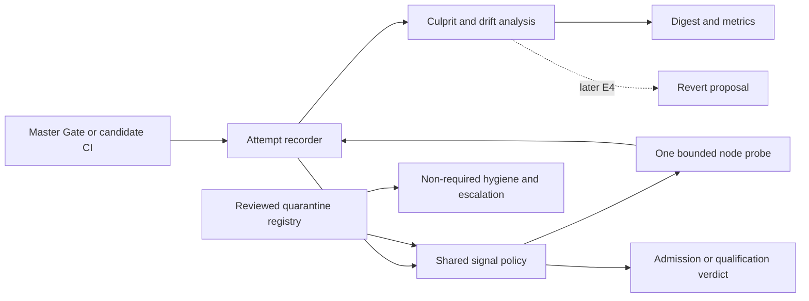

# E3 trustworthy signal: readiness, E1/E2 behavior changes, and an initial design

Independent research by **cdx**, 2026-10-23. Live observations were collected around 15:55–16:06 UTC. This report uses the shared design, accepted E2 plan, audited epic records, source code, and independent GitHub/PyPI reads. No report, transcript, or findings from another researcher in this swarm were consulted.

## Recommendation

**Start E3 now, but start with its evidence contract and a conservative retry policy. Do not treat E2 as complete or make E3 responsible for completing the release cutover.**

E1 is closed and its principal protections are deployed. E2 has delivered substantial infrastructure: an exact core dependency, a sealed candidate format, real-install exercises, candidate-bound qualification evidence, an observe-only steward, and release metrics. Publication, operational cutover, and decisive live qualification acceptance remain unfinished. E3 therefore has real integration surfaces to build on, but also several unsafe assumptions to resolve before its output can authorize retries or identify a culprit.

The most important findings are:

1. **Installability has improved materially.** PyPI now serves sase 0.18.0, the four most recent scheduled family canaries succeeded, and 0.1.0 is yanked. The original design's “latest sase is 0.17.1 and installs fall back to 0.1.0” snapshot is obsolete.
2. **The exact-pair release train is not yet the production publication path.** The checkout still contains the legacy publisher and `publish_existing`, while `release.yml` ends with an intentional refusal for release/resume. The scheduled steward observes without taking train actions.
3. **E2 intentionally substituted a bounded job retry for E3's absent node retry.** The accepted E2 plan explicitly keeps that retry as a future backstop. Simply adding node retries would create a compounded retry policy. E3 needs a shared retry budget and an evidence format that distinguishes workflow attempts from test attempts.
4. **An isolated pass does not establish a false red.** The original design correctly requires order-dependent defects to stay red, but its “rerun only failed nodes” prescription cannot prove that by itself. Choose a conservative acceptance rule explicitly.
5. **E3 attribution must not trust the current `release_metrics green` result without repair.** It can count duplicate exercise legs as complete coverage, and its Full CI aggregate requirement conflicts with N1 advisory-job semantics. Both behaviors were reproduced with small in-memory inputs.
6. **Current red CI is not evidence that retries are the main remedy.** The latest Full CI failed before tests on a reproducible setup-order defect. The latest Master Gate had four failing nodes in one shard, above E3's proposed three-node retry limit.

E3's exit should remain the original one: mechanisms deployed, adversarial acceptance demonstrated, and a measured baseline published. The under-3% false-red soak belongs to E6's entry decision, not E3's completion.

## Evidence boundary and present state

The primary source snapshot is `sase@35e593bcc01553b14b4b5109cbc7992162c1caa6`. It pins core source revision `246e28743538b6cd4d4e098b6960085c3e8ef5a9`; the opened core checkout was `db2ce6375a7bb92c7218d6190f2a6346952e6ad5`. Claims below distinguish source implementation, recorded acceptance, and live observations. Source availability does not establish successful production rollout.

| Item | Observed state | Consequence |
| --- | --- | --- |
| E1 `sase-1my` | Closed, six phases closed; landing evidence dated October 19 | A usable foundation, with explicit acceptance exceptions |
| E2 `sase-1n6` | In progress; phases .1–.4, .7, .8 closed; .5, .6, .9, .10 in progress | Qualification acceptance, publish/confirm, handover, first real steward release remain open |
| PyPI sase | 0.18.0; uploaded October 19 at 11:09 UTC; requires `sase-core-rs>=0.42.0,<0.43.0` | The currently published release still uses a range |
| Checkout sase | `pyproject.toml` declares `sase-core-rs==0.42.0` | Exact pinning is implemented for future builds; it cannot change 0.18.0's existing metadata |
| PyPI core | 0.42.1, five distribution files | Latest published core differs from checkout's exact selected version and source pin |
| PyPI plugins | github 0.2.24, telegram 0.4.29, research-artifacts 0.2.0 | github's former unpublished `sase>=0.18.0` floor is now satisfiable |
| Family canary | Scheduled runs October 20, 21, 22, 23 succeeded | Four successful daily observations; not a completed seven-day soak |
| New Release workflow | Latest two relevant runs, both October 20, failed before producing qualification proof | The later identity fix needs a fresh successful rehearsal |
| Release steward | Fifteen-minute schedule in source; no `--live` on scheduled ticks | A successful steward run means the observer ran, not that it shipped anything |

Live package metadata came from each package's [PyPI JSON API](https://pypi.org/pypi/sase/json), including the version-specific [sase 0.18.0 metadata](https://pypi.org/pypi/sase/0.18.0/json). Other package endpoints are listed in the sources. Local `git tag --contains` found no tag containing the checkout's pinned core revision. This is consistent with the observed latest public core 0.42.1; it is not a claim about an unpublished future release.

### A small operational baseline

These are bounded samples of latest workflow runs, not a statistically representative flake study:

| Sample | Window, by run creation | Results |
| --- | --- | --- |
| Latest 30 Master Gate runs | October 20 21:16:23 to October 23 15:23:38 UTC | 25 failed, 5 succeeded |
| Latest 20 Full CI runs | October 22 15:16:30 to October 23 15:33:40 UTC | 20 failed |
| Latest four scheduled install canaries | October 20–23 | 4 succeeded |

The inspected [Full CI run 39979320330](https://github.com/sase-org/sase/actions/runs/39979320330) failed in `full / build-core / build-core`, at `astral-sh/setup-uv@v4`: its cache dependency glob matched no `sase-core/**/pyproject.toml`. In `build-core.yml`, setup-uv executes before either core checkout. The dependent lint/test jobs were skipped. This is a setup/harness failure, not a collected-test flake, and a node retry cannot help it.

The inspected [Master Gate run 39977879162](https://github.com/sase-org/sase/actions/runs/39977879162), at the same SHA, passed docs, lint, core-wheel and seven test shards. Shard 8 reported **4 failed, 6,922 passed, 8 skipped**:

- `tests/monitor/test_monitor_diagnostics.py::test_supervisor_freezes_stage_manifest_and_retained_log_metadata`
- `tests/ace/tui/test_custom_gate_modal_sizing.py::test_compact_width_scales_and_caps_at_120`
- `tests/ace/tui/test_custom_gate_modal_sizing.py::test_compact_scroll_refits_after_resize`
- `tests/ace/tui/test_custom_gate_modal_sizing.py::test_custom_preview_rail_grows_and_stacks_at_narrow_breakpoint`

Those are observed assertion failures. This research did not rerun them, so it does not classify them as deterministic defects or flakes. Under the proposed threshold, this shard is ineligible for node retry regardless.

**Do not label 25/30 or 20/20 a false-red rate.** Repeated failures of one broken setup step, repeated dispatches on one SHA, product regressions, and flakes have different denominators and remedies.

## What E1 changed

E1's accepted scope was installability of the family: retention by consumer need, published sibling floors, a clean-install canary, headroom reporting, and recovery procedures.

| Developer/operator behavior | Before | Delivered behavior and limits |
| --- | --- | --- |
| Core deletion planning | Newest-N retention could remove the only core usable by a supported sase release | Retention protects dependency needs for at least ten supported consumer releases, newest 30 cores, complete platform sets, and baseline/recovery candidates; unreadable metadata refuses the plan |
| Historical broken releases | Easy to overlook or conflate with a new deletion | Already-unresolvable windows are reported; they do not permanently prevent otherwise safe reclamation |
| Plugin release PRs | A plugin could declare a floor absent from PyPI | Shared `release-dependency-floor` check fails with `DEPENDENCY_UNPUBLISHED`; delayed sibling publication can trigger bounded scheduled rechecks |
| Public installation checks | A resolver could silently install an older usable release and look green | Linux/macOS canaries compare installed family versions with newest usable releases, reinstall exact selected versions, check core compatibility and load plugin entry points |
| Canary alerting | An incomplete result could appear green | Both expected OS artifacts and successful smoke execution are required; artifacts include run, attempt, SHA, OS and first failed step |
| Storage pressure | Size pressure could be handled without consumer context | Core headroom reporting and protected-set refusal make storage decisions explainable |
| Recovery | Ad hoc deletion/republication assumptions | Runbook and dispatch-only TestPyPI drill tooling; old sase 0.1.0 is confirmed yanked |

Two nuances matter for E3:

- The canary is a **detector**, not an admission gate. A red public install is input to E2's steward and recovery policy. E3 quarantine or retry must not suppress that severity signal.
- The retention code's “confirmed-working baseline” currently means the two newest sase releases whose dependency windows contain a complete core. That is a resolver/platform-completeness proxy, not a persisted runtime-canary success certificate. Do not reuse the phrase as proof that an arbitrary historical test baseline passed.

Recorded acceptance includes protected versions and refused deletions, unreachable-PyPI refusal, a green two-platform canary and impossible-version red probe, and a plugin floor probe using `sase>=99`. The E1 landing record explicitly says the **seven-day soak was not completed** and the **TestPyPI drill was not run**, with those waits/drills declined by the owner. Its decision-record addition was also declined. The epic's closed status must not erase these exceptions.

The four later daily green canaries strengthen operational confidence. They do not retroactively supply the unrun recovery drill. Today's [canary 39955243994](https://github.com/sase-org/sase/actions/runs/39955243994) is the most recent success observed.

Sources: audited `bead:sase-1my`; `tools/check_family_install`; `tools/check_release_dependency_floor`; `.github/workflows/install-smoke.yml`; core `.github/scripts/pypi_retention.py`.

## What E2 changed, and what it has not changed yet

The actual E2 plan expands the original eight-phase sketch into ten phases. Use the actual bead numbers when coordinating work; original “E2.3 qualification” now corresponds to **sase-1n6.5**.

| E2 component | Delivered developer-facing behavior | Readiness limit |
| --- | --- | --- |
| Core cut and retention seam (.1) | Core release checks can retry failed jobs once; in-flight sase tags protect exact core pins | This is job retry, not E3 test-node retry; do not combine the policies blindly |
| Exact build (.2) | `release.yml` has release, resume and rehearsal modes; identity assertion; one wheel plus one sdist; candidate/generation, digests and observations | Tag release/resume intentionally ends red before publication; old tags do not acquire later workflow fixes |
| Exact core (.3) | Checkout declares `==0.42.0`; core-ensure selects complete published versions; local development uses explicit core overrides | Current public 0.18.0 still declares a range; source-containment enforcement has an open defect |
| Real-file exercise (.4) | Linux/macOS × wheel/sdist; isolated installation and application exercise, upgrade checks; injected macOS failure support | Live end-to-end proof remains part of the unfinished train acceptance |
| Qualification (.5) | Reusable CI supports explicit source ref and published-core mode; versioned N1 inventory; typed evidence bound to candidate, generation, SHA, core version, job/run/attempt and policy digest | The acceptance child is still open; latest relevant rehearsals failed before qualification |
| Publish/confirm (.6) | Intended retained-byte upload, digest-checked resume and PyPI confirmation | Not implemented as an operational publisher in this snapshot |
| Steward (.7) | Rust-owned deterministic decisions with Python readers/effects; typed blockers; restart-safe action keys; scheduled observation | Scheduled ticks do not take actions; release merge authority is a separate switch |
| Metrics (.8) | Read-only `tools/release_metrics`, including `green <sha> --json`, windows and numerator/denominator reporting | Useful scaffolding; the attribution predicate needs the repairs below |
| Handover (.9), acceptance (.10) | Planned removal of competing release authority and first real steward release | Both remain in progress |

The legacy [publish workflow](https://github.com/sase-org/sase/blob/35e593bcc01553b14b4b5109cbc7992162c1caa6/.github/workflows/publish.yml) still exposes `publish_existing` and uses `skip-existing: true`. The new [release workflow](https://github.com/sase-org/sase/blob/35e593bcc01553b14b4b5109cbc7992162c1caa6/.github/workflows/release.yml) still has its terminal “not yet qualified” refusal. Thus it would be inaccurate to tell developers that publishing now always uses retained qualified bytes or that ci_watch has already yielded merge authority to the steward. I did not inspect or change private ci_watch configuration; the source and open handover phase are enough to reject a claim of completed cutover.

### Qualification semantics already available for E3

The N1 inventory makes these release blockers: lint, Python 3.12/3.13/3.14 tests, and the four exercise legs. Visual tests, performance floors, tutorial tests, and AcePageGroup isolation are advisory. Admission remains the separate Master Gate.

The evaluator rejects missing, unreadable, cancelled, skipped, zero-test, collection-error and harness evidence. It preserves prior job evidence, permits at most two workflow attempts, and requires a carried-forward successful job to be the same execution. Rerunning an already-successful blocker is rejected.

The pytest collector is controller-owned, prevents nested pytest from overwriting the outer report, and captures first failing IDs and `FLAKY:` lines. It does **not** execute E3 retries. Its current `collected` value is largely derived from observed node outcomes; E3 should add separate selected/collected/completed sets rather than interpreting this count as a full expected-test inventory.

The accepted E2 plan explicitly says its job retry is a backstop until and after E3. E3 must change that integration deliberately; an undocumented removal or multiplication of retries would contradict the accepted contract.

### Concrete E2 seams to repair or settle before E3 rollout

1. **Repair build-core setup ordering and rerun live qualification acceptance.** Current Full CI is not even reaching test collection. The old identity command defect was repaired in `ba7ab4e96b`, but the latest relevant release runs remain the October 20 failures [39495874381](https://github.com/sase-org/sase/actions/runs/39495874381) and [39495879106](https://github.com/sase-org/sase/actions/runs/39495879106). Repair presence and deployed proof are separate facts.
2. **Close the source-containment gap already recorded on E2.** `release.yml` currently supplies `--core-source-pin` by grepping the requirement in `pyproject.toml`, not by reading `sase-core-revision.txt`. The manifest's public dependency clause checks a version and file inventory but not ancestry of the selected core tag. The E2 parent already records this as a discovered issue. E3 must not equate “published-core tests passed” with “the published core contains the required source revision.”
3. **Fix the attribution baseline predicate.** `assess_release_green` counts successful exercise jobs by name prefix and total count, allowing four copies of Ubuntu/wheel to satisfy four required legs. It also first filters Full CI runs by aggregate success, so advisory failure can eliminate passing N1 blockers. An older successful run is accepted without establishing whether a later comparable run contradicts it. These semantics are unsuitable for selecting a trusted culprit-search endpoint.
4. **Agree the shared workflow boundary.** E2 owns CI inputs/checkouts, release/publish behavior and candidate evaluation. E3 owns test execution steps and signal policy. E3.7 visual promotion follows stable .5 qualification. Avoid concurrent independent edits to the same workflow sections.

For item 3, independent in-memory probes on the stated source SHA produced:

```text
DUPLICATE_LEGS True
  required=4, passed=4, all four jobs named exercise (ubuntu-latest, wheel)
ADVISORY_RED_AGGREGATE False
  missing=['full_ci', 'n1_blocking_jobs'] despite the modeled blocking lint job passing
```

The first is a false-green defect. The second confirms the current aggregate prerequisite; whether to retain it is a policy choice, but it conflicts with the advertised N1-only boundary and should not silently control E3 attribution. The duplicate-leg issue was also already mentioned in the unrelated documentation review commit `92d271364c`; this report's probes are independent corroboration, not a newly claimed discovery.

## Proposed E3 architecture

Build one chain of evidence: **execute → record immutable attempts → evaluate signal → attribute → report**. Keep execution facts distinct from a policy decision to accept a recovery.



### 1. One versioned evidence envelope

Extend the existing E2 envelope rather than creating a second JSON vocabulary. Separate:

- **Identity:** repository, tested SHA/tree, execution-tool revision, workflow and caller scope, run ID, workflow attempt, job ID/matrix, candidate/generation when applicable.
- **Environment:** source/published core mode; expected and observed core source revision or published wheel digest; Python patch version; OS/architecture/runner image; dependency resolution digest; pytest/xdist versions; worker count and distribution mode; shard assignment digest; relevant clock/seed inputs.
- **Selection and completeness:** selected node-ID digest/count, collected set/count, deselections with explicit policy reasons, completed outcomes, missing nodes, collection and setup/teardown errors. Zero expected tests must be an explicit lane policy, never inferred from exit zero.
- **Attempts:** immutable attempt 1 and at most one eligible node probe; raw exit status, failure phase, normalized signature, duration and log locator; retained first failure even after recovery.
- **Decision:** `pass`, `recovered`, `test_red`, or `no_verdict`, plus reason, evidence links, retry budget consumed, quarantine policy digest and any safety-critical exclusion.

A first assertion failure is `test_red`; “deterministic” requires replication and belongs to attribution. Setup, coverage, collection, timeout, missing evidence and recorder failures must remain distinguishable. Use pytest's [exit status contract](https://docs.pytest.org/en/stable/reference/exit-codes.html) together with reports; exit 1 alone is not a complete eligibility test.

E2's strict schema readers reject extra fields. Therefore add a schema version and coordinated reader/writer changes, with fixtures for old retained manifests, rather than inserting new fields into schema v1. Candidate identity must remain independent of later observations. Every observation should bind the signal-policy digest as well as N1's digest.

Python should collect pytest events, launch subprocesses and handle GitHub transport. Shared retry eligibility, quarantine interpretation, verdict composition and attribution policy belong in `sase_core`, with wire types and bindings. The existing Rust `release_steward` is an integration point, not a reason to reimplement policy in each frontend. Bump sase's core-revision CI pin when adding bindings.

**Separate tooling runtime from the candidate runtime.** A new E3 binding used by the test runner cannot be assumed present in an older published core being qualified. Either the tooling environment carries the source-pinned policy core separately, as the steward already does, or qualification waits for the required tooling core to be published. Never replace the candidate's selected published wheel with a newer source wheel to make the harness work.

### 2. Bounded retries with honest recovery

Recommended initial rules:

1. Eligibility requires a complete first attempt, one to three unique failing test nodes, and only approved test-failure phases. No retry for collection/harness/setup failures, missing evidence, zero collection, cancellation, timeout, coverage failure, or protected safety tests.
2. Attempt 1 is retained before a probe starts. Probe precisely those node IDs, once, with the same code, dependencies, clock and declared configuration. Preserve exact node IDs, including parametrization; do not scrape a formatted terminal summary.
3. An isolated passing probe records recovery evidence, but **does not by itself authorize green for a new unknown signature**. Initial auto-acceptance should be restricted to a reviewed transient-flake policy entry. Unknown or order-sensitive failures stay red pending diagnosis. A known order failure is never eligible for automatic acceptance.
4. Every accepted recovery emits a stable `FLAKY:` line and structured evidence. Repeated recovery increments debt and can trigger escalation; it must not silently retire a test.
5. The workflow attempt and node attempt have independent identities but one durable budget. E2's job backstop may survive for explicitly unhandled legacy lanes, but must not reset a consumed node budget. A second workflow attempt must not give every failed node a fresh retry allowance.

This conservatism is a deliberate refinement of the original sketch. Pytest documents order and shared-state dependence as causes of flaky behavior, and warns about permanent permissive xfail use. A fresh isolated run removes precisely the context needed to reproduce some bugs. [Pytest flaky-test guidance](https://docs.pytest.org/en/stable/explanation/flaky.html).

If broader automatic recovery is desired, the alternative is an order-preserving replay of the original causal execution unit. That requires captured worker order, predecessor context and resource conditions, and can rerun passing predecessors. It is a larger and more expensive contract than “only failed nodes once.” Do not pretend the two designs are equivalent. Begin conservatively and measure the unresolved-recovery rate before expanding.

Implementation seams:

- `tools/run_pytest` already owns selection, shards, environment cleanup and worker-token leases. Normal lanes currently `execv` pytest, so a multi-attempt executor must deliberately change process supervision or sit around that runner. Preserve child cleanup, token accounting and tmp guards.
- `tests/_pytest_qualify_evidence.py` claims one output path using an exclusive `.owner` file. Each attempt needs its own path; reusing the first path can silently prevent a second process from recording.
- xdist controllers should aggregate; workers should not race to write the final envelope. Include setup/teardown and worker-crash outcomes.
- Preserve the original 3.12 coverage measurement and threshold. A successful tiny retry must not replace the first coverage database or turn a coverage failure green.
- Keep test steps conditional on successful prerequisites. Use `always()` for bounded evidence/report uploads, not as permission to continue setup or publication after failure. GitHub specifically warns against indiscriminate `always()` on critical setup tasks. [GitHub expression guidance](https://docs.github.com/en/actions/reference/workflows-and-actions/expressions#always).

Local `just check` and ToolRun triage should keep their current contracts. CI recovery is an explicit composite command's result, not rewriting the raw failed attempt or changing KNOWN/FLAKY receipt semantics. The project decision “Triage Annotates; It Never Changes an Exit Code” remains intact.

### 3. Quarantine as reviewed debt, not an automatic classifier

Use a small versioned registry with exact node IDs, bounded signature predicates, affected lane/platform, owner, existing bead, evidence, introduction date, expiry, safety classification and review reason. Fail closed on malformed policy or overbroad patterns. One observed isolated pass must not automatically create an entry.

There are two mechanisms to distinguish:

- A known-flake entry permits a narrowly defined recovered outcome after its bounded probe.
- A quarantine exclusion temporarily removes a particular test from blocking execution, while an advisory quarantine lane continues exercising it and records the coverage exception.

Keep the test visible in selected/collected/deselected accounting. An xfail or missing test must not look like an ordinary pass. Default-deny quarantine for release integrity, authorization, deletion safety and other selected safety-critical contracts.

Expiry must **not reintroduce a time bomb into admission**. Keep the reviewed exclusion stable until explicitly removed, fail a separate non-required hygiene job, escalate the existing owner/bead once per escalation stage, and include the overdue entry in the digest. Use real control-plane time for hygiene; the +30-day test canary must not mass-expire debt entries. Detect removed/renamed node IDs and require a reviewed resolution.

The existing `tests/reproducible_flake_baseline.txt` and `tools/selection_health` are not a quarantine implementation: they track reproducible full-lane flake debt and retirement timestamps. Reuse their evidence and bead identities, but do not reinterpret every baseline line as permission to exclude a test or accept a retry. Keep local selection-health and CI quarantine policies distinct during migration.

### 4. Parity and drift

Add `.python-version` with the project's selected development default, proposed 3.12; keep the deliberate 3.12/3.13/3.14 CI compatibility matrix. A default file is not a reason to collapse that matrix.

For source-mode execution, compare artifact provenance with the exact `sase-core-revision.txt` value before test startup. `setup-sase` currently checks that a provenance file exists and prints its contents; it does not compare that source SHA to the expected pin. Version-only checks cannot detect different unreleased core commits with the same Cargo version.

For published mode, require the manifest version and wheel digest; separately prove source containment where E2 promises it. Exact tag SHA equality is not the right comparison for an ancestor pin. For local development, show or record intentional deviations without blocking legitimate simultaneous edits to sase and its linked core checkout; strict parity belongs in CI and explicit reproduction mode.

Run an ordinary nightly canary and a +30-day injected-time canary on the **same captured tip SHA**, with separate clock identities. Do not change the runner's system clock, TLS/OIDC validation, token expiry or cache time. First inventory tests and application clock seams so the shifted lane reports what it actually covers. Start with injectable wall-clock consumers; keep monotonic timing, test timeouts and quarantine hygiene on real time.

Use a separate drift workflow/check identity rather than adding scheduled failures to the required Master Gate identity. Add a missing-run/staleness detector: GitHub says scheduled jobs can be delayed or dropped under load, so a cron expression alone does not establish daily coverage. [GitHub scheduled-event behavior](https://docs.github.com/en/actions/reference/workflows-and-actions/events-that-trigger-workflows#schedule).

### 5. Attribution for E4, without doing E4's job

Use the first observed failing SHA with a comparable green parent as a **suspect**, not a proven culprit. Verify the selected signature fails at the suspect and passes at its parent, proposed initial `k=2` on each, with matching environment, clock and selection policy. Keep k and resource caps configurable and visible.

Classifications:

- `recovered`: failure disappears under the declared probe policy; retain whether that was admissible or only diagnostic.
- `culprit`: the signature reproduces at the suspect and not at its parent under comparable conditions.
- `drift`: the unchanged source/environment comparison demonstrates a time or external-input change; parent also-red alone is insufficient proof.
- `unknown`: missing history, unstable reproductions, differing failures, mismatched environments, or budget exhaustion.

A `culprit-check.yml` job should execute the target revision's application/tests with an explicitly identified trusted diagnostic harness, retaining both revisions. This avoids relying on old target commits containing today's diagnostics. Triggering inputs must name immutable SHAs. Run reproduced code without publication credentials or issue-write authority; a separate reporter can post sanitized facts. No revert or automatic commit belongs in E3.

For release-lane bisection, separate three notions: admission-green, N1 source-CI green, and candidate-pair qualification green. They are not interchangeable. Repair `release_metrics green` to enumerate unique matrix identities and comparable attempt evidence. Then expose lane-specific anchors. Do not require an ordinary commit to have a tag-only exercise run before it can be a source-lane bisection baseline.

Historical endpoints can have different core pins and dependencies. Record those differences; if they cannot be held comparable, emit unknown rather than blame whichever commit happens to precede the red. A missing test at the parent is not a passing test. Cap search depth and runner minutes, and retain unresolved intervals.

E4 can consume the evidence bundle and propose a revert later. E3 should never label a culprit solely because it was the first red after a sequence of unobserved commits.

### 6. Metrics that cannot improve by hiding evidence

Extend the E2 read-only transport and report vocabulary, with explicit windows and denominators:

| Metric | Definition |
| --- | --- |
| Initial test-red rate | Comparable completed first attempts with test failures / comparable completed first attempts |
| Accepted recovery rate | Eligible red attempts accepted after the bounded policy / eligible red attempts |
| Diagnostic recovery rate | Isolated recoveries still withheld from acceptance / eligible red attempts |
| Confirmed false-red rate | First-attempt reds adjudicated as non-regression under a documented rule / comparable completed first attempts |
| Unknown/no-verdict rate | Missing, cancelled, harness, timeout or otherwise unclassifiable observations / all expected observations |
| Red minutes/day | Union of time intervals when the latest observed tip is red, clipped to each UTC day; unknown gaps reported separately |
| Attribution latency | Failure observation to classified evidence; p50/p90 with sample count and unresolved/censored cases |
| Quarantine debt | Active/expired entries, duration and recurrence, segmented by lane and owner |
| Escape rate | Confirmed regressions missed by admission but found by defined later lanes / comparable admitted changes, with observation horizon |
| Retry cost | Additional runner minutes and test executions / first-attempt work |

Deduplicate by repository, tested SHA, policy/environment identity, run/job and execution attempt as appropriate. Report distinct-SHA statistics alongside execution statistics. Multiple new workflow dispatches on one unchanged SHA must not manufacture an apparently large independent sample. A zero denominator is “not observed,” not 0%.

Retain compact evidence beyond ordinary Actions artifact expiry, following E2's durable candidate-observation pattern. The digest should link the first failure, probe, owner and age, with a bounded top list. This research's raw workflow counts are an initial operational snapshot, not the E3 exit baseline.

## Suggested work split and sequencing

Retain the original seven E3 slices, but make the interface work and acceptance dependencies explicit.

| Slice | Deliverable | Prerequisites and exit proof |
| --- | --- | --- |
| E3.1 Signal contract and bounded executor | Versioned evidence, Rust policy, Python recorder/executor, CI adoption | First agree E2 retry budget and schema migration. Prove accepted planted transient recovery, deterministic red, order-dependent red, collection/zero/harness refusal and no compounded retry |
| E3.2 Quarantine | Registry, advisory execution, real-time hygiene, idempotent escalation | Depends on signal accounting. Expiry fails hygiene only; missing node and overbroad policy refuse; protected tests cannot be quarantined |
| E3.3 Parity | Python default, source provenance and published-wheel checks, reproduction metadata | Can start alongside .1. Wrong source artifact fails before tests; published mode remains distinct; legitimate local core work has an explicit path |
| E3.4 Drift | Same-SHA ordinary and injected-clock canaries, coverage description, stale-run detection | Depends on parity/evidence. Planted application time bomb fails +30-day canary without changing admission or quarantine expiry |
| E3.5 Attribution | Dispatchable suspect/parent verification, lane-specific bisection, typed result | Repair baseline predicate first. Planted culprit, external drift and irreproducible failure reach correct classifications; missing parent test stays unknown |
| E3.6 Digest and baseline | Read-only collection, durable rollups, cost and denominator reporting | Instrument early; publish baseline after adoption. Prove reruns, duplicate evidence, missing days and zero denominators cannot improve metrics falsely |
| E3.7 Visual promotion study | Measured recommendation and recorded decision | After E2 qualification stabilizes. Default remains advisory; promote only with stable false-red rate, incremental defect yield and acceptable latency |

Avoid a new umbrella program that absorbs E2's unfinished publishing or E4's reverts. E3 can make progress while E2 finishes, but CI acceptance needs a functioning harness. Have one integration owner for `ci.yml` and the evidence schema; source/tooling work can proceed independently of PyPI administrative handover.

### Required adversarial cases

1. One reviewed transient failure recovers once; first attempt and `FLAKY:` survive.
2. Four failures get no node retry; an error plus one assertion failure also gets no retry.
3. A contaminating predecessor causes a victim to fail in-suite and pass alone; admission stays red.
4. Collection error, no collection, cancelled job, worker crash, truncated report and evidence-upload failure all withhold green.
5. Setup/teardown failure, coverage failure and ordinary assertion failure remain distinct.
6. Re-running a GitHub job cannot reset a consumed node budget; full-workflow retries cannot cherry-pick fresh green blocker histories.
7. Nested pytest and xdist workers cannot overwrite attempt 1; missing expected nodes are detected.
8. Duplicate matrix legs, wrong SHA/core/policy digest, stale generation and changed carried-forward success all refuse.
9. Quarantine expiry escalates hygiene only; a protected test and a renamed node cannot disappear silently.
10. Injected +30-day application time reveals a time bomb while network authentication, monotonic deadlines and debt expiry remain real-time.
11. Candidate published-core execution never falls back to a source wheel, even when E3 tooling needs a newer binding.
12. A reproduced culprit is linked to evidence; parent-also-red, missing parent test and budget exhaustion return unknown or independently evidenced drift.
13. Advisory visual failure does not silently veto a policy that declares it advisory; safety vetoes remain explicit separate decisions.
14. Retry signal does not alter ToolRun raw exit history or receipt eligibility.

## Decisions needed before implementation starts changing CI outcomes

The research supports these defaults; they are design recommendations, not new permissions or configuration changes:

- Accept only reviewed transient signatures after isolated recovery; keep unknown isolated passes diagnostic.
- Enforce a single retry allowance across node probes and E2's workflow backstop.
- Keep quarantine expiry nonblocking for admission, with mandatory owner escalation and continued advisory execution.
- Put shared signal/attribution policy in Rust; keep pytest integration and transport in Python.
- Expose separate lane baselines instead of one overloaded “release-green” boolean.
- Keep visuals advisory for this epic unless the measured promotion study supports a later change.

The key readiness gate is a shared E2/E3 contract plus working source/published-core CI, not waiting for every E2 phase to close. The current implementation and live evidence are sufficient to design and begin E3. They are not sufficient to promise that adding retries will restore release cadence or to turn automatic culprit-based reverts on.

## Sources and verification

### Audited project inputs

- [Original converged design](pypi_release_reliability_design_and_work_split/pypi_release_reliability_design_and_work_split.md), read through `sase artifact read research:202610/pypi_release_reliability_design_and_work_split/pypi_release_reliability_design_and_work_split.md`.
- Accepted plan `plan:202610/e2_release_train_steward.md`, read through `sase artifact read`.
- Epic records `bead:sase-1my` and `bead:sase-1n6`, read through `sase bead read`; the former includes acceptance exceptions, the latter the open source-containment finding and live-proof history.
- Audited project decisions `decisions:triage-annotates-does-not-change-exit-codes` and `decisions:check-full-is-explicit`.

### Source at the inspected revision

- [N1 inventory](https://github.com/sase-org/sase/blob/35e593bcc01553b14b4b5109cbc7992162c1caa6/.github/release-qualification.json)
- [Qualification evaluator](https://github.com/sase-org/sase/blob/35e593bcc01553b14b4b5109cbc7992162c1caa6/tools/_release_qualification.py) and [evidence validation](https://github.com/sase-org/sase/blob/35e593bcc01553b14b4b5109cbc7992162c1caa6/tools/_release_qualification_evidence.py)
- [Pytest evidence plugin](https://github.com/sase-org/sase/blob/35e593bcc01553b14b4b5109cbc7992162c1caa6/tests/_pytest_qualify_evidence.py), [pytest runner](https://github.com/sase-org/sase/blob/35e593bcc01553b14b4b5109cbc7992162c1caa6/tools/run_pytest), [rerun contract tests](https://github.com/sase-org/sase/blob/35e593bcc01553b14b4b5109cbc7992162c1caa6/tests/test_release_candidate_rerun.py)
- [Master Gate](https://github.com/sase-org/sase/blob/35e593bcc01553b14b4b5109cbc7992162c1caa6/.github/workflows/master-gate.yml), [CI](https://github.com/sase-org/sase/blob/35e593bcc01553b14b4b5109cbc7992162c1caa6/.github/workflows/ci.yml), [Build Core](https://github.com/sase-org/sase/blob/35e593bcc01553b14b4b5109cbc7992162c1caa6/.github/workflows/build-core.yml), [setup-sase](https://github.com/sase-org/sase/blob/35e593bcc01553b14b4b5109cbc7992162c1caa6/.github/actions/setup-sase/action.yml)
- [Release metrics](https://github.com/sase-org/sase/blob/35e593bcc01553b14b4b5109cbc7992162c1caa6/tools/_release_metrics.py), [steward workflow](https://github.com/sase-org/sase/blob/35e593bcc01553b14b4b5109cbc7992162c1caa6/.github/workflows/release-steward.yml), [family checker](https://github.com/sase-org/sase/blob/35e593bcc01553b14b4b5109cbc7992162c1caa6/tools/check_family_install)
- [Core steward policy](https://github.com/sase-org/sase-core/tree/db2ce6375a7bb92c7218d6190f2a6346952e6ad5/crates/sase_core/src/release_steward) and [consumer-driven retention](https://github.com/sase-org/sase-core/blob/db2ce6375a7bb92c7218d6190f2a6346952e6ad5/.github/scripts/pypi_retention.py), inspected in the checkout opened with `sase repo open sase-core`.

### Live and upstream sources

- GitHub workflow collections and job logs, read through the GitHub connector; workflow-specific listing fell back to `gh run list` because that connector endpoint was rejected. Run links appear beside the observations above.
- PyPI JSON metadata: [sase](https://pypi.org/pypi/sase/json), [core](https://pypi.org/pypi/sase-core-rs/json), [github](https://pypi.org/pypi/sase-github/json), [telegram](https://pypi.org/pypi/sase-telegram/json), [research-artifacts](https://pypi.org/pypi/sase-research-artifacts/json).
- GitHub [rerun semantics](https://docs.github.com/en/actions/how-tos/manage-workflow-runs/re-run-workflows-and-jobs): a rerun retains the event's SHA/ref and original triggering actor's privileges. This does not freeze mutable external dependencies or make separate workflow dispatches equivalent evidence.
- Pytest and GitHub primary documentation linked beside the design claims above.

Verification performed: source/history inspection, audited artifacts/beads, read-only live API/CLI observations, and two direct in-memory probes of the baseline evaluator. No production workflow was dispatched, release configuration changed, package published, quarantine applied, or code modified. No repository test suite was run for this research-only deliverable. Current live defects are reported with ownership/integration recommendations; this report does not claim they were fixed.
