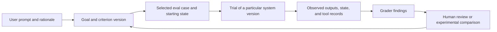

# Goals as the basis for SASE evals: a reading guide and design questions

Researcher: cdx  
Date: 2026-10-13  
Scope: independent research for research.4f; no other researcher's report or findings from this swarm were consulted.

My recommendation is to use goals to preserve **what success means, who wanted it, and why**, then attach evaluation evidence to that intent. An eval should give you evidence for a decision: whether to adopt a model, revise a prompt, trust a completion claim, or improve the goal itself. It should not become the authority that decides what you want.

For a first reading session, choose **#1, #2, and #3** in the ranked list at the end. For the most direct connection to your goal design, add **#4 and #5**. My strongest new conceptual finding is that evaluation criteria often become clearer *while you inspect outputs*. Your recent changes of mind about goals need not be a prerequisite problem to solve before starting evals; they are a reason to make criteria and judgments traceable.

## Context I used, and which direction I favored

I reviewed the shared prior research through audited artifact reads and opened the private job research checkout through `sase repo open`.

- [Goals inspiration, round two](../goals_inspiration_round_two_reading_list/goals_inspiration_round_two_reading_list.md), published in the research repo on October 6, is the latest relevant goals reading synthesis I found. It emphasizes human ownership, articulation, evidence-backed claims, standing goals, and honest settlement.
- [Recent goals redesign readings](../goals_redesign_recent_reading_list/goals_redesign_recent_reading_list.md) records the newer desire for lighter goal creation, a Goals tab, review of both plans and outcomes, standing goals, and goal-related orchestration. I treated that as more relevant than the September designs.
- [Databricks research](../databricks_nyc_cv_and_role_pitches/databricks_nyc_cv_and_role_pitches.md) and its [v2 follow-up](../databricks_nyc_cv_and_role_pitches/databricks_nyc_cv_and_role_pitches_v2.md) distinguish task-success evals from existing harness verification. The v2 decision was to skip the optional pilot then, not evidence that a pilot had been completed. Its carried specification proposed 8–12 coding tasks from merged history, frozen starting commits, tests as the oracle, repeated trials, and failures/timeouts retained in the denominator.
- In the private `bbugyi200/job--research` repo, `202610/agent_platform_and_devtools_job_openings/agent_platform_and_devtools_job_openings.md` repeats that distinction: SASE's trust and failure-classification infrastructure is relevant experience, but it is not yet evidence of real-agent task success. It recommends the same small pilot.
- Your Bob annotations on the [AutomationXP26 goals paper](https://www.microsoft.com/en-us/research/publication/goals-as-first-class-abstractions-in-human-ai-collaboration/) particularly favor goals at any level, links to the originating prompt, agent history, alignment checks for subgoals, and goals driving evals. Your library marks this paper finished on October 13, so I use it as an anchor rather than recommending it again.

There is a timing mismatch worth making explicit. The loaded project memory describes a Rust-owned goal ledger and host binding as accepted decisions; your prompt describes goals as forthcoming, while prior research calls them partially built. I did not audit implementation completeness. This report concerns the design opportunity, and does not assume that a usable goals feature or a goal-eval subsystem exists.

The [goals workshop paper](https://www.microsoft.com/en-us/research/publication/goals-as-first-class-abstractions-in-human-ai-collaboration/) is a research agenda, not a controlled demonstration that encoding goals improves agent outcomes. Its empirical companion, [Nudging Attention to Workplace Meeting Goals](https://arxiv.org/abs/2602.16939), studied 361 employees and 7,196 meetings. The pre-meeting intervention's effect was not statistically significant; post-meeting measurement apparently prompted reflection in both groups. That makes it a useful caution: even collecting goal feedback can change the behavior you are trying to measure.

## What an eval is, in terms useful for SASE

An eval is a repeatable way to ask: **given this situation, did this version of the system meet these criteria?**

The helpful vocabulary is a **case** with inputs and success conditions, a **trial** that attempts it, **observed evidence**, and one or more **graders**. The transcript describes the run; the outcome is what actually happened in the environment. Those are distinct objects in [Anthropic's agent-eval guide](https://www.anthropic.com/engineering/demystifying-evals-for-ai-agents).

For example:

> Goal: A user can cancel a running monitor and see a truthful terminal status.

A candidate eval could start a known long-running command in an isolated environment, ask an agent to implement the requested behavior, then independently exercise cancellation and inspect the resulting state. The agent saying it implemented cancellation is a completion claim. A generated diff is work evidence. The observed behavior is outcome evidence.

Existing unit tests of SASE's own state transitions remain useful. Real-agent evals add a different experiment: can an agent, using the actual SASE workflow, deliver the requested change? The grader may use ordinary tests. What changes is the system under test and the input distribution.

An eval also needs an intended decision. “Model A scored higher” is less useful than “under our budget and review policy, Model A completed more of these real tasks without unacceptable errors.”

## The most useful connection: a goal is a source of cases, not automatically a case

This is my proposed conceptual separation, not an implementation plan:

A live goal can generate evaluation material: the initial request, a clarification, a failure, an accepted output, or a disputed completion claim. But reproducing that goal as an experiment requires selecting a starting state, a bounded scenario, allowed interventions, and a grading rule.

I would keep at least these distinctions in mind:

| Question | Suitable object or evidence | Mistake to avoid |
| --- | --- | --- |
| What do I want, and why? | Person-owned goal linked to the request | Treating a benchmark score as the user's objective |
| What experiment are we running? | Frozen case, environment, constraints | Replaying today's changed goal against yesterday's conditions |
| What happened? | Host/tool observations and produced artifacts | Accepting the agent's narration as the outcome |
| Was a criterion met? | Tests, rubric judgments, human assessments | Converting all unknowns into passes or failures |
| Did the agent claim completion honestly? | Claim compared with independently assessed evidence | Measuring only correctness of the final artifact |
| Do I consider this goal settled? | Human decision, with reasons | Treating an automated grade as human acceptance |

The relationship can also be many-to-many: a standing goal may motivate hundreds of cases, while one run may provide evidence for several criteria. A single launch binding need not dictate the shape of analytical relationships.

This lets goal creation stay light. You need not require every goal to arrive with a complete benchmark definition. More structure can be added when you promote a scenario into an eval.

## Four tensions the readings illuminate

### 1. Set criteria before execution, but let people refine them

[Factory's Missions architecture](https://factory.com/news/missions-architecture) writes a validation contract before defining features, then uses fresh agents to validate behavior. The order is intended to prevent correctness criteria from merely reflecting the implementation already planned.

[EvalGen's paper](https://arxiv.org/abs/2404.12272) supplies the necessary counterweight. Its nine-expert qualitative study found criteria drift: inspecting outputs caused people to add or refine criteria and sometimes revise previous grades.

My inference: record a criterion version before a trial, but permit explicit revision afterward. Preserve what changed and why. If you compare system versions under revised criteria, regrade both sets of outputs where possible. Do not quietly move the standard only for the candidate you prefer.

This also separates two legitimate activities: exploring what you value and measuring progress against a currently agreed standard. Both matter; they should not be presented as the same experiment.

### 2. Measure outcomes and consequential behavior, without demanding one plan

A final artifact can be correct despite a harmful or untrustworthy process. For instance, a research report might contain good recommendations while using sources you explicitly forbade. Conversely, an agent can take an unexpected route and still satisfy your request.

[Braintrust and Basis's behavior-spec article](https://www.braintrust.dev/blog/behavior-specs) gives a practical representation for recurring expectations: intent, evidence, decisions, execution, recovery, and failure modes. Their judges use true, false, and not-applicable labels.

My inference: distinguish outcome criteria from behavioral constraints. Evaluate observable requirements such as honoring scope, preserving evidence, and handling missing information. Avoid turning a successful reference solution's exact tool sequence into the only accepted method.

A standing requirement might be “claim validation only for the current artifact version.” That is different from an incidental preference such as which test command the agent uses first.

### 3. Broad goals require explicit assumptions about contribution

The classic [goal-oriented requirements survey](https://webperso.info.ucl.ac.be/~avl/files/RE01.pdf) connects high-level objectives, refinements, responsibilities, environmental assumptions, and obstacles. It also distinguishes goals of achieving a state from maintaining one.

My inference: “all child tasks finished” should not automatically certify the parent outcome. You still need to believe that the decomposition is sufficient and its assumptions hold.

For “make SASE easier to trust,” a child that adds test-result links is only a hypothesis about contribution. You might then examine review effort, incorrect acceptances, and subsequent reopenings. For “keep the system healthy,” a successful check today says something about a time window; it does not finish the objective forever.

The useful inheritance from this older literature is its questions, not an obligation to implement a formal goal graph or require mathematical predicates for every user intention.

### 4. Evaluate the human-agent arrangement as well as the agent

The [oversight study](https://arxiv.org/abs/2602.16844) found that its improved interface reduced error-finding time and increased confidence without meaningfully improving final accuracy. [τ²-bench](https://arxiv.org/abs/2506.07982) models both a user and an agent acting on a shared environment, and separates communication/coordination failures from other errors.

My inference: an eval for SASE should specify how human decisions enter the run. An agent operating with helpful clarifications and approvals is taking a different test from one operating without them.

For your review surface, useful quantities could include review time, important errors caught, incorrect acceptances, and reversals. For orchestration, they could include whether the agent surfaced an unresolved conflict before acting. These are candidate research questions, not proven metrics for your particular workflow.

A human acceptance click is useful evidence of preference; it is not an infallible label of technical correctness.

## What I would try to learn first

The earlier Databricks pilot remains a good learning exercise. I would make its purpose narrower than a general SASE leaderboard: **learn whether you can measure task success and diagnose a disputed result.** Goals can provide provenance even before the complete goal experience is built.

1. **Choose one concrete comparison.** For example, compare the same agent workflow with and without a concise explicit outcome and acceptance criteria. This tests the value of goal articulation rather than merely demonstrating a runner.
2. **Use the proposed 8–12 historical tasks as a pilot, not a precise ranking.** Check that the reference change passes the grader and that the unfixed starting state reveals the relevant defect. Freeze the prompt, criteria, dependencies, and starting revision.
3. **Keep the answer and grading authority outside the agent's control.** A parent commit is not enough isolation if the repository still reveals the future solution through history. Preserve grader tests independently so an agent cannot pass by weakening them.
4. **Compare under a stated operating policy.** Keep resources, retry budget, human interventions, and relevant SASE/model versions comparable. [Anthropic's infrastructure study](https://www.anthropic.com/engineering/infrastructure-noise) found a six-percentage-point Terminal-Bench spread across resource configurations with the same model and harness.
5. **Report every launched trial and its disposition.** Keep timeouts, crashes, cancellations, and missing evidence visible. For user-facing delivery reliability, these remain in the denominator; diagnose infrastructure failures separately rather than silently dropping them. State a different estimand explicitly if you also report conditional solving ability.
6. **Read the failures before adding machinery.** For each failed criterion, ask whether the agent failed, the environment failed, the grader was wrong, or the request was underspecified. Record at least one disagreement with a reason.

The success table should have room for cost and human attention. The case for doing this is reinforced by [AI Agents That Matter](https://arxiv.org/abs/2407.01502), which critiques accuracy-only comparisons, weak holdouts, and poor reproducibility. A repeatedly solved tiny task bank will not tell you that the system generalizes.

Two particular measurements deserve separate names:

- **Task success:** did the independently inspected result meet the frozen criteria?
- **Completion-claim precision:** among runs that claimed completion, how many actually met those criteria?

Claim precision alone can be gamed by never claiming completion, so also track the proportion of successful runs for which completion was claimed, plus unjustified continuation and premature claims. This is my proposed SASE-specific extension, not a finding that the papers validated.

For repeated trials, the original [τ-bench paper](https://arxiv.org/abs/2406.12045) distinguishes reliability across attempts from merely finding one successful attempt. Under a simplified independent-trial model with success probability 0.8, at least one success in three attempts is 99.2%, whereas three successes out of three is 51.2%. These are very different operating promises. Shared environment problems and task heterogeneity can break the simple independence assumption; preserve per-task results rather than deriving reliability from one pooled average.

I would postpone a framework choice until these exercises expose a real storage, tracing, or grading problem. The question is whether SASE's existing records make evidence easy to inspect and experiments easy to repeat. The report does not propose installing an eval service, launching agents, or changing the goal implementation.

## Questions worth carrying into your goals design

- What is the smallest goal record that preserves intent, provenance, and the current meaning of success?
- When you reject a claim, are you correcting the output, the criterion, the goal, or the agent's interpretation? Can the feedback express that distinction?
- Can an observation demonstrate an outcome without requiring you to trust the doer's account?
- Which recurring behavioral requirements deserve evals, and which are temporary scaffolding that can be retired?
- For standing goals, what observation window and sampling policy make a judgment meaningful?
- If a subgoal succeeds, what evidence supports its contribution to the parent?
- Is the goal feature helping you accomplish better work, or mainly making agent activity look organized?

That last question requires a different kind of study. [METR's 2026 update](https://metr.org/blog/2026-02-24-uplift-update/) explains why measuring developer productivity became difficult as AI adoption changed participant selection, task selection, and concurrent work. An autonomous task pass rate should not be presented as a measured improvement in your productivity.

## Reading selection and library check

I favored readings that help define success, expose errors in judgments, connect goals to evidence, or challenge a tempting design assumption. This is an inspiration list, not an exhaustive survey of eval frameworks. I deliberately included older foundational work because this request sets no publication-age limit.

Sources are the authors' papers, author-hosted articles, or official research/product posts. Vendor architecture accounts demonstrate possible designs; they do not establish independent comparative effectiveness. The goal position paper and oversight/productivity studies also concern settings that differ from SASE.

Before ranking, I checked 18 distinct works in one batched `bob ref find` call, with two extra title lookups to catch alternate identities for the Hamel articles. Two works matched your library: the goals paper is finished, and Anthropic's eval guide is queued. The other candidates were not found under the checked identities; that is not proof you have never read them. I also reviewed a capped page of recently finished external references for context. Prior inclusion in a SASE research report was not treated as external reading history.

The unranked candidates were the already-read goals paper, its meeting-goal experiment discussed above, and the previously suggested “Optimized but Unowned” paper. The latter is peripheral to the eval questions prioritized here. Companion works count individually in the library check but share a ranked entry where reading them together is more useful.

## Ranked articles and papers to consider reading

### 1. Your AI Product Needs Evals — Hamel Husain

[Read the article](https://hamel.dev/blog/posts/evals/) · March 29, 2024 · Practitioner article · Beginner-friendly.

**Why first:** it explains how to start without a sophisticated eval platform. The Rechat case connects scoped assertions, human inspection, model graders, and product experiments. Its updated caution about raw grader agreement on imbalanced data is particularly useful.

**Bring this question:** what are the things you already inspect manually after a SASE agent finishes, and which could become repeatable checks?

**Read closely:** “The Types of Evaluation” and “Looking At Your Traces.”

**Limit:** a practitioner's case study, not a universal sequence every project must follow. For SASE, this is an orientation before any tool selection.

### 2. Demystifying evals for AI agents — Anthropic

[Read the article](https://www.anthropic.com/engineering/demystifying-evals-for-ai-agents) · January 9, 2026 · Engineering article.

**Already in your library, queued since 2026-01-11; legacy backlog.**

**Why second:** it provides the best compact map of agent evals, including grader choices, outcome inspection, repeated attempts, environmental isolation, and a practical starting process. Its research-agent examples make it relevant beyond coding.

**Bring this question:** what would let you grade a SASE run from observed artifacts and state rather than its final response?

**Read closely:** “The structure of an evaluation,” “Understanding non-determinism,” and the zero-to-one roadmap.

**Limit:** vendor experience, not evidence that a particular grader or task count is sufficient for your product.

### 3. Who Validates the Validators? Aligning LLM-Assisted Evaluation of LLM Outputs with Human Preferences — Shankar et al.

[Read the paper](https://arxiv.org/abs/2404.12272) · April 18, 2024 preprint; UIST 2024 · HCI paper.

**Why third:** this is the strongest bridge between learning evals and still discovering what your goals should mean. EvalGen helps people generate and calibrate evaluators; its criteria-drift finding challenges the idea that all standards can be finalized before seeing results.

**Bring this question:** when your interpretation of “good” changes, how should SASE preserve that change without making historical comparisons misleading?

**Read closely:** sections 7.3.1 and 8.1.

**Limit:** a small qualitative study and prototype, not a demonstration of reliable automated goal settlement.

### 4. Goal-Oriented Requirements Engineering: A Guided Tour — Axel van Lamsweerde

[Read the author's PDF](https://webperso.info.ucl.ac.be/~avl/files/RE01.pdf) · August 2001 · Survey/tutorial paper.

**Why this high:** it directly connects goals to verification, rationale, alternative refinements, environmental assumptions, and obstacle analysis. It supplies a deeper vocabulary for “at any altitude” than most contemporary agent articles.

**Bring this question:** if the proposed subgoals are all achieved, why should the parent outcome follow?

**Read closely:** section 2 and the goal-reasoning material in section 5, particularly obstacles and conflicts.

**Limit:** formal requirements work, including safety-critical examples. Borrow the distinctions while keeping SASE's goal creation light; you need not adopt the whole method.

### 5. “It's Hard to Eval” Is a Product Smell — Hamel Husain

[Read the article](https://hamel.dev/blog/posts/eval-smell/) · June 29, 2026 · Illustrated practitioner article.

**Why here:** its central argument is that products should produce outputs that people can verify without redoing the entire job. That speaks directly to your goal review surface and evidence-backed claims.

**Bring this question:** what should SASE put beside a completion claim so that you can challenge it quickly?

**Read closely:** the interactive before/after examples.

**Companion:** [How Missions Work](https://factory.com/news/missions-architecture), Theo Luan, April 10, 2026, for a concrete contract-before-plan and validator architecture.

**Limit:** informative design accounts, not proof of unbiased graders or accurate human decisions.

### 6. Behavior specs, an open standard for supervising long-horizon agents — Ankur Goyal and Mitchell Troyanovsky

[Read the article](https://www.braintrust.dev/blog/behavior-specs) · July 29, 2026 · Braintrust/Basis product-engineering article.

**Why here:** it gives a compact way to describe recurring judgment and recovery requirements. Its emphasis on sparse specs is helpful when you want evals without another large requirements bureaucracy.

**Bring this question:** which standing expectations about SASE agents deserve continuous checks even when their outputs look correct?

**Read closely:** “Behavior specs,” “Specs that don't rot,” and the distinction between testing adherence and deciding whether a requirement is worthwhile.

**Limit:** an advocated standard and vendor account. Do not infer that a trajectory judge can reliably assess every stated behavior.

### 7. τ-bench, followed by τ²-bench — Yao et al.; Barres et al.

[τ-bench](https://arxiv.org/abs/2406.12045) · June 17, 2024.  
[τ²-bench](https://arxiv.org/abs/2506.07982) · June 9, 2025.  
Benchmark research papers.

**Why here:** the first provides a clear example of grading against the resulting world state and measuring repeated-run consistency. The second adds a user who also acts on the world, making communication and coordination part of success.

**Bring this question:** what are the simulated user, starting state, policy constraints, and observable goal state for one realistic SASE scenario?

**Read closely:** the evaluation method in τ-bench, then the dual-control formulation and ablations in τ²-bench.

**Limit:** customer-support environments and simulated users. Their model scores do not transfer to SASE.

### 8. AI Agents That Matter — Kapoor, Stroebl, Siegel, Nadgir, and Narayanan

[Read the paper](https://arxiv.org/abs/2407.01502) · July 1, 2024 · Benchmark-methodology paper.

**Why here:** it is the best antidote to optimizing a small task bank until one architecture appears superior. It argues for cost-aware comparisons, useful holdouts, and reproducibility.

**Bring this question:** are you comparing better reasoning, more retries, a larger resource budget, or memorization of your own eval cases?

**Read closely:** sections 2, 4, and 5.

**Limit:** its empirical comparisons involve older agents and benchmarks. Read the measurement argument, not the historical model rankings. A small internal pilot can still be useful if you state its limited purpose.

### 9. Overseeing Agents Without Constant Oversight: Challenges and Opportunities — Grunde-McLaughlin et al.

[Read the paper](https://arxiv.org/abs/2602.16844) · February 18, 2026 · HCI research paper.

**Why here:** it treats human review as a system that needs evaluation. That is essential if goals funnel agent outputs into a Needs Review surface.

**Bring this question:** does your interface help you find errors, or merely make accepting outputs faster?

**Read closely:** the outcome-oriented Specification design and final controlled study.

**Limit:** computer-use/question-answering tasks, not SASE coding workflows. The useful result is the warning against equating confidence, speed, and accuracy.

### 10. We are Changing our Developer Productivity Experiment Design — METR

[Read the update](https://metr.org/blog/2026-02-24-uplift-update/) · February 24, 2026 · Research-methods article.

**Why here:** it shows how measurement becomes harder when people change which tasks they attempt and run agents concurrently.

**Companion:** [Measuring the Impact of Early-2025 AI on Experienced Open-Source Developer Productivity](https://metr.org/Early_2025_AI_Experienced_OS_Devs_Study-paper.pdf), July 2025. In its specific 16-developer, 246-task setting, AI use increased completion time by 19%.

**Bring this question:** if SASE makes previously unattractive work possible, what would an unchanged-task timing metric miss?

**Limit:** neither the 2025 result nor the update establishes your productivity effect in late 2026. This is a lesson in experimental design.

### 11. Quantifying infrastructure noise in agentic coding evals — Anthropic

[Read the article](https://www.anthropic.com/engineering/infrastructure-noise) · February 5, 2026 · Engineering measurement article.

**Why here:** it makes evaluation environments part of the question. RAM, CPU, timeout policies, and concurrency can change what a successful run requires.

**Bring this question:** which conditions must you record before attributing an improvement to a goal prompt or model change?

**Read closely:** “How this affects measurement” and “Recommendations.”

**Limit:** the measured magnitudes are benchmark-specific. The point is to control and disclose conditions, not to apply a six-point correction to SASE scores.

### 12. AgentBoard: An Analytical Evaluation Board of Multi-turn LLM Agents — Ma et al.

[Read the paper](https://arxiv.org/abs/2401.13178) · January 24, 2024; revised December 23, 2024 · NeurIPS 2024 paper.

**Why here:** it provides a concrete alternative to final success alone: observed progress against annotated subgoals, used for analysis.

**Bring this question:** which intermediate observations explain a failed SASE run without pretending that task count equals progress?

**Read closely:** section 2.2 and Appendix L.

**Limit:** progress annotation introduces assumptions. Its maximum-achieved progress measure can conceal later regression; treat that as historical diagnostic evidence, not proof of the current goal state.

Library check: 2 of 18 candidates already in your library (1 finished).
