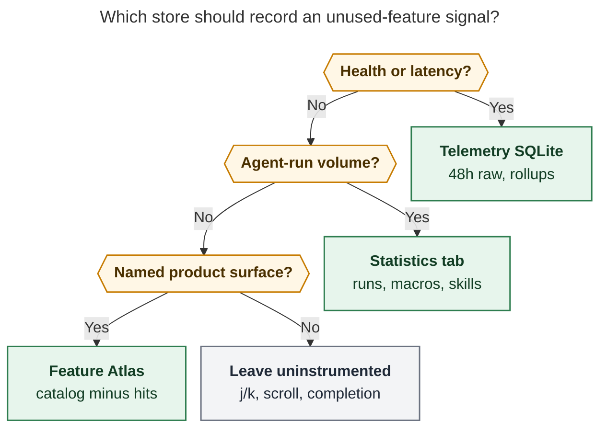
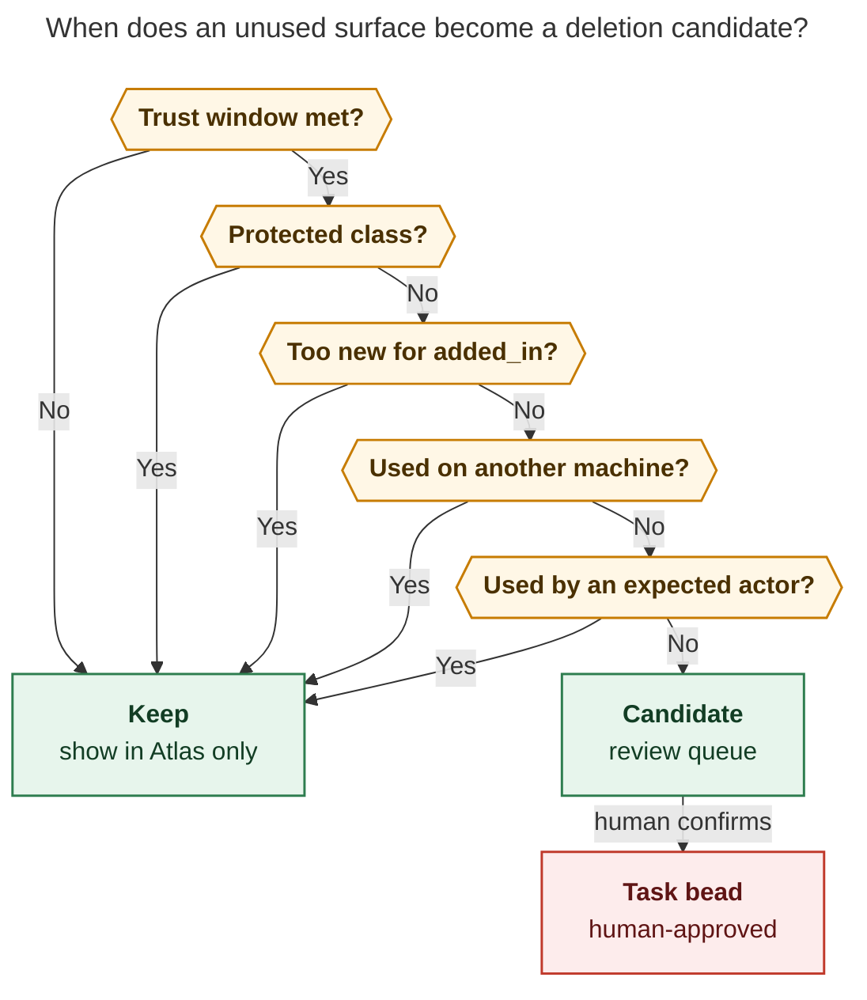

# Feature Atlas: product-surface coverage for SASE

**Question.** How should SASE record which parts of the product Bryan actually uses, so that after a month or two he can find functionality worth deleting, without slowing the TUI, without storing secrets, and with a path to later opt-in export?

**Answer.** Build a **Feature Atlas**: a code-owned catalog of named product surfaces, cheap in-memory hit counters against those IDs, a new Admin Center Statistics view that sorts *zeros first*, and a human review queue. Do not build a general-purpose analytics platform, do not log payloads, and do not treat two months of silence as a delete order.

This report is independent. It uses the live sase and sase-core trees on 2026-10-27, the existing Statistics / telemetry / skill-use machinery, and public practice from Mozilla Glean, Homebrew Analytics, JetBrains FUS, and the Grok `/learn` unused-surface ritual.

## Bottom line

1. **The goal is good. The framing is too broad.** "Detailed usage tracking" suggests event streams, funnels, and payloads. The deletion question needs the opposite: a complete catalog of deletable units, plus a count, a first-seen, a last-seen, and an actor. Mozilla's Glean rule applies here: it is impossible to collect a measurement that has not been declared.

2. **A large slice of this already exists, and it answers the wrong question.** Admin Center Statistics (`#` then `6`) already reports run volume, providers, skills, macros, plans, and perf. Those views are *top-N of what fired*. Deletion needs the catalog complement: surfaces with **zero** hits. The Activity view is titled "Top …" because it is truncated. Unused macros and unused skills are already recoverable by joining existing logs to existing catalogs; unused TUI commands and unused CLI leaves are not.

3. **Do not extend `~/.sase/telemetry/metrics.sqlite`.** The telemetry docs are explicit: that store is debugging and health history; product-usage questions belong on durable records behind the Statistics tab. Keep that split. Atlas gets its own SQLite file, its own retention, and its own query API in sase-core.

4. **Do not instrument the TUI hot path beyond a single atomic increment.** `tui_perf.md` forbids disk I/O, JSON parsing, and subprocesses on the event loop. Key-to-paint p95 is already targeting under 16 ms. A dict increment is fine. A flush, a catalog rebuild, or an argv serialization on `j`/`k` is not. Exclude high-frequency chrome (row movement, scroll, completion probes, auto-refresh ticks) from the catalog entirely.

5. **Two months of local data on one machine is not a deletion corpus.** Bryan's fleet is at least athena, apollo, and mac. A command used only on mac looks unused on apollo. Agents invoke CLI surfaces Bryan never types. Safety commands (`sudo`, `restore`, `migrate`, `doctor`) are supposed to be rare. Atlas produces *candidates*; a human review queue, a protected class, and a cross-machine pack/merge are part of the product, not follow-up.

## Critique of the request

The request is directionally right and slightly overspecified in ways that would make the first version either slow, leaky, or misleading.

### What is right

- **The deletion motive is real.** This checkout's CLI registrar table has 68 top-level groups and about 507 `add_parser(` calls. The TUI command catalog has 133 `AppKeymaps` actions, with 359 keymap fields across ten scoped keymap classes. There are 21 bundled macros, about 20 generated skills, six live feature flags, eight Statistics views, and eight Admin Center sections. Static unused-symbol lint (`symvision`) finds unused *code*. This finds unused *product*. Those are different sets.
- **Performance is a binding constraint.** The TUI is already too slow. Any design that writes on the keystroke path, or that makes Statistics load heavier on first paint, will fail the existing perf rules before it helps anyone delete anything.
- **No sensitive data, even before export.** Skill-use logs today store `cwd`, `reason`, `agent_name`, and `artifacts_dir`. Artifact consumption logs store resolved paths and refs. Memory-read stats key on `canonical_path`. Those ledgers are useful locally and unsafe to ship. The atlas store has to be export-safe *from the first row*, so a later opt-in pack is a filter over counts rather than a redaction project.
- **Visualization is part of the feature.** A JSONL file Bryan greps in two months will not get used. The Statistics tab already has the right visual language: tiles, sparklines, legends, `?` glossary, range chips, off-thread load, empty-per-view states.

### What would go wrong if implemented as written

**"Detailed" invites payloads.** Command argv, prompt text, project keys, bead titles, file paths, and skill reasons are the first things a naive logger grabs. Homebrew's command analytics records command and option *names* after option *values* have been removed, and still treats that as the sensitive edge. Atlas should store even less: a catalog id, an actor, a day bucket, a count.

**"A month or two" is a candidate window, not a verdict.** Homebrew's public docs say analytics must not replace maintainer judgement, and that low usage alone does not establish that removing a command is safe. The Grok `/learn` skill says the same in one line: *zero hits is evidence, not proof.* Seasonal workflows, disaster-recovery commands, and features added last week all look unused on a 30-day clock.

**"After I have enough data" delays the UX.** The view is how you learn whether collection is complete. An Atlas that opens on day one, full of honest zeros and a "recording for 3 days · not yet trustworthy" chip, is how catalog gaps get found. Designing the dashboard after the corpus exists is how you discover you never recorded TUI modal keymaps.

**One machine is not Bryan's product.** Tailnet memory names athena, apollo, and mac. Deletion review has to union packs from every machine Bryan uses, or the atlas will recommend deleting the mac-only nvim / screenshot / tmux surfaces.

**External opt-in export is a later epic.** It should freeze the pack schema now (so local rows stay shippable) and should not drive v1 networking, identity, or sampling. Homebrew shows a notice *before the first send*. Local recording can be on by default, matching `telemetry.enabled: true`. Sending stays off until a later, gated epic.

### Is this a good idea?

Yes, with the adjustments below. The product is large, Bryan wants it smaller, and the existing Statistics tab cannot name a zero. The alternative approaches are weaker for this goal:

| Approach | What it finds | Why it is insufficient alone |
| --- | --- | --- |
| `symvision` unused symbols | Dead code | A public command with no callers in-tree can still be a human workflow |
| Admin Center Statistics | Top skills, macros, providers, runs | Truncated to highest-volume rows; zeros are invisible |
| `sase skill log` / `sase stats` Activity | Skills and memory notes that fired | No TUI commands, no CLI leaves, no "never" |
| TUI traces (`SASE_TUI_TRACE`, stalls JSONL) | Perf forensics | Opt-in, high volume, not a product catalog |
| Grok `/learn` | Unused Grok skills, plugins, MCP servers | Different harness; does not see `sase bead` or TUI leader keys |
| Shell history mining | Some human CLI | Misses agents, TUI, macros; paths and args leak |

The Atlas is the missing join: **catalog minus hits**, with actor and freshness.

### Would I take a different approach?

I would still build local coverage, and I would start smaller than "detailed tracking":

1. **Week one, no new store:** generate the catalog from parsers, `CommandSpec`, macro catalog, skill sources, and the flag registry. Join it to `skill_uses.jsonl` and run-level `macros.json`. Print unused macros and unused skills tomorrow.
2. **Week two, cheap hits:** in-memory counters at CLI dispatch and TUI command dispatch, flushed like telemetry, queried as Statistics view 09.
3. **Week three, review ritual:** protected class, markdown export, `sase stats atlas pack` / `merge` so Bryan can union machines without a server.
4. **Later:** opt-in HTTPS pack to a Bryan-owned endpoint, with the same JSON the dry-run already printed.

I would not build session replay, funnels, user properties, a web dashboard, or a Prometheus export. SASE already removed the bundled Prometheus / Grafana / Pushgateway stack in the sase-6k telemetry epic. Reintroducing a monitoring stack for this would be a new unused surface.

## Requirement adjustments

These are deliberate changes to the request. Each is justified.

1. **Replace "detailed usage tracking" with "catalog coverage ledger."** The unit of data is a named surface, not an event. Justification: Glean and Mozilla's probe guidance both start from "minimum data that answers the question." The question is "which named surfaces have zero hits?"
2. **Exclude high-frequency chrome from the catalog.** Do not count `j`/`k`, scroll, mouse highlight, completion candidate queries, or auto-refresh ticks as product usage. Justification: those paths would dominate the store, burn the TUI budget, and never inform a deletion.
3. **Record actor as a required dimension:** `human-tui`, `human-cli`, `agent-cli`, `scheduler`, `plugin`. Drop `test`. Justification: agents will make the CLI look fully used; humans will make TUI navigation look fully used. Deletion of an agent-facing command needs agent hits; deletion of a TUI command needs human-tui hits.
4. **Trust window: 90 days of recording *and* "since this surface was added," whichever is later.** Two months remains a useful *preview*. Justification: a surface added in last week's release is unused by construction.
5. **Protected class in the catalog, not in the viewer's head.** Safety and recovery surfaces (`sudo`, `restore`, `revert`, `migrate`, `doctor`, `disk`, `repro`, `revive-log`) can appear in the unused list with a badge; they cannot enter the review-to-delete queue automatically.
6. **Cross-machine pack/merge in v1, network export in a later epic.** Justification: Bryan cannot make a deletion decision from apollo alone. A JSON pack he copies from mac is enough. A server is not.
7. **Visualization ships with collection.** The Statistics Atlas view, `sase stats atlas`, and `?` glossary are phase 1, not a sequel.
8. **Keep the name off `usage` and `telemetry`.** `sase usage` is provider subscription windows. `sase telemetry` is health metrics. Call this **Atlas**. Query it as `sase stats atlas` so it reuses the Statistics range / format / JSON envelope machinery.
9. **Permanent config, not a feature flag.** Flags are temporary routes. Local recording is a user-facing choice like `telemetry.enabled`. Default recording on, default export off.
10. **Never copy existing audit payloads into the atlas store.** Skill reasons, cwd, memory paths, and artifact paths stay in their current ledgers. Atlas may join *counts* from those ledgers by catalog id.

## What already exists

On this checkout, product-adjacent recording is already split across four systems. Atlas should consume them, not fork them.

### Local health telemetry

`docs/contribute/telemetry.md` describes the current contract:

- In-process accumulators, periodic flush, Rust-owned SQLite at `~/.sase/telemetry/metrics.sqlite`.
- Raw retention 48 hours, 5-minute rollups 30 days, hourly rollups one year.
- Failed flushes retry a few times and then drop; they never interrupt SASE work.
- `telemetry.enabled: true` by default; disabled mode leaves no-op stubs connected.
- Counters for agent runs, LLM invocations, hooks, VCS, finalizers, tool-run recording. Labels are low-cardinality (`provider`, `status`, `workflow`). Run ids, argv, and agent ids are forbidden as metric labels.

This is the right *flush architecture* to copy and the wrong *schema* to extend.

### Admin Center Statistics

Eight views, loaded only while visible, aggregated off the UI thread, refreshed every 30 seconds:

| # | View | Question it answers |
| --- | --- | --- |
| 01 | Overview | How much ran, which providers / skills / projects dominate |
| 02 | Runners | Occupancy and concurrency |
| 03 | Projects | Default-branch output, code size, this machine's runs |
| 04 | Providers | Model and effort mix |
| 05 | Activity | Top skills, memory notes, workspaces |
| 06 | Macros | Macro frequency, co-usage, focus drill-down |
| 07 | Plans & Questions | Plan lifecycle and question sessions |
| 08 | Perf | TUI / launch / LLM latency from logs plus the metric store |

`sase stats project` already mirrors one of those views on the CLI, with rich / markdown / JSON and the same range parser. Atlas should be view 09 and `sase stats atlas`, not a new modal family.

The visual language to reuse: `#FF87D7` accent, `render_stat_tile` + sparklines from `sase.telemetry.render`, per-view empty states, scope chips for Range / Group / Project, `?` glossary.

### Durable activity logs

Rust `agent_stats::query_activity_stats` already scans:

- `skill_uses.jsonl` keyed by `skill_name`
- `memory_reads.jsonl` keyed by `canonical_path`
- question / plan / epic-plan gate bundles

Run stats roll up `macros.json` from agent artifacts. Those are real coverage signals for macros and skills. They are top-N. They include fields Atlas must never export.

### TUI and CLI catalogs that can generate the atlas

The catalogs already exist as code:

- TUI palette: `CommandSpec.id` (`app.<action>`, `saved_query.N`, mode keys). `execute_command()` is the single palette dispatch point.
- TUI keys: `AppKeymaps` plus nine scoped keymap dataclasses (Config, Statistics, Projects, Machines, ToolRuns, CommandLine, Gate, Memory, Snippet).
- CLI: `_COMMAND_REGISTRARS` in `parser_registry.py`, plus Rust `command_line::CommandNode.canonical_path` used by completion.
- Macros: sase-core `macro_catalog`.
- Skills: `src/sase/macros/skills/` plus `sase skill list`.
- Flags: `FeatureFlag` registry.
- Plugins: `sase_commands` entry points, dispatched before argparse.

CI can fail a PR that adds a public `add_parser`, `AppKeymaps` field, macro, or skill without a catalog row. That is the Glean property: undeclared surfaces cannot be recorded, and missing declarations cannot land.



**Caption.** Health stays in the existing metric store, agent volume stays in Statistics, and only named product surfaces enter the Atlas. High-frequency chrome is omitted on purpose.

## Industry lessons that actually transfer

### Mozilla Glean: catalog first, aggregate by default

Glean makes undeclared collection impossible: every metric lives in `metrics.yaml`, every new collection needs data review, and the first design question is "what is the minimum data that can answer this?" ([Glean overview](https://docs.telemetry.mozilla.org/concepts/glean/glean.html), [adding a probe](https://firefox-source-docs.mozilla.org/toolkit/components/telemetry/start/adding-a-new-probe.html)).

For "how many people use feature X?", Mozilla's own table picks **aggregate scalars**, not event telemetry. Rich events exist for funnels and diagnostics, at higher cost, often limited to pre-release. Firefox also ships `about:telemetry` so a user can see exactly what was recorded.

Transfer:

- The atlas catalog is `metrics.yaml`.
- Hits are scalars (counts), not events.
- The Statistics Atlas view is `about:telemetry`.
- A catalog PR is a data-collection review.

### Homebrew Analytics: deletion-shaped, fail-open, values stripped

Homebrew's [Anonymous Analytics](https://docs.brew.sh/Analytics) names the same motive: whether a feature is used enough to justify its maintenance cost. It also states the limit: analytics must not replace technical evidence, and low usage alone does not make removal safe.

Operational details worth copying:

- Command events keep names and drop values.
- No user identifier in the payload.
- Send happens in a detached process with a short timeout; failures are silent so analytics never delay the command.
- A notice appears before the *first send*; `HOMEBREW_ANALYTICS_DEBUG=1` prints the exact request.
- Maintainers mostly see public aggregates, not per-user history.

Transfer: atlas flush is fail-open; pack dry-run prints the exact JSON; export is a later notice-gated send.

### JetBrains FUS: feature IDs, not session replay

IntelliJ's Feature Usage Statistics layer (`FUCounterUsageLogger` in intellij-community) is a catalog of feature groups and counters. That is the right granularity for an IDE-shaped TUI: "this action ran," not "this pixel was hovered."

### Grok `/learn`: unused is a curation ritual

The bundled `/learn` skill already does unused-surface detection for Grok skills, plugins, and MCP servers. Its rules are the right product copy for Atlas:

- Build a catalog of what exists (`surfaces.json`) plus hit counts (`usage.json`).
- Zero hits is evidence, not proof.
- The only copy of a job is an `ask`, not a delete.
- Human curation writes a decision ledger before anything is removed.
- Secrets never appear in the inventory.

Atlas is that ritual for SASE itself.

## Recommended product: Feature Atlas

### What a surface is

A **surface** is one deletable unit of product, with a stable id:

```text
cli.bead.create
cli.stats.project
tui.app.open_admin_center
tui.statistics.next_view
macro.mentor
skill.sase_plan
flag.artifacts_files_pane
plugin.listen
admin.statistics
```

Aliases (`sase vcs` → stitch, palette vs key for the same `CommandSpec.id`) share one id. Recording the key and the palette as two unused things, while Bryan uses one of them daily, would be a false candidate.

Each catalog row carries:

| Field | Purpose |
| --- | --- |
| `id` | Stable, dotted, versioned |
| `kind` | `cli`, `tui`, `macro`, `skill`, `flag`, `plugin`, `admin`, `stats-view` |
| `label` | Human name from `--help` or palette |
| `added_in` | SASE version that introduced it |
| `protected` | `safety`, `recovery`, `infra`, or empty |
| `actors_expected` | `human-tui`, `human-cli`, `agent-cli`, … |
| `retire_with` | Optional sibling ids that must die together |

Generation is mechanical. Python walks `_COMMAND_REGISTRARS` / argparse, `APP_COMMAND_META` plus scoped keymap metadata, macro and skill inventories, and the flag registry; it emits a frozen JSON catalog. Rust core treats that file as the universe of ids it will accept. CI fails on drift, the same way `ensure_metadata_covers_app_keymaps()` already fails when a keymap field lacks palette metadata.

### What a hit is

One in-memory increment:

```text
(id, actor, yyyymmdd) -> count += 1
```

Plus `first_seen_ts`, `last_seen_ts`, and `sase_version` at first_seen. No argv. No option values. No paths. No project keys. No agent names. No reasons. No hostnames.

Optional later, still aggregate: a `flag_names` set of *option names* used (Homebrew-style), never values. Skip this in v1. Flag names have moderate cardinality and little deletion value compared to command identity.

### Where it is recorded

Three hooks cover almost all surfaces. All three must be cheaper than a log line.

1. **CLI.** After argparse (and after the bead / goal / plugin fast paths) resolve a canonical path, increment `cli.<path>` with actor `agent-cli` when `SASE_AGENT*` is set, otherwise `human-cli`. Plugin-mounted commands increment `plugin.<name>`. Fast paths still record: skipping them would make `sase bead` look unused, which is the opposite of the truth.
2. **TUI.** Wrap command execution so palette (`execute_command`) and key bindings share `CommandSpec.id` / keymap metadata ids. Actor is `human-tui`. Do this in one place; scattering `atlas.hit()` through action methods will rot.
3. **Joins, not new loggers.** Macros from run `macros.json`, skills from `skill_uses.jsonl` counts, flags from the managed flag-state file's last-changed time (or an increment in `sase flag set`). Scheduler jobs increment `scheduler.<routine>.<job>` from the existing job record, not from a new JSONL.

Tests and `just check` runs use actor `test` and are dropped from default queries.

### Storage and performance

Copy the telemetry shape, in a second file:

```text
Instrumentation (atomic increment)
        |
        v
In-process counters  (thread-safe, no I/O)
        |  15s flush for TUI/service; atexit for CLI
        v
sase_core_rs atlas bindings
        |
        v
~/.sase/atlas/hits.sqlite
        |
        +---- Statistics view 09 / sase stats atlas
```

Hard rules, all existing SASE law:

- **Never block the TUI event loop.** Flush on the telemetry flusher thread or a pump-free task. `tui_perf.md` rule 1 and rule 2.
- **Bound the increment.** Target: atlas recording adds well under 0.1 ms to a command dispatch; `SASE_TUI_PERF=1` p95 for `j`/`k` does not move, because `j`/`k` are not recorded.
- **Fail open.** A full disk, a busy SQLite, or a missing catalog id drops the hit at debug level. Homebrew's "analytics never delay the command" is the contract.
- **Busy timeout 250 ms**, WAL, short transactions, opportunistic retention on write. Match `TELEMETRY_MAX_BUSY_TIMEOUT` and the existing 250 ms default.
- **Retention:** daily buckets 400 days (covers a year plus slack). No raw per-event log. If Bryan wants a 30-day preview, the query window shrinks; the store does not need 5-minute rollups.
- **Cardinality budget:** on the order of 1e3 catalog ids × 4 actors × 400 days is a small SQLite. Refuse any hit whose id is not in the catalog (Glean property).
- **Startup:** catalog load is once per process, off first paint. Statistics Atlas loads only while visible, same as today's pane.

Put the store and the query in **sase-core**. The rust-core boundary litmus test is satisfied: CLI, TUI, and a future export sender all need the same hits. Python owns catalog generation, hook placement, and presentation, matching telemetry.

Do not reuse `metrics.sqlite`. Mixing health histograms with a product catalog would fight retention policy, label rules, and the Statistics/Perf split sase-6k already paid for.

### Privacy, local and exported

Local atlas rows are the export schema. That is the whole trick.

**Allowed in the store and in a pack:**

- catalog id, kind, label
- actor
- day
- count
- first_seen / last_seen
- sase version at first_seen
- catalog version
- recording-start timestamp
- OS family and CPU arch (Homebrew-style, for later multi-user analysis)
- "custom-prefix" if `SASE_HOME` is non-default, never the path

**Forbidden, including locally in this store:**

- argv and option values
- file paths, cwd, project keys, project display names
- agent names, prompt text, skill reasons
- bead titles, artifact refs, memory canonical paths
- hostnames, usernames, IP addresses, machine aliases
- tokens, env values, repo remotes

Existing ledgers that already contain some of those fields stay as they are. They are not inputs to `sase stats atlas pack`.

`sase stats atlas pack --dry-run` prints the exact JSON that a future send would POST. That is Homebrew's debug mode, made the default for export.

For PyPI users, later:

- Recording remains local-default-on.
- A one-time notice before the first send, with the dry-run attached.
- Opt-in config `atlas.export.enabled`, default false.
- Fail-open HTTPS, short timeout, detached, no user identifier.
- Bryan's server sees aggregates per SASE version and OS family, never a Bryan-shaped timeline of one human.

v1 does not send.

## Visualization UX

The Atlas has to feel like the rest of SASE: keyboard-first, tiled, honest about empty data, and a little bit pretty. A browser dashboard would be a new unused surface.

### Statistics view 09 — Atlas

Open Admin Center with `#`, press `6`, then `0` `9` (or `]` from Perf). Same scope header as today: **Range** (`t`/`T`/`c`), no Project chip (atlas is machine-global, like Perf), **Group** cycles `kind` → `actor` → `protection`.

**Hero tiles** (reuse `render_stat_tile`):

| Tile | Meaning |
| --- | --- |
| Surfaces | Catalog size |
| Used | Hits > 0 in range, after `added_in` filter |
| Unused | Zeros, excluding protected and too-new |
| Rare | 1–2 hits in range |
| Trust | Days recording, catalog coverage %, "not yet trustworthy" until 30 days |

Sparkline on Unused is daily unused-count, which should fall as Bryan actually uses the product and as the catalog grows.

**Body, zeros first.** Grouped by kind. Each row:

```text
cli.tmux-agent          unused   ·  0   · added v0.17  ·  human-cli
tui.app.cycle_grouping  rare     ·  2   · last 18d     ·  human-tui
macro.mentor            used     · 41   · last 2d      ·  agent-cli
cli.sudo                unused   ·  0   · protected:safety
```

Unused rows use the muted palette; rare uses the warning tile color; protected unused keep a lock glyph so they never look like "delete me."

Default filter: `unused+rare`, which is the deletion hunting ground. `g` cycles grouping. `/` filters by id or label. `x` drills one surface: daily sparkline, actor split, siblings in `retire_with`, and a one-line "why this exists" from the catalog.

**Trust chip in the header.** Until recording has 30 days and catalog coverage is ≥ 95%, the unused list renders under a banner: "Preview only — unused is not yet a candidate list." After 90 days the banner goes away for v1-era surfaces; surfaces with `added_in` inside the window stay preview-only.

**Empty states are per-filter**, matching Statistics. "No unused surfaces in the last 90 days" is a victory screen, not a bug.

**`?` glossary** defines Used / Unused / Rare / Protected / Too new / Actor / Coverage, plus the sentence Homebrew uses: low usage is not a safe-removal proof.

This is the beautiful part: the existing Statistics chrome already looks like a product. Atlas inherits it and inverts the sort. The emotional design is a map of territory Bryan has never walked, not a Grafana wall.

### CLI

```text
sase stats atlas
sase stats atlas --unused
sase stats atlas -k tui
sase stats atlas -f markdown -r 90d
sase stats atlas -j
sase stats atlas pack --dry-run
sase stats atlas merge ./atlas-mac.json
```

Bare `sase stats` already lists implemented views; Atlas becomes one of them. Markdown output is for the pager and, later, a listen-able monthly briefing. JSON is the agent-facing envelope, versioned like `project_stats_envelope`.

`pack` / `merge` are how Bryan unions athena / apollo / mac without standing up a server. Merge is by `(id, actor, day)` addition, with recording-start = min and catalog-version conflict reported, never guessed.

### What I would not build in v1

- A heatmap web page
- Per-keystroke session replay
- Project-filtered atlas (project names are identity-adjacent; TUI commands are not project-scoped anyway)
- Auto-opening the unused list on TUI start (that is how you train Bryan to ignore it)

A later delight, not v1: `sase stats atlas -f markdown -r 90d` piped through sase-listen as a monthly audio briefing. That uses a surface Bryan already cares about.

## From unused to deleted



**Caption.** Zeros become candidates only after trust, protection, recency, cross-machine merge, and actor checks. A human still has to file the bead.

The review queue is a CLI/TUI list, not an automatic epic. Each candidate shows last-seen, days-unseen, actor mix, `added_in`, protected badge, and sibling ids. Confirming creates an ordinary task bead (`feature` or a follow-up on an existing cleanup epic) with that evidence pasted. Atlas never closes a flag bead, never deletes a command, and never opens a PR.

This matches `/learn` curation and Homebrew's "maintainer judgement" line. It also matches SASE's existing flag ritual: sunset flags already have a human `FlagTriage` step.

## Phased delivery

### Phase 0 — catalog and joins (days, not weeks)

Emit the catalog. Join macros and skills. Ship `sase stats atlas` as a read-only report of unused macros/skills plus "TUI/CLI instrumentation not yet recording." This proves the UX and finds catalog bugs while the unused list is still allowed to be wrong.

### Phase 1 — hits, view 09, CLI, pack/merge

sase-core hit store. CLI + TUI hooks. Statistics Atlas. `sase stats atlas`. Pack/merge. Config `atlas.enabled`. Perf acceptance: `j`/`k` p95 unchanged; CLI fast paths (`sase bead`, `sase completion candidates`) stay on their current budgets.

### Phase 2 — trust, protection, review queue

Trust banner. Protected class. Review-to-bead. Markdown export. Catalog CI gate.

### Phase 3 — opt-in export (separate epic)

Notice, dry-run, `atlas.export.enabled`, fail-open POST of the pack schema frozen in phase 1. No schema additions that were not already local.

Phase 0 is enough to start deleting unused *macros and skills* this week. Phase 1 is the actual product. Phase 3 waits until Bryan has used pack/merge across his own machines.

## Risks

- **Observer effect.** Looking at Atlas will make Bryan try forgotten commands. That biases toward keeping things. Accept it; it is the conservative error.
- **Catalog drift.** A new CLI leaf that misses the generator looks unused forever. The CI gate is mandatory, modeled on `ensure_metadata_covers_app_keymaps`.
- **False unused from missing hooks.** Palette-only recording would mark key-driven commands unused. The shared `CommandSpec.id` is the mitigation.
- **TUI freeze from a "harmless" flush.** Treat atlas I/O as a perf feature. Stall watchdog (`tui_stalls.jsonl`) is the forensic backstop.
- **Privacy regression via joins.** A future "helpful" engineer will want to attach last agent name to a skill row. The pack schema, and a test that the SQLite pragma/table has only the allowed columns, are the guard.
- **Name collision with `sase usage`.** Doc and `--help` must say Atlas is product-surface coverage, not LLM quota windows.

## Recommended solution

Ship **Feature Atlas** as Statistics view 09 plus `sase stats atlas`.

- **Catalog** generated from the parser tree, TUI command specs, macros, skills, flags, and plugins; CI-enforced; protected class included.
- **Hits** as daily `(id, actor)` counters in `~/.sase/atlas/hits.sqlite`, Rust-owned, telemetry-shaped flush, fail-open, no payloads.
- **Hooks** at CLI canonical-path dispatch and TUI command dispatch only; high-frequency chrome omitted; macros/skills joined from existing logs.
- **UX** that inverts Statistics: zeros first, trust chip, actor split, `?` glossary, markdown/JSON/rich, pack/merge for the tailnet.
- **Deletion** as a human review queue that files beads. Two months of zeros is a preview. Ninety days, all machines merged, unprotected, not-too-new, expected actor silent: a candidate.
- **Export** later, same JSON, opt-in, notice-gated, no identity.

Do this instead of a detailed event platform, instead of stuffing feature ids into the health metric store, and instead of waiting for a server before Bryan can see his own unused TUI commands.

The first implementation patch that would earn trust: Phase 0 catalog + unused macros/skills in the existing Statistics chrome, with a banner that TUI/CLI hits are still dark. That is a small, beautiful, immediately useful slice of the same design.

## Sources

### In-tree (this checkout, 2026-10-27)

- `docs/contribute/telemetry.md` — local metric store, Statistics vs telemetry split, flush/fail-open contract.
- `docs/reference/tui/admin-center.md` and the Statistics section of `docs/contribute/telemetry.md` — eight views, keys, off-thread load.
- `docs/reference/cli/stats.md`, `telemetry.md`, `usage.md`, `skill.md` — existing command names and the `usage` collision.
- `sase/memory/tui_perf.md` — event-loop rules, p95 < 16 ms, idle ticks.
- `src/sase/telemetry/` — accumulators, 15 s flush, stubs when disabled.
- `src/sase/stats/` — Statistics view registry and Rust activity/run queries.
- `src/sase/ace/tui/commands/` — `CommandSpec`, `execute_command`, 133 app commands.
- `src/sase/ace/tui/keymaps/app_keymaps.py` — 359 fields across ten keymap classes.
- `src/sase/main/parser_registry.py` — 68 CLI groups; ~507 `add_parser(` calls under `src/sase/main/`.
- `src/sase/skills/use_log.py` — skill-use payload includes cwd and reason.
- `sase-core` `crates/sase_core/src/telemetry/`, `agent_stats/activity.rs`, `command_line/grammar.rs`, `artifact_consumption.rs`.
- Bundled Grok `/learn` skill — unused-surface curation rules.

### External

- [Mozilla: adding a telemetry probe](https://firefox-source-docs.mozilla.org/toolkit/components/telemetry/start/adding-a-new-probe.html) — minimum data, aggregate vs rich, `about:telemetry`.
- [Glean overview](https://docs.telemetry.mozilla.org/concepts/glean/glean.html) — undeclared collection is impossible.
- [Glean metrics.yaml](https://mozilla.github.io/glean/book/reference/yaml/metrics.html) — catalog-first registry.
- [Homebrew Anonymous Analytics](https://docs.brew.sh/Analytics) — maintenance-cost motive, values stripped, fail-open send, low usage is not a removal proof.
- JetBrains IntelliJ `FUCounterUsageLogger` — feature-id counters for IDE actions.
- Georg Fritzsche, [Introducing Glean](https://medium.com/georg-fritzsche/introducing-glean-telemetry-for-humans-4e8b4788b8ad) — data review as a product constraint.
