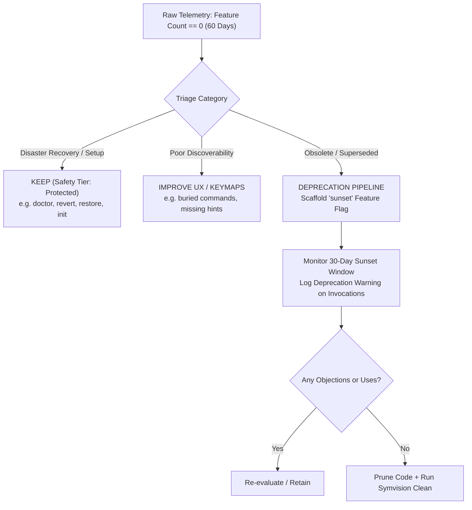
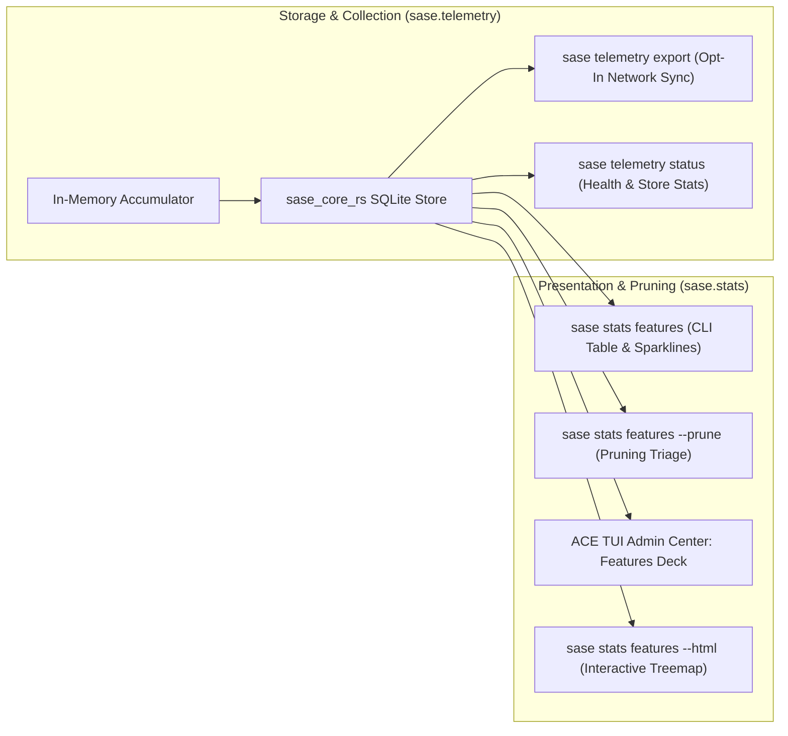
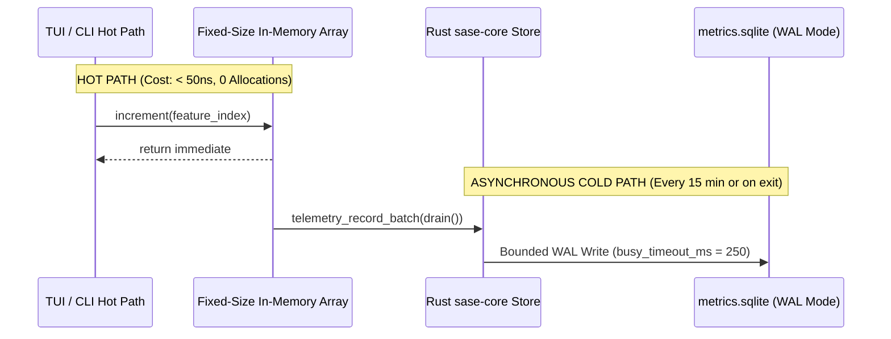
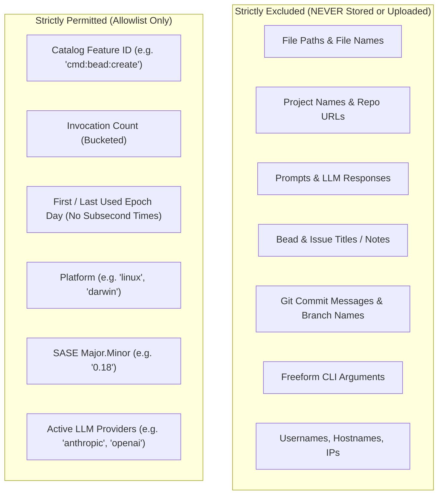
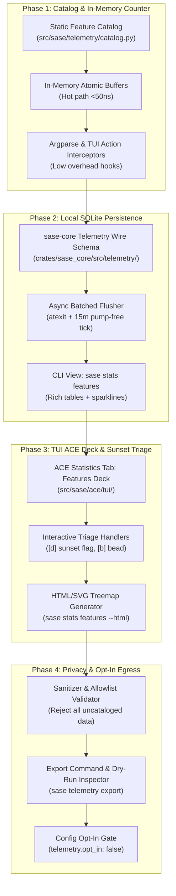

# Feature Usage Telemetry and Dead-Code Pruning in SASE: Architectural Strategy, Zero-Overhead Instrumentation, and UX Design

**Researcher:** `research.2p.gem`  
**Date:** 2026-10-27  
**Artifact ID:** `research:202610/feature_usage_tracking_and_pruning_design__gem.md`  
**Status:** Complete / Final Recommendation  

---

## Executive Summary

This research investigates the design, performance architecture, privacy guarantees, and user experience for introducing detailed feature usage tracking to SASE. The primary objective is to empower Bryan (and eventually external users) to identify dormant, unneeded functionality accumulated across SASE's extensive evolution, establishing a reliable, evidence-based pipeline for dead-code pruning.

### Core Findings & Verdict

1. **The Core Premise is Necessary but High-Risk**: SASE has expanded into a massive software engineering operating system with over 60 top-level CLI commands, hundreds of TUI widgets, complex macro swarms, and background orchestrators. Pruning dead code is urgent to arrest cognitive bloat and performance degradation. However, using raw usage counts over a 30-to-60 day period as an autonomous deletion trigger is dangerous. It risks deleting disaster recovery tools, emergency repair facilities, and low-frequency lifecycle features (the "Chesterton's Fence" dilemma), while confusing poor feature discoverability with lack of utility.
2. **Naming Conflict with Existing `sase usage`**: SASE already possesses an established CLI command group and glossary concept named `sase usage` (`sase usage list`, `sase usage refresh`), which is exclusively dedicated to LLM provider subscription quota and usage windows. Reusing `usage` for feature tracking creates immediate CLI collisions and user confusion. We recommend establishing the feature tracking domain as **`sase stats features`** for user-facing inspection and **`sase telemetry features`** for underlying storage and egress.
3. **Strict Zero-Overhead TUI Architecture**: Profiling evidence from October 2026 (`tui_gc_measurement_20261023.md`) demonstrates that the SASE TUI already suffers from severe Python garbage collection heap bloat and multi-second Gen-2 GC pauses (e.g. 2.76s idle p95 on Athena). Naive telemetry—such as allocating event objects, tracking keystrokes, or performing synchronous SQLite operations on the Textual event loop—would be fatal. Telemetry must operate strictly at the *semantic feature level* using fixed-size preallocated in-memory counters in the Rust core (`sase_core_rs`), with persistence deferred to asynchronous, batched flushes during idle ticks or process exit.
4. **Privacy-Preserving, Allowlist-Only Telemetry**: To safely enable opt-in external telemetry uploads, SASE must adopt an absolute data boundary. No user strings, file paths, repository URLs, project keys, prompt contents, commit messages, or freeform CLI arguments may ever be captured. The system must record exclusively *whitelisted Feature IDs* from an explicit Feature Catalog, accompanied by coarse environment facts and logarithmic frequency buckets.
5. **Rich, Native UX**: We propose a cohesive three-tier visualization system:
   - A fast, scriptable CLI dashboard (`sase stats features`) with Unicode block sparklines, categorical color bars, and a specialized `--prune` mode ranking dead features by code weight (Lines of Code × Inactive Days).
   - An interactive "Features & Pruning" deck embedded directly into the ACE TUI Admin Center Statistics tab, complete with single-keystroke scaffolding of SASE `sunset` feature flags (`sase flag new`).
   - An exportable standalone HTML/SVG treemap visualizing the relationship between codebase volume and real-world feature activation.

---

## 1. Critical Evaluation: Telemetry-Driven Pruning vs. Software Realities

The user's stated goal is:
> *"The goal of this change is to help me understand which parts of sase I never use. After a month or two of monitored use, for example, I would like to go through this data and use it to help me find functionality that should be deleted."*

While aggressive pruning is healthy and necessary for SASE's longevity, relying on usage telemetry as a blunt deletion trigger contains fundamental traps.



### 1.1 The Pitfalls of Telemetry-Driven Deletion

#### A. The "Chesterton's Fence" of Low-Frequency vs. Zero-Value Features
Many of the most valuable utilities in a complex developer platform are rarely used:
- **Disaster Recovery & Rollback**: Commands like `sase doctor`, `sase ace restore`, `revert_agent_workspace`, `sase patch maintenance`, and `sase telemetry cleanup-test-data` may not be touched during two months of smooth operation. However, deleting them because their invocation count is zero would leave the developer stranded during an outage or repository corruption.
- **Lifecycle & Bootstrap Tools**: Commands such as `sase init`, `sase repo init`, project onboarding wizards, and migration kits (`sase migrate`) run once per project or machine setup. Their value is high, but their ongoing frequency is near zero.
- **Safety Rule**: Telemetry cannot distinguish between an *obsolete feature* and an *infrequent emergency valve*.

#### B. The Ergonomics and Discoverability Fallacy
Zero invocations often indicate poor ergonomics rather than lack of utility:
- If a TUI panel has an obscure shortcut or is buried three levels deep in modal navigation, the user will avoid it.
- If a CLI subcommand has unintuitive argument syntax or poor shell completion, the user falls back to manual scripts.
- Deleting an underused feature without checking *why* it was underused removes capabilities that might only have needed a 5-minute discoverability improvement (e.g. surfacing a shortcut in the footer or adding an onboarding hint).

#### C. The Solo-User Persona Bias
Bryan's personal daily usage represents one specific operational pattern (heavy focus on autonomous swarm execution, specific TUI views, headless print-mode commands). However:
- SASE supports multiple agent workflows (interactive human-in-the-loop, parallel background swarms, external CLI scripts, automated CI hooks).
- If Bryan monitors only his personal usage for 60 days and deletes features that *he* never touched, he risks amputating workflows required by external users, secondary machines (e.g. Apollo vs. Athena), or future automated pipelines.

#### D. Surface Features vs. Internal Architectural Bloat
Usage telemetry tracks user-facing surface interactions (CLI commands, TUI actions, macros). But the actual bloat causing TUI slowness and maintenance drag in SASE is often *internal*:
- Dead helper classes, duplicate data converters, abandoned abstraction layers (e.g. legacy `changespec` compatibility aliases), and redundant layout watchers.
- Usage tracking cannot discover dead internal code branches. Telemetry must be paired with static call-graph analysis (such as Symvision and `vulture`).

---

### 1.2 Adjusted Requirements: The 4-Tier Pruning Lifecycle

To harness the power of telemetry without falling into these traps, we must adjust the requirements from "telemetry deletes code" to a structured **Audited Pruning Lifecycle**:

| Tier | Classification | Telemetry Threshold | Action on Zero Invocations | Examples |
| :--- | :--- | :--- | :--- | :--- |
| **Tier 1: Protected** | Safety, Recovery, Diagnostics, Setup | Excluded from pruning | Retain indefinitely; flag for health checks only | `sase doctor`, `sase ace restore`, `sase init`, `sase repo init` |
| **Tier 2: Core Workflow** | Central daily engineering surfaces | > 5 uses / month | Active maintenance; optimize performance | `sase bead`, `sase stitch`, `sase tui`, `sase run`, `sase final` |
| **Tier 3: Experimental / Incubating** | Features in beta or evaluation | < 2 uses / month | Solicit feedback; schedule for refinement or removal | New agent tabs, experimental prompt assists |
| **Tier 4: Sunset Candidates** | Standard features with zero activity | 0 uses in 60 days | Enter Deprecation Pipeline via SASE `sunset` feature flag | Unused CLI subcommands, dormant TUI modals, abandoned macros |

#### Integration with SASE Feature Flags
SASE already possesses a mature feature flag policy (documented in `sase/memory/sase_flags.md`):
- A feature identified for removal must not be deleted immediately.
- Instead, it is placed behind a `sunset` flag created via:
  ```bash
  sase flag new sunset_<feature_name> -k sunset \
    --when-enabled "Retains legacy <feature> with a deprecation notice" \
    --when-disabled "Removes <feature> code and dependencies" \
    --remove-when "No invocations recorded in 30 days after deprecation notice"
  ```
- If the feature remains unused during the sunset window, the Off branch is deleted, and the flag bead is closed.

---

## 2. Resolving the Naming Taxonomy Conflict

SASE currently features a dedicated command group named `sase usage`:
```
usage: sase usage [-h] {list,refresh} ...
Inspect and refresh cached LLM subscription usage
```
Furthermore, the SASE core glossary defines:
> **Usage Window (usage-window)**: A rolling rate limit and quota window tracked across LLM providers (Anthropic, OpenAI, Codex).

Attempting to mount feature usage tracking under `sase usage` (e.g. `sase usage tracking` or `sase usage features`) creates cognitive dissonance and breaks CLI command dispatch.

### Recommended Command Architecture

We propose separating the *storage/engine* from the *presentation/triage*:



1. **Storage Subsystem**: Mount inside `sase.telemetry` (`src/sase/telemetry/features.py`), reusing the existing SQLite metrics engine and background flusher infrastructure.
2. **Presentation Subsystem**: Mount inside `sase.stats` (`sase stats features`), aligning directly with existing Admin Center statistics views (`sase stats project`, `sase stats macro`, `sase stats activity`).
3. **Dedicated Pruning Action**: `sase stats features --prune` or alias `sase prune`.

---

## 3. Performance Architecture: Zero-Overhead Instrumentation

The user emphasized:
> *"We will need to make sure this doesn't hurt performance too much (the TUI is already too slow, for example)."*

### 3.1 Understanding the TUI Slowness Constraint

The October 2026 performance census (`tui_gc_measurement_20261023.md`) revealed that the SASE TUI on Athena experiences:
- **Idle full-collection p95**: 2.761 seconds (target ≤ 0.500s).
- **GC wall-time share**: 5.71% of total paired-interval execution.
- **RSS Growth**: Over 694 MB accumulated over a 4-hour window.
- **Underlying Cause**: Python object graphs surviving initial collection and bloat in Gen-2 garbage collector sweeps, combined with cyclic event handler references.

Furthermore, `sase/memory/tui_perf.md` establishes strict operational laws:
> - **Rule 1**: Never block the event loop. No synchronous disk I/O or JSON parsing in action handlers.
> - **Rule 2**: Off the event loop is NOT off the pump. Keep callbacks thin and synchronous; launch slow bodies with `spawn_pump_free_task()`.
> - **Rule 11**: Keystroke paths are read-only and prompt-free.

### 3.2 Anti-Patterns to Avoid

| Anti-Pattern | Mechanism | Impact on SASE |
| :--- | :--- | :--- |
| **Keystroke / Frame Tracking** | Intercepting every `j`/`k`, cursor motion, or character typed in `prompt_text_area`. | Catastrophic. Generates tens of thousands of objects per minute, triggering immediate GC freezes. |
| **Synchronous SQLite Writes** | Writing an event to SQLite inside a Textual action handler. | Freezes the UI thread for 5–50ms per action, dropping keyboard events. |
| **Deep Call-Stack Inspection** | Using `inspect.stack()` or frame inspection to determine the calling function. | Destroys CPU cache; adds 2–10ms overhead per call. |
| **Per-Event Object Allocation** | Allocating `dataclass` or `dict` instances for every UI click. | Feeds the Python GC cyclic generation heap, increasing full GC pause times. |

### 3.3 The Zero-Overhead Telemetry Engine

To guarantee undetectable overhead, the tracking subsystem uses a **two-tier architecture**:



#### 1. Preallocated In-Memory State (Hot Path)
- Features are mapped at startup to a contiguous integer `feature_index` via an immutable, frozen catalog.
- Recording an event requires zero memory allocation. In Python/Rust:
  ```python
  # Fast in-memory counter bump: ~40 nanoseconds
  _FEATURE_COUNTS[feature_index] += 1
  _FEATURE_LAST_SEEN[feature_index] = int(time.time())
  ```
- No strings are allocated. No timestamps are formatted. No I/O is touched.

#### 2. Semantic Granularity
- We track **discrete user intents**, never physical inputs:
  - CLI: Subcommand execution (`cli:bead:list`, `cli:patch:sync`).
  - TUI: Screen/modal display (`tui:modal:plan_approval`), tab switches (`tui:tab:artifacts`), command palette execution, and explicit action dispatches (`tui:action:split_deck`).
  - Agent/Macros: Macro expansions (`macro:research_swarm`), skill calls (`skill:sase_repo`).
- Total event volume: ~50 to 500 events per day. At this volume, total memory footprint is less than 50 KB.

#### 3. Bounded, Pump-Free Persistence
- **CLI Commands**: Flush in-memory deltas during `atexit` (already standardized in `sase.telemetry._registry.register_flush_on_exit`).
- **TUI Session**: Flush lazily on a long 15-minute quiet tick using `spawn_pump_free_task()` or on clean `on_unmount`.
- **Rust Backend**: Delegated to `sase_core_rs.telemetry_record_batch` in `sase-core`, which writes to SQLite using WAL mode and a 250ms busy timeout, guaranteeing that database contention never stalls UI rendering.

---

## 4. Privacy, Security & Opt-in Architecture for External Export

The user specified:
> *"We will eventually want to support allowing external users to opt-in to periodically packaging up this usage data and sending it to one of my servers for analysis, so it is important that we don't store any sensitive data."*

SASE operates in environments dealing with proprietary source code, internal project codenames, confidential agent prompts, and personal notes. A telemetry leak would be catastrophic.

### 4.1 The Absolute Data Boundary

We establish a formal **Telemetry Allowlist**:



### 4.2 Telemetry Export Wire Schema

When data is packaged for external analysis, it conforms to a minimal, auditable JSON schema:

```json
{
  "$schema": "https://sase.sh/schemas/telemetry/v1.json",
  "client_uuid": "e4d909c2-5e12-4f11-9a99-0b2a8d11c4e2",
  "period_start": "2026-10-01",
  "period_end": "2026-10-27",
  "environment": {
    "os": "linux",
    "arch": "x86_64",
    "sase_version": "0.18.2",
    "python_version": "3.12",
    "configured_providers": ["anthropic", "gemini"]
  },
  "features": [
    { "id": "cli:bead:list", "count_bucket": "100+", "last_used_days_ago": 0 },
    { "id": "cli:patch:sync", "count_bucket": "20-49", "last_used_days_ago": 1 },
    { "id": "tui:tab:artifacts", "count_bucket": "50-99", "last_used_days_ago": 0 },
    { "id": "tui:deck:split_three_pane", "count_bucket": "1-4", "last_used_days_ago": 12 },
    { "id": "cli:repro:capture", "count_bucket": "0", "last_used_days_ago": null }
  ]
}
```

### 4.3 Privacy Principles & Guarantees

1. **Local-First, Strict Opt-In**: Telemetry collection is enabled locally by default for the user's personal inspection. Network transmission is strictly **opt-in (`opt_in: false` by default)**. No network requests are ever dispatched unless explicitly configured.
2. **Transparent Payload Inspection**: Users can inspect the exact payload before submission:
   ```bash
   sase telemetry export --dry-run --json
   ```
3. **Count Bucketing (Differential Privacy)**: Precise invocation counts are bucketed into ranges (`0`, `1-4`, `5-19`, `20-49`, `50-99`, `100+`) to prevent behavioral fingerprinting or side-channel inference.
4. **Coarse Temporal Granularity**: Timestamps are truncated to calendar days (`last_used_days_ago`). Sub-second timestamps are stripped to prevent cross-dataset timing attacks.
5. **No Hash Surrogates**: We do not hash sensitive strings (e.g. `sha256(project_name)`). Hashing small keyspaces (such as project or repo names) is vulnerable to rainbow table precomputation. We omit project context entirely.

---

## 5. The Denominator Problem: The Feature Catalog

A mathematical truth of dead-code detection is:
$$\text{Unused Features} = \text{Feature Catalog} \setminus \{f \in \text{Feature Catalog} \mid \text{Count}(f) > 0\}$$

Without an explicit, authoritative **Feature Catalog** (the denominator), telemetry can only report what *has* been run. It can never tell you what exists but has *never* been run.

### 5.1 Catalog Structure and Source Anchors

The catalog is generated automatically during build/test verification and stored as an immutable structure in `sase.telemetry.catalog`:

```python
@dataclass(frozen=True, slots=True)
class FeatureEntry:
    id: str                  # e.g. "cli:bead:dep"
    subsystem: str           # "CLI", "TUI", "Skill", "Macro", "Proc"
    title: str               # Human-readable name
    safety_tier: str         # "protected", "core", "workflow", "experimental"
    code_path: str           # Source file anchor, e.g. "src/sase/bead/dep.py"
    est_loc: int             # Approximate lines of code
    description: str         # One-line explanation of functionality
```

### 5.2 Automated Catalog Extraction

1. **CLI Catalog**: Harvested directly from `sase.main.parser_registry` by walking the `argparse` subcommand tree.
2. **TUI Catalog**: Harvested by scanning `@action` bindings, registered modal screens, and tab IDs in `src/sase/ace/tui/`.
3. **Skills & Macros**: Harvested by enumerating skill definitions in `src/sase/macros/skills/` and registered macros in `src/sase/default_macros/`.
4. **Maintenance Lint**: A Symvision lint (`tools/check_feature_catalog`) ensures that every newly added CLI subcommand or TUI action registers a corresponding entry in the catalog, preventing undocumented drift.

---

## 6. User Experience & Visualization Design

The user specified:
> *"I will need some way to visualize my usage of sase after I have enough data. Think hard about what the best UX for this functionality looks like. I want you to lead the design on this one. Make sure you design this feature so it is intuitive, reliable, and (last but not least) beautiful!"*

We design three complementary visualization experiences:
1. **The CLI Terminal Dashboard (`sase stats features`)**: Instant, filterable, scriptable terminal tables with Rich formatting and sparklines.
2. **The ACE TUI "Features & Pruning" Deck**: An interactive, keyboard-driven management deck in the Admin Center Statistics tab.
3. **The Standalone Visual HTML Treemap**: A zero-dependency, self-contained SVG treemap comparing codebase volume against real-world usage.

---

### 6.1 Surface 1: The CLI Terminal Dashboard (`sase stats features`)

The CLI interface uses SASE's existing Rich telemetry renderers (`src/sase/telemetry/render/` with `sparkline.py`, `bars.py`, and `DARK_THEME`).

#### Command Invocations
```bash
sase stats features                  # Overview table of all features
sase stats features --unused         # Filter to zero-usage features
sase stats features --subsystem tui  # Inspect TUI-only actions
sase stats features --prune          # Pruning triage advisor mode
```

#### Visual Mockup: `sase stats features --prune`

```
╭─ SASE Feature Pruning Advisor · 60-Day Observation Window (Aug 28 – Oct 27) ──────────────────────────╮
│ 142 Total Features Cataloged · 98 Active (69%) · 18 Occasional (13%) · 26 Dormant / Unused (18%)       │
╰───────────────────────────────────────────────────────────────────────────────────────────────────────╯

  PRIORITY PRUNING CANDIDATES (Ranked by Code Weight × Dormancy)

  FEATURE ID                 SUBSYSTEM  TIER         CALLS   LAST USED     CODE SIZE   STATUS
  ─────────────────────────────────────────────────────────────────────────────────────────────────────
  cli:repro:capture          CLI        Workflow         0   Never (60d+)   1,420 LOC   💀 CANDIDATE
  tui:deck:three_pane_split  TUI        Workflow         0   Never (60d+)     890 LOC   💀 CANDIDATE
  cmd:patch:restore          CLI        Workflow         0   Never (60d+)     650 LOC   💀 CANDIDATE
  macro:nested_swarm         Macro      Experimental     0   Never (60d+)     430 LOC   💀 CANDIDATE
  cli:mobile:pair            CLI        Experimental     0   Never (60d+)     380 LOC   💀 CANDIDATE
  tui:modal:font_selector    TUI        Workflow         0   Never (60d+)     210 LOC   💀 CANDIDATE

  EXEMPT FROM DELETION (Protected Recovery / Setup Facilities)

  FEATURE ID                 SUBSYSTEM  TIER         CALLS   LAST USED     CODE SIZE   REASON
  ─────────────────────────────────────────────────────────────────────────────────────────────────────
  cli:doctor                 CLI        Protected        1   42 days ago     980 LOC   System Diagnostics
  cli:ace:restore            CLI        Protected        0   Never (60d+)     510 LOC   Disaster Recovery
  cli:init:memory            CLI        Protected        0   Never (60d+)     740 LOC   Bootstrap Facility
  cli:telemetry:cleanup      CLI        Protected        0   Never (60d+)     320 LOC   State Maintenance

  TOP ACTIVE WORKFLOWS (Healthy Core)

  FEATURE ID                 SUBSYSTEM  TIER         CALLS   LAST 30 DAYS     LAST USED   SHARE
  ─────────────────────────────────────────────────────────────────────────────────────────────────────
  cli:bead:list              CLI        Core         1,240   ▅▆▇██▇▆▅▄▇   2 mins ago  32.4%
  tui:tab:agents             TUI        Core           892   ▃▅▆▇▇██▇▆▆   Just now    23.3%
  cli:stitch:create          CLI        Core           312   ▂▃▄▅▆▇██▇▅   1 hour ago   8.1%
  skill:sase_repo            Skill      Core           245   ▂▂▄▅▆▆▇▇▇▆   3 hours ago  6.4%

─────────────────────────────────────────────────────────────────────────────────────────────────────────
Action: Run 'sase flag new sunset_<id> -k sunset' to begin deprecation of any pruning candidate.
```

---

### 6.2 Surface 2: The ACE TUI "Features & Pruning" Deck

Integrated directly into ACE's Admin Center (Statistics tab), alongside the existing `Projects`, `Runs`, `Providers`, and `Macros` sub-views.

```
┌─ ACE Admin Center ────────────────────────────────────────────────────────────────────────────────────┐
│ [1] Overview  [2] Projects  [3] Runs  [4] Providers  [5] Macros  [6] Features*                        │
├─────────────────────────────────────────────────┬─────────────────────────────────────────────────────┤
│ Search: [/] filter...    Filter: [u] Unused (26)│ Detail: cli:repro:capture                           │
│                                                 │                                                     │
│ Subsystem   Feature ID               Invocations│ Subsystem:    CLI Automation                        │
│ ─────────────────────────────────────────────── │ Safety Tier:  Workflow (Safe to prune)              │
│ ▼ CLI (12 Unused)                               │ Status:       💀 Pruning Candidate (0 calls in 60d) │
│   repro:capture                       0 calls 💀│ Implementation: src/sase/main/repro_handler.py     │
│   patch:restore                       0 calls 💀│ Code Footprint: 4 files · 1,420 lines of Python     │
│   mobile:pair                         0 calls 💀│ Description:  Capture & replay reproduction bundles │
│   comments:preview                    0 calls 💀│                                                     │
│   disk:reclaim                        1 calls 🟡│ Usage History (Weekly Buckets):                     │
│   bead:list                       1,240 calls 🟢│   Aug: [    ] 0                                     │
│   stitch:create                     312 calls 🟢│   Sep: [    ] 0                                     │
│                                                 │   Oct: [    ] 0                                     │
│ ▼ TUI Widgets (8 Unused)                        │                                                     │
│   deck:three_pane_split               0 calls 💀│ Pruning Recommendation:                             │
│   modal:font_selector                 0 calls 💀│   Feature has zero witnessed calls across all       │
│   prompt:snippet_pane                 2 calls 🟡│   workspaces and daemons. Recommending sunset.      │
│   tab:agents                        892 calls 🟢│                                                     │
│                                                 │ Actions:                                            │
│ ▼ Skills & Macros (6 Unused)                    │   [d] Scaffold Sunset Flag (sase flag new)          │
│   macro:nested_swarm                  0 calls 💀│   [b] File Task Bead for Pruning                    │
│   skill:sase_gmail                    0 calls 💀│   [h] View Documentation & Callers                  │
│                                                 │   [x] Mark as Protected (Exempt from Pruning)       │
├─────────────────────────────────────────────────┴─────────────────────────────────────────────────────┤
│ [j/k] Navigate  [u] Unused Only  [d] Propose Sunset  [b] Create Bead  [Enter] Inspect  [q] Back      │
└───────────────────────────────────────────────────────────────────────────────────────────────────────┘
```

#### Key TUI Interactions
- **One-Key Sunset Scaffolding (`d`)**: Pressing `d` on an unused feature immediately invokes `sase flag new sunset_<feature> -k sunset` with prepopulated justifications, opening a clean review gate.
- **One-Key Task Bead Creation (`b`)**: Files a task bead of type `task` to schedule code removal.
- **Protected Exemption Toggle (`x`)**: Allows Bryan to tag a low-frequency feature as "Protected" (e.g. an obscure VCS repair tool), moving it out of the pruning candidates list with an auditable reason.

---

### 6.3 Surface 3: Standalone Visual HTML Treemap

Generated on demand via:
```bash
sase stats features --html > ~/.sase/reports/features_treemap.html
```

#### Concept & Visual Hierarchy
- **Visualization Type**: Nested Treemap (Subsystem → Module → Feature).
- **Box Area**: Proportional to **Code Size (LOC)**.
- **Box Color**: Proportional to **Usage Activity**:
  - `Deep Green`: High frequency (>50 calls/month).
  - `Cyan / Blue`: Moderate frequency (5–49 calls/month).
  - `Muted Slate`: Low frequency (1–4 calls/month).
  - `Dark Red / Crimson`: Zero usage (0 calls in 60 days) = **Bloat / Dead Code Target**.
- **Interactive Capabilities**: Hovering displays file paths, callers, and last invocation timestamp. Clicking a red box copies the `sase flag new` sunset command to the clipboard.
- **Implementation**: Written in vanilla SVG/JavaScript (zero external CDN or npm dependencies), rendering reliably in any modern browser or embedded webview.

---

## 7. Recommended Implementation Architecture

We propose an implementation organized into four discrete, testable phases.



### Phase 1: Feature Catalog & Low-Overhead In-Memory Tracker
- Define the static catalog schema in `src/sase/telemetry/features/catalog.py`.
- Pre-populate all CLI verbs, TUI actions, skills, and macros.
- Implement preallocated in-memory counter arrays in Python with thread-safe atomic increments.
- Hook into:
  - CLI: `sase.main.entry` immediately after command dispatch.
  - TUI: `AceApp.check_action` or `action_*` dispatch.
  - Verification: Benchmark hot path to confirm `< 50ns` overhead and zero heap allocations.

### Phase 2: Local SQLite Persistence & CLI Reporting
- Add `feature_activity` table to the existing local telemetry database (`~/.sase/telemetry/metrics.sqlite`).
- Implement the Rust core binding `telemetry_record_feature_batch` in `crates/sase_core/src/telemetry/store.rs`.
- Register the `atexit` flusher for short-lived CLI runs and a 15-minute pump-free timer for the TUI.
- Build the `sase stats features` CLI command using Rich tables, Unicode sparklines, and the `--prune` advisor view.

### Phase 3: ACE TUI Statistics Integration & Pruning Workflow
- Add the `Features` view to `src/sase/stats/views.py` and `_view_models.py`.
- Mount the Features deck inside ACE TUI's Statistics tab.
- Implement keybindings:
  - `d`: Prepopulate and prompt `sase flag new sunset_<feature> -k sunset`.
  - `b`: Create a task bead via `/sase_new_task` for code removal.
  - `x`: Toggle protected status.
- Implement `sase stats features --html` standalone SVG treemap generation.

### Phase 4: Privacy Sanitizer & Opt-In External Export
- Build `sase telemetry export` CLI command.
- Implement strict schema validation ensuring no non-allowlist keys can ever enter the export envelope.
- Implement count bucketing and timestamp day-truncation.
- Add configuration settings to `default_config.yml`:
  ```yaml
  telemetry:
    local_tracking: true     # Record feature counts locally for self-pruning
    opt_in_sync: false       # Never send data externally unless true
    sync_server_url: ""      # Bryan's analysis ingestion server
  ```
- Build `sase telemetry export --inspect` for complete dry-run visibility.

---

## 8. Summary of Recommendations & Next Steps

| Dimension | Initial Idea / Proposal | Recommended Architecture | Reason for Adjustment |
| :--- | :--- | :--- | :--- |
| **Command Naming** | `sase usage ...` | `sase stats features` (inspect) & `sase telemetry features` (engine) | Avoid collision with existing `sase usage` (LLM subscription windows). |
| **Pruning Trigger** | Delete features with 0 uses after 30–60 days | 4-Tier Lifecycle: Protected vs. Sunset Flag Pipeline | Avoid deleting disaster recovery, setup tools, or undiscovered features. |
| **TUI Performance** | Standard event logging | In-memory atomic integer array; async pump-free flush | TUI already suffers from 2.7s GC pauses; hot path must be zero-allocation. |
| **Data Scope** | "Don't store sensitive data" | Formal Whitelist-only schema; bucketed counts; day truncation | Prevent any risk of leaking proprietary paths, code, or prompts. |
| **Visualization** | General usage visualization | 3-Tier UX: Rich CLI sparklines, ACE TUI Pruning Deck, SVG Treemap | Provides immediate actionable triage and visual contrast of code volume vs. usage. |

### Immediate Next Action
To proceed with this initiative:
1. File an architectural bead for Phase 1: `Feature Catalog & Zero-Overhead In-Memory Tracker`.
2. Review the proposed `Protected` feature list with Bryan to establish the baseline of non-deletable recovery tools.
3. Once Phase 1 and 2 are active, allow a 60-day background soak to accumulate representative usage before executing the first sunset flag batch.
