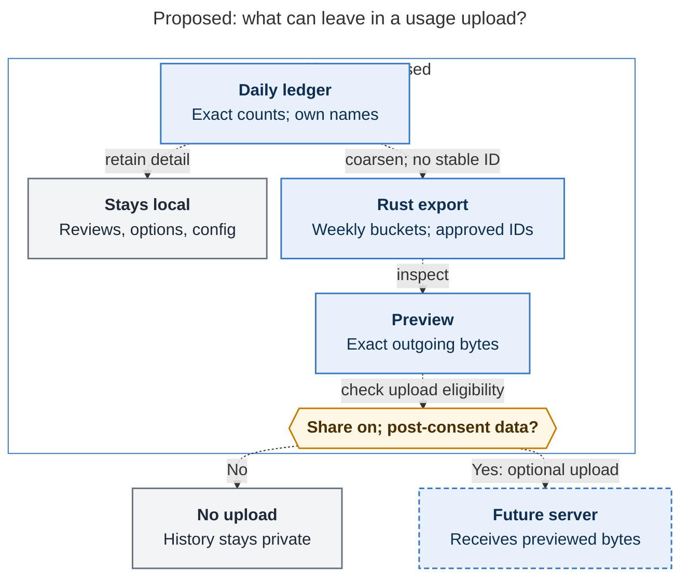

# Diagram proposals: Footprint: a usage census for finding what sase should delete

Proposals for the swarm linker, not a report. Each diagram restates only what the source
report says.

```yaml
source: research:202610/footprint_feature_usage_tracking/footprint_feature_usage_tracking__final.md
producer: research.2p.image
check: "mmdc 12.0.0 with Puppeteer --no-sandbox and the PDF-mirroring config rendered 1 of 1 Mermaid diagrams"
```

## export-privacy-boundary

```yaml
anchor: |-
  The local ledger is detailed: daily, exact counts, and your own
question: |-
  What must happen before local usage data can leave in a future upload?
illustrates: |-
  The Rust-owned export projection coarsens the local ledger, keeps reviews and private detail local, and sends only previewed bytes from data collected after consent.
caption: The proposed export narrows local detail, previews exact bytes, and permits upload only with sharing enabled and data collected after consent.
review: "702.164x917 px, fit 93.0%; question and visual checks passed; 1 revision; batch 1 of 1; broken-input rejection passed"
```


