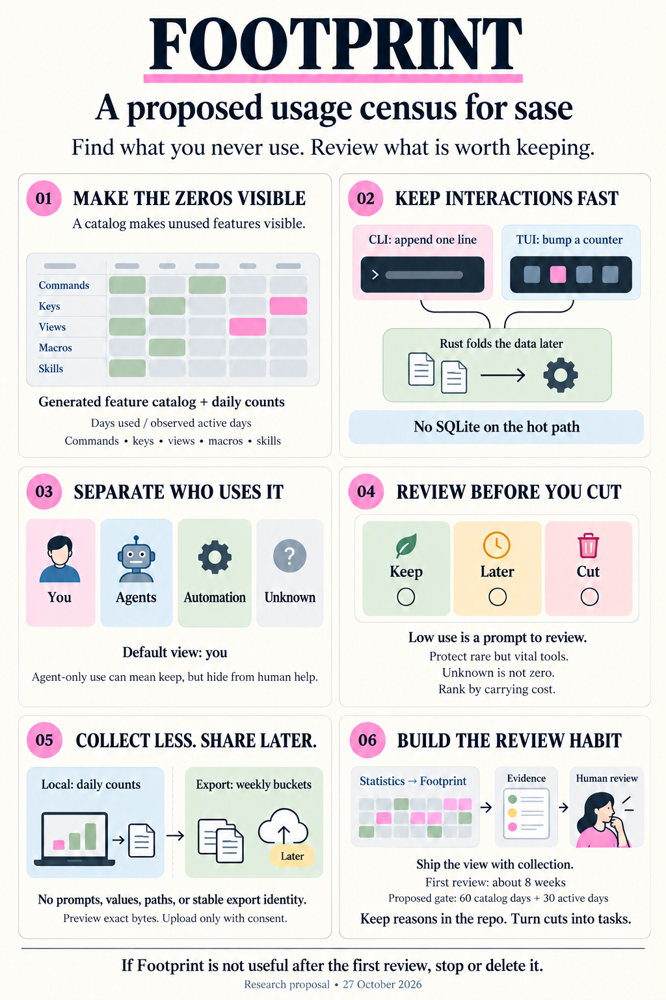
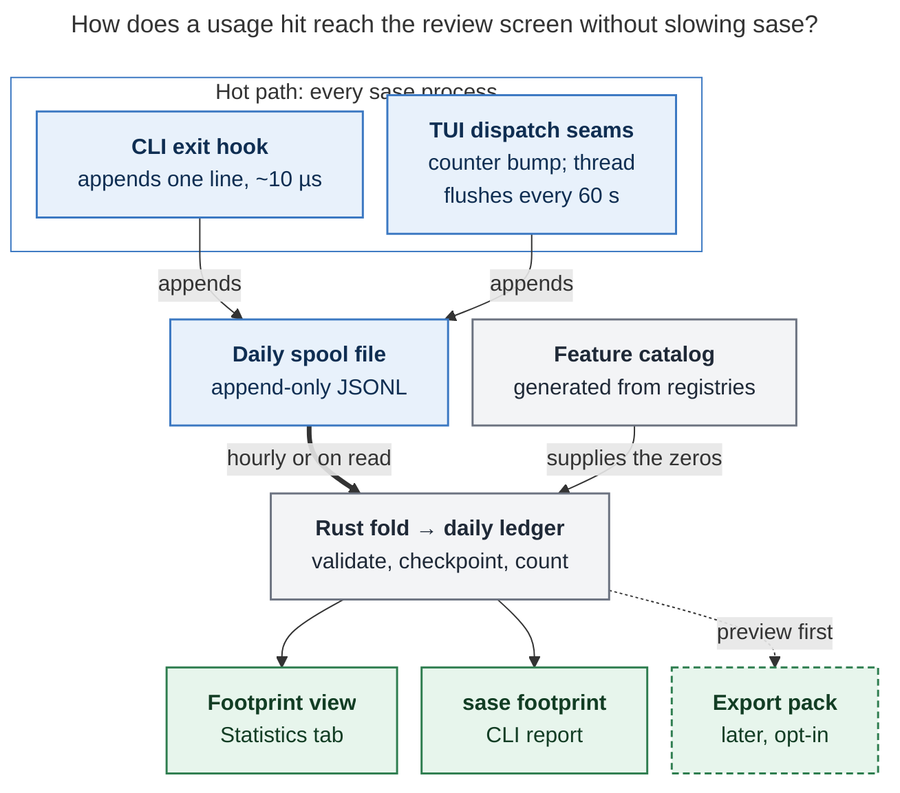
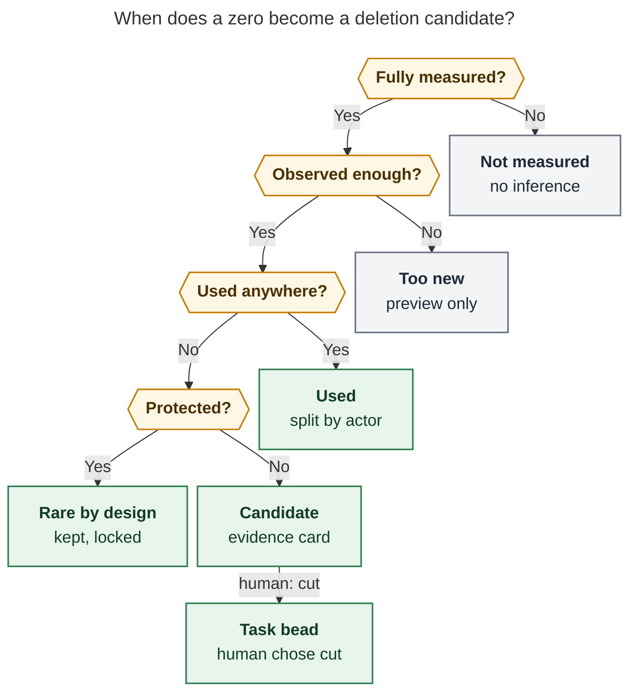
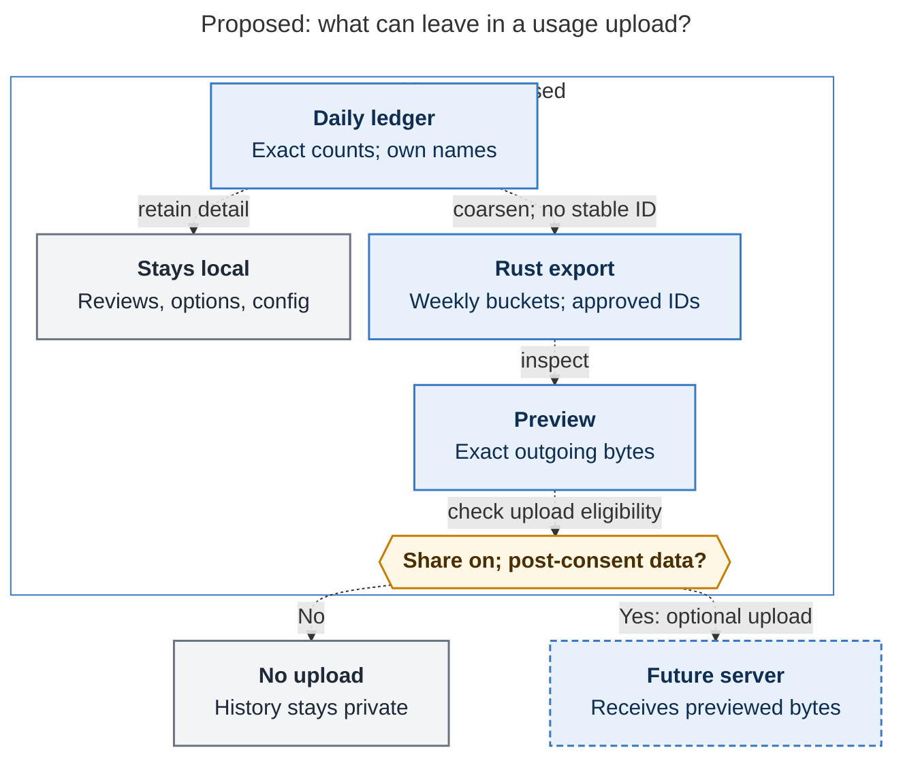

# Footprint: a usage census for finding what sase should delete

> **Research query:** How should sase support detailed usage tracking that, after a month
> or two of monitored use, helps me find functionality I never use and should delete,
> without hurting performance (the TUI is already too slow), without storing sensitive
> data (external users may later opt in to periodically sending packaged usage data to my
> servers), and with the best UX for visualizing it: intuitive, reliable, and beautiful?
> Is this a good idea, would a different approach be better, which requirement
> adjustments are justified, and what solution do you recommend?



## Bottom line

1. **Yes, build it. But build a census, not an event log.** Your goal is to find the
   zeros, and an event log cannot show a zero: a feature that never fires leaves no
   record. The core of the design is a **[feature
   catalog](#the-catalog-as-the-denominator)** generated from sase's own registries
   (argparse tree, palette commands, keymaps, views, macros, skills, config schema). It
   is joined against **per-day aggregate counts**. "Never used" then means "in the
   catalog, with zero recorded uses over a window that was actually observed." All five
   reports reached this conclusion independently.
2. **Split by [actor](#dimensions-and-the-primary-metric) from day one.** Agents run the
   CLI thousands of times a day (7,675 chat transcripts so far this month). Without a
   `human | agent | automation | unknown` split, agent traffic will hide what *you* use
   and make agent-only commands look human-used. That would be the single most damaging
   analysis error.
3. **The hot path costs one counter bump or one appended line, and never touches
   SQLite.** I [measured both](#appendix-a---measurements) on apollo. Appending one line
   to a file costs **8 µs** (p99 20 µs). Opening SQLite, upserting, committing, and
   closing costs **7–8 ms** (p99 up to 45 ms), roughly 1,000× more. So the CLI appends
   one spool line at exit, and the TUI bumps an in-memory counter (~0.6 µs) that a
   daemon thread flushes. The Rust core folds spool lines into a daily ledger later, off
   the hot path.
4. **The deliverable is a [review workflow](#the-review-experience), not a dashboard.**
   A **Footprint** view in Admin Center → Statistics opens on a one-glance *map of
   sase*: every surface is a cell, lit by how recently you used it. [Lenses](#lenses)
   (Cold, Fading, Agent-only, Dead paths, Friction, Hot, Coverage) lead to evidence
   cards. On each card you choose keep (with a reason), later, or cut. When you finish a
   review, an agent turns the cuts into task beads and records the keep reasons in the
   repo.
5. **Low usage is a reason to review, never a deletion verdict.** Recovery tools,
   once-a-quarter flows, and features you never discovered all look unused for two
   months. The design gives them [explicit states](#from-zero-to-decision): protected,
   too new, not measured, coverage gap. It ranks candidates by **carrying cost** (lines
   of code, tests, churn), not by disuse alone.
6. **Be [export-ready now; upload later](#privacy-and-the-eventual-opt-in-upload).**
   Store only catalog IDs and enum values: no values, paths, prompts, names, or hashes
   of them. The first consumer of the export pack is your own multi-machine merge
   (athena, apollo, mac). Build the opt-in upload only when external users exist. That
   follows the project's `decisions:corpus-before-mechanism` record.

## Is this a good idea

**Yes, with a sharper goal than "detailed usage tracking."** sase is large enough that
deletion pays off. `src/sase` has 1.41 M lines of Python in 6,099 files, plus 1.6 M
lines of tests (from the cld report's AST walk). Its surface is too big to inventory
from memory: about 450 CLI leaf commands, ~1,400 options, ~380 palette commands, ~170
focused-pane bindings, ~900 config leaves, 8 Statistics views, plus macros and skills.
The project has also already paid for speculative machinery. One removal recorded in
`decisions:corpus-before-mechanism` "deleted a CLI command family, a wire/facade layer,
an ACE modal, a doctor check, and a docs page." A census would have shown those as cold
weeks earlier.

Usage is only a *proxy* for value, though. Each known failure mode needs an explicit
answer in the design, or the data will lead you to bad deletions:

- **Agents vs. you**
  - *Why it bites sase:* Skills make agents call `sase bead`, `sase memory read`, and `sase artifact create` constantly. Agent-facing commands are an API for skills.
  - *Design response:* `actor` is a first-class dimension. An **Agent-only** lens shows what agents use and you never touch: candidates to hide from human help, not to delete.
- **Rare but vital**
  - *Why it bites sase:* `doctor`, workspace repair, restore, migrations, gate decisions, and release flows may run once a quarter.
  - *Design response:* A **protected** class in the catalog, plus keep reasons recorded once in a repo overlay. Protected zeros are shown with a lock and never enter the candidate list.
- **Automatic features have no invocation**
  - *Why it bites sase:* AXE routines, hooks, mentors, and finalizers run without a keypress.
  - *Design response:* Derive `auto:*` usage from operational metrics that already exist (`AXE_CYCLES`, `HOOK_EXECUTIONS`, and similar). Add probes only where no metric exists.
- **Exposure bias**
  - *Why it bites sase:* A feature added 10 days ago cannot have 60 days of use, and annual flows may fall outside the window.
  - *Design response:* Every row shows observed active days and age in the catalog. A **Too new** state applies, collection is always on, and 400-day retention lets a second review catch seasonal flows.
- **Unknown vs. unwanted**
  - *Why it bites sase:* Zero use may mean you never discovered it, or that the keybinding is dead while the palette entry is used.
  - *Design response:* A `via` dimension (key, palette, mode, CLI, and so on). The **Dead paths** lens frees a key or flag without deleting the feature. `--help` and usage errors are recorded as outcomes.
- **Absence of data looks like zero**
  - *Why it bites sase:* Missing instrumentation, a crash, a full disk (apollo's root filesystem is **95 % full**), or an old TUI process all produce silence.
  - *Design response:* Distinct evidence states: *no recorded use*, *not measured*, *coverage incomplete*, *unavailable*. An unknown is never drawn as a pale zero.
- **Usage ≠ cost**
  - *Why it bites sase:* A cold 40-line flag and a cold 3,000-line subsystem are not equally urgent.
  - *Design response:* Rank by **carrying cost × disuse**: LOC, tests, and 90-day churn on every candidate, computed at review time.
- **Dogfooding inflates usage**
  - *Why it bites sase:* You build sase, and you use each feature heavily while developing it.
  - *Design response:* Exclude pytest, VHS demos, and benchmarks. The **Fading** lens catches features that were only used around their own launch.
- **Observer effect**
  - *Why it bites sase:* Looking at Footprint makes you try forgotten commands.
  - *Design response:* Accept it; it errs toward keeping things. Weight review toward the later part of the window.
- **The instrument becomes clutter**
  - *Why it bites sase:* Telemetry systems grow into features nobody uses.
  - *Design response:* Footprint records its own usage. If you don't open it after the first review cycle, it is the first cut.

**Would I take a different approach?** I would keep the goal and change the method in
five ways:

1. **Census, not log.** Breadth (every surface) matters more than depth (sequences,
   arguments, timings).
2. **No per-feature instrumentation code.** About six central seams (CLI exit, TUI
   `run_action`, palette dispatch, prefix-mode dispatch, view entry, modal push) plus a
   generated catalog mean that **new features are tracked for free**, and a CI drift
   guard keeps the catalog complete. This is what makes the system reliable and cheap
   to maintain.
3. **Start deleting before collection matures.** Some cuts need no new data: a source
   review of obviously dead features, unused macros and skills joined from logs that
   already exist ([Phase 0](#phased-delivery-with-exit-criteria)), and an optional
   backfill from shell history. Don't track a feature for 60 days just to postpone a
   decision you could already make.
4. **Agents do the archaeology.** sase is agent-native, so the most powerful "view" of
   a cold list may be an agent. A bundled `#footprint_review` macro would take the cold
   list and produce a deletion plan with call sites, tests, docs, skill references, and
   risk. You make the decisions; the agent does the digging.
5. **Complement it with code-level evidence later.** The census finds unused *features*.
   A first-hit function lens using Python 3.12's `sys.monitoring` ([Phase
   4](#phased-delivery-with-exit-criteria)) finds dead *code inside* features you do
   use, and Symvision already finds unreferenced symbols.

## Requirement adjustments explicitly called out

Each item is a deliberate departure from the request. **Source** shows whether the
researchers agreed on it or whether it is my call.

- **R1**
  - *Original:* "Detailed usage tracking"
  - *Adjusted:* **Complete but coarse.** Per-day counts for *every* catalog surface, split by actor, via, and outcome. **No** event timelines, argument values, or free text.
  - *Why:* "Never used" needs completeness, not detail. Coarse data is also what makes the privacy and performance goals achievable.
  - *Source:* All five
- **R2**
  - *Original:* —
  - *Adjusted:* **Actor dimension**, with the default view set to *you*.
  - *Why:* Agent volume would drown out your signal.
  - *Source:* All five
- **R3**
  - *Original:* —
  - *Adjusted:* **A generated feature catalog is a hard requirement**, with a CI drift guard.
  - *Why:* Zeros are invisible without a denominator.
  - *Source:* All five
- **R4**
  - *Original:* "After a month or two"
  - *Adjusted:* **Always on.** First review at ~8 weeks. Candidates require ≥60 days in the catalog and ≥30 observed active days (tunable). Retention is 400 days, so a second review catches seasonal flows. Macro and skill history is backfilled on day one.
  - *Why:* Two months that contain four active days prove little, and annual flows need a longer view.
  - *Source:* cld, grk, mus; thresholds mine
- **R5**
  - *Original:* "Find functionality that should be deleted"
  - *Adjusted:* **The output is decisions.** Candidates go to a human review, cuts become task beads, and protected surfaces never become candidates. Actual removal follows the existing `sunset` flag policy whenever external users could rely on the feature.
  - *Why:* Low frequency is not authorization to remove.
  - *Source:* All five
- **R6**
  - *Original:* "Visualize after I have enough data"
  - *Adjusted:* **The view ships with collection.**
  - *Why:* An honest view on day one, full of zeros and a "preview" banner, is how you find catalog gaps before they cost you two months.
  - *Source:* grk
- **R7**
  - *Original:* —
  - *Adjusted:* **Multi-machine merge is in scope** (export/import packs), before any server exists.
  - *Why:* athena, apollo, and mac each see part of your usage, and `%dispatch` agents run remotely.
  - *Source:* cld, grk, mus
- **R8**
  - *Original:* "External opt-in upload"
  - *Adjusted:* **Design the schema now; build transport only when outside users exist.** No stable identifier ever goes in a pack.
  - *Why:* Corpus before mechanism. A stable ID turns weekly reports into a longitudinal behavioral profile.
  - *Source:* All five; identity rule from cdx and me
- **R9**
  - *Original:* "Don't hurt performance too much"
  - *Adjusted:* **Explicit budgets, enforced by benchmarks** ([performance budgets](#performance-budgets)).
  - *Why:* "Too much" can't be tested; a number can.
  - *Source:* cld, cdx
- **R10**
  - *Original:* —
  - *Adjusted:* **Separate store and switch from health telemetry.**
  - *Why:* Different privacy domain, retention, and consent semantics. The telemetry docs already say product-usage questions belong elsewhere.
  - *Source:* cdx, cld, grk; overrides mus, gem
- **R11**
  - *Original:* —
  - *Adjusted:* **Name it Footprint** (`sase footprint`, Statistics → Footprint).
  - *Why:* `usage` is taken (LLM quota windows), `telemetry` means health metrics, and "feature" is overloaded (feature flags, the `feature` task type).
  - *Source:* cld; reasoning mine
- **R12**
  - *Original:* —
  - *Adjusted:* **Footprint must pass its own test.** A go/no-go gate after the first review cycle.
  - *Why:* The instrument must justify its own maintenance cost.
  - *Source:* cld, cdx

## What sase already has

I re-checked every load-bearing claim in the reports against the tree at `a42eedc1c4`
and the installed tool.

- **The telemetry store is for health, and product usage is explicitly out of scope**
  - *Evidence:* `docs/contribute/telemetry.md` §intro: "Historical product-usage questions are answered by the Admin Center's Statistics tab … instead of this short-lived metric store."
  - *Design consequence:* Don't extend `metrics.sqlite`; reuse its *patterns* only
- **Neither the CLI nor the TUI calls `init_telemetry()`**
  - *Evidence:* Call sites are only AXE runners and daemons (`axe/orchestrator.py`, `lumberjack.py`, `run_agent_runner_bootstrap.py`, the mentor, hook, and CRS runners)
  - *Design consequence:* The gap this feature fills. Extending telemetry would add a per-CLI init and flush
- **Statistics has 8 views and shared range/format machinery**
  - *Evidence:* `src/sase/stats/registry.py` (8 × `StatisticsViewSpec`); `sase stats project` is the CLI precedent
  - *Design consequence:* Footprint becomes view 09 and reuses the chrome, render primitives, and `#FF87D7` accent
- **All key bindings dispatch through `App.run_action`**
  - *Evidence:* Textual `_check_bindings` (both priority and normal) and markup clicks call `run_action`, which consults `check_action`. sase overrides `check_action` at `ace/tui/app.py:415`
  - *Design consequence:* One public override counts every binding dispatch, after sase's existing availability gate
- **The palette bypasses `run_action`**
  - *Evidence:* `ace/tui/commands/execute.py:45` calls `getattr(app, f"action_{…}")` directly
  - *Design consequence:* One extra hit in `execute_command`, with `via=palette`
- **Prefix modes bypass bindings**
  - *Evidence:* `ace/tui/actions/_event_keyboard.py:19` `on_key` runs an if/elif chain (fold, checkout, link, jump, …)
  - *Design consequence:* One hit per handled mode key, using a reverse key→action map
- **The installed Textual (8.2.8) differs from the workspace pin (8.0.1)**
  - *Evidence:* `~/.local/share/uv/tools/sase` vs `pyproject.toml`
  - *Design consequence:* A contract test must assert a hit for one binding per scope across Textual versions
- **CLI fast paths run before argparse**
  - *Evidence:* `src/sase/main/entry.py`: bead, goal, completion candidates/ensure, `run` special cases, plugin dispatch, all inside `main()`
  - *Design consequence:* Wrap `main()` in a single `try/finally` recorder; each fast path only sets the feature ID
- **The busiest agent command already loads the Rust binding; completion does not**
  - *Evidence:* `sase bead list` imports `sase_core_rs` (11.6 ms self) and spends 1.85 s importing `sase.bead.cli`. The completion fast path imports no `sase_core_rs` (0.26 s wall)
  - *Design consequence:* The spool writer must be **pure Python** (no Rust import on the hot path). Rust owns the line schema and validates it at fold time
- **Actor markers already exist**
  - *Evidence:* `SASE_AGENT`, `SASE_JOB_ROUTINE`/`SASE_JOB_RUN_ID`, `SASE_SERVICE_UNIT`, `SASE_PROC_ID`, `SASE_MONITOR_ID`, `SASE_GATE_COMMAND`
  - *Design consequence:* Actor classification is nearly free, with no new env contract except an optional `SASE_CLIENT` for editor and chat frontends
- **Existing activity logs are unsafe to export**
  - *Evidence:* `skill_uses.jsonl` records `agent_name`, `cwd`, `reason`, `artifacts_dir` (verified on disk)
  - *Design consequence:* Join **counts by `skill_name` only**; never copy rows
- **A persistent installation ID exists**
  - *Evidence:* `~/.sase/installation_identity.json` (`installation_id`)
  - *Design consequence:* **Do not reuse** for any export
- **`sase usage` is taken**
  - *Evidence:* Glossary *Usage Window*; `parser_usage.py`
  - *Design consequence:* Naming ([R11](#requirement-adjustments-explicitly-called-out))
- **The TUI has strict event-loop rules**
  - *Evidence:* `tui_perf.md` rules 1–2 (no I/O on the loop; off-loop ≠ off-pump), 9 (nothing before first paint), 14 (idle ticks reload nothing)
  - *Design consequence:* Counter bump only; a flush thread instead of a Textual timer; no startup work
- **Keymap changes must update the defaults**
  - *Evidence:* `gotchas` core memory: `src/sase/default_config.yml`
  - *Design consequence:* New Statistics keys go through `ace.keymaps.statistics`

## Where the researchers disagreed and how I resolved it

- **Store**
  - *Positions:* New SQLite store (cdx, cld, grk) vs. a `Usage` taxonomy in `metrics.sqlite` (mus, gem)
  - *Resolution:* **Separate store** at `~/.sase/footprint/`, Rust-owned
  - *Deciding evidence:* The telemetry doc's own contract; the CLI and TUI never init telemetry; PID-bearing `source` keys multiply rows (cld counted 2,654 sources); ops retention and labels are generic; `telemetry.enabled` is a health switch, not a product-usage consent. mus's reuse instinct is honored by copying the flush pattern and render primitives.
- **CLI write path**
  - *Positions:* Append to a spool, fold later (cld) vs. a short SQLite transaction at exit (cdx) or an atexit flush into SQLite (grk, gem)
  - *Resolution:* **Spool append** via a pure-Python `os.write(O_APPEND)`; fold in Rust
  - *Deciding evidence:* My bench: 8 µs vs. 7–8 ms mean (p99 20–45 ms). With WAL, closing the last connection checkpoints, which every short-lived CLI process does. Concurrent agent writers make lock contention worse.
- **Catalog breadth**
  - *Positions:* 30–50 hand-mapped families (cdx) vs. exhaustive generation from registries (cld, grk, gem)
  - *Resolution:* **Generate exhaustively; display grouped by area.** Hand-curate only an overlay (protected, `retire_with`, notes).
  - *Deciding evidence:* Completeness is the whole point. IDs come from dispatch points (argparse leaves, `CommandSpec.id`, action names), so their semantics are clean. cdx's rigor about what counts as use is applied at the few ambiguous seams (view restore vs. explicit entry, dialog open vs. submit).
- **Default**
  - *Positions:* Off until you start a study (cdx) vs. local recording on (cld, grk, gem) vs. following `telemetry.enabled` (mus)
  - *Resolution:* **`footprint.mode: local` by default; `share` is never a default.** It has its own switch.
  - *Deciding evidence:* Go's toolchain defaults to local-only collection. `~/.sase` already holds full chat transcripts, so content-free counters add negligible local risk. A study you must remember to start is a study that never starts. A first-run notice and `sase footprint status` disclose it.
- **Window**
  - *Positions:* 60 days + 20 active days (cdx); 90 days (grk); always on with a first review at 8 weeks (cld); 90d/all (mus)
  - *Resolution:* **Always on.** First review ~8 weeks. Candidate gate: ≥60 days in the catalog and ≥30 observed active days of the relevant surface and actor
  - *Deciding evidence:* Your near-daily use makes 30 active days reachable in 8 weeks. Zero uses in 30 independent active days still allows a ~9.5 % daily-use rate (one-sided 95 %), so the UI says "no recorded use across 30 active days," never "safe to delete."
- **CLI options**
  - *Positions:* All option dest names (cld); a curated set (mus); skip in v1 (grk)
  - *Resolution:* **Record option *dest names* generically, never values.** Local only, not exported in v1
  - *Deciding evidence:* Dead flags are the cheapest, lowest-risk cuts, and dest names are code identifiers.
- **Review actions**
  - *Positions:* keep/cut/later, then beads and an agent (cld); a one-key sunset flag (gem); review→bead (grk); Markdown export (cdx)
  - *Resolution:* **keep (reason) / later / cut, recorded locally.** "Finish review" launches `#footprint_review`, which edits the repo overlay and files beads
  - *Deciding evidence:* The TUI runs from the installed package (`uv tool`), so it cannot edit repo files. `sase_flags.md` says flags are created only by `sase flag new` in the implementing change, never from a viewer.
- **Export identity**
  - *Positions:* Rotatable `footprint_id` (cld); `client_uuid` (gem); no stable ID plus a per-report nonce (cdx); no identifier (grk)
  - *Resolution:* **No stable ID. A random per-report nonce for dedup. Count "installation-weeks," not users**
  - *Deciding evidence:* A persistent ID links weeks into a profile. KDE's policy forbids installation identifiers, and OpenTelemetry warns that hashing is not anonymization. The cost (you can't count unique users) is accepted; reopen only through a decision record.
- **Export precision**
  - *Positions:* Raw counts (cld, grk) vs. buckets (cdx, gem)
  - *Resolution:* **Bucketed counts plus active-day counts per ISO week**
  - *Deciding evidence:* A full vector of rare-feature counts can fingerprint a person.
- **HTML treemap**
  - *Positions:* Later and optional (cld, cdx); Phase 3 (gem); never (grk, mus)
  - *Resolution:* **Not v1.** An optional offline atlas, built only after the TUI view proves itself
  - *Deciding evidence:* It is another surface to maintain. Build it only if monthly reviews want a bigger canvas.
- **Flush cadence**
  - *Positions:* 15 s (cdx, grk); 60 s (cld); 15 min (gem)
  - *Resolution:* **60 s when dirty, plus on quit**, from a daemon thread
  - *Deciding evidence:* Fifteen minutes loses too much on a crash. The thread costs no pump time either way.
- **Day boundary**
  - *Positions:* UTC (cdx) vs. local (cld)
  - *Resolution:* **Local calendar date** in the personal store; ISO week in exports
  - *Deciding evidence:* "Days you used sase" should match your days. Exports coarsen anyway.
- **Name**
  - *Positions:* Footprint (cld); Atlas (grk); Features (cdx, gem); Usage (mus)
  - *Resolution:* **Footprint**
  - *Deciding evidence:* It is distinctive, matches the map metaphor, and avoids the `usage` collision and the overloaded "feature." If "memory footprint" connotations bother you, Atlas is the runner-up.

## Design

### The catalog as the denominator

A **feature ID** is `<namespace>:<path>`. The catalog is generated by walking
registries offline, in CI and in the fold job, and never on a hot path. That matters
because the CLI builds only a partial parser (`create_parser(only=…)`).

- **`cli`**
  - *Example IDs:* `cli:bead.list`, `cli:agent.tribe.list`
  - *Source of truth:* Full argparse tree walk; a parser post-pass injects `set_defaults(_footprint_cmd=…)` into every leaf
- **`cli` option**
  - *Example IDs:* `cli:bead.list#json` (dest name only)
  - *Source of truth:* Option actions per leaf
- **`tui`**
  - *Example IDs:* `tui:app.zoom_panel`, `tui:fold.cycle_hooks`, `tui:statistics.cycle_range`
  - *Source of truth:* `build_command_catalog()` → `CommandSpec.id`; scoped keymap dataclasses
- **`view`**
  - *Example IDs:* `view:agents`, `view:admin.statistics`, `view:stats.perf`, `view:modal.plan_approval`
  - *Source of truth:* Tab enums, Admin Center catalog, Statistics registry, modal screen classes
- **`macro`, `skill`**
  - *Example IDs:* `macro:research`, `skill:sase_repo`, `macro:~custom`
  - *Source of truth:* Bundled macro catalog; generated skill sources
- **`config`**
  - *Example IDs:* `config:ace.page_size` (an override is present; the value never is)
  - *Source of truth:* Leaf paths of `default_config.yml`
- **`auto`**
  - *Example IDs:* `auto:axe.cycle.<type>`, `auto:hook.<type>`
  - *Source of truth:* Label values of existing ops metrics
- **`plugin`**
  - *Example IDs:* `plugin:listen`, `plugin:~third_party`
  - *Source of truth:* Known `sase_commands` entry points

Rules:

- **Allowlist, never denylist.** Anything unrecognized collapses to
  `<namespace>:~other`. User-defined names (custom macros, modes, snippets, saved
  queries) appear as `~custom` in anything exportable. Your local view may show them.
- **Aliases share one ID.** The key and palette entry for the same `CommandSpec.id` are
  one feature reached two ways (`via`), not two features.
- **A CI drift guard** fails a PR that adds a parser leaf, keymap field, macro, or skill
  that the generator misses. It is modelled on the existing
  `ensure_metadata_covers_app_keymaps()`.
- **A repo-tracked overlay** (for example `src/sase/footprint/overlay.yml`) holds the
  human knowledge: `protected: safety|recovery|bootstrap|infra`, keep reasons,
  `retire_with` siblings, and a one-line "why this exists." It is reviewed in PRs,
  shared across machines, and readable by agents.
- **Lifecycle:** the fold records `first_in_catalog` and `last_in_catalog` from daily
  catalog snapshots keyed by sase version, so "too new" and "retired" are facts, not
  guesses.

### Dimensions and the primary metric

Each ledger row is `day × feature × actor × via × outcome → count`, plus
`dur_ms_sum`/`dur_ms_max` for CLI rows. Duration feeds the Hot lens: with
`sase bead list` taking ~3 s on a loaded host, "most-used and slowest" is a direct list
of performance targets.

- **actor:** `human` · `agent` (`SASE_AGENT`; gate commands an agent proposed count
  here too) · `automation` (`SASE_JOB_*`, `SASE_SERVICE_UNIT`, `SASE_PROC_ID`, AXE) ·
  `unknown`. Never infer `human` from a TTY alone, because agents use PTYs. Editor and
  chat frontends set `SASE_CLIENT=<builtin>` and count as `human` with
  `via=editor|chat`.
- **via:** `key` · `mouse` · `palette` · `mode` · `cmdline` · `cli` · `completion` ·
  `editor` · `chat` · `prompt` (macros) · `auto`.
- **outcome:** `ok` · `error` · `usage_error` · `help` · `cancelled`.

**The primary metric is *days used out of observed active days*.** Raw count is
secondary: pressing an awkward key 200 times is not 200 units of value. An *observed
active day* is a day with at least one human record on that surface family (CLI or
TUI). Days are unioned across processes and machines, never summed.

### Recording seams

All seams are central. Adding a feature never requires adding a recording call.

**CLI (one line per process).** Wrap the body of `entry.py:main()` in `try/finally`.
The parser post-pass supplies the leaf ID. Fast paths (bead, goal, completion, plugin)
set the same module-level "current hit" before they call `sys.exit`, so a single
`finally` records all of them. The outcome comes from the exit code (2 →
`usage_error`, `-h` → `help`, `KeyboardInterrupt` → `cancelled`). Option dest names are
mapped from `-`-prefixed argv tokens through the leaf parser; values are never read.
An argparse error records the deepest matched group with `usage_error`, which is a free
discoverability signal. Completion records `cli:completion.candidates` with its closed
`KIND` enum, never the prefix being completed.

**TUI (in-memory counter bumps only).**

1. **`AceApp.run_action` override** (public Textual API): count when `super()` returns
   True, keyed by the namespace's keymap scope plus the action name, never its
   parameters. A frozenset skip-list drops navigation chrome (`j`/`k`, scroll, cursor)
   before the dict is touched.
2. **`execute_command`**: one hit with `via=palette` (it bypasses `run_action`).
3. **The `on_key` prefix-mode chain**: one hit with `via=mode` when a `_handle_*_key`
   returns True. Custom modes record `tui:custom.~custom`.
4. **View entry**: `watch_current_tab`, Admin Center section switches, Statistics view
   switches, and a single `push_screen` wrapper for modals (270 call sites, one
   override). Count only **explicit** entry, never a tab restored at startup.
5. **Key vs. mouse**: `on_key` already sets `_last_input_action`, and `on_mouse_down`
   sets a sibling flag that `run_action` reads to choose `via`.

**Derived sources (no new hot-path code).** These become ordinary ledger rows at fold
time:

- **Macros:** from the launch-prompt data that Statistics → Macros already reads. This
  backfills full history on day one.
- **Skills:** counts by `skill_name` from `skill_uses.jsonl`.
- **Automation:** label values of the existing 1-hour ops rollups.
- **Config:** a daily snapshot of which bundled leaf paths are overridden (paths only).
- **Flags:** state changes in `feature_flags.json`.
- **Optional, opt-in:** a one-shot `~/.zsh_history` importer that keeps only lines
  starting with `sase`, resolves them to command IDs, and discards everything else. It
  is local-only and gives the first review months of human CLI history.

**Excluded:** pytest (forced off through the existing
`assert_test_state_write_isolated` pattern), VHS demo tapes, benchmarks
(`SASE_FOOTPRINT=off`), typed characters, redraws, and polling.

### Storage and fold



*Hot paths only append a line or bump a counter. Validation, aggregation, and the
catalog join all happen later in sase-core Rust, and every reader works from the folded
ledger. The dashed export path stays off unless you opt in.* (Mermaid CLI 12.0.0:
681 × 899 px, 95.8 % PDF fit.)

- **Spool:** `~/.sase/footprint/spool/YYYY-MM-DD.jsonl`, mode 0600. Each record is one
  `write()` of ≤512 bytes with `O_APPEND`, so writers need no lock. Every line carries
  `sase_version` and `catalog_rev`: a long-running TUI keeps executing the code it
  imported (`tui_perf.md` rule 15), so the fold must know which catalog applies. There
  is a hard 32 MB/day cap with a drop counter. Torn lines are skipped and counted.
  Expected volume is about 1–2 MB/day at current agent load (an estimate).
- **Ledger:** `~/.sase/footprint/footprint.sqlite`, owned by **sase-core Rust**. It
  passes the backend-boundary litmus test: the TUI, CLI, sase-nvim, sase-telegram, and
  a future exporter must all agree, and the export projection is a privacy boundary
  that must not diverge. Tables: `daily`, `coverage(day, surface, active, gaps)`,
  `features` (lifecycle, first/last used), `catalog_snapshots`, `fold_checkpoints`,
  `reviews` (local decisions, never exported), and `meta`. There is no PID, host, or
  source column.
- **Fold:** parses, validates against the catalog snapshot, upserts, and commits the
  byte-offset checkpoint **in the same transaction**, so a crash can't double-count.
  It runs from an hourly AXE routine, on demand from `sase footprint`, and off-thread
  when the view opens on a stale ledger. Spool files are deleted 7 days after a full
  fold.
- **Retention:** 400 days of daily rows, about 10–20 MB per year.
- **Faults are visible, never silent zeros.** Corruption quarantine starts a new epoch
  and leaves a visible gap. A full disk, the spool cap, or a failed fold mark that day
  "coverage incomplete." Recording failure never changes a command's outcome. Clearing
  history uses a generation token, so stale workers can't repopulate it.
- **Calibration:** verifying the instrumentation exercises everything. A
  `study_start` setting (default: end of a 3-day calibration window) is where the
  review window begins.

### Performance budgets

- **CLI hit**
  - *Measured:* **8 µs** mean, 20 µs p99 for an `O_APPEND` line (mine). SQLite open+upsert+commit+close: **7–8 ms** mean, **20–45 ms** p99
  - *Budget (CI bench):* ≤100 µs p99 added; no new imports
  - *Mechanism:* Pure-Python spool append in `finally`
- **CLI scale**
  - *Measured:* `sase bead list` ≈ 3.1 s wall; `sase version` ≈ 0.9 s (loaded host)
  - *Budget (CI bench):* —
  - *Mechanism:* A hit costs <0.01 % of a trivial command
- **TUI action**
  - *Measured:* Dict increment ≈ 0.6 µs
  - *Budget (CI bench):* ≤2 µs and **zero** event-loop I/O; `j`/`k` p95 <16 ms unchanged; enabled-minus-disabled p95 ≤0.5 ms
  - *Mechanism:* Counter bump in the seams; no Textual timers
- **TUI flush**
  - *Measured:* —
  - *Budget (CI bench):* No pump involvement
  - *Mechanism:* `threading.Thread` loop (like `sase-telemetry-flusher`) swaps the dict every 60 s if dirty, and on quit
- **Startup**
  - *Measured:* —
  - *Budget (CI bench):* Zero Footprint work before first paint
  - *Mechanism:* Catalog maps are built lazily on the first hit
- **View open**
  - *Measured:* —
  - *Budget (CI bench):* ≤50 ms, worker-loaded; cached summary painted first
  - *Mechanism:* `spawn_pump_free_task()`; reads only the ledger
- **Fold**
  - *Measured:* —
  - *Budget (CI bench):* ≤1 s per day of spool
  - *Mechanism:* AXE routine; never on the TUI path

GC note: the TUI already suffers multi-second Gen-2 pauses (the gem report, citing
`tui_gc_measurement_20261023`). The counter dict holds at most a few thousand
long-lived keys built from interned action strings. It allocates no per-event objects
beyond a reused tuple key, so it adds nothing measurable to heap churn.

## The review experience

### The job to be done

> "After eight weeks I sit down for an hour and leave with (a) a confident cut list
> filed as beads, (b) a keep list with reasons I'll never have to re-derive, and (c) the
> top 20 hot paths I should protect and make fast."

Seven principles follow from that job. **Lead with the zeros. Rank by what a cut would
save. Separate you from your agents at every level of detail. Say how trustworthy the
data is. Decide where you look. One glance, then drill. Never show an unknown as a
zero.**

### Where it lives

- **TUI:** Admin Center → Statistics → **Footprint** (view 09), inheriting the pane
  chrome: `[`/`]` to switch views, `t` for range, `g` for lens, `a` for actor, `/` to
  find, `?` for the glossary. The Statistics **Overview** gains one tile: *"Footprint ·
  412 of 1,180 surfaces used · 41 active days observed."* No new global tab, no
  auto-open, no nagging.
- **CLI:** `sase footprint`, which defaults to `list` per the `cli_rules.md` convention.
  Subcommands, alphabetically: `catalog`, `export`, `import`, `list`, `show`, `status`.
  `list` takes `-a/--actor`, `-A/--area`, `-f/--format rich|json|markdown`,
  `-l/--lens`, and `-r/--range`. Markdown is designed to be pasted into an agent
  prompt.
- **Agent:** a bundled `#footprint_review` macro ([the review loop](#the-review-loop)).
- **One notification, once:** when the first candidate gate is met, a single inbox
  item reads *"Your first Footprint review is ready: 23 candidates."* It makes the
  review a ritual with a start date rather than a chore you have to remember.

### The map on the first screen

Each area is one row and each surface one cell, sorted by heat. Every row is both a
heat strip and a coverage bar, so cold areas stand out immediately. *(All numbers are
illustrative.)*

```text
 STATISTICS · FOOTPRINT      athena+apollo+mac · you · last 60d · 41 active days
 ─────────────────────────────────────────────────────────────────────────────────
  412 / 1,180 used    214 candidates    38 rare by design    96 not measured
 ─────────────────────────────────────────────────────────────────────────────────
 bead         ███████████████▓▓▓▓▓▓▒▒▒▒▒·········              38/47    81%
 agent        ███████████▓▓▓▓▓▓▒▒▒▒▒▒················          29/45    64%
 artifact     ██████▓▓▓▓▒▒▒▒·········                           14/23    61%
 changespec   █▒▒··················                              3/21    14%  ◂
 mobile       ??????????????????                                 —/18    not measured
 tui · app    ████████████████████▓▓▓▓▓▓▓▒▒▒▒▒▒▒▒······        171/191    90%
 tui · copy   ████▓▓▒▒▒·······································    9/78    12%  ◂
 ─────────────────────────────────────────────────────────────────────────────────
 █ ≤7d  ▓ ≤30d  ▒ ≤60d  · no recorded use  ? not measured     ↵ area  g lens  a actor
```

- **Trust chip.** Until the candidate gate is met, the header shows `PREVIEW · 12 of 30
  active days` and the candidate count reads "preview." After that, surfaces whose
  `added_in` falls inside the window stay in preview.
- **Actor toggle** (`a`): *you → agents → automation → everyone*. The difference
  between the *you* and *agents* maps is the Agent-only lens.
- **Day one** is already useful. The catalog is complete, nearly everything shows `·`,
  and "recording since 14:02" is visible. A whole area showing `?` reveals a missing
  seam immediately (grk's point: you find catalog gaps now, not in two months).

### Lenses

`g` cycles the lenses in the view; `-l` selects one on the CLI.

- **Map**
  - *Shows:* Every area as a heat/coverage strip
  - *Typical decision:* Orientation
- **Cold**
  - *Shows:* Zero uses by anyone, past the gate, unprotected; sorted by carrying cost
  - *Typical decision:* Cut, or keep with a reason
- **Fading**
  - *Shows:* Used before, not in the last 30 days (catches launch-only dogfooding)
  - *Typical decision:* Watch, or cut
- **Agent-only**
  - *Shows:* Agents use it, you never do
  - *Typical decision:* Hide from human help and the palette; keep
- **Dead paths**
  - *Shows:* Keys never pressed (feature reached via palette only); options never passed
  - *Typical decision:* Free the key; drop the flag (the cheapest cuts)
- **Friction**
  - *Shows:* High share of `usage_error` or `help` outcomes
  - *Typical decision:* Fix the UX, or cut
- **Hot**
  - *Shows:* Top surfaces by days used and by CLI time spent
  - *Typical decision:* Protect and optimize (feeds TUI and CLI perf work)
- **Coverage**
  - *Shows:* Uninstrumented areas, gaps, drops, version boundaries, unknown actor share
  - *Typical decision:* Trust the data, or fix the instrument

### The evidence card

Press `↵` on a row to open its evidence card.

```text
 cli:changespec.rebase                         changespec · CLI command · builtin
 ─────────────────────────────────────────────────────────────────────────────────
 Evidence      No recorded use by you across 41 observed active days.
               Measured the whole window · no known gaps · in catalog since v0.12
 Uses (60d)    you 0 · agents 3 · automation 0          last: 41 days ago (agent)
 Activity      ▁▁▁▁▁▁▁▁▂▁▁▁▁▁▁▁▁▁▁▁▁▁▁▁▁▁▁▁▁▁▁▁▁▁▁▁▁▁▁▁▁▁▁▁▁▁▁▁▁▁▁▁▁▁▁▁▁▁▁▁
 Reached via   cli 3 · help 1 · usage error 1
 Carries       4 files · 812 LOC · 37 tests · 6 commits in 90d
 Mentioned in  1 doc page · 0 skills · 0 memory notes
 Decision      ○ undecided          k keep…   l later   x cut   y copy id
```

The evidence sentence is always plain language, and it states the denominator.
"Carries" and "Mentioned in" are computed at review time from the installed sources
(LOC) and, when a sase checkout is available, from tests, churn, and references in
skills and docs. "Mentioned in skills" is what separates an agent API from dead weight.

### The review loop

- `k` opens a small reason picker (*rare by design · safety · agent-facing · API
  contract · other*). `l` snoozes for 30 days. `x` marks a cut. `u` undoes.
  Decisions are stored **locally** in the ledger's `reviews` table, which is never
  exported.
- **Finish review** (`F`) requests a `#footprint_review` agent launch through
  LaunchApproval, carrying the marked set as Markdown. The agent does the
  archaeology (call sites, tests, docs, skill references, `git log`). It writes keep
  reasons into the repo overlay as a normal reviewed change, files one task bead per cut
  (or a parent with children) through the standard `/sase_new_task` path, and notes
  where the `sunset` flag policy applies because external users might rely on the
  feature.
- Reviewed rows leave Cold until their usage changes, so the second review takes
  minutes.
- **No delete button and no flag button.** Footprint never closes a bead, deletes
  code, or opens a PR.

### What makes it beautiful

- **Consistency is the beauty.** Use Statistics' own tiles, sparklines, block glyphs,
  panels, and the `#FF87D7` accent. Footprint should look as if it always belonged.
- **Colour carries meaning, and only one meaning each.** The accent ramp means recency
  (hot → muted grey). A zero is **neutral**, not red, because unused is not a failure.
  **Amber** means incomplete evidence. **Red** is reserved for collector failure. No
  emoji skulls.
- **Unknown has its own glyph** (`?`), so it never reads as a pale zero. Every state
  has a text label, so nothing depends on colour alone.
- **Calm.** No animation, no ticking counters, no auto-open. Refresh happens only
  while the view is visible, through the existing worker and generation-check path,
  preserving selection by feature ID.
- **Responsive.** List and card side by side when wide; the card drops below when
  narrow. Secondary columns are hidden first.
- **Delights for later:** a monthly `sase footprint list -f markdown` digest read
  aloud by sase-listen, and an offline, self-contained HTML **atlas**: a treemap with
  area = LOC and colour = recency, so you can see where the maintenance budget goes
  compared with where your time goes. Build the atlas only if the TUI view proves
  itself.

### From zero to decision



*A zero becomes a candidate only after the coverage, exposure, cross-machine, and
protection checks. Only your decision turns a candidate into a task bead.* "Observed
enough" means ≥60 days in the catalog and ≥30 observed active days on the relevant
surface; "anywhere" means across all merged machines and by the actor that matters.
(Mermaid CLI 12.0.0: 753 × 1110 px, 80.4 % PDF fit.)

## Privacy and the eventual opt-in upload

**Closed capture contract.** The store accepts only catalog IDs and enum values, never
property maps, widget strings, or exception text. Rust enforces this independently at
the binding and at fold time, plugins included. A schema test asserts that the
ledger's columns are exactly the allowed set, which guards against a later
"helpful" join that adds an agent name.

**Never recorded, including locally in this store:** argument or option values,
prompts, queries, clipboard or file contents, paths, cwd, repo/project/branch names,
remotes, artifact refs, bead/agent/session IDs, usernames, hostnames, IPs, model
aliases, raw errors, environment values, **and hashes of any of these** (hashing small
keyspaces is reversible by guessing). Existing ledgers that hold such fields
(`skill_uses.jsonl` and others) contribute counts by catalog ID only.

**Two data products.** The local ledger is detailed: daily, exact counts, and your own
custom names visible to you. [The export privacy-boundary
diagram](#figure-export-privacy-boundary) traces the proposed path out of this ledger: a
Rust export coarsens it, reviews stay local, and only previewed bytes from post-consent
data could leave.

<div id="figure-export-privacy-boundary">



_The proposed export narrows local detail, previews exact bytes, and permits upload only with sharing enabled and data collected after consent._

</div>

The export pack is a separate, narrower Rust-owned projection:

```json
{
  "schema": "sase.footprint.export/1",
  "nonce": "r_5f0c…",
  "week": "2026-W44",
  "sase": "0.18",
  "os": "linux",
  "observed_days": 5,
  "features": [
    {"id": "cli:bead.list", "actor": "human", "days": 4, "n": "6-20"},
    {"id": "tui:app.zoom_panel", "actor": "human", "days": 0, "n": "0"},
    {"id": "macro:~custom", "actor": "human", "days": 2, "n": "2-5"}
  ],
  "not_measured": ["plugin:~third_party"]
}
```

- **Coarsening:** ISO week only, with no time of day anywhere; count buckets `0`,
  `1`, `2–5`, `6–20`, `21+`; version cohort without commit SHA. Built-in IDs only. No
  config leaves, option names, or plugin names in v1. Eligibility and not-measured
  fields are included, so a missing probe never becomes a zero.
- **Identity:** none. A random per-report nonce lets the server deduplicate. The server
  reports "eligible installation-weeks received," not users.
- **Show before send:** `sase footprint export --preview` prints exactly the bytes that
  would leave, and an upload sends byte-identical content. Only data collected after
  consent is ever sent; there is no backfill of private history.
- **Modes**, following Go's telemetry: `off` / `local` (default) / `share` (never a
  default). The server can never enable fields or modes. Stopping sharing discards
  unsent packs.
- **Governance:** any change to the exported field list requires a `decisions:` record,
  the sase equivalent of Go's public counter-approval process.
- **Server, later:** a Worker route on the existing `sase.sh` Cloudflare deployment.
  Disable IP and body logging, retain little, and suppress small groups in published
  aggregates. Be honest that TLS doesn't hide the IP from the receiver, and that a
  nameless payload is not automatically anonymous. Debian popcon's
  installed/voted/old/recent split is the model for published aggregates, and it maps
  almost exactly onto Hot, Cold, Fading, and Too new.
- **First consumer: you.** Run `sase footprint export` on athena and mac, then
  `sase footprint import` on apollo. Days are unioned and counts summed, with nonce
  dedup. This exercises the exact pack format months before any server exists.

## Alternatives considered

- **Usage counters in `metrics.sqlite` (mus, gem)**
  - *Strength:* No new store
  - *Verdict:* **No.** It violates the telemetry doc's contract, adds an init and flush to every CLI, uses PID-keyed sources, ops retention, and a health switch. Reuse its patterns and render primitives instead.
- **Hosted or event analytics (PostHog-style), OpenTelemetry collector, Grafana**
  - *Strength:* Ready dashboards, funnels
  - *Verdict:* **No.** Privacy-hostile defaults, a server on day one, and it still can't show zeros without a catalog. sase already removed its Prometheus/Grafana stack in sase-6k.
- **Mozilla Glean stack**
  - *Strength:* Excellent schema and review discipline
  - *Verdict:* **Borrow the discipline** (declared catalog, data review, "minimum data that answers the question"). Integrating the stack is overkill.
- **Raw JSONL events kept as the store**
  - *Strength:* Trivial prototype
  - *Verdict:* **No.** It keeps chronology you don't need and grows with every interaction. A spool that is folded and deleted is the safe version.
- **Memory-mapped counters or a collector daemon**
  - *Strength:* Cheap increments, crash survival
  - *Verdict:* **Fallback only**, if measured CLI loss or overhead is unacceptable. Don't build this speculatively.
- **Static analysis only (Symvision, import graphs)**
  - *Strength:* Zero runtime cost
  - *Verdict:* **Complement.** It finds unreferenced code, not unused features.
- **Line coverage in production (coverage.py)**
  - *Strength:* Exhaustive
  - *Verdict:* **No.** Too slow. Use the function-level `sys.monitoring` first-hit lens (Phase 4) instead.
- **Shell-history mining only**
  - *Strength:* Months of history instantly
  - *Verdict:* **Optional backfill.** It misses the TUI, agents, and other machines.
- **Ask agents which features are deletable**
  - *Strength:* Quick
  - *Verdict:* **Opinion without evidence.** Use agents downstream of the data.

## Phased delivery with exit criteria

- **Phase 0 — Catalog and quick wins** (days)
  - *Scope:* Decision record ("Footprint is a census, not an event log"). Catalog generator, Rust catalog wire, and drift guard. `sase footprint catalog`. Unused macros and skills joined from existing logs. A source review of already-known dead features.
  - *Exit criterion:* The catalog covers every registry, CI fails on drift, and the first cuts of unused macros and skills are filed.
- **Phase 1 — Record**
  - *Scope:* CLI `finally` recorder and fast paths, the TUI seams, spool, Rust fold and ledger, hourly AXE fold, `footprint.mode`, `sase footprint status`, calibration window.
  - *Exit criterion:* The [performance-budget](#performance-budgets) benches pass, a week of spools folds cleanly, `SASE_TUI_PERF=1` `j`/`k` p95 is unchanged, and the Textual contract test passes on 8.0.1 and 8.2.8.
- **Phase 2 — See** (ships with Phase 1)
  - *Scope:* Statistics view 09 (map, trust chip, lenses, card, Coverage), `sase footprint list/show`, Overview tile, `default_config.yml` keymaps, help and glossary, visual snapshots (wide/narrow, light/dark, empty, all-unknown).
  - *Exit criterion:* The view loads in ≤50 ms off-thread, and day-one empty and preview states are honest.
- **Phase 3 — Decide**
  - *Scope:* Derived sources (automation, config, flags, optional zsh backfill), the review loop, local decisions, `#footprint_review`, carrying cost, `export`/`import` and merge across athena, apollo, and mac.
  - *Exit criterion:* **First real review ~8 weeks after Phase 1** produces beads plus overlay keep reasons.
- **Go/no-go**
  - *Scope:* Footprint's own `view:stats.footprint` usage after the first review.
  - *Exit criterion:* If it is near zero, stop here or delete it. The tool must pass its own test.
- **Phase 4 — Optional depth**
  - *Scope:* `sys.monitoring` first-hit dark-code lens (local only, CLI sampled, off under pytest), the HTML atlas, the sase-listen digest.
  - *Exit criterion:* A quiet-host bench shows negligible overhead.
- **Phase 5 — Share** (only once outside users exist)
  - *Scope:* Consent UX, `share` mode, Worker endpoint, published aggregates.
  - *Exit criterion:* Byte-identical preview and upload, a documented schema, and a governing decision record.

This is a two-repo change (sase-core wire, store, fold, and bindings; sase seams,
adapters, and presentation), including the `sase-core-revision.txt` pin move described
in `docs/rust_backend.md`.

## Risks and open questions

### Risks

- **A Textual upgrade silently breaks counting.** Mitigation: the public `run_action`
  seam plus a contract test asserting one hit per keymap scope.
- **Misreading the data deletes something vital.** Mitigations: the actor split,
  protected class, trust chip, evidence sentence with its denominator, cross-machine
  merge, and the rule that cuts go through beads and review.
- **Catalog drift makes a new surface look unused forever.** Mitigation: the CI drift
  guard is mandatory, not optional.
- **A "harmless" flush freezes the TUI.** Mitigation: a thread rather than a Textual
  timer, no startup work, and the stall watchdog (`tui_stalls.jsonl`) as the forensic
  backstop.
- **Privacy drift through joins.** Mitigations: the column-allowlist schema test, and a
  decision record for any export change.
- **CLI loss under fan-out.** A process killed mid-run loses its one line. Accept it,
  and expose drop and torn-line counts in Coverage.

### Open questions for you

1. **Name and placement:** `sase footprint` as a top-level group (recommended: one home
   for report and controls) or `sase stats footprint` (consistent with
   `sase stats project`, but `list` flags then need an explicit `list` token)?
2. **Keep reasons in the repo overlay** (recommended: they are design knowledge) or
   machine-local?
3. **zsh-history backfill:** high value for the first review, but it reads a file that
   contains everything else you type. It keeps only `sase` lines.
4. **Multi-machine merge:** manual `export`/`import` (recommended first, because it
   dogfoods the pack) or automatic sync through the fleet gateway?
5. **Thresholds:** are 60 days in the catalog plus 30 active days the right candidate
   gate for your cadence?

## Recommended solution

Build **Footprint**: a local-first, privacy-by-construction **usage census** of sase.

1. **A generated, CI-guarded feature catalog** (CLI commands and option names, palette
   and pane commands, views and modals, macros, skills, config leaves, automation) is
   the denominator, so "no recorded use" is a precise statement. A small repo overlay
   holds the human knowledge: protected class, keep reasons, and retire-together
   siblings.
2. **Central seams, with hot paths that only bump or append.** A single `try/finally`
   in `entry.py:main()` appends one spool line (~8 µs) for every CLI path, fast paths
   included. The TUI bumps an in-memory counter in `run_action`, `execute_command`, the
   `on_key` mode chain, and the view-entry and modal seams. A daemon thread flushes it
   every 60 s. There is no SQLite on any hot path, no Textual timer, and no work before
   first paint.
3. **sase-core Rust owns** the line schema, the checkpointed fold into a daily ledger
   (`day × feature × actor × via × outcome`), coverage and gap tracking, queries, and
   the export projection, in its own store at `~/.sase/footprint/`, separate from
   health telemetry.
4. **Derive what already exists:** macros (with full backfill), skills (counts only),
   automation from ops metrics, config overrides, and optionally human CLI history from
   zsh.
5. **Review, don't just chart.** Statistics → Footprint opens on the coverage map with
   a trust chip, and the lenses lead to evidence cards that show carrying cost. Your
   keep, later, and cut decisions finish in a `#footprint_review` agent that files
   beads and records keep reasons. `sase footprint` mirrors everything in rich, JSON,
   and Markdown.
6. **Export-ready, upload-later.** Store allowlisted IDs and enums only. Exports use
   ISO weeks, count buckets, no identity, and a mandatory byte-exact preview. Use the
   format first for your own athena/apollo/mac merge, and build `share` and a
   `sase.sh` endpoint only when outside users exist.

Start with [Phase 0](#phased-delivery-with-exit-criteria) this week: you can begin
deleting unused macros and skills right away. Ship Phases 1 and 2 together, and hold the
first real review about eight weeks later. If you never open Footprint after that
review, delete it. A tool for finding dead weight should not become dead weight itself.

## About this report

*Consolidated report · lead researcher · 2026-10-27. Merges five independent reports
(`__cdx`, `__cld`, `__grk`, `__mus`, `__gem` in this directory) with my own code checks
and measurements on apollo (sase `a42eedc1c4`). Where the researchers disagreed, [the
disagreements section](#where-the-researchers-disagreed-and-how-i-resolved-it) says how
each disagreement was settled and why.*

**Question.** How should sase track feature usage so you can find, and then delete, the
parts you never use? It must not slow the CLI or the already-slow TUI, it must never
store sensitive data (an opt-in upload may come later), and it needs a review experience
that is intuitive, reliable, and beautiful.

## Appendix A - Measurements

My measurements were taken on apollo on 2026-10-27, with load average 6.7–11.5, so the
timings are noisy. They used an isolated Python 3.12 run on ext4 (root filesystem 95 %
full).

- **`O_APPEND` open+write+close** of a ~110-byte JSON line, 3,000 iterations: mean
  8.4 µs, p50 7.4 µs, p99 20.0 µs.
- **SQLite** connect (WAL DB already created) + upsert + commit + close, 300
  iterations: `synchronous=FULL` mean 7.66 ms, p99 19.99 ms; `synchronous=NORMAL` mean
  8.02 ms, p99 45.18 ms.
- **Dict increment** with a tuple key, 10⁶ iterations: 643 ns mean.
- **`sase bead list -s open`:** 3.07–3.13 s wall. It imports `sase_core_rs` (11.6 ms
  self), and `sase.bead.cli` takes 1.85 s cumulative.
- **`sase completion candidates`:** 0.26 s wall, with no `sase_core_rs` import.
- **Agent volume:** 7,675 chat transcripts under `~/.sase/chats/202610`.

The cld report's measurements (same host, load ~12) agree: append 21 µs, SQLite
11.4 ms, dict increment 489 ns. They also counted 457 CLI leaves, ~1,400 options, 378
`CommandSpec`s, 168 pane bindings, 906 config leaves, 54,214 functions, and 1,470
`action_*` methods. `sys.monitoring` first-hit counts were 729 functions for
`sase version` and 3,622 for `sase bead list`, with overhead inside noise. The
operational store was 153 MB with 2,654 distinct `source` values.

## Appendix B - Provenance

Distinctive contributions carried into this design, by report:

- **cdx:** Evidence-state vocabulary and trustworthy absence; days-used as the primary metric; calibration window; binomial caution; no stable identity in exports; batch dedup and fault semantics; colour discipline (zero neutral, red only for failure)
- **cld:** Census framing; the generated catalog at ~3,300 entries; append-vs-SQLite measurement; spool → Rust fold architecture; `run_action`/palette/mode seams; derived sources and backfill; the map, lenses, and evidence card; carrying-cost ranking; `#footprint_review`; dark-code lens; self-measurement gate; the Footprint name
- **grk:** Proof that the telemetry doc excludes product usage; protected class and trust window; ship the view with collection; cross-machine pack/merge in v1; Glean, Homebrew, and Grok `/learn` lessons; review queue → bead
- **mus:** Three resolutions of "detailed" (surface / parameter shape / content); static-reachability join with Symvision; behaviour change under observation; minimal reuse of existing machinery as a cost discipline
- **gem:** GC-pressure constraint from the October TUI census; zero-allocation hot path; LOC × dormancy ranking; protected and setup tiers; treemap concept; naming collision analysis
- **Lead (me):** Verified the claims above against the tree and installed tool; measured the CLI write paths and import graph; found that completion must stay Rust-import-free, the Textual 8.0.1/8.2.8 skew, the `push_screen` modal seam, the existing actor env markers, and the 95 %-full disk fault path; resolved each disagreement ([disagreements](#where-the-researchers-disagreed-and-how-i-resolved-it)); added the installed-package constraint on review writes, dogfooding and Fading, the one-time "review ready" notification, and the candidate thresholds

## Sources

- Go telemetry: [go.dev/doc/telemetry](https://go.dev/doc/telemetry); Russ Cox,
  [telemetry design](https://research.swtch.com/telemetry-design.pdf)
- Mozilla Glean: [overview](https://docs.telemetry.mozilla.org/concepts/glean/glean.html),
  [adding a probe](https://firefox-source-docs.mozilla.org/toolkit/components/telemetry/start/adding-a-new-probe.html)
- Homebrew: [Anonymous Analytics](https://docs.brew.sh/Analytics)
- KDE: [application privacy policy](https://kde.org/privacypolicy-apps/)
- OpenTelemetry: [handling sensitive data](https://opentelemetry.io/docs/security/handling-sensitive-data/)
- Debian: [Popularity Contest](https://popcon.debian.org/)
- SQLite: [WAL](https://www.sqlite.org/wal.html)
- PEP 669: [`sys.monitoring`](https://peps.python.org/pep-0669/)
- Textual: [workers](https://textual.textualize.io/guide/workers/); installed
  `textual/app.py` (`_check_bindings`, `run_action`)
- NN/g: [choosing UX research methods](https://www.nngroup.com/articles/which-ux-research-methods/)
- In-tree at `a42eedc1c4`: `docs/contribute/telemetry.md`, `src/sase/telemetry/`,
  `src/sase/stats/registry.py`, `src/sase/main/entry.py`,
  `src/sase/main/parser_stats.py`, `src/sase/ace/tui/app.py`,
  `src/sase/ace/tui/commands/execute.py`,
  `src/sase/ace/tui/actions/_event_keyboard.py`, `src/sase/skills/use_log.py`,
  `src/sase/logs/_bounded.py`; memory `tui_perf.md`, `cli_rules.md`, `sase_flags.md`,
  `decisions:corpus-before-mechanism`, `decisions:rust-core-required`,
  `glossary:usage-window`
