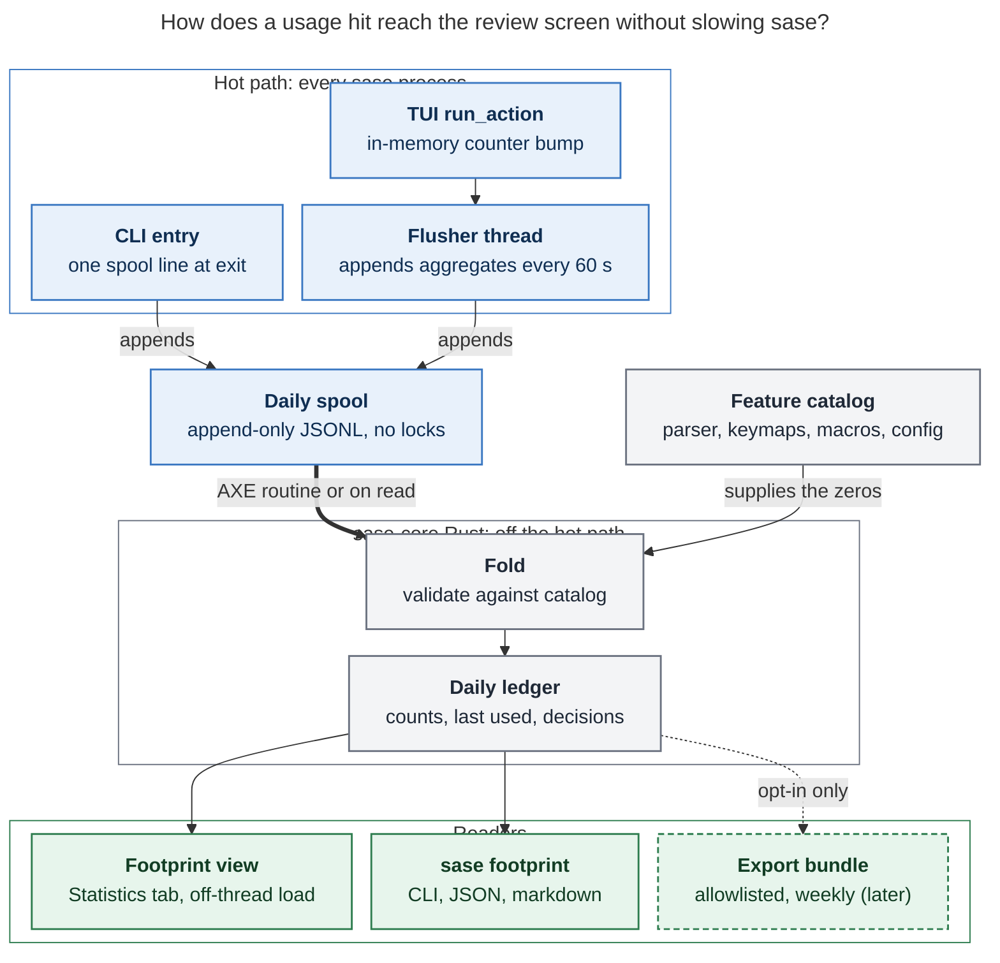

# Footprint: a usage census for finding what sase should delete

*Researcher: cld · 2026-10-27 · Question: how should sase track feature usage so Bryan
can find and delete the parts he never uses, without hurting performance, without
storing sensitive data, and with a review experience that is intuitive, reliable, and
beautiful?*

---

## Bottom line

1. **Build it, but build a census, not an event log.** The goal is to find the zeros,
   and an event log can't show a zero: a feature that never fires leaves no record. The
   core of the design is a **feature catalog** generated from sase's own registries
   (argparse tree, palette command catalog, focused-pane keymaps, Statistics views,
   bundled macros, config schema), joined against **per-day aggregate counts**. "Never
   used" means "in the catalog, zero rows".
2. **Split by actor from day one.** About 250 agent runs per day hit the CLI
   constantly (October alone has 7,658 chat transcripts). Without an
   `actor = human | agent | automation | script` split, agent traffic will hide what
   *you* use and will make agent-only features look human-used. That would be the most
   damaging analysis error.
3. **Keep the hot path to one append or one counter bump.** On this host, one O_APPEND
   JSONL line costs **~21 µs**, while a per-invocation SQLite open+upsert costs **~11
   ms** (≈500× more), against a **~0.9 s** `sase version` baseline. The TUI bumps an
   in-memory counter (~0.5 µs) and flushes from a daemon thread, never from the Textual
   pump. Folding into a durable ledger happens in sase-core Rust, off the hot path.
4. **Make the deliverable a review workflow, not a dashboard.** The UX centrepiece is
   a **Footprint view** in Admin Center → Statistics. It opens on a one-glance "map of
   sase" in which every feature is a cell lit by how recently it was used. From there,
   lenses (Cold, Fading, Agent-only, Dead keys, Dead flags, Friction, Hot) lead into a
   review loop where you mark each candidate *keep (with a reason)*, *cut*, or
   *later*. Cuts become task beads, and an agent can do the archaeology.
5. **Rank deletion candidates by carrying cost, not just disuse.** `src/sase` holds
   **1.41 M lines of Python in 6,099 files and 54,214 functions**, plus 1.6 M lines of
   tests. A cold feature that costs 3,000 lines and 80 tests matters more than a cold
   40-line flag. Show LOC, tests, and 90-day churn next to every candidate.
6. **Design the data to be exportable now, but defer upload.** Store only
   catalog-allowlisted IDs and enum dimensions, never values, paths, prompts, or names.
   The first "external" consumer of the export bundle should be your own multi-machine
   merge (athena, apollo, and the Mac). Build the upload server only when real
   external users exist (the project's own *corpus before mechanism* decision).
7. **Add a cheap "dark code" lens later.** Python 3.12 `sys.monitoring` first-hit
   function coverage finds code that never executes, at near-zero steady-state cost. It
   complements the feature census because it catches dead branches *inside* features
   you do use.
8. **Name it "Footprint".** `sase usage` already means LLM subscription usage, the
   glossary already defines a *Usage Window*, and `sase telemetry` is the operational
   metrics store. Reusing either word would confuse humans and agents.

---

## 1. What sase already has (ground truth)

I read the code before designing anything. Several pieces already exist. Some should be
reused and some should deliberately *not* be.

| Existing piece | What it does today | Reuse? |
| --- | --- | --- |
| `src/sase/telemetry/` (`metrics.py`, `_registry.py`) | In-house Counter/Gauge/Histogram singletons; flushed in batches to a Rust SQLite store (`sase_core_rs.telemetry_record_batch`) at `~/.sase/telemetry/metrics.sqlite`. Retention: raw 48 h, 5-min rollups 30 d, 1-h rollups 365 d. | **Reuse as a derived source**, not as the store (see §8). |
| `init_telemetry()` call sites | Only AXE daemons and runners (`axe/orchestrator.py`, `axe/lumberjack.py`, `axe/run_agent_runner_bootstrap.py`, the mentor, hook, and CRS runners). **Neither the CLI entry nor the TUI records anything.** | The gap this feature fills. |
| Store size today | 153 MB on disk; 126 k raw samples, 169 k 5-min rows, 21.7 k 1-h rows. `source` includes the PID (`lumberjack:checks:pid=1217975`), so every process gets its own rollup rows. | Shows that per-process keys inflate rows, so avoid them. |
| Admin Center → Statistics (`src/sase/stats/registry.py`, `ace/tui/modals/statistics_pane*.py`) | Eight views: overview, runners, projects, providers, activity, macros, plans_questions, perf. Shared chrome: range `t`, group `g`, project `p`, help `?`. `sase stats project` is the CLI. | **Home of the new view.** |
| Statistics → Macros | Already measures macro adoption from launch prompts (runs, refs, share, pairings). | **Derive `macro:*` usage from it** (and backfill months of history) rather than re-instrumenting. |
| Render primitives (`src/sase/telemetry/render/`) | Block-glyph sparklines, bars, tiles, axis, a palette with dark/light themes. | **Reuse** for the view. |
| Palette command catalog (`ace/tui/commands/catalog.py`) | `build_command_catalog()` yields **378** `CommandSpec`s with stable ids (`app.*` 191, `copy.*` 78, `leader.*` 29, `fold.*` 24, …). A guard raises if keymap metadata drifts. | **The TUI half of the denominator, for free.** |
| Focused-pane keymap scopes (`ace/tui/keymaps/scopes.py`) | Nine scopes (command_line 24, gate 13, statistics 16, memory 40, snippets 23, projects 26, machines 12, tool_runs 13, config 1) = **168** bindings. | Denominator, part 2. |
| CLI parser (`src/sase/main/parser*.py`) | **457** leaf commands and ~**1,400** options. Fast paths (`bead_fast_path`, `goal_fast_path`, `completion_fast_path`, plugin dispatch) bypass argparse. | Denominator, part 3. Each fast path needs its own record call. |
| Config schema (`src/sase/default_config.yml`) | **906** leaf paths. | "Which knobs has anyone ever changed?" A zero-hot-path signal. |
| Actor signal | Agent processes carry `SASE_AGENT` (plus `SASE_AGENT_NAME`, etc.). | Actor classification is nearly free. |
| Test isolation | `assert_test_state_write_isolated(path, category=…)` already guards telemetry writes under pytest. | Reuse for footprint writes. |
| `~/.sase/installation_identity.json` | A persistent `installation_id`. | **Do not reuse** for export; mint a separate, rotatable id. |
| HTML precedent | `src/sase/macro/catalog_template.html.j2` renders a styled static catalog. | A precedent for an optional static "atlas" report later. |
| `sase.sh` deploy (`wrangler.jsonc`) | Cloudflare Workers static-assets site. | A natural future home for an opt-in upload endpoint. |

Two facts frame everything that follows:

- **The surface is enumerable.** About 3,300 features (457 + ~1,400 + 378 + 168 + 906 +
  views and macros) is small enough to count exhaustively each day. That rules out
  sampling and makes "never used" a precise statement.
- **The codebase is large enough that deletion pays.** 1.41 M lines of Python in
  `src/sase` (files capped near 700 lines) plus 1.6 M lines of tests. The project's own
  decision record `decisions:corpus-before-mechanism` records three speculative memory
  mechanisms that were built and then deleted at real cost. One removal "deleted a CLI
  command family, a wire/facade layer, an ACE modal, a doctor check, and a docs page."
  A usage census would have surfaced those as cold weeks earlier.

---

## 2. Is this a good idea? A critique

**Yes — with a sharper goal than "detailed usage tracking".** The value is not in the
counts. It comes from a defensible cut list, from protecting what matters, and from
knowing where to spend performance work. Usage is only a *proxy* for value, though, and
it has well-known failure modes. The design has to handle each of them explicitly or
the data will lead you to bad deletions.

| Failure mode | Why it bites sase specifically | Design response |
| --- | --- | --- |
| **Agents vs. you** | Agents call `sase bead`, `sase memory read`, `sase artifact create`, and others hundreds of times a day. Skills depend on commands you never type. | `actor` is a first-class dimension. The *Agent-only* lens shows features that agents use and you never touch: candidates to hide from human help, **not** to delete. |
| **Rare but vital** | Recovery and repair (`sase doctor`, workspace repair, migrations, rewind, kill paths, gate decisions) may run once a quarter, and their value lies in existing when needed. | `keep` decisions carry a reason (`rare_by_design`, `safety`, `agent_facing`, `api_contract`). They live in a repo-tracked overlay so they are reviewed once and remembered. |
| **Automatic features have no invocation** | AXE routines, finalizers, hooks, mentors, and workflows run without anyone pressing a key. | Derive `auto:*` usage from ops metrics that already exist (`AXE_CYCLES{cycle_type}`, `HOOK_EXECUTIONS{hook_type}`, `WORKFLOW_EXECUTIONS{workflow}`, `FINALIZER_SELECTED{instance}`, `MENTOR_EXECUTIONS`). Add explicit probes only where no metric exists. |
| **Exposure bias** | A feature added 10 days ago can't have 60 days of use, and quarterly workflows (releases, audits) may not occur in a two-month window. | Every row shows *observed days* and *age in catalog*. Features younger than 21 days carry a **Too new** badge and are excluded from Cold. Collection stays on permanently; the first review comes at ~8 weeks, but the data keeps maturing. |
| **Unknown vs. unwanted** | A feature you never use may be one you never *discovered*. A key binding may be dead while the palette entry gets used. | A `via` dimension (key, palette, mode, mouse, cmdline, cli, completion). The *Dead keys* lens shows features used only through the palette, which frees the key without deleting the feature. Record `--help` views and argparse usage errors as `outcome`s. |
| **Usage ≠ cost** | A cold 40-line flag and a cold 3,000-line subsystem are not equally urgent. | Rank by **carrying cost × disuse**. Show LOC, files, tests, and 90-day commit churn per candidate (computed at review time, not on the hot path). |
| **n = 1 now, n > 1 later** | External users' needs differ from yours, and designing for the upload server first would warp the local tool. | Local first. Make the schema export-ready and defer the transport (see §7). |
| **The instrument becomes clutter** | Telemetry systems tend to grow into features nobody uses. | Ship in phases with exit criteria. **Footprint records its own usage**: if you never open the view, it is the first thing to cut. |

**Would I take a different approach?** I keep the goal and change the method in four
ways:

1. **Census, not log.** Aggregate counts per (day, feature, actor, via, outcome),
   checked against a generated catalog. Breadth (every feature) matters more than depth
   (sequences, arguments, timings).
2. **Two lenses on "unused".** *Feature census* answers "which capabilities do I never
   reach?". *Dark code* (first-hit function coverage; §6) answers "which code never
   runs, even inside features I do use?". Together they cover both feature-level and
   code-level dead weight.
3. **Decisions are the output.** The review screen records keep, cut, or later. Cuts
   become beads and keeps become documented reasons, so the next review only shows what
   changed.
4. **Agents do the archaeology.** sase is agent-native, so the most powerful
   "visualization" may be a bundled `#footprint_review` macro. It hands an agent the
   cold list (markdown export) and asks for a deletion plan with call sites, tests,
   docs references, and risk for each candidate. You make the decisions; the agent does
   the digging.

---

## 3. Requirement adjustments (explicitly called out)

These change or add to the original requirements. Each one is a deliberate departure,
and I've given the reason.

| # | Original | Adjusted | Why |
| --- | --- | --- | --- |
| **A1** | "Detailed usage tracking" | **Complete but coarse**: per-day counts for *every* catalog feature, split by actor, via, and outcome. **No** event timelines, argument values, or free text. | "Never used" needs completeness, not detail. Coarse data is also what makes the privacy and performance goals achievable. |
| **A2** | — | **Add an `actor` dimension**: `human` (TTY, no agent env), `agent` (`SASE_AGENT` set), `automation` (AXE, services, scheduler; set by an explicit env contract), `script` (non-TTY, e.g. editor integrations). | Agent traffic dominates the CLI and would otherwise drown out your own signal. |
| **A3** | — | **A generated feature catalog is a hard requirement.** It provides the denominator for every report. | Zeros are invisible without it. |
| **A4** | "After a month or two" | **Always-on**, with exposure-normalized confidence. First review at ~8 weeks. **Backfill** macros and agent launches from existing history on day one, and optionally human CLI use from shell history. | Seasonal features need longer windows, and backfill gives useful answers immediately. |
| **A5** | "Eventually let external users opt in to periodic upload" | **Defer transport; design for it now.** Use an allowlist-only schema, ISO-week coarsening in exports, a separate rotatable `footprint_id`, and a mandatory `--preview`. Exercise the bundle first through your own cross-machine merge. | `decisions:corpus-before-mechanism`: don't build a server until a corpus of users needs it. |
| **A6** | "Don't hurt performance too much" | **Explicit budgets with bench tests** (§5.5): ≤100 µs added per CLI invocation; ≤2 µs and zero I/O per TUI action on the event loop; no new pump timers. | "Too much" can't be tested; a number can. |
| **A7** | "Some way to visualize" | **A review workflow** (map → lens → card → decision → bead), plus agent-assisted review. A static HTML atlas is optional and comes later. | The job is to make decisions, and charts alone don't produce them. |
| **A8** | — | **Multi-machine merge** (athena, apollo, the Mac; `%dispatch` agents run remotely). | Each machine sees only part of your usage. |
| **A9** | — | **Rank by carrying cost**, using LOC, tests, and churn. | Deletion effort should go where the payoff is biggest. |
| **A10** | — | **Exclude noise**: pytest (auto-off), shell-completion keystrokes (one coarse counter, no words), and dev bench runs. | Keeps the counts honest. |
| **A11** | — | **Name it Footprint** (`sase footprint`; glossary term *Footprint*). | `usage` and `telemetry` are taken. |

---

## 4. Feature identity: the vocabulary

A **feature id** is `<namespace>:<path>`. Every id must come from the catalog. Anything
unrecognized collapses to `<namespace>:~other` on the hot path, so free text can never
leak in by accident.

| Namespace | Example ids | Catalog source of truth | Size |
| --- | --- | --- | --- |
| `cli` | `cli:bead.list`, `cli:agent.tribe.list` | argparse tree walk (`create_parser()` post-pass) | 457 |
| `cli` option | `cli:bead.list#json` (dest name, never the value) | argparse option actions per leaf | ~1,400 |
| `tui` (palette) | `tui:app.zoom_panel`, `tui:fold.cycle_hooks`, `tui:copy.agents.chat_path`, `tui:saved_query.3` | `build_command_catalog()` → `CommandSpec.id` | 378 |
| `tui` (panes) | `tui:memory.open_history`, `tui:statistics.cycle_range` | keymap scope dataclasses in `keymaps/scopes.py` | 168 |
| `view` | `view:agents`, `view:admin.statistics`, `view:stats.perf`, `view:artifacts.beads` | `TabName`, `config_center_catalog.CenterTab`, `stats/registry.py`, `artifact_tabs` | ~40 |
| `macro` | `macro:research`, `macro:~custom` | bundled macro catalog; user macros stay local-only (§7) | dozens |
| `config` | `config:ace.page_size` (presence of an override, never the value) | leaf paths of `default_config.yml` | 906 |
| `auto` | `auto:axe.cycle.<type>`, `auto:hook.<type>`, `auto:finalizer.<instance>` | label values of existing ops metrics | tens |
| `plugin` | `plugin:listen`, `plugin:~third_party` | `sase_commands` entry points of known plugins | few |

**Dimensions per row:** `day` (local), `feature`, `actor`
{human, agent, automation, script}, `via`
{key, palette, mode, mouse, cmdline, cli, completion, prompt, auto, api}, `outcome`
{ok, error, usage_error, help, cancelled}, `count`, and optionally `dur_ms_sum` and
`dur_ms_max` (CLI wall time — useful to the Hot lens for performance work). Views also
carry `active_seconds` (dwell counted only while there was input in the last 60 s, so an
idle TUI left on Agents overnight doesn't count).

**Catalog entries** add `kind`, `area` (the grouping row on the map — e.g. the first CLI
path segment or the palette category), `label`, `origin` (builtin | user | plugin),
`source_module` (for cost attribution: the CLI handler module, or the `action_*`
method's module), and lifecycle dates (`first_in_catalog` and `last_in_catalog`, written
by the fold job as it sees daily catalog snapshots).

**Tags and keep reasons** live in a single **repo-tracked overlay** (for example
`src/sase/footprint/feature_notes.yml`), not in the local ledger. A decision like "keep
`cli:workspace.repair` because it is rare by design" is knowledge about sase itself.
It should be reviewed in a PR, shared across machines, and visible to agents doing
deletion work. Cut decisions become task beads, so the ledger stores only "reviewed at"
timestamps.

---

## 5. Recording design



*Hot paths only bump a counter or append one line. All parsing, validation,
aggregation, and catalog joins happen later in sase-core, and every reader works from
the folded ledger. The dashed export path stays off unless you opt in.* (Rendered with
`@mermaid-js/mermaid-cli` 12.0.0: 868 × 1171 px, 75.2 % PDF fit.)

### 5.1 CLI seams

- **`src/sase/main/entry.py:main`.** After `parser.parse_args()`, read the leaf id from
  a default that a one-time parser post-pass injects into every leaf subparser
  (`set_defaults(_footprint_cmd="bead.list")`). Map option tokens in `sys.argv` (those
  starting with `-`) to their action `dest` names through the leaf parser; values are
  never touched. Wrap the rest of `main` in `try/finally` to capture the outcome:
  exit 0 → `ok`, 2 → `usage_error`, `-h/--help` → `help`, `KeyboardInterrupt` →
  `cancelled`, anything else → `error`. Record wall time and append **one** spool line.
- **Fast paths.** `bead_fast_path`, `goal_fast_path`, and plugin dispatch each record
  their own leaf id (bead is the highest-volume agent command, so missing it would skew
  everything). The **completion fast path** records only
  `cli:completion.candidates`/`via=completion` — never the word being completed. It
  shows that shell completion is used without logging keystrokes.
- **Argparse errors happen before a leaf is known.** Record those as
  `cli:<deepest matched group>` with `usage_error`. That is a cheap, valuable
  discoverability signal.

### 5.2 TUI seams

All of these are in-memory counter bumps; none performs I/O.

- **`AceApp.run_action` override** (public Textual API). In Textual 8.2.8 both key
  bindings (`App._check_bindings`) and markup-click actions (`App._broker_event`)
  funnel through `run_action`. Count only when the base call returns `True`, meaning
  the action was dispatched rather than vetoed by the existing `check_action` →
  `check_app_action` gate. The namespace maps to an id: the app namespace gives
  `tui:app.<action>`, and a focused-pane widget class maps to its keymap scope through a
  small static map built from `keymaps/scopes.py`. Prefer this public method over
  `_dispatch_action` so a Textual upgrade can't silently break counting.
- **Palette: `ace/tui/commands/execute.py:execute_command`.** It calls
  `app.action_<name>()` directly and bypasses `run_action`, so add one
  `hit(spec.id, via="palette")` here. There is no double counting.
- **Prefix modes: `ace/tui/actions/_event_keyboard.py:on_key`.** This single `if/elif`
  chain dispatches the fold, checkout, saved-query, copy, ancestry, leader, bead-issue,
  bang, and custom modes. When a `_handle_<mode>_key` returns `True`, record
  `tui:<mode>.<action>` through a reverse key→action map built once from the registry,
  with `via="mode"`. Custom modes record `tui:custom.~custom` (their names are user
  data).
- **Key vs. mouse.** `on_key` and the existing `on_mouse_down` handler set one
  `_last_input_kind` attribute, and `run_action` reads it to choose `via`.
- **Views: `_app_watchers.py:watch_current_tab`**, plus the Admin Center tab activation
  callback and the Statistics view switch. Count entries and add active dwell computed
  from `time.monotonic()` deltas — no timers.
- **Flush.** A daemon thread (modelled on `sase-telemetry-flusher`) swaps the counter
  dict every 60 s and on quit, then appends one spool line per non-zero
  (feature, via, outcome) aggregate. This follows `tui_perf.md` rule 2: never put a slow
  await on the pump. It adds no `set_interval`, no `call_later`, and no work on the
  startup path.

### 5.3 Derived sources (no new hot-path code)

During fold, these become ordinary ledger rows with `via=auto` or `via=prompt`:

- **Automation.** Read the existing 1-h ops rollups for the metrics listed in §2 and
  project their label values into `auto:*` features.
- **Macros.** Use the same launch-prompt data that Statistics → Macros reads. This
  **backfills every macro's history on day one.**
- **Config.** Once a day, record which bundled config leaf paths are overridden in the
  merged config (paths only; values never). Dict-of-user-entries sections such as
  `ace.snippets` and `ace.tribes` count as one feature with a bucketed entry count,
  because their keys are user data.
- **Optional human-CLI backfill.** A one-shot importer reads `~/.zsh_history`, keeps
  only lines that start with `sase`, resolves them to catalog command ids, and discards
  everything else. It is local-only and opt-in, and it gives you months of human CLI
  history before the live counters have matured.

### 5.4 Storage and fold

- **Spool:** `~/.sase/footprint/spool/YYYY-MM-DD.jsonl`. Each record is one `write()`
  of ≤512 bytes with `O_APPEND`; parallel writers need no lock. The fold tolerates torn
  or garbage lines by skipping them and counting them in `meta`. There is a hard cap
  (e.g. 32 MB per day file) with a drop counter. A day's volume is roughly one line per
  CLI call plus one line per TUI flush per active feature — on the order of 1 MB/day at
  current agent volume (an estimate, not a measurement).
- **Ledger:** `~/.sase/footprint/footprint.sqlite`, owned by **sase-core Rust**. The
  litmus test in `rust_core_backend_boundary` applies because every frontend (TUI, CLI,
  sase-nvim, sase-telegram, the mobile gateway) must record and query identically, and
  the export projection is a privacy boundary that must not diverge. Tables:
  `daily(day, feature, actor, via, outcome, count, dur_ms_sum, dur_ms_max, active_s)`,
  `features(id, kind, area, origin, source_module, first_in_catalog, last_in_catalog,
  first_used, last_used)`, `catalog_snapshots(day, sase_version, digest)`,
  `fold_checkpoints(file, byte_offset)`, `reviews(feature, reviewed_at)`, and
  `meta(schema_version, footprint_id, …)`. No PID or source column; the rows are
  per-day aggregates.
- **Fold** (`sase_core_rs.footprint_fold`) parses spool lines, validates them against
  the latest catalog snapshot, upserts `daily`, and commits the checkpoint (file, byte
  offset) **in the same transaction**, so a crash can't double-count. Spool files are
  deleted 7 days after they are fully folded. The fold runs from an **AXE routine**
  (hourly), on demand from `sase footprint`, and off-thread from the TUI view when the
  spool is more than an hour stale.
- **Size:** a few hundred active rows per day → ~100–200 k rows per year → roughly
  10–20 MB per year. Keep daily rows indefinitely, which is the opposite of the ops
  store's raw-sample churn.
- **Catalog snapshots** are built in Python by walking the registries (the full parser
  build is too slow for the hot path, so the fold job does it), cached by
  `(sase version, config token)`, and handed to Rust as one wire payload.
- **Spool append in Rust too.** `sase_core_rs` is already imported by ordinary CLI
  commands (~6 ms cumulative import, measured), so a `footprint_append(record)` binding
  adds no import cost and keeps a single writer implementation for every frontend.

### 5.5 Performance budgets (measured on apollo, load average ~12)

| Path | Measured cost | Budget (CI bench) | Mechanism |
| --- | --- | --- | --- |
| CLI hit | **~21 µs** per O_APPEND open+write+close (Python); per-invocation SQLite open+upsert ≈ **11.4 ms** | ≤100 µs p99 added | Spool append only; never SQLite on the hot path |
| CLI baseline for scale | `sase version` ≈ **0.84–0.97 s** wall | — | The hit is ~0.002 % of a trivial command |
| TUI action | dict increment ≈ **0.5 µs** | ≤2 µs; **zero** event-loop I/O | Counter bump in `run_action`; flush in a daemon thread |
| TUI view open | — | ≤50 ms off-thread; first paint from a cached summary | `spawn_pump_free_task()`; reads only the ledger |
| Fold | — | ≤1 s per day of spool | AXE routine; never on the TUI startup path |

Safety valves: the config field `footprint.mode: off | local | share` (default `local`)
is a permanent user choice, so per `sase_flags.md` it is a config field, not a feature
flag; at most a temporary epic-scaffolding beta flag. An env override
`SASE_FOOTPRINT=off` is available for bench runs. Pytest forces it off via the
state-write guard pattern. GC hygiene: counter keys reuse Textual's interned action
strings, so there is no per-event allocation churn. That matters given the recent TUI
GC-freeze work (`sase-1nf.13`).

---

## 6. The "dark code" lens (complementary, Phase 4)

**Mechanism.** PEP 669 (`sys.monitoring`, Python 3.12+): register a `PY_START` callback
under a free tool id that records `(module, qualname)` for `sase.*` code objects and
returns `sys.monitoring.DISABLE`. Each function then costs one callback the *first*
time it runs and nothing afterwards. The result is function-level "ever executed"
coverage in production, without coverage.py's per-line cost.

**Measured here.** `sase version` first-hits **729** sase functions; `sase bead list`
first-hits **3,622**, out of **54,214** in `src/sase` (AST count). On this loaded host
the wall-clock difference was inside run-to-run noise. A quiet-host bench must confirm
that before the lens is enabled by default.

**Why it's worth it.** It finds dead *code* — helpers, branches, whole modules — inside
features that are used, which the feature census can't see. TUI action methods are
named `action_<name>` (there are 1,470 in `src/sase`), so it also cross-checks the
census.

**Caveats.**

- Registration code (parser builders, catalog construction) runs on every invocation
  and will look "used" when it isn't meaningfully used. Read the lens as "never
  executed", not "valuable".
- Avoid tool id 1 (coverage.py under pytest-cov); turn the lens off under pytest.
- To bound volume, sample CLI processes (e.g. 1 in 20) and keep the TUI always-on.
- Store `functions(qualname, first_hit, last_hit, hit_days)` — at most ~54 k rows, not
  daily rows.
- Keep it local-only.

---

## 7. Privacy by construction (export-ready from day one)

**Principle: allowlist, never denylist.** Only ids that exist in a catalog snapshot are
stored verbatim; everything else becomes `~other`. Every dimension is an enum. With no
free-text column anywhere, sensitive data can't be stored by mistake.

**Never recorded:** argument or option values, prompts, query strings, file paths,
project or repo names, agent names, bead/plan/goal ids, hostnames, usernames, error
messages, exception text, environment values, and saved-query or custom-mode names.

**Local-only vs. exportable.** User-defined macros, custom modes, snippets, tribes, and
third-party plugin commands show their names in *your* local view, because you want to
see them. The export projection collapses them to `<ns>:~custom` counts. Only catalog
entries with `origin: builtin` are exported by name.

**Export bundle** (Rust-owned projection, versioned schema):

```json
{
  "schema": "sase.footprint.export/1",
  "footprint_id": "fp_8c1e…",
  "sase_version": "0.x.y",
  "platform": "linux",
  "week": "2026-W44",
  "observed_days": 6,
  "features": [
    {"id": "cli:bead.list", "actor": "agent", "via": "cli", "n": 412, "usage_error": 3},
    {"id": "tui:app.next_tab", "actor": "human", "via": "key", "n": 1180},
    {"id": "macro:~custom", "actor": "human", "via": "prompt", "n": 37}
  ]
}
```

- **Time coarsening:** day locally, ISO week in exports, and no time of day anywhere.
- **Identity:** a random `footprint_id` that is distinct from `installation_id` and
  rotatable (`sase footprint share --rotate`). A `--forget` request deletes server-side
  data.
- **Show before send:** `sase footprint export --preview` prints exactly what would
  leave the machine, in readable form and as JSON. Uploads send byte-identical content.
- **Modes** follow Go's toolchain telemetry: `off` / `local` (default) / `share`.
  Uploads happen only in `share`, which is never on by default. Go's design is the
  closest precedent: counters stay local by default, uploads are opt-in weekly
  aggregates of an approved counter subset, and there are no time-ordered traces
  ([go.dev/doc/telemetry](https://go.dev/doc/telemetry);
  [Russ Cox's design](https://research.swtch.com/telemetry-design.pdf)).
- **Governance:** any change to the exported field list goes through a `decisions:`
  record, which is the sase equivalent of Go's public counter-approval process.
- **Server, later:** a Worker route on the existing `sase.sh` Cloudflare deployment,
  storing bundles in object storage, with **no IP logging**. Debian's popularity
  contest is a useful model for the published aggregates. It separates *installed* from
  *used regularly* (`vote`), *installed but unused* (`old`), and *recently upgraded*
  (`recent`) ([popcon.debian.org](https://popcon.debian.org/)) — almost exactly the
  Hot / Cold / Fading / Too-new lenses below.
- **First consumer:** your own machines. `sase footprint export` on athena and the Mac,
  then `sase footprint import` on apollo, merges by summing counts. That exercises the
  exact bundle format external users would send, months before any server exists.

---

## 8. Alternatives considered

| Option | Pros | Cons | Verdict |
| --- | --- | --- | --- |
| Add `sase_feature_uses_total{feature,via,actor}` to the existing `sase.telemetry` store | No new store | CLI and TUI never call `init_telemetry`. Per-process `source` in the primary key multiplies rows. Ops retention (1-h rollups for 365 d) and an ops privacy domain. A SQLite write per CLI process (~11 ms). Health tooling would see usage noise. | **Reuse its patterns, render primitives, and rollups as a derived source; not as the store.** |
| Event analytics (PostHog/Segment/OpenTelemetry-style events) | Rich funnels and sequences | Privacy-hostile by default, heavy client, needs a server on day one, and still can't show zeros without a catalog | **No.** |
| Line-level production coverage (coverage.py) | Exhaustive | Too slow for the TUI and CLI hot paths | **No.** Function-level `sys.monitoring` instead (§6). |
| Static dead-code analysis only (Symvision unused-symbol lint, import graphs) | Zero runtime cost; already partly exists | Finds *unreferenced* code, not *unused features*; a referenced handler can still be dead to users | **Complement only.** |
| Ask agents to survey the code for deletable features | Quick | Opinion without evidence | **Use agents downstream of the data** (`#footprint_review`). |
| Shell-history mining only | Instant months of human CLI history | Misses the TUI, agents, and automation; per-machine; zsh-only | **Optional backfill** (§5.3). |

---

## 9. Visualization and review UX

### 9.1 The job to be done

> "After eight weeks I sit down for an hour and leave with (a) a confident cut list
> filed as beads, (b) a keep list with reasons I'll never have to re-derive, and (c) the
> top 20 hot paths I should protect and make fast."

Six design principles follow from that job:

1. **Lead with the zeros.**
2. **Rank by what a cut would save.**
3. **Separate you from your agents** at every level of detail.
4. **Say how confident the data is** (observed days, too-new badges).
5. **Decide where you look** — no context switch from evidence to decision.
6. **One glance, then drill**: a gestalt first, details on demand.

### 9.2 Where it lives

- **TUI:** a new **Footprint** view in Admin Center → Statistics (the ninth view). It
  inherits the pane chrome: `[`/`]` to switch views, `t` for range, `g` to cycle the
  *lens*, `?` for help, `r` to refresh. The Statistics Overview gets one hero tile:
  *"Footprint · 412 of 3,312 features used (12 %) · 63 days observed"*. Data loads
  through `spawn_pump_free_task()` from the ledger's small precomputed summary, so
  opening the view never touches spools.
- **CLI:** `sase footprint` (bare → `list`, per the default-list rule in
  `cli_rules.md`). Subcommands (alphabetical): `catalog`, `export`, `import`, `list`,
  `share`, `show`, `status`. `list` takes `-l/--lens`, `-a/--actor`, `-r/--range`,
  `-A/--area`, and `-f/--format rich|json|markdown`. Markdown output is designed to be
  pasted into an agent prompt.
- **Agent-assisted review:** a bundled `#footprint_review` macro. Given
  `sase footprint list -l cold -f markdown`, the agent investigates each candidate
  (call sites, tests, docs, skills that mention it, `git log` age) and produces a
  deletion plan ranked by risk and payoff.
- **Optional, later:** `sase footprint atlas --html`, a static, self-contained
  "atlas". Its centrepiece is a treemap with area proportional to LOC and colour by
  recency of use, so you can see where the maintenance budget goes versus where you
  actually spend time. The macro catalog HTML template is the precedent. Build it only
  if the TUI view proves itself.

### 9.3 The map (the first screen)

Each area is one row and each feature is one cell, sorted by heat, so every row reads
both as a heat strip and as a coverage bar. Cold areas stand out immediately. *(The
numbers below are illustrative only, not real data.)*

```
 Footprint  ·  63 days observed  ·  actor: you            range 60d    lens: Map
 ──────────────────────────────────────────────────────────────────────────────────
 bead        ████████████████████▓▓▓▓▓▓▒▒▒▒▒▒▒·········          38/47   81%
 agent       █████████████▓▓▓▓▓▓▓▒▒▒▒▒▒▒················          29/45   64%
 artifact    ██████▓▓▓▓▒▒▒▒·········                              14/23   61%
 axe         ███▓▓▓▓▒▒···········                                  9/20   45%
 project     ██▓▓▒▒············                                    6/18   33%
 changespec  █▒▒··················                                 3/21   14%  ◂
 mobile      ··················                                    0/18    0%  ◂
 tui · app   ██████████████████████████▓▓▓▓▓▓▓▓▒▒▒▒▒▒▒▒······…   171/191  90%
 tui · copy  ████▓▓▒▒▒········································      9/78   12%  ◂
 config      ███▒▒·································…               41/906   5%
 ──────────────────────────────────────────────────────────────────────────────────
 █ ≤7d  ▓ ≤30d  ▒ ≤60d  · never        ↵ open area   g lens   a actor   / filter
```

Colour: the hot-to-cold ramp uses the Statistics accent family (`#FF87D7` for hot,
fading toward muted grey); "never" is a faint dot. With `a`, the actor toggle cycles
*you → agents → automation → everyone*. Under *agents*, the same map shows the surface
your agents depend on, and the diff between the two maps is the Agent-only lens.

### 9.4 Lenses (`g` cycles them; `-l` on the CLI)

| Lens | Shows | Typical decision |
| --- | --- | --- |
| **Map** | Every area, coverage strips | Orientation |
| **Cold** | In the catalog, zero uses by anyone in range, not too new; sorted by carrying cost | Cut or keep (with a reason) |
| **Fading** | Used before, not in the last 30 days | Watch, or cut |
| **Agent-only** | Agents use it, you never do | Hide from human help and the palette; keep |
| **Dead keys** | Feature used only via palette or command line; key never pressed | Free the key binding |
| **Dead flags** | CLI options never passed | Cheapest, lowest-risk cuts |
| **Friction** | High `usage_error` or `help` share | Fix the UX, or cut |
| **Hot** | Top features by use and by CLI time spent | Protect and optimize (feeds TUI performance work) |
| **Dark code** *(Phase 4)* | Modules and functions never executed | Delete dead internals |

### 9.5 The feature card (`↵` on a row)

```
 cli:changespec.rebase                          changespec · CLI command · builtin
 ──────────────────────────────────────────────────────────────────────────────────
 Last used     41 days ago · agent             In catalog     since before tracking
 Uses (60d)    you 0 · agents 3 · automation 0
 Activity      ▁▁▁▁▁▁▁▁▂▁▁▁▁▁▁▁▁▁▁▁▁▁▁▁▁▁▁▁▁▁▁▁▁▁▁▁▁▁▁▁▁▁▁▁▁▁▁▁▁▁▁▁▁▁▁▁▁▁▁▁
 Reached via   cli 3 · help 1 · usage error 1
 Carries       4 files · 812 LOC · 37 tests · 6 commits in 90d
 Mentioned in  docs/reference/… · 0 skills · 0 memory notes
 Decision      ○ undecided                 k keep…   x cut   l later   y copy id
```

### 9.6 The review loop

- `k` opens a tiny reason picker (*rare by design · safety · agent-facing · API
  contract · other*) and writes the reason to the repo overlay.
- `x` marks the feature as a cut and `l` snoozes it for 30 days.
- `B` files task beads for all marked cuts, either one per cut or one parent with
  children, through the same path `/sase_new_task` uses.
- `P` launches `#footprint_review` on the marked set.

Reviewed rows drop out of Cold until their usage changes, so the second review takes
minutes rather than an hour.

---

## 10. Phased rollout with exit criteria

| Phase | Scope | Exit criterion |
| --- | --- | --- |
| **0 — Catalog** | Decision record ("Footprint is a census, not an event log"); Rust catalog snapshot wire; `sase footprint catalog`. No recording yet. | The catalog lists ≥3,000 features with areas and source modules; a test fails if a registry gains an entry the catalog misses (mirroring the palette's existing drift guard). |
| **1 — Record** | CLI and fast-path seams, TUI seams, spool, Rust fold and ledger, AXE fold routine, `footprint.mode`, `sase footprint status`. | The benches in §5.5 pass; a week of spools folds cleanly; TUI j/k p95 is unchanged (`SASE_TUI_PERF=1`). |
| **2 — Derive and backfill** | `auto:*` from ops rollups, macros from launch prompts, config overrides, optional zsh importer. | Macro and config lenses are useful on day one. |
| **3 — Review UX** | Statistics Footprint view, lenses, card, decisions overlay, `B`/`P`, `#footprint_review`, Overview tile. | **First real review at ~8 weeks after Phase 1**, producing a cut list as beads. |
| **4 — Dark code** | `sys.monitoring` sampler, function ledger, lens. | A quiet-host bench shows negligible overhead. |
| **5 — Multi-machine** | `export --preview`, `import`, merge. | Merged view across athena, apollo, and the Mac. |
| **6 — Share** *(only once external users exist)* | Consent UX, `share on/off/--rotate/--forget`, Worker endpoint. | Byte-identical preview and upload; documented schema. |

Go/no-go gate after Phase 3: if Footprint's own `view:stats.footprint` count is near zero
after the first review cycle, stop at Phase 3 (or delete it — the tool should pass its
own test).

---

## 11. Risks and mitigations

- **Textual upgrade breaks counting.** Use the public `run_action` and add a contract
  test that simulates one binding per scope and asserts a hit.
- **Misreading the data leads to deleting something vital.** Mitigations: the actor
  split, Too-new badges, observed-days display, keep reasons in the repo, and cuts that
  go through beads and review rather than instant deletion.
- **Spool growth or corruption.** Daily files, a size cap with a drop counter,
  checkpointed fold, and tolerance for torn lines.
- **Perf regression.** Bench tests in CI, the `SASE_FOOTPRINT=off` kill switch, and no
  new pump timers (a design rule enforced in review).
- **Privacy drift as features are added.** The allowlist-only schema makes new free-text
  fields impossible without a schema change, and schema changes require a decision
  record.
- **Footprint becomes the next thing to delete.** Phase gates and self-measurement.

---

## 12. Open questions for Bryan

1. Should `script` (non-TTY human-launched, such as sase-nvim calls) count toward "you"
   in the default map, or stay separate? I recommend keeping it separate but including
   it in *everyone*.
2. Should keep reasons go into the sase repo (my recommendation: they're design
   knowledge) or stay machine-local?
3. Do you want the zsh-history backfill? It is high value for the first review, but it
   touches a file that contains everything else you type. It only keeps lines that
   start with `sase` and never stores the rest.
4. Multi-machine merge: a manual `export`/`import` (simple, and it dogfoods the export
   bundle) or automatic sync through the fleet gateway (convenient, more machinery)?

---

## 13. Recommended solution

Build **Footprint**: a local-first, privacy-by-construction **usage census** of sase.

1. **A generated feature catalog** (CLI commands and options, palette and focused-pane
   commands, views, bundled macros, config leaves, automation) is the denominator, so
   "never used" is exact.
2. **Hot paths only bump or append.** The CLI writes one O_APPEND spool line at exit
   (~21 µs) from `main/entry.py` and each fast path. The TUI bumps an in-memory counter
   in `AceApp.run_action`, `execute_command`, the `on_key` mode chain, and
   `watch_current_tab`, and a daemon thread flushes it. There is no event-loop I/O and
   no new pump timers.
3. **sase-core Rust owns** the record schema, the checkpointed fold into a per-day
   ledger (`day × feature × actor × via × outcome`), queries, and the export
   projection. Folding runs from an AXE routine or on read.
4. **Derive what already exists** instead of re-instrumenting it: automation from ops
   metrics, macros from launch prompts with full backfill, and config usage from
   override snapshots.
5. **Review, don't just chart.** A Footprint view in Admin Center → Statistics opens on
   the coverage map. Lenses (Cold, Fading, Agent-only, Dead keys, Dead flags, Friction,
   Hot) lead to feature cards that show carrying cost and to keep/cut/later decisions.
   Keeps are written to a repo overlay with reasons, cuts become beads, and
   `#footprint_review` lets an agent do the archaeology. `sase footprint` mirrors all
   of it with JSON and markdown output.
6. **Export-ready, upload-later.** Store allowlisted ids and enums only, coarsen to ISO
   weeks in exports, use a separate rotatable id, and require a mandatory preview. Use
   it first for your own multi-machine merge, and build the opt-in `share` mode and
   server only once outside users exist.
7. **Add the dark-code lens** (`sys.monitoring` first-hit coverage) once the census is
   proven, to find dead code inside live features.

Do the first real review about eight weeks after recording lands. By then the Macros,
Config, and Dead-flags lenses will already have produced quick, low-risk cuts.

---

## Appendix A — Measurements and how they were taken

All measurements were taken on apollo on 2026-10-27, with load average ~12 throughout,
so absolute timings are noisy.

- `sase version` wall time over three runs: 0.97 s, 0.84 s, 0.91 s.
- Microbenchmarks (Python 3.12, isolated, temp dir):
  - O_APPEND open+write+close of a ~120-byte JSON line, 2,000 iterations: 21.1 µs mean.
  - SQLite connect + WAL pragma + create-if-missing + upsert + commit + close, 200
    iterations: 11.4 ms mean.
  - Dict increment with a tuple key, 10⁶ iterations: 489 ns mean.
- `sys.monitoring` `PY_START` + `DISABLE` callback filtering to files under `/sase/`:
  729 first-hit functions for `sase version` and 3,622 for `sase bead list -s open`. On
  vs. off timings were within noise.
- Static counts:
  - AST walk of `src/sase`: 6,099 files, 1,405,805 lines (identical to the
    `git ls-files` count), 54,214 functions, 1,470 `action_*` methods.
  - `tests/`: 1,607,939 lines.
  - Argparse walk of `create_parser()`: 457 leaf commands, ~1,400 option actions.
  - `build_command_catalog()` with the merged config: 378 specs.
  - Focused-pane scopes: 168 bindings.
  - `default_config.yml`: 906 leaf paths.
- Ops telemetry store (read-only): 153 MB on disk; `samples` 126,142 rows; `rollup_5m`
  168,705; `rollup_1h` 21,672 rows across 2,654 distinct `source` values.
- Agent volume: 7,658 chat transcripts under `~/.sase/chats/202610`.

## Sources

- Go telemetry documentation: [go.dev/doc/telemetry](https://go.dev/doc/telemetry)
- Russ Cox, *Go Telemetry design*:
  [research.swtch.com/telemetry-design.pdf](https://research.swtch.com/telemetry-design.pdf)
- Go telemetry proposal: [golang.org/issue/58894](https://golang.google.cn/issue/58894)
- Debian Popularity Contest (inst / vote / old / recent / no-files):
  [popcon.debian.org](https://popcon.debian.org/)
- PEP 669, *Low Impact Monitoring for CPython* (`sys.monitoring`, `DISABLE`):
  [peps.python.org/pep-0669](https://peps.python.org/pep-0669/)
- sase code read for this report (repo-relative): `src/sase/telemetry/`,
  `src/sase/stats/registry.py`, `src/sase/main/entry.py`, `src/sase/main/parser*.py`,
  `src/sase/ace/tui/app.py`, `src/sase/ace/tui/keymaps/`,
  `src/sase/ace/tui/commands/{catalog,execute}.py`,
  `src/sase/ace/tui/actions/_event_keyboard.py`, `src/sase/ace/tui/_app_watchers.py`,
  `src/sase/logs/tui_telemetry.py`, `src/sase/default_config.yml`; sase-core
  `crates/sase_core/src/telemetry/store.rs`; Textual 8.2.8 `app.py` (`run_action`,
  `_check_bindings`, `_broker_event`).
