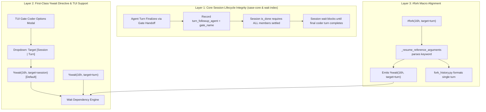

# SASE Research Report: Root Cause and Architecture Analysis for `#fork` and `%wait` Session vs. Turn Target Synchronization

**Author:** Researcher `gem` (5-Researcher Swarm)  
**Date:** 2026-10-30  
**Repository:** `sase` (linked sidecar `research`)  
**Target Path:** `202610/fork_target_session_vs_turn_wait__gem.md`  

---

## Executive Summary

When agent `16h.f0` was launched with `#fork:16h` in its prompt, the user expected it to wait until agent session `16h` had completely finished its work (planning, human gate review, and coder implementation) before starting. Instead, `16h.f0` started running its own planning phase at 15:27:18 EDT, while `16h` was still awaiting gate approval and before `16h--code` was even launched (which ran from 15:30:48 to 15:51:26 EDT).

This report investigates the precise root cause from durable artifact evidence and source code, critiques the proposed plan to add a `target=session|turn` input to the `fork` macro, and provides a comprehensive architectural recommendation.

### Key Findings

1. **Root Cause of Early Release**:
   - At launch time (15:22:37), `16h` was actively executing its initial turn, `16h--plan` (`20261030151600`).
   - `#fork:16h` automatically generated an implicit wait dependency via `fork_wait_dependency("16h")`. Because `16h` had not yet attached a successor turn (the gate), `find_agent_session("16h")` fell back to `find_named_agent("16h")`, which bound the wait dependency to `kind: "agent"` at timestamp `20261030151600` (specifically the single turn `16h--plan`).
   - When `16h--plan` finished at 15:25:08.573959 with `outcome: "completed"`, the `wait_checks` lumberjack chop evaluated `dependency_resolution_status`. Because the target was bound to the single turn `16h--plan`, the chop observed that the turn was terminal and stamped `wait_dependencies_satisfied_at: 1793388308.573959`. It published `ready.json`, releasing `16h.f0--plan` at 15:25:39.
   - Furthermore, in the core wait dependency index (`_artifact_state.py` and `_index_entities.py`), `turn_followup_handoff_agent` only inspects `monitor` and `gate` turns. When an agent turn (`16h--plan`) hands off to a gate turn (`16h--gate`), it exits with `outcome: "completed"` without registering a pending turn follow-up. Thus, even under session evaluation, `is_done = any(candidate.is_done for candidate in effective_generation)` evaluated to `True`, prematurely declaring the session complete!

2. **Why `16h.f0--code` Waited While `16h.f0--plan` Did Not**:
   - When `16h.f0--gate` was approved, the reviewer entered `wait_agents: ["16h"]` in the TUI coder options.
   - The gate injected `%wait(16h)` into `16h.f0--code`'s prompt.
   - When `16h.f0--code` booted at 15:38:19, `16h--code` was actively executing. `%wait(16h)` waited on `16h--code` and was released when `16h--code` stopped at 15:51:26.
   - In both cases, the wait system targeted the *currently executing turn* rather than the full session lifecycle.

3. **Critique of the Proposed `target` Input on `fork.yml`**:
   - **Timing Mismatch**: `#fork` is a launch-deferred macro (`LAUNCH_DEFERRED_MACRO_NAMES`). Its Jinja/Python steps in `fork.yml` execute *after* an agent is released from wait. Adding an input to `fork.yml` does nothing for the pre-wait dependency loop in AXE.
   - **Macro Grammar Constraint**: In `fork.yml`, `name` has `repeatable: true`. SASE's `validate_repeatable_input_order` requires any repeatable input to be the final user-facing positional input. Placing `target` after `name` causes a `MacroValidationError` at load time; placing `target` before `name` breaks positional syntax for every `#fork:<name>` in existence.
   - **Keyword Discard in Reference Extractor**: `_resume_reference_arguments` in `src/sase/agent/names/_resume.py` uses `parse_args` and explicitly discards named keyword arguments (`positional, _ = parse_args(...)`).
   - **Input Type Clarification**: Model inputs do *not* use `type: enum`; they use `named_type: "model"` with dynamic Rust validation. Enum inputs use `type: enum` with a static `choices:` list.
   - **Scope Mismatch**: TUI coder options and non-forking `%wait` directives do not use `#fork`. Putting `target` only on `#fork` leaves all other wait surfaces unable to distinguish session vs. turn.

4. **Recommended Solution**:
   - **Fix Core Session Lifecycle Tracking**: Ensure an agent turn that hands off to a gate or successor registers a pending follow-up so that session `is_done` requires full session settlement.
   - **First-Class `%wait` Targeting**: Add `target=session|turn` to `%wait(...)`, `PromptWaitDirective`, `sase.wait_spec`, and the TUI tale gate coder options modal. Default to `target=session` whenever a bare agent name is given.
   - **Support Suffix Targeting**: Allow explicit turn targeting by name (e.g. `%wait(16h--plan)` or `#fork(16h--plan)`).
   - **Coordinate `#fork` Parameters**: Update `_resume_reference_arguments` to extract keyword arguments from `#fork(...)` and pass `target` to both launch-time wait resolution and post-admission transcript formatting.

---

## 1. Concrete Incident Timeline: Agent `16h` and `16h.f0`

From artifact inspections across `gh_bobs-org__bob-cli` under `~/.sase/projects/gh_bobs-org__bob-cli/artifacts/ace-run/202610/30/`, the exact timestamps and metadata tell an unambiguous story:

| Timestamp Dir | Agent / Turn Name | Session | Role | State / Outcome | Launch / Boot | Finished / Stopped | Notes |
| :--- | :--- | :--- | :--- | :--- | :--- | :--- | :--- |
| `20261030151600` | `16h--plan` | `16h` | `plan` | `completed` | 15:16:03 EDT | 15:25:08.573 EDT | Handed off to gate `86241186...` |
| `20261030152239` | `16h.f0--plan` | `16h.f0` | `plan` | `completed` | 15:22:41 EDT | 15:34:48 EDT | Had `#fork:16h`; **unblocked at 15:25:39** |
| `20261030152501` | `16h--gate` | `16h` | `gate` | `answered` | 15:28:07 EDT | 15:29:53 EDT | Plan gate for `16h`; approved by reviewer |
| `20261030153048` | `16h--code` | `16h` | `code` | `completed` | 15:30:49 EDT | 15:51:36 EDT | Implemented plan for `16h` |
| `20261030153440` | `16h.f0--gate` | `16h.f0` | `gate` | `answered` | 15:36:31 EDT | 15:37:56 EDT | Plan gate for `16h.f0`; reviewer added `wait: 16h` |
| `20261030153819` | `16h.f0--code` | `16h.f0` | `code` | `completed` | 15:38:20 EDT | 16:05:51 EDT | Had `%wait(16h)`; unblocked at 15:51:54 |

### Microsecond Forensic Evidence

In `20261030151600/done.json` (`16h--plan`):
```json
{
  "name": "16h--plan",
  "outcome": "completed",
  "finished_at": 1793388308.573959
}
```

In `20261030152239/agent_meta.json` (`16h.f0--plan`):
```json
{
  "name": "16h.f0--plan",
  "agent_session": "16h.f0",
  "wait_for": ["16h"],
  "wait_for_fork_sources": [
    {
      "kind": "agent",
      "name": "16h",
      "artifact_dir": "/home/bryan/.sase/projects/gh_bobs-org__bob-cli/artifacts/ace-run/202610/30/20261030151600",
      "timestamp": "20261030151600",
      "project_name": "gh_bobs-org__bob-cli"
    }
  ],
  "wait_dependencies_satisfied_at": 1793388308.573959,
  "wait_completed_at": "2026-10-30T19:25:39.497615+00:00",
  "wait_release_source": "ready_json",
  "run_started_at": "2026-10-30T19:27:18.163927+00:00"
}
```

Notice:
1. `wait_dependencies_satisfied_at` is `1793388308.573959`—down to the exact microsecond of `16h--plan`'s `finished_at`.
2. `wait_for_fork_sources` bound `16h` with `kind: "agent"` and pointed directly to artifact `20261030151600` (`16h--plan`).
3. `16h.f0--plan` unblocked at 15:25:39 and started executing its LLM turn at 15:27:18.
4. Meanwhile, `16h` was only on step 1 of its session: the plan gate `16h--gate` wasn't answered until 15:29:53, and `16h--code` didn't finish until 15:51:36!

```mermaid
sequenceDiagram
    autonumber
    participant U as User / TUI
    participant S1 as Session 16h (Plan/Gate/Code)
    participant W as AXE Wait Engine (wait_checks)
    participant S2 as Session 16h.f0 (Plan/Gate/Code)

    Note over S1: 15:16:03 Launch 16h--plan
    S1->>S1: Running 16h--plan
    Note over S2: 15:22:37 Launch 16h.f0--plan (#fork:16h)
    S2->>W: Park on wait_for_fork_sources (kind="agent", dir=16h--plan)
    
    S1->>S1: 15:25:08 16h--plan completes & hands off to gate
    S1->>W: done.json finished_at = 1793388308.573959
    W->>S2: 15:25:39 Dependencies satisfied! Writes ready.json
    Note over S2: 15:27:18 16h.f0--plan STARTS (premature release!)
    
    S1->>S1: 15:28:07 16h--gate pending reviewer decision
    U->>S1: 15:29:53 User approves tale in 16h--gate
    S1->>S1: 15:30:48 16h--code starts implementing
    
    S2->>S2: 15:34:40 16h.f0--plan completes; creates 16h.f0--gate
    U->>S2: 15:37:56 User approves 16h.f0--gate with coder wait: 16h
    Note over S2: 15:38:19 16h.f0--code launches with %wait(16h)
    S2->>W: Parks waiting for active turn 16h--code
    
    S1->>S1: 15:51:26 16h--code completes!
    W->>S2: 15:51:54 16h.f0--code released
    Note over S2: 15:53:21 16h.f0--code starts implementing
```

---

## 2. In-Depth Root Cause Analysis

Why did the wait engine target the turn instead of the session? There are two root causes in the codebase working in tandem:

### Cause A: Launch-Time Fallback in `fork_wait_dependency`

In `src/sase/agent/fork_waits.py`:
```python
def fork_wait_dependency(name: str) -> dict[str, str]:
  clan = find_agent_clan(name)
  if clan is not None:
    return {"kind": "clan", "name": clan.name, ...}

  agent_session = find_agent_session(name)
  if agent_session is not None:
    dependency = {"kind": "session", "name": agent_session.base_name}
    if agent_session.root is not None:
      dependency.update(_artifact_identity(agent_session.root.artifacts_dir))
    return dependency

  agent = find_named_agent(name)
  if agent is not None:
    return {
        "kind": "agent",
        "name": agent.name,
        **_artifact_identity(Path(agent.artifacts_dir)),
    }
```

When `16h.f0` was launched at 15:22:37:
1. `16h` had only booted `16h--plan`.
2. SASE's session architecture treats an agent as a "bare agent" until it attaches a successor (see `src/sase/agent/_agent_session_promotion.py`).
3. Because `16h--plan` had not yet handed off to `16h--gate`, `find_agent_session("16h")` did not find an established multi-turn session.
4. It fell through to `find_named_agent("16h")`.
5. `find_named_agent("16h")` matched the currently executing artifact `20261030151600` via `meta.workflow_name == "16h"`.
6. This produced `{"kind": "agent", "name": "16h", "artifact_dir": ".../20261030151600"}`.
7. Consequently, `16h.f0` was explicitly programmed to wait on the single agent turn `16h--plan`.

### Cause B: Missing Follow-Up Tracking for Agent Turns in Session Resolution

Even when a target is resolved as `kind: "session"`, the session completion logic in `src/sase/core/wait_dependency_resolution/_index_entities.py` contains a critical bug:

```python
# src/sase/core/wait_dependency_resolution/_index_entities.py
effective_generation, handoffs_present = cls._agent_session_handoff_state(
    candidates, extra_present_names=extra_present_names
)
...
return WaitEntity(
    timestamp=newest_timestamp,
    is_resolved=(
        handoffs_present
        and all(candidate.is_resolved for candidate in effective_generation)
    ),
    is_done=any(candidate.is_done for candidate in effective_generation),
    members=effective_generation,
)
```

Look at how `handoffs_present` and `turn_followup_handoff_agent` work:
```python
# src/sase/core/wait_dependency_resolution/_artifact_state.py
def turn_followup_handoff_agent(
    meta: Mapping[str, Any], done_data: Mapping[str, Any] | None, ...
) -> str | None:
  kind = _terminal_turn_kind(meta, done_data)
  if kind is None:
    return None
  ...


def _terminal_turn_kind(
    meta: Mapping[str, Any], done_data: Mapping[str, Any] | None
) -> str | None:
  """Return the turn kind when a monitor/gate turn member reached a terminal state."""
  ...
  outcome = done_data.get("outcome")
  kind = _TURN_KIND_BY_OUTCOME.get(outcome)
  # _TURN_KIND_BY_OUTCOME = {MONITOR_OUTCOME: "monitor", GATE_OUTCOME: "gate"}
  return kind
```

`_terminal_turn_kind` **only recognizes monitor and gate outcomes!**
When an agent turn like `16h--plan` finishes:
- Its `done.json` has `outcome: "completed"`.
- `_terminal_turn_kind` returns `None`.
- `turn_followup_handoff_agent` returns `None`.
- `_agent_session_turn_handoffs_have_successors` checks:
  `all(candidate.turn_followup_agent is None or candidate.turn_followup_agent in names_in_generation for candidate in candidates)`
  Because `turn_followup_agent` is `None`, this immediately evaluates to `True`!
- And `is_done = any(candidate.is_done for candidate in effective_generation)`: because `16h--plan` is done, `is_done` evaluates to `True`!
- Therefore, the wait engine treats the session as fully resolved and done the instant `16h--plan` exits, completely blind to the fact that `16h--plan` handed off to a gate turn (`16h--gate`).

---

## 3. Critique of the Proposed Plan

The user proposed:
> 1. Implement this with a new `target=<target>` input on the `fork` macro.
> 2. The `<target>` input value would be required to be either `"session"` or `"turn"` (with a default of `"session"`).
> 3. Enforce this using an enum macro input type (the same type used for inputs that accept model names).

### 3.1 Fatal Flaw: Timing Separation (Launch Wait vs. Macro Expansion)

`#fork` is defined in `LAUNCH_DEFERRED_MACRO_NAMES` (`src/sase/macro/processor.py`):
```python
LAUNCH_DEFERRED_MACRO_NAMES: frozenset[str] = frozenset({"fork"})
```

When an agent prompt is submitted:
1. Ordinary macros expand, but `#fork` references are explicitly deferred.
2. The launcher extracts directives and fork references lexically using regex (`src/sase/axe/run_agent_directives_flow.py`).
3. The runner parks the agent in `run_agent_wait.py`, waiting for `ready.json`.
4. **`fork.yml` DOES NOT EXECUTE BEFORE OR DURING THE WAIT!**
5. Only *after* `ready.json` is observed and the wait loop terminates does `expand_deferred_launch_macros` run (in `run_agent_runner_setup_prompt.py`).
6. Only then does `fork.yml` run to load transcript history.

If `target` were added as an input in `src/sase/macros/fork.yml`, that input would only be parsed and evaluated *after* the wait is already over. It would have **zero effect** on whether the agent waits for the session or the turn!

### 3.2 Macro Grammar Constraint: `validate_repeatable_input_order`

In `src/sase/macros/fork.yml`:
```yaml
input:
  name:
    type: agent
    default: null
    repeatable: true
    description: Optional agent name, named proc name/ID...
```

Notice that `name` is `repeatable: true` (to support multi-parent forks like `#fork:agent1,agent2` or `#fork(agent1, agent2)`).

SASE enforces a strict rule in `src/sase/macro/input_binding.py`:
```python
def validate_repeatable_input_order(inputs: list[InputArg]) -> None:
  visible = [input_arg for input_arg in inputs if not input_arg.is_step_input]
  repeatable = [input_arg for input_arg in visible if input_arg.repeatable]
  if len(repeatable) > 1 or repeatable[0] is not visible[-1]:
    raise MacroValidationError(
        "A repeatable input must be the final user-facing positional input"
    )
```

This creates an unavoidable syntactic conflict in `fork.yml`:
- If `target` is added *after* `name`, `validate_repeatable_input_order` raises `MacroValidationError` because `name` is not the final input.
- If `target` is added *before* `name`, `target` becomes positional input 0:
  Any standard call like `#fork:16h` will pass `"16h"` to `target`. Validation will fail immediately because `"16h"` is neither `"session"` nor `"turn"`. This breaks every existing `#fork` call in the entire system.
- SASE currently has no `kwonly: true` flag for macro inputs.

### 3.3 Reference Argument Parsing Discards Named Arguments

In `src/sase/agent/names/_resume.py`:
```python
def _resume_reference_arguments(text: str, match: re.Match[str]) -> list[str]:
  ...
  positional, _ = parse_args(inner, preserve_empty_args=True)
  return [value for value in positional if value]
```
The pre-wait reference extractor (`_resume_reference_arguments`) parses the argument list with `parse_args` and explicitly ignores named keyword arguments (the `_` variable).
If a user writes `#fork(16h, target=turn)`:
- `positional` is `["16h"]`.
- `target=turn` is discarded.
If a user writes `#fork(name=16h, target=turn)`:
- `positional` is empty `[]`.
- No fork target is found at all, and no wait is established!

### 3.4 Misconception Regarding Model Input Types

The user notes: *"We should enforce this using an enum macro input type (this is the same type we use for inputs that accept model names I believe)."*

In SASE's macro type system (`src/sase/macro/models.py` and `src/sase/macro/_loader_parsing_inputs.py`):
- **Model inputs** do *not* use `InputType.ENUM`. They use `named_type: "model"` (resolved through Rust bindings via `classify_model_value`), which dynamically checks valid model aliases and registered provider targets.
- **Enum inputs** use `type: enum` with a static list of `choices:`, for example:
  ```yaml
  target:
    type: enum
    default: session
    choices:
      - {value: session, description: Wait for the entire agent session}
      - {value: turn, description: Wait only for the currently active turn}
  ```
While `type: enum` with `choices` is the correct way to declare enums in SASE macros (as seen in `src/sase/macros/pr.yml`), placing it on `fork.yml` fails for the reasons described above.

### 3.5 Architectural Separation of Concerns

- **`#fork` is for Context Injection**: `#fork` exists to load conversation history from a parent and inject it into the child's prompt. The implied wait is merely a precondition (you cannot format a chat file before it exists).
- **`%wait` is for Execution Synchronization**: `%wait` (and `%w`) is the universal directive for controlling execution order across agents, beads, hoods, procs, and time.
- The user noted: *"since we have the ability to specify that coder agents wait for another agent (in the coder options for a tale's gate in the TUI, for example), it would be useful to be able to specify whether an agent should target the agent session or the currently running turn..."*
- In that exact TUI tale gate scenario, the coder agent **does not use `#fork` at all!** It uses `%wait(16h)`!
- If `target=` were only implemented as an input on `#fork`, the TUI coder options gate would still have no way to specify session vs. turn waiting.

---

## 4. Alternative Approaches and Design Evaluation

| Dimension | Option 1: User's Plan (`target` on `fork.yml`) | Option 2: `target` on `%wait` Directive | Option 3: Syntactic Target Naming (`16h` vs `16h--plan`) | Option 4: Full Multi-Layer Architecture (Recommended) |
| :--- | :--- | :--- | :--- | :--- |
| **Mechanics** | Add input to `fork.yml` | Add `target=session\|turn` to `%wait(...)` | Use session name for session, suffixed name for turn | Fix session lifecycle + `%wait(target=)` + `#fork` keyword parsing |
| **Timing Viability** | **Broken** (deferred macro runs post-wait) | **Viable** (parsed at launch time) | **Viable** (parsed at launch time) | **Viable** (coordinates both pre-wait and post-wait) |
| **Grammar Conflict** | **Broken** (`repeatable` tail error) | **Clean** (`%wait` already takes keyword args) | **Clean** (standard identifier syntax) | **Clean** (handles named args in reference parser) |
| **TUI Coder Coverage**| **None** (TUI uses `%wait`, not `#fork`) | **Complete** (TUI generates `%wait`) | **Partial** (requires user to know suffix) | **Complete** (TUI modal can offer toggle) |
| **Fixes Root Cause?** | **No** (session completion still buggy) | **Partial** (still broken if default fails) | **Partial** (still broken if default fails) | **Yes** (session handoffs correctly tracked) |

---

## 5. Recommended Solution

The recommended solution addresses both the immediate failure of `16h.f0` and the broader feature request across three integrated layers:



### Layer 1: Core Session Lifecycle Integrity (Fixing the Bug)

A bare agent name like `16h` represents the **agent session container**. Waiting on `16h` must, by default, wait until the session settles.

1. **Fix `fork_wait_dependency` in `src/sase/agent/fork_waits.py`**:
   - When resolving a target name `name` that matches a running agent whose `workflow_name` or `agent_session` is `name`, do not treat it as an isolated turn (`kind: "agent"`).
   - Emit `{"kind": "session", "name": name, ...}` even if it is currently in its first turn.

2. **Fix `turn_followup_handoff_agent` in `src/sase/core/wait_dependency_resolution/_artifact_state.py`**:
   - Currently, `_terminal_turn_kind` only checks `_TURN_KIND_BY_OUTCOME` (`monitor` and `gate`).
   - When an agent turn completes with a handoff to a gate (indicated by `meta.get("gate_member_agent_name")` or `meta.get("gate_id")`), record `turn_followup_agent = meta["gate_member_agent_name"]`.
   - This ensures `_agent_session_turn_handoffs_have_successors` sees the pending gate member and keeps `handoffs_present = False` until the gate turn attaches and completes.

3. **Fix `_agent_session_entity` in `src/sase/core/wait_dependency_resolution/_index_entities.py`**:
   - Replace `is_done = any(candidate.is_done for candidate in effective_generation)` with a settlement check:
     ```python
     is_done = (
         handoffs_present
         and not any(_member_is_pending(candidate) for candidate in effective_generation)
         and any(candidate.is_done for candidate in effective_generation)
     )
     ```
   - A session is only done when its current active chain has no pending successors and the final member is terminal.

### Layer 2: First-Class `%wait` Targeting and TUI Integration

Because `%wait` is the universal primitive used by raw prompts, coder options in gates, and scripts:

1. **Extend `%wait` Directive Syntax**:
   - Allow: `%wait(16h, target=session)` (default) and `%wait(16h, target=turn)`.
   - Short form: `%w(16h, target=turn)`.
   - In `src/sase/macro/_directive_collect_main.py`: Parse `target=` keyword on `%wait` / `%w`.
   - Validate that `target` must be either `"session"` or `"turn"`.

2. **Support Explicit Turn Name Waiting**:
   - SASE naming conventions already reserve `<session>--<suffix>` for turns.
   - If a user specifies `%wait(16h--plan)` or `#fork:16h--plan`:
     - The target has an explicit turn suffix.
     - The resolver recognizes it as an individual agent turn and waits only for `16h--plan`.
   - This provides a zero-syntax-change escape hatch: waiting on `16h` waits for the session; waiting on `16h--plan` waits for the turn.

3. **Update TUI Gate Coder Options**:
   - In `src/sase/ace/tui/modals/approve_options_modal.py` (`_WaitSpecInputModal`):
     - Add a selector or support wait spec syntax: `16h` (session) or `16h:turn` / `16h(target=turn)`.
     - In `sase.wait_spec` (`src/sase/wait_spec.py`), allow `target=turn` or `target=session` attributes on agent entries.

### Layer 3: Align `#fork` Reference Extraction and Transcript Scoping

To support the user's desired `#fork(16h, target=turn)` syntax:

1. **Update `_resume_reference_arguments` in `src/sase/agent/names/_resume.py`**:
   - Instead of discarding named arguments (`positional, _ = parse_args(...)`), capture named arguments:
     ```python
     positional, named = parse_args(inner, preserve_empty_args=True)
     ```
   - Return structured target objects: `ForkReference(name="16h", target=named.get("target", "session"))`.

2. **Propagate to `run_agent_directives_flow.py`**:
   - When building `wait_fork_sources`:
     - If `target == "turn"`, force `fork_wait_dependency(name, target="turn")` to bind `kind: "agent"`.
     - If `target == "session"`, force `fork_wait_dependency(name, target="session")` to bind `kind: "session"`.

3. **Update Transcript Injection in `_agent_chat_from_name_sources.py`**:
   - When `#fork` runs post-admission:
     - If `target == "turn"`, resolve only the single requested turn's chat (`kind: "agent"`).
     - If `target == "session"`, resolve the full multi-turn session history (`kind: "session"`).
   - This provides semantic consistency: `target=turn` both waits for only that turn and forks only that turn's conversation; `target=session` waits for the full session and forks the full multi-turn conversation.

---

## 6. Implementation Plan & Affected Components

| Component | File Path | Proposed Changes |
| :--- | :--- | :--- |
| **Wait Directive Collector** | `src/sase/macro/_directive_collect_main.py` | Allow `target=` keyword on `%wait` / `%w`; validate `{"session", "turn"}`. |
| **Directive Types** | `src/sase/macro/_directive_types.py` | Add `wait_targets: dict[str, str]` to `PromptDirectives`. |
| **Directives Flow** | `src/sase/axe/run_agent_directives_flow.py` | Pass target specification from directives and `#fork` references to `fork_wait_dependency`. |
| **Fork Wait Resolution** | `src/sase/agent/fork_waits.py` | Accept `target="session"\|"turn"`; treat bare names as sessions even if only turn 0 is active. |
| **Artifact State** | `src/sase/core/wait_dependency_resolution/_artifact_state.py` | Extract `gate_member_agent_name` in `turn_followup_handoff_agent` so agent-to-gate handoffs stay pending. |
| **Session Entities** | `src/sase/core/wait_dependency_resolution/_index_entities.py` | Require `effective_generation` to be fully settled before declaring session `is_done`. |
| **Wait Spec Parser** | `src/sase/wait_spec.py` | Parse `target=turn\|session` qualifiers on agent wait specs. |
| **TUI Approval Modal** | `src/sase/ace/tui/modals/approve_options_modal.py` | Expose wait target option (Session vs. Turn) in tale gate coder options modal. |
| **Fork Reference Lexer** | `src/sase/agent/names/_resume.py` | Parse `target=` named keyword arguments in `_resume_reference_arguments`. |
| **Fork Transcript Builder**| `src/sase/scripts/_agent_chat_from_name_sources.py` | Honor `target="turn"` to restrict transcript injection to the specific parent turn. |

---

## Conclusion

The premature release of `16h.f0` was caused by a combination of launch-time fallback to turn-level binding and a gap in session handoff tracking when an agent turn hands off to a gate turn. 

Implementing `target=<target>` solely as an input on `fork.yml` cannot succeed because `#fork` is launch-deferred (macro expansion occurs only *after* wait release), `validate_repeatable_input_order` rejects inputs following a repeatable argument, and the gate coder options in the TUI use `%wait` rather than `#fork`.

The proper solution is multi-layered:
1. Fix the session handoff detection in `_artifact_state.py` and `_index_entities.py` so that waiting on an agent session (`16h`) correctly stays blocked through gate and coder phases by default.
2. Introduce explicit `target=session|turn` on the universal `%wait` directive and in `sase.wait_spec` (powering the TUI coder options).
3. Update `#fork` reference parsing in `_resume.py` to extract `target=` keyword arguments, routing them both to pre-wait dependency generation and post-admission transcript formatting.
