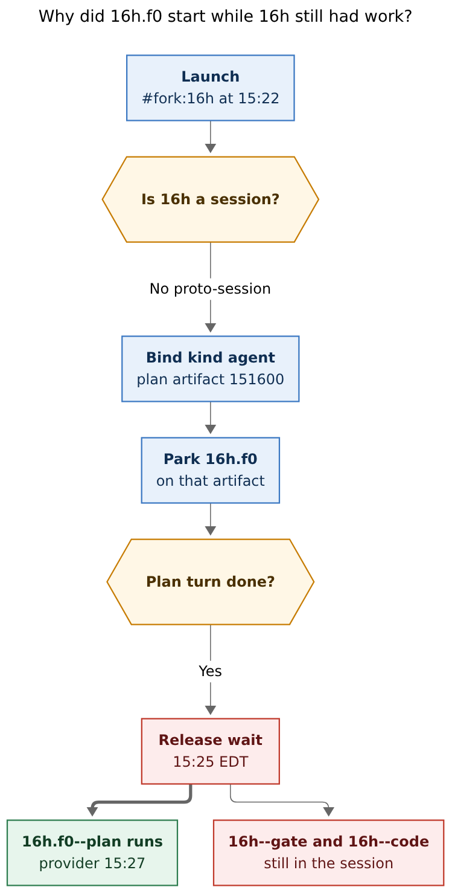
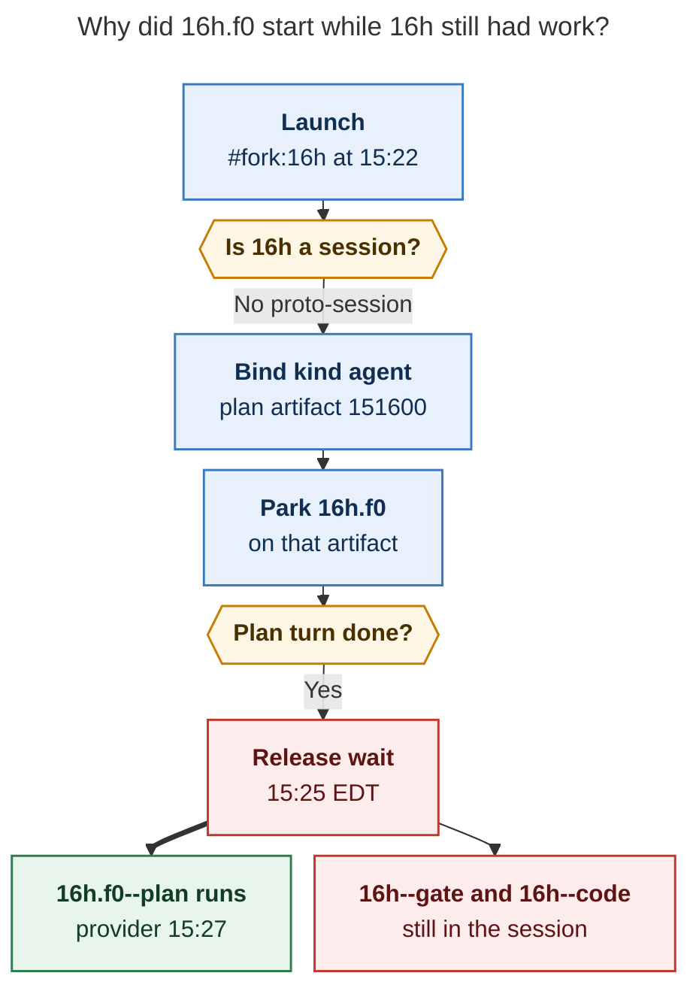
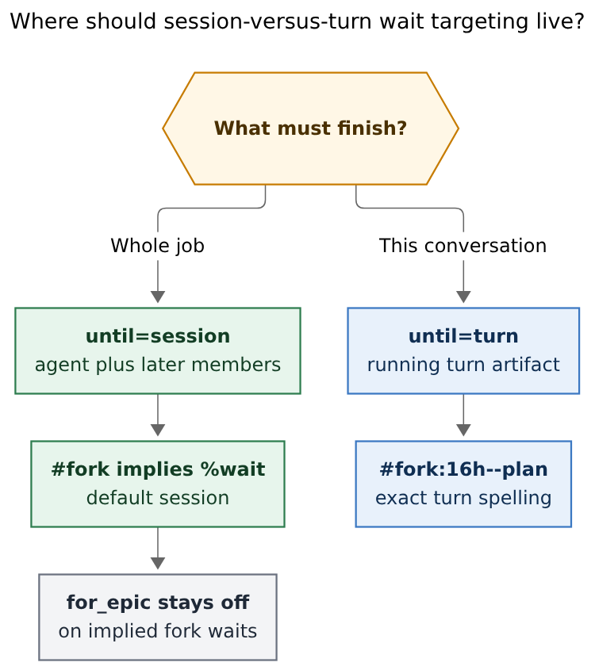
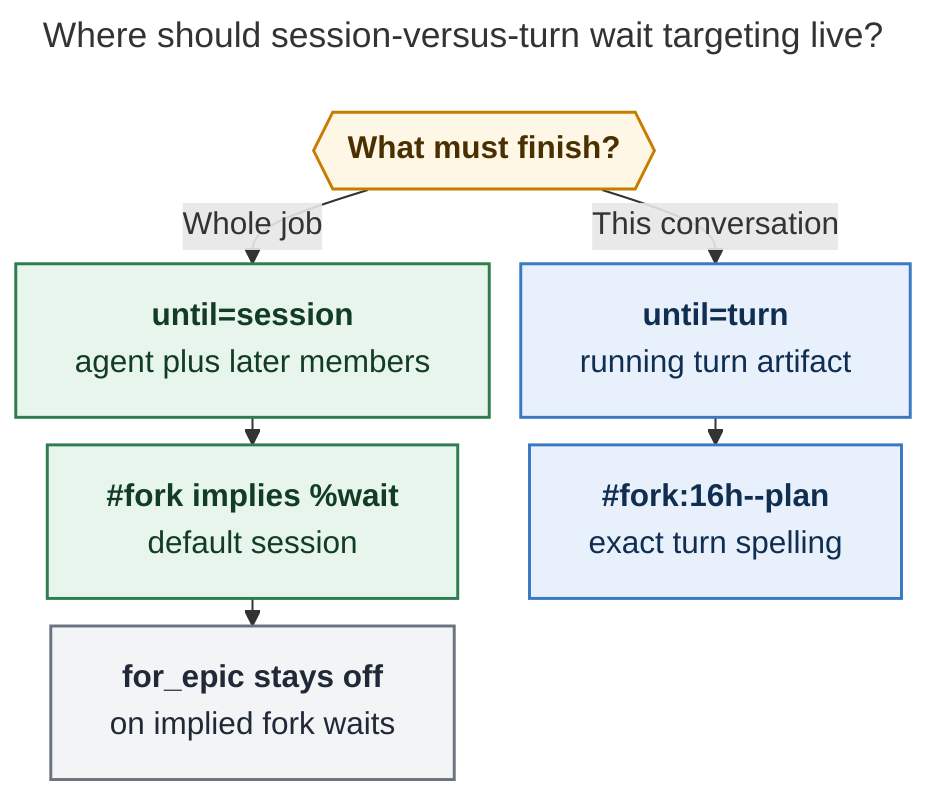

# Fork wait targeting: session versus turn

**Question.** Why did `16h.f0` start before `16h` finished, given `#fork:16h`? Is a
new `target=session|turn` input on `#fork` the right fix, and how should that
capability be implemented?

**Researcher.** grk (`research.5j.grk`). Independent report. I did not read peer
reports from this swarm.

**Evidence.** Live artifacts for the `16h` / `16h.f0` bob-cli sessions, the
installed sase that launched them (`0.18.1` / `dab2d701`), and the current sase
tree's wait/fork code and docs. Times below are converted from artifact UTC
stamps to America/New_York (EDT, UTC−4).

## Bottom line

`#fork:16h` did wait. It waited for the **plan turn artifact**, not for the
**16h session**. `16h.f0--plan`'s provider started at 15:27 EDT, two minutes
after `16h--plan` handed off, while `16h--gate` and `16h--code` were still
ahead. That is the currently running turn, snapshotted at bind time.

Adding `target=` on the `#fork` macro is the right *vocabulary* and the wrong
*primary fix*. The hole is in wait **resolution**, not in macro expansion.
`fork.yml` never binds the implied wait; `fork_agent_names()` even discards
named kwargs today. A new input that is not wired through that path would be
dead for wait purposes.

**Recommended solution.** Change the implied `#fork:<name>` wait so a
not-yet-session parent is followed into the session that grows from it
(successors that appear after the wait begins), matching `%wait:<session>` and
the existing identity-wait path. Expose that as `until=session|turn` (inline
`enum`, default `session`) on **both** `%wait` and `#fork`. Keep
`#fork:16h--plan` as the exact turn spelling. Do not arm `for_epic` on implied
fork waits.

**Adjustment (called out).** Use `until=`, not `target=`. `target` already
means the parent name, and `--next-fork session|turn|none` already uses those
words for a different axis (where the next agent attaches). The closed set is
inline `enum` with `choices`, not `type: model`.

## Incident: `16h.f0` did wait, then released too early

User prompt (from `16h.f0--plan` `raw_prompt.md`):

```text
#gh:gh_bobs-org__bob-cli #fork:16h Also, I should be able to use the
`<ctrl+n/p>` keymaps ...
#plan %m:@xlarge
```

`16h.f0--plan` `agent_meta.json` recorded:

```json
"wait_for": ["16h"],
"wait_for_fork_sources": [{
  "kind": "agent",
  "name": "16h",
  "artifact_dir": ".../ace-run/202610/30/20261030151600",
  "timestamp": "20261030151600",
  "project_name": "gh_bobs-org__bob-cli"
}]
```

That `artifact_dir` is the `16h--plan` turn. `kind` is `"agent"`, not
`"session"`.

| Turn | Boot (EDT) | Provider / run (EDT) | Settled (EDT) |
| --- | --- | --- | --- |
| `16h--plan` | 15:16:03 | 15:17:47 | handoff 15:24:53, finalizing 15:25:05 |
| `16h.f0--plan` | 15:22:41 | 15:27:50 | handoff 15:34:31 |
| `16h--gate` | — | 15:28:07 | gated after approve |
| `16h--code` | 15:30:49 | 15:32:29 | provider done 15:51:16 |
| `16h.f0--gate` | — | 15:36:31 | gated after approve |
| `16h.f0--code` | 15:38:20 | 15:53:48 | provider done 16:05:35 |

`16h.f0--plan` booted while `16h--plan` was still running, then sat until that
plan artifact completed. The LLM did not start until 15:27:50. From the user's
point of view the child "started" while `16h` still had a gate and a coder
ahead. The wait marker never cleared those later members because it was not a
session wait.

The later coder *did* wait for the rest of `16h`. Tale-gate approval stamped
`%wait(16h)` onto `16h.f0--code` (`raw_prompt.md`), with `wait_for_epics_of:
["16h"]`. That coder booted at 15:38:20 and only reached the provider at
15:53:48, after `16h--code` finished at 15:51:16. The tale-gate wait option
already does session-shaped waiting (plus epic follow). The implied `#fork`
wait on the planner did not.

Injected history matched the early release: `16h.f0--plan`
`workflow_state.json` `wait_chats` lists only the `16h--plan` transcript. A
session-level wait would have started after `16h--code` and injected plan,
gate, and code.

**Reader question:** Why did `16h.f0` start while `16h` still had work?

**Caption:** The implied `#fork` wait bound `16h` as one agent artifact and
released when that plan turn finished, while `16h`'s gate and code turns were
still running.



Rendered size: 498.2 × 986 px; fit scale: 90.5%. Mermaid CLI 12.0.0.



## Why the implied wait targeted the turn

`#fork` is two mechanisms that look like one:

1. **History injection** (`src/sase/macros/fork.yml`) after the waiter is
   admitted.
2. **Implied wait** extracted from the raw prompt in
   `resolve_wait_state()` (`src/sase/axe/run_agent_directives_flow.py`) via
   `fork_agent_names()`.

The second is the one that parked `16h.f0`. Tests in
`tests/test_agent_names_extract_naming.py` (`TestExtractDirectivesImplicitForkWait`)
document that `#fork:foo` implies `%wait:foo` and records
`wait_for_fork_sources`.

Bind time (`fork_wait_dependency()` in `src/sase/agent/fork_waits.py`) picks
the first match:

1. clan
2. **session** (`find_agent_session`)
3. named agent (`find_named_agent`)
4. proc
5. bare name

A session bind is already implemented and tested
(`test_agent_session_fork_records_root_identity`): `#fork:cx` against
`cx--plan` with `agent_session: cx` records `kind: "session"`. `16h.f0`
recorded `kind: "agent"` instead, so `find_agent_session("16h")` returned
`None` at 15:22:41.

That matches the session model in
`docs/reference/agents/agent-sessions.md`: a session is created only when the
first `%i(suffix, session=parent)` attachment happens. Until then the parent
is a one-turn agent. At bind time `16h` was still that proto-session: a
running planner named `16h` (workflow `16h`) whose later rename to
`16h--plan` and `agent_session: 16h` had not happened. `find_named_agent`
matches `name` or `workflow_name` and stores the **lookup** name, which is why
the snapshot says `"name": "16h"` even after the artifact is later renamed.

Resolve time then locked that snapshot in. In
`dependency_resolution_status()` (`_resolution.py`), a name that also appears
in `wait_for_fork_sources` is **skipped** on the name path. Only
`fork_source_status()` runs. For `kind: "agent"` that function treats the
bound artifact as terminal when `is_done or is_failed`
(`_index_fork_queries.py`). The plan turn's `done.json` is enough. Later
session members are invisible.

`%wait` identity resolution already does the thing the user wanted.
`identity_status()` (`_index_identity_queries.py`) looks up the same artifact,
then calls `agent_session_candidate_for_root()`. If a session has grown from
that root, it waits until the session is resolved and identity-successful,
including successors declared through `turn_followup_agent` that are not in
the generation yet (`_agent_session_turn_handoffs_have_successors`). Docs
state the same contract: `%wait:<session>` and `sase agent wait <session>`
"wait for successors that appear after the wait begins." An exact
`--<suffix>` name targets one member. A `%wait` on `<base>--plan` unblocks at
plan submit; a `%wait:<base>` on the container stays parked until the chain
completes (`docs/reference/macros/directive-launch.md`).

The implied `#fork` wait does not use that path once it has snapshotted
`kind: "agent"`. Explicit `%wait:16h #fork:16h` is also special: an explicit
duplicate wait **suppresses** `wait_for_fork_sources`
(`test_explicit_duplicate_wait_is_not_repeated`). That name-only wait can
upgrade to a session once `agent_session` exists. Bare `#fork:16h` cannot.

So the user's reading is correct: `16h.f0` targeted the currently running
turn. It is not a missed `#fork` expansion. It is bind-time proto-session
classification plus resolve-time refusal to follow that artifact into a
session.

## Existing session-versus-turn knobs

The product already has this distinction in several places. None of them is
`target=` on `#fork`.

| Surface | Session | Turn |
| --- | --- | --- |
| Wait name | `%wait:16h` / `#fork:16h` once a session exists | `%wait:16h--plan` / `#fork:16h--plan` |
| Gate continuation | `--next-fork session` (attach next member) | `--next-fork turn` (independent turn) |
| Tale-gate coder wait | `--wait` / TUI wait field stamps `%wait(name)` on the coder | exact `--plan` row never follows |
| Wait modal | Agents field; Follow epics tri-state | no session/turn toggle today |
| `%wait for_epic=` | follow **other** agents the parent launched as an epic | `for_epic=false` stays on that agent |

`--next-fork session|turn|none` is **attachment policy** for the next agent,
not wait coverage. Reusing `target=session|turn` on `#fork` will collide with
that language unless the docs hammer the difference.

`for_epic=` is the closest existing "keep waiting after this agent completes"
control, and it is the wrong axis for this bug. Epic follow waits on **other
agents** the parent launched. Session follow waits on **later turns of the
same agent** (`--gate`, `--code`, `--mon`). `16h.f0--plan` had no
`wait_for_epics_of`. Implied fork waits are explicitly not armed for
epic-follow in `resolve_wait_state()`. Keep that. The tale-gate coder wait
armed epic follow separately, which is why `16h.f0--code` waited through
`16h--code`.

The Wait modal (`docs/reference/tui/agents-tab.md`) already has a Follow
epics row under Agents. A session-versus-turn control belongs there too, as
the same kind of policy toggle, not only as a `#fork` kwarg.

## Critique of `target=` on the fork macro

The idea is good: authors should be able to say "wait for the whole job" or
"wait for this conversation." Default session matches the user's expectation
and the docs for bare session names. The proposed packaging is too narrow and
would not have fixed `16h.f0` by itself.

**Putting the input only on `fork.yml` does not bind waits.** `fork.yml`
currently has a repeatable `name: { type: agent }`. Workflow expansion runs
**after** admission. The implied wait is computed earlier from the raw prompt.
`_resume_reference_arguments()` in `src/sase/agent/names/_resume.py` parses
`#fork(...)` with `parse_args()` and **drops named kwargs** (`positional, _ =
parse_args(...)`). `#fork(16h, target=session)` would inject history from
`16h` and ignore `target=` for waiting unless that parser and
`resolve_wait_state()` change.

**A new input without a resolution change keeps today's bug.** Default
`session` only helps if bind/resolve follow a proto-session into later
members. If bind still snapshots `kind: "agent"` whenever
`find_agent_session` is `None`, `#fork:16h` with default session still
releases at plan handoff. The 16h.f0 trace is exactly that.

**`type: model` is not the enum type.** Macro arguments
(`docs/reference/macros/arguments.md`) resolve scalar → inline `enum` →
builtin (`agent`, `model`, `effort`) → plugin `<dist>@<id>`. Model tokens use
builtin `model` (same values as `%model`, with extra bind-time checks). Closed
sets of two to four values use inline `enum` with `choices`, compact signature
`until: session | turn`. That is what `#pr`'s `status` input already does.
Do not invent a plugin named type for two values.

**`target=` is a poor keyword.** The positional `name` is already the fork
target. `target=session` reads as "fork the session object" (history) as much
as "wait until the session settles." Wait keywords already include `time=`,
`bead=`, `hood=`, `for_epic=`. `until=` sits in that family. If a fork-only
alias is wanted, `until=` can be accepted on `#fork` and copied onto the
implied wait.

**Colon form cannot carry the keyword.** `#fork:16h` stays the common
spelling. Default session must apply to that form. `until=turn` requires
`#fork(16h, until=turn)` or the exact member name `#fork:16h--plan`.

**One `until=` per invocation is enough.** Repeatable `name` plus one named
enum covers `#fork(a, b, until=session)`. Mixed coverage is two invocations:
`#fork(planner, until=turn) #fork(coder, until=session)`.

**Do not merge this with `--next-fork`.** Session-versus-turn for
*continuation attachment* and session-versus-turn for *wait coverage* share
words and must stay separate flags.

## Recommended solution

**Reader question:** Where should session-versus-turn wait targeting live?

**Caption:** Default `until=session` follows the parent into later session
members. `until=turn` snapshots the running turn. Implied fork waits leave
`for_epic` off.



Rendered size: 499.7 × 564 px; fit scale: 100%. Mermaid CLI 12.0.0.



### 1. Fix default wait resolution (this would have saved `16h.f0`)

Treat a `#fork:<name>` / `%wait:<name>` on a live one-turn agent as a
**session seed**, not a frozen turn:

- Reuse `identity_status()` / `agent_session_candidate_for_root()` for implied
  fork sources bound to an agent artifact, **or** record `kind: "session"` even
  when `find_agent_session` is still `None`, pointing at that root artifact.
- Once the first follow-up attaches, keep waiting for the generation,
  including `turn_followup_agent` successors that appear after the wait
  begins.
- A parent that never becomes a session still completes when that one artifact
  succeeds, so one-shot agents do not hang.
- Exact `#fork:16h--plan` / `%wait:16h--plan` stays turn-scoped (planner-row
  exception at plan submit unchanged).

This is a behavior change for implied `#fork` waits on proto-sessions. It is
the correct default: the docs already describe bare session names this way;
the snapshot just fires before the session exists.

### 2. Add `until=session|turn` on the wait layer, then on `#fork`

**Adjustment:** keyword `until=`, default `session`, inline enum.

```yaml
# in fork.yml, named, not positional (name is already repeatable last positional)
until:
  type: enum
  default: session
  description: How far the implied wait covers the parent.
  choices:
    - { value: session, label: Session, description: Parent agent plus later session members }
    - { value: turn, label: Turn, description: The running turn artifact at bind time }
```

Wire the same keyword through `%wait`:

```text
%wait(16h)                         # until=session (default)
%wait(16h, until=turn)             # snapshot the running turn
%wait(16h--plan)                   # exact turn, unchanged
#fork:16h                          # implies until=session
#fork(16h, until=turn)             # restore today's 16h.f0 behavior
#fork:16h--code                    # exact member
```

Parser work:

- Keep named kwargs in `_resume_reference_arguments()` / a dedicated fork-arg
  parser.
- Reject unknown `until=` values the same way `for_epic=` rejects junk
  (`wait-for-epic-invalid-value` analog).
- Stamp `until` onto `wait_for_fork_sources` (for example `"until": "turn"`)
  so resolution does not have to re-parse the prompt.
- `until=turn` is today's `kind: "agent"` snapshot of the live artifact.
- `until=session` is identity/session follow, including proto-sessions.

Tale-gate `--wait` and the TUI Wait modal should grow the same enum (a
session/turn toggle under Agents, next to Follow epics). The coder wait the
user already uses then matches `#fork`, instead of `#fork` growing a private
dialect.

### 3. Leave implied fork waits `for_epic=false`

Session follow is "this agent's later turns." Epic follow is "other agents
this agent launched." Forking a planner to continue a related conversation
should not wait for a later epic by default. The tale-gate wait option can
still stamp `%wait(16h)` with default `for_epic=true` when the human asks the
coder to wait.

### 4. Docs and completion

Update `docs/reference/macros/built-ins.md`, `directive-launch.md`, and
`agent-sessions.md` so `#fork:<name>` on a running one-turn agent is described
as a session seed. TUI completion inside `#fork(` should offer `until=` after
`name=`, using the enum value menu (already true for `bool` / `path` / `agent`
and for compact enum signatures).

## Implementation notes

Wait resolution currently lives in Python
(`src/sase/core/wait_dependency_resolution/`). Shared frontend behavior
(TUI, CLI, implied `#fork`) should keep one resolver. If this logic is moving
into `sase-core`, land the session-seed rule there; do not ship a Python-only
`until=` that CLI and TUI then reimplement.

Suggested test matrix:

1. `#fork:parent` while parent is a running one-turn `#plan` agent; parent
   then grows `--gate` / `--code`; child stays parked until `--code`
   completes. This is the `16h.f0` replay.
2. Same launch with `#fork(parent, until=turn)`; child starts when the plan
   artifact completes.
3. `#fork:parent--plan` still unblocks at plan submit.
4. `#fork:parent` against an already multi-member session records
   `kind: "session"` (existing test) and waits for remaining members.
5. One-shot agent that never grows a session still releases on that artifact.
6. `#fork(parent, until=bogus)` fails at bind with allowed values listed.
7. `#fork:parent %wait:parent` (explicit duplicate) keeps one wait and honors
   `until=` from whichever occurrence authored it; conflicting values error.
8. Implied fork wait still does not write `wait_for_epics_of`.

## Risks

Changing the default will delay forks that today start in parallel with a
parent's coder. That is the `16h.f0` surprise; callers who want the old
overlap use `until=turn` or `#fork:16h--plan`. Publish that in the changelog.

There is a short race at plan handoff: `done.json` can appear before the gate
member is indexed. Session-seed resolution must use `turn_followup_agent` /
handoff-present, not "any member `is_done`." `AgentSessionCandidate.is_done`
is already `any(...)`; fork session status requires `is_resolved and is_done`.
Do not weaken that to `is_done` alone.

`find_named_agent` matching `workflow_name` is load-bearing for proto-sessions
and for the recorded `"name": "16h"` snapshot. Session-seed logic should key
off `artifact_dir`, not the lookup name.

## Gaps

I did not re-run `fork_wait_dependency("16h")` against a reconstructed
15:22:41 snapshot of `agent_meta.json`; the live file now has
`agent_session: 16h` written at attachment. The `kind: "agent"` record on
`16h.f0--plan` is the contemporaneous proof.

I could not `sase artifact read` the earlier `wait_follows_agent_into_epic`
and `macro_enum_inputs_named_types` reports (index status `missing`). The
live `for_epic=` and enum docs were enough.

## Confidence

High on the incident and on the bind/resolve mismatch. High that a
fork.yml-only `target=` input would not fix it. Medium-high that
`until=session|turn` on `%wait` plus implied `#fork` is the smallest surface
that also covers the tale-gate wait field. The remaining product choice is
whether default session is acceptable for people who fork a live planner as a
side conversation; I would take that default and give them `until=turn`.
