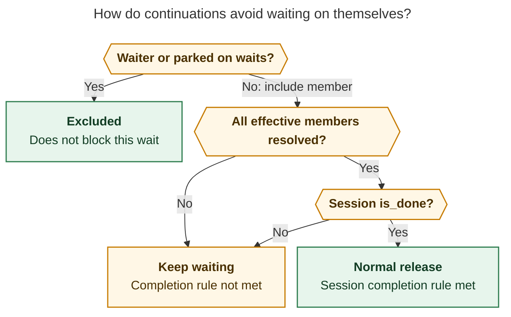

# Diagram proposals: Why `16h.f0` started early, and how to add `session` / `turn` wait targets

Proposals for the swarm linker, not a report. Each diagram restates only what the source
report says.

```yaml
source: research:202610/fork_wait_session_vs_turn_target/fork_wait_session_vs_turn_target__final.md
producer: research.5j.image
check: "mmdc 12.0.0 with the PDF-mirroring config rendered 1 of 1 Mermaid diagrams"
```

## continuation-exclusion

```yaml
anchor: |-
  Both depend on the existing rule that excludes the waiter's own artifact and members
question: |-
  How can a same-session continuation wait without blocking on itself?
illustrates: |-
  Same-session host follow-ups and pipe successors must retain self-exclusion, while
  normal session completion requires every effective member to resolve and
  session.is_done to hold.
caption: "Exclude the waiter and members parked on waits; normal completion still requires every effective member resolved and session.is_done."
review: "741.209x808 px, fit 88.1%; question and visual checks passed; 1 revision, 2 look rounds; source trace and unique anchor verified; normal-success conditions only, with logical checks rather than an asserted source-code order"
```


