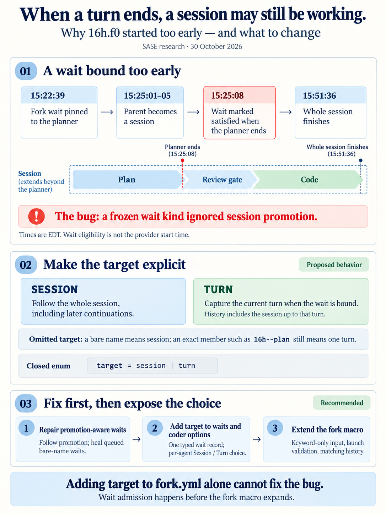
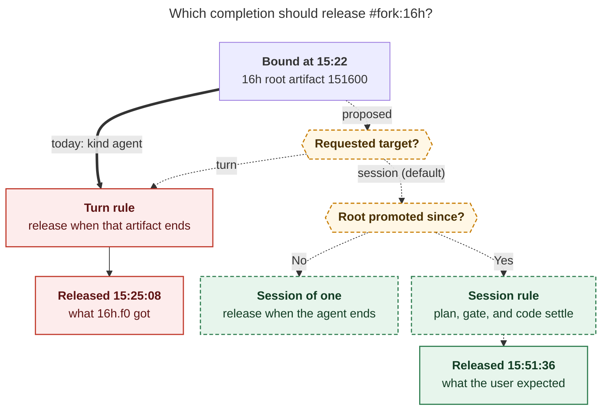
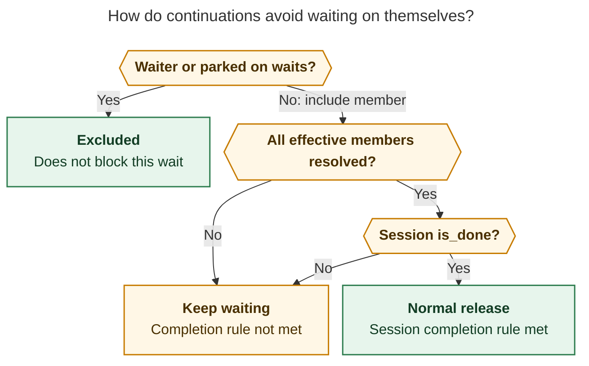

# Why `16h.f0` started early, and how to add `session` / `turn` wait targets

> **Research query:** Why did the `16h.f0` agent, whose prompt included `fork:16h`, start
> before the `16h` agent finished its work? Evaluate the proposal to let a wait target
> either an agent's session or its currently running turn through a new `target` input on
> the `fork` macro (an enum of `session` or `turn`, defaulting to `session`, also wanted in
> the TUI's coder options), critique the plan, call out any adjusted requirements, and
> recommend a solution.



## Bottom line

**Why it happened.** `#fork:16h` was supposed to wait for the whole `16h` session, and
the docs say it should. It released early because the wait was
**[bound too early](#mechanism)**. At 15:22:39, when `16h.f0` launched, `16h` was still a
single running agent. It had no gate or coder yet, so it was not a session.
`fork_wait_dependency("16h")` therefore recorded `kind: "agent"`, pinned to the planner's
artifact. About 2½ minutes later, the planner opened its tale gate, and that promoted
`16h` to a session (`16h--plan`, `16h--gate`, `16h--code`). The stored dependency never
picked up the promotion. `16h.f0` was released at 15:25:08.57, the exact microsecond
`16h--plan` finished. At that point the gate and the coder were still ahead, and the
`16h` session did not settle until 15:51:36.

Your reading ("it targeted the currently running turn") is right about the effect. But
the turn was targeted **by accident**. If you had launched `16h.f0` after 15:25:01, you
would have gotten session semantics. This is a bug against the documented contract, not
a missing feature.

**Is the plan a good idea?** The direction is good. An explicit, typed, defaulted choice
between "the whole session" and "the current turn" is worth having. But the plan as
written has [four problems](#what-is-missing-or-wrong):

1. **It would not have fixed this incident.** The code already intended session
   semantics, so a `session` default changes nothing on its own.
2. **It cannot be added to `fork.yml` as is.** The repeatable `name` input must be the
   last input.
3. **The value would be read too late.** The wait is computed from a lexical scan before
   `fork.yml` ever runs, and that scan currently drops named arguments.
4. **It does not reach the coder options you cited.** That surface emits `%wait(...)`,
   not `#fork`.

**Recommended solution, in three phases:**

1. **[Phase 1](#phase-1-promotion-aware-fork-waits), the fix.** Bare-name fork waits
   follow session promotion. This needs no new syntax, and it heals already-queued waits.
2. **[Phase 2](#phase-2-typed-target-on-the-wait-record), the wait record.** Add one
   typed `target` field to the wait dependency record. Expose it on
   `%wait(..., target=session|turn)` and as a per-agent toggle in the coder options.
3. **[Phase 3](#phase-3-target-on-the-fork-macro), the fork macro.** Expose the same
   field as `#fork(..., target=session|turn)`. This needs keyword-only macro inputs,
   launch-time validation, and history that follows the binding.

Keep the name `target`. Use an inline enum, not the `model` type. Exact member names
such as `#fork:16h--plan` keep meaning one turn.

**Workaround until Phase 1 lands:** write `%wait(16h, for_epic=false) #fork:16h`. An
explicit wait on the same name suppresses the pinned fork source. The plain-name wait
does follow promotion (cld replayed this). Two caveats:

- An explicit `%wait` is success-only. If `16h` fails, the fork stops instead of
  forking the failure.
- `for_epic=false` is needed only to avoid also waiting for epics that `16h` launches.

## What happened

All runs are in `~/.sase/projects/gh_bobs-org__bob-cli/artifacts/ace-run/202610/30/`.
Times are EDT. The lead researcher re-read the metadata below; cdx, cld, grk, and gem
corroborate it.

- **15:16:00:** `16h` launched (`20261030151600`) as a plain agent named `16h`. Its
  provider ran from 15:17:42.
- **15:22:39:** `16h.f0` launched with `#gh:gh_bobs-org__bob-cli #fork:16h … #plan`. The
  launch scan recorded `kind: "agent"`, pinned to `20261030151600`.
- **15:25:01–05:** The gate member `16h--gate` (`20261030152501`) was created. Its files
  were first written at 15:25:02. `16h` was promoted: the root was renamed `16h--plan`
  and given `agent_session: 16h`.
- **15:25:08.57:** `16h--plan` wrote `done.json`: `outcome: completed`,
  `finished_at: 1793388308.573959`.
- **15:25:39:** **`16h.f0` released.** `wait_dependencies_satisfied_at` was
  `1793388308.573959`, equal to the planner's finish time. `wait_release_source` was
  `ready_json`.
- **15:27:18:** `16h.f0--plan` started running, after waiting about 98 s for a runner
  slot.
- **15:27:50:** `16h.f0`'s fork history rendered "agent session `16h` · Members shown: 1
  of 2 · Not shown: `16h--gate` (running)".
- **15:29:53:** You approved `16h`'s tale gate. `16h--code` (`20261030153048`) launched at
  15:30:48 and ran from 15:32:29.
- **15:51:36.77:** `16h--code` finished. The `16h` session was now actually done.
- **15:51:54:** `16h.f0--code` was released. It carried `%wait(16h)` from your coder
  options and had `wait_for_epics_of: ["16h"]`, with no fork source. It released at
  exactly `16h--code`'s finish time.

The decisive record is from `16h.f0--plan`'s `agent_meta.json`:

```json
"wait_for": ["16h"],
"wait_for_fork_sources": [{
  "kind": "agent", "name": "16h",
  "artifact_dir": ".../ace-run/202610/30/20261030151600",
  "timestamp": "20261030151600", "project_name": "gh_bobs-org__bob-cli"
}],
"wait_dependencies_satisfied_at": 1793388308.573959
```

Three components treated the same name `16h` in three different ways:

- **`#fork:16h` implied wait (bound at launch):** Waited for one turn ❌
- **`#fork:16h` history (resolved late):** Treated `16h` as a session and flagged that
  the gate was still running
- **`%wait(16h)` from coder options:** Waited for the whole session ✅

So admission and context injection disagreed. That is a real defect, not just confusing
labels in the TUI.

**Reader question:** Which completion should release `#fork:16h`?

**Caption:** Today, a bare name bound before session promotion goes straight to the
one-artifact rule. The proposal checks the requested target first and then follows
promotion. That would have held `16h.f0` until `16h--code` finished at 15:51:36.



Rendered with Mermaid CLI 12.0.0 using the PDF configuration: 791 × 874 px, fit scale
82.5%.

## Mechanism

`#fork` is really two mechanisms that look like one:

- **The implied wait.** It is derived from the raw prompt before launch.
- **History injection.** `fork.yml` runs it only after the wait releases, because `fork`
  is the only entry in `LAUNCH_DEFERRED_MACRO_NAMES` (`src/sase/macro/processor.py:81`).

Four steps produced the early release:

1. **The wait is bound once, from a lexical scan.** `resolve_wait_state()`
   (`src/sase/axe/run_agent_directives_flow.py:40`) collects names with
   `fork_agent_names()` and calls `fork_wait_dependency(name)` for each one. The result
   is stored as `wait_for_fork_sources`.
2. **Binding freezes the kind, not just the identity.** `fork_wait_dependency()`
   (`src/sase/agent/fork_waits.py:13`) tries these in order: clan, then
   `find_agent_session()`, then `find_named_agent()`, then proc, then bare name.
   `find_agent_session()` deliberately skips "plain exact agents named `base_name`"
   (`src/sase/agent/names/_lookup_groups.py:317`). A plain agent gets session metadata
   only when promotion runs, which happens when its first gate, monitor, or handoff
   member attaches. At 15:22:39 no such member existed, so the lookup fell through to
   `{"kind": "agent", artifact_dir: <planner>}`.
3. **Evaluation trusts the frozen kind.** In `fork_source_status()`
   (`src/sase/core/wait_dependency_resolution/_index_fork_queries.py:72`), the `"agent"`
   branch releases when that one candidate `is_done or is_failed`. Only the `"session"`
   branch calls `agent_session_candidate_for_root()`, which builds the session-wide
   result. The pinned candidate itself already says it is now the root of session `16h`;
   the `kind` dispatch simply ignores that.
4. **The session-aware name check is skipped.** `dependency_resolution_status()`
   (`_resolution.py`) skips the name path for any name that also has a fork source. So
   the visible `wait_for: ["16h"]` never ran the session-aware `is_resolved("16h")` that
   released `16h.f0--code` correctly.

Pinning the identity at launch is deliberate. It stops a later agent that reuses the name
from redirecting an already-queued fork, and it gives forks their "release on failure
too" behavior. The defect is narrower than that: the **kind** is pinned along with the
identity, and a bare agent's kind is not stable, because promotion is a normal lifecycle
event that happens after launch.

### Verification

- **cld** copied the 15:26 state into a scratch projects root and ran the installed
  resolver. The recorded `kind=agent` dependency came back resolved (the bug). The same
  dependency as `kind=session` came back waiting. A name-only `%wait:16h` came back
  waiting.
- **cdx** ran the real evaluator on an in-memory index with a completed planner and a
  pending gate. The agent dependency resolved; the session dependency waited.
- **The lead researcher** confirmed the gate artifact existed by 15:25:02, six seconds
  before the planner's `done.json`, and re-read the binder and evaluator source.

## Where the reports disagreed and how it resolves

- **The session aggregate is also broken: a planner-to-gate handoff is not tracked and
  `is_done = any(...)`, so even a `kind: session` wait would release early ("Cause B")**
  - *Source:* gem
  - *Verdict:* **Refuted for this incident.** See
    [the note below](#why-cause-b-does-not-hold).
- **`%wait(16h)` on `16h.f0--code` also targeted the running turn**
  - *Source:* gem
  - *Verdict:* **Refuted.** A name-only `%wait` goes through the session result (cld's
    replay showed it waiting while the gate was pending). It released at `16h--code`'s
    finish time because that was also the moment the session ended. It also had
    epic-follow armed.
- **A `session` default "preserves today's behavior"; for names that are not yet
  sessions, `session` ≡ `turn`**
  - *Source:* mus
  - *Verdict:* **Wrong.** The not-yet-a-session case is exactly the failing case. mus did
    not inspect the artifacts. It correctly guessed `kind: agent`, but guessed that work
    escaped "under a different name" when the real cause was promotion timing. Its
    phase 1 (`target=session` means today's `fork_wait_dependency` unchanged) would not
    have fixed `16h.f0`.
- **Other ways the wait could have released (parent failure, manual run-now, the
  `11q.w0` gate-settlement window)**
  - *Source:* mus, cld
  - *Verdict:* **Ruled out.** See
    [the list below](#why-the-other-release-paths-are-ruled-out).
- **Inputs that accept model names use the enum type**
  - *Source:* your premise
  - *Verdict:* **No** (all five reports agree). `model` is a builtin *Domain* type that
    `%model` validates, including provider routing. Closed sets use an inline
    `type: enum` with `choices` (for example `pr.yml`'s `status`) or a builtin
    *NamedEnum* such as `effort` (sase-core `macro_input_types/catalog.rs`).
- **Name: `target` (cdx, mus, gem), `scope` (cld), or `until` (grk)**
  - *Source:* split
  - *Verdict:* **Keep `target`** ([adjusted requirements](#adjusted-requirements), R2).
- **Should already-queued `kind: agent` records be reinterpreted? Heal them (cld) or
  never touch accepted waits (cdx)**
  - *Source:* split
  - *Verdict:* **Heal, narrowly** ([Phase 1](#phase-1-promotion-aware-fork-waits)).
- **Should a turn target inject only that turn (cdx, mus, gem) or the session up to and
  including it (cld)?**
  - *Source:* split
  - *Verdict:* **Session up to and including the bound turn**
    ([proposed semantics](#proposed-semantics)).
- **Where should the code live? Rust (cdx) or the existing Python resolver (cld)**
  - *Source:* split
  - *Verdict:* **Both, split by phase** ([recommended solution](#recommended-solution)).

### Why Cause B does not hold

Release requires `session.is_resolved and session.is_done`. `is_resolved` needs *every*
effective member to be resolved. A gate member without `done.json` is never resolved,
because `artifact_is_resolved()` returns `False` for gate and monitor turn members. Two
independent replays (cdx, cld) showed a `kind: session` dependency still waiting in
exactly this state. What remains true is that correctness depends on an ordering rule:
the successor member must be registered before its predecessor writes `done.json`. It
held here (15:25:02 vs 15:25:08). It should be pinned with a test.

### Why the other release paths are ruled out

- **Parent failure.** `16h--plan`'s outcome was `completed`.
- **Manual run-now.** The satisfied-at time is exactly the planner's finish time, which
  is the resolver's stamp, not a manual release.
- **The `11q.w0` gate-settlement window.** That is a different mechanism, and a same-day
  fix (`3b71545e55`, "keep waiters pending during handoff launch") targets it.
- **The slot-queued successor case.** `fdbc47b51a` fixed that only on the session path,
  which this wait never reached.

## Critique of the proposal

### What it gets right

- The need is real. Today SASE chooses between session and turn *implicitly*, based on
  whether the parent had been promoted when you pressed enter. That is the worst
  possible option.
- `session` is the right default. It matches the docs, `%wait`, and your expectation.
- A closed, typed value is right. The Rust input-type catalog gives validation,
  completion, and LSP hover from one definition.
- Wanting the same choice in the coder options is right.

### What is missing or wrong

1. **The bug fix is a prerequisite.** Without it, `#fork(16h, target=session)` launched
   at 15:22 still releases at 15:25:08.
2. **A `fork.yml` input is read too late to affect the wait.** `fork.yml` runs only
   after admission. The wait comes from `_resume_reference_arguments()`
   (`src/sase/agent/names/_resume.py:301`), which discards named arguments with
   `positional, _ = parse_args(...)`. cdx's checks show:
   - `#fork(demo, target=turn)` yields the names `['demo']`, with the target lost.
   - `#fork(name=demo, target=turn)` yields no fork names, so no wait at all.

   The binder also keeps unknown named values for runtime context
   (`bind_input_args()` docstring). So an undeclared `target=tunr` would not be caught
   either; at best it would be caught at expansion, after the agent had already waited.
3. **No input can follow `name` today.** `validate_repeatable_input_order()`
   (`src/sase/macro/input_binding.py:24`) requires the repeatable `name` to be the last
   user-facing input. Neither Python's `InputArg` nor sase-core's catalog has a
   keyword-only flag (checked). If `target` were placed first instead, `#fork:16h`
   would bind `16h` to `target` and fail.
4. **The coder options emit `%wait`, not `#fork`.**
   - `wait_spec.py` parses agent names, `bead=`, and `hood=`.
   - The approval response stores `wait_agents` (`src/sase/_plan_approval_protocol.py:309`).
   - The accepted-plan launch renders that as `%wait(...)` in a fresh coder prompt.

   An input on `#fork` cannot add this choice there.
5. **"Turn" is undefined.** It needs answers for three cases:
   - a session parked at a gate,
   - a pending handoff,
   - an idle or finished session.

   History must then cut at the same point the wait does.
6. **Fork kinds that are not agents.**
   - A clan has generations, not a single current turn.
   - A tribe resolves to its next member.
   - A proc or monitor fork is already a single run.
7. **Same-session continuations must keep working.**
   - Host follow-ups fork their own session: `fork_target_for_settled_starter()` returns
     the session name (`src/sase/turns/followup.py:465`).
   - Pipe successors write `#fork:{parent_name}` (`src/sase/axe/run_agent_exec_pipe.py:215`).

   Both depend on the existing rule that excludes the waiter's own artifact and members
   that are still parked on their own waits. Session-seed binding must keep that rule,
   or these continuations will wait on themselves.

[The continuation-exclusion diagram](#figure-continuation-exclusion) traces how a
continuation skips its own artifact and members parked on waits, yet normal release still
needs every effective member resolved and the session done.

<div id="figure-continuation-exclusion">



*Exclude the waiter and members parked on waits; normal completion still requires every effective member resolved and session.is_done.*

</div>

## Adjusted requirements

These are explicit changes to your spec.

- **R1**
  - *Your spec:* (implied) the option fixes this
  - *Adjusted:* **Add a prerequisite fix:** a bare-name fork follows promotion, with no
    new syntax
  - *Why:* Session was already the intent; the binding was wrong
- **R2**
  - *Your spec:* `target=<target>`
  - *Adjusted:* **Keep `target`.** Document that it is a different setting from
    `--next-fork session|turn|none`
  - *Why:* See the naming note below the list
- **R3**
  - *Your spec:* enum "like model inputs"
  - *Adjusted:* Inline `type: enum`, `choices: [session, turn]`, matched exactly. Promote
    it to a builtin NamedEnum (e.g. `wait_target`) once `%wait` shares it
  - *Why:* `model` is a Domain type; `effort` is the precedent for values shared between
    a macro input and a directive
- **R4**
  - *Your spec:* default `session`
  - *Adjusted:* **An omitted target is decided by the name.** A bare name means session.
    An exact member (`16h--plan`) keeps meaning that member. Record whether `target` was
    given explicitly
  - *Why:* Otherwise existing exact-turn references, including host-generated ones,
    silently widen
- **R5**
  - *Your spec:* input on `fork.yml`
  - *Adjusted:* Store `target` on the **wait dependency record**. Bind it when the launch
    or approval is accepted, persist it, and validate it at launch (fail fast)
  - *Why:* The wait is computed before the macro expands
- **R6**
  - *Your spec:* —
  - *Adjusted:* Add **keyword-only macro inputs** to the shared macro contract. `target`
    goes only in the paren form, `#fork(16h, target=turn)`; the colon form cannot carry
    it
  - *Why:* Otherwise the repeatable-last rule blocks it
- **R7**
  - *Your spec:* coder options can choose
  - *Adjusted:* Same field on `%wait(..., target=)` and as a **per-agent** toggle in the
    coder-options wait field
  - *Why:* That surface emits `%wait`
- **R8**
  - *Your spec:* "currently running turn"
  - *Adjusted:* **Turn = the session's current turn when the wait is bound.** That is the
    newest member in the root's chain that has not finished (gate and monitor turns
    count), or else the newest finished member. Pin it by artifact identity
  - *Why:* Precise and stable; queue delays cannot move it
- **R9**
  - *Your spec:* —
  - *Adjusted:* **History follows the binding.** It never re-resolves the name after
    release
  - *Why:* Wait and context must agree on the same cutoff
- **R10**
  - *Your spec:* —
  - *Adjusted:* `target=turn` on a clan or tribe is a launch error. On a proc or monitor
    both values are accepted and mean the same thing
  - *Why:* There is no single current turn for a clan or tribe
- **R11**
  - *Your spec:* —
  - *Adjusted:* Keep the existing failure behavior. Fork waits release when the parent
    ends, even on failure, and the failure is flagged in the injected context. Explicit
    `%wait` stays success-only. Implied fork waits keep epic-follow off
  - *Why:* `target` is about scope. Whether failure releases the wait and whether epics
    are followed are separate settings

**Naming note (R2).** cld proposed `scope=` and grk proposed `until=`. Both have
problems:

- `scope=` already means `project|host` on the sibling launch directive
  `%hold(..., scope=)`.
- `until=` sits next to `%wait`'s existing `time=` keyword and reads like a time limit.

`target`'s overlap is mostly internal (identifiers such as `fork_target` in about 27
places). Users read `#fork(16h, target=turn)` as "what part of 16h to target", which is
what it means.

## Proposed semantics

- **`#fork:16h` / `#fork(16h, target=session)`**
  - *Waits for:* The whole session generation, following promotion; released once it
    settles
  - *Injects:* All session members (today's session rendering)
- **`#fork(16h, target=turn)`**
  - *Waits for:* The session's current turn, captured at bind time
  - *Injects:* The session's members up to and including that turn; later members listed
    as "after the bound turn"
- **`#fork:16h--plan` (target omitted)**
  - *Waits for:* That member only, as today
  - *Injects:* That member only, as today
- **`#fork(16h--plan, target=session)`**
  - *Waits for:* The owning session
  - *Injects:* The whole session
- **`#fork(a, b, target=turn)`**
  - *Waits for:* Each parent's current turn
  - *Injects:* Each parent, cut the same way
- **`#fork(a, target=turn) #fork(b)`**
  - *Waits for:* Mixed targets, written as separate references
  - *Injects:* —
- **`%wait(16h)`**
  - *Waits for:* The session (epic-follow on by default, as today)
  - *Injects:* —
- **`%wait(16h, target=turn)`**
  - *Waits for:* The current turn captured at bind time
  - *Injects:* —
- **Coder options "16h · Turn"**
  - *Waits for:* The turn captured when you approve
  - *Injects:* —

### History for a turn target

For a bare name with `target=turn`, inject the session's members up to and including the
bound turn. Do not inject only the single turn. Two reasons:

- If the session is parked at a gate, the bound turn *is* the gate, and its own record
  is just the decision.
- A coder turn's transcript does not contain the planning conversation.

Cutting at the bound turn gives exactly what `#fork:16h` would have shown had the
session ended there. Exact member names keep single-member history, because there the
name already chose one transcript.

One consequence to document: `#fork(16h, target=turn)` while `16h` is at its gate waits
for your gate decision. To fork the plan immediately, use `#fork:16h--plan`.

### Combining an explicit `%wait` with `#fork` on the same name

Today an explicit `%wait:foo` *removes* the implied fork source for `foo`. Once targets
exist, key that deduplication on (identity, target), not on the name. Example:
`%wait(16h) #fork(16h, target=turn)` must mean "wait for the session, but inject only up
to the bound turn".

## Alternatives considered

- **A. `target` input on `fork.yml` only (as proposed)**
  - *Fixes `16h.f0`?* No
  - *Reaches coder options?* No
  - *Verdict:* Rejected as the whole solution
- **B. Promotion fix only**
  - *Fixes `16h.f0`?* **Yes**
  - *Reaches coder options?* n/a
  - *Verdict:* **Do first**, but it gives no way to ask for a turn
- **C. `target` on `%wait` only**
  - *Fixes `16h.f0`?* With B
  - *Reaches coder options?* Yes
  - *Verdict:* Partial. The fork history still re-resolves the name, and `%wait` is
    success-only
- **D. Name-grammar selectors (`16h^`, `16h--@current`)**
  - *Fixes `16h.f0`?* With B
  - *Reaches coder options?* Awkward
  - *Verdict:* Rejected: collides with `@` templates and tribes, and cannot be completed
    as a typed value
- **E. Look up fork waits by name late (drop identity pinning)**
  - *Fixes `16h.f0`?* Yes
  - *Reaches coder options?* n/a
  - *Verdict:* Rejected: loses protection against name reuse, failure release, and
    self-exclusion
- **F. A separate `#fork_turn` macro**
  - *Fixes `16h.f0`?* With B
  - *Reaches coder options?* No
  - *Verdict:* Fallback only if keyword-only inputs prove too costly. It duplicates the
    public API
- **G. Rework session identity so continuations always join the session (mus)**
  - *Fixes `16h.f0`?* Yes
  - *Reaches coder options?* n/a
  - *Verdict:* Unnecessary. [Phase 1](#phase-1-promotion-aware-fork-waits)'s
    session-seed binding is the targeted version of this
- **H. B, then one `target` field on the wait record, exposed on `%wait`, coder options,
  and `#fork`**
  - *Fixes `16h.f0`?* **Yes**
  - *Reaches coder options?* **Yes**
  - *Verdict:* **Recommended**

## Recommended solution

### Phase 1 promotion-aware fork waits

Small; ships alone; no syntax.

- **Evaluation side, which heals waits already queued.** In `fork_source_status()`,
  treat a `kind: "agent"` dependency as a session when both of these hold:
  - its pinned candidate is now a session root (no `parent_timestamp`,
    `agent_session_name` set), and
  - the recorded `name` is that session's bare owner name.

  In that case evaluate it through `agent_session_candidate_for_root()`, exactly like
  `kind: "session"`. The name check keeps `#fork:16h--plan` meaning one turn. This is
  about ten lines, and it fixes any fork parked on this bug right now, with no
  migration.
- **Recording side.** When a bare name resolves to a root agent, record it as a *session
  seed*: `kind: "session"` plus the root's artifact identity. Record exact-member
  references as turn-scoped. New records then describe themselves.
- **No hangs.**
  - An agent that finishes without ever being promoted is a session of one, and it
    releases the fork as today.
  - Members attached manually after a verified release cannot pull the fork back.
- **Tests:**
  - Replay `16h`: a plain agent is promoted, the planner finishes while the gate is
    pending, and the fork stays waiting until the coder finishes.
  - A legacy bare-name `kind: agent` record heals.
  - A legacy `--plan` record still releases at the plan turn.
  - A successor is registered before its predecessor's `done.json` (ordering rule).
  - A same-session host follow-up and a pipe successor still release.
  - Keep `test_wait_dependency_slot_queued_session_members.py` and the 11q.w0 / handoff
    tests in the regression set.
- **Docs and changelog.** In `docs/reference/agents/agent-sessions.md`, add that a bare
  name covers an agent that "becomes a session after the fork or wait was bound". Add a
  CHANGELOG entry: forking a live planner now waits through review and coding.

### Phase 2 typed target on the wait record

One typed target on the wait record, plus `%wait` and coder options.

- **One wait record format.** Use one versioned record for every bound wait, with these
  fields:
  - the requested spelling,
  - `target`,
  - whether `target` was given explicitly,
  - the kind,
  - the project and root identity,
  - the pinned turn identity, if any,
  - the release policy.
- **Logic in sase-core.** Put the pure decisions in sase-core, behind the `sase_core_rs`
  binding:
  - choosing the current turn,
  - deriving the target from the name,
  - rejecting invalid combinations, such as a turn target on a clan.

  Python gathers the facts from artifacts. The TUI only displays and edits. This follows
  the Rust core boundary, because the TUI preview, the CLI, and the runner must agree.
- **`%wait(..., target=session|turn)`.** Add it to the Python directive collector, to
  `PromptWaitDirective`, and to sase-core's editor directive diagnostics and completion.
  Add `sase agent wait --target` for parity. Add a builtin NamedEnum `wait_target` to
  the Rust input-type catalog so `%wait` and `#fork` share one value list.
- **Coder options.**
  - Add a per-agent Session/Turn toggle next to Follow epics.
  - Store structured wait entries in the approval response alongside the legacy
    `wait_agents`, so old requests still decode.
  - Render `%wait(16h, target=turn)`.
  - For the text wait spec, `turn=16h` fits the existing `bead=` / `hood=` entry
    grammar.
  - Show what was bound, for example `waiting on 16h (turn 16h--code, captured at
    approval)`.

### Phase 3 target on the fork macro

`#fork(..., target=session|turn)`.

- **Keyword-only inputs.** Add keyword-only input support to the shared macro contract:
  Python `InputArg`, the binder, the Rust catalog types, compact signatures,
  `sase macro show`, and LSP argument completion. This turns the "repeatable input must
  be last" rule into "only keyword-only inputs may follow a repeatable input".
- **`fork.yml`.** Add `target` as a keyword-only enum (`session`, `turn`).
  - Leave its default empty, meaning "decided by the name" (R4), if the input contract
    allows that.
  - Otherwise default it to `session`, and treat "not given explicitly" together with an
    exact member name as meaning that member.
- **Launch scan.** `_resume_reference_arguments()` returns structured fork references:
  name, target, and whether the target was given explicitly.
  - Keep `fork_agent_names()` as a wrapper for the callers that only need names for
    naming.
  - Validate against the same enum. An invalid value, or a turn target on a clan or
    tribe, fails launch preparation.
  - Cover the colon and paren forms, `name=`, templates, fenced blocks, disabled regions,
    and multiple references.
  - `#fork(a, turn)` must still mean two parents.
- **History.** The `resolve` step reads the bound records from the launching agent's
  `wait_for_fork_sources` and applies the R9 cutoff. It must stop calling
  `resolve_agent_chat_sources()` on bare names.

### Where the code lives

Wait resolution is still Python (`src/sase/core/wait_dependency_resolution/`). The only
related code in sase-core is `wait_epic_follow.rs`. Phase 1 is an urgent, small fix, so
make it where the code lives. Phases 2 and 3 introduce new shared rules and vocabulary
that every frontend needs, so those belong in sase-core. They do not depend on porting
the whole resolver first. After the core change lands, move `sase-core-revision.txt`
past it.

### Order

Phase 1 now. If you want only one more phase, do Phase 2 before Phase 3. It covers the
coder options, which were your motivating case, and `%wait` already accepts keywords.
Phase 3 is the more expensive change, because it needs the macro-contract work.

## Decisions for you

1. **History for a turn target:** the session up to and including the bound turn
   (recommended), or that turn's record alone.
2. **Healing queued legacy waits** in Phase 1 (recommended), or changing behavior only
   for new launches.
3. **Name:** `target` (recommended) or `scope`. Do not use `until`.
4. **Phase order:** Phase 2 before Phase 3 (recommended), or ship them together as one
   epic.

**Residual risks:**

- Forks of a live planner will now wait through human review. That is intended, but
  announce it.
- Session-scope waits inherit any future gate-settlement or handoff windows. Keep the
  ordering-rule test and the 11q.w0 / slot-queued tests in the regression set.

## Sources

**About this report.** Consolidated report, 2026-10-30. Merges five independent reports
(`cdx`, `cld`, `grk`, `mus`, `gem`) with the lead researcher's own checks of the incident
artifacts and code. The code reviewed was sase `ee7bcddb60` and sase-core `0ec67fdc`.
grk identified the sase build that launched the agents as `0.18.1` / `dab2d701`. No
production code was changed.

**Researcher reports in this directory:**

- `fork_wait_session_vs_turn_target__cdx.md`: precise timeline, binder and parser
  experiments, the full pipeline design.
- `fork_wait_session_vs_turn_target__cld.md`: replay of the 15:26 state, the
  legacy-healing guard, the history cutoff.
- `fork_wait_session_vs_turn_target__grk.md`: provider-start timeline, the existing
  session/turn settings, the epic-follow distinction. Its figures sit alongside it.
- `fork_wait_session_vs_turn_target__mus.md`: per-kind release table, secondary release
  paths, the wait-spec `turn=` entry.
- `fork_wait_session_vs_turn_target__gem.md`: the deferred-macro timing point, the
  layered recommendation. Its "Cause B" is refuted [above](#why-cause-b-does-not-hold).

**Incident artifacts:** `~/.sase/projects/gh_bobs-org__bob-cli/artifacts/ace-run/202610/30/`,
directories `20261030151600`, `20261030152239`, `20261030152501`, and `20261030153048`.
In each: `agent_meta.json`, `done.json`, and the file birth times.

**Code:**

- `src/sase/agent/fork_waits.py`
- `src/sase/agent/names/_lookup_groups.py:317`
- `src/sase/agent/names/_resume.py:301`
- `src/sase/axe/run_agent_directives_flow.py:40`
- `src/sase/core/wait_dependency_resolution/{_index_fork_queries.py,_index_queries.py:287,_artifact_state.py,_resolution.py}`
- `src/sase/macro/input_binding.py:24`
- `src/sase/macro/processor.py:81`
- `src/sase/macros/fork.yml`
- `src/sase/macros/pr.yml`
- `src/sase/turns/followup.py:465`
- `src/sase/axe/run_agent_exec_pipe.py:215`
- `src/sase/_plan_approval_protocol.py:309`
- `src/sase/wait_spec.py`
- `src/sase/main/parser_gate.py:25`
- sase-core `crates/sase_core/src/macro_input_types/catalog.rs`

**Docs:** `docs/reference/agents/agent-sessions.md` (bare-name session contract, fork
history rules), `docs/reference/macros/built-ins.md` (fork waits, failure release),
`docs/reference/macros/directive-launch.md` (`%wait` keywords: `for_epic=`, `time=`).

**Prior research:** `research:202610/11q_w0_early_wait_release.md`, a different
early-release mechanism.
