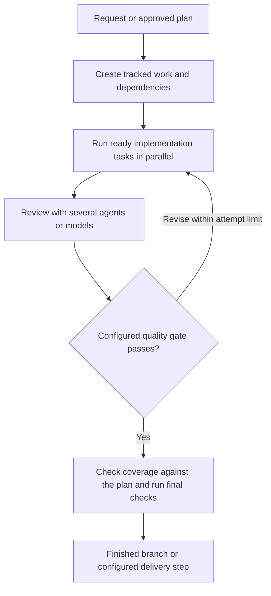

# Gas City: purpose, architecture, and the software-factory vision

Researcher: **cdx**  
Research date: **2026-10-17 (UTC)**  
Project: [gastownhall/gascity](https://github.com/gastownhall/gascity)  
Repository snapshot: [`2dec01c71a3dd5cdd0ca494ea7c72f4806d6c770`](https://github.com/gastownhall/gascity/commit/2dec01c71a3dd5cdd0ca494ea7c72f4806d6c770), dated October 17, 2026. The latest stable release tag found in the checkout was **v1.5.0**, whose target commit is dated October 4; its release announcement was published October 7. Findings about `main` can describe work newer than that release.

This is an independent investigation of the repository, public documentation, maintainer writing, roadmap issues, and company product pages. No other report from this research swarm was consulted. Repository files and history were read from an audited local checkout; citations identify the corresponding upstream snapshots. I did not install Gas City, run an agent fleet, or reproduce performance or quality claims.

## Main findings

**Gas City is an open-source platform for turning CLI coding agents into a configurable, persistent software-production workflow.** You describe agents, projects, workflows, and automation in TOML and Markdown. Its `gc` executable runs workers, routes work, enforces dependencies, manages sessions, and exposes progress through a CLI, API, and dashboard. Existing tools such as Claude Code, Codex CLI, and Gemini CLI do the model-driven work. Gas City supplies the surrounding machinery. It is implemented in Go and licensed under MIT. [Repository README][readme], [FAQ][faq]

**There is a clear long-term vision:** make engineering processes configurable, versioned, reusable assets, then have fleets of interchangeable agents execute them with less continuous human supervision. Gas City generalizes Gas Town's fixed organization into reusable orchestration building blocks. The company is extending that foundation toward shared team workflows and a commercial multi-operator product, Gasworks. The current public engineering roadmap is more immediate: improve recovery, reduce infrastructure overhead, and ease contribution. [Project principles][agents], [maintainer's orchestration thesis][vision], [roadmap][roadmap], [Gasworks][gasworks]

My assessment: this is a concrete workflow engine with a broader software-factory ambition. Its useful distinction is the combination of durable work tracking, agent lifecycle management, configurable execution graphs, and reusable team practices. The evidence does not establish that autonomous output is inherently correct or that the longer-term team product is already generally available.

## What people use it for

The motivating problem is what happens after one coding-agent session becomes several: someone must track assignments, preserve state across crashes, coordinate dependencies, obtain reviews, send revisions back, and determine whether the whole request was satisfied. Gas City lets an engineer encode that repeated process once and run it again. Its documentation describes features flowing through decomposition, parallel implementation, review, gap analysis, correction, and final checks. [How Gas City Works][concepts], [formula guide][formulas]

A representative workflow looks like this. The diagram illustrates a configuration someone can build; it does not mean every new city automatically runs these exact stages:

The controller advances the graph. Agents supply judgments and artifacts; configured commands can evaluate tests or recorded verdicts. This separates execution of the method from reasoning inside individual steps. Actual code implements fan-out, resumption of partially created work, and bounded retry/control loops; these are more than architectural diagrams. [Formula guide][formulas], [fan-out code][fanout], [control-loop code][control]

| Use | What Gas City contributes | Evidence and qualification |
| --- | --- | --- |
| Feature development and bug fixing | Routes work to workers and advances dependent steps | Central documented workflow; execution code and tests exist in the repository. |
| Repeated reviews and revisions | Parallel review lanes, synthesis, checks, and bounded loops | The launch announcement demonstrates one coder, three reviewers, and a synthesizer. Quality improvement is a maintainer claim, not an independent experiment. |
| Multi-project work | Registers repositories as rigs, with scoped configuration and routing | A city can coordinate several projects; isolation and store topology require appropriate configuration. |
| Scheduled maintenance and reactive work | Orders launch formulas or commands on schedules, conditions, or events | Mechanical work can run without allocating an LLM worker. |
| Inspecting an agent fleet | Session management, reconciliation, event streams, run views, and usage visibility | A dashboard and typed HTTP/SSE API expose work and sessions. |
| Trying different team organizations | Swappable packs, prompts, providers, and worker pools | Examples include hierarchical Gas Town and flatter swarm configurations. |

Sources: [launch example][launch], [conceptual model][concepts], [migration guide][coming], [API reference][api], [swarm example][swarm].

There is a real self-hosting use case: maintainers say they develop Gas City with Gas City and expose their Maintainer City through a public dashboard. This supports a serious operational use, though it remains a first-party demonstration. The 1.4 announcement also describes using it to build a time-tracking application. [Gas City 1.4 announcement][blog14]

## How it works, without the themed vocabulary getting in the way

The current public model has six primitives:

| Primitive | Plain-language meaning |
| --- | --- |
| **Agent** | A worker definition: provider, prompt, scope, and execution settings. A running instance is a session. |
| **Bead** | A durable record of work or state. Tasks, messages, sessions, and work groupings can use bead-shaped records. |
| **Formula** | A reusable method specifying steps, dependencies, inputs, and control flow. Applying it creates a concrete run. |
| **Rig** | A registered project, normally a repository, where work is performed. |
| **Pack** | Reusable configuration and supporting assets. A city is the local root pack plus deployment settings. |
| **Event** | An observable activity record, usable by people, clients, and event-triggered automation. |

A **city** is a deployment rooted in a directory containing configuration and runtime state. A **convoy** groups related work. An **order** determines when a formula or command runs. A **pool** scales instances of a worker to match demand. Work lives outside any particular model context window, so a replacement session can discover its assignment and recorded progress. [Conceptual model][concepts], [README][readme]

Two distinctions matter:

1. **Formula v1 and v2 are both supported.** V1 generally hands the method to one agent within its session. V2 creates independently routable work and controller-owned control steps, so the orchestrator drives a graph across workers. The guide recommends explicitly declaring v2 for new work. A formula is not automatically a multi-agent graph simply because it is called a formula. [Formula guide][formulas]
2. **Agent providers and session runtimes answer different questions.** Codex versus Claude selects the coding harness; tmux, subprocess, exec, ACP, Kubernetes, or herdr concern session execution or integration. The FAQ lists sixteen built-in harnesses, and mixed fleets are configurable. [FAQ][faq], [README][readme]

The default work backend uses Beads with Dolt, the version-controlled database. A file backend supports lighter setups. Active performance work separates infrastructure records into SQLite while retaining versioned work in Dolt. Thus, the idea that everything is beads describes the domain model, not a guarantee that every record resides in one Dolt database. [README][readme], [roadmap][roadmap], [SQLite code][sqlite]

One terminology trap: the README calls Gas City an **orchestration-builder SDK**, but contributor instructions say Go packages remain under `internal/` and public `pkg/` exports are future work until the API stabilizes. Today's clear user extension surfaces are configuration, packs, prompts, formulas, provider contracts, and HTTP APIs. Calling it a stable, publicly importable Go library would overstate what this snapshot promises. [Design decisions][agents], [API reference][api]

## Relationship to Gas Town and Beads

**Gas Town supplied the original operating model.** Its familiar Mayor, Deacon, Polecat, Witness, and Refinery roles were embedded in its implementation. Gas City rebuilds the infrastructure so those roles can be configuration. Its explicit design rule is zero hardcoded roles: the same engine should run Gas Town, a simpler team, or a different topology. [Project instructions][agents], [Coming from Gas Town][coming]

**Beads supplies durable work and shared state.** Gas City uses that substrate to coordinate workers and drive workflows. Using Beads alone does not imply operating a city or adopting Gas Town's roles. [README][readme], [conceptual model][concepts]

**Gas City has its own maintainers.** Steve Yegge's April launch essay credits Julian Knutsen and Chris Sells with building it from the vision. The current company page lists Sells as CEO, Knutsen as CTO, and Yegge as an advisor. [Yegge's launch essay][yegge], [company page][company]

Early launch material called it a drop-in Gas Town replacement. Current migration documentation is more specific: map roles and behavior onto primitives and avoid copying Town's directory architecture literally. The July 1.3 announcement introduced a different default `gascity` pack. The current picture is continuity with Gas Town, with explicit migration differences and alternative operating models. [Launch essay][yegge], [migration guide][coming], [1.3 announcement][blog13]

## The long-term vision

### 1. Make engineering practice reusable and executable

The ambition reaches beyond starting terminals. Planning, implementation, review, revision, validation, and maintenance become explicit methods. Teams refine and reuse them instead of expecting an operator to remember each intervention. Sells argues that humans set the quality bar while orchestration automates repeated execution. [Orchestration Is All You Need][vision]

Packs make methods portable. They can contain agents, workflows, orders, prompts, commands, skills, MCP configuration, checks, and supporting files. Imports and a registry let people discover and reuse configurations. **My inference:** process knowledge is intended to accumulate as maintained assets, much as libraries accumulate reusable code. This is an ecosystem direction, not evidence of uniform quality among available packs. [Pack guide][packs], [1.4 announcement][blog14]

### 2. Stay useful as models improve

The contributor-facing Primitive Test is explicit: infrastructure should remain necessary for a much more capable model. Atomic state transitions, process lifecycle, worktrees, and transport belong in infrastructure; task reasoning belongs with models and prompts. This is the stated architectural philosophy, not proof that every implementation perfectly follows it. [Primitive Test][primitive]

Sells's related thesis is that better models do not remove the value of coordinating work and reviewing it from several perspectives. **My inference:** the project positions itself as enduring coordination infrastructure around changing agents. [Orchestration thesis][vision]

### 3. Extend into other agent-operated processes

Software engineering is the strongest evidenced use. Yegge's launch essay also proposes DevOps, monitoring, ETL, data pipelines, ticket queues, and incident response. Configurable workers, dependencies, orders, and adapters make that plausible. I found no basis to treat each named domain as a separately validated production solution. [Launch vision][yegge]

### 4. Make the factory shared and governed for organizations

Current company pages distinguish two commercial layers from the free, MIT-licensed project:

- **Beads Team Server:** shared work graphs, provenance, private run history, and usage/cost visibility. Its page says design partnerships are open, with broader availability coming.
- **Gasworks:** a shared factory for multiple operators, including Beads Team Server, delivered as managed SaaS or inside a customer's VPC. The page says active development, with design partnerships opening in **December 2026**. It advertises direct provider billing without an inference surcharge.

These are public product intentions as of the research date. December is a design-partnership target, not a general-availability promise. Commercial product descriptions should not be read as capabilities already delivered by the open-source repository. [Beads Team Server][team], [Gasworks][gasworks], [company home page][home]

## The actual public roadmap

`ROADMAP.md`, updated October 5 and owned by Julian Knutsen, names three priorities for **1.6**. It explicitly describes current thinking rather than commitments and omits delivery dates.

| Priority | Desired outcome | Named work |
| --- | --- | --- |
| Session and reconciler reliability | Recover correct session/work state after crashes, restarts, and upgrades | Complete the keyed v2 reconciler replacement, remove the legacy path, reduce P0/P1 lifecycle defects. |
| Performance | Remain responsive as cities grow without overloading the versioned work store | Move infrastructure bookkeeping to SQLite; improve `gc`, `bd`, and reconciler hot paths. Numerical targets await benchmarks. |
| Contributor onboarding | Make intent, rules, and invariants easier for human and agent contributors to find | Colocated instructions, boundary-package documentation, a codebase map, and curated starter issues. |

Sources: [roadmap at inspected commit][roadmap], [reliability issue #7093](https://github.com/gastownhall/gascity/issues/7093), [performance issue #7094](https://github.com/gastownhall/gascity/issues/7094). The roadmap links onboarding to [issue #7095](https://github.com/gastownhall/gascity/issues/7095); I relied on the checkout for that area because the issue's web fetch failed.

This is a next-release agenda, not a dated multi-year delivery plan. **My interpretation:** the immediate challenge is making the flexible factory dependable and economical enough to support the organizational ambition.

## Limits that affect the assessment

**Persistence supports recovery; it does not prove correctness.** Durable tasks help replacements resume. They do not prove a review is sound, an external action is safe to repeat, or generated code meets an unstated requirement. Bounded checks and retry exhaustion are visible in code. Ongoing recovery work also argues against treating broad launch assurances as settled guarantees. [Control-loop code][control], [roadmap][roadmap]

**Gas City is not itself a security sandbox.** Its trust-boundary reference says imported packs and configured commands run as trusted code. Choosing runtimes, permissions, credentials, and trusted configuration remains part of operating a factory. This is material to the enterprise ambition. [Trust-boundary reference][trust]

**Scale claims require workload-specific evidence.** The Kubernetes example is a 100-worker demonstration whose workers claim and close a bead, then exit. This illustrates intended scaling mechanics, not an independently verified benchmark of a complex project with 100 coding agents. The October announcement also labels the SQLite infrastructure ledger opt-in and experimental. [Hyperscale example][hyperscale], [1.5 announcement][blog15]

**Documentation sometimes lags changes.** The reconciler-v2 document opens with an older description of trace-only controllers, while its later Admission section describes a cutover with acting passes and restrictions. I therefore avoid claiming the complete replacement has shipped. Operational decisions should use the selected release's code and compatibility checks, not one architectural summary. [Reconciler-v2 document][reconciler]

**There is an operating-cost and complexity tradeoff.** MIT licensing does not remove model charges, runtime resources, or database/session administration. The prerequisites and recovery/performance roadmap make that visible. My assessment is that the value is clearest for repeated, multi-stage work and an operator willing to own its workflows and infrastructure. [README][readme], [FAQ][faq], [roadmap][roadmap]

## Conclusion

Gas City builds and operates configurable teams of coding agents that execute durable, repeatable workflows across projects and sessions. Its longer-term objective is an owned, reusable software factory: people define standards and methods; interchangeable workers execute them; orchestration keeps work moving and inspectable.

The strongest future signals are the no-hardcoded-roles architecture, pack reuse, model-improvement design test, and shared-team product direction. The strongest near-term signal is the 1.6 focus on lifecycle reliability and performance. These support a substantive platform vision while leaving its broadest autonomy, scalability, and organizational claims to be demonstrated in particular deployments.

## Primary-source index

Repository links are pinned to the inspected commit. Websites were accessed October 17, 2026 and may change.

- [README][readme], [project instructions/design principles][agents], [roadmap][roadmap], and [Primitive Test][primitive].
- [How Gas City Works][concepts], [FAQ][faq], [Coming from Gas Town][coming], [formulas][formulas], [packs][packs], and [HTTP/SSE API][api].
- [Fan-out implementation][fanout], [control loops][control], [SQLite store][sqlite], and [reconciler architecture][reconciler].
- [Swarm example][swarm], [Kubernetes scale demonstration][hyperscale], and [trust boundaries][trust].
- Chris Sells: [Orchestration Is All You Need][vision] (April 21) and [Announcing Gas City 1.0][launch] (April 28).
- Steve Yegge: [Welcome to Gas City][yegge] (April 24).
- Release announcements: [1.3][blog13] (July 3), [1.4][blog14] (July 28), and [1.5 / Beads 1.3][blog15] (October 7).
- [Gas City, Inc.][home], [company/team][company], [Beads Team Server][team], and [Gasworks][gasworks].

[readme]: https://github.com/gastownhall/gascity/blob/2dec01c71a3dd5cdd0ca494ea7c72f4806d6c770/README.md
[agents]: https://github.com/gastownhall/gascity/blob/2dec01c71a3dd5cdd0ca494ea7c72f4806d6c770/AGENTS.md
[roadmap]: https://github.com/gastownhall/gascity/blob/2dec01c71a3dd5cdd0ca494ea7c72f4806d6c770/ROADMAP.md
[faq]: https://github.com/gastownhall/gascity/blob/2dec01c71a3dd5cdd0ca494ea7c72f4806d6c770/docs/getting-started/faq.md
[concepts]: https://github.com/gastownhall/gascity/blob/2dec01c71a3dd5cdd0ca494ea7c72f4806d6c770/docs/getting-started/how-gas-city-works.md
[coming]: https://github.com/gastownhall/gascity/blob/2dec01c71a3dd5cdd0ca494ea7c72f4806d6c770/docs/getting-started/coming-from-gastown.md
[formulas]: https://github.com/gastownhall/gascity/blob/2dec01c71a3dd5cdd0ca494ea7c72f4806d6c770/docs/guides/understanding-formulas.md
[packs]: https://github.com/gastownhall/gascity/blob/2dec01c71a3dd5cdd0ca494ea7c72f4806d6c770/docs/guides/understanding-packs.md
[api]: https://github.com/gastownhall/gascity/blob/2dec01c71a3dd5cdd0ca494ea7c72f4806d6c770/docs/reference/api.md
[primitive]: https://github.com/gastownhall/gascity/blob/2dec01c71a3dd5cdd0ca494ea7c72f4806d6c770/engdocs/contributors/primitive-test.md
[fanout]: https://github.com/gastownhall/gascity/blob/2dec01c71a3dd5cdd0ca494ea7c72f4806d6c770/internal/dispatch/fanout.go
[control]: https://github.com/gastownhall/gascity/blob/2dec01c71a3dd5cdd0ca494ea7c72f4806d6c770/internal/dispatch/control.go
[sqlite]: https://github.com/gastownhall/gascity/blob/2dec01c71a3dd5cdd0ca494ea7c72f4806d6c770/internal/beads/sqlite_store.go
[reconciler]: https://github.com/gastownhall/gascity/blob/2dec01c71a3dd5cdd0ca494ea7c72f4806d6c770/engdocs/architecture/reconciler-v2.md
[swarm]: https://github.com/gastownhall/gascity/blob/2dec01c71a3dd5cdd0ca494ea7c72f4806d6c770/examples/swarm/city.toml
[hyperscale]: https://github.com/gastownhall/gascity/blob/2dec01c71a3dd5cdd0ca494ea7c72f4806d6c770/examples/hyperscale/city.toml
[trust]: https://github.com/gastownhall/gascity/blob/2dec01c71a3dd5cdd0ca494ea7c72f4806d6c770/docs/reference/trust-boundaries.md
[vision]: https://sellsbrothers.com/orchestration-is-all-you-need
[launch]: https://sellsbrothers.com/announcing-gas-city-1-0
[yegge]: https://yegge.ai/essays/welcome-to-gas-city/
[blog13]: https://blog.gascity.com/posts/gas-city-1-3-now-were-looping-with-gas/
[blog14]: https://blog.gascity.com/posts/gas-city-1-4-the-view-from-the-factory-floor/
[blog15]: https://blog.gascity.com/posts/beads-1-3-and-gas-city-1-5/
[home]: https://gascity.com/
[company]: https://gascity.com/about/
[team]: https://gascity.com/beads-team-server/
[gasworks]: https://gascity.com/gasworks/
