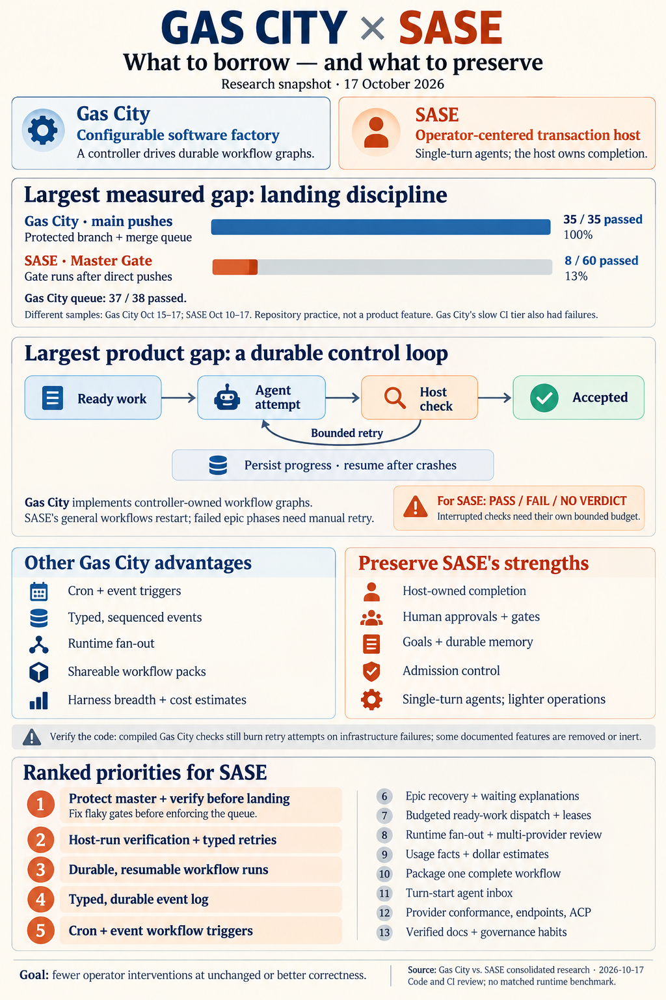

---
tags:
  - pypi-release-reliability
---

# Gas City vs. SASE: where Gas City is ahead, and what SASE should borrow

> **Research query:** Compare SASE with Gas City, using the recent Gas City and Gas Town
> research in the research sidecar repo for context. In particular, in what ways is Gas
> City superior to SASE? End with a ranked list of recommended improvements to consider
> making to SASE based on the findings.

## Bottom line

1. **The two systems make different bets, and most of the comparison follows from
   that.**
   - **Gas City is a configurable factory.** A controller compiles a written method (a
     TOML *formula*) into a graph of durable work records (*beads*). It then drives that
     graph to completion outside any chat session, across pools of agent sessions. Roles,
     schedules and supervision policy are configuration, shipped in *packs*.
   - **SASE is a transaction host for one operator.** Single-turn headless agents run in
     pooled workspaces. The host owns completion, and a human approves plans, launches
     and goals.
   - Gas City is [ahead](#where-gas-city-is-superior) wherever *unattended, graph-shaped*
     work is the goal. SASE is [ahead](#where-sase-is-ahead) on completion integrity,
     human-in-the-loop control, memory, admission control and operational weight.
2. **Gas City's main *product* advantage: the method is data that a deterministic
   controller executes.**
   - Its [control dispatcher](#workflow-runs-are-durable-graphs-owned-by-a-controller)
     runs `check`, `retry`, `fanout`, `drain`, scope and finalize nodes with no agent
     involved. It persists attempt state on beads and resumes after a crash. A
     crash-injection test faults every store write.
   - In SASE, the equivalent pieces live in prompts and in one in-process executor. Macro
     workflows restart from step 0. A failed epic phase parks its dependents until a
     human retries it. "Done" is the agent's declaration plus commit postconditions.
   - [All five reports agree](#points-all-five-reports-agree-on) on this. It drives
     recommendations [2](#r2-host-run-verification-with-typed-attempts-and-failure-policy)
     and [3](#r3-durable-and-resumable-workflow-and-epic-runs).
3. **Gas City's largest *measured* advantage is how its repository lands code, not the
   `gc` product.** I re-pulled the numbers today:
   - **Gas City:** a ruleset with required checks and a merge queue. Its merge-queue runs
     passed 37 of 38 times, and its pushes to `main` 35 of 35 (`bazel.yml`, Oct 15–17).
   - **SASE:** `master` has no ruleset (`[]`). Master Gate passed **8 of the last 60**
     runs, 23 of 100, and 49 of 300 (Oct 10–17), with a p50 of 12.5 minutes.
   - **The reds are not one stuck test.** The 12 newest red runs failed across lint and
     all eight test shards. The merge-queue report traces many green→red flips to flaky
     TUI timing tests, so the gate must become trustworthy before anything enforces it.
   - Only cld and mus measured this. A separate report published today,
     [`merge_queue_fenced_master_and_exact_sha_releases`](../merge_queue_fenced_master_and_exact_sha_releases/merge_queue_fenced_master_and_exact_sha_releases__final.md),
     already designs SASE's fix. Gas City is live proof that the design works at SASE's
     cadence (see [Its default branch stays green by
     construction](#its-default-branch-stays-green-by-construction)).
4. **Read Gas City's documentation skeptically.** The code contradicts about a dozen of
   its claims (see [Gas City claims that do not survive the
   code](#gas-city-claims-that-do-not-survive-the-code)). One correction matters for
   borrowing: the spec says a check that times out or exits 75 does not burn a retry
   attempt, but that protection exists only on a legacy path. The compiled
   `[steps.check]` loop burns an attempt anyway. Two reports (mus, gem) repeated the
   spec's claim.
5. **Borrow the control plane, not the session model.**
   - Gas City's own design already splits the two: the orchestrator executes control
     nodes, and agents execute only work nodes. SASE already has the right worker, the
     single-turn agent. What it lacks is the durable graph and the host-owned loop
     around it.
   - [Do not borrow](#explicitly-not-recommended) long-lived tmux sessions, Dolt, LLM
     patrols, or "zero hardcoded roles" absolutism.
6. **Top recommendations** (full list in [Ranked recommendations for
   SASE](#ranked-recommendations-for-sase)):
   1. [Fence `master` and land through a verified
      queue](#r1-fence-master-and-land-through-a-verified-queue).
   2. [Add host-run verification with typed attempts and failure
      policy](#r2-host-run-verification-with-typed-attempts-and-failure-policy).
   3. [Make workflow and epic runs durable and resumable in
      `sase-core`](#r3-durable-and-resumable-workflow-and-epic-runs).
   4. [Add a typed, sequenced event log](#r4-a-typed-sequenced-and-durable-event-log).
   5. [Add cron and event triggers that can fire
      workflows](#r5-cron-and-event-triggers-that-can-fire-workflows).

## Two machines at a glance

- **Unit of execution**
  - *Gas City:* A session: a long-lived CLI agent, usually in tmux, reused across steps
    and adopted after a controller restart
  - *SASE:* One provider turn, headless with stream-JSON output; continuation is
    mechanical (`single-turn-agents`)
- **Unit of method**
  - *Gas City:* A formula. v2 compiles it into a bead graph that a control dispatcher
    executes
  - *SASE:* A typed YAML macro or workflow, run in-process; epics run as `%wait`-chained
    phase agents plus a lander
- **Who handles failure**
  - *Gas City:* The dispatcher, by policy written in the formula
  - *SASE:* A human: `sase bead work` retry or `TaskTriage`
- **Completion**
  - *Gas City:* Whatever a pack formula pushes (`mol-polecat-commit` runs `git push`); no
    landing code in Go
  - *SASE:* Host-owned finalizers, atomic declarations, independently verified
    postconditions
- **Automation**
  - *Gas City:* Orders: cooldown, cron, condition, event, manual and webhook triggers → a
    formula or an exec command
  - *SASE:* Scheduler routines and jobs on intervals; jobs can propose agent launches but
    not standalone workflows
- **Observation**
  - *Gas City:* Typed event log, SSE, generated OpenAPI, web dashboard, `gc trace`
  - *SASE:* ACE TUI, Android app and gateway, Telegram, local telemetry, ToolRun triage
- **Sharing**
  - *Gas City:* Packs with namespaced imports, version pins, a lockfile and a registry
  - *SASE:* Python plugins (13 entry-point groups), a GitHub-topic catalog, committed
    `sase/macros`
- **Work store**
  - *Gas City:* `bd` beads on Dolt (infrastructure beads moving to SQLite in 1.6)
  - *SASE:* Git event-stream beads in sidecars, plus Rust-owned SQLite stores
- **Ops weight**
  - *Gas City:* tmux required, a Dolt server, `bd`, a supervisor
  - *SASE:* `uv tool install`, a service host, no database server

## Where Gas City is superior

Ranked by impact on SASE's outcomes × size of the gap × confidence that Gas City's
version works.

**Evidence tags** (from cld, extended): **[wired]** has a production caller in Gas City.
**[partial]** is wired, but with a verified gap. **[doc-only]** or **[inert]** is
described or parsed, but nothing consumes it. **[project]** describes how the Gas City
*repository* is run, not a feature of the `gc` product.

**Ranked list: ways Gas City is superior to SASE**

1. **[Its default branch stays green by
   construction.](#its-default-branch-stays-green-by-construction)** It has required
   checks, a batched merge queue, cached Bazel tests and evidence watchdogs. The result
   is 37 of 38 queue runs green against 8 of 60 for SASE's Master Gate. *(High
   confidence; [project].)*
2. **[Workflow runs are durable
   graphs](#workflow-runs-are-durable-graphs-owned-by-a-controller)** that survive
   crashes and resume at bead boundaries, with idempotent attempts and crash-injection
   tests. *(High; [wired].)*
3. **[The host decides "done".](#done-is-a-host-run-check-and-failure-policy-is-data)** A
   host-run check loop can re-create a whole subtree, and typed failure classes support
   soft-fail lanes. *(High in design, medium in execution; [partial]: compiled checks
   burn attempts on infrastructure failures, and voting was removed.)*
4. **[Its automation reacts.](#automation-is-reactive-and-user-authored)** Cron, event,
   condition and webhook orders fire whole methods, and supervision policy ships as
   editable orders. *(Medium-high; [partial].)*
5. **[It has a typed, sequenced, followable event
   log,](#a-typed-event-log-plus-a-generated-api-and-decision-traces)** a generated API
   and reason-coded decision traces. *(High; [wired].)*
6. **[Its methods compose and fan out at
   runtime:](#methods-compose-and-fan-out-at-runtime)** `extends` overrides, `drain`,
   `on_complete`, and per-step routing for mixed-vendor review. *(Medium-high;
   [partial].)*
7. **[Ready work routes to roles,](#work-routes-to-roles-and-claims-carry-leases)** and
   claims carry leases. *(Medium; [partial].)*
8. **[Packs](#packs-make-whole-processes-shareable)** share whole processes through
   versioned, locked imports. *(High; [wired].)*
9. **[Substrate breadth:](#substrate-breadth-and-an-endpoint-axis)** 18 harnesses, an
   endpoint axis, more runtimes and a runtime conformance suite. *(High in count, medium
   in robustness.)*
10. **[Dollar cost estimates and reliability analytics.](#smaller-advantages)** *(Medium;
    [partial]: they cover claude and codex, and no budget is enforced.)*
11. **[Durable addressed mail.](#smaller-advantages)** *(High; [wired].)*
12. **[Contributor discipline:](#smaller-advantages)** the Primitive Test, inert-feature
    and verified-on doc conventions, executable tutorials, and an extensible doctor.
    *(Medium; SASE is otherwise at parity or ahead.)*
13. **[Productization and reach.](#smaller-advantages)** *(High as a fact; low relevance
    for one operator.)*

### Its default branch stays green by construction

Evidence tag: **[project]**.

**Gas City**

- **A `main` ruleset** with `deletion`, `non_fast_forward`, `pull_request`,
  `required_status_checks`, `code_scanning` and `merge_queue` rules (GitHub API, today).
  - The queue squashes, uses `ALLGREEN` groups of up to 5 entries, and builds up to 4
    groups at once (cld).
  - Agents push only to branches, and a pre-push hook runs `bazel test //...`.
- **Missing evidence is a failure.** `pr-evidence-watchdog.yml` fails a PR whose head
  never produces complete CI evidence. `ci-verdict-watchdog.yml` exists because a run
  cancelled in the queue "looks identical to 'everything passed'".
- **Verification is fast because it is cached and budgeted.**
  - Bazel uses remote caching and execution. The p50 is about 4.9 minutes on PRs and
    about 4.6 minutes in the queue.
  - `engdocs/bazel-ci-budget.md` gives a decision rule: if
    `gap = elapsed − critical_path` is under 15% of elapsed, shorten the critical path;
    otherwise add capacity. One flag (`--jobs=64`) cut a run from 841 s to 167 s (mus).
- **Live outcome** (`bazel.yml`, Oct 15–17):
  - Merge queue: 37 of 38 green.
  - Push to `main`: 35 of 35 green.
  - PRs: 115 green and 7 red. The reds were caught before merge.
  - cld counted 99 of the last 100 `CI` runs green, at 8–114 commits a day.

**SASE today**

- **No ruleset** (`gh api repos/sase-org/sase/rules/branches/master` returns `[]`).
- **The commit finalizer rebases and pushes straight to `master`.** Master Gate runs after
  the push, so it reports breakage instead of preventing it.
- **Master Gate results:** 8 of the last 60 runs green; 23 of 100; 49 of 300. The p50 is
  747 s and the p90 1,119 s.
- **Releases are stuck.** The merge-queue report found PyPI stuck at 0.17.1 for 49 days,
  Full CI green in 1 of 271 runs since Aug 27, and a false-red rate of about 30–40% per
  build on a healthy tree.
- **Repair epics keep recurring.** The bead tracker shows a string of "fix Master Gate
  reds / prove 0.18.0" epics (for example `sase-1kx.1`, `sase-1kx.5.3`, `sase-1lh.7.5`).

**Caveats**

- **Push-to-`main` green is by construction.** With a queue, 35 of 35 is the expected
  result. The informative numbers are the queue's 1-in-38 rejection rate and PR
  first-pass rate.
- **Gas City pays for speed.** It runs a remote-execution farm and Blacksmith runners
  over a hermetic Go build.
- **Its slow tier has been red too.** Nightly Tier B failed on 52 of its last 60 runs,
  though the last six nights were green (mus). The fast gate stays green partly because
  the slow tier is separate, which is the same trade SASE made.
- **Groups, not single SHAs.** Grouped verification checks the tip of each group, not
  each SHA, and `ci-two-speed-split` values per-SHA attribution.
- **Not a product feature.** The `gc` product has no Go landing machinery.

**Verdict.** This is the largest and best-measured gap. Every unattended-work feature
below multiplies landings, so it matters first.

### Workflow runs are durable graphs owned by a controller

Evidence tag: **[wired]**.

**Gas City**

- **Applying a v2 formula writes beads.** From then on the run is independent of the
  file and of every session. Step beads are independently routable (`gc.run_target`).
- **The control dispatcher keeps nothing in memory.**
  - On restart it re-queries open, ready control beads (`cmd/gc/dispatch_runtime.go`).
  - Each control kind resumes from state saved on its bead: `gc.retry_state`,
    `gc.fanout_state`, `gc.drain_state`, `gc.control_epoch`.
- **Crash-safe ordering.** A control settles its logical bead first and closes itself
  last, so an interrupted settle is re-driven.
  - Attempts use idempotency keys (`<controlID>:attempt:<n>`) plus a compare-and-swap on
    the epoch.
  - Retries append `<step>.attempt.N` beads under a stable logical step, so downstream
    `needs` never reopen old work (`engdocs/design/inline-ralph-v0.md`).
- **The close-ownership invariant.** The compiler rejects any graph in which a node is
  blocked by the control bead that closes it.
- **The crash-injection harness** (`internal/dispatch/crash_injection_test.go`):
  1. Record an uninterrupted run.
  2. Fault each store-write position in turn.
  3. Let later cycles converge, and compare the final ledger with the uninterrupted run.
  4. Require that one more cycle changes nothing.
- **Drift detection.** `gc formula version-check` flags a running instance whose formula
  file has changed.

**SASE today**

- **Workflows always start over.** `WorkflowExecutor` starts at
  `current_step_index=0` (`src/sase/macro/workflow_executor.py:104`).
  `workflow_state.json` is rewritten on every step change, but only the TUI reads it. A
  `_step_inputs` skip hook exists (line 256), but nothing calls it to resume.
- **Retries and restarts discard progress.** Provider retries re-run the whole workflow.
  Restart and auto-restart "stop, wipe, relaunch".
- **Epic phases are dispatched up front and chained by `%wait`.** A failed phase keeps
  dependents and the lander parked until a human re-runs `sase bead work`
  (`docs/reference/work-units/bead-work.md`).
- **Some resume exists already.** The commit finalizer's workflow is resumable (commit
  `5230c3080e`). Bead-work checkpoints the epic graph and skips closed phases on retry.
  So SASE has the ingredients, but not a general recovery contract (cdx).

**Caveats**

- One dispatcher per scope: `ProcessControl` is not compare-and-swap guarded against a
  second dispatcher.
- Sweeps are serial, so a slow check blocks others.
- Retried steps repeat their external side effects (Gas City issue #3005).
- Work resumes only at bead boundaries.

**Verdict.** A structural lead, with high confidence. It is the "factory" the other
features build on.

### Done is a host-run check and failure policy is data

Evidence tag: **[partial]**.

**Gas City**

- **`[steps.check]`.** After an iteration closes, the dispatcher (never an agent) runs an
  exec script with a whitelisted environment.
  - Pass closes the step.
  - Fail with budget left re-creates the **whole subtree** as iteration N+1, for example
    review lanes → synthesis → fix.
  - Exhaustion fails the step and blocks downstream work.
  - The shipped `build-basic-review` loop runs acceptance, test-evidence and simplicity
    reviewers in parallel. A synthesizer combines their findings, a fix step applies
    them, and the loop repeats until `implementation-review-approved.sh` passes, at most
    6 times.
- **`retry` reads metadata, not error text.**
  - Workers write `gc.outcome` and `gc.failure_class` (`transient` | `hard`).
  - `on_exhausted = soft_fail` closes an optional lane with
    `gc.final_disposition = soft_fail`, so downstream work proceeds "with degraded
    coverage".
  - A "pass" that is missing a required artifact is downgraded to transient.
- **Scopes.** `abort_scope` is fail-closed. Teardown runs after settlement and can read
  the outcome, so "clean up on pass, keep the workspace on fail" is expressible.

**SASE today**

- `repeat: {until, max}` wraps a single step, and that step's own output decides when to
  stop.
- There is no `retry` field and no multi-step loop body.
- Mentors have no model field and no synthesizer.
- Finalizers verify the *commit*, not whether the *task* was accepted. The only epic
  acceptance step is the lander's prompt.
- **Verification does not loop.** Receipts prove that a verification ran
  (`receipts-prove-before-they-skip`), but the host never spawns the next attempt from a
  verdict.

**A SASE data point** (mus, from the 2026-10-01 CI report): of 1,000 local `just check`
runs, 199 were killed by a signal and 12 were lost. Those 211 runs are "no verdict", not
"fail". Any retry loop SASE builds must tell them apart.

**Caveats (verified in code)**

- **Infrastructure failures burn attempts on the compiled path.** See [Disputed
  questions and resolutions](#disputed-questions-and-resolutions) below.
- **Incomplete kill.** There is no process-group kill, so a check's grandchildren
  survive.
- **Silent hold.** A missing check script holds the step open, and the only signal is a
  late `control.stalled` event.
- **Voting is gone.** `tally` was removed, though the docs still recommend it.
- **Cost.** Every's review found that a six-step job can cost about six single-session
  jobs, because each step starts fresh. SASE's per-phase agents share this property.

**Verdict.** High value. It extends `host-owned-completion` from "the commit is correct"
to "the task is accepted".

### Automation is reactive and user-authored

Evidence tag: **[partial]**.

**Gas City**

- **An order is a trigger plus either a formula or an `exec` command.**
  - Triggers: `cooldown`, `cron` (5 fields plus a time zone), `condition` (a shell check),
    `event` (for example `bead.closed`, read through a sequence cursor), `manual` and
    `webhook`.
  - A single-flight gate stops re-fires.
- **Supervision policy ships as editable orders** in the core pack (`orphan-sweep`,
  `spawn-storm-detect`, `renudge-stale-human-gates`, `cascade-nudge-on-blocker-close`,
  `gate-sweep`, `reaper`, …). Exec orders do mechanical work with no LLM.

**SASE today**

- Jobs trigger only on `always`, `git.commits_since` and `fs`, with `run_every`,
  `inhibit_if` and `once_per` guards.
- Jobs emit validated `proposed_launches` with `dedupe_key` and `wait_on`, which is a
  strong action contract.
- But `#!workflow` references are forbidden in proposal prompts
  (`docs/reference/automation/scheduler-jobs.md:200`), and there are no cron or event
  triggers.

**Caveats**

- Event triggers poll on the roughly 30-second tick and fire once per batch.
- Orders cannot pass variables (issue #1813).
- `reserved_dispatch` is declared but nothing reads it.

**Verdict.** Medium-high. The gap is triggers, and what a job may launch, not the
scheduler itself.

### A typed event log plus a generated API and decision traces

Evidence tag: **[wired]**.

**Gas City**

- **The event log** is `.gc/events.jsonl`.
  - Sequence numbers are assigned under a mutex plus a flock.
  - About 106 event types each have a registered payload, enforced by
    `TestEveryKnownEventTypeHasRegisteredPayload`.
  - Rotated archives remain replayable.
  - `gc events --follow` streams over SSE with cursors.
- **The API.** Huma generates the OpenAPI spec (about 130 paths), and `TestOpenAPISpecInSync`
  catches drift. The CLI, API and embedded dashboard are required to be projections over
  the same domain packages (`internal/api/AGENTS.md`).
- **`gc trace`** records *why* the reconciler started, skipped, drained or restarted
  something, with reason codes and cycle IDs. Even "no demand" can be recorded as a
  positive decision.

**SASE today**

- `~/.sase/logs/events.jsonl` is untyped, with second-resolution `%y%m%d_%H%M%S`
  timestamps and no sequence numbers (`src/sase/logs/run_log.py:104-120`).
- Following works only per entity (`sase tool show -F`, `sase monitor show --follow`).
- The gateway's SSE stream supports `Last-Event-ID`, but it is buffered in memory, so a
  restart forces `resync_required`.
- There is no OpenAPI spec and no web dashboard.

**Caveat.** For a single operator, the TUI and mobile app beat a local web page. The
valuable part is the durable log and the causal explanations.

### Methods compose and fan out at runtime

Evidence tag: **[partial]**.

**Gas City**

- **`extends` with same-id overrides** splices a child's step into the middle of an
  inherited pipeline.
- **Variables are validated** (`required`, `enum`, `pattern`) before any bead exists.
- **`drain`** runs an item formula over every member of a convoy discovered at runtime,
  ordered by dependencies, with 1–100 units and an exclusive reservation per member.
- **`on_complete`** fans out over a completed step's JSON output (spec §3.4).
- **Per-step routing** (`gc.run_target`) sends the acceptance, test-evidence and
  simplicity reviews to different roles (and vendors), then fans them in to a
  synthesizer.

**SASE today**

- `for` is sequential.
- `parallel` runs a fixed list of steps on threads inside one process, not as separate
  agents in separate workspaces.
- A project override replaces a whole file.
- The epic pipeline has a fixed shape: a phase cannot be a multi-step method.
- Mixing vendors on one diff is a prompt-authoring trick, not a primitive.

**Caveats.** `on_item_failure` is ignored for `separate` drains. The exclusive reservation
only blocks other drains. `extends` drops advice.

### Work routes to roles and claims carry leases

Evidence tag: **[partial]**.

**Gas City**

- A role is `agents/<name>/agent.toml` plus a prompt.
- **Pools** set `min_active_sessions` and `max_active_sessions`, with a `scale_check`
  demand query.
- `gc sling` creates and routes work in one command.
- **Claims are atomic,** and as of Beads 1.3 they carry a five-minute lease with
  heartbeats. `bd reclaim` returns expired work after a grace period, so dead agents do
  not strand the queue.

**SASE today**

- Every launch is ad hoc.
- Ready standalone tasks raise a human `TaskTriage` gate.
- Epics dispatch automatically only after a plan is approved.
- Claim and release exist for beads that die *before* promotion. Nothing leases
  in-progress work.

**Caveat.** The v2 reconciler refuses `scale_check` and the stall timeouts, and legacy
remains the default. Long-lived pools cost money and degrade context.

**Transferable idea:** ready work of type X routes to role Y within a budget. Pools of
long-lived sessions do not transfer.

### Packs make whole processes shareable

Evidence tag: **[wired]**.

**Gas City**

- A pack is a directory: `pack.toml` plus `agents/`, `formulas/`, `orders/`, `commands/`,
  `doctor/`, `skills/`, `mcp/` and `overlay/`.
- Named imports are namespaced (`review.worker` and `build.worker` coexist), pinned by
  semver or `sha:`, and locked in `packs.lock` with content hashes.
- `pack.toml` holds reusable behavior, `city.toml` holds deployment choices, and
  machine-local bindings are kept separate.
- A registry supports search, show and publish.

**SASE today**

- Sharing means Python packaging (13 entry-point groups) or copying `sase/macros`.
- There is no data-only bundle, no version-pinned import and no lockfile.
- SASE's plugins are more powerful at the code level (providers, VCS, finalizers).

**Caveat.** Packs are trusted executable code; Gas City's own `trust-boundaries.md` says
so.

### Substrate breadth and an endpoint axis

Evidence tag: **[wired]**.

**Gas City**

- **18 harness presets in code:** claude, codex, gemini, grok, kimi, kiro, cursor,
  copilot, amp, opencode, mimocode, zcode, cerebras, groq, auggie, pi, omp and
  antigravity. Adding one can be config-only.
- **An `upstreams` axis** renders one `base_url` and key onto each harness's env vars,
  which unlocks Bedrock, Vertex and proxy endpoints.
- **Runtimes:** tmux, subprocess, `exec:` script, ACP, Kubernetes, ssh and others.
- **`gc runtime conformance`** is a requirement-coded suite, kept honest by negative
  tests.

**SASE today**

- 7 production providers (agy, claude, codex, grok, muse, opencode and qwen).
- No `ANTHROPIC_BASE_URL` or `OPENAI_BASE_URL` anywhere in `src/`.
- No ACP, container or Kubernetes runtime.
- No provider conformance suite. `fakey` and the VCS contract test are the nearest
  things.

**Caveats.** The default runtime is tmux pane-scraping. The 100-pod `examples/hyperscale`
demo runs workers that claim a bead, mark it done and exit, so it proves scaling
machinery, not 100 productive coders (cdx).

### Smaller advantages

- **Cost in dollars, and reliability analytics**
  - *Gas City:* `UsageFact` records with idempotency keys; a layered price table that
    flags unpriced models; `gc costs`; `gc analyze reliability` per (model, prompt
    version, rig), with denominators
  - *SASE today:* Token counts and usage-window percentages; no price table (the only
    `cost_usd` read is a zero-cost check)
  - *Value to SASE:* Medium. It is the budget unit any auto-launch policy needs, and
    SASE has had a quota-burn episode (`muse_quota_burn_2026_10_12`).
- **Durable addressed mail**
  - *Gas City:* Mail beads with threads and read state, injected at `UserPromptSubmit`,
    with provider conformance tests
  - *SASE today:* Artifacts, variables, bead notes, continuations; no inbox
  - *Value to SASE:* Medium for cooperating agents. It was already the Gas Town report's
    R5.
- **Contributor discipline**
  - *Gas City:* The Primitive Test and capability ladder; an "Accepted But Inert" spec
    section; "Last verified against code" headers; CI-enforced boundaries; executable
    tutorials (`TestTutorial01`); release-gate files
  - *SASE today:* Decision records with reopen conditions (better than Gas City's
    "settled" list); the Rust-core litmus test; reference memory
  - *Value to SASE:* Small and cheap to borrow.
- **Extensible doctor**
  - *Gas City:* About 113 check types, about 37 of which can fix their problem; packs add
    `doctor/<name>/doctor.toml`
  - *SASE today:* About 103 checks with two narrow fix flags; projects cannot add checks
  - *Value to SASE:* Small and cheap.
- **Productization and reach**
  - *Gas City:* `brew install`, macOS CI, Windows code paths, a public Maintainer City,
    Discord, about 1,400 stars
  - *SASE today:* Single operator, POSIX only, installed with `uv` plus plugins plus a
    Rust pin
  - *Value to SASE:* Matters only for the launch and outside users.

## Where SASE is ahead

**Do not over-borrow.**

- **Completion integrity.**
  - SASE has atomic declarations, host-selected finalizers that verify independently,
    absorption of raw commits, discarded-work guards, resumable commit attempts and
    fingerprinted receipts.
  - In Gas City, "done" is whatever a pack formula pushes.
- **Human-in-the-loop.** Gates that hold no resources, autonomy profiles,
  LaunchApproval, a typed sudo gate, the Android app and Telegram.
- **Goals and memory.** A human-settled goal ledger, memory-built instruction bundles,
  decision records, a glossary and audited reads. Gas City's stance is "the model IS the
  skill system", which it contradicts itself.
- **Admission control.** A weighted queue, priorities, holds with TTLs, runner slots, and
  usage-window probes with drain. Gas City has count caps and no token or dollar budget.
- **Robust adapters.** Stream-JSON subprocesses instead of tmux keystrokes and pane
  scraping.
- **Lighter operations.** No Dolt server and no mandatory tmux. Pooled workspaces share
  objects through alternates. Gas City carries Dolt bloat and compaction runbooks and is
  moving infrastructure beads to SQLite.
- **A personal fleet.** `%dispatch` across your own machines, with machine attention.
- **Docs that match the code,** and decision records with reopen conditions.

## Gas City claims that do not survive the code

Calibrate Gas City's documentation before copying any of it. Each item was checked
against `45c804d59` by cld, mus or cdx, and items 1–4 were re-checked by me.

1. **Infrastructure-tolerant checks.** The spec says a timeout or exit 75 re-runs without
   spending an attempt. That is true only on the legacy `KindCheck` path. Compiled
   formulas emit `KindRalph`, which spends an attempt (see [Disputed questions and
   resolutions](#disputed-questions-and-resolutions)).
2. **Quorum voting.** `tally` was removed (`errTallyRemoved`), but `AGENTS.md` and the
   formulas guide still recommend it.
3. **Crash-loop quarantine.** It is never fed: `recordStart` has no production caller.
   `session.quarantined` and `session.suspended` are registered events with no emitter.
4. **"Health patrol is one kind of order."** It is Go controller logic.
5. **Reconciler v2.** It is opt-in (`default=legacy`), and it refuses `scale_check`, the
   stall timeouts and several runtimes. Its docs call it both a "trace-only skeleton" and
   a completed cutover. Formula v2 and reconciler v2 are separate switches (cdx).
6. **`on_item_failure`** is validated for `separate` drains, but nothing reads it.
7. **`reserved_dispatch`** is set by two core orders, but nothing reads it.
8. **"Sixteen harnesses."** The code has 18.
9. **"No skills system, no MCP registration"** are listed as permanent exclusions, but
   `internal/materialize/` projects both into every provider.
10. **"Keep judgment out of Go."** The stall recycler, the pane-text rate-limit
    heuristics and the Claude-only idle clock are all judgment written in Go.
11. **Accepted but inert.** The spec itself lists inert features: `until` re-execution,
    gate-type watchers, `waits_for` modes and `vars.type` enforcement.
12. **Mail deduplication** is documented as best-effort and non-atomic, so mail is not
    exactly-once delivery.

**The lesson for SASE:** Gas City fixed its "outage burns attempts" incident on the code
path that compiled formulas no longer use. Any check loop SASE builds needs a test that
drives the *compiled* path end to end.

## Ranked recommendations for SASE

Ranked by leverage × fit with SASE's decision records × confidence ÷ size. Sizes: S is
days, M is 1–3 weeks, and L is a month or more. Items marked **(core)** belong in
`sase_core` under the Rust-core boundary, with thin Python and TUI adapters. Every item
preserves single-turn agents, host-owned completion, non-blocking gates and human goal
settlement.

### R1 Fence master and land through a verified queue

*From:* [Its default branch stays green by
construction](#its-default-branch-stays-green-by-construction) · *Size:* S → L, staged

**Do not re-derive this; execute the plan in**
[`merge_queue_fenced_master_and_exact_sha_releases`](../merge_queue_fenced_master_and_exact_sha_releases/merge_queue_fenced_master_and_exact_sha_releases__final.md):

1. **This week:** block force pushes and deletion on `master` and `v*` tags. Make
   `publish.yml` build, test and publish the exact release SHA, and ship 0.18.0.
2. **Weeks 1–2: make the gate trustworthy before enforcing it.** Add one bounded rerun
   and an expiring quarantine, aiming for under 3% false reds per build. A queue in front
   of a gate with 30–40% false reds would bounce a third of good changes.
3. **Weeks 1–3: pilot GitHub's merge queue.** The host creates the PRs, approvals stay at
   zero, merge commits, build concurrency 2. Beads close only on proof of merge, and an
   ejection launches one repair turn.
4. **Then enforce it,** and write the decision record that replaces the merge-queue
   clause in `decisions:ci-two-speed-split`.

**What Gas City adds to that plan:**

- **Missing evidence counts as red.** A landing with no gate verdict for its SHA is a
  failure (the `pr-evidence-watchdog` pattern).
- **A gate budget.** Report `elapsed`, `critical_path` and `gap` for every Master Gate
  run, and use Gas City's 15% rule to choose between shortening the critical path and
  adding capacity.
- **An external proof.** A GitHub merge queue works at about 57 commits a day with
  agent-authored PRs. That rebuts the August rejection's capacity argument, together
  with the merge-queue report's replay simulation (p50 about 13 minutes to land at
  concurrency 2).

**Success:** Master Gate at least 95% green on `master` over two weeks at at least 30
commits a day, and releases every 1–3 days.

**Why #1:** it is the largest measured gap, it is already designed, and R2–R7 all
multiply landings.

### R2 Host-run verification with typed attempts and failure policy

*From:* [Done is a host-run check and failure policy is
data](#done-is-a-host-run-check-and-failure-policy-is-data) · *Size:* M · **(core)**

Start on **epic phases**, whose bead state is already durable, so this does not wait for
[R3](#r3-durable-and-resumable-workflow-and-epic-runs).

1. **A `verify:` policy on a phase** (and later on a workflow step or group): a command,
   a timeout and `max_attempts`. After the phase agent finishes, the host runs the check
   through `sase tool run`, so the verdict is a fingerprinted receipt. Exit 0 closes the
   phase.
2. **A "not yet" verdict appends a new attempt record under the same logical phase.**
   The next single-turn attempt receives the previous diff (from the rescue store) and
   the failing output, optionally on a model one rung higher on the effort ladder.
3. **A three-valued verdict: `pass`, `fail` and `no_verdict`.**
   - `no_verdict` covers a check killed by a signal, lost, timed out, or exiting 75.
   - It does not consume an attempt, but it has its own bounded budget so it still
     terminates.
   - **Implement this on the path that actually runs,** with an end-to-end test (see the
     lesson under [Gas City claims that do not survive the
     code](#gas-city-claims-that-do-not-survive-the-code)).
4. **Typed failure classes.** `failure_class: transient | hard` goes in the agent's final
   declaration, not in error text. `on_exhausted` is one of:
   - `park` (today's behavior);
   - `soft_fail`, a pass with a "degraded coverage" disposition the lander must report;
   - `escalate`, which raises a gate.
5. **Avoid Gas City's bugs.** Kill the whole process group. A missing check script fails
   loudly (or raises one stalled event); it never holds the phase silently.

**Fit:** this extends `host-owned-completion` from "the commit is correct" to "the task
is accepted". Receipts remain proof and never skip a run
(`receipts-prove-before-they-skip`).

**Success:** the share of failed phases resolved without a human goes up, and zero
`no_verdict` runs are counted as failures.

### R3 Durable and resumable workflow and epic runs

*From:* [Workflow runs are durable graphs owned by a
controller](#workflow-runs-are-durable-graphs-owned-by-a-controller) · *Size:* M–L ·
**(core)**

1. **Authoritative run records.** Record, per step: a stable step and attempt identity,
   status, inputs, outputs, the workflow and config version, and an idempotency key
   (`<run>:<step>:<attempt>`). Write in the order "settle the step, then advance the
   cursor".
2. **Resume instead of rerun.** Add `sase workflow resume <run>`, starting from the first
   unfinished step (the `_step_inputs` hook is a start). Route provider retry and
   auto-restart through it instead of wiping and starting from step 0.
3. **Side-effect classes.** A step declares `pure` or `effectful` (push, PR comment,
   notification). An effectful step records what it already did, so a resume never
   blindly repeats it; an uncertain outcome is *inspected*. This avoids Gas City issue
   #3005 by design.
4. **Host-driven epic waves.** The host launches each wave when it becomes ready, instead
   of dispatching every phase up front behind `%wait`. That lets R2's policy cover
   multi-step groups (review lanes → synthesis → fix).
5. **Acceptance criterion:** a crash-injection test that faults every durable write
   (graph creation, claim, launch, gate or monitor handoff, result adoption, finalize)
   and compares the result with an uninterrupted run. Copy the shape of Gas City's
   harness.

**Fit:** compatible with `single-turn-agents`. The *run* is durable; each agent turn is
still one turn.

**Success:** an injected executor crash loses no completed work and repeats no known
external action.

### R4 A typed sequenced and durable event log

*From:* [A typed event log plus a generated API and decision
traces](#a-typed-event-log-plus-a-generated-api-and-decision-traces) · *Size:* M ·
**(core)**

- **The log.** Append-only, owned by Rust, with a per-host sequence number, a registry of
  typed payloads, and a test that every event kind has a schema. Rotated archives stay
  replayable.
- **CLI.** `sase events [--follow] [--after N] [--type …] [-j]`.
- **Gateway.** Back the gateway's SSE stream with the log, so `Last-Event-ID` survives a
  restart.
- **First events to emit:**
  - agent lifecycle;
  - bead created and closed;
  - gate opened and answered;
  - ToolRun verdicts;
  - landing outcomes (R1);
  - attempt verdicts (R2);
  - scheduler jobs fired.
- **Reuse existing stores.** Start from existing notification and ToolRun records; do not
  build a second store.

### R5 Cron and event triggers that can fire workflows

*From:* [Automation is reactive and
user-authored](#automation-is-reactive-and-user-authored) · *Size:* S–M

- **Triggers.** Add `trigger: cron` (5 fields plus a time zone) now. Add
  `trigger: event` (a type filter plus a durable cursor) once R4 lands.
- **Workflow targets.** Let a job launch a standalone workflow with variables, under the
  existing admission and autonomy controls. The current ban exists because no durable run
  model exists, and R3 removes that reason.
- **Default supervision jobs, all deterministic and notify-first:**
  - orphaned-claim sweep;
  - stale-gate re-notify with channel escalation (the Gas Town report's R4);
  - spawn-storm detection;
  - "blocker closed" notification.

### R6 Deterministic epic convergence and a causal why-is-this-waiting view

*From:* [A typed event log plus a generated API and decision
traces](#a-typed-event-log-plus-a-generated-api-and-decision-traces) and [Work routes to
roles and claims carry leases](#work-routes-to-roles-and-claims-carry-leases) · *Size:*
M · **(core projection)**

- **A scheduler job** compares each active epic's *desired* state with its *actual* state
  (agent registry, claims, bead statuses, last progress). It emits `proposed_launches`
  for stuck, lost or failed work, reusing `dedupe_key`, `wait_on` and `inhibit_if`.
  - Budgets per epic and per day; every action recorded in bead history.
  - No LLM in the detection path.
  - Identity is generation-aware, so a reaper never judges a previous session (the Gas
    Town #4890 lesson).
- **One backend projection, shared by CLI, TUI and gateway,** answers "why is this not
  moving?". It names the dependency, gate, quota, hold, lease, failed predecessor or
  uncertain observation, plus the last decision time and the next event that could
  change it. An unknown observation stays distinct from a dead worker.
- **Reason-coded traces** (`sase trace <job|epic> --for 10m`) once convergence produces
  real "why didn't it relaunch?" questions.

**Success:** an operator finds a stalled deliverable's cause without opening several
logs.

### R7 Bounded ready-work dispatch with leases

*From:* [Work routes to roles and claims carry
leases](#work-routes-to-roles-and-claims-carry-leases) · *Size:* M · **(core)** ·
*After:* [R2](#r2-host-run-verification-with-typed-attempts-and-failure-policy) and
[R6](#r6-deterministic-epic-convergence-and-a-causal-why-is-this-waiting-view)

- **An opt-in policy per project or `task_type`.** A ready bead whose type is allowed is
  launched as a single-turn `sase bead work` worker, under runner slots and a daily
  launch and usage budget.
  - Every auto-launch is logged.
  - A gate still fires when the policy refuses: unknown type, over budget, lander, or an
    unsettled goal.
  - `TaskTriage` stays the default.
- **Leases on in-progress claims.** A heartbeat, expiry and grace period return work to
  `ready` (Beads 1.3's reclaim, on SASE's own store).
- **Later:** size concurrent launches from the depth of the ready queue (Gas City's
  `scale_check`, without persistent sessions).

**Success:** approved work starts when capacity appears, and a dispatcher restart never
double-launches.

### R8 Runtime fan-out, phases as methods, and mixed-vendor review lanes

*From:* [Methods compose and fan out at runtime](#methods-compose-and-fan-out-at-runtime)
· *Size:* M

- **Real fan-out.** `for: … parallel: true` launches separate agents in separate
  workspaces under runner-slot admission, then joins their results.
- **Data-driven fan-out.** A step's typed output list fans out into item turns (the
  `on_complete` and `drain` idea), with `max_concurrency` and
  `on_item_failure: continue | skip_remaining`, and actually honor the setting.
- **A phase can be a method.** `sase bead work` accepts an item workflow per phase (for
  example implement → verify → review loop). Allow same-id step overrides instead of
  whole-file replacement.
- **First consumer: a shipped `review_lanes` workflow.** Three reviewers on different
  providers, a synthesizer, and an R2 `verify:` loop until approved. Use it on SASE's own
  lander first. Accepting comments in the TUI stays the default.
- **Mind the cost.** A step that starts fresh pays full context again, so prefer few,
  meaningful steps.

### R9 Usage facts and a price table

*From:* [Smaller advantages](#smaller-advantages) · *Size:* M · **(core)**

- **A usage fact per turn** (tokens, cache tokens, wall-seconds), keyed per operation for
  idempotency.
- **A configurable price table** with an `unpriced` flag, instead of zeroing or dropping
  unknown models.
- **Reports.** `sase costs` and a reliability report per (model, size alias, macro
  version), with denominators.
- **Purpose:** the budget unit for R6 and R7, and evidence for size-alias choices. It
  absorbs the cost half of the Gas Town report's R13. Export OTel only when a consumer
  exists.

### R10 Package one complete orchestration; packs only on demand

*From:* [Packs make whole processes shareable](#packs-make-whole-processes-shareable) ·
*Size:* S → M

- **First, through existing plugins.** Ship one whole orchestration as a plugin: the R8
  review loop, or the research swarm. Include its prompts, checks, scheduler policy and
  deployment examples, and keep reusable behavior separate from machine paths and
  capacity.
- **Success:** two projects run it without copied templates.
- **Only then, data-only packs.** Build a pack format (`imports:` with `sha:` pins, a
  content-hash lockfile, namespaced macro names) when a second consumer needs non-Python
  distribution (`corpus-before-mechanism`). Code stays in plugins.

### R11 A turn-start inbox

*From:* [Smaller advantages](#smaller-advantages) · *Size:* M · **(core)**

- **The basics.** Opt-in direct messages to a stable recipient identity, delivered in the
  recipient's next authorized turn. Messages are bounded, reference artifacts, and carry
  read and expiry state.
- **Isolation.** No automatic wake-ups, no broadcast at first, and enforced
  independent-swarm isolation.
- **Prior art:** this is the Gas Town report's R5, now confirmed by Gas City's
  conformance-tested mail contract.

### R12 Provider substrate: a conformance suite, then an endpoint axis, then ACP

*From:* [Substrate breadth and an endpoint axis](#substrate-breadth-and-an-endpoint-axis)
· *Size:* S–M each

- **A conformance suite first.** Requirement-coded tests (`PRV-<GROUP>-NNN`) that any
  `sase_llm` provider runs, covering streaming, interrupt, resume, usage, retry
  classification and declaration delivery. Add negative tests proving each requirement
  gates, and make `fakey` the reference implementation. This turns per-provider lore
  into a contract.
- **An `upstreams:` block** (`base_url` plus a key as an env reference), rendered by each
  adapter. It unlocks Bedrock, Vertex and proxy endpoints without new providers.
- **One generic ACP adapter** for breadth without tmux.
- **Defer** containers and Kubernetes until isolation or capacity is a measured
  bottleneck. Use systemd sandbox properties as the first containment step (the Gas Town
  report's R12).

### R13 Cheap governance borrowings

*From:* [Smaller advantages](#smaller-advantages) · *Size:* S

- **The capability ladder** as one line next to the Rust-core litmus test: prompt →
  config → compose existing machinery → adapter → new core surface. Add Gas City's
  three-question Primitive Test (atomicity? more useful as models improve? transport, not
  judgment?). Do not copy its "no skills, no flags, no MCP" exclusions.
- **"Last verified against code: <date>"** headers on architecture and reference docs,
  with a staleness warning, plus an **"accepted but inert"** section convention for keys,
  flags and events that have no consumer.
- **Executable quick-start docs,** run in CI as scripted scenarios.
- **Project-contributed doctor checks with fixes** (`sase/doctor/<name>/…`). They also
  give the Gas Town report's R11 (a typed repair catalog) an extension point.

### Explicitly not recommended

- **Long-lived tmux sessions,** keystroke nudges and pane-text heuristics, or always-on
  session pools as the default worker.
- **Dolt,** or any database server as the work store. Gas City itself is moving
  infrastructure beads off Dolt.
- **LLM patrol agents** for mechanical supervision; Gas City moved patrol into code.
- **"Zero hardcoded roles" as a rule in SASE.** The lander, triage and mentor roles are
  fine as overridable macros.
- **Dropping skills, flags or memory** in the name of "the model is the skill system".
- **Git-worktree pooling to save disk** (alternates already share objects), or
  process-table reconciliation to replace a problem nobody has measured.
- **A bisecting batch merge queue,** or an LLM-judged merge.
- **A Bazel migration as step one.** First measure whether per-shard or per-file inputs
  repeat often enough to justify a cache; the 0-of-527 finding covers only whole-command
  repeats.
- **A hosted-service protocol or web dashboard** before there is a consumer.
- **Gas City's vocabulary** (city, rig, wisp, convoy, sling, molecule), or its docs taken
  at face value.

## Sequencing and success measures

1. **R1 phase 0 (fences, exact-SHA release) and R13**
   - *Why this order:* Cheap and immediate; unblocks releases
2. **R1 phases 1–2 (trustworthy gate, queue pilot), in parallel with R2 on epic phases**
   - *Why this order:* A gate that refuses red, and a host that loops on verdicts
3. **R3, then R4 and R5 (cron first)**
   - *Why this order:* Durable runs make workflow triggers safe; the log feeds event
     triggers
4. **R9, then R6, then R7**
   - *Why this order:* Budgets before convergence; convergence before auto-dispatch
5. **R8, R10, R11, R12**
   - *Why this order:* As real workflows ask for them

**Benchmark.** Repeat a fixed workload on the same providers:

- independent tasks;
- one dependency chain across two repos;
- one failing verification;
- one killed check (the `no_verdict` case);
- one injected executor crash;
- one rate-limit wait;
- one gated decision.

**Track:**

- operator interventions per landed deliverable;
- red-`master` hours;
- ready-to-start and finished-to-landed time;
- duplicate launches;
- lost work;
- `no_verdict` runs miscounted as failures;
- dollars per deliverable (after R9).

**Target:** fewer operator interventions at unchanged or better correctness, not more
simultaneous agents.

**Decision records this implies** (to write through `/sase_memory_write`; not done
here):

- a successor to the merge-queue clause of `ci-two-speed-split`;
- "verification verdicts drive attempts" (R2);
- "workflow runs are durable and resumable" (R3).

## Report inputs and snapshots

**Consolidated report** · lead researcher · 2026-10-17

**Question as restated by the lead:** Compare SASE with Gas City (`gastownhall/gascity`),
using the recent Gas City and Gas Town research in the research sidecar for context. In
particular, in what ways is Gas City superior to SASE? End with a ranked list of
recommended improvements to SASE.

**Inputs:** five independent reports
([cdx](gascity_advantages_over_sase_and_what_to_borrow__cdx.md),
[cld](gascity_advantages_over_sase_and_what_to_borrow__cld.md),
[grk](gascity_advantages_over_sase_and_what_to_borrow__grk.md),
[mus](gascity_advantages_over_sase_and_what_to_borrow__mus.md),
[gem](gascity_advantages_over_sase_and_what_to_borrow__gem.md)), plus my own code checks,
live CI pulls, and three earlier sidecar reports that the swarm used (or should have used).

**Snapshots**

- **Gas City**
  - *Revision:* `45c804d59` (2026-10-17 03:34 UTC)
  - *Notes:* `main` after v1.5.0. Four reports used this revision; gem cites
    `2dec01c71a`.
- **SASE**
  - *Revision:* `master` @ `04490cabb1`
  - *Notes:* The reports used `5ea5fa5452` and `28ced2a125`. Nothing relevant changed in
    between.

## Where the reports agreed, where they split, and what is true

### Points all five reports agree on

- Gas City's control/work split and its check and retry primitives are its most
  important product idea, and they fit SASE's `host-owned-completion` decision.
- SASE's typed YAML workflows are a *richer authoring language* than Gas City's formulas
  (typed inputs and outputs, `while`/`repeat`, HITL, cross-step type checks). Gas City's
  variables are strings only, its conditions are compile-time, and its `until` loops are
  inert. The gap is durability, not expressiveness. gem's description of SASE workflows
  as "procedural Python" is wrong.
- Keep single-turn agents, host-owned completion, durable gates and the goal ledger.
- Reject Dolt, tmux keystroke injection, LLM patrols for mechanical checks, and Gas
  Town's role hierarchy.

### Disputed questions and resolutions

The reports split on these questions; I resolved each by checking the code or the data.

- **Is landing discipline a Gas City advantage, and how big?**
  - *Positions:* cld #1, mus #1, grk R15; cdx and gem silent
  - *Resolution:* **The largest measured gap; ranked #1.** It is tagged [project]: it
    describes the repo, not `gc`. [Live numbers above](#bottom-line).
- **Does an infrastructure failure (timeout or exit 75) spare a check attempt?**
  - *Positions:* mus and gem: yes. cld: only on the legacy path
  - *Resolution:* **cld is right.** The v2 compiler emits `KindRalph`
    (`internal/formula/ralph.go:73`). Dispatch routes it through `processAttemptControl`
    → `evaluateRalphIteration`, where any non-pass verdict becomes `attemptContinue`
    (`internal/dispatch/control.go:290-323`). The 20-try infra budget
    (`maxCheckInfraRetries`) lives only in `processRalphCheck`, the legacy `KindCheck`
    path (`ralph.go:25-130`). Its own comment cites a "maintainer-city incident: 3
    attempts burned in one outage".
- **Is `tally` quorum voting available?**
  - *Positions:* grk: yes. cld and mus: removed
  - *Resolution:* **Removed.** The parser rejects it with `errTallyRemoved`
    (`internal/formula/types.go:40-45`).
- **Is health patrol "an order"?**
  - *Positions:* grk: yes (user docs). cld: no
  - *Resolution:* **It is Go controller logic.** `how-gas-city-works.md:94` calls it an
    order. `engdocs/architecture/health-patrol.md` describes a controller subsystem that
    *dispatches* orders.
- **Does crash-loop quarantine work?**
  - *Positions:* mus: yes (architecture doc). cld: never fed
  - *Resolution:* **Not fed.** `recordStart` has no production caller, and the doc
    concedes that `session.quarantined` has no emitter.
- **Harness count**
  - *Positions:* grk and mus: 16 (docs). cld: 18
  - *Resolution:* **18** entries in `internal/worker/builtin/profiles.go`.
- **Do full clones per agent cap SASE's concurrency?**
  - *Positions:* gem: yes, "tens of GB". cdx and grk: no
  - *Resolution:* **No.** Workspaces are reused, and they share Git objects with the
    primary through `objects/info/alternates` (verified in this workspace,
    `src/sase/workspace_provider/_git_objects_state.py`). Nobody has measured a startup or
    disk problem.
- **Does SASE have cron triggers?**
  - *Positions:* gem: yes ("AXE cron"). cld: no
  - *Resolution:* **No.** `_TRIGGER_PROVIDERS = {"always", "git.commits_since", "fs"}`
    (`src/sase/axe/chop_runner_policy.py:29`).
- **Can SASE scale out to other machines?**
  - *Positions:* gem: no
  - *Resolution:* **Yes, to enrolled machines,** through `%dispatch`
    (`docs/reference/integrations/remote-dispatch.md`). It has no container or Kubernetes
    runtime.
- **Packs: build now or wait?**
  - *Positions:* grk R6, cdx #5, gem #6, cld R8; mus: watch only
  - *Resolution:* **Medium-low.** Ship one complete orchestration through the existing
    plugin system first (`corpus-before-mechanism`).
- **Event log, API and dashboard**
  - *Positions:* cld #4; grk, cdx and mus: later or conditional
  - *Resolution:* **Build the event log now,** as the foundation for triggers and for
    durable SSE. Defer OpenAPI and a web dashboard until a client needs them.

### Claims from gem not carried forward

"Sub-millisecond Rust reads, zero bloat" is unmeasured advocacy. The claim that SASE
relies on fragile PID files is unsupported: the service host checks PID plus boot time
and reaps orphan scopes. gem attributes Beads v1.2.0's accidental release to an
autonomous agent; the earlier
[vision report](../gascity_software_factory_purpose_and_vision/gascity_software_factory_purpose_and_vision__final.md)
confirmed only that the release was accidental and untested. gem's recommendations to
adopt worktree pooling and process-table reconciliation rest on these errors and are
dropped.

## Method, confidence, and limits

**What I did beyond the five reports**

- Re-checked the disputed Gas City claims in code at `45c804d59`:
  - the dispatch routing of `KindRalph` vs. `KindCheck`, and where the infrastructure
    budget lives;
  - `errTallyRemoved`;
  - whether `recordStart` has callers;
  - the harness profiles;
  - `on_complete` in the spec;
  - the core-pack orders list.
- Re-checked SASE claims:
  - workspace alternates;
  - the executor's step-0 start and skip hook;
  - scheduler triggers and the workflow ban;
  - the event-log format;
  - the absence of a price table and of base-URL handling;
  - the bead-work parking behavior;
  - commit `5230c3080e` (commit-finalizer resume only).
- Pulled live CI:
  - SASE Master Gate, last 300 runs, with failing-job names for the 12 newest reds;
  - Gas City `bazel.yml`, last 200 runs, by event;
  - both repos' branch rulesets.
- Searched SASE beads for overlapping planned work. Nothing is planned for workflow
  resume, cron or event triggers, an event log, an inbox or cost tracking. The landing
  work is tracked through the merge-queue report and the release epics.
- Read the merge-queue report (same day; no input report cited it) and the prior Gas Town
  and Gas City vision reports, using audited `sase artifact read` calls.

**Confidence**

- **High:**
  - Gas City's control-node semantics and the infrastructure-attempt bug;
  - the CI and ruleset numbers;
  - SASE's step-0 executor, trigger set, event-log format and missing price table.
- **Medium:**
  - the payoff of R2, R3 and R6 on SASE's relatively short epics;
  - whether SASE's gate can reach under 3% false reds without new infrastructure.
- **Low or unmeasured:**
  - Gas City's fleet throughput and cost per step (maintainer claims);
  - the quality gains from mixed-vendor review lanes.

**Not done.** Nobody installed Gas City, ran a city, or benchmarked matched workloads.
The CI windows are short (days), so they show current state, not long-run rates.

## Sources

**Gas City** @ `45c804d59` (opened with `sase repo open gh:gastownhall/gascity`):

- **Rules and docs:**
  - `AGENTS.md`, `ROADMAP.md`;
  - `docs/getting-started/how-gas-city-works.md`;
  - `docs/reference/specs/formula-spec-v2.md`;
  - `docs/guides/{understanding-formulas,understanding-packs,shareable-packs,harness-recipes,configuring-an-agent}.md`;
  - `docs/reference/{events,api,trust-boundaries}.md`.
- **Engineering docs:**
  - `engdocs/architecture/{health-patrol,reconciler-v2,dispatch,event-bus}.md`;
  - `engdocs/design/{inline-ralph-v0,usage-facts-v0}.md`;
  - `engdocs/bazel-ci-budget.md`, `engdocs/contributors/primitive-test.md`.
- **Code:**
  - `internal/dispatch/{runtime,control,ralph,retry,fanout,drain,crash_injection_test}.go`;
  - `internal/formula/{types,ralph,graph}.go`;
  - `internal/worker/builtin/profiles.go`;
  - `cmd/gc/crash_tracker.go`;
  - `internal/bootstrap/packs/core/orders/`.
- **CI:**
  - `.github/workflows/{bazel,ci,pr-evidence-watchdog,ci-verdict-watchdog}.yml`;
  - `gh run list -w bazel.yml` (200 runs, Oct 15–17);
  - `gh api repos/gastownhall/gascity/rules/branches/main`.

**SASE** @ `04490cabb1`:

- **Code:**
  - `src/sase/macro/workflow_executor.py`;
  - `src/sase/axe/chop_runner_policy.py`;
  - `src/sase/logs/run_log.py`;
  - `src/sase/workspace_provider/_git_objects_state.py`.
- **Docs:**
  - `docs/reference/automation/scheduler-jobs.md`;
  - `docs/reference/work-units/bead-work.md`;
  - `docs/reference/agents/workspaces.md`.
- **Decision records:** `ci-two-speed-split`, `receipts-prove-before-they-skip`.
- **Live data:**
  - `gh run list -w "Master Gate"` (300 runs, Oct 10–17) and failed-job logs;
  - `gh api repos/sase-org/sase/rules/branches/master`;
  - `sase bead search`.

**Prior sidecar research** (audited reads):

- [`merge_queue_fenced_master_and_exact_sha_releases`](../merge_queue_fenced_master_and_exact_sha_releases/merge_queue_fenced_master_and_exact_sha_releases__final.md)
- [`gastown_vs_sase_lessons_to_borrow`](../gastown_vs_sase_lessons_to_borrow/gastown_vs_sase_lessons_to_borrow__final.md),
  whose R1–R14 are cross-referenced above
- [`gascity_software_factory_purpose_and_vision`](../gascity_software_factory_purpose_and_vision/gascity_software_factory_purpose_and_vision__final.md)

**Web sources cited by the input reports:** Chris Sells, *Orchestration Is All You Need*
(2026-04-21); *Beads 1.3 and Gas City 1.5* (2026-10-07); Every's review (Katie Parrott,
2026-05-19); Yegge's *The Continuous Thunderdome* (Aug 2026), as quoted in the vision
report.
