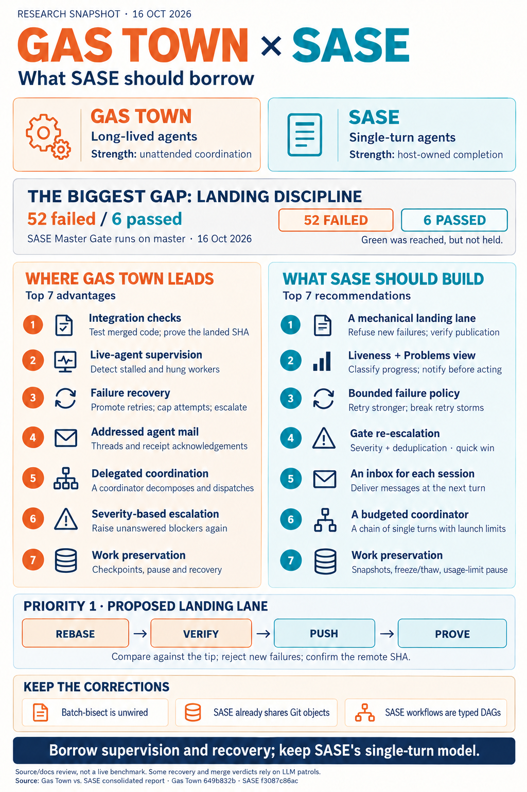

---
tags:
  - pypi-release-reliability
---

# Gas Town vs. SASE: where Gas Town is ahead, and what SASE should borrow

> **Research query:** How does SASE compare with Gas Town (the
> [gastownhall/gastown](https://github.com/gastownhall/gastown) GitHub repo), with a
> particular focus on the things Gas Town does better than SASE? End with a ranked list of
> the ways Gas Town is superior to SASE and a (not necessarily one-to-one) ranked list of
> recommended changes to consider making to SASE based on the findings.

## Bottom line

1. **The two are different machines.**
   - Gas Town is a *process model*: long-lived role agents run in tmux, other agents
     supervise them, and all work and mail live in a shared Dolt ledger.
   - SASE is a *transaction model*: single-turn agents run in isolated workspaces, and the
     host owns completion and every continuation.
   - Gas Town's advantages mostly come from running **unattended**. SASE's come from
     keeping a human **responsible for correctness**.
2. **Gas Town is ahead at keeping work moving without a human.** In particular, it:
   - refuses to call a merge done until the merged result has been tested and the target
     branch provably contains the commit;
   - turns a failure into a policy decision: retry on a stronger model, circuit-break,
     skip, or escalate;
   - notices live agents that have quietly stalled;
   - lets agents, and a coordinator agent, message each other and dispatch work.
3. **The most expensive gap is SASE's [landing path](#landing-discipline), and it is live
   today.**
   - In the 200 most recent Master Gate runs on `master`, Oct 16 had **6 passes and 52
     failures**, and HEAD `f3087c86` is red.
   - Master did go green during Oct 13–15, after the `sase-1lh` repair epic, and then
     went red again.
   - Nothing on SASE's landing path refuses a red change. Gas Town's
     *verify on the integrated tip, then prove the merge* discipline is the most valuable
     idea to borrow.
4. **Several headline claims are false at the source level.** This applies to Gas Town's
   README and to parts of two swarm reports:
   - batch-then-bisect merging is **unwired**;
   - SASE does **not** pay full-clone costs, because its workspaces share Git objects
     through alternates;
   - SASE workflows are **typed DAGs**, not prompt expansions.

   See [where the reports disagreed](#where-the-reports-disagreed-and-what-is-actually-true).
5. **Treat Gas Town as a parts bin, not a reference architecture.**
   - Its repo has been quiet since July. Yegge wrote that it "fell apart at the seams with
     Opus 4.7".
   - Its own supervisors [caused incidents](#lessons-from-gas-town-failures).
   - Its successor, Gas City, moved watchdog logic into deterministic orchestrator code
     and hard-codes zero roles.
   - The ideas that survived both rewrites are supervision, landing discipline and
     dispatch. Borrow those, not the tmux, LLM-patrol and hard-coded-role machinery.
6. **Top recommendations** (full list in
   [the recommended changes](#ranked-list-of-recommended-changes-to-sase)):
   1. A mechanical
      **[landing lane](#r1-a-mechanical-landing-lane)** that
      ratchets against the tip and proves the push.
   2. **[Live-turn liveness classification](#r2-live-turn-liveness-classification-and-a-problems-view)**
      with a Problems view.
   3. A **[failure-policy engine](#r3-a-failure-policy-engine-for-bead-work)** for bead
      work.

   **Recurring gaps.** The May 2026 comparison (`research:202605/sase_vs_gastown.md`)
   already recommended a coordinator agent, an agent-health subsystem, and a
   Refinery-like landing queue. Five months later, none of the three exists, and
   `sase bead search` finds no open bead for any of them.

## Method and evidence

### About this report

**Consolidated report** by the lead researcher. It merges five independent swarm reports
(cdx, cld, grk, mus, gem) with independent verification of every point they disagreed on.
Date: 2026-10-16.

**Snapshots compared**

- **Gas Town (`gastownhall/gastown`)**
  - *Revision:* `649b832b` (2026-07-23, `v1.2.1-304`)
  - *Notes:* `main` has had no commits since this one.
- **Gas City (`gastownhall/gascity`)**
  - *Revision:* `3c4cf446b` (2026-10-16)
  - *Notes:* Gas Town's successor. Read for context only.
- **SASE**
  - *Revision:* `f3087c86ac` (`master`)
  - *Notes:* sase-core at `594faf31`, matching `sase-core-revision.txt`.

Gas Town paths are relative to its repo root. SASE paths are relative to the SASE repo
root.

### Inputs

- **cdx:** the most careful about evidence boundaries. Contributes the upstream-issue
  counterevidence and the convoy-manager analysis.
- **cld:** the deepest code verification. Contributes the landing-path measurement and
  most of the mechanism detail.
- **grk:** the "hook / identity / prime" framing.
- **mus:** a supervision-first framing.
- **gem:** broad coverage, but with several factual errors about SASE and the merge queue
  (corrected in
  [where the reports disagreed](#where-the-reports-disagreed-and-what-is-actually-true)).

### My own verification

- Opened `gastown` and `gascity` with `sase repo open` and checked the disputed claims
  in source.
- Checked SASE-side claims in this checkout: workspaces, bead storage, the workflow
  executor, auto-restart, autonomy gates, doctor and providers.
- Tallied Master Gate outcomes with `gh run list`.
- Searched beads for planned overlapping work.
- Read the decision records `ci-two-speed-split`, `receipts-prove-before-they-skip` and
  `single-turn-agents`.
- Read two prior reports through `sase artifact read`:
  - `research:202610/master_ci_red_why_and_how_to_stay_green`
  - `research:202605/sase_vs_gastown.md`

### Evidence tags

Evidence tags used below:

- **[code]:** In source, with a production caller.
- **[daemon]:** Runs from Gas Town's Go daemon with no LLM in the loop.
- **[LLM-triggered]:** The logic is Go code, but it fires only when an LLM patrol agent
  runs the command per its formula.
- **[unwired]:** Code exists, but no non-test caller does.
- **[doc-only]:** Described in docs but not built.

### Not done

Nobody in the swarm ran a live town or benchmarked equivalent workloads. Upstream issues
are cited as reported, not reproduced.

## Gas Town in October 2026

**Timeline**

- Launched 2026-01-01.
- v1.0 around April; v1.2.1 on 2026-06-06.
- `main` frozen since 2026-07-23. Its last weeks are mostly agent-authored PR-sheriff and
  merge-queue fixes.

**Size and reach**

- About 18.4k stars and 1.7k forks; about 506 open issues (GitHub API, 2026-10-16).
- About 249k lines of non-test Go plus 226k lines of Go tests; 457 files in
  `internal/cmd`.
- 13 agent presets and about 50 bundled formulas.
- Kilo sells a hosted "Gas Town by Kilo".

**Yegge's verdict (August 2026)**

- In a post quoted by
  [Simon Willison](https://simonwillison.net/2026/Aug/4/steve-yegge/), Yegge says Gas
  Town "fell apart at the seams with Opus 4.7": the model kept "fiddling with Gas Town
  itself" instead of finishing work.
- He moved his own work to a private harness, Wheelhouse, "roughly the same shape as Gas
  Town, but without the scars". Its operating rule is **"crons watch, models act"**
  (cld).

**Gas City is the active successor (commit today)**

Its migration guide (`docs/getting-started/coming-from-gastown.md`) says:

- "the orchestrator hardcodes **zero roles**";
- the Deacon watchdog becomes "orchestrator health patrol + reconciliation";
- formulas run "as a graph across many agents, out of your session".

**Upstream reliability reports against HEAD 649b832** (cdx; open when consulted, not
reproduced):

- [#4890](https://github.com/gastownhall/gastown/issues/4890): an idle reaper killed a
  reused worker by reading its *previous* session's state.
- [#4887](https://github.com/gastownhall/gastown/issues/4887): usage-limit waits are
  indistinguishable from hangs.

**Implication:** borrow the mechanisms that survived the rewrites (landing discipline,
failure policy, liveness, escalation, dispatch). Do not borrow LLM patrols for
mechanical checks or keystroke-driven sessions.

## Where the reports disagreed and what is actually true

1. **The Refinery is a Bors-style batch-then-bisect queue**
   - *Who made it:* gem (ranked #1), mus (#2), grk (#7)
   - *Verdict:* **False in practice; the code is [unwired]**
   - *Evidence:* `AssembleBatch`, `ProcessBatch` and `bisectBatch` in
     `internal/refinery/batch.go` have no non-test callers. The shipped
     `mol-refinery-patrol.formula.toml` processes branches "one at a time".
     `docs/design/architecture.md` lists Phase 2 batch-then-bisect as "Blocked by Phase
     1". Only `README.md` advertises it. cdx and cld were right.
2. **SASE full clones mean slow spawns and disk bloat, so worktrees are a major win**
   - *Who made it:* gem (#2), grk (#4)
   - *Verdict:* **Mostly false**
   - *Evidence:* SASE workspaces are a **reused pool** (`#10`+). By default they "share
     the primary checkout's object database through Git alternates"
     (`docs/reference/agents/workspaces.md`). Measured: `sase_11/.git` is **40 MB** vs.
     **3.0 GB** for the primary `.git`. A worktree duplicates the working tree just the
     same. What remains is per-workspace sidecar and linked clones and the complexity of
     pool eviction and rescue. That is minor.
3. **Dolt beats SASE's "flat-file" beads, which suffer merge conflicts and lock
   contention**
   - *Who made it:* gem (#3)
   - *Verdict:* **Overstated**
   - *Evidence:* SASE beads are append-only per-root **event streams** in git, with a
     mutation flock and an optional dedicated beads sidecar
     (`docs/reference/work-units/bead-storage.md`). The telemetry, ToolRun and goal
     stores are Rust-owned SQLite. The real trade-off is multi-writer *latency* (Dolt
     writes are visible at once; SASE converges by pull) against operational weight (a
     Dolt server per town is Gas Town's heaviest dependency). Not ranked as a SASE
     deficit.
4. **SASE macros are "prompt expansions, not workflow DAGs"**
   - *Who made it:* gem
   - *Verdict:* **False**
   - *Evidence:* `docs/reference/workflows.md` documents typed inputs and outputs; agent,
     bash, python and parallel steps; control flow; `finally`; HITL; and step imports.
     Two things really are missing: **crash resume** (`WorkflowExecutor.execute()`,
     `src/sase/macro/workflow_executor.py:201`, always iterates from step 0) and
     **per-step overlays**.
5. **Every SASE landing is a human-reviewed PR**
   - *Who made it:* mus
   - *Verdict:* **False for this project**
   - *Evidence:* The `builtin@commit` finalizer rebases and pushes straight to `master`:
     669 commits since Oct 1, about 42 a day. The PR path exists through sase-github, but
     it is not the default here.
6. **SASE supports more providers**
   - *Who made it:* mus
   - *Verdict:* **False by count**
   - *Evidence:* Gas Town ships 13 presets (`internal/config/agents.go`). SASE has 7
     production providers plus `fakey` (`src/sase/llm_provider/`). SASE's are headless
     stream-JSON; Gas Town drives TUIs with keystrokes.
7. **Inter-agent messaging is "prohibited" in SASE**
   - *Who made it:* gem
   - *Verdict:* **Overstated**
   - *Evidence:* SASE has no addressed mailbox. Data still moves at turn boundaries
     through `%wait`, `sase var`, `@agent:` references, `sase pipe`, `#fork` and bead
     notes.
8. **SASE doctor is read-only (grk) / has about 9 fixers (cld)**
   - *Who made it:* grk, cld
   - *Verdict:* **Both partly right**
   - *Evidence:* `sase doctor` has 108 checks and two `--fix-*` flags. Other repairs live
     in domain commands: `sase workspace repair`, goal repair, and the bead and artifact
     doctors. Gas Town: **63 of 75** files in `internal/doctor/` implement `Fix`.
9. **Gas Town's recovery is autonomous Go code**
   - *Who made it:* cld ([code] tags)
   - *Verdict:* **Needs a qualifier**
   - *Evidence:* Redispatch with model promotion (`internal/deacon/redispatch.go`) and
     `gt escalate stale` are Go, but they run only when the Deacon and Witness **LLM
     patrol formulas** call them. That makes them [LLM-triggered]. Truly daemon-driven
     pieces are the GUPP check (`internal/daemon/lifecycle.go:1068`), the convoy
     manager's stranded-work scan (`daemon.go:553`), the checkpoint dog and usage-limit
     backoff.
10. **Persistent agent identity plus CVs gives Gas Town a quality loop**
    - *Who made it:* grk (#3), mus (#4)
    - *Verdict:* **Plumbing yes, loop no**
    - *Evidence:* `BD_ACTOR` stamps git author, beads and events. Capability-based
      routing, which would consume the CV, is [doc-only]. SASE already has a permanent
      `sase agent names` registry and per-provider/model/effort stats in the Admin
      Center.

## The architectures side by side

- **Execution**
  - *Gas Town:* Long-lived tmux sessions; "GUPP": if work is on your hook, you run it
  - *SASE:* Single-turn agents; continuation is always mechanical
    (`decisions:single-turn-agents`)
- **Driving the CLI**
  - *Gas Town:* `tmux send-keys` keystroke injection, readiness by prompt matching
  - *SASE:* Headless stream-JSON subprocess per provider
    (`decisions:adapters-normalize-harnesses`)
- **State**
  - *Gas Town:* Dolt SQL server per town; beads, mail and convoys are rows
  - *SASE:* Git event-stream beads in sidecars plus Rust-owned SQLite stores (ToolRun,
    telemetry, goals)
- **Coordinator**
  - *Gas Town:* The **Mayor**, a Claude session that files beads and `gt sling`s them
  - *SASE:* The human (TUI, Telegram, mobile). Agent launch requests need approval
- **Supervision**
  - *Gas Town:* Go daemon → Boot (LLM) → Deacon (LLM) → per-rig Witness and Refinery
  - *SASE:* Service host restarts daemons; PID liveness and orphan reaping; update-skew
    auto-restart only
- **Landing**
  - *Gas Town:* Worker runs `gt done` → MR bead → Refinery LLM merges one at a time after
    testing the merged tip
  - *SASE:* Host finalizer rebases, commits and pushes to `master`; CI reports after the
    push
- **Workflows**
  - *Gas Town:* TOML formulas → molecules, mostly a checklist printed into the prompt
  - *SASE:* Typed YAML macro workflows; plans → epics → beads in Kahn waves
- **Human loop**
  - *Gas Town:* Escalation beads plus email, SMS and Slack by severity
  - *SASE:* Durable non-blocking gates, autonomy profiles, LaunchApproval, sudo gate
- **Observability**
  - *Gas Town:* OTel export, `gt feed` Problems view, htmx dashboard, `gt costs`
  - *SASE:* ACE TUI, Admin Center statistics, local SQLite telemetry, ToolRun triage

Some of Gas Town's advantages depend on the process model, such as mid-task nudges and
an always-on Mayor. Those cannot be copied without reopening
`decisions:single-turn-agents`, which waits on a true suspend/resume primitive.

**Most of the gaps that matter do not depend on the process model.** The landing lane,
failure policy, liveness, escalation, crash snapshots, workflow overlays and telemetry
export can all be built inside SASE's decision records.

## Where Gas Town is ahead area by area

### Landing discipline

**Gas Town**

- **The Refinery tests the merged result.** It runs a 1,285-line patrol formula
  (`internal/formula/formulas/mol-refinery-patrol.formula.toml`). For each MR it:
  - merges the target into a temp branch;
  - runs setup, typecheck, lint, build and test on the **merged** result;
  - classifies a failure as either branch-caused (sends `FIX_NEEDED` mail and keeps the
    MR) or already on the target (files a P1 bug and merges anyway).

  **[LLM-triggered]**
- **Post-merge proof.** `verifyMQPostMergeProof` (`internal/cmd/mq.go:601`) refuses to
  close beads or delete the branch unless the target branch contains the submitted
  `commit_sha`. **[code]**
- **Merged-only dependencies.** A `merge-blocks` dependency resolves only when the
  blocker's close reason starts with `"Merged in "` (`internal/convoy/operations.go:237`,
  `internal/beads/beads.go:491`). Downstream work therefore waits for *landed* code.
  **[code]**
- **Fair ordering.** Priority scoring with anti-starvation (`internal/refinery/score.go`).
  **[code]**
- **Integration branches for epics.** These use a flock and an ancestry check, plus a
  pre-push hook that blocks `integration/*` from landing on the default branch.
  **[code]**
- **Batch-then-bisect** is **[unwired]**
  ([disagreement 1](#where-the-reports-disagreed-and-what-is-actually-true)).

**SASE today**

- **No refusal point.** The `builtin@commit` finalizer rebases onto `origin/<default>`,
  commits, pushes with retry, can launch one conflict-repair turn, and checks publication
  evidence afterwards (cdx). Nothing refuses a red change, and Master Gate runs only
  *after* the push.
- **The 2026-10-01 swarm report found:**
  - `master` red for 13 days and about 1,110 commits;
  - 42% of pushes landing before the previous push's gate finished;
  - `sase final submit` recording `verdict_provenance: "unverified"` instead of refusing;
  - no branch protection.
- **Today's Master Gate tally** (my check):

  - **Oct 13:** Pass 14 · Fail 30
  - **Oct 14:** Pass 16 · Fail 17
  - **Oct 15:** Pass 8 · Fail 5
  - **Oct 16:** Pass 6 · Fail 52

  **Green was reached but not held.**
- **Nothing planned.** `sase bead search` for "merge queue" and for landing refusal
  finds nothing. Meanwhile the backlog of "make master green" epics keeps growing:
  `sase-1lh`, `-1kx`, `-1kl`, and others.

**Caveats**

- Gas Town's merge verdict is an **LLM judgment**, and it can merge red by calling a
  failure "pre-existing".
- The Gas Town project itself landed its PRs through GitHub, not through its own Refinery
  (cld).
- `decisions:ci-two-speed-split` rejected a GitHub merge queue. A strict serial queue
  running the full gate would need about 19 gate-hours a day at SASE's cadence.
- **Borrow the mechanisms:** verify on the integrated tree, prove the SHA, and resolve
  dependencies only on merge. Do not borrow LLM-judged merging or bisection.

### Closing the loop on failed work

**Gas Town**

- **Redispatch with model promotion.** A rule in `.gastown/model-escalation.json`
  (`promote_after_failures`) re-slings a failed bead to a stronger agent. After an attempt
  cap, it escalates to the Mayor instead. **[LLM-triggered]**
- **Respawn circuit breaker.** After `MaxBeadRespawns=3` it sends `SPAWN_BLOCKED` to the
  Mayor. If the work is already on main, it closes the bead instead
  (`internal/witness/handlers.go`). **[code]**
- **Prior-attempt reuse.** A re-slung bead gets the previous attempt's branch injected so
  the new worker can cherry-pick it (`internal/cmd/sling_dispatch.go`). **[code]**
- **Skip and continue.** "Mountain" convoys label a bead skipped after three failures
  and keep going with independent work. **[code]** Note that `gt mountain pause` is a
  no-op because nothing reads its label.
- **The convoy manager.** It is event-driven, with a 30-second stranded scan. It
  dispatches ready work that has no worker, skips parked rigs, and is tested
  (`internal/daemon/convoy_manager.go`). **[daemon]**

**SASE today**

- **Auto-restart covers only update-skew deaths before the model turn.** In the doc's
  words: "Never restarted: provider errors, rate limits, auth, kills and cancels,
  OOM/timeout/disk-full, ... tool and test failures"
  (`docs/reference/agent-auto-restart.md:88`).
- **Retry fallback goes the wrong way for real failures.** The transient-error fallback
  for Claude is a *downgrade* to Sonnet: right for an overload, wrong for a task that
  failed.
- **Every failure needs a human.**
  - A failed epic phase parks its dependents and the lander until a human retries.
  - Ready standalone tasks wait for `TaskTriage`.

**Caveat:** issue #4890 shows why any automatic redispatch needs **generation-aware
ownership** first. The reaper must know which session generation it is judging.

### Supervising live agents

**Gas Town**

- **GUPP violation check.** Flags an agent with hooked work, alive, but no progress for
  30 minutes (`internal/daemon/lifecycle.go:1068`). **[daemon]**
- **Three-level tmux health check:** session dead, agent process dead, or hung.
- **Heartbeats.** Every `gt` command refreshes a heartbeat. There are three heartbeat
  stores and an explicit rule never to declare an agent stuck from one store alone
  (`docs/concepts/heartbeats.md`).
- **Zombie taxonomy** in `internal/witness/handlers.go`.
- **`gt feed` Problems view.** Groups agents as GUPP-violation, stalled, zombie, working
  or idle, with one-key nudge and hand-off.

**SASE today**

- **What exists:** PID and boot-time liveness, stale-claim cleanup, orphan-scope reaping,
  and a teardown watchdog that fires only *after* an accepted declaration.
- **The blind spot:** "A provider that wedges *before* submitting its declaration is not
  covered" (`docs/contribute/llm-invocation.md:378`).
- **Timeouts are monitor-only.** The `wall_clock` and `no_progress` timeout kinds exist
  only for monitors (`src/sase/core/continuation_wire.py:35`).
- **SASE is better placed to build this.** It already receives structured stream-JSON
  events and `tool_calls.jsonl`, where Gas Town has to scrape screens.

**Caveat:** Gas Town's killers produced incidents: the "Deacon murder spree", the
"serial killer bug", #4890 and #4887. **Classify deterministically and act
conservatively.**

### Agent-to-agent communication and delegated coordination

**Gas Town**

- **`gt mail` addressing.** Messages go to an agent, a rig broadcast, an `@group`, or a
  `queue:` address with exactly one claimant.
- **A typed protocol:** `POLECAT_DONE`, `MERGE_READY`, `MERGED`, `MERGE_FAILED`,
  `REWORK_REQUEST`, `RECOVERED_BEAD`, `HELP`.
- **Threads and two-phase, crash-safe acknowledgements** (`internal/mail/delivery.go`).
- **Delivery at a turn boundary.** Claude's `UserPromptSubmit` hook runs
  `gt mail check --inject`, and a nudge queue with expiry handles busy agents.
- **The Mayor.** A Claude session that files beads and slings them to workers. The
  pitch is "tell the Mayor what you want".
- **One-knob capacity.** Setting `scheduler.max_polecats` turns every sling into
  daemon-dispatched work under a cap, with sling-context beads and a circuit breaker.

**SASE today**

- **No mailbox:** no addressed mailbox, acknowledgement, queue or broadcast.
- **Agent launch requests never auto-resolve.** `GATE_AUTO_CAPABILITIES`
  (`src/sase/autonomy/gates.py`) covers only `plan`, `epic_plan` and `question`.
- **Little dispatch happens without a human.** The only such path is approving an epic
  plan under `%auto`. Otherwise the human is the integration point.

**Caveats**

- Mail defaults to ephemeral wisps, and an acknowledgement proves receipt, not completion
  (cdx).
- Re-injecting hundreds of open mails "ballooned agent context to 60–70%" and froze the
  Deacon (CHANGELOG 1.0.1).
- A literal always-on Mayor breaks `single-turn-agents`.

### Durable assignment and identity

This is grk's and mus's emphasis: durable assignment, the recovery ritual, and identity.

**Gas Town**

- **The hook.** A pinned assignment that survives crash, compaction and session recycling.
- **`gt prime`** (1,476 lines). Reprints role, hook, formula checklist and pending mail;
  `SessionStart` and `PreCompact` hooks run it automatically.
- **`BD_ACTOR`.** Stamps agent identity into git authorship, beads and events.

**SASE today**

- **The assignment lives in the original prompt.** It is backed by bead claims and
  instruction bundles.
- **Recovery needs a person.** A turn that dies mid-work needs someone to relaunch it with
  context.

**Assessment:** most of the hook concept is a consequence of long-lived sessions. The
transferable part is a deterministic **"what am I on" payload**: assignment, open
inbox, checklist position and the predecessor's state. It should be assembled from
bead, plan and inbox records so that any successor turn starts oriented.

### Cross-project deliverables (convoys)

**Gas Town:** a convoy groups beads across rigs, independently of whichever workers are
running them.

- `gt convoy stage` emits waves and gated tasks.
- Subscribers are notified on land, and the convoy reopens if work is added.

**SASE today**

- Cross-project bead IDs and waits already exist.
- The epic planner rejects open blockers outside the epic
  (`sase-core crates/sase_core/src/bead/work.rs`).
- Several `bead work` targets run in order rather than as one cross-project graph.
- Goals track outcomes, but only a human settles them.

**Assessment:** a view over existing records would fill the gap; a new work-unit type is
not needed (cdx).

### Escalation lifecycle

**Gas Town**

- **Creating escalations:** `gt escalate -s MEDIUM|HIGH|CRITICAL` with fingerprint
  dedupe.
- **Severity routes:**
  - medium → bead plus Mayor mail;
  - high → also email;
  - critical → also SMS;
  - a Slack webhook is also available.
- **Lifecycle:** acknowledge and close; `gt escalate stale` bumps severity after 4 hours,
  at most twice **[LLM-triggered]**; delivery failures are recorded.

**SASE today**

- **Channels exist:** priority-tabbed notifications, gates, Telegram, FCM push,
  `notify-send`, a remote Attention panel, snooze reminders and `+1` dedupe.
- **The lifecycle doesn't:**
  - no severity scale;
  - no re-escalation of an unanswered gate;
  - no agent-raised "page me" lever.

### Keeping work through crashes and usage limits

**Gas Town**

- **Checkpoint dog.** WIP commits every 10 minutes in each live worker. **[daemon]**
- **`gt done` safety nets:**
  - recovers orphaned stashes;
  - auto-saves uncommitted work;
  - verifies the push;
  - a zero-commit "sleepwalk" guard whose message deliberately omits the bypass flag,
    because "LLM agents read error messages and self-bypass" (`internal/cmd/done.go:1024`).
- **Usage limits pause instead of crash.** A usage-limit signature triggers a fixed
  backoff that doesn't count against the crash budget (`internal/daemon/usage_limit.go`).
- **`gt estop` / `gt thaw`** freeze and resume every agent with `SIGTSTP` / `SIGCONT`
  (`internal/estop/estop.go`).
- **`quota_dog` account rotation:** macOS-only and a terms-of-service risk.

**SASE today**

- **Strong at finish time:** the declaration protocol, absorption of raw commits, the
  `dirty_work_discarded` guard, `commit_state.json`, the rescue store, and 14-day held
  claims.
- **Missing:**
  - mid-turn snapshots;
  - a freeze for *running* agents (holds and maintenance mode only stop new work);
  - drain deletes in-flight progress;
  - an agent killed by a usage limit is never restarted.

### Patching and resuming workflows

**Gas Town**

- **Overlays.** `replace`, `append` or `skip` a single formula step per town or per rig
  (`internal/formula/overlay.go`).
- **Directives.** Per-role operator-policy files.
- **Poured molecules.** Resume from the last finished step.

**SASE today:** workflows are far more expressive, but:

- a project override replaces the whole file;
- the executor always restarts at step 0.

### Asking a predecessor session

**Gas Town:** `gt seance --talk <id> -p "…"` runs `claude --fork-session --resume <id>`
(`internal/cmd/seance.go:57`). It asks the predecessor one question, read-only.

**SASE today:**

- `#fork` and `#fork_by_chat` inject whole transcripts into a new agent;
- `sase chat show` reads them.

There is no cheap, one-shot way to question a past session.

### External observability and cost

**Gas Town**

- **OTLP export:** 23 counters plus lifecycle log events with `run.id` correlation.
- **Live views:** `gt feed` and an htmx dashboard.
- **`gt costs`:** Claude-only, with a pricing table hard-coded "as of Jan 2025".
- **`gt audit --actor`:** one timeline across git, beads and events.

**SASE today**

- **Strong local visibility:** Rust/SQLite telemetry, Admin Center statistics and ToolRun
  triage.
- **Missing:** OTel export (zero hits in the code and docs), a dollar cost model, and a
  web UI.
- **SASE's local default is the right choice for a single operator.**

### Breadth, reach and fences (smaller gaps)

- **Doctor auto-repair:** 63 of 75 Gas Town check files implement a fix; SASE has two
  doctor `--fix-*` flags plus domain repair commands.
- **Provider reach:** 13 presets against 8 providers. Gas Town pays for the extra reach
  with fragility: by its own inventory, 17 of 28 integration points depend on Claude Code
  UI internals.
- **Distribution:** Gas Town has Homebrew (`gt`, `bd` and `dolt` together), Docker, a
  minimal Windows path and a hosted offering. SASE is `uv tool install`, POSIX only.
- **Fences:**
  - Gas Town has an mTLS command proxy with branch-scoped push for containerized workers
    (`internal/proxy/git.go`). It is partly unwired.
  - SASE runs providers with approvals bypassed and no containment, relying on its
    gates, guarded recipes and host-owned pushes.
- **Evals:** `gt-model-eval/` is a 94-case promptfoo suite for deciding whether a role
  can run on a cheaper model. SASE has nothing comparable.

## Where SASE is already better

Don't over-borrow:

- **Completion integrity.**
  - Atomic declarations; host-selected finalizers that verify independently; absorption
    of raw commits.
  - Discarded-work guards; fingerprinted, resumable commit attempts; a rescue store.
  - In Gas Town, "done" is a CLI the agent chooses to run.
- **Human checkpoints that hold no resources.** Gate shells, autonomy profiles, plan and
  epic approval, mentors, and a typed sudo gate.
- **Capacity admission.** A weighted queue, holds with TTLs, and a scheduler-independent
  file-lock gate. Gas Town's scheduler drains about one bead per 3-minute heartbeat by
  default.
- **Real execution graphs and expressive workflows.** Kahn waves, recursive child epics,
  typed workflows with control flow. Gas Town's default molecules are a checklist printed
  into the prompt.
- **Provider routing.** Multi-provider size aliases, fallbacks, usage-window probes and
  drain.
- **Robust adapters.** Stream-JSON, not screen-scraping.
- **Workspace efficiency.** Pooled workspaces with shared Git alternates
  ([disagreement 2](#where-the-reports-disagreed-and-what-is-actually-true)).
- **Provenance and measured verification.** Commit footers, audited memory and repo
  reads, the ToolRun ledger, triage verdicts and fingerprint-bound receipts.
- **Docs that match the code.** Decision records with reopen conditions. Gas Town's docs
  drift both ways: batch-bisect is advertised but unwired; plugins are documented as
  unimplemented but ship; model-aware molecules are marked "DONE" but are doc-only.
- **Remote fleet.** `%dispatch` and machine attention across your own hosts.

## Lessons from Gas Town failures

1. **Watchdogs need tight limits on what they may destroy.** Every Gas Town supervisor
   layer caused incidents. The fixes each time:
   - detect deterministically;
   - re-check right before acting;
   - deduplicate concurrent actors;
   - make liveness generation-aware.
2. **Don't spend LLM sessions on mechanical checks.** Boot's idle check "saves ~480
   Claude sessions/day". Gas City moved patrol logic into deterministic code.
3. **Docs ahead of code erode trust.** SASE's decision-record discipline is the antidote.
4. **Inboxes need read and expiry semantics from day one.** Unbounded re-injection froze
   the Deacon.
5. **Error text written for an LLM is an attack surface.** Never name a bypass in a
   refusal. Route it through `/sase_gate`, as SASE's install guard already does.
6. **The factory can eat the product.** Yegge's Opus 4.7 failure was the model fiddling
   with the harness itself. SASE is mostly built *by* SASE, and the red-master treadmill
   is one symptom of the same risk.
7. **Fences beat promises.** The Beads 1.2.1 incident, an unauthorized release, happened
   because the agent "had all the permissions to do so in the first place".

## Ranked list of ways Gas Town is superior to SASE

Ranked by **impact on SASE's outcomes × size of the gap × confidence that Gas Town's
version actually works**.

1. **It refuses to land untested integration and proves every merge.** It tests the
   merged tip, proves the target contains the submitted SHA, and resolves dependencies
   only on "Merged in". SASE has no refusal point, and the cost is visible today (6 of 58
   Master Gate runs green on Oct 16).
   - *Confidence and evidence:* High; [code] plus [LLM-triggered] verdict. Batch-bisect
     excluded as [unwired].
   - *Ranked by:* cld 1, gem 1, mus 2, cdx 3, grk 7
2. **It supervises live agents.** GUPP, stalled and zombie classification across several
   heartbeat stores, plus a Problems view with one-key actions. SASE cannot see a turn
   that wedges before it declares.
   - *Confidence and evidence:* High; [daemon]
   - *Ranked by:* mus 1, cld 3, grk 5, gem 5
3. **It closes the loop on failed work.** Redispatch promoted to a stronger model, a
   respawn circuit breaker, prior-attempt branch reuse, skip-and-continue, and a daemon
   that redispatches stranded convoy work. SASE parks failures for a human, and its retry
   fallback goes *down* a tier.
   - *Confidence and evidence:* Medium-high; part [daemon], part [LLM-triggered]
   - *Ranked by:* cld 2, cdx 2
4. **Agents can message each other.** Mail with addresses, queues, threads, crash-safe
   acknowledgement, and delivery at turn boundaries.
   - *Confidence and evidence:* High in capability, medium in robustness
   - *Ranked by:* cdx 1, grk 2, mus 3, cld 4
5. **The human can delegate coordination.** A Mayor that decomposes and slings work, plus
   a one-knob dispatch governor. Every agent-requested launch in SASE needs a human
   click.
   - *Confidence and evidence:* Medium; [code], but the Mayor is an LLM session
   - *Ranked by:* cld 4, grk 8, gem 6, mus 11
6. **It escalates by severity and re-escalates stale items**, through out-of-band
   channels (email, SMS, Slack).
   - *Confidence and evidence:* High; [code], with an [LLM-triggered] stale bump
   - *Ranked by:* all five
7. **It keeps work through crashes and usage limits.** 10-minute WIP checkpoints, the
   sleepwalk guard, push verification, usage-limit pause instead of crash, estop/thaw.
   - *Confidence and evidence:* High; [code] and [daemon]
   - *Ranked by:* cld 7–8
8. **Assignment and identity outlive the session.** The hook, `gt prime` re-orientation,
   and actor attribution in git, beads and events.
   - *Confidence and evidence:* Medium. The CV-driven routing is [doc-only]
   - *Ranked by:* grk 1 and 3, mus 4–5
9. **One tracker for a deliverable that spans projects** (convoys), with notify-on-land.
   - *Confidence and evidence:* Medium-high
   - *Ranked by:* cdx 2, mus 8, grk 10
10. **Workflows can be patched per step and resumed after a crash.** Overlays,
    directives, poured molecules.
    - *Confidence and evidence:* High for overlays; medium for resume
    - *Ranked by:* cld 9, mus 6, grk 9, gem 7
11. **You can question a predecessor session** (seance): a read-only fork-and-resume Q&A.
    - *Confidence and evidence:* High; [code]
    - *Ranked by:* gem 4, grk 6, cld 10
12. **It plugs into external observability.** OTLP, cost rollups, an event feed, a web
    dashboard.
    - *Confidence and evidence:* High, but its value depends on having such a stack.
      Costs are Claude-only and stale
    - *Ranked by:* all five; low priority
13. **Its doctor repairs far more** (63 fixers against 2 flags plus domain commands).
    - *Confidence and evidence:* High
    - *Ranked by:* cdx 4, cld 12, grk 13
14. **It reaches more people.** More presets, Homebrew/Docker/Windows/hosted
    distribution, and a large community.
    - *Confidence and evidence:* High, but presets cost fragility
    - *Ranked by:* cld 11 and 15, mus 9, gem 11
15. **It has credential fences and eval evidence for cheaper roles.** An mTLS push proxy
    (partly [unwired]) and `gt-model-eval`.
    - *Confidence and evidence:* Medium
    - *Ranked by:* cld 13–14

**Explicitly not counted as Gas Town advantages:**

- **Batch-then-bisect merging:** [unwired].
- **Worktrees vs. full clones:** SASE already shares objects through alternates.
- **Dolt:** a trade-off, not a win.
- **Wasteland federation, capability routing, model-aware molecules and Daytona
  sandboxes:** doc-only or early.
- **The "20–30 agents" scale claim:** never measured.

## Ranked list of recommended changes to SASE

Ranked by leverage, fit with SASE's decision records, and size. Items marked **(core)**
belong in `sase_core` under the Rust-core boundary, with thin Python/TUI adapters.

### R1 A mechanical landing lane

Ratchet, then prove · addresses [#1](#ranked-list-of-ways-gas-town-is-superior-to-sase) · L · (core)

1. **Per-repo landing lease.** The commit finalizer serializes rebase → verify → push →
   prove, so concurrent landings can't race past each other's verdicts.
2. **Refuse regressions, not inherited reds.** Refuse a landing whose verified failure set
   on the **rebased** tree contains failures the tip's baseline doesn't have. The
   baseline witness is the latest Master Gate or Full CI result for the tip.
   - This works while `master` is red, which is when it matters most.
   - It uses the existing fingerprint-bound receipts as *proof for host completion*,
     consistent with `receipts-prove-before-they-skip`, and never as a skip.
   - Verify with the agent's `just check` on the rebased tree, not the full gate, so
     throughput survives about 40–90 landings a day.
3. **Prove the push.** Confirm the remote default branch contains the expected SHA.
   Only then close beads and resolve `%w(bead=…)` waiters, so dependents wait for landed
   code (Gas Town's `mq post-merge` and `merge-blocks`).
4. **Stop-the-line mode.** While the tip is red past a threshold, accept only changes that
   reduce failures, and reverts.
5. **Batch only if queue depth demands it.** On a batch failure, land the members that
   pass individually and send the remainder to a diagnosis agent rather than bisecting.
   That follows Yegge's own megabatch-plus-diagnosis practice, and Gas Town never wired
   its bisect anyway.

- **Guardrails:** refusals route through a gate and never name a self-bypass. This needs
  a new decision record beside `ci-two-speed-split`; a local landing lane is not the
  GitHub merge queue that decision rejected.
- **Success criterion:** Master Gate stays green once green, and no landing happens
  without a covering receipt.

### R2 Live-turn liveness classification and a Problems view

Addresses [#2](#ranked-list-of-ways-gas-town-is-superior-to-sase) · M · (core classification, TUI view)

1. **Build a progress signal** from what adapters already stream: last stream-JSON event,
   last tool call, last workspace write.
2. **Classify each running agent** as `working`, `quiet`, `stalled`, `wedged` or
   `zombie`. Use generation-aware identity and require two observations plus a re-check
   before any action (lessons from #4890 and #4887).
   - Usage-limit throttling, a legitimately long tool, and an open gate must classify as
     healthy waits.
3. **Optional per-turn budgets.** `wall_clock` and `no_progress`, reusing the monitor
   timeout kinds.
4. **Notify first.** Automatic action only through explicit configuration.
5. **TUI.** A Problems grouping in the Agents tab with one-key kill, restart-with-`#fork`
   and hand-off; also `sase agent problems --json` for headless use (mus).

### R3 A failure-policy engine for bead work

Addresses [#3](#ranked-list-of-ways-gas-town-is-superior-to-sase) · M · (core) · depends on
[R2](#r2-live-turn-liveness-classification-and-a-problems-view)

1. **Per-epic or per-bead policy.** For example:
   `on_failure: retry(max=2, promote=true) → skip_and_continue | park → escalate(sev=high)`.
2. **Promotion climbs the effort ladder or an ordered `||` model list.** That is the
   reverse of today's transient-error downgrade, which stays for overloads only.
3. **The retry receives the failed attempt's evidence:** its diff from the rescue store
   and a transcript summary (Gas Town's prior-branch injection).
4. **Skip-and-continue for independent waves.** The lander records skipped phases as
   explicit follow-ups.
5. **A fleet-wide storm breaker.** Every attempt is recorded in bead history.

### R4 Severity, stale-gate re-escalation, and an agent "page me" lever

Addresses [#6](#ranked-list-of-ways-gas-town-is-superior-to-sase) · S

- **Severity:** add `severity` to notifications and gates.
- **Re-escalation:** re-raise an unanswered gate after N hours on a louder channel (TUI →
  Telegram → push → optional email or Slack webhook), at most twice, with fingerprint
  dedupe (extending `+1`).
- **Agent lever:** `sase notify create --severity high` for agent-raised blockers. The
  escalating agent's turn still ends (`gates-never-block`).
- **Digest:** prefer a consolidated blocker digest to repeated alerts.
- **Why first:** this is the cheapest quick win.

### R5 Session-addressed inbox delivered at the start of a turn

Addresses [#4](#ranked-list-of-ways-gas-town-is-superior-to-sase), [#8](#ranked-list-of-ways-gas-town-is-superior-to-sase) · M–L · (core)

- **Message model:** direct send / read / acknowledge to a stable session identity plus
  recipient generation, carrying artifact references for large payloads.
- **A small typed vocabulary:** `DONE`, `REWORK`, `HELP`, `HANDOFF`, `RECOVERED`.
- **Delivery:** as a section in the next turn's instruction bundle, with read and expiry
  semantics and a size cap ([lesson 4](#lessons-from-gas-town-failures)).
- **Reorientation payload:** the same bundle section carries the "what am I on" payload
  from [durable assignment and identity](#durable-assignment-and-identity). This is the
  single-turn-compatible half of `gt prime`.
- **Limits:**
  - preserve independent-swarm isolation;
  - never let a message itself start a model turn without an explicit continuation
    policy;
  - add broadcast and claim queues only after direct delivery is reliable.

### R6 A coordinator *session* with a launch budget

Addresses [#5](#ranked-list-of-ways-gas-town-is-superior-to-sase) · L · depends on R2–R5

- **A chain of single turns, not an always-on Mayor.** Mechanical wake events start each
  turn:
  - an epic phase fails;
  - a gate goes stale;
  - `master` turns red;
  - a daily digest is due.
- **Each turn** reads state, files and links beads, posts a summary, and may **launch
  within a budget**.
- **The budget is a new autonomy rule** letting LaunchApproval auto-resolve within limits
  (launches per day, size cap, tag allowlist such as `ci` and `flake`), with every
  auto-launch logged.
- **Fit:** this keeps `single-turn-agents` and `gates-never-block` intact. It matches
  Wheelhouse's single-voice pattern and Gas City's "crons watch, models act".

### R7 Work preservation: snapshots, freeze/thaw, suspend, and a zero-diff guard

Addresses [#7](#ranked-list-of-ways-gas-town-is-superior-to-sase) · S–M

1. **Mid-turn snapshots.** Every N minutes during a long turn, record
   `git stash create` / `write-tree` snapshots into the rescue store as refs. They never
   commit on the branch, so host-owned completion is preserved.
2. **Freeze/thaw.** `sase agent freeze|thaw [--all|--provider P]` via the cgroup v2
   freezer on the existing systemd agent scopes. This is a true e-stop that keeps context.
3. **Suspend instead of drain on usage limits.** Freeze mid-turn agents until the parsed
   reset time. Drain remains the option when time matters more than progress.
4. **Zero-diff declaration guard.** A declaration that claims implementation with no diff
   must include a `no_change_reason`. Word the refusal so it doesn't name a bypass.
5. **On workspace heal,** offer orphaned stashes back as restore commands.

### R8 A cross-project deliverable view with stranded-work reconciliation

Addresses [#9](#ranked-list-of-ways-gas-town-is-superior-to-sase) · M · (core)

- **The view.** Project existing epics, beads, waits and goals into one deliverable
  showing ready, running, waiting, failed, awaiting-integration and landed work. Every
  item gets an owner or an explained block. No new work-unit type.
- **Notifications.** Notify on land.
- **Redispatch, carefully.** Begin with diagnosis and an operator-invoked resume. Enable
  bounded automatic redispatch only after
  [R2](#r2-live-turn-liveness-classification-and-a-problems-view)'s generation-aware
  ownership is proven.
- **Goals stay human-settled.**

### R9 Step overlays and crash resume for macro workflows

Addresses [#10](#ranked-list-of-ways-gas-town-is-superior-to-sase) · M · (core resolution)

- **Overlays.** Project or home overlays that `replace`, `append` or `skip` a named step
  of a bundled workflow. A `skip` passes its declared outputs through.
- **Resume.** `sase workflow resume <run>` starts at the first unfinished step using the
  recorded `workflow_state.json` outputs, for workflows whose steps declare themselves
  resumable.

### R10 Seance

`sase chat ask <agent> "question"` (seance) · addresses [#11](#ranked-list-of-ways-gas-town-is-superior-to-sase) · S

- **How it works:** fork-resume the predecessor's provider session read-only (Claude
  `--fork-session --resume`, or Codex resume where supported), answer once, then discard
  the fork.
- **Why:** far cheaper than `#fork`-injecting a whole transcript when you need one fact.

### R11 A typed repair catalog

Addresses [#13](#ranked-list-of-ways-gas-town-is-superior-to-sase) · S–M, ongoing

- **The contract:** each check names its evidence, the proposed mutation and its scope,
  and a postcondition to re-check.
- **Scope:** unify the existing workspace, sidecar, claim, goal and finalizer repairs
  behind one surface first.
- **Ordering:** add new fixers by **observed failure frequency** (`corpus-before-mechanism`).

### R12 Fences now; containment later

Addresses [#15](#ranked-list-of-ways-gas-town-is-superior-to-sase) · S → L

- **Now:** GitHub tag and release rulesets on `sase-org/sase` and its sidecars, so only
  the release workflow can tag.
- **After R1 exists:** a required-status ruleset.
- **Later:** systemd sandbox properties on agent scopes (`ProtectHome=`,
  `ReadWritePaths=`), plus scoped push credentials.

### R13 Opt-in OTLP export and config-driven pricing

Addresses [#12](#ranked-list-of-ways-gas-town-is-superior-to-sase) · M · (core) · low priority

- **Export:** selected lifecycle and ToolRun events with stable correlation IDs, bounded
  cardinality and content redaction. Local SQLite telemetry stays authoritative.
- **Pricing:** a configurable pricing table joined to usage, plus Codex token capture.
- **When:** build it only for a demonstrated consumer.

### R14 Smaller items

Addresses [#14](#ranked-list-of-ways-gas-town-is-superior-to-sase), [#15](#ranked-list-of-ways-gas-town-is-superior-to-sase)

- **Headless presets** only for CLIs with a print or stream-JSON mode (Copilot, Cursor,
  Amp).
- **A role-downgrade eval harness** that replays labelled triage, mentor and lander
  decisions against cheaper models.
- **Homebrew tap and Docker quickstart**, timed with the launch post.

### Explicitly not recommended

- tmux keystroke injection and screen-scraping.
- LLM patrol agents for mechanical checks.
- Dolt as the state store.
- An always-on Mayor process.
- Multi-account quota rotation.
- Bisecting merge queues at SASE's current volume.
- Migrating workspaces to worktrees. Alternates already deliver the disk savings.
- Wasteland-style federation.
- Named-persona agent CVs. Keep per-model and per-alias outcome stats instead.
- Copying Gas Town's role vocabulary.

### Mapping and sequencing

**Mapping to Gas Town advantages and SASE decisions**

- **R1 landing lane**
  - *Gas Town advantages (rank):* 1, 7 (push proof)
  - *Fits SASE decisions?* Yes. Extends `host-owned-completion`; receipts used as proof
    only. Needs a new decision record next to `ci-two-speed-split`
- **R2 liveness**
  - *Gas Town advantages (rank):* 2
  - *Fits SASE decisions?* Yes. Detection on the host; action gated by policy
- **R3 failure policy**
  - *Gas Town advantages (rank):* 3
  - *Fits SASE decisions?* Yes. The host decides; agents stay single-turn
- **R4 escalation**
  - *Gas Town advantages (rank):* 6
  - *Fits SASE decisions?* Yes. Gates still never block
- **R5 inbox**
  - *Gas Town advantages (rank):* 4, 8
  - *Fits SASE decisions?* Yes, if delivered at turn start
- **R6 coordinator session**
  - *Gas Town advantages (rank):* 5
  - *Fits SASE decisions?* Yes, as designed. Needs a budgeted LaunchApproval autonomy
    rule
- **R7 preservation**
  - *Gas Town advantages (rank):* 7
  - *Fits SASE decisions?* Yes. Snapshots are host-side; freezing a scope is not an agent
    waiting
- **R8–R14**
  - *Gas Town advantages (rank):* 9–15
  - *Fits SASE decisions?* Yes

**Suggested order**

1. **Now:** R1, because master is red today and the ratchet works while it is red. Also
   the quick wins R4, R10 and the R12 rulesets.
2. **Next:** R2, then R3. Together they make unattended epics safe.
3. **Then:** R7 and R5, which together prepare R6.
4. **Later:** R8, R9, R11 and R13 as the measured need appears.

**How to measure success** (cdx): run a small repeated workload with:

- independent tasks;
- one dependency chain across repositories;
- one conflicting change;
- one failed worker;
- one gated decision.

Track ready-to-assigned time, finished-to-landed time, human interventions, duplicate
launches, lost output, red-master hours and supervision tokens, against today's SASE on
the same providers. The first target is **fewer operator interventions at unchanged
correctness**, not more simultaneous agents.

## Sources

**Gas Town** @ `649b832b`:

- **Overview:** `README.md`, `CHANGELOG.md`.
- **Design and concept docs:**
  - `docs/design/{architecture,escalation,mail-protocol,scheduler,dolt-storage,directives-and-overlays}.md`
  - `docs/concepts/{convoy,heartbeats,identity,molecules,polecat-lifecycle,propulsion-principle}.md`
- **Refinery:** `internal/refinery/{batch,engineer,score}.go`.
- **Commands:**
  - `internal/cmd/{mq,mq_integration,done,seance,prime,escalate,escalate_impl,deacon,sling_dispatch,costs,refinery}.go`
- **Supervision:**
  - `internal/deacon/redispatch.go`, `internal/witness/{handlers,mountain}.go`
  - `internal/daemon/{daemon,lifecycle,convoy_manager,checkpoint_dog,usage_limit}.go`
- **Messaging:** `internal/mail/{delivery,router,types}.go`, `internal/nudge/queue.go`.
- **Other internals:**
  - `internal/convoy/operations.go`, `internal/beads/beads.go`
  - `internal/doctor/`, `internal/config/agents.go`, `internal/estop/estop.go`
  - `internal/proxy/git.go`, `internal/telemetry/`
- **Formulas:** `internal/formula/formulas/{mol-refinery-patrol,mol-deacon-patrol,mol-witness-patrol}.formula.toml`.

**Gas City** @ `3c4cf446b`: `docs/getting-started/coming-from-gastown.md`.

**SASE** @ `f3087c86ac`:

- **Docs:**
  - `docs/reference/agents/workspaces.md`
  - `docs/reference/work-units/{bead-storage,bead-work,goals}.md`
  - `docs/reference/workflows.md`, `docs/reference/agent-auto-restart.md`
  - `docs/reference/automation/{notifications,notification-gates,notification-types}.md`
  - `docs/contribute/llm-invocation.md`, `docs/contribute/telemetry.md`
- **Code:**
  - `src/sase/macro/workflow_executor.py`, `src/sase/autonomy/gates.py`
  - `src/sase/core/continuation_wire.py`, `src/sase/llm_provider/`
- **Decision records:** `decisions:{ci-two-speed-split,receipts-prove-before-they-skip,single-turn-agents}`.
- **Live data:** `gh run list` (Master Gate on `master`, Oct 12–16) and `sase bead search`.

**Prior research:**

- `research:202610/master_ci_red_why_and_how_to_stay_green/master_ci_red_why_and_how_to_stay_green.md`
- `research:202605/sase_vs_gastown.md`

**Web:**

- [Simon Willison, 2026-08-04, quoting Yegge on Opus 4.7 and Wheelhouse](https://simonwillison.net/2026/Aug/4/steve-yegge/)
- [The New Stack on Gas Town by Kilo](https://thenewstack.io/steve-yegges-ai-agent-orchestration-project-gas-town-comes-to-the-cloud-and-brings-the-wasteland-with-it/)
- Upstream issues [#4890](https://github.com/gastownhall/gastown/issues/4890) and [#4887](https://github.com/gastownhall/gastown/issues/4887) (via cdx)
- Further essays and posts cited by the swarm reports: cld cites yegge.ai and blog.gascity.com; grk cites Maggie Appleton, Latent Space and the GitHub API.

**Swarm reports** (this directory): `gastown_vs_sase_lessons_to_borrow__{cdx,cld,grk,mus,gem}.md`.
