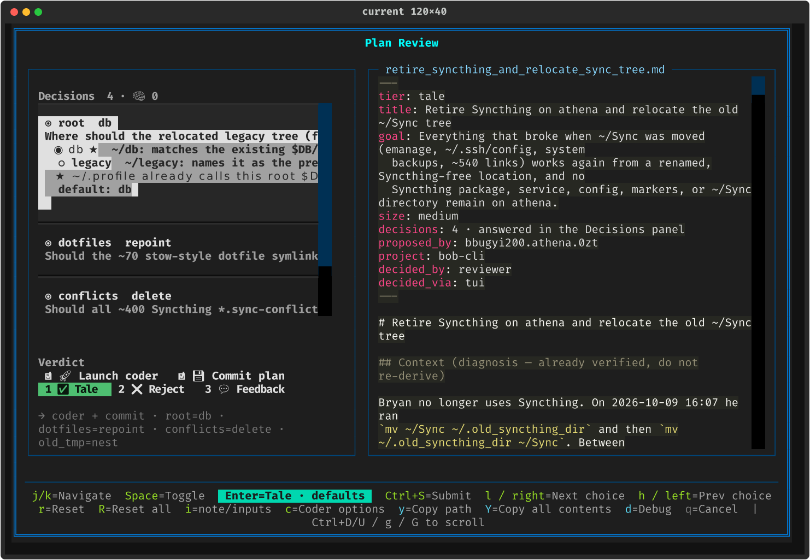
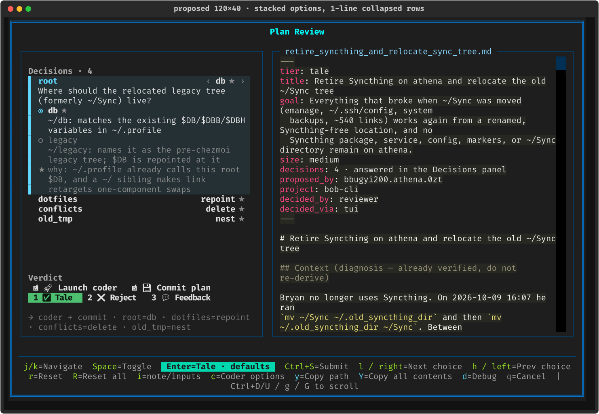

# Plan Decisions in the TUI Gate Panel: From Clipped Buttons to Decision Cards

> **Research query:** Make decisions look much better in the gate panels the TUI shows.
> Today they look bad, and some decision text is cut off (see
> `~/tmp/screenshots/20261012_074036.png`). Research the best possible TUI design, and
> end with a recommended solution and UX.

**Researcher:** cld · **Date:** 2026-10-12 · **Code baseline:** sase `597931b222`,
Textual 8.2.8 (the version in the installed `sase` tool env; the workspace `.venv` has
8.0.1, and both behave the same here).

**Method.** I read the decision rendering code end to end. I reproduced the screenshot
headlessly from the real plan behind it
(`~/.sase/plans/202610/retire_syncthing_and_relocate_sync_tree.md` and its
`.plan-decisions.json`). I measured the live widget geometry, and I measured every
decision written since the feature shipped (28 plans, 47 decisions). I read the
rendering source of two well-regarded terminal form libraries (Charm's `huh` and
`clack`). I also built a working prototype that swaps a new widget into the **real**
`PlanApprovalModal`, so every "proposed" image below is a real Textual render, not a
drawing. The prototype is saved next to this report as
`plan_gate_decision_cards__cld_prototype.py`.

---

## Bottom line

**The cut-off text and the ugly highlight are two implementation bugs, not a design
choice.** Each decision row is a Textual `Button` whose label is a multi-line Rich
`Text`. A Button sizes itself to its longest line (`width: auto`), so a focused row is
**103 cells wide inside a 44-cell viewport**. The overflow is clipped sideways, with no
wrapping and no ellipsis. A focused Button also applies Textual's `text-style: b reverse`
span by span, which produces the ragged white and grey blocks. A third bug compounds
them: the list is capped at `max-height: 16` inside a rail with 44 free rows, so the
fourth decision is hidden behind a fat scrollbar above 28 empty rows.

**Recommendation: replace the Buttons with *decision cards* in a rail that grows with
the terminal.**

1. **Cards, not Buttons.** Each decision is one focusable card that wraps all its text
   and never clips. The current card expands to show the full question, every choice
   with its consequence, and the reason for the default. The other cards collapse to a
   **name ⟶ answer** line plus the question in one line, with an ellipsis.
2. **A focus bar, not reverse video.** The focused card gets a thick accent bar on its
   left and a faint tint across the whole card, which is the pattern `huh` uses. Other
   cards keep an invisible bar of the same width, so nothing shifts when focus moves.
3. **Answers in one right-aligned column**, like a settings list: `db ★`,
   `repoint ★`, `legacy ●`. You can check the whole sheet at a glance before pressing
   Enter, which is exactly what "approve as shown" needs.
4. **A responsive rail.** The width is clamped between 50 and 84 cells, and the
   document keeps what the plan's text actually needs (plans are hard-wrapped at about
   88 columns). The list fills the rail's height. Collapsed rows drop to one line
   automatically when space runs out.
5. **`z` zooms to a full-width decision sheet** with every card expanded. This is the
   escape hatch for narrow terminals and five-decision plans.
6. **Cleaner copy:**
   - Drop the redundant `default: db` line.
   - Label the reason `why ★` instead of starting it with a bare `★`, which made it
     read as a third option.
   - Rewrite the memory chips as plain sentences ("edits glossary:sase-project · web
     strand · new", "default off ★ — you did not ask for this edit").
   - Hide `🧠 0`.
   - Use width-1 `☐`/`☑` in aligned positions.

The keys stay exactly as they are (`j`/`k`, `h`/`l`, Space, `r`/`R`, Enter); only `z`
is new. This is presentation-only work, so it stays in the sase repo (no `sase-core`
change).

| Today (real plan, 200×56) | Proposed (same plan, same size) |
| --- | --- |
|  |  |

---

## 1. What is actually wrong

I rendered the current modal headlessly with the real syncthing plan and then queried
the widgets. At 200×56:

```text
rows region  Region(x=6, y=7, width=44, height=16)   virtual Size(width=103, height=21)
plan-decision-0  Size(width=103, height=7)  focus text-style: bold reverse
plan-decision-1  Size(width=82,  height=2)
plan-decision-2  Size(width=82,  height=2)
plan-decision-3  Size(width=82,  height=2)
rail             Size(width=46,  height=44)
```

| # | Symptom in the screenshot | Root cause | Where |
| --- | --- | --- | --- |
| 1 | **Questions, choice labels, and the reason are cut off** mid-word ("Where should the relocated legacy tree (f") | Rows are `Button`s. `Button.get_content_width()` returns `max(line length) + 2` and the default CSS is `width: auto`. The 103-cell row is clipped by a 44-cell scroll viewport, so nothing wraps and no ellipsis appears. The code's own truncation (`[:57] + "..."` and `[:77] + "..."`) never shows, because the clip happens first. | `plan_decision_rows.py:111,116,328`; Textual `widgets/_button.py` `get_content_width` |
| 2 | **Ragged white and grey highlight blocks** on the focused row | The Button `:focus` style is `text-style: $button-focus-text-style`, which defaults to `"b reverse"`. Reverse video applies per text span: normal spans turn white, `dim` spans turn grey, and padding and blank cells stay dark. | Textual `design.py:518` (`"b reverse"`) |
| 3 | **Only 3 of 4 decisions are visible, with ~28 empty rows below** | `.plan-decision-rows { max-height: 16; }`, while the rail has 44 rows. `old_tmp` is reachable only by scrolling. | `styles.tcss:1783-1786` |
| 4 | **A fat red/orange scrollbar** | A nested `VerticalScroll` (the list) inside another `VerticalScroll` (the rail, which has `scrollbar-gutter: stable`) uses the 2-cell default scrollbar, so there are two gutters. | `plan_decision_rows.py:223`; `styles.tcss:1820-1824` |
| 5 | **The rail is cramped while the document wastes ~100 columns** | The rail is a fixed `width: 50` at every terminal width. From the screenshot I estimate the terminal at ~262 columns, so the document pane is ~200 columns wide, but the plan's text is hard-wrapped at ~88. | `styles.tcss:1779-1781` |
| 6 | **The `★` line reads like a third option** (`★ ~/.profile already calls…`) | The `why` text is prefixed with the default mark and indented like a choice. | `plan_decision_rows.py:187` |
| 7 | **Redundant `default: db` line** | `★` on the option already says this. | `plan_decision_rows.py:190` |
| 8 | **`Decisions 4 · 🧠 0`** | The memory count is shown even when it is zero. | `plan_approval_modal_view.py:86-91` |
| 9 | **Hard to scan the answers** | `◉ root  db` puts the glyph, id, and value in one bold run. `◉` appears on every choice row whatever its state, so it carries no information. | `plan_decision_rows.py:_collapsed_row_text` |

Two more problems are not visible in this screenshot:

- **Narrow layout (<100 columns).** The rail docks to the bottom at 48% height, and the
  decisions area gets about **3 rows**. The focused decision's options are never
  visible (golden `plan_gate_tale_decisions_stacked_90x40.png`).
- **The goldens approved the bug.** Every `plan_gate_tale_decisions_*` golden shows the
  same ragged reverse-video blocks. The fixtures use toy strings ("By pane", "pane
  keeps order") that never overflow, so the visual lane could not catch the clipping.

| Current, 120×40 | Current, memory toggles (`new_project_wizard`), 160×44 |
| --- | --- |
|  |  |

## 2. What real decisions look like

I measured every `*.plan-decisions.json` under `~/.sase/plans`: 28 plans and 47
decisions, written 2026-10-08 to 2026-10-12.

| Field | p50 | p90 | max | Design consequence |
| --- | --- | --- | --- | --- |
| Decisions per plan | 1 | 3 | 5 | 18 of 28 plans have exactly one decision. The common case must look calm, not like a form. |
| `ask` (chars) | 87 | 106 | 114 | Takes 2–3 lines at a 44-cell width and 1–2 at 80. **It must wrap.** |
| Choice `label` (chars) | 78 | 86 | 93 | Takes ~2 lines at a 44-cell width. A hanging indent matters. |
| `why` (chars) | 83 | 92 | 97 | Takes 2 lines in a 50-cell rail. |
| `id` (chars) | 14 | 23 | **27** | Long ids such as `tui_screenshot_rule` must share the header line with the answer, so the answer must never be pushed off. |
| Choice keys (chars) | 6 | 11 | 20 | The key column has to cope with `materialize`. |
| Options per choice | 2 | 2 | 3 | Radio lists are short, so showing every option is cheap. |

**Kinds:** 26 toggles and 21 choices. **19 of the 47 are memory decisions**, and
nearly all of those are toggles. So the most common card is the memory toggle, not the
choice in the screenshot, and it needs its own layout.

## 3. What good terminal forms do

I read the rendering source of two widely used terminal form libraries.

**Charm `huh`** (`charmbracelet/huh` @ `ffb6a97`):

- **Focus bar.** A focused field gets a thick left border with padding
  (`theme.go:111`: `PaddingLeft(1).BorderStyle(ThickBorder()).BorderLeft(true)`). A
  blurred field gets the same border set to `HiddenBorder()` (`theme.go:128-129`), so
  the layout never shifts when focus moves. This is exactly the fix for symptom 2.
- **Wrapping.** Titles and descriptions wrap (`wrap(s.title.val, maxWidth)`), and each
  option wraps to the field width minus the cursor width. The wrapped lines sit in a
  hanging indent under the label (`field_select.go:688`, `renderOption`).
- **Inline select.** It renders `← value →`, with the arrows dimmed at either end of
  the list (`optionsView`). This is a compact affordance for "h/l changes this value".

**`clack`** (`bombshell-dev/clack` @ `cbeefcb`):

- **Hints for the active row only.** An option's `hint` is drawn only for the
  **active** option. Inactive options are dimmed, and an answered prompt collapses to
  its selected value (`packages/prompts/src/select.ts`, `opt()`). This is the
  progressive disclosure an accordion of decisions needs.
- **Long lists.** They wrap with `fast-wrap-ansi` and window themselves with a dim
  `...` marker for overflow (`limit-options.ts:114,153`).

**Textual itself** has the primitives needed, with no custom drawing:

- `text-wrap: nowrap` plus `text-overflow: ellipsis` (from the
  [Textual docs](https://textual.textualize.io/styles/text_overflow/)).
- `border-left: outer|thick|blank`, `background` tints in `%`,
  `scrollbar-size-vertical: 1`, `HORIZONTAL_BREAKPOINTS` (already used by this modal),
  and `Static` widgets that wrap Rich renderables to their width.

**General rules I also applied:**

- Keep a comfortable line length (roughly 45–90 characters). This argues for capping
  the rail around 84 cells instead of letting it grow without limit.
- Lay settings out as key on the left and value on the right, so the values form one
  column you can scan.
- Never let colour be the only signal. The changed marker pairs gold with `●`.

**Prior SASE research already called for this.** The accepted cross-surface report
specified "focused: cyan bar, tinted background", "full ask, wrapped", and choice
labels with a hanging indent (`research:202610/plan_decisions_cross_surface_ux/
plan_decisions_cross_surface_ux__final.md`, *Row anatomy*). The shipped Button
implementation did not deliver that design. This report keeps that design and makes it
concrete and buildable.

## 4. Options considered

| Option | Verdict | Why |
| --- | --- | --- |
| **A. Patch the Buttons** (`width: 100%`, wrap, drop reverse) | Not enough | It fixes clipping and the blocks, but a Button cannot right-align a value column, style sub-parts, or carry a border bar without fighting its 3-row border model (the Verdict CSS already fights this). Its press semantics are also wrong: pressing a decision only focuses it. |
| **B. Decision cards in a responsive rail** | ✅ **Recommended** | Every problem in §1 is fixed with standard Textual pieces. It keeps the keymap, the docked Verdict, and focus-follows-document. Prototyped below. |
| C. One `RadioSet` per decision | Rejected | Each `RadioSet` takes over arrow keys and focus inside itself, which breaks the j/k-between and h/l-within model. Toggles, memory evidence, and the reason line do not fit a radio list either. |
| D. One `OptionList` holding all decisions | Viable implementation variant of B | It gives a full-row highlight and wrapping for free. But expanding and collapsing means `replace_option_prompt` churn, the highlight-echo guard rules apply (tui_perf rule 12), and per-card borders are harder. B is simpler for at most 5 items. |
| E. One question at a time (wizard or tabs, as in AskUserQuestion-style UIs) | Rejected | "Approve as shown" depends on seeing every answer at once. A wizard adds a step per decision for a feature whose common case is "read, press Enter". |
| F. Edit decisions inline at their callouts in the document | Rejected for now | Many plans have no callouts (the syncthing plan mentions `old_tmp = nest` in prose). Keep the current coupling: focusing a card scrolls the document to its callout. |
| G. Three columns at very wide widths (Verdict \| Decisions \| Doc) | Rejected | A rail capped at 84 cells already shows all four full questions at 262 columns. Another layout mode means more goldens and more seams. |
| H. **`z` zoom: a full-width decision sheet** | ✅ **Adopt as a complement** | It is the only good answer below 100 columns, where a docked rail gets ~8 rows, and for five-decision plans. |

## 5. Recommended design

### 5.1 Layout and sizing

```
┌ Plan Review  CLAUDE(opus) ────────────────────────────────────────────────────────────┐
│┌ rail: clamp(50, W − doc_need, 84) ──────┐ ┌ plan.md (keeps doc_need) ───────────────┐│
││ e ✏️ Edit plan · validated on save       │ │ …                                        ││
││ Decisions · 4 · 1 changed ●             │ │ > [!decision] root = legacy              ││
││▌root                       ‹ legacy ● ›│ │ …                                        ││
││▌Where should the relocated legacy tree …│ │                                          ││
││  dotfiles                     repoint ★ │ │                                          ││
││  …  (list = 1fr, 1-cell scrollbar)      │ │                                          ││
││ Verdict (docked bottom, unchanged)      │ │                                          ││
│└─────────────────────────────────────────┘ └──────────────────────────────────────────┘│
│ footer hints                                                                           │
└────────────────────────────────────────────────────────────────────────────────────────┘
```

- **Rail width.** Recompute on resize, only when the plan has decisions:
  ```
  doc_need   = clamp(widest folded plan line + 6, 72, 104)   # text + padding/border/scrollbar
  rail_width = clamp(inner_width − doc_need − 1, 50, 84)
  ```
  For the syncthing plan this gives **50 at ≤140 columns, 53 at 160, 84 at ≥200**,
  which matches the prototype renders. Measure the widest line once per content load,
  next to `_ensure_fold_cache`, never per keypress. The cap of 84 keeps lines readable.
  At 84, a p90 question (106 characters) takes two lines and a p90 label takes one or
  two. Plans without decisions keep today's 44.
- **One scroll container.** The rail becomes a plain `Vertical`, and only the decision
  list scrolls. Give the list `height: 1fr` (it fills the space between Actions and the
  docked Verdict) and remove `max-height: 16`. Use `scrollbar-size-vertical: 1` with
  `scrollbar-gutter: auto` (no gutter unless it overflows), and muted scrollbar colours.
- **Actions in one line.** `e ✏️ Edit plan · validated on save` replaces the current
  4–5 rows (centred title, rule, two-line caption), which gives decisions back about 3
  rows.

### 5.2 Card anatomy

All cards share one header row: the **name** on the left (bold, accent when current)
and the **answer chip** right-aligned. The chip is `value ★` when the value is the
default, and `value ●` in gold when it was changed. The current card adds the
affordance arrows `‹ … ›`. The id may ellipsize; the chip never does.

**Collapsed (two lines, the default when there is room):**

```
  root                                         db ★
  Where should the relocated legacy tree (former…
```

**Collapsed (one line, used automatically when the list would overflow; see §5.4):**

```
  dotfiles                                repoint ★
```

**Current card, choice, rail narrower than 60 cells (stacked options):**

```
▌ root                                    ‹ db ★ ›
▌ Where should the relocated legacy tree
▌ (formerly ~/Sync) live?
▌ ◉ db ★
▌   ~/db: matches the existing $DB/$DBB/$DBH
▌   variables in ~/.profile
▌ ○ legacy
▌   ~/legacy: names it as the pre-chezmoi
▌   legacy tree; $DB is repointed at it
▌ ★ why: ~/.profile already calls this root $DB,
▌   and a ~/ sibling makes link retargets
▌   one-component swaps
```

**Current card, choice, rail of 60 cells or more (two-column options, hanging indent):**

```
▌ root                                                            ‹ db ★ ›
▌ Where should the relocated legacy tree (formerly ~/Sync) live?
▌
▌ ◉ db ★    ~/db: matches the existing $DB/$DBB/$DBH variables in ~/.profile
▌ ○ legacy  ~/legacy: names it as the pre-chezmoi legacy tree; $DB is
▌           repointed at it
▌
▌   why ★   ~/.profile already calls this root $DB, and a ~/ sibling makes
▌           link retargets one-component swaps
```

**Current card, memory toggle (the most common kind):**

```
▌ 🧠 human_only_record                      ‹ ☐ no ★ ›
▌ Add a decisions record that remote repository
▌ creation (sase project create) is human-only?
▌   edits    decisions:project-create-human-only
▌            web strand · project · new
▌   default  off ★ — you did not ask for this edit
```

The other memory provenance states change only the `default` line:

- **Asked:** `default  on ★ — you asked: "and note the convention in the tui memory"`
- **Quote not found** (yellow): `default  ⚠ off — "…" is not in your messages; turn on
  to allow`
- **Correction:** `default  on ★ — corrects a statement this plan makes false`

**Current card, plain toggle:**

```
▌ keep_shim                                ‹ ☑ yes ★ ›
▌ Keep the compatibility shim for one release?
▌   why ★  removing it now breaks pinned plugins
```

Toggles do not list `yes`/`no` as options: the chip already shows the value, and Space
flips it.

**Styling rules:**

- **Focus.** `border-left: outer $accent` plus `background: $accent 10%` on the
  current, focused card. When the current card has lost focus (for example, you are on
  the Verdict), the bar drops to a muted accent and a 6% tint. Every other card gets
  `border-left: blank`, so the width is identical and nothing jumps.
- **No reverse video** anywhere in the rail.
- **Options.** The selected option shows `◉`, bold, in normal colour. Unselected
  options show `○` and are dimmed, including their labels (clack's pattern).
- **Why line.** It is always labelled `why ★` (or `★ why:` when stacked) and set in
  dim italic, so it can never be mistaken for an option.
- **The `default: …` line is dropped.**
- **Section header.** `Decisions · 4`, then `· 1 changed ●` when any value differs,
  then `· 🧠 2` only when there are memory decisions.

### 5.3 States

| State | What changes |
| --- | --- |
| At default | Chip `value ★` with a muted star |
| Changed | Chip `value ●` in gold. The header gains `· N changed ●`. The Enter badge already reads `Tale · 1 change`. The `★` stays on the default option inside the expanded card, so you can see what you moved away from. |
| Current but not focused | Card stays expanded, with a muted bar and lighter tint |
| Unverified memory | The yellow `⚠` default line, value `☐ no`, and the collapsed second line becomes `⚠ quote not found · off` |
| Settled elsewhere | Cards become read-only: grey bar, no `‹ ›`, and the header reads `Decided via Telegram · 1 changed`. `h`/`l`/Space show the existing "Settled elsewhere" toast. |
| Esc and reopen | Unchanged (`esc_drafts` already restores values) |

### 5.4 Density: never clip the current card

The rule is simple: **the current card is always shown in full. Everything else adapts.**

1. Lay out the current card fully wrapped and the others as two-line collapsed cards.
2. If that overflows the list's height, collapse the others to one line.
3. If it still overflows, scroll. Keep the current card visible (`scroll_visible`), and
   show `↑ 1 more` / `↓ 2 more` hints in dim text in the list's top and bottom rows, as
   clack does.
4. If the current card alone is taller than the list (narrow terminal, very long text),
   show a dim `z: full sheet` hint on its last visible row.

Compute this from the list height and the card heights on resize and on
focused-index change, never per render. Re-render only the cards whose state changed
(old current, new current, edited card), not all of them as `refresh_rows()` does
today.

### 5.5 Keys

There is **no change** to existing bindings: `j`/`k` move between decisions and then
on to the Verdict, `h`/`l`/←/→ change a choice or set a toggle, Space cycles or flips,
`r`/`R` reset, and Enter always approves as shown.

New:

| Key | Action | Notes |
| --- | --- | --- |
| `z` | Toggle the **decision sheet** (zoom) | Free in the gate keymap. Add it as `ace.keymaps.gate.decision_zoom` in `src/sase/default_config.yml`, to the help modal, and to the footer (conditional: only when the plan has decisions). It must join `gate_modal_taken_keys` so gate actions never claim it. |
| Esc (in zoom) | Leave zoom first | A second Esc cancels the modal as today. Losing the whole review by pressing Esc to "go back" would be hostile. |

**Rejected:**

- Digit keys for choices (they collide with numbered branch submit).
- Showing a number on each card (it invites "press 2 for decision 2").
- Enter to open a picker (Enter has priority and always submits).

### 5.6 The decision sheet (`z`)

- **Layout.** The document pane is hidden. The rail takes the body's full width, with
  the cards in one column whose text is capped at about 100 cells, and **every card is
  expanded**.
- **What stays the same.** `j`/`k` move the current card, `h`/`l` edit it, and the
  Verdict and outcome sentence stay docked.
- **Footer.** It shows `z=Back to plan`.
- **Narrow default.** Below 100 columns, open the sheet automatically when the plan has
  three or more decisions. Otherwise start in the normal stacked layout, with the rail
  at 62% height instead of 48% when the plan has decisions.

### 5.7 Glyphs and copy

| Token | Meaning | Rule |
| --- | --- | --- |
| `▌` / blank bar | Current card / any other card | Same width in both states |
| `◉` / `○` | Selected / unselected option | Only inside the expanded card. Dropped from collapsed rows, where it carried no information. |
| `★` muted | The planner's default | On the chip and on the default option, and as the `why ★` label |
| `●` gold | Changed from the default | Always paired with the gold colour. Never colour alone. |
| `☐` / `☑` | Toggle value | **Width-1, text-presentation glyphs.** The current `⬜`/`☑️` are emoji-presentation (Rich counts them as 2 cells, and terminals disagree). In my right-aligned prototype chip, `⬜` overlapped the next letter until I switched. |
| `🧠` | Memory decision | Only at the start of a line, never inside aligned or justified text |
| `‹ ›` | "h/l changes this" | Current card only (`huh`'s inline-select affordance) |
| `…` | Truncated | Every collapsed truncation shows an ellipsis. Silent clipping is a bug. |

### 5.8 Authoring guidance (small `/sase_plan` edit)

The rail cannot fix verbose input. Add three sentences to the decision rules in
`src/sase/macros/skills/sase_plan.md`:

- **Do not restate the key at the start of its label.** Today's labels start
  `~/db: …`, `Yes: …`, `No: …`, which costs 4–8 characters per line and shows the key
  twice.
- **Aim for asks ≤ 90 characters and labels ≤ 70.** The p50s today are 87 and 78.
- **Keep ids ≤ 16 characters.** The p90 is 23, and ids appear in the collapsed header,
  the outcome sentence, and `-D id=value`.

That file is a generated-skill source, so read the `generated_skills.md` memory before
editing it.

### 5.9 Other gate surfaces

- **Inbox gate card** (`notification_modal_gate.py:_plan_decisions_block`). It
  currently prints `◉ id  value ★` rows. Reuse the collapsed-card builder in read-only
  form (name on the left, chip on the right, question on a second dim line) so the
  inbox and the modal look like one system.
- **Agent prompt panel PLAN lane.** It already uses the shared `_plan_display_decisions`
  builders, so leave it alone. Apply the `☐`/`☑` glyph rule there too.

## 6. Prototype evidence

Every image below is a real render of `PlanApprovalModal` with the prototype card list
swapped in. The data is the real syncthing plan, or `new_project_wizard` for memory.

| 262×72 (the user's terminal, estimated): rail 84, all four questions in full | 160×48: `root` changed to `legacy`, `dotfiles` current, stacked options in a 53-cell rail |
| --- | --- |
|  |  |

| 120×40: rail 50, one-line collapsed rows, all four answers visible | Memory toggles, 160×44: target, scope, and provenance as sentences |
| --- | --- |
|  |  |

| `z` decision sheet, 120×40 | 90×40 stacked: still tight even at 62% height, which is why `z` exists |
| --- | --- |
|  |  |

What the prototype proved:

- Wrapping removes all clipping.
- The aligned answer column makes the sheet easy to check at a glance.
- The focus bar reads clearly in both the cyan theme and the PNG renderer.
- At 120 columns, one-line collapsed rows plus stacked options fit four decisions with
  one expanded.

What it also exposed:

- **The emoji-width trap** (§5.7).
- **The narrow docked layout is fundamentally too short.** Hence the auto-sheet rule.
- **The two-column option grid wastes space when a key is long** (`materialize`) in a
  narrow rail. Hence the stacked layout below 60 cells.

## 7. Implementation sketch

All of this is presentation-only Textual code and stays in the sase repo. The Decision
Sheet and summary sentence already come from `sase-core` and do not change.

1. **`plan_decision_rows.py`.**
   - Replace the Buttons with a `DecisionCard(Static, can_focus=True)` per decision,
     keeping the ids `plan-decision-{i}`, so `focus_gate_control`,
     `_sync_focused_decision`, and `visible_control_ids` keep working unchanged.
   - Keep `PlanDecisionRows`' public interface (`focused_index`, `focused_id`,
     `update_rows`, `rebuild`, `set_focused_index`).
   - Make the row-text builders pure functions of `(row, definition, width, mode)`
     returning Rich renderables (`Group` / `Table.grid`), as in the prototype, so they
     remain unit-testable without a pilot.
   - Make the card's `render()` width-aware (collapsed ellipsis, stacked or grid
     choice), so resizes need no Python loops.
2. **`plan_approval_modal_view.py`.**
   - Change the rail container from `VerticalScroll` to `Vertical`.
   - Compute the rail width on resize from the cached widest line.
   - Use the new header text and the one-line Actions.
   - Add the `z` sheet as a class toggle (`-decision-sheet`) on the modal that hides
     `#plan-approval-scroll` and widens the rail.
3. **`styles.tcss`.**
   - Remove `max-height: 16` and set the list to `1fr`.
   - Add the card, focus-bar, and tint rules and the thin scrollbar.
   - Add `-decision-sheet` rules.
   - Set the narrow rail to 62% when it has decisions.
4. **Keymap:** `decision_zoom: "z"` in `default_config.yml`, the help modal, and the
   conditional footer entry (the footer rule in `src/sase/ace/CLAUDE.md`).
5. **Performance** (tui_perf rules 7–8).
   - On `h`/`l`/Space, re-render only the edited card. On `j`/`k`, re-render only the
     old and new current cards.
   - Compute the sheet once per keypress. Today the summary, Enter badge, and rows each
     call `sheet()` separately.
   - Measure the widest line only when content loads.
6. **Tests.**
   - **A realistic-length fixture.** Add the syncthing decisions verbatim to
     `_ace_plan_decisions_png_fixtures.py`. The toy fixtures hid this bug.
   - **New goldens:** 120×40, 200×56, 90×40 (stacked), and 120×40 sheet.
   - **A pilot invariant test.** For every card,
     `card.size.width <= rows.content_region.width`, and the list's
     `virtual_size.width == region.width` (no horizontal overflow). This would have
     caught the shipped bug.
   - **Regenerate** the existing `plan_gate_*decisions*` goldens once, as one reviewed
     group, through `just fix-tui-screenshots` (tui_screenshot memory).

## 8. Open questions for Bryan

1. **Rail cap.** 84 is my pick. Do you want the rail to keep growing on your ~262-column
   terminal (say, to 100), or keep the document pane wide for plans with code blocks?
2. **Auto-sheet below 100 columns** for three or more decisions: helpful, or surprising?
3. **Focus colour.** Should the bar use the modal's cyan (`#5FD7FF`, as prototyped) or
   the gate accent? Cyan matches the title and file name.
4. **Inbox card.** Is it worth restyling in the same change, or as a follow-up?

## Sources

- **sase code** (`597931b222`): `src/sase/ace/tui/modals/plan_decision_rows.py`,
  `plan_approval_modal_view.py`, `plan_approval_modal_controls.py`,
  `plan_decision_sheet.py`, `notification_modal_gate.py`,
  `src/sase/ace/tui/styles.tcss`, `src/sase/sdd/_plan_display_decisions.py`,
  `src/sase/default_config.yml`, `src/sase/macros/skills/sase_plan.md`.
- **Visual goldens:** `tests/ace/tui/visual/snapshots/png/plan_gate_tale_decisions_*.png`
  and `notification_gate_plan_decisions_pending_120x40.png`.
- **Textual 8.2.8:** `textual/widgets/_button.py` (`DEFAULT_CSS`, `get_content_width`)
  and `textual/design.py:518` (`button-focus-text-style = "b reverse"`).
- **Textual docs:** [text-overflow](https://textual.textualize.io/styles/text_overflow/).
- **Charm `huh`** @ `ffb6a97` (opened as an external repo): `theme.go:111,128-129` and
  `field_select.go` (`optionsView`, `renderOption`).
- **`clack`** @ `cbeefcb` (opened as an external repo):
  `packages/prompts/src/select.ts` (`opt()`) and `limit-options.ts:114,153`.
- **Prior research:**
  `research:202610/plan_decisions_cross_surface_ux/plan_decisions_cross_surface_ux__final.md`.
- **Data:** the user's screenshot `~/tmp/screenshots/20261012_074036.png`, plus 28
  `~/.sase/plans/**/*.plan-decisions.json` files (2026-10-08 to 2026-10-12).
- **Prototype:** `plan_gate_decision_cards__cld_prototype.py`. Run it with the `sase`
  tool interpreter and `PYTHONPATH=<sase checkout>/src`; it takes the arguments
  `WIDTH HEIGHT OUT.png [--changed] [--compact] [--zoom] [keys…]`, and `PROTO_PLAN`
  selects the plan.
