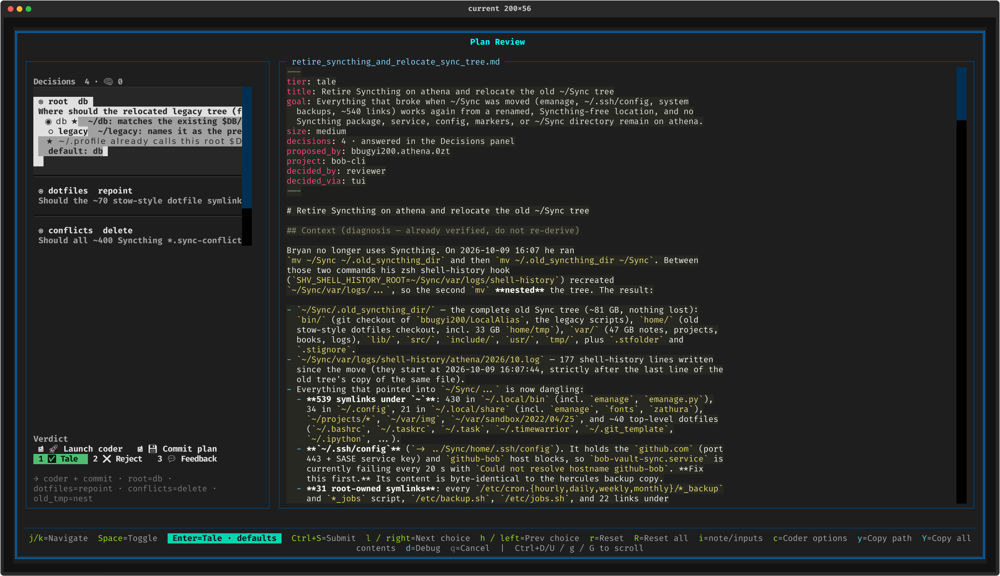
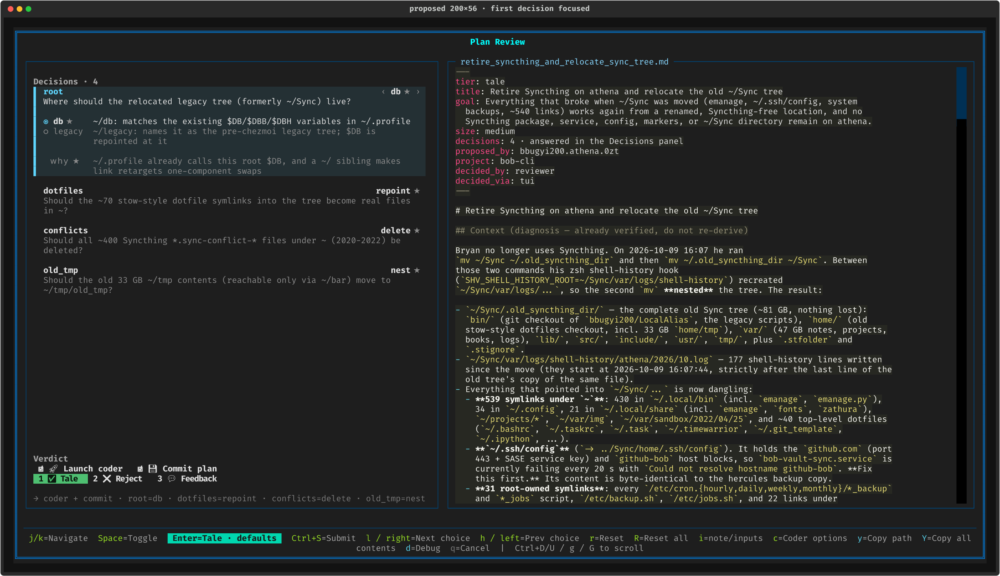
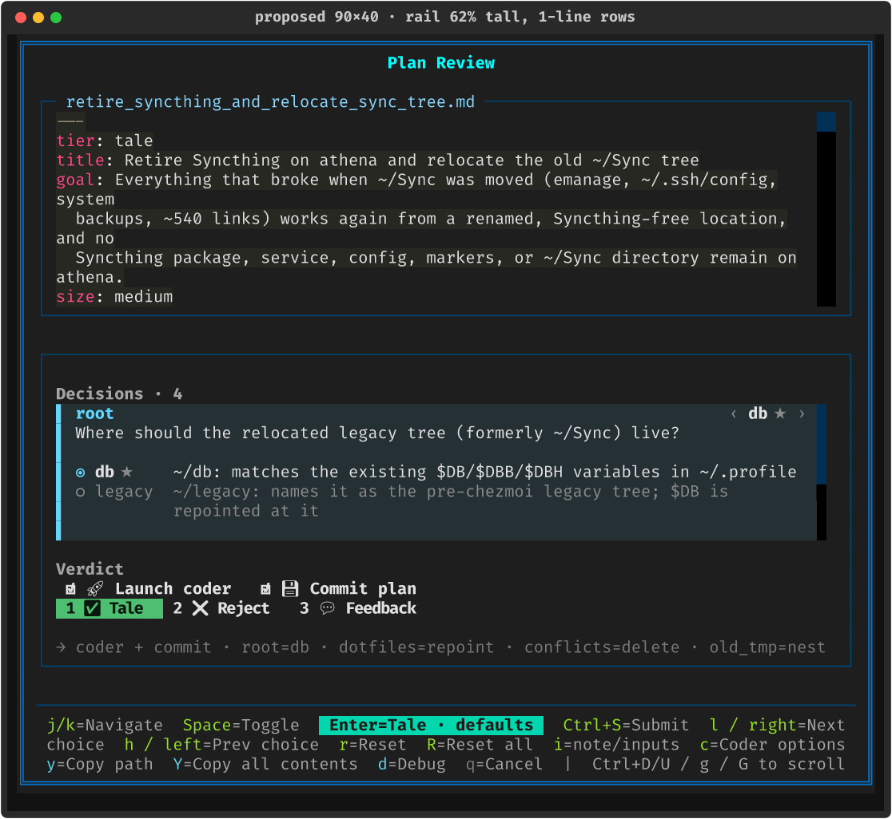
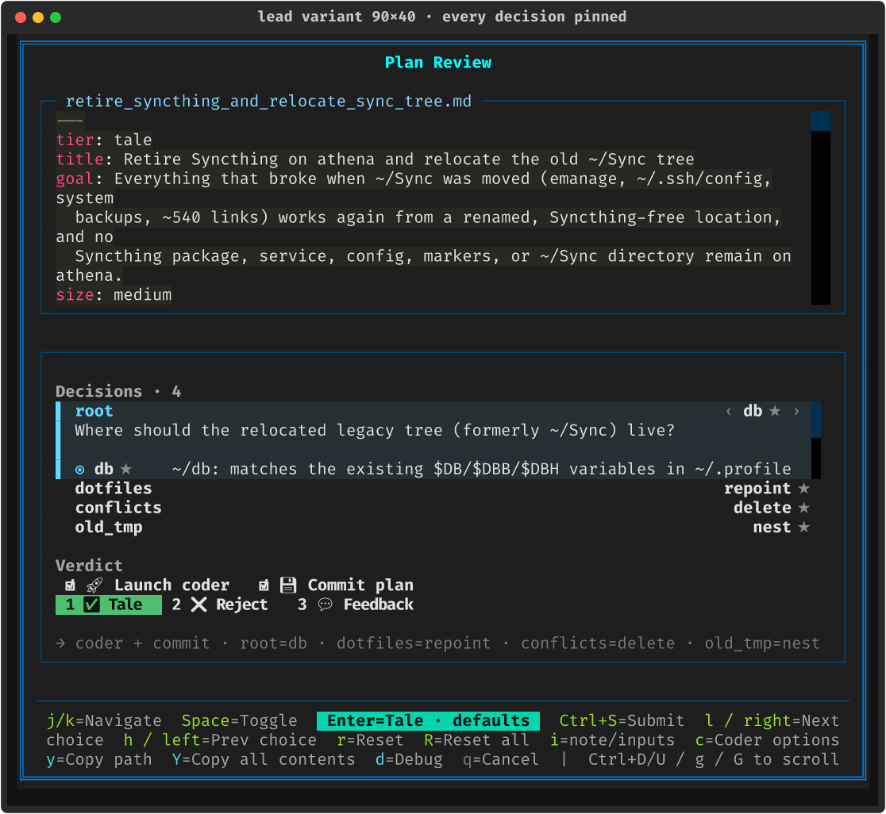
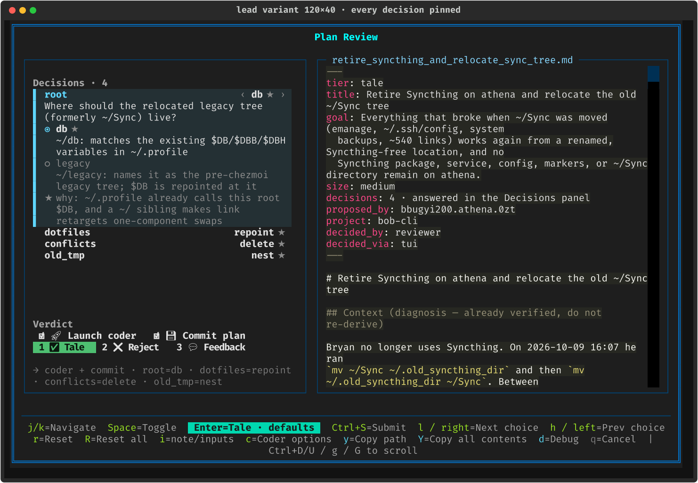
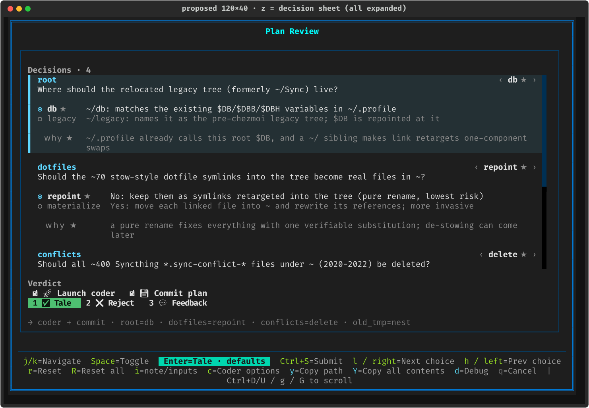
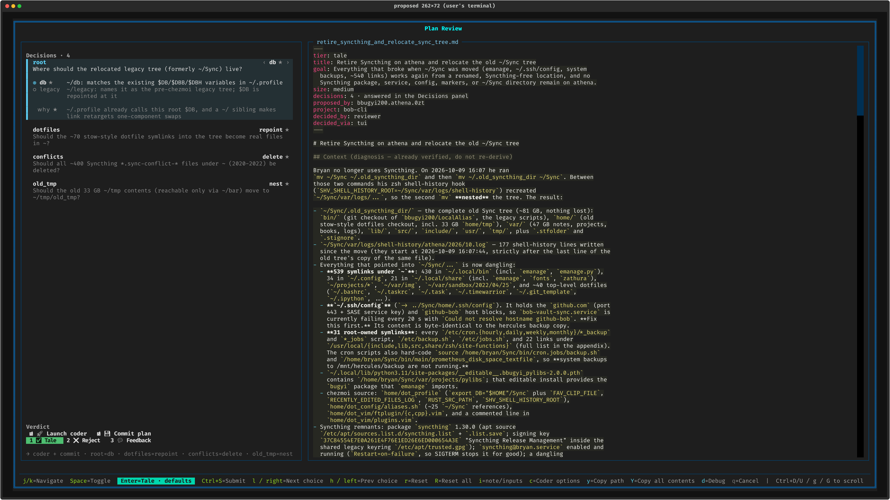
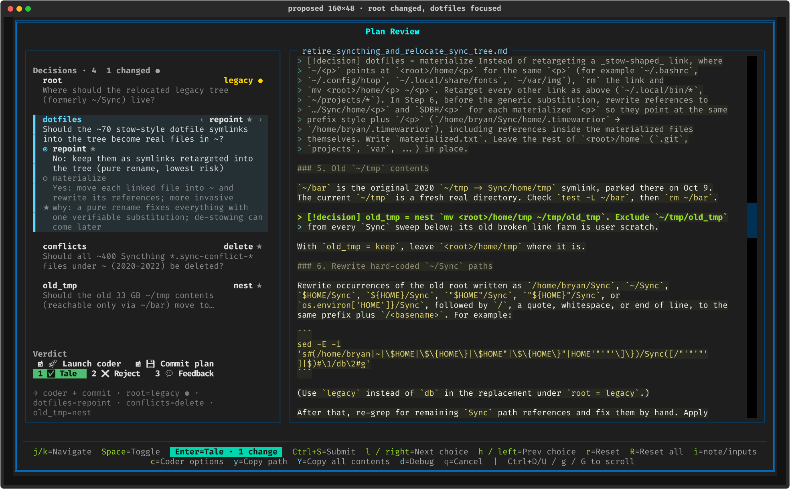
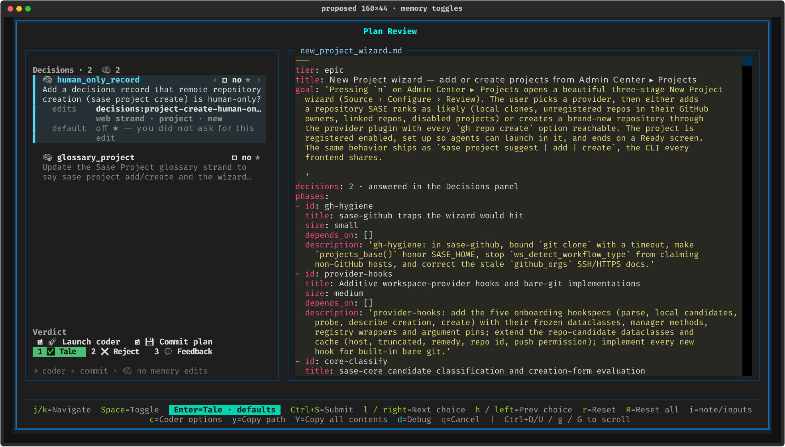
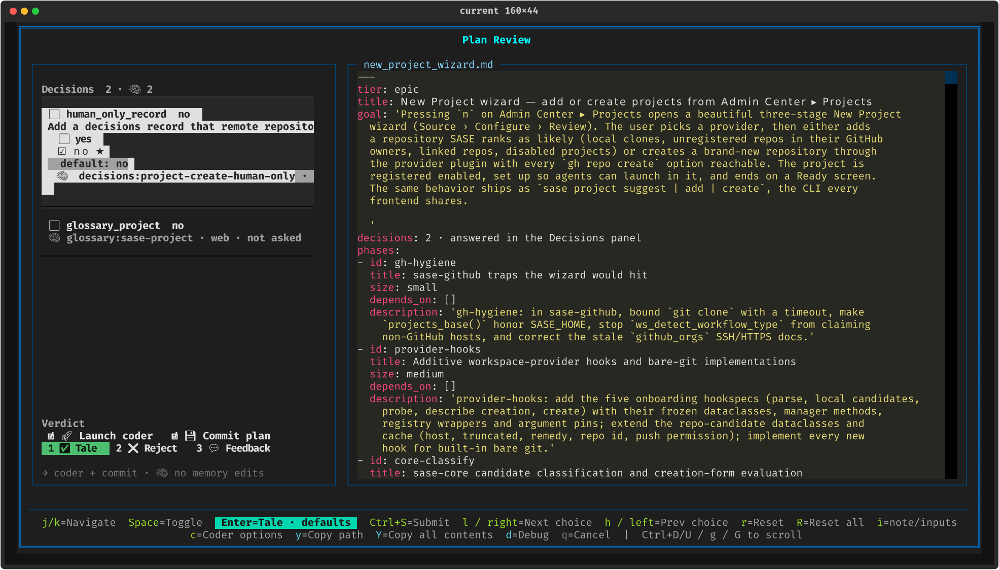

# Gate-Panel Decisions in the TUI: Pinned Decision Cards

> **Research query:** Make decisions look much better in the gate panels the TUI shows.
> Today they look bad, and some decision text is cut off (see
> `~/tmp/screenshots/20261012_074036.png`). Research the best possible TUI design, and
> end with a recommended solution and UX.

**Lead consolidation** · 2026-10-12 · merges five independent reports (`cdx`, `cld`,
`grk`, `mus`, `gem`, all in this directory) with the lead's own verification.
**Code baseline:** sase `558a45eca4`; Textual 8.0.1 in the workspace `.venv` (`cld` also
checked 8.2.8 in the installed tool env, with the same behavior).

**What the lead added:**

- Re-checked every root-cause claim against the code and Textual's source.
- Re-ran `cld`'s decision-size census. It matches exactly.
- Built a prototype variant that tests the one invariant no report had shown working:
  every decision stays on screen at 90×40
  (`gate_panel_decision_cards__final_pinned_prototype.py`).
- Settled the disagreements between the reports (§4).

---

## 1. Bottom line

**The cut-off text and the ugly highlight come from implementation bugs, not from a
design limit.** All five reports agree, and `cld` and `cdx` measured it independently:

1. **Each decision is a Textual `Button`, and its label is the whole multi-line card.**
   `Button.get_content_width()` returns the longest line + 2, and the default CSS is
   `width: auto`. So the focused row is **103 cells wide inside a 44-cell viewport**.
   The overflow is clipped sideways: nothing wraps, and no ellipsis appears.
2. **Focusing a Button applies `text-style: b reverse` span by span**
   (`button-focus-text-style`, Textual `design.py`). That produces the ragged
   white-and-grey staircase.
3. **The list is capped at `max-height: 16` inside a rail with about 44 free rows.**
   `old_tmp`, the fourth decision, is hidden behind a fat scrollbar while about 28 rows
   below it sit empty.

A 50-cell rail that never grows, nested scroll containers, and noisy chrome make these
worse.

**Recommendation: pinned decision cards in a responsive rail.**

- **Cards, not Buttons.** Wrapping `Static` cards keep author order.
- **The current card expands in place** to show the full question, every option with
  its consequence, and a `why ★` footnote.
- **Every other decision collapses** to a `name … value ★` line, plus a one-line
  question preview when there is room.
- **Every decision is always on screen.** If space runs out, the current card scrolls
  inside itself; the list never scrolls ids away.
- **Focus is a left accent bar with a faint tint.** No reverse video.
- **The rail grows with the terminal:** `40%`, at least 50 and at most 84 cells.
- **`z` toggles a full-width decision sheet.**
- **No key changes.** Enter still approves as shown.
- **Presentation-only.** No `sase-core` change.

| Today (real plan, 200×56) | Proposed (same plan, same size; `cld` prototype, real Textual render) |
| --- | --- |
|  |  |

---

## 2. What is wrong, and why

The screenshot is a Plan Review modal on athena. From its geometry, the terminal is about
**265×76** (`cld` estimated 262×72). The plan has four decisions: `root`, `dotfiles`,
`conflicts`, and `old_tmp`. All rows below were confirmed in the code by the lead.

| # | Symptom in the screenshot | Root cause | Where |
| --- | --- | --- | --- |
| 1 | Question, option labels, and `why` are cut mid-word ("…legacy tree (f", "…the existing $DB/", "…root $D") | A Button sizes to its longest line (`get_content_width` = max line + 2; `width: auto`). The scroll viewport clips it. The Python `[:77]+"..."` truncation never shows because the clip happens first. | `plan_decision_rows.py:328`; Textual `widgets/_button.py` |
| 2 | Ragged white and grey blocks on the focused row | Button `:focus` uses `b reverse`, applied per span, so `dim` spans turn grey and padding stays dark | Textual `design.py:358` (8.0.1) |
| 3 | Only 3 of 4 decisions are visible, above a large empty gap | `.plan-decision-rows { height: auto; max-height: 16 }` | `styles.tcss:1783` |
| 4 | Fat red scrollbar, with text running under it | A `VerticalScroll` list inside a `VerticalScroll` rail (`scrollbar-gutter: stable`) means two 2-cell gutters | `plan_approval_modal_view.py:277`, `styles.tcss:1820` |
| 5 | The rail is cramped while the plan pane wastes about 80 columns | The rail is a fixed `width: 50` at every terminal width, and plans are hard-wrapped at about 88 columns | `styles.tcss:1779` |
| 6 | The `★ ~/.profile…` line reads like a third option | `why` is prefixed with the default mark and indented like a choice | `plan_decision_rows.py:187` |
| 7 | Redundant `default: db` line | The `★` on the option already says it | `plan_decision_rows.py:190` |
| 8 | `Decisions 4 · 🧠 0` | The memory count shows even when it is zero | `plan_approval_modal_view.py:86` |
| 9 | Answers are hard to scan | `◉ root  db` is one bold run, and `◉` appears on every choice row whatever its state | `_collapsed_row_text` |
| 10 | Actions take 5 rows (title, centered button, rule, two-line caption) | The 2026-10 spec said "Actions take one line"; it was never built | `_compose_gate_actions` |
| 11 | The footer wraps to two lines even at about 265 columns | It lists ~17 hints, including `l / right=Next choice  h / left=Prev choice` | `plan_approval_footer.py` |

**The shipped widget never matched the accepted design.** The 2026-10 cross-surface
research (`plan_decisions_cross_surface_ux__final.md`, *Row anatomy*) specified:

- a cyan `▌` focus bar with a tinted background;
- the full question, wrapped;
- option labels with a hanging indent.

The Button implementation delivered none of these. The repair is to build that design
properly, not to invent a new one.

**Why the tests missed it.** `mus` reported "no snapshot coverage". That is wrong:

- There are eight `plan_gate_*decisions*` / `notification_gate_plan_decisions_*` goldens.
- Eight `test_plan_decision_ace_*.py` modules exist, and they call `_collapsed_row_text`
  and `_expanded_row_text`.

The real gap is the fixtures. They use toy strings ("By pane", "pane keeps order") that
never overflow, so the goldens approved the ragged reverse-video blocks.
`test_plan_decision_ace_render.py` checks rail and Verdict geometry, but a valid rail
can still clip a child (`cdx`, `cld`, `grk`).

**The narrow layout is broken too** (below 100 columns, the rail docks at the bottom at
48% height). The golden `plan_gate_tale_decisions_stacked_90x40.png` shows the focused
decision losing every option.

## 3. What real decisions look like

The lead re-ran `cld`'s census of every `~/.sase/plans/**/*.plan-decisions.json`
(28 plans, 47 decisions, 2026-10-08 to 2026-10-12) and got identical numbers.

| Field | p50 | p90 | max | Grammar limit (`docs/sdd.md`) | Consequence |
| --- | --- | --- | --- | --- | --- |
| Decisions per plan | 1 | 3 | 5 | — | 18 of 28 plans have **one** decision. The common case must look calm, not like a form. |
| `ask` (chars) | 87 | 106 | 114 | 120 | 3 lines at a 44-cell width, 2 at 76. **Must wrap.** |
| Choice `label` | 78 | 86 | 93 | 100 | About 2 lines in a narrow rail. Needs a hanging indent. |
| `why` | 83 | 92 | 97 | 100 | About 2 lines. |
| `id` | 14 | 23 | 27 | 32 | The header line must give the answer chip priority over the id. |
| Choice key | 6 | 11 | 20 | 24 | The option grid must cope with keys like `materialize`. |
| Options per choice | 2 | 2 | 3 | — | Showing every option is cheap. |

**Kinds:** 26 toggles and 21 choices. **19 of the 47 are memory decisions**, nearly all
toggles. The most common card is therefore a memory toggle, not the four-choice
screenshot, and it needs its own layout (§5.2).

**The screenshot is a tail case.** Only 2 of the 28 plans had four or more decisions.
The design has to look right with one decision and still hold up with five.

## 4. Where the reports disagreed, and the resolution

| Question | Positions | Resolution |
| --- | --- | --- |
| **Overall structure** | **Accordion of cards:** `cld`, `mus`, `gem`. **One-line index plus a separate inspector card:** `grk`. **Two-pane workbench** (index plus editor, with Decisions/Plan tabs below about 140 columns): `cdx`. | **Accordion of cards, plus `grk`'s rule that every id stays visible.** With p50 = 1 decision, a separate index duplicates the only row. The accordion keeps author order and puts each question next to its answer. Its one real failure was `cld`'s own 90×40 render, where the current card pushed the other three decisions out of view. The lead's variant fixes this by letting the current card scroll inside its own slot (§6). An index plus editor stays the fallback if moving rows prove disorienting in use. |
| **Enter** | `cdx`: make Enter select within the editor and move global submit to Ctrl+S. Everyone else: Enter approves as shown. | **Keep Enter = approve as shown.** It is the accepted cross-surface contract ("Enter never changes a value"), Enter is a `priority=True` gate binding, and the expanded card already shows every option, so no picker is needed. |
| **Digit keys** | `gem`: `1`–`9` select a choice directly. `cld`, `grk`, and the prior research: reject. | **Reject.** Digits submit numbered branches *with the current values*. Reusing them for choices would make one keystroke ambiguous between editing and submitting. |
| **Rail width** | `cld`: content-aware `clamp(50, W − doc_need, 84)`. `grk`: `36%`, 50–76. `mus`: `32%`, 52–72. `gem`: 74 (62 at medium widths). `cdx`: about 45%, 64–88, with tabs below 140. | **`width: 40%; min-width: 50; max-width: 84`, pure CSS.** That gives about 50 at 120 columns, 53 at 140, 61 at 160, 77 at 200, and 84 from about 220 up. Cap at 84 because past about 76 inner cells, prose lines get too long to read comfortably. Use `cld`'s content-aware formula only if plans with wide code blocks suffer at 160–200. |
| **Narrow terminals (below 100 columns)** | `cdx`: tabs. `cld`: `z` sheet, opened automatically for 3+ decisions, rail at 62%. `grk`/`mus`: keep the dock and make it work. | **All three, layered.** Keep the dock but raise the rail to 62% when the plan has decisions. Pin every id. Make `z` the full-width view switch. The lead measured **only 7 list rows at 90×40 even at 62%**, so the docked view is the fallback and the sheet is where real reading happens. Opening the sheet automatically is an open question (§9). |
| **Toggle glyphs** | `grk`/`mus`: keep `☑️`/`⬜` as the canonical cross-surface glyphs. `cld`: use the width-1 `☐`/`☑` in the TUI. | **Use width-1 `☐`/`☑` wherever the TUI aligns columns** (the answer chip, option rows, and the inbox card). Rich measures `☑️`, `⬜`, and `🧠` as 2 cells and terminals disagree about them. In `cld`'s right-aligned chip, `⬜` overlapped the next letter. The TUI hardcodes these glyphs locally (`plan_decision_rows.py`, `notification_modal_gate.py`), so Telegram and the CLI are unaffected. The shared `◉ ○ ★ ● 🧠` vocabulary does not change. |
| **Rationale styling** | `gem`: a bordered "Author's Rationale" box. Everyone else: a dim footnote. | **A dim italic footnote labelled `why ★`.** A box inside a card inside the rail is three nested borders, and it costs rows the narrow layout does not have. |
| **The `default:` line** | `mus` and `cdx` keep a default or "was" line. `cld`, `grk`, and `gem` drop it. | **Drop it.** The `★` stays on the default option in the expanded card, so after a change you can still see what you moved away from. Changed state is gold `●` plus the words `N changed` in the header and Enter badge. |
| **`RadioSet` / `SelectionList`** | Rejected by every report that considered it. | **Reject.** These widgets capture arrow keys, Space, and Enter inside themselves, which breaks the j/k-between, h/l-within model. Use the *look* of radios, keep focus at the decision level, and make option lines clickable. |
| **Authoring limits** | `cld`: tighten `/sase_plan` copy guidance. `grk`: "wrap to the limit; do not punish planners". | **The renderer must handle the grammar maximum** (120/100/32/24) with no clipping. Separately, add `cld`'s guidance not to restate the key at the start of its label. Today's labels open `~/db: …`, `No: …`, `Yes: …` (the zoom render shows `repoint` labelled "No: keep them…"), which wastes 4–8 cells and shows the key twice. Soft length targets are optional. |

**Corrections to individual reports:**

- **`mus` — "no tests reference the rows":** false (§2).
- **`gem`:**
  - It attributes the clip to "Button `overflow: hidden; text-overflow: clip`". The
    actual mechanism is intrinsic width (`get_content_width` with `width: auto`).
  - Its ASCII reconstruction of the Verdict row (`☑ 2 Reject ☐ 3 Feedback`) does not
    match the screenshot.
  - Its `max-height: 28` keeps a hard cap that will bite again.
- **`cld`'s prototype:**
  - It ellipsizes the memory target (`decisions:project-create-human-on…`). The current
    card must never ellipsize; long identifiers should fold onto the next line.
  - Its 120×40 render forces one-line collapsed rows even though two-line rows fit
    (19 rows available, 18 needed).

## 5. Recommended solution and UX

### 5.1 Layout

Wide layout (100 columns or more), plan with decisions:

```text
┌ Plan Review  CLAUDE(opus) ─────────────────────────────────────────────────────────┐
│┌ rail: 40% · min 50 · max 84 ───────────┐ ┌ plan.md (1fr) ─────────────────────────┐│
││ e ✏️ Edit plan · validated on save      │ │ …                                       ││
││ Decisions · 4 · 1 changed               │ │ > [!decision] root = legacy   ← tinted  ││
││▌root                       ‹ legacy ● ›│ │ …                                       ││
││▌Where should the relocated legacy tree │ │                                         ││
││▌(formerly ~/Sync) live?                │ │                                         ││
││▌ ○ db ★    ~/db: matches the existing  │ │                                         ││
││▌           $DB/$DBB/$DBH variables     │ │                                         ││
││▌ ◉ legacy  ~/legacy: names it as the   │ │                                         ││
││▌           pre-chezmoi legacy tree     │ │                                         ││
││▌   why ★   ~/.profile already calls    │ │                                         ││
││▌           this root $DB, …            │ │                                         ││
││  dotfiles                    repoint ★ │ │                                         ││
││  Should the ~70 stow-style dotfile sy… │ │                                         ││
││  conflicts                    delete ★ │ │                                         ││
││  old_tmp                        nest ★ │ │                                         ││
││          (list = 1fr, fills to Verdict)│ │                                         ││
││ Verdict                    (docked)    │ │                                         ││
││ ☑ 🚀 Launch coder  ☑ 💾 Commit plan     │ │                                         ││
││ 1 ✅ Tale  2 ❌ Reject  3 💬 Feedback    │ │                                         ││
││ → coder + commit · root=legacy ● · …   │ │                                         ││
│└────────────────────────────────────────┘ └─────────────────────────────────────────┘│
│ j/k=Navigate  h/l=Choice  Space=Cycle  r/R=Reset  Enter=Tale · 1 change  z=Sheet  …  │
└──────────────────────────────────────────────────────────────────────────────────────┘
```

- **Rail.** `width: 40%; min-width: 50; max-width: 84` when the plan has decisions.
  Decision-free plans keep 44, and generic gates keep 42.
- **One scroll region.**
  - The rail becomes a plain `Vertical`.
  - The decision list is `height: 1fr` (no `max-height`), between the one-line Actions
    and the docked Verdict.
  - Use `scrollbar-size-vertical: 1`, `scrollbar-gutter: auto`, and muted scrollbar
    colours.
  - Wrap widths are measured inside the gutter, so text never runs under the scrollbar.
- **Actions in one line:** `e ✏️ Edit plan · validated on save`. This finally builds
  the 2026-10 spec and gives decisions back about 4 rows.
- **The document pane is unchanged:**
  - fold, callout tint, and focus-follow (focusing a decision scrolls to its callout)
    stay as they are;
  - optionally add `grk`'s dim `answering root` caption under the filename when the
    callout is off screen.

### 5.2 Card anatomy

Every card shares one header row:

- **Left:** the name, bold, with the accent colour on the current card.
- **Right:** the answer chip, right-aligned.
  - `value ★` (★ muted) when the value is the default.
  - `value ●` in gold when it was changed.
  - The current card adds the `‹ … ›` arrows, borrowed from Charm `huh`'s inline
    select, meaning "h/l changes this".
- **The id may ellipsize. The chip never does.**

**Collapsed card, two lines** (used when there is room):

```text
  dotfiles                                  repoint ★
  Should the ~70 stow-style dotfile symlinks into t…
```

**Collapsed card, one line** (used automatically when space is short; §5.3):

```text
  dotfiles                                  repoint ★
```

**Current card, choice, inner width below 60 (options stacked):**

```text
▌ root                                     ‹ db ★ ›
▌ Where should the relocated legacy tree
▌ (formerly ~/Sync) live?
▌ ◉ db ★
▌   ~/db: matches the existing $DB/$DBB/$DBH
▌   variables in ~/.profile
▌ ○ legacy
▌   ~/legacy: names it as the pre-chezmoi
▌   legacy tree; $DB is repointed at it
▌ ★ why: ~/.profile already calls this root $DB,
▌   and a ~/ sibling makes link retargets
▌   one-component swaps
```

**Current card, choice, inner width 60 or more (two-column options with a hanging
indent):**

```text
▌ root                                                        ‹ db ★ ›
▌ Where should the relocated legacy tree (formerly ~/Sync) live?
▌
▌ ◉ db ★    ~/db: matches the existing $DB/$DBB/$DBH variables in ~/.profile
▌ ○ legacy  ~/legacy: names it as the pre-chezmoi legacy tree; $DB is
▌           repointed at it
▌
▌   why ★   ~/.profile already calls this root $DB, and a ~/ sibling makes
▌           link retargets one-component swaps
```

**Current card, memory toggle (the most common card):**

```text
▌ 🧠 human_only_record                     ‹ ☐ no ★ ›
▌ Add a decisions record that remote repository
▌ creation (sase project create) is human-only?
▌   edits    decisions:project-create-human-only
▌            web strand · project · new
▌   default  off ★ — you did not ask for this edit
```

The other provenance states change only the `default` line:

- **Asked:** `on ★ — you asked: "…"`
- **Quote not found** (yellow): `⚠ off — "…" is not in your messages; turn on to allow`
- **Correction:** `on ★ — corrects a statement this plan makes false`

The warning and its effect are always visible. Long quotes wrap below it.

**Current card, plain toggle.** The chip carries the value, and Space flips it, so no
yes/no rows are listed:

```text
▌ keep_shim                                ‹ ☑ yes ★ ›
▌ Keep the compatibility shim for one release?
▌   why ★  removing it now breaks pinned plugins
```

**Wrapping rules:**

- Prose wraps to the card's real content width.
- Unbreakable paths and ids use `text-overflow: fold`.
- Ellipsis is allowed **only** on collapsed previews and on the id in the header.
- Silent clipping anywhere is a bug.

### 5.3 Density: pin every decision, never clip the current card

The rule: **the current card is shown in full, or it scrolls inside itself. Every other
decision stays visible as at least one line.**

1. Lay out the current card fully wrapped and the others as two-line collapsed cards.
2. If that overflows the list height, collapse the others to one line.
3. If it still overflows, give the current card a slot of at most
   `list_height − (n − 1)` rows. The card scrolls inside that slot, with a 1-cell
   scrollbar, and its last visible row shows a dim `↓ more · z: sheet` hint.
4. The list itself never scrolls a decision out of view. The maximum is 5 decisions, so
   it never needs to.

Recompute this on resize and on focus change only, never per render. Re-render only the
cards whose state changed (the old current card, the new current card, and the edited
card). Today, `refresh_rows()` relabels every Button.

| `cld` card prototype at 90×40: three decisions pushed out of view | Lead's pinned variant at 90×40: all four ids visible, current card scrolls inside itself |
| --- | --- |
|  |  |

At 120×40 the pinned variant shows the whole `root` card plus all three other answers in
19 rows ().

### 5.4 Styling tokens

| Token | Meaning | Rule |
| --- | --- | --- |
| `▌` bar plus a faint tint | Current card | `border-left: outer $accent` with about a 10% accent background while focused. When focus is on the Verdict, the bar turns muted with about a 6% tint. Other cards get `border-left: blank`, so nothing shifts (`huh`'s hidden-border trick). **No reverse video anywhere in the rail.** |
| `◉` / `○` | Selected / unselected option | Only inside the expanded card. The selected option is bold in normal colour. Unselected options are dimmed, and so are their labels. |
| `★` muted | The planner's default | On the chip, on the default option, and as the `why ★` label |
| `●` gold | Changed from the default | Always paired with the words `N changed`. Never colour alone. |
| `☐` / `☑` | Toggle value | Width-1, text-presentation glyphs |
| `🧠` | Memory decision | Only at the start of a line, never inside aligned columns |
| `…` | Truncated | Only on collapsed previews and on ids |
| Header | `Decisions · 4` | Append `· 1 changed` when nonzero, and `· 🧠 2` only when there are memory decisions |

**Restraint:**

- Keep one border per pane, with no box per card.
- Use normal foreground for questions and option labels; dim is only for metadata and
  unselected options (`cdx`).
- Questions and options are what the reviewer must read, so they must never be grey.

### 5.5 States

| State | What changes |
| --- | --- |
| At default | The chip reads `value ★`. |
| Changed | The chip reads `value ●` in gold, and the header gains `· N changed`. The Enter badge already reads `Tale · 1 change`. Choosing the default again clears the changed state. |
| Current card, but focus on the Verdict | The card stays expanded with a muted bar. |
| Unverified memory | A yellow `⚠` default line, and the value stays `☐ no` until the reviewer turns it on. The collapsed preview becomes `⚠ quote not found · off`. |
| Settled elsewhere | Cards become read-only: grey bar, no `‹ ›`, and the header reads `Decided via Telegram · …`. `h`/`l`/Space show the existing toast. |
| Esc, then reopen | Unchanged: `esc_drafts` restores the values. |
| No decisions | No Decisions section; the rail stays at 44. |

### 5.6 Keys

**Existing bindings do not change:**

- `j`/`k` walk the Actions → Decisions → Verdict ring.
- `h`/`l`/←/→ step a choice or set a toggle.
- Space cycles a choice or flips a toggle.
- `r`/`R` reset.
- Enter approves as shown.
- Digits and Ctrl+S submit branches with the current values.

**Mouse:**

- Clicking a card makes it current.
- Clicking an option line in the current card selects that option.

**New:**

| Key | Action | Notes |
| --- | --- | --- |
| `z` | Toggle the full-width **decision sheet** | Add `ace.keymaps.gate.decision_zoom: "z"` to `src/sase/default_config.yml`, the help modal, and the conditional footer (only when the plan has decisions). It must join `gate_modal_taken_keys`. `z` already means "zoom" in the artifact-files modal. **Check for a collision with the app-level `z` fold-mode prefix** (`keymaps/mode_keymaps.py`); a `priority=True` gate binding should win inside the modal, but test it. |
| Esc while in the sheet | Leave the sheet first | A second Esc cancels the modal, as today. |

### 5.7 The decision sheet (`z`) and narrow terminals

- **The sheet.**
  - The document pane is hidden.
  - The rail takes the full body width, with card text capped at about 100 cells.
  - **Every card is expanded.**
  - `j`/`k`/`h`/`l` still work.
  - The Verdict and outcome sentence stay docked.
  - The footer shows `z=Back to plan`.

  
- **Below 100 columns:**
  - The rail docks at the bottom at **62%** height (up from 48%) when the plan has
    decisions.
  - The pinned rule of §5.3 keeps every id visible.
  - `z` is the real reading view.
  - Open question: should the modal open straight into the sheet when there are three
    or more decisions?

### 5.8 Footer

The footer currently wraps even at about 265 columns. Two changes:

- **Merge the pairs** into `h/l=Choice` and `r/R=Reset`, saving about 30 cells.
- **Make the decision hints conditional on a decision being focused.** ACE's footer
  convention (`src/sase/ace/CLAUDE.md`) already allows this.

Keep the Enter badge exactly as it is. It is the outcome summary that makes "approve as
shown" trustworthy.

### 5.9 Other gate surfaces

- **Inbox gate card** (`notification_modal_gate.py:_plan_decisions_block`):
  - Reuse the collapsed-card builder in read-only form: name on the left, chip on the
    right, question as a dim second line.
  - Switch to `☐`/`☑`.
  - The golden `notification_gate_plan_decisions_pending_120x40.png` renders
    `◉ grouping  pane ★` letter-spaced. That may be an SVG `textLength` artifact around
    `◉`, but check it in a live terminal while restyling.
- **PLAN lane and `sase plan show`:** these use the shared `_plan_display_decisions.py`
  builders and are out of scope.
- **Custom and sudo gate rails:** they must never copy the Button-accordion pattern.

## 6. Prototype evidence

Every image is a real Textual render of `PlanApprovalModal` with a card list swapped
in. The data is the real syncthing plan, or `new_project_wizard` for memory decisions.

| 262×72 (about the user's terminal): rail 84, all four questions in full | 160×48: `root` changed to `legacy`, stacked options in a 53-cell rail |
| --- | --- |
|  |  |

| Memory toggles, 160×44 | Current memory decisions, 160×44 |
| --- | --- |
|  |  |

**What the prototypes proved:**

- Wrapping removes all clipping.
- The right-aligned answer column makes the whole sheet checkable at a glance.
- The focus bar reads clearly.
- With pinning, four decisions stay reachable even at 90×40.

**What they exposed:**

- The emoji-width trap (§4).
- The docked narrow layout is fundamentally short: 7 list rows at 90×40, even at 62%.
- `cld`'s grid ellipsized a memory target. Fold it instead.

**To reproduce:**

```bash
python gate_panel_decision_cards__final_pinned_prototype.py \
    plan_gate_decision_cards__cld_prototype.py WIDTH HEIGHT OUT.png
```

Run it from this directory with the sase workspace `.venv` interpreter. The plan comes
from `PROTO_PLAN`, or defaults to the syncthing plan.

## 7. Implementation sketch

All of this is presentation-only Textual code in the sase repo. The Decision Sheet,
defaults, provenance, and the summary sentence already come through `sase-core`, so the
Rust boundary is untouched.

1. **`plan_decision_rows.py`**
   - Replace each Button with a `DecisionCard(Static, can_focus=True)` inside a
     per-decision slot. Keep the ids `plan-decision-{i}` so `focus_gate_control`,
     `_sync_focused_decision`, and `visible_control_ids` keep working.
   - Keep `PlanDecisionRows`' public interface (`focused_index`, `focused_id`,
     `update_rows`, `rebuild`, `set_focused_index`).
   - Make the text builders pure functions of `(row, definition, width, mode)` that
     return Rich renderables (`Group`/`Table.grid`). That keeps them unit-testable
     without a pilot.
   - Delete the 60/80-character slicing and the dead `plan-decision-detail-*` Statics.
   - Stop swallowing mount and query errors (`except Exception: pass`); they hid the
     dead detail widgets.
2. **`plan_approval_modal_view.py`**
   - Make the rail a `Vertical`.
   - Add the one-line Actions.
   - Use the new header text.
   - Add the sheet as a `-decision-sheet` class toggle that hides `#plan-approval-scroll`
     and widens the rail.
3. **`styles.tcss`**
   - Rail `40%`, min 50, max 84.
   - List `1fr`, with no `max-height`.
   - Card, bar, and tint rules.
   - Thin muted scrollbar.
   - Sheet rules.
   - Narrow rail at 62% when the plan has decisions.
4. **Controls and footer:**
   - pinned slot sizing on resize and focus change;
   - `z` and Esc-leaves-sheet;
   - the merged footer hints.
5. **Keymap:** `decision_zoom` in `default_config.yml`, the help modal, and
   `gate_modal_taken_keys`.
6. **Performance** (the `tui` memory's performance rules):
   - On `h`/`l`/Space, re-render only the edited card plus the summary.
   - On `j`/`k`, re-render only the old and new current cards.
   - Compute `sheet()` once per keypress; today the summary, Enter badge, and rows each
     call it.
   - No `validate_plan`, no re-lex, and no span recache on keypress.
7. **Tests:**
   - **Fixtures:**
     - the syncthing decisions, verbatim;
     - a **max-copy** fixture at the grammar limit: 120-character asks, 100-character
       labels, 3 choices, 5 decisions, and a 32-character id.
   - **A pilot invariant**, which would have caught the shipped bug:
     - for every card, `card.size.width <= rows.content_region.width`;
     - `virtual_size.width == region.width` (no horizontal overflow);
     - every `plan-decision-{i}` slot intersects the list region by at least one row;
     - the current card's last character is reachable by scrolling.
   - **Goldens:** 120×40, 200×56, 90×40 docked, 120×40 sheet, max-copy at 120×40 and
     90×40, and memory verified/unverified.
   - Regenerate the existing `plan_gate_*decisions*` goldens once, as one reviewed group.
   - Before calling it done, run the real `sase screenshot` against a live four-decision
     plan.

**Delivery:** one PR in three commits (`grk`'s order):

1. Cards, wrapping, and height (fixes the clipping and the hidden decision).
2. Chips, focus bar, and copy.
3. Responsive width, the `z` sheet, the narrow layout, and the footer.

**Optional same-day hotfix**, if wanted before then:

- `.plan-decision-row { width: 100%; text-wrap: wrap; }` (`cdx` measured this fixing
  the wide layouts: a 42-cell, 17-row widget with every field visible);
- `:focus { text-style: bold; }`;
- `.plan-decision-rows { height: 1fr; max-height: 100%; }`.

It still leaves Button chrome and does not fix the 90×40 layout.

**Authoring nudge.** This is a separate, small `/sase_plan` edit, and it is a generated
skill source, so read the `generated_skills` memory first. Tell planners not to restate
the choice key at the start of its label.

## 8. Rejected alternatives

| Alternative | Why not |
| --- | --- |
| Patch the Buttons only | It fixes the clipping but not the chrome, the value column, the focus bar, or the narrow layout. A Button's press semantics are also wrong here: pressing a decision only focuses it. |
| Index plus separate inspector (`grk`), or two-pane workbench (`cdx`) | Strong designs, but they duplicate the single row in the 64% of plans that have one decision. They are the fallback if the accordion's moving rows test poorly. |
| Context-sensitive Enter, or Enter opens a picker | Breaks "Enter never edits a value" and the priority binding. |
| Per-decision `RadioSet` / `OptionList` | Key capture. `OptionList` is a viable implementation of the collapsed list, but its expand/collapse churn and highlight-echo guards cost more than five Static cards. |
| Wizard or one-question-at-a-time | "Approve as shown" depends on seeing every answer at once. |
| Editing inline at the plan callouts | Many plans have no callouts. |
| Three columns (Verdict \| Decisions \| Plan), or a top drawer | Starves the plan below about 180 columns, or takes plan height. |
| Bordered rationale boxes and cards (`gem`) | Nested borders, row cost, visual noise. |

## 9. Open questions for Bryan

1. **Rail cap.** 84 is recommended. On your ~265-column terminal, do you want it larger
   (say 100), or keep the plan pane wide for code blocks?
2. **Below 100 columns, with three or more decisions:** open straight into the `z`
   sheet, or always start docked?
3. **Focus colour:** the modal's cyan (`#5FD7FF`, as prototyped), or the gate accent?
4. **Scope:** restyle the inbox gate card and the footer in the same PR, or as
   follow-ups?

## Sources

- **Researcher reports (this directory):**
  - `gate_panel_decision_cards__cdx.md` (workbench and measured clipping);
  - `__cld.md` (root causes, census, `huh`/`clack` source study, card prototype and
    renders);
  - `__grk.md` (index plus inspector, pinned-id invariant);
  - `__mus.md` (wrap-first rows);
  - `__gem.md` (card mocks, layout comparison).
- **Prior accepted research:**
  `research:202610/plan_decisions_cross_surface_ux/plan_decisions_cross_surface_ux__final.md`
  (the ACE layout, row anatomy, keys, and the "approve as shown" contract).
- **sase code** (`558a45eca4`):
  - `src/sase/ace/tui/modals/plan_decision_rows.py`
  - `plan_approval_modal_view.py`
  - `plan_approval_modal_controls.py`
  - `plan_approval_footer.py`
  - `notification_modal_gate.py`
  - `gate_action_runner.py`
  - `src/sase/ace/tui/styles.tcss` (1766–1830, 2190)
  - `src/sase/sdd/_plan_display_decisions.py`
  - `src/sase/default_config.yml` (`ace.keymaps.gate`)
  - `docs/sdd.md` (decision grammar limits)
  - `src/sase/ace/CLAUDE.md` (footer convention)
- **Visual goldens:** `tests/ace/tui/visual/snapshots/png/plan_gate_*decisions*.png` and
  `notification_gate_plan_decisions_*`.
- **Textual 8.0.1:** `widgets/_button.py` (`DEFAULT_CSS`, `get_content_width`),
  `design.py:358` (`button-focus-text-style = "b reverse"`), and
  `css/constants.py` (`text-overflow: clip|fold|ellipsis`, `text-wrap: wrap|nowrap`).
  Docs:
  [text-overflow](https://textual.textualize.io/styles/text_overflow/),
  [text-wrap](https://textual.textualize.io/styles/text_wrap/),
  [scrollbar-gutter](https://textual.textualize.io/styles/scrollbar_gutter/).
- **Terminal-form references** (via `cld`):
  - Charm `huh` @ `ffb6a97` (`theme.go` hidden-border focus bar, `field_select.go`
    inline select);
  - `clack` @ `cbeefcb` (`select.ts` active-only hints, `limit-options.ts` overflow
    markers).
- **UX references** (via `cdx`):
  [GOV.UK radios](https://design-system.service.gov.uk/components/radios/) and
  [accordion](https://design-system.service.gov.uk/components/accordion/) guidance,
  [NN/G progressive disclosure](https://www.nngroup.com/articles/progressive-disclosure/),
  and the [W3C radio group pattern](https://www.w3.org/WAI/ARIA/apg/patterns/radio/).
- **Data:**
  - the screenshot `~/tmp/screenshots/20261012_074036.png`;
  - 28 `~/.sase/plans/**/*.plan-decisions.json` files, re-measured by the lead.
- **Lead prototype:** `gate_panel_decision_cards__final_pinned_prototype.py`, with
  renders `__final_pinned_90x40.png` and `__final_pinned_120x40.png`.
