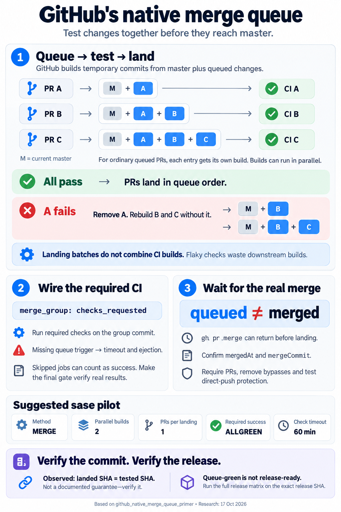

---
tags:
  - pypi-release-reliability
---

# How GitHub's native merge queue works

> **Research query:** Help me understand how GitHub's native merge queues work, using
> the
> [merge_queue_fenced_master_and_exact_sha_releases.md](../merge_queue_fenced_master_and_exact_sha_releases/merge_queue_fenced_master_and_exact_sha_releases.md)
> report in the research repo as context.



## Bottom line

- **A merge queue is a line in front of `master`.** Clicking merge (or running
  `gh pr merge`) does not merge a PR. It puts the PR in line. GitHub then builds a
  [temporary commit](#the-mental-model): current `master`, plus every PR ahead of it,
  plus this PR. CI runs on that commit. If CI passes, the PR lands. If CI fails, the PR
  is removed and nothing lands.
- **`master` moves to the exact commit CI tested.** GitHub's docs don't promise this,
  but live data shows it. On Homebrew/brew (merge method) and github/docs (squash
  method), every queue landing I sampled had exactly the SHA of a tested queue commit.
  cld found the same in 34 of 35 landings on Homebrew and bevy. One report (grk)
  [claimed the opposite](#where-the-reports-disagreed); the data contradicts that.
- **Each PR gets its own CI build.** GitHub stacks the builds so they can run in
  parallel. The [batching settings](#the-settings) only control how many
  *already-passed* PRs land at once. They never merge several PRs into one build.
- **CI has to listen for a new event, `merge_group`.** A required check that runs only
  on `pull_request` [never reports on the queue commit](#wiring-ci-to-the-queue). The
  queue waits until its timeout, then ejects the PR.
- **Landing happens later, on its own schedule.** `gh pr merge` exits 0 as soon as the PR
  is queued (or auto-merge is armed). Automation has to
  [watch for the real merge](#driving-it-from-automation).
- **sase can use it today.** `sase-org/sase` is a public repo owned by an organization,
  which qualifies on any plan. Zero required approvals is a
  [supported setting](#guarding-master-and-bypasses).

## The mental model

`master` is at commit `M`. PRs A, B and C are queued in that order:

- **Queue entry A:** Temporary branch (read-only) `gh-readonly-queue/master/pr-A-<M>` ·
  What CI tests M + A
- **Queue entry B:** Temporary branch (read-only)
  `gh-readonly-queue/master/pr-B-<A's commit>` · What CI tests M + A + B
- **Queue entry C:** Temporary branch (read-only)
  `gh-readonly-queue/master/pr-C-<B's commit>` · What CI tests M + A + B + C

What happens next:

- **All pass:** `master` moves to A's commit, then to B's, then to C's. (With a larger
  merge limit, it can jump straight to C's, since C's commit already contains A and B.)
- **A fails:** A is ejected. B and C are rebuilt without A (`M + B`, then `M + B + C`)
  and their CI starts over. A green build of B *with* A says nothing about B *without*
  A.
- **Someone jumps the line:** every build in progress restarts, because the order
  changed.

This fixes the problem PR checks cannot: two PRs that each pass against an old `master`
but break it together. The older fix, "require branches to be up to date", makes every
author rebase and re-run CI after every landing. The queue does that rebasing itself.

Rebuilds are the main cost. One failure near the front restarts every build behind it.
That is why the context report's simulation is so sensitive to the
[false-red rate](#limits-and-risks).

## How a PR moves through the queue

1. **The PR passes its own required checks.** Then anyone with write access can enqueue
   it. You can also enqueue early; auto-merge enqueues it once its checks pass.
2. **GitHub builds the group commit** on a `gh-readonly-queue/…` branch and fires
   `merge_group` (`checks_requested`).
3. **CI reports the required checks** on that commit, within the status check timeout.
4. **Pass:** `master` advances to that commit, and the PR shows as merged.
   **Fail:** the PR leaves the queue, and the PR timeline records why. The documented
   reasons are:
   - a failed required check;
   - a check timeout;
   - a manual or API removal;
   - a conflict with the base;
   - a branch-protection failure GitHub can't resolve.

### Which commits matter

- **PR head**
  - *What it is:* What the agent wrote; tested by PR checks against an old base
  - *Becomes `master`?:* No. Under the merge method it survives as the merge commit's
    second parent
- **Group commit**
  - *What it is:* The queue's temporary commit; tested by `merge_group` checks
  - *Becomes `master`?:* **Yes**, observed in practice. Docs only say it is "merged in
    to the target branch"
- **Release SHA**
  - *What it is:* A later `master` commit picked for a PyPI release
  - *Becomes `master`?:* It already is a `master` commit. The queue's checks are not the
    full release matrix

## The settings

The settings live on the **Require merge queue** rule of a repository ruleset (or a
classic branch-protection rule, which can't use wildcard branch names). GitHub documents
ranges but no defaults, so set every value explicitly.

- **Merge method (`merge_method`)**
  - *What it does:* How each PR becomes a commit: `MERGE`, `SQUASH` or `REBASE`
  - *Suggested sase start:* **MERGE.** Keeps the agent's commits, and was outside the
    blast radius GitHub reported for April 2026
- **Build concurrency (`max_entries_to_build`, 1–100)**
  - *What it does:* How many group builds run at once, i.e. how far ahead GitHub builds.
    This is the throughput knob; it costs runners
  - *Suggested sase start:* **2**
- **Merge limits (`min`/`max_entries_to_merge`, 1–100, plus a wait time)**
  - *What it does:* How many passed PRs land in one `master` update. Docs: "Merge limits
    do not combine `merge_group` builds."
  - *Suggested sase start:* **1 / 1** at first, so each `master` move is one PR. Raise
    the max later
- **Only merge non-failing PRs (`grouping_strategy`)**
  - *What it does:* **On (`ALLGREEN`):** every PR's own group build must pass.
    **Off (`HEADGREEN`):** a PR whose build failed can still land if a later build that
    includes it passes
  - *Suggested sase start:* **On**
- **Status check timeout (`check_response_timeout_minutes`, 1–360)**
  - *What it does:* Checks still silent at the deadline count as failed
  - *Suggested sase start:* **60**. Include time spent waiting for a runner

Two real configurations, read from GitHub's rules API:

- **github/docs** (run by GitHub): `SQUASH`, `ALLGREEN`, concurrency 2, merge 1 at a
  time, 60-minute timeout. The proposed sase setup is close to this.
- **Homebrew/brew**: `MERGE`, `HEADGREEN`, concurrency 100, merge up to 100, 60-minute
  timeout.

## Wiring CI to the queue

```yaml
on:
  pull_request:
    branches: [master]
  merge_group:
    types: [checks_requested]
```

- **Required checks are evaluated twice under the same names.** They run once on the PR
  head (the entry ticket) and once on the group commit (the landing gate). GitHub has
  no separate required-check list for each stage.
- **Skips behave differently by level.**
  - A **job** skipped by `if:` reports Success.
  - A **workflow** skipped by a `paths:` filter stays Pending, which blocks the queue
    until the timeout.
  - The dangerous case is `if: github.event_name == 'pull_request'` on a required job.
    On `merge_group` that job is skipped, counts as passed, and lets untested code land.
- **Use one aggregate required job** that `needs:` everything and runs with
  `if: always()`. Make it event-aware:
  - on a PR, accept the jobs you intentionally skip;
  - on `merge_group`, require every dependency to have actually succeeded.
- **Test the group commit.** In a `merge_group` run, `GITHUB_SHA` is the group commit,
  and `actions/checkout` uses it by default. Don't check out
  `github.event.pull_request.head.sha`; that payload doesn't exist in the queue.
- **`push` triggers fire on queue branches.** GitHub pushes each
  `gh-readonly-queue/…` branch, so `on: push` with no branch filter runs there too.
  Homebrew shows this: 10 of its last 100 push runs were on queue branches. sase's push
  triggers are already filtered to `master`.
- **Concurrency keys:** keys built from `github.ref` or `github.sha` are safe, because
  each group has its own ref. A fixed key with `cancel-in-progress: true` would cancel
  queue builds.

### sase specifics

Checked against today's workflows:

- **Master Gate** runs only on `push` to `master`, and `ci.yml` only on `pull_request`.
  Whichever one becomes the required gate needs a `merge_group` trigger.
- **`pr-title.yml`** runs only on `pull_request`. Don't make it required, or give it a
  trivial `merge_group` job with the same name.
- **`ci.yml` concurrency** (`ci-${{ github.ref }}`, cancel-in-progress) is safe in the
  queue.
- **The push-triggered Master Gate becomes a duplicate.** `master` lands on an
  already-tested SHA, so the gate would re-test the same commit about 43 times a day.
  Keep it briefly as a flake detector, then look up results by SHA instead.

## Driving it from automation

- **`gh pr merge`.** Its help text: "If required checks have not yet passed, auto-merge
  will be enabled. If required checks have passed, the pull request will be added to the
  merge queue."
  - `--match-head-commit <sha>` refuses if the PR head moved.
  - `--admin` bypasses the queue for anyone allowed to.
  - `gh` cannot list the queue or remove an entry.
- **GraphQL:**
  - `enqueuePullRequest` takes `expectedHeadOid` and `jump`;
  - `dequeuePullRequest` removes an entry;
  - `mergeQueue(branch:)` and `PullRequest.mergeQueueEntry` show position and state
    (`QUEUED`, `AWAITING_CHECKS`, `MERGEABLE`, `UNMERGEABLE`, `LOCKED`).
- **Events:**
  - `pull_request`: `enqueued`, `dequeued`, `auto_merge_enabled`;
  - `merge_group`: `checks_requested`, `destroyed`. A destroyed group or a dequeue
    happens on success too. **Only a dequeue without a merge means the PR was ejected.**
- **The landing watcher should track three states:** awaiting checks, queued, and
  merged.
  - Confirm landing with the PR's `mergedAt` and `mergeCommit`.
  - Under the merge method, also check that the PR head is an ancestor of `master`.
  - Resolve beads and `%w(bead=…)` waiters only after that.
  - Queue state lives only on GitHub, so after a host restart, re-read it rather than
    enqueue twice.

## Guarding master and bypasses

- **No GitHub doc says the queue rule alone blocks direct pushes.** Fence `master` with
  sibling rules as well:
  - Require a pull request, with **0 approvals**;
  - Restrict updates;
  - block force pushes and deletion;
  - keep the bypass list empty.

  Then probe it with a test push.
- **Required approvals would deadlock.** Agents push as the maintainer, and GitHub
  doesn't let you approve your own PR. A required PR "doesn't necessarily have to be
  approved".
- **Bypass is all-or-nothing per actor.** Any bypass the maintainer holds, every agent
  holds too. github/docs shows bypass in action: its sync bots land commits that never
  went through its queue.
- **The rule may also block creating branches.** An unconfirmed community report from
  April–May 2026 says the merge-queue rule now blocks pushes that create a branch
  matching it. No GitHub staff confirmed this.

## Limits and risks

- **Flakes become ejections.** A false red ejects a good PR and restarts every build
  behind it. The queue has no retry, quarantine or bisect. The options are:
  - fix the flakes;
  - retry inside the job;
  - accept `HEADGREEN`, whose guarantee is weaker.

  The context report's target, under 3% false reds per build, is what makes the queue
  work.
- **No shared CI.** Five PRs landing together still cost five builds. Throughput comes
  only from build concurrency, which costs runners.
- **Jumping the line restarts everything.** Treat it as a hotfix hatch. On Enterprise it
  is admin-only by default.
- **GitHub's code is in your landing path.** On 2026-04-23, from 16:05 to 20:43 UTC, a
  regression in "merge base computation for merge queue ref updates" made **squash**
  groups of more than one PR revert earlier PRs.
  - Later status updates also mentioned rebase. The merge method was not named.
  - Reported counts: 2,092 PRs on the status page; 2,804 per GitHub's COO.
  - Customers found it before GitHub's monitoring did.
  - The status page doesn't say whether CI tested the bad commits, so the incident
    proves nothing either way about tested-vs-landed SHAs.
  - **The lesson:** use merge commits and land one PR at a time while piloting.
- **Stacked PRs (GA 2026-10-06)** enter the queue as one merge group. Under the merge
  method, GitHub now creates one merge commit per PR.

## What this means for the sase plan

1. **The queue is the right fence**, and the [proposed settings](#the-settings) (merge,
   concurrency 2, `ALLGREEN`, 60 min) are sound. Add max merge size 1 for the pilot.
2. **Wire `merge_group` into the required gate before enforcing it**, and use an
   [event-aware aggregate check](#wiring-ci-to-the-queue). This is the setup step that
   most often breaks.
3. **Queue-green is not release-ready.** The queue proves only the gate's checks on the
   landed SHA. The plan's exact-SHA release step is still required: run the full
   matrix on the release commit and publish those exact files.
4. **Expect landed SHA = tested SHA, but check it.** The
   [watcher](#driving-it-from-automation) should confirm that each new `master` SHA has
   a passing `merge_group` run. That makes the tree-equality proof trivially true.
5. **Rehearse on a scratch repo before enforcing.** Cover:
   - a conflict;
   - a red check and an ejection;
   - a rejected direct push;
   - recovery after a host restart;
   - SHA tracking.

   Measure wasted builds and false ejections. The 13 / 27–34 min latency figures are
   the context report's simulation, not a GitHub guarantee.

## Where the reports disagreed

- **Does `master` land on the tested commit?**
  - *Reports:* cld: yes, measured. grk: no, GitHub makes a new commit. cdx: unverified.
    gem: vague
  - *Resolution:* **Yes in practice.** Lead check on Homebrew (merge) and github/docs
    (squash) agrees with cld. The docs don't promise it, so assert it in the watcher
- **Does the April 2026 incident prove GitHub recomputes the landing commit?**
  - *Reports:* grk: yes
  - *Resolution:* **No.** The status page describes a wrong merge-base computation and
    never says whether CI tested the bad commit
- **Does the queue rule alone block direct pushes?**
  - *Reports:* grk: likely, citing a community report. cdx, cld: unverified
  - *Resolution:* **Unverified.** Use the PR rule, Restrict updates and an empty bypass
    list, then probe (see [Guarding master and bypasses](#guarding-master-and-bypasses))
- **How many false reds can a queue tolerate?**
  - *Reports:* gem: throughput collapses past 10–15%
  - *Resolution:* **Use the context report's data:** target under 3%; latency held up
    to about 10%
- **Who can jump the line?**
  - *Reports:* gem: anyone with write access. cld, grk: admin-only by default on
    Enterprise
  - *Resolution:* **Treat it as an admin hotfix hatch**

## Confidence and method

Context:
[the merge-queue-fenced `master` report](../merge_queue_fenced_master_and_exact_sha_releases/merge_queue_fenced_master_and_exact_sha_releases.md),
which recommends landing every sase change through one.

Consolidated from four independent reports (cdx, cld, grk, gem) plus lead verification
against live public repos on 2026-10-17.

- **High confidence (GitHub docs, `gh` 2.96 help text, live API):**
  - entry and ejection rules;
  - the `merge_group` trigger;
  - setting names and ranges;
  - `gh pr merge` behavior;
  - availability;
  - the github/docs and Homebrew rule configurations;
  - push runs on queue branches.
- **High confidence (observed, not documented):**
  - landed SHA = tested group SHA, for both the merge and squash methods;
  - stacking and rebuild-on-failure, which cld saw on bevy.
- **Unverified:**
  - whether the queue rule alone blocks direct pushes;
  - default values;
  - `merge_group` behavior when the enqueuer is `GITHUB_TOKEN` (enqueue as the
    maintainer or as a GitHub App);
  - whether rebase-method groups were also hit in April 2026.
- **Not done:** no repo, ruleset or workflow was created or changed.

## Sources

- GitHub Docs:
  - [Managing a merge queue](https://docs.github.com/en/repositories/configuring-branches-and-merges-in-your-repository/configuring-pull-request-merges/managing-a-merge-queue)
  - [Merging a PR with a merge queue](https://docs.github.com/en/pull-requests/how-tos/merge-and-close-pull-requests/merging-a-pull-request-with-a-merge-queue)
  - [`merge_group` event](https://docs.github.com/en/actions/reference/workflows-and-actions/events-that-trigger-workflows#merge_group)
  - [Available rules for rulesets](https://docs.github.com/en/enterprise-cloud@latest/repositories/configuring-branches-and-merges-in-your-repository/managing-rulesets/available-rules-for-rulesets#require-merge-queue)
  - [REST: repository rules](https://docs.github.com/en/rest/repos/rules)
  - [Troubleshooting required status checks](https://docs.github.com/en/pull-requests/how-tos/merge-and-close-pull-requests/troubleshooting-required-status-checks)
- GitHub blog:
  - [Merge queue GA (2023-07-12)](https://github.blog/changelog/2023-07-12-pull-request-merge-queue-is-now-generally-available/)
  - [How GitHub uses merge queue](https://github.blog/engineering/engineering-principles/how-github-uses-merge-queue-to-ship-hundreds-of-changes-every-day/)
  - [Stacked pull requests GA (2026-10-06)](https://github.blog/changelog/2026-10-06-stacked-pull-requests-generally-available/)
- Incident:
  - [GitHub status `zsg1lk7w13cf`](https://www.githubstatus.com/incidents/zsg1lk7w13cf)
  - [The Stack coverage](https://www.thestack.technology/github-bug-messed-up-customer-code-coo-plays-down-incident/)
- Community:
  - [Discussion #193295](https://github.com/orgs/community/discussions/193295) (merge-queue rule on creation pushes; unconfirmed)
- CLI: [`gh pr merge`](https://cli.github.com/manual/gh_pr_merge)
- Live reads, 2026-10-17:
  - `merge_group` and `push` Actions runs plus `main` commit history for Homebrew/brew
    and github/docs;
  - `rules/branches/main` for both;
  - sase's `.github/workflows/`.
