# Google Release Engineering vs. SASE Planned Release Process: Comparative Analysis and Actionable Inspirations

> **Research query:** How does SASE's planned release process (as proposed in `merge_queue_fenced_master_and_exact_sha_releases.md` and reassessed in `merge_queue_fence_reassessment_and_epic_split.md`) compare to Google's release engineering process? What inspiration can SASE take from Google, and what ranked changes should be considered for the planned release process?

---

## Executive Summary

SASE is preparing a major transformation of its release process across four planned epics:
1. **Epic A:** Exact-candidate releases, artifact SHA qualification, and install guards.
2. **Epic B:** Trustworthy gate engineering (bounded reruns, expiring flake quarantine, and drift canaries).
3. **Epic C:** Queue-aware landing records, host-owned completion state machines, and landing-aware dependency waits.
4. **Epic D:** Production cutover to a GitHub native merge queue on `master` with rebase linear history, zero approvals, and a nightly automated release train.

This planned architecture adopts several foundational principles that Google's Release Engineering discipline pioneered: **build-once binary provenance**, **pre-merge gate isolation**, **reproducible integration checking**, and **decoupling fast admission gates from heavyweight qualification matrices**.

However, a rigorous comparison between SASE's plan and Google's release engineering practices reveals a critical architectural divergence: **SASE still plans to release directly from the moving tip of `master` via in-place PRs (release-please on trunk)**, whereas Google universally decouples release candidates onto **stabilization release branches cut from known-good baselines with cherry-picks**. Furthermore, SASE's planned "install canary" operates *after* public PyPI deployment—meaning broken releases or missing dependencies are discovered only after end users are exposed.

This report compares SASE's planned process to Google's release engineering model across six dimensions, highlights high-value inspirations that fit SASE's agentic scale, warns against inapplicable corporate overhead, and concludes with a prioritized, ranked list of concrete changes to incorporate into SASE's four-epic program.

---

## 1. Overview of SASE's Planned Release Process

SASE's release process is currently emerging from a severe stall:
- **PyPI Status:** Stuck on `0.17.1` for over seven weeks (49+ days).
- **Dependency Breakage:** Bare `pip install sase` resolves to `sase==0.1.0` because an aggressive retention script in the linked `sase-core` repository deleted the older `sase-core-rs` binary wheels required by `0.17.1`.
- **Landing Noise:** SASE agents (and human maintainers) push directly to `master` without an integration fence. Master Gate has exhibited an 8–27% pass rate, with green windows decaying in ~36 hours, driven largely by TUI timing flakes and environment skew across hosts (`athena` and `apollo`).
- **Release Automation Defect:** Existing `publish.yml` builds whatever commit happens to sit at the tip of `master` when the action runs, rather than the tagged release commit.

To solve this, the planned release architecture (reassessed across Epics A–D) introduces:
- **Exact-Candidate Releases (Epic A):** Release-please creates a version PR; `build` compiles the wheel and sdist once from the exact release SHA, records SHA-256 digests, runs qualification jobs against those exact artifacts, and uploads only those verified files.
- **Trustworthy Pre-Merge Gate (Epic B):** Master Gate adds one bounded serial rerun (for $\le 3$ failed nodes) and an expiring quarantine list (max 14 days) to drive false reds below 3%.
- **Queue-Aware Host Architecture (Epic C):** Host-owned `LandingRecord` in `sase_core`, asynchronous queuing via `sase-github`, and decoupling bead closure from physical merge delivery (`delivered(bead) = closed ∧ merged`).
- **Enforced Merge Queue (Epic D):** GitHub native merge queue with rebase method (single commit per PR), `integration-ready` aggregate status check, zero human approvals, and an automated nightly release train.

---

## 2. Google's Release Engineering Model: Core Principles & Mechanics

Google's release engineering discipline (detailed in the *Site Reliability Engineering* book, Chapter 8, and *Software Engineering at Google*, Chapters 23 & 24) is governed by specific institutional philosophies:

### 2.1 The Philosophy: "Faster is Safer" and Continuous Delivery
- **Small Batches, Frequent Releases:** Large, infrequent releases bundle dozens of disparate features and bug fixes, making regression triage nearly impossible. Small, frequent releases limit the blast radius of any single change.
- **Release Trains:** Releases depart on a fixed schedule (e.g., daily, weekly, or bi-weekly). Features do not hold the release train. If a feature or fix is not fully qualified when the train departs, it catches the next train.
- **Hermetic Builds (Blaze/Bazel):** A build must be completely self-contained, deterministic, and reproducible. Given the same source tree and compiler toolchain, the build produces identical bit-for-bit artifacts. Builds are executed once; the resulting artifacts are promoted across testing and deployment stages without rebuilding.

### 2.2 Branching Strategy: Release from a Branch, Not from Trunk
Google practices trunk-based development (millions of commits to a single shared repository, Piper), but **major services and tools do not release directly from the tip of trunk (HEAD)**.
- **Candidate Baseline (Green Build / LKG):** The release process begins by selecting a known-good commit on trunk—one that has already passed presubmit and postsubmit integration suites (Last Known Good / LKG).
- **Release Branch Isolation:** A release branch (e.g., `releases/2026.42`) is cut at that baseline commit.
- **Cherry-Pick Stabilization:** If integration qualification, load testing, or canary analysis uncovers a defect on the release branch:
  1. The bug fix must be authored, reviewed, and merged into the trunk first.
  2. The fix is then cherry-picked onto the release branch.
  3. No general trunk changes are ever merged into the release branch, and the release branch is never merged back into trunk.
- **Why this matters:** Active development on trunk never stops or slows down while a release is being stabilized. Conversely, unexpected breakages or noisy commits on trunk cannot destabilize an in-flight release candidate.

### 2.3 Presubmit vs. Postsubmit (Two-Speed Test Pyramid)
- **TAP (Test Automation Platform) Presubmit:** Runs before a change list (CL) can be submitted. To keep presubmit fast, Google uses dependency graph analysis to execute only the tests affected by the diff. Furthermore, presubmit strictly enforces **Test Sizing**:
  - *Small Tests:* Unit tests running in a single process, no network, no disk I/O, execution time $<1$ second. Hermetic and deterministic.
  - *Medium Tests:* Local integration, running on a single host, execution time $<5$ minutes.
  - *Large Tests:* Multi-host, end-to-end, load tests.
- **Postsubmit:** Runs the full, broad test matrix continuously on trunk after submission.
- **Submit-and-Revert Culture:** If a change breaks postsubmit on trunk, the default operational response is immediate automated or Build Cop revert ("revert first, debug later").

### 2.4 Decoupling Deployment from Release (Feature Flags / Flagz)
- **Deployment $\ne$ Release:** In Google terminology, *deployment* means pushing code and binaries to production environments; *release* means exposing the new behavior to users.
- **Dark Launching:** High-risk or multi-stage features merge into trunk continuously, but remain dormant behind feature flags (Flagz / G-Config). Unfinished work does not block production releases because the code paths are inactive.

### 2.5 Automated Canary Analysis (ACA) and Progressive Rollout
- Software is never deployed to 100% of production at once.
- Releases follow a staged progression:
  1. Internal Dogfood / Dev channel.
  2. Canary deployment (e.g., 1–5% of fleet/users), running alongside a baseline for statistical comparison of latency, errors, and memory usage.
  3. Phased regional or fleet rollout (10%, 25%, 50%, 100%).
- Automatic rollback occurs immediately if canary anomalies exceed error budgets.

---

## 3. Comparative Matrix: SASE Planned Process vs. Google

| Dimension | Google Release Engineering | SASE Planned Process (Epics A–D) | Alignment / Gap Analysis |
| :--- | :--- | :--- | :--- |
| **Trunk & Branching** | Trunk-based development; releases cut to **isolated release branches** from a green baseline (LKG); stabilization via cherry-picks. | Trunk-based development; releases cut **directly on `master`** via release-please PRs; fix-forward on trunk. | **Major Gap:** SASE release qualification competes with active agent commits on `master`. A failure on `master` stalls the entire release pipeline. |
| **Build & Artifact Provenance** | Hermetic builds (Blaze); build once, hash/sign binaries, test exact artifacts, deploy exact artifacts. | Build once from exact release SHA; record SHA-256 digests; qualify exact wheel/sdist; upload exact files (Epic A). | **Strong Alignment:** SASE's Epic A directly mirrors Google's exact-binary provenance discipline. |
| **Admission Gate (Presubmit)** | TAP Presubmit: fast, affected-only, strictly hermetic Small/Medium tests; zero approvals required for automated bot landings. | GitHub Native Merge Queue: speculative rebase builds; fast Master Gate (~13 min p50); zero human approvals. | **Strong Alignment:** Merge queue provides server-enforced speculative integration checking; zero-approval autonomous landing. |
| **Heavy / Slow Verification** | Postsubmit continuous testing; Large/system tests off the critical presubmit path; Build Cop reverts. | Heavy lane (`ci.yml`: visual tests, multi-Python 3.13/3.14, perf floors, ~30–76 min) decoupled from merge queue; nightly + release-blocking. | **Strong Alignment:** Adopts Google's two-speed separation to prevent queue starvation. |
| **Flake Management** | Automated flake scoring/tracking; flaky tests automatically demoted from presubmit blockers. | Bounded serial rerun ($\le 3$ nodes); 14-day expiring quarantine list (fails lint on expiration) (Epic B). | **Partial Gap:** SASE's expiring quarantine punishes unrelated PRs with lint failures instead of de-escalating the test. |
| **Deployment / Release Decoupling** | Pervasive runtime feature flags (Flagz); features merge dark; releases never blocked by incomplete epics. | Feature flags restricted by policy (`sase_flags.md`); features ship immediately in PyPI package upon merge; epic phases sequenced by agent waits. | **Architectural Divergence:** SASE relies on client-side CLI configs and agent coordination rather than server-side dark launching. |
| **Rollout & Canarying** | Automated Canary Analysis (ACA) across Dogfood $\to$ Canary (1%) $\to$ Staged Prod; automated rollback before 100% rollout. | Direct upload to PyPI; daily clean-environment "install canary" runs **after publication** (Epic A6). | **Critical Gap:** SASE discovers package installation or runtime dependency breakage *after* the immutable PyPI release is live. |
| **Cross-Repo Dependencies** | Monorepo (Piper) ensures atomic cross-library updates; external dependencies mirrored with immutable retention. | Multi-repo sidecars (`sase`, `sase-core`); `sase` consumes binary `sase-core-rs` wheels from PyPI; retention script previously broke installs. | **Moderate Gap:** SASE's multi-repo boundary creates cross-repo version skew and retention fragility. |

---

## 4. Key Inspirations SASE Can Take From Google

### 4.1 Inspiration 1: Decouple Release Qualification from Trunk Velocity
At Google, if an engineer breaks trunk ten minutes after a release candidate is branched, the release engineer does not care—the release branch is isolated at a known-good baseline. In SASE's current plan:
- Release-please creates a release PR directly on `master`.
- The release candidate runs on `master`.
- If qualification fails (for example, a Python 3.14 compatibility error or a packaging smoke failure), the maintainer must "fix forward on `master`" or pause releases. But with autonomous SASE agents landing ~43 commits per day across multiple hosts, fixing forward on trunk means racing against incoming agent PRs.
- **The Google Lesson:** Isolate the release candidate. Either branch a release branch from the latest gate-green commit or qualify a tagged candidate baseline independently of trunk landings.

### 4.2 Inspiration 2: Pre-Flight Staging / Canarying Before Immutable Publication
At Google, code is never pushed to public users without passing through a canary or dogfood stage.
- In Python packaging, **PyPI releases are immutable**. Once `sase==0.18.0` is uploaded to PyPI, it can never be replaced, deleted, or re-uploaded. If it contains a missing C-extension or broken core binding, that version is permanently burned.
- SASE's planned Epic A includes an "install canary" (Phase A6), but it runs as a daily cron *after* publication.
- **The Google Lesson:** Run the install canary and smoke test against the built wheel/sdist in a **staging ring** (e.g., GitHub Actions artifacts, a private wheelhouse, or TestPyPI) *before* publishing to public PyPI. If the clean install or `sase core health` fails in staging, the release is aborted before any public user sees it.

### 4.3 Inspiration 3: Non-Punitive Flake Quarantine & Automated De-escalation
Google's CI philosophy treats tests as an alerting mechanism. A broken or flaky test is treated like a noisy, misconfigured alert: it should not be allowed to page the on-call engineer every five minutes, nor should it block all engineering progress across the company.
- In SASE's Epic B plan, quarantined tests are placed in a list with an owner and an expiration of $\le 14$ days. If an entry expires, **it fails lint for all future builds**.
- This creates synthetic build breakage: an agent working on an unrelated feature (e.g., macro templates) will have its PR rejected by the merge queue simply because a TUI modal test quarantine expired on day 15!
- **The Google Lesson:** Do not punish unrelated PRs for test maintenance debt. If a test's quarantine expires without a fix, it should automatically be de-escalated to advisory status or disabled with an escalated task bead assigned to the owner, rather than breaking the integration gate for the entire repo.

### 4.4 Inspiration 4: Hermetic Upstream Retention Invariants
The incident where `pip install sase` resolved to `sase==0.1.0` occurred because `sase-core`'s retention job pruned old `sase-core-rs` wheels on PyPI.
- Google avoids this through its monorepo and internal third-party mirror: no internal automated tool is ever permitted to delete an artifact that a production binary or active release depends on.
- **The Google Lesson:** Treat inter-repo dependency preservation as an immutable invariant. `sase-core` must maintain a formal compatibility contract with `sase` so that retention pruning cannot execute without proving that all active, supported `sase` versions remain installable.

---

## 5. What SASE Should NOT Borrow from Google (Avoid Over-Engineering)

While Google's release practices offer powerful insights, copying Google blindly would introduce counterproductive complexity:

1. **Do NOT implement complex Affected Target Test Selection (Bazel TAP):**
   - Google calculates exact dependency subgraphs because its monorepo has billions of lines of code. SASE has ~150k lines of Python and Rust. GitHub Actions running sharded pytest runs in 12–15 minutes is fast enough. Adding dynamic test-selection tooling would add fragile custom infrastructure with minimal latency savings.
2. **Do NOT introduce human code review or approval gates:**
   - Google requires human `OWNERS` approval and readability review on every CL. SASE is fundamentally an autonomous agentic system where agents commit and land code without human intervention. Enforcing approvals would create an immediate bottleneck and deadlock self-authored agent PRs.
3. **Do NOT adopt complex multi-stage canary clusters (ACA):**
   - SASE is a developer CLI and TUI tool distributed via PyPI, not a distributed web service serving millions of live HTTP requests. Progressive traffic shifting (1% $\to$ 10% $\to$ 100%) does not apply to PyPI. A simple staging smoke test (installing the artifact in a clean VM before PyPI upload) achieves 95% of the safety with 1% of the infrastructure.

---

## 6. Ranked List of Recommended Changes to SASE's Planned Release Process

Based on this comparative analysis, here is the prioritized, ranked list of concrete adjustments to make to the planned four-epic release program:

```mermaid
flowchart TD
    subgraph Current_Plan["Current SASE Planned Process"]
        CP1["Trunk Commit (master)"] --> CP2["release-please PR on master"]
        CP2 --> CP3["Build Wheel & Sdist once"]
        CP3 --> CP4["Run Candidate Qualification"]
        CP4 --> CP5["Direct Upload to PyPI"]
        CP5 --> CP6["Post-Publish Install Canary (Detects failures late)"]
    end

    subgraph Recommended_Plan["Google-Inspired Enhanced Process"]
        RP1["Candidate Baseline (Green SHA)"] --> RP2["Isolated Release Candidate / Branch"]
        RP2 --> RP3["Build Wheel & Sdist once"]
        RP3 --> RP4["Run Candidate Qualification"]
        RP4 --> RP5["Pre-Flight Staging & Clean Install Smoke"]
        RP5 -->|Passes Smoke| RP6["Upload to PyPI (Zero-defect public release)"]
        RP5 -->|Fails Smoke| RP7["Abort & Alert (Zero public impact)"]
    end
```

### Rank 1: Pre-Publication Staged Verification (Pre-Flight Install Canary)
- **Target Epic:** Epic A (Phase A3 / Phase A6).
- **The Problem in the Plan:** SASE plans to publish directly to PyPI in A3, and then run an install canary in A6 on a daily schedule. If a built wheel has a missing shared library, an unresolvable dependency, or an entry-point crash, public users get the broken package immediately.
- **The Change:** Insert a **Pre-Flight Staging Verification** step immediately prior to PyPI publication:
  1. Build the wheel and sdist once.
  2. Upload them to an isolated staging area (GitHub Actions artifacts or TestPyPI).
  3. Spin up fresh, clean virtual environments across all supported Python versions (3.11, 3.12, 3.13, 3.14).
  4. Execute `pip/uv install` from the staged artifacts.
  5. Run `sase core health` and basic CLI smoke commands (`sase --help`, `sase repo list`).
  6. Only if all staging checks exit 0, proceed to the public PyPI upload step.
- **Impact:** High. Eliminates the possibility of publishing an un-installable package to PyPI, resolving the exact root cause of the current 49-day release stall before public release.

### Rank 2: Isolate Release Candidates from Trunk Velocity (Branch/Baseline Isolation)
- **Target Epics:** Epic A (Phase A1) and Epic D (Phase D6).
- **The Problem in the Plan:** Release-please creates version-bump PRs directly on `master`. Qualification occurs against `master`. If qualification fails, trunk is blocked or the maintainer must "fix forward" on `master` while 43 agent landings per day are entering the merge queue.
- **The Change:** Adopt Google's release-branch / candidate-baseline isolation:
  1. The nightly release train identifies the latest commit on `master` that is verified **gate-green**.
  2. Cut an isolated candidate baseline (or temporary release branch `release/vX.Y.Z`).
  3. Execute qualification on this isolated commit.
  4. If qualification passes, tag and publish the release, then merge the changelog/version bump back to `master`.
  5. If qualification fails, development on `master` continues unaffected. Maintainers can cherry-pick a targeted fix to the release branch or discard the candidate without rolling back trunk.
- **Impact:** High. Decouples the release pipeline from the high-frequency agent merge queue, preventing release stalls caused by transient trunk instability.

### Rank 3: Non-Punitive Flake Quarantine (De-escalation Instead of Expiring Lint Failure)
- **Target Epic:** Epic B (Phase B2).
- **The Problem in the Plan:** Phase B2 specifies that quarantine entries expire after $\le 14$ days, and "an expired entry fails lint". This introduces a synthetic time-bomb into the gate: an unrelated agent trying to land a critical bug fix on day 15 will fail lint because an unrelated test owner hasn't resolved a quarantined flake.
- **The Change:** Replace the expiring lint failure with **automated de-escalation and alert escalation**:
  1. When a quarantine entry reaches 14 days without resolution, it does *not* fail lint on agent PRs.
  2. Instead, the test is automatically moved to disabled/ignored status in presubmit.
  3. A high-priority `ci` bead is filed or escalated directly to the maintainer/owner.
  4. Weekly flake digests report expired quarantine tests prominently.
- **Impact:** Medium-High. Protects the merge queue from synthetic breakage and maintains agent landing velocity while still holding owners accountable for test debt.

### Rank 4: Enforce Hermetic Cross-Repo Retention Contract
- **Target Epic:** Epic A (Phase A5).
- **The Problem in the Plan:** Phase A5 plans to modify `pypi_retention.py` in `sase-core` to retain versions needed by the last $N \ge 2$ SASE releases. However, this is a soft script heuristic that runs in another repository.
- **The Change:** Turn this into a strict, verifiable contract:
  1. SASE's build/qualification pipeline must assert that the exact range of `sase-core-rs` declared in `pyproject.toml` exists on PyPI and can be resolved cleanly *before* building the release candidate.
  2. In `sase-core`, `pypi_retention.py` must require an explicit, cryptographically checked manifest of all active downstream SASE versions before executing any PyPI deletion command (`--dry-run` by default, fails closed on any API error).
- **Impact:** Medium. Ensures the multi-repo sidecar architecture cannot silently orphan published releases.

### Rank 5: Formalize Test Sizing for Merge Gate vs. Qualification Matrix
- **Target Epics:** Epic B (Phase B6) and Epic D.
- **The Problem in the Plan:** There is ongoing debate in SASE research about whether to fold `visual-test` or multi-Python matrix runs into Master Gate. Reassessment correctly kept visual tests off the gate because they take ~30 minutes, exceeding the gate's 20-minute ceiling.
- **The Change:** Formally adopt Google's **Test Sizing Standard**:
  1. **Small/Medium (Presubmit / Merge Queue Gate):** Must be strictly hermetic, mock external networks/processes, run in $<1$ minute per test, and complete the full gate in $<15$ minutes. Only these tests can gate a merge.
  2. **Large (Nightly / Release Qualification):** TUI visual snapshots, multi-Python matrices (3.13, 3.14), performance floor benchmarks, and tutorial tests. These run exclusively in the decoupled nightly and pre-release qualification pipelines.
  3. Enforce an automated contract test in CI that fails if any test in the merge gate exceeds 60 seconds of execution time.
- **Impact:** Medium. Prevents gradual test suite bloat from slowing down the merge queue and keeps landing latency within the p50 $<15$ min target.

---

## 7. Conclusion

SASE's planned four-epic release overhaul is a mature, well-reasoned architecture that correctly identifies the fatal flaws of the status quo (unfenced pushes, unverified tip builds, and unmanaged test flakes).

By incorporating the core lessons of Google Release Engineering—specifically **pre-flight staging verification (canarying before PyPI)**, **isolating release candidates from trunk velocity**, **non-punitive flake quarantine de-escalation**, and **strict test sizing**—SASE can upgrade its planned process from merely "keeping `master` green" to achieving a truly resilient, automated, zero-defect release train that easily sustains its 43+ agent landings per day.
