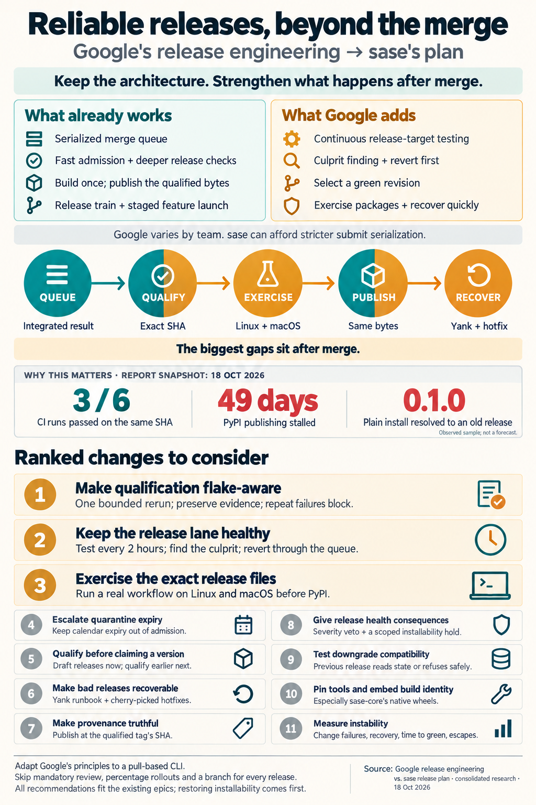

---
tags:
  - pypi-release-reliability
---

# Google's release engineering vs. sase's planned merge-queue release program

> **Research query:** How does sase's planned release-process overhaul (the merge-queue
> fenced `master` and exact-SHA release design, as reassessed and split into epics),
> meant to make releases much more reliable, compare to Google's release process, and
> what inspiration can sase take from Google? End with a ranked list of changes to
> consider making to the planned change, if any are warranted.

## Bottom line

1. **Keep the architecture.** The plan shares Google's philosophy, and on landing it is
   stricter than Google is. All four researchers and I agree on keeping
   ([what to keep](#where-the-plan-already-matches-or-beats-google)):
   - the native merge queue with zero approvals;
   - rebase landing with linear history;
   - exact-SHA, build-once publishing with a candidate record;
   - the admission / release-blocking / advisory check inventory (N1);
   - the four-epic split.

   Google *cannot* serialize submits at its scale. *Software Engineering at Google*
   names serialization as the small-project option: "CI systems for smaller repositories
   or projects can avoid this problem by serializing submits." sase can afford it, and
   it gets something Google doesn't have: every `master` SHA is a tested integration.
2. **The gap is everything after the merge.** Google puts its heavy machinery
   *after* submit and *after* release
   ([where Google would push back](#where-google-would-push-back)):
   - continuous testing of the release-gating targets;
   - automated culprit finding and rollback;
   - cutting releases at *green* head;
   - running the shipped artifact before users do;
   - a fast way to undo a bad release.

   The plan is thinnest on exactly these, and it is the post-merge release lane that
   stalled PyPI for 49 days.
3. **New evidence today makes three of these urgent:**
   - **[Qualification would be a coin flip.](#qualification-is-one-all-or-nothing-run)**
     Full CI ran six times on the unchanged SHA `ae9f044bb3` and passed three. Each red
     job failed **one or two tests out of about 56,277**, and the failing tests differed
     from run to run. Nothing in `ci.yml`, `master-gate.yml` or the `justfile` reruns a
     failed test. Epic A's all-or-nothing qualification would refuse about half of all
     good candidates.
   - **[Epic A would make PyPI's provenance false.](#provenance-will-name-the-wrong-commit)**
     `publish.yml` runs on a 3-hour schedule at `master`'s tip. Trusted-publishing
     attestations name the commit that *triggered the run*. Once Epic A checks out the
     release SHA instead, the attestation will usually certify a later commit that was
     never built.
   - **[Epic B plants a time bomb in its own gate.](#the-quarantine-expiry-is-a-time-bomb-in-the-required-gate)**
     It has quarantine entries expire after at most 14 days and has an expired entry
     fail lint, and lint is a required gate job. Every expiry would therefore fail every
     merge group, and Epic B's own +30-day shifted-clock canary would flag every live
     quarantine entry as a time bomb.
4. **Changes are warranted:** eleven, ranked [at the end](#ranked-changes-to-the-planned-release-process).
   All of them fit inside the existing epics. None delays Track 0, and none reopens the
   queue, zero approvals, rebase landing or exact-SHA publishing. The top three:
   1. [make release qualification flake-aware](#make-release-qualification-flake-aware);
   2. [give the release-blocking lane Google's post-submit discipline](#give-the-release-blocking-lane-google-style-post-submit-discipline):
      continuous runs, culprit finding, revert first;
   3. [run a real exercise against the exact release files](#exercise-the-exact-release-files-before-they-reach-pypi),
      on Linux and macOS, before they reach PyPI.
5. **[Don't copy](#what-not-to-copy-from-google):**
   - required human review;
   - percentage rollouts;
   - affected-test selection;
   - a monorepo;
   - a release branch for every release;
   - push-on-green for every build;
   - stop-the-line on any red.

## What this report compares

### Inputs and the plan under review

**Consolidated report** · lead researcher · 2026-10-18 · sase `master` at `7b9436bede`

**Inputs:** four independent reports
([cdx](google_release_engineering_vs_sase_release_plan__cdx.md),
[cld](google_release_engineering_vs_sase_release_plan__cld.md),
[grk](google_release_engineering_vs_sase_release_plan__grk.md),
[gem](google_release_engineering_vs_sase_release_plan__gem.md)), plus my own checks
against the live repos, PyPI, CI history and Google's primary sources.

**The plan under review** is the reassessed design (Step 0, Track 0, Epics A–D) in
[`merge_queue_fence_reassessment_and_epic_split.md`](../merge_queue_fence_reassessment_and_epic_split/merge_queue_fence_reassessment_and_epic_split.md),
together with the parts of the
[original design](../merge_queue_fenced_master_and_exact_sha_releases/merge_queue_fenced_master_and_exact_sha_releases.md)
that the reassessment kept.

**The question, as the lead researcher recorded it:**

> I've been thinking about making some big changes to sase's release process with the
> goal of making them much more reliable. How does our planned release process compare
> to Google's release process? Is there any inspiration that sase can take from this
> release process? End with a ranked list of changes I should consider making to the
> planned change.

### What "Google's release process" means here

Google has no single release process. The SRE book says so directly: "individual teams
can decide how often and when to release". The common, publicly documented core is:

- **Piper**, one trunk;
- **Critique** review, plus a fast presubmit;
- **TAP**, presubmit and continuous post-submit testing;
- **Blaze**, hermetic builds;
- **Rapid**, release automation: a release branch cut at a green revision, with
  cherry-picks;
- **MPM**, hashed and signed packages whose labels (`dev`, `canary`, `production`) move;
- **canary and staged rollout**;
- **Binary Authorization for Borg**, provenance enforced at deploy time;
- **Build Cops**.

Most product engineers experience Rapid as invisible automation. What they touch is
the *launch* layer above it. Your own Ad Manager records show that layer, as summarized
by the [2026-10-11 CV research](../google_ad_manager_cv_evidence_and_bullets__cdx.md):

- separate beta, SB and GA launch changes;
- shadowing 100% of read-only traffic;
- stepping a service migration from 10% to 50% to 100%;
- a first launch cohort of 20 publishers.

So this report compares the plan against both layers. **Binary release** is
Rapid/TAP/MPM. **Feature launch** is flags, cohorts and shadowing.

## Scorecard

Each concern below lists Google's public core, the sase plan, and the verdict.

- **Landing gate**
  - *Google (public core):* Review plus a fast presubmit on a snapshot; mid-air
    collisions accepted
  - *sase plan:* Native queue tests the stacked result; zero approvals
  - *Verdict:* **Ahead** on integration, deliberately weaker on review
- **What "green" means**
  - *Google (public core):* True head vs. green head; "100% green ... is awfully
    expensive"
  - *sase plan:* Gate-green vs. release-green on one SHA
  - *Verdict:* **Match**
- **Heavy tests**
  - *Google (public core):* Post-submit TAP on every affected change; release targets =
    continuous targets
  - *sase plan:* Full CI every 2 h; D4 may move it to nightly
  - *Verdict:* **Gap** ([the release-blocking lane](#the-release-blocking-lane-gets-none-of-the-google-post-submit-machinery))
- **Post-submit response**
  - *Google (public core):* Culprit finding, automatic rollback, a Build Cop who drops
    everything
  - *sase plan:* A `ci` bead, one repair turn, a 48-h notification
  - *Verdict:* **Gap** ([the release-blocking lane](#the-release-blocking-lane-gets-none-of-the-google-post-submit-machinery))
- **Flakes**
  - *Google (public core):* Flake classification, multiple attempts, quarantine
  - *sase plan:* Bounded rerun and quarantine, **gate only**
  - *Verdict:* **Gap** for qualification ([all-or-nothing qualification](#qualification-is-one-all-or-nothing-run))
- **Choosing the candidate**
  - *Google (public core):* "Most teams cut these at green, as opposed to true, head"
  - *sase plan:* Release PR armed at true head nightly, qualified after merge
  - *Verdict:* **Gap** ([candidates cut at true head](#candidates-are-cut-at-true-head-and-the-version-is-claimed-first))
- **Qualifying the candidate**
  - *Google (public core):* Re-run tests on the release branch, with an audit trail
  - *sase plan:* Release-blocking set on the exact SHA, candidate record
  - *Verdict:* **Match**
- **Artifact identity**
  - *Google (public core):* One hashed package; labels move, bytes never change
  - *sase plan:* Build once, record digests, never retag
  - *Verdict:* **Match**
- **Running the artifact**
  - *Google (public core):* System tests on packaged artifacts; canary on real traffic
  - *sase plan:* Install smokes; a daily install canary *after* publishing
  - *Verdict:* **Gap** ([nobody runs the artifact](#nobody-runs-the-artifact-users-install))
- **Rollback and hotfix**
  - *Google (public core):* Rollback first; cherry-pick onto the release branch
  - *sase plan:* Not specified for a bad *published* release
  - *Verdict:* **Gap** ([no way to undo a bad release](#there-is-no-way-to-undo-a-bad-release))
- **Provenance**
  - *Google (public core):* Truthful signed provenance, checked at deploy
  - *sase plan:* Trusted publishing exists; will name the wrong commit
  - *Verdict:* **Defect** ([provenance](#provenance-will-name-the-wrong-commit))
- **Hermetic builds**
  - *Google (public core):* Toolchain versioned with the source revision
  - *sase plan:* Floating build backend, uv, and Rust compiler
  - *Verdict:* **Small gap**, mostly in sase-core ([hermeticity](#hermeticity-matters-mainly-for-sase-core))
- **Feature launch**
  - *Google (public core):* Flags; launch separate from binary; cohorts and shadowing
  - *sase plan:* Beta flags; config-driven landing mode; allowlist pilot
  - *Verdict:* **Match**; Epic D's cutover is a textbook staged launch
- **Release health**
  - *Google (public core):* Error budgets change what work happens
  - *sase plan:* Metrics plus notifications
  - *Verdict:* **Gap** ([release health](#release-health-has-no-consequence))
- **Metrics**
  - *Google (public core):* DORA: lead time, frequency, change-fail rate, recovery time
  - *sase plan:* False reds, landing latency, days since release
  - *Verdict:* **Partial**

## Where the plan already matches or beats Google

Keep these.

- **A serialized queue instead of presubmit on a snapshot.** At about 42 landings a
  day, sase can buy what Google gave up. Epic B remains the precondition: flakiness,
  not runner capacity, is the binding constraint.
- **The N1 inventory is TAP's project split.** A check that blocks a *release* need not
  block every *merge*. Presubmit should run "only fast, reliable" tests. Keeping the
  roughly 30-minute `visual-test` out of the 20-minute gate is right.
- **Build once and ship the exact bytes.** That is MPM: a package identified by hash,
  with only labels moving. Epic A's candidate record also covers Rapid's audit trail and
  its list of changes since the last release.
- **A train that leaves on time, run self-service.** A nightly chance to release, with
  a 1–3 day target, follows the same reasoning Chrome gave for moving to a two-week
  cycle in September 2026: "smaller scope minimizes disruption and simplifies
  post-release debugging."
- **Expiring, bead-linked quarantine and a shifted-clock canary.** Both have direct
  Google analogues, though the expiry needs one fix
  ([the quarantine time bomb](#the-quarantine-expiry-is-a-time-bomb-in-the-required-gate)).
- **A narrow circuit breaker, not stop-the-line.** That matches the SWE book's "CI Is
  Alerting" sidebar.
- **An audited break-glass (N9).** It is BAB's emergency procedure.
- **Epic D's cutover is the staged launch you ran at Ad Manager:**
  - `landing.mode` defaults to `push`, which is a dark launch;
  - the pilot routes an allowlist of docs, `toobig` and ratchet agents, which is a
    first cohort;
  - the push-triggered gate stays on as an independent audit, which is shadowing;
  - enforcement waits for a measured soak, which is GA.
- **Zero approvals is a correct divergence.** Agents push as the maintainer, and GitHub
  refuses self-approval. Write that substitution into the decision record (grk), so a
  later reader doesn't "fix" it by adding reviewers.

## Where Google would push back

### The release-blocking lane gets none of the Google post-submit machinery

N1 deliberately keeps these checks out of the queue:

- `test (3.13)` and `test (3.14)`;
- the install smokes on the wheel and the sdist;
- the core-floor smoke.

For these checks, sase is exactly where Google is: post-submit only. Google gives that
lane its strongest machinery. The plan gives it a bead, one repair turn and a 48-hour
clock, and D4 may cut its cadence to nightly. Three verified quotes say why Google
treats it differently:

- **SRE book, ch. 8:** "the continuous build test targets correspond to the same test
  targets that gate the project release."
- **SWE book, ch. 23, on culprits:** TAP "automatically splits a failing batch up into
  individual changes", and it can "automatically roll back changes when it has high
  confidence that they are the culprit."
- **SWE book, ch. 23, on the Build Cop:** "The most effective tool the Build Cop has is
  the rollback." Rolling back is "the preferred solution"; fixing forward is "a riskier
  proposition".

Cadence decides how hard a culprit hunt is. At about 42 landings a day, a 2-hour tick
implicates 3–4 commits, and a nightly run implicates about 42.

sase's own history makes the case: at least eight "make CI green" repair epics, each
yielding a green window that decayed in about 36 hours. That is fix-forward losing the
race (cld, grk).

### Qualification is one all-or-nothing run

**Evidence** (cld; I re-checked it today):

- Full CI ran on `ae9f044bb3` between 03:13Z and 11:13Z and went green, green, red,
  green, red, red.
- `test (3.12)` failed in all three red runs, and `test (3.14)` in two of them.
- Each failing job reports totals like "1 failed, 56276 passed". In run 39122381498 the
  failure was a screenshot-convergence timeout in
  `test_screenshot_export.py::test_app_export_body_tolerates_signal_task_prepare_error`.
- No workflow or recipe reruns failed tests.

**Why it matters:**

- Epic B's bounded rerun is scoped to Master Gate test steps, and Epic A owns `ci.yml`.
  No phase gives the qualification jobs a rerun.
- With about 56k tests per job, even a tiny per-test flake rate makes a red job likely.
  Today that refuses about half of all good candidates, and the nightly train inherits
  the coin flip.

**Google basis:** flake classification and multiple attempts.

**Refinement** (cdx): a pass on rerun is *recovered on rerun*, not proof of a false red.
Keep the first attempt, count recovered novel signatures separately, and reproduce
repeat offenders under the same shard, order and concurrency before calling them
harmless.

### Candidates are cut at true head and the version is claimed first

**Google:** the SRE book recommends "creating releases at the revision number (version)
of the last continuous test build that successfully completed all tests". The SWE book
says "most teams cut these at green, as opposed to true, head." A candidate that fails
is simply not promoted.

**The plan:**

1. arm the release-please PR at true head;
2. land it through the queue, which runs only the gate;
3. tag it;
4. qualify it.

A failed qualification therefore leaves a tag and a version bump behind. N12 handles
this by making "tagged, not on PyPI" an explicit state.

**The three researchers proposed incompatible fixes.** release-please's own design
decides between them:

- **release-please needs the tag to exist.** It finds the previous release by its tag.
  Its docs warn that GitHub's lazy tag creation for draft releases "causes
  release-please to fail to find the previous release, potentially generating incorrect
  changelogs", which is why `force-tag-creation` exists. `skip-github-release` only
  works "if you have existing infrastructure to tag these releases." **Under
  release-please, the version is claimed when the bump lands.**
- **gem's release branch with the bump merged back to `master` fights release-please.**
  The tag would sit on a commit outside `master`'s history, and the bump would need a
  merge-back. That is the `stable`-branch design the original already rejected.
- **grk's "publish last night's candidate" adds nothing under release-please.**
  Candidates exist only for bump commits, so last night's candidate either qualified and
  shipped or failed. A last-known-green pointer is only meaningful when any green SHA
  can become a release, which is cld's tag-on-green option.
- **The harm of a claimed version is smaller than cld implies.** With `draft: true` and
  `force-tag-creation: true`, a failed candidate is a burned release-candidate number
  plus a CHANGELOG entry, not a public release. Google burns candidate numbers
  routinely.

  The real lesson is about *selection*: a red tip must not stop a release, and a version
  should be claimed only by a qualified candidate.

**Resolution, in three steps:**

1. **Now, in Epic A:** set release-please to `draft: true` and `force-tag-creation:
   true`. The publish job un-drafts the GitHub release only after PyPI confirmation.
   This settles the plan's own `draft` spike, including the gotcha the docs call out.
2. **In Epic D:** qualify inside the release PR's `merge_group` run (cld's option a).
   - Only the release PR's group runs the release-blocking set and builds the retained
     wheel and sdist.
   - A failure ejects the PR, so no bump, tag or CHANGELOG entry lands.
   - This becomes cheap if `test (3.13)` and `test (3.14)` are sharded the way the gate
     shards 3.12. The gate's eight shards finish within 20 minutes; the Full CI legs
     take 45–80 minutes each, unsharded.
   - Run the train at a quiet hour, because the extra shards compete with the gate for
     the 20-job cap.
3. **Design tag-on-green, with a measured trigger.** This is Google's literal model:
   the version comes from the tag (for example `hatch-vcs`), and the newest
   release-green SHA gets tagged. Adopt it if fewer than two in three nightly
   candidates qualify over two weeks after items
   [1](#make-release-qualification-flake-aware) and
   [2](#give-the-release-blocking-lane-google-style-post-submit-discipline) of the
   ranked list land. Its cost is retiring release-please's bump commit and reworking
   `release_watch`, `ci_watch`, the CHANGELOG and `sync-release-metadata`.

### Nobody runs the artifact users install

**Evidence:**

- The fleet runs **editable** source installs with `sase-core-rs` overridden (cld,
  apollo's `uv tool` receipt).
- `sase-16p`, "latest PyPI sase is uninstallable", was filed Sep 22 and sat in the ready
  queue for weeks, because no machine depends on the PyPI path day to day.
- **Today, bare `sase` still resolves to `sase==0.1.0`**, checked with
  `uv pip compile` on Python 3.12. 0.1.0 (Feb 2026) has no `sase-core-rs` dependency.
  Every later release needs a core window that retention deleted (PyPI keeps 51 core
  versions, the oldest 0.34.23), so the resolver silently falls back.

**What already exists, and what is missing:**

- `publish.yml` already installs the built wheel into a fresh venv and runs a
  core-floor smoke.
- **Missing: behavior.** The smoke only checks that sase imports; it never uses it.
- **Missing: platforms.** The wheel declares `Operating System :: POSIX`, and
  `sase-core-rs` ships macOS universal2 and Linux aarch64 wheels, but every smoke runs
  on `ubuntu-latest` x86_64.
- **Missing: timing.** The daily install canary runs *after* publishing.

**Resolve the staging debate without TestPyPI.**

- **The proposals:** grk proposed a TestPyPI stage; gem proposed TestPyPI or Actions
  artifacts.
- **The problem:** neither `sase` nor `sase-core-rs` exists on TestPyPI (both return
  404). A TestPyPI install would need both projects registered and a mixed-index
  resolve, which is a dependency-confusion risk.
- **The resolution:** install the candidate's files directly, with dependencies from
  public PyPI. That exercises the bytes and the real dependency environment. Use
  TestPyPI only for the publish-mechanics drills (V-A5 and the yank drill), and note
  that those drills first need TestPyPI projects and trusted publishers, a human-gated
  setup.

**Dogfood:** optionally put one machine, for example the mac, on the PyPI release
channel (cld, cdx). That is Google's dogfood ring, and its health feeds the yank
decision. cdx's real-use opt-in cohort is the fuller version. Defer it until the
automated exercise exists, and isolate its state and credentials when you add it.

### There is no way to undo a bad release

The plan recovers *partial uploads* and *queue outages*. It never says what happens
when a *published* release is bad. On Google's side:

- **Rollback is the first tool**, and on MPM it is a label move.
- **Fixes reach a release only by cherry-pick.** Rapid's release branches "never merge
  changes from the branch back into the mainline". Fixes are "submitted to the mainline
  and then cherry picked into the branch."

On PyPI, the closest equivalents are:

- **Yank, then fix forward.** Under PEP 592, installers ignore yanked releases whenever
  the constraints can be satisfied otherwise, while exact pins still work.
  - Write a runbook.
  - Have `release_watch` *propose* a yank through `/sase_gate` when post-publish
    confirmation, the canary or a severe regression fails. Yanking faces outward, so it
    stays human-gated.
- **Fail loud, not old.** Yank releases that can no longer be installed, plus 0.1.0 if
  it falls outside the support horizon, so a broken window produces a resolver error
  instead of a silent 0.1.0. This is a human-gated, outward-facing step. A5's retention
  invariant remains the real fix.
- **A hotfix lane, for when `master` can't produce a candidate.**
  1. Branch `release/X.Y` from the published tag.
  2. Cherry-pick the fix from `master`.
  3. Let release-please run on that maintenance branch.
  4. Qualify that SHA through Epic A, and publish.
  5. Never merge the branch back.

  Because `bump-patch-for-minor-pre-major` makes `feat` commits bump the patch in 0.x,
  `master`'s next version could collide with the hotfix version. Advance `master`'s
  manifest past it (grk). Spike this in Epic A.
- **State must survive a downgrade** (cdx). A package rollback is unsafe if the newer
  version rewrote durable state:
  - apollo's `~/.sase` holds 123 entries, including two SQLite databases and three
    one-way migration markers (`agent_name_auto_migration.json`,
    `agents_pane_queries_migrated`, `procs_migration.json`);
  - 661 source files carry schema versions;
  - no test exercises N → N−1.

  Google's canary-plus-rollback model only works because a release must coexist with
  the previous one. sase's hosts already run mixed SHAs against git-synced sidecars, so
  the same discipline is cheap insurance.

### Provenance will name the wrong commit

**What happens today:**

- `publish.yml` triggers on `schedule` (`17 */3 * * *`) and `workflow_dispatch` only,
  and runs at `master`'s tip.
- It publishes through trusted publishing (`environment: pypi`, `id-token: write`).
- The action attaches PEP 740 attestations whose certificate carries the *workflow
  run's* commit, from the OIDC token.
- For 0.17.1 that happened to be the tag commit (cld decoded it).

**What Epic A breaks:** under Epic A, `build` checks out the release SHA while the run
executes at a later tip. That is about five landings per 3-hour tick, so PyPI would
attest to a commit that was never built.

**Google basis:** BAB exists to make deploy-time provenance truthful.

**Fix, at almost no cost:**

- Run the publishing job *at the tag ref*, either by dispatching at the tag or by
  triggering on a tag push.
- Restrict the `pypi` environment's deployment refs to `v*` tags.
- After publishing, verify that each file's attestation names the candidate SHA and the
  expected publisher.

A pushed tag alone still never publishes, because `publish` requires qualification and
asserts that tag, version and `__version__` all agree.

### The quarantine expiry is a time bomb in the required gate

gem saw half of this; the interaction with N3 is my addition.

**The defect:**

- B2 makes an expired quarantine entry fail lint, and `lint` is a Master Gate job.
- On day 15, then, every merge group fails, for every unrelated change. N3's circuit
  breaker then holds admission.
- B4's +30-day shifted-clock canary would also go red on every night with any live
  entry, since all entries expire within 14 days. That canary is meant to find exactly
  this class of defect: a required check that depends on the calendar.

**What Google shows:** accountability without breaking everyone else. The SWE book's
Takeout case suppresses failing tests under a bug tag that is cleaned up
automatically, and rejects commenting tests out, because that "would make the failures
too easy to forget about."

**Fix:**

- Expiry escalates instead of failing admission:
  - it fails a *non-required* hygiene check;
  - it raises the flake bead's priority;
  - it shows in the digest;
  - it counts against release health ([see below](#release-health-has-no-consequence)).
- The test keeps running in the non-required job.
- Evaluate expiry against real time, and exclude it from the shifted-clock run.

### Release health has no consequence

**The plan:** owners, repair turns, a 48-hour clock and notifications.

**The evidence that this is not enough:** installability has been broken since about
Sep 20, while about 43 landings a day continued and `sase-16p` sat in the ready queue.

**Google's answer:** the SRE workbook's error-budget policy. When a user-facing SLO is
exhausted, ordinary change stops and reliability work takes priority. Two concrete
forms (grk, cdx):

- **An installability hold.** While the public install canary is red:
  - the train doesn't cut;
  - landings touching `pyproject.toml`, `uv.lock`, `sase-core-revision.txt`, packaging
    workflows or retention are held through the N3 hold;
  - the fix itself jumps the queue;
  - everything else keeps landing. Freezing all admission would turn an install outage
    into a queue storm.
- **A severity veto above N1** (cdx). A confirmed defect that corrupts state, loses
  work, breaks a supported install or breaks an essential workflow blocks promotion,
  *whichever suite found it*. A cosmetic visual mismatch can stay advisory, with a
  scoped, expiring exception.

### Hermeticity matters mainly for sase-core

**Google:** "If two people attempt to build the same product at the same revision ... we
expect identical results". "A project built last month won't use this month's version
of the compiler *if a cherry pick is required*." Hermeticity is what makes hotfix
rebuilds safe.

**The sase wheel itself** is `py3-none-any`, pure Python. Its floating inputs are:

- `hatchling>=1.27`;
- an unpinned `hatch-fancy-pypi-readme`;
- an unpinned `setup-uv@v4`;
- `uv python install 3.12`.

These mostly affect metadata, not behavior. grk's "forbid `rust-toolchain@stable` on
gate and publish" therefore overstates the risk for sase: no Rust code enters the sase
wheel, and the gate's `@stable` builds a core wheel only for tests.

**The native wheels users install come from sase-core.** There, `rust-toolchain.toml`
says `channel = "stable"`, and `release-plz.yml` builds with
`dtolnay/rust-toolchain@stable` and `maturin-action`. The `Cargo.lock` is committed, but
the compiler floats.

**Fix:**

- Pin the Rust toolchain in sase-core.
- Pin the build backend and uv in sase.
- Set `SOURCE_DATE_EPOCH` in sase.

This is lower priority than the items above, because Epic A's retained artifacts
already cover the main risk.

### Identity and metrics

- **Bake identity into the wheel** (grk). A generated build-info module (version, git
  SHA, core pin, candidate ID) lets `sase version --json` answer "which bytes are on
  this machine?" for a PyPI install, not just for an editable checkout.
- **Measure instability, not just throughput** (cld). Add DORA's change-fail rate,
  recovery time and lead time from landing to PyPI, plus:
  - **time to release-green**, TAP's mean time to clean up;
  - **gate escape rate**, the share of release-blocking failures whose culprit passed
    the gate. Use it, together with runtime and false-red data, for N1 promotion
    decisions. It plays the role of Google's "95%+" presubmit-predictiveness figure.

## Where the reports disagreed and how I resolved it

Each disputed question below lists the researchers' positions and the resolution.

- **How to pick the candidate**
  - *Positions:* cld: qualify in the merge group, or tag-on-green. grk: a
    last-known-green pointer as the policy. gem: a release branch with the bump merged
    back
  - *Resolution:* **Draft releases now, merge-group qualification in D, tag-on-green
    designed with a trigger.** gem's variant fights release-please; grk's pointer only
    helps under tag-on-green
    ([candidates cut at true head](#candidates-are-cut-at-true-head-and-the-version-is-claimed-first))
- **Pre-publish stage**
  - *Positions:* grk: TestPyPI then a host. gem: TestPyPI or artifacts. cdx: the exact
    final bytes to a cohort. cld: the candidate wheel plus a real workflow
  - *Resolution:* **Install the candidate files directly, with public dependencies, on
    Linux and macOS.** TestPyPI hosts neither project
    ([nobody runs the artifact](#nobody-runs-the-artifact-users-install))
- **Hermeticity priority**
  - *Positions:* grk #3; cdx #4; cld last
  - *Resolution:* **Low for the pure-Python sase wheel, medium for sase-core's native
    wheels** ([hermeticity](#hermeticity-matters-mainly-for-sase-core))
- **Quarantine expiry**
  - *Positions:* Plan: fail lint. gem: de-escalate
  - *Resolution:* **gem, plus the N3 conflict:** escalate, never fail admission
    ([the quarantine time bomb](#the-quarantine-expiry-is-a-time-bomb-in-the-required-gate))
- **Auto-revert**
  - *Positions:* cld and grk for; cdx and gem silent
  - *Resolution:* **Adopt, with a confidence rule** (k of k failing on the culprit, k of
    k passing on its parent). The revert lands through the queue, the bead reopens, and
    fix-forward is the fallback when the revert conflicts. Reuse the atomic multi-SHA
    revert in `ace/revert_agent_transaction.py`
- **Release-health consequence**
  - *Positions:* grk: hold packaging landings. cdx: limit feature work in the
    implicated area
  - *Resolution:* **grk's mechanical hold, with the fix exempt, plus cdx's severity veto
    as policy** ([release health](#release-health-has-no-consequence))
- **Real-use cohort**
  - *Positions:* cdx: an opt-in cohort before PyPI. cld: optionally one machine on the
    release channel
  - *Resolution:* **An automated exercise is required; a dogfood machine is optional; a
    cohort comes later**

## Smaller corrections to the inputs and the plan

- **gem:**
  - sase supports Python 3.12–3.14 (`requires-python >=3.12`), not 3.11.
  - PyPI files *can* be deleted or yanked. What PyPI forbids is reusing a filename.
  - "Google universally releases from branches" overstates it; push-on-green services
    deploy green builds directly.
  - Google defines test sizes mainly by resource constraints (one process, one
    machine, many machines), not by a per-test wall-clock ceiling.
- **grk:**
  - Rust toolchain pinning belongs in sase-core, not in sase's publish job
    ([hermeticity](#hermeticity-matters-mainly-for-sase-core)).
  - The TestPyPI stage needs projects that don't exist yet
    ([nobody runs the artifact](#nobody-runs-the-artifact-users-install)).
- **cld:** under release-please, a burned version is structural, but with draft releases
  its harm is cosmetic. The lesson is about selection
  ([candidates cut at true head](#candidates-are-cut-at-true-head-and-the-version-is-claimed-first)).
- **cdx, correcting the plan's N8:** merge limit 1 caps how many PRs *merge together*.
  It does not make each tested candidate single-PR, because a speculative build
  contains every change queued ahead of it. Keep merge limit 1, drop the "trivial
  proof" claim, and have Epic C's sandbox prove the source → tested → landed mapping
  with several queued PRs, a failure and a reorder.
- **The plan itself:**
  - V-A5's TestPyPI drill presumes TestPyPI projects and a trusted publisher. Add them
    as a human-gated prerequisite.
  - Record in the "PyPI publishes exactly the qualified release SHA" decision that
    publishing a qualified candidate is pre-authorized by that policy. It is an
    outward-facing action, and without that record the train would need a human for
    every release. Yanking stays gated.

## What not to copy from Google

- **Required human review.** It deadlocks self-authored agent PRs, and the queue plus
  host-owned completion is the substitute.
- **Percentage rollouts and channel machinery.** PyPI is pull-based and has no traffic
  to split. Rollout safety comes from qualifying, exercising and yanking instead.
- **Affected-test selection, or batched post-submit.** A 12-minute sharded gate at about
  42 landings a day doesn't need it.
- **A monorepo for sase and sase-core.** The portable lesson is the retention invariant,
  plus a train that cuts the core release it needs. Both are already in the plan.
- **A release branch per release.** Use one only for hotfixes
  ([no way to undo a bad release](#there-is-no-way-to-undo-a-bad-release)).
- **Push-on-green for every build.** A Borg rollback takes minutes; a yanked wheel has
  already been installed. A train of qualified snapshots is the right analogue.
- **Stop-the-line on any red.** The SWE book calls blocking all commits on red CI
  "probably misguided". N3's narrow circuit breaker is the right form.

## Ranked changes to the planned release process

**How these are ranked:** by expected gain toward the plan's own goal (an installable,
qualified PyPI release every 1–3 days) per unit of cost.

- **Items 1–4** are either defects in the plan as written or its largest structural
  gap. They are cheap to fold into planning now; no beads exist yet for Epics A–D.
- **Items 5–8** add the release-side safety Google relies on.
- **Items 9–11** are cheap hardening.

### Make release qualification flake-aware

**Rank 1** (Epic A2, using B1's mechanism)

- **What:** apply B1's bounded in-job rerun to every release-blocking `ci.yml` job, with
  the same rules:
  - rerun only when three or fewer nodes fail;
  - never rerun collection or harness errors;
  - keep the first attempt, and emit `FLAKY:`;
  - a node that fails twice blocks publication;
  - label passes on rerun "recovered", and count novel signatures separately.

  Feed the rerun data to B2, so quarantine entries are proposed from measurements.
- **Why first:** today, [3 of 6 runs on an unchanged SHA were red](#qualification-is-one-all-or-nothing-run),
  each from one or two of about 56k tests. Without this, Epic A refuses about half of
  all good candidates.
- **Acceptance:** a planted flake in `test (3.14)` leaves qualification green with
  `FLAKY:` recorded. A planted deterministic failure still blocks publication.

### Give the release-blocking lane Google-style post-submit discipline

**Rank 2** (a new Epic B phase after A2; revert in C or D): give the release-blocking
lane Google's post-submit discipline.

- **What:**
  - Keep the release-blocking class on the 2-hour Full CI tick. Drop D4's nightly-only
    option for this class; advisory checks may go nightly.
  - Add a deterministic culprit finder. Using A2's new `ref` input, it reruns only the
    failing node IDs at each SHA since the last green.
  - **Revert first.** When a culprit is confirmed (k of k failing, its parent k of k
    passing), open a revert PR that jumps the queue and reopen the culprit's bead for a
    reland. Fall back to a fix-forward turn when the revert conflicts.
  - Replace the 48-hour clock with a *time-to-release-green* SLO, for example p90 under
    6 h. Keep 48 h only as the human escalation.
- **Google basis:** [the release targets are the continuous targets, TAP's culprit
  finding and automatic rollback, and "rolled back (the preferred
  solution)"](#the-release-blocking-lane-gets-none-of-the-google-post-submit-machinery).
- **Acceptance:** a planted break in a 3.13-only path is attributed to its commit and
  reverted through the queue without an LLM verdict, and the lane is green again within
  the SLO.

### Exercise the exact release files before they reach PyPI

**Rank 3** (Epic A2 and A6)

- **What:**
  - Install the candidate's own wheel and sdist into clean environments, with
    dependencies from public PyPI.
  - Run a short, no-LLM behavioral exercise: start up, run a real CLI workflow, run
    `sase core health`, restart a service, and render a headless TUI frame.
  - Run it on `ubuntu-latest` **and `macos-latest`**; both are free for public repos.
  - Keep A6's daily public-install canary, and have it assert the expected version.
  - Optionally, put one machine on the PyPI release channel.
- **Why:** today's smoke proves sase imports, on one platform. The current outage went
  unnoticed for weeks because [nobody runs the artifact](#nobody-runs-the-artifact-users-install).
- **Acceptance:** a candidate that imports but fails the exercise, or fails on macOS,
  is withheld. A passing candidate reaches PyPI with identical digests.

### Never let a required check depend on the calendar

**Rank 4** (Epic B2)

- **What:**
  - Quarantine expiry escalates instead of failing admission: a non-required hygiene
    check, a raised bead priority, a digest entry, and a count against release health.
  - The quarantined test keeps running in the non-required job.
  - Exclude expiry from the shifted-clock run.
- **Why:** as written, B2 fails every merge group on day 15 and keeps B4's canary
  permanently red ([the quarantine time bomb](#the-quarantine-expiry-is-a-time-bomb-in-the-required-gate)).
  It costs nothing to fix in the plan.
- **Acceptance:** V-B3 changes from "an expired entry fails lint" to "an expired entry
  fails the hygiene check, the gate stays green, and the bead escalates." The
  shifted-clock run stays green while quarantine entries exist.

### Claim a version only for a qualified candidate

**Rank 5** (Epic A1 now, Epic D later, plus a spike)

- **What:**
  1. **Now:** set release-please to `draft: true` and `force-tag-creation: true`. The
     publish job un-drafts the release after PyPI confirmation.
  2. **In D:** shard `test (3.13)` and `test (3.14)` like the gate, and run the
     release-blocking set plus the retained wheel and sdist build inside the release
     PR's `merge_group`. A failure ejects the PR and leaves `master` untouched; prove
     this on Epic C's sandbox.
  3. **Spike:** design tag-on-green (version taken from the tag, newest release-green
     SHA tagged), with an adoption trigger of fewer than two in three nightly candidates
     qualifying over two weeks.
- **Google basis:** ["creating releases at the revision number (version) of the last
  continuous test build that successfully completed all
  tests."](#candidates-are-cut-at-true-head-and-the-version-is-claimed-first)
- **Acceptance:** a candidate that fails qualification produces no public GitHub
  release. After D, it also produces no bump commit on `master`.

### Add a way to undo a bad release

**Rank 6** (Epic A3, plus a runbook)

- **What:**
  - Write a yank-then-fix-forward runbook, with `release_watch` proposing yanks through
    `/sase_gate`.
  - Through a gate, yank the releases that can no longer be installed, plus 0.1.0 if it
    falls outside the support horizon, so a broken window fails loudly.
  - Spike a release-please maintenance-branch hotfix lane: cherry-pick only, never
    merged back, with `master`'s manifest advanced past the hotfix version.
  - Run a yank drill on TestPyPI once the projects exist there.
- **Google basis:** [rollback first, and Rapid's cherry-pick
  branches](#there-is-no-way-to-undo-a-bad-release).
- **Acceptance:** on a drill project, a yanked version stops resolving, the previous
  version still installs, and an exact pin still works.

### Make the PyPI provenance name the qualified SHA

**Rank 7** (Epic A1 and A3): make PyPI's provenance name the qualified SHA.

- **What:**
  - Run the uploading job at the tag ref.
  - Restrict the `pypi` environment to `v*` tags.
  - After publishing, check each attestation's source digest and publisher identity.
  - Add BAB's written justification and notification to N9's emergency path.
- **Why:** Epic A as written makes the current, [accidentally correct
  attestations](#provenance-will-name-the-wrong-commit) false. The fix is nearly free.
- **Acceptance:** with `master` advanced past the release commit before publishing, the
  attestation still names the release commit.

### Give release health a consequence

**Rank 8** (Epic D6, as policy)

- **What:**
  - **Severity veto:** confirmed lost-work, corruption, broken-install or
    essential-workflow defects block promotion, whichever suite found them. Accepted
    low-impact failures get scoped, expiring exceptions.
  - **Installability hold:** while the public install canary is red, hold landings
    that touch packaging and dependencies through the N3 hold, with the fix exempt. The
    train doesn't cut, and one owner is activated.
- **Google basis:** [error-budget policy](#release-health-has-no-consequence).
- **Acceptance:** a simulated red install canary holds a `pyproject.toml` change, lets
  an unrelated change land, and lets the fix jump the queue.

### Make downgrade a tested contract

**Rank 9** (Epic A2, or a follow-up)

- **What:**
  - Declare that release N's durable state is readable by N−1, or that N−1 refuses it
    loudly.
  - Add a qualification smoke: write state with the candidate, then run the previous
    release against it.
  - Document any one-way migration before promoting the release that contains it.
- **Why:** yanking ([item 6](#add-a-way-to-undo-a-bad-release)) only helps if users can
  go back. Today, nothing tests going back.

### Pin the toolchains and bake identity into the wheel

**Rank 10** (sase-core; Epic A1)

- **What:**
  - Pin the Rust toolchain in sase-core's `rust-toolchain.toml` and release workflow.
  - Pin hatchling, `hatch-fancy-pypi-readme` and uv, and set `SOURCE_DATE_EPOCH`, in
    sase.
  - Generate a build-info module (SHA, core pin, candidate ID) that
    `sase version --json` reports for PyPI installs.
- **Why:** it makes [hotfix rebuilds trustworthy](#hermeticity-matters-mainly-for-sase-core)
  and support questions answerable. The priority is low, because the retained artifacts
  cover the main risk.

### Add instability metrics to the digest

**Rank 11** (Epic B5 and D)

- **What:** add the following, each with numerator and denominator:
  - lead time from landing to PyPI;
  - change-fail rate (releases yanked or hotfixed within 7 days);
  - recovery time;
  - time to release-green;
  - gate escape rate.

  Use the escape rate in N1 promotion decisions
  ([identity and metrics](#identity-and-metrics)).

**Also record**, in the decision record that supersedes the queue clause of
`ci-two-speed-split`:

- the "CI is alerting" principle: required checks guard user invariants, and 100% green
  is not a goal;
- that a PyPI release never waits on an unfinished flag, because flags separate launch
  from release (grk).

## Method, confidence and limits

**Read through audited channels:**

- the four input reports, the two context reports and the CV research report, via
  `sase artifact read`;
- the `sase_flags.md` memory, via `sase memory read`;
- the `research`, `sase-core` and `googleapis/release-please` repositories, via
  `sase repo open`.

**Measured or checked directly (high confidence):**

- Full CI history for `ae9f044bb3`, its failing jobs, and the test totals per job;
- `publish.yml` triggers, checkout, `skip-existing` and environment;
- the gate's eight shards and `@stable` toolchain, and lint as a gate job;
- `ci.yml`'s unsharded matrix, and the absence of reruns;
- `pyproject.toml`: build requirements, `requires-python` and OS classifiers;
- PyPI: the 0.17.1 file tags, the requirements of 0.1.0, 0.2.0 and 0.10.0, the 51 core
  versions, no yanks, and today's resolution of bare `sase` to 0.1.0;
- TestPyPI 404s for both projects;
- sase-core's `rust-toolchain.toml`, `release-plz.yml`, committed `Cargo.lock`, and
  retention default (30);
- release-please's `draft`, `force-tag-creation` and `skip-github-release` docs, read
  in its source;
- apollo's `~/.sase` inventory, schema-version references, and the absence of downgrade
  and yank tooling.

**Google quotes verified verbatim** on the SRE book ch. 8, SWE book ch. 23 and the
Chrome blog, through a fetch helper:

- the release-target recommendation;
- releasing at the last green continuous build;
- the branching and cherry-pick rules;
- hermetic builds and the compiler and cherry-pick sentence;
- MPM labels;
- true head vs. green head and "cut at green";
- the Build Cop and rollback sentences;
- TAP's culprit splitting and automatic rollback;
- serialized submits;
- "CI Is Alerting";
- Chrome's two-week cycle.

**Taken from the input reports, not re-fetched:**

- the SRE workbook's canary and error-budget chapters;
- the BAB whitepaper;
- the SWE book's "only fast, reliable" presubmit wording, the Takeout quarantine
  quote, and "probably misguided";
- Google's 2016 flake statistics (cld flagged these as secondary-source);
- PyPI attestation internals (cld decoded the 0.17.1 provenance; I verified the trigger
  side).

**Not verified:**

- whether merge-group qualification ([item 5](#claim-a-version-only-for-a-qualified-candidate),
  step 2) behaves as described under GitHub's queue. That belongs to Epic C's sandbox
  (V-C9);
- whether release-please maintenance branches work cleanly with sase's 0.x bump rules;
- how your Ad Manager team's release rotation actually ran beyond the launch records.
  Where your experience contradicts a public source, trust it and re-rank.

**Not done:** no workflows, rulesets, releases, memory files or beads were changed. No CI
was triggered, and nothing was yanked.

## Sources

**Google:**

- *Site Reliability Engineering*, ch. 8,
  [Release Engineering](https://sre.google/sre-book/release-engineering/)
- *The Site Reliability Workbook*:
  [Canarying Releases](https://sre.google/workbook/canarying-releases/) and the
  [Example Error Budget Policy](https://sre.google/workbook/error-budget-policy/)
- *Software Engineering at Google*:
  [ch. 23, Continuous Integration](https://abseil.io/resources/swe-book/html/ch23.html)
  and [ch. 24, Continuous Delivery](https://abseil.io/resources/swe-book/html/ch24.html)
- [Binary Authorization for Borg](https://docs.cloud.google.com/docs/security/binary-authorization-for-borg)
- [Chrome's two-week release cycle](https://developer.chrome.com/blog/chrome-two-week-release)
  (2026-03-03)
- Henderson et al., [Flake Aware Culprit Finding](https://hackthology.com/flake-aware-culprit-finding.html)
- [DORA metrics](https://dora.dev/guides/dora-metrics/)

**Packaging:**

- [PEP 592, yanking](https://peps.python.org/pep-0592/)
- [PyPI attestations](https://docs.pypi.org/attestations/) and
  [trusted publishers](https://docs.pypi.org/trusted-publishers/)
- release-please `docs/manifest-releaser.md`, `docs/cli.md` and `schemas/config.json`,
  at `45e6e20`

**SASE**, at `7b9436bede`, sase-core at `80dc704a`, and live `gh` and PyPI data:

- `.github/workflows/{publish,master-gate,ci,full}.yml`, `pyproject.toml`,
  `release-please-config.json`
- `src/sase/ace/revert_agent_transaction.py`
- sase-core: `rust-toolchain.toml`, `.github/workflows/release-plz.yml`,
  `.github/scripts/pypi_retention.py`
- Full CI runs 39092843619, 39097854068, 39104985574, 39112297316, 39120426524 and
  39122381498

**Research:**

- [The original plan](../merge_queue_fenced_master_and_exact_sha_releases/merge_queue_fenced_master_and_exact_sha_releases.md)
- [The reassessment](../merge_queue_fence_reassessment_and_epic_split/merge_queue_fence_reassessment_and_epic_split.md)
- [The CV research report](../google_ad_manager_cv_evidence_and_bullets__cdx.md)
- The four input reports linked under
  [Inputs and the plan under review](#inputs-and-the-plan-under-review):
  [cdx](google_release_engineering_vs_sase_release_plan__cdx.md),
  [cld](google_release_engineering_vs_sase_release_plan__cld.md),
  [grk](google_release_engineering_vs_sase_release_plan__grk.md) and
  [gem](google_release_engineering_vs_sase_release_plan__gem.md)
