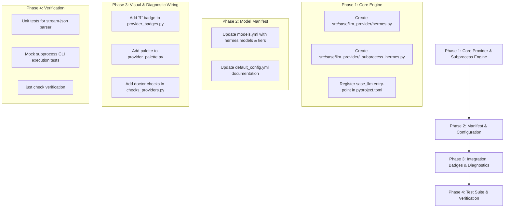

# Hermes Agent as a SASE LLM Provider: Architecture, Integration Contract, and Implementation Roadmap

- **Author:** Researcher Gem (`research.4w.gem`)
- **Date:** 2026-10-19
- **Target Audience:** SASE System Architects, Core Maintainers, LLM Provider Engineering
- **Domain:** LLM Provider Subsystem, Agent CLI Adapters, Instruction Delivery, Subprocess Streaming

---

## 1. Executive Summary

This research investigates the design, mechanics, and implementation required to add **Hermes** (specifically [Nous Research's Hermes Agent](https://github.com/nousresearch/hermes-agent)) as a new, fully supported, first-class LLM provider in SASE.

### Core Verdict & Architectural Recommendation
SASE does not implement an internal LLM tool-calling loop; rather, under SASE's core architecture (*"One prompt is not an engineering system"* and Architecture Decision Record `adapters-normalize-harnesses`), SASE **wraps autonomous coding agent CLIs** as single-turn workers within ephemeral numbered worktree clones (`sase_<N>`). Governance, git commits, plan approvals, and multi-agent coordination remain strictly host-owned.

We recommend implementing Hermes as **SASE's eighth native Agent CLI Provider** (`hermes`), directly wrapping the `hermes` CLI in headless single-query mode:
```bash
hermes chat --query-file <prompt_file> --format stream-json --yolo --ignore-user-config --ignore-rules --source tool --model <model> [--reasoning <level>]
```

This design turns Hermes from a potential rival into a powerful execution engine for SASE. It unlocks:
1. **Nous Research Model Family:** Direct execution on frontier open-weight models (Hermes 3, Hermes 4) and Nous Portal endpoints.
2. **Local and Specialized Inference:** Execution on local instances (via Ollama, llama.cpp, vLLM, LM Studio) managed through Hermes's provider routing.
3. **Multi-Model Flexibility:** Access to Hermes's unified multi-provider catalog (~40 backends) under SASE's strict governance, host-owned completion, and two-speed CI verification.

### Key Gotchas Identified
- **Binary Name Collision (High Severity):** Meta's React Native JavaScript engine installs a binary named `hermes` on many developer systems (`/usr/bin/hermes`). Consequently, the SASE provider **must publish no automatic detection priority** (`llm_autodetect_priority() -> None`), following the safety precedent set by `muse`. Hermes must be explicitly selected via `llm_provider.provider: hermes`, `%model:hermes/...`, or `SASE_HERMES_PATH`.
- **Instruction Delivery Isolation:** Hermes natively scans for and auto-injects `AGENTS.md`, `SOUL.md`, and local memories. SASE requires deterministic per-invocation instruction delivery (`instructions-per-invocation`). Passing `--ignore-rules` and `--ignore-user-config` to `hermes chat` is mandatory to disable Hermes's native memory scraping and ensure SASE's delivered instruction bundle is authoritative without duplication.
- **Headless Execution & Argument Limits:** Large prompts containing code context, diffs, and AST symbols easily exceed OS `ARG_MAX` if passed as command-line arguments. Using `--query-file <path>` (which reads the prompt from a managed temporary file) is mandatory over `-q`.

---

## 2. Review of Prior Research & Context

Prior research within the SASE sidecar repository investigated the relationship between SASE and Hermes from a functional and competitive standpoint:
1. **`research:202609/sase_vs_hermes_agent/sase_vs_hermes_agent__gem.md`** (September 2026): Analyzed the architectural heritage of OpenClaw-descended agents vs. SASE, establishing that Hermes is an agent-centric personal AI runtime with closed-loop self-evolution, while SASE is an industrial engineering control plane.
2. **`research:202610/can_hermes_replace_sase/can_hermes_replace_sase__final.md`** (October 2026): A 5-researcher synthesis assessing whether Hermes can replace SASE. The report refuted the replacement claim, concluding that Hermes lacks SASE's governance half (vendor CLI supervision, host-owned commits, typed durable gates, work records in git). Crucially, Section 9 of the report proposed:
   > *"Complement, not rival... Hermes has a clean headless mode: `hermes chat --oneshot -q … --format stream-json`... Making Hermes the eighth SASE provider would turn the main competitor in the overlap into a supplier. It would bring Hermes's local and any-model loop under SASE's workspaces, gates and finalizers."*

This research builds directly upon that strategic conclusion, translating the high-level concept into a production-grade SASE provider implementation.

---

## 3. Comparative Evaluation of Implementation Models

We evaluated three potential architectural models for integrating Hermes into SASE:

```
┌────────────────────────────────────────────────────────────────────────────────────────┐
│                               Candidate Architectures                                  │
├───────────────────────────────┬───────────────────────────────┬────────────────────────┤
│ Model 1: Headless CLI Adapter │ Model 2: Direct API Client    │ Model 3: Daemon / ACP  │
│ (hermes chat --format json)   │ (REST / OpenAI-compatible SDK)│ (hermes-acp / Gateway) │
├───────────────────────────────┼───────────────────────────────┼────────────────────────┤
│ • Native SASE provider pattern│ • Direct HTTP to Nous Portal  │ • Long-running daemon  │
│ • Full tool execution in repo │ • No agent tool loop in SASE! │ • Complex RPC state    │
│ • Subprocess isolation        │ • Violates single-turn worker │ • State leak risk      │
│ • Verified & Zero-debt        │ • Reinvents agent execution   │ • High friction        │
├───────────────────────────────┼───────────────────────────────┼────────────────────────┤
│      VERDICT: ADOPT           │      VERDICT: REJECT          │    VERDICT: REJECT     │
└───────────────────────────────┴───────────────────────────────┴────────────────────────┘
```

### Model 1: Headless Agent CLI Wrapper (Recommended)
- **Concept:** Implement a pluggy provider plugin `HermesProvider(LLMProvider)` that invokes the `hermes` executable using headless single-query flags.
- **How it works:** SASE creates the isolated workspace directory (`sase_<N>`), renders the instruction bundle, writes the combined prompt to a managed temporary file, and launches `hermes chat --query-file ... --format stream-json`. SASE streams JSONL events from stdout, updates the live reply file for the TUI, extracts token counters, and handles process termination.
- **Pros:**
  - Matches the exact pattern used by `claude`, `codex`, `agy`, `opencode`, `qwen`, `grok`, and `muse`.
  - Leverages Hermes's built-in file editing, terminal execution, and toolsets directly inside the ephemeral workspace.
  - Zero state pollution between agent turns; hermetic process lifecycle.
- **Cons:** Requires the `hermes` CLI to be installed on the host machine.

### Model 2: Direct Inference API Client (Rejected)
- **Concept:** Call Nous Research's OpenAI-compatible inference endpoint (`https://inference-api.nousresearch.com/v1`) directly via HTTP/Python SDK without invoking an agent CLI.
- **Why Rejected:**
  - SASE is an orchestrator of *coding agents*, not an agent itself. SASE contains no tool execution loop (it does not parse tool calls to execute shell commands, read files, or write patches).
  - Attempting to use a raw model API directly would require building an entire agent execution runtime inside SASE, directly violating the core design philosophy (*"sase does not replace coding agents"*).
  - If a user wishes to query Nous models without agent tools, they can already use SASE's existing multi-model providers like `opencode` pointed at Nous endpoints.

### Model 3: Gateway / ACP Daemon Integration (Rejected)
- **Concept:** Connect to a persistent `hermes` background daemon or ACP (Agent Client Protocol) server via IPC or WebSockets.
- **Why Rejected:**
  - SASE agent runs are strictly single-turn, stateless invocations (ADR `single-turn-agents`).
  - Persistent daemons maintain internal session state, conversation history, and working directories that conflict with SASE's ephemeral numbered clones (`sase_<N>`).
  - Managing daemon lifecycles, socket health, and crash recovery introduces significant operational complexity with zero benefit over the CLI's native `--oneshot` mode.

---

## 4. Technical Specification: The `hermes` SASE Provider

### 4.1 Invocation Protocol & CLI Contract
Hermes Agent provides a dedicated machine-readable streaming mode via `hermes chat`:

```bash
hermes chat \
  --query-file /tmp/sase_managed_prompt_xyz.txt \
  --format stream-json \
  --oneshot \
  --yolo \
  --ignore-user-config \
  --ignore-rules \
  --source tool \
  --model <model_id> \
  [--reasoning <effort_level>]
```

#### Detailed Flag Breakdown:
- `--query-file PATH`: Reads the prompt safely from a file (or `-` for stdin). Preserves arbitrary text, quotes, and backticks without shell escaping limitations.
- `--format stream-json`: Emits newline-delimited JSON (JSONL) events to stdout and sets quiet mode (suppressing ANSI spinners, banners, and interactive chrome).
- `--oneshot`: Forces single-query execution and immediate process exit upon completion (standard in non-TTY pipelines).
- `--yolo`: Bypasses all interactive tool approval prompts. Crucial because headless SASE execution has no interactive human terminal attached during agent tool execution.
- `--ignore-user-config`: Prevents reading `~/.hermes/config.yaml` or personal profile defaults, guaranteeing reproducible, hermetic execution. Credentials in environment variables or `.env` remain active.
- `--ignore-rules`: Skips automatic scraping and injection of `AGENTS.md`, `SOUL.md`, `.cursorrules`, and memories. This ensures SASE retains sole authority over instruction delivery.
- `--source tool`: Tags the session as an automated integration, preventing it from polluting the user's interactive Hermes history.
- `--model <model_id>`: Specifies the exact model to run.
- `--reasoning <effort>`: Forwards reasoning effort (`none`, `minimal`, `low`, `medium`, `high`, `xhigh`, `max`, `ultra`).

### 4.2 Stream JSON Protocol & Parsing
The `StreamJsonEmitter` in `hermes_cli/stream_json.py` emits four primary event types to stdout:

```json
{"type": "system", "subtype": "init", "model": "nous/hermes-3-llama-3.1-405b", "session_id": "sess-1234", "timestamp": 1774000000000}
{"type": "text", "text": "I will examine the codebase...", "timestamp": 1774000001000}
{"type": "tool_use", "name": "read_file", "input": {"path": "src/main.py"}, "tool_call_id": "call-001", "timestamp": 1774000002000}
{"type": "tool_result", "name": "read_file", "tool_call_id": "call-001", "output": "...", "duration_ms": 42, "is_error": false, "timestamp": 1774000003000}
{"type": "result", "session_id": "sess-1234", "exit_code": 0, "text": "Changes completed successfully.", "tokens": {"input": 4500, "output": 850, "total": 5350, "cache_read": 3200, "cache_write": 1300}, "duration_ms": 12400, "timestamp": 1774000015000}
```

#### SASE Stream Parser Mapping (`_subprocess_hermes.py`):
1. **`text` events:** Captured and passed to `append_stream_text()` to update the live reply buffer file for ACE TUI rendering.
2. **`tool_use` & `tool_result` events:** Processed to emit real-time activity indicators on SASE's TUI cards and log files.
3. **`result` event:**
   - `tokens.input` ➔ `usage_totals["input_tokens"]`
   - `tokens.output` ➔ `usage_totals["output_tokens"]`
   - `tokens.cache_read` ➔ `usage_totals["cache_read_input_tokens"]`
   - `tokens.cache_write` ➔ `usage_totals["cache_creation_input_tokens"]`
   - `text` ➔ Final response text returned in `InvokeResult`.
   - `exit_code` ➔ Verified against process return code.

### 4.3 Reasoning Effort Grammar Mapping
SASE defines a canonical reasoning effort scale in `sase.macro.effort.EFFORT_LEVELS_ORDERED`:
`none`, `minimal`, `low`, `medium`, `high`, `xhigh`, `max`.

Hermes Agent natively supports reasoning effort through `--reasoning <LEVEL>` with an exact keyword match:
```python
HERMES_EFFORT_CLI_ARGS: dict[str, list[str]] = {
    "none": ["--reasoning", "none"],
    "minimal": ["--reasoning", "minimal"],
    "low": ["--reasoning", "low"],
    "medium": ["--reasoning", "medium"],
    "high": ["--reasoning", "high"],
    "xhigh": ["--reasoning", "xhigh"],
    "max": ["--reasoning", "max"],
}
```
This enables seamless pass-through via SASE's standard `effort_cli_args()` helper.

### 4.4 Instruction Delivery Plan (E3 Parity)
SASE ADR `instructions-per-invocation` mandates that agents receive a single, unified instruction bundle.
- **Channel ID:** `hermes.prompt_prefix`
- **Delivery Strategy:**
  1. Hermes runs with `--ignore-rules`, suppressing its internal `AGENTS.md` scanning.
  2. The SASE instruction delivery boundary injects the memory bundle directly at the top of the prompt:
     ```markdown
     <!-- sase-instructions bundle=... invocation=... -->
     # Structured Agentic Software Engineering (SASE) - Agent Instructions
     ...
     
     --- User Prompt ---
     <Actual agent prompt text>
     ```
  3. The combined prompt is written to a temporary file passed via `--query-file`.
  4. Slot configuration: `root: explicit`, `subagent: none`.

---

## 5. Required Codebase Modifications

Integrating Hermes as a first-class provider requires changes across several targeted modules in `src/sase/`:

```
src/sase/
├── llm_provider/
│   ├── hermes.py                    # [NEW] HermesProvider implementation
│   ├── _subprocess_hermes.py        # [NEW] JSONL stream parser
│   ├── models.yml                   # [EDIT] Add hermes provider, models, and tiers
│   ├── instruction_delivery.py      # [EDIT] Register CHANNEL_HERMES_ROOT
│   └── _subprocess.py               # [EDIT] Export stream_and_parse_hermes_json_output
├── integrations/
│   ├── provider_badges.py           # [EDIT] Add "hermes": "☤" (caduceus) or "🪽"
│   └── provider_palette.py          # [EDIT] Add "hermes" brand gold/amber palette
├── doctor/
│   └── checks_providers.py          # [EDIT] Add hermes setup fallback & auth checks
├── default_config.yml               # [EDIT] Document hermes in llm_provider comments
└── pyproject.toml                   # [EDIT] Register sase_llm entry point
```

### 5.1 Provider Implementation: `src/sase/llm_provider/hermes.py`
A new provider class conforming to `LLMProvider` and pluggy `@hookimpl`:

```python
"""Hermes Agent LLM provider implementation."""

from __future__ import annotations

import os
import shutil
from typing import TYPE_CHECKING

from ._effort_args import effort_cli_args
from ._hookspec import hookimpl
from .base import LLMProvider
from .instruction_delivery import current_instruction_delivery
from .model_manifest import (
    provider_model_names,
    provider_short_aliases,
    provider_tier_model,
)
from .types import InvokeResult, LLMInvocationOptions, ModelTier

if TYPE_CHECKING:
    from .retry_config import ProviderRetryConfig
    from .usage_limit_config import ProviderUsageLimitConfig

_HERMES_PATH_ENV = "SASE_HERMES_PATH"
CHANNEL_HERMES_ROOT = "hermes.prompt_prefix"


def resolve_hermes_executable() -> str:
    override = os.environ.get(_HERMES_PATH_ENV)
    if override:
        return override
    found = shutil.which("hermes")
    if found:
        return found
    # Fallback to ~/.hermes/bin/hermes or ~/.local/bin/hermes
    fallback = os.path.expanduser("~/.hermes/bin/hermes")
    if os.path.isfile(fallback) and os.access(fallback, os.X_OK):
        return fallback
    raise FileNotFoundError(
        "Unable to locate Hermes executable. Ensure 'hermes' is on PATH or set SASE_HERMES_PATH."
    )


class HermesProvider(LLMProvider):
    """LLM provider that invokes Nous Research's Hermes Agent CLI."""

    def resolve_model_name(self, model_tier: ModelTier = "large") -> str:
        return provider_tier_model("hermes", model_tier)

    @hookimpl
    def llm_provider_name(self) -> str:
        return "hermes"

    @hookimpl
    def llm_provider_short_name(self) -> str:
        return "her"

    @hookimpl
    def llm_resolve_model_name(self, model_tier: ModelTier) -> str:
        return self.resolve_model_name(model_tier)

    @hookimpl
    def llm_autodetect_cli_name(self) -> str:
        return "hermes"

    @hookimpl
    def llm_autodetect_priority(self) -> int | None:
        # CRITICAL: Return None to avoid hijacking systems where Meta's
        # React Native 'hermes' engine binary is installed on PATH.
        return None

    @hookimpl
    def llm_known_model_names(self) -> list[str]:
        return list(provider_model_names("hermes"))

    @hookimpl
    def llm_model_short_aliases(self) -> dict[str, str]:
        return provider_short_aliases("hermes")

    @hookimpl
    def llm_cli_status_color(self) -> str:
        return "#E0A96D"  # Hermes brand gold/bronze

    @hookimpl
    def llm_skill_template_context(self) -> dict[str, str]:
        return {
            "provider_name": "Hermes Agent",
            "provider_tool_name": "Hermes",
            "provider_native_ask_tool": "clarify",
        }

    @hookimpl
    def llm_skill_deploy_subpath(self) -> str:
        return ".hermes"

    @hookimpl
    def llm_auth_evidence(self) -> dict[str, list[str]]:
        return {
            "credential_paths": [
                "~/.hermes/config.yaml",
                "~/.hermes/.env",
            ],
            "api_key_env_vars": [
                "NOUS_API_KEY",
                "OPENROUTER_API_KEY",
                "OPENAI_API_KEY",
                "ANTHROPIC_API_KEY",
            ],
        }

    @hookimpl
    def llm_install_metadata(self) -> dict[str, object]:
        return {
            "manager": "script",
            "display_name": "Hermes Agent",
            "vendor": "Nous Research",
            "docs_url": "https://hermes-agent.nousresearch.com/docs/",
            "install_script_url": "https://hermes-agent.nousresearch.com/install.sh",
            "install_dir": "~/.local/bin",
            "version_argv": ["--version"],
        }

    @hookimpl
    def llm_interactive_cli(self) -> dict[str, object]:
        return {
            "menu_key": "h",
            "bypass_args": ["--yolo"],
            "model_args": ["--model", "{model}"],
        }

    @hookimpl
    def llm_default_usage_limit_config(self) -> ProviderUsageLimitConfig:
        from .usage_limit_config import ProviderUsageLimitConfig
        return ProviderUsageLimitConfig(
            patterns=[
                "usage limit reached",
                "rate limit exceeded",
                "insufficient_quota",
                "credits depleted",
                "exceeded your current quota",
            ]
        )

    @hookimpl
    def llm_default_retry_config(self) -> ProviderRetryConfig:
        from .retry_config import _RETRY_CONTINUATION_NUDGE, ProviderRetryConfig
        return ProviderRetryConfig(
            max_retries=3,
            error_patterns=[
                "model_stream_idle_timeout",
                "Connection reset by peer",
                "502 Bad Gateway",
                "503 Service Unavailable",
                "504 Gateway Timeout",
            ],
            wait_times=[30, 120, 600],
            continuation_prompt=_RETRY_CONTINUATION_NUDGE,
            preserve_workspace=True,
        )

    @hookimpl
    def llm_instruction_delivery(self) -> dict[str, object]:
        return {
            "root": {"status": "explicit", "channel": CHANNEL_HERMES_ROOT},
            "subagent": {"status": "none"},
        }
```

### 5.2 Model Catalog Manifest: `src/sase/llm_provider/models.yml`
Add the `hermes` catalog section:

```yaml
  hermes:
    models:
      - nous/hermes-3-llama-3.1-405b
      - nous/hermes-3-llama-3.1-70b
      - nous/hermes-3-llama-3.1-8b
      - nous/anthropic/claude-sonnet-4-6
      - nous/openai/gpt-6.1-sol
      - openrouter/deepseek/deepseek-v4-pro
      - openrouter/moonshotai/kimi-k3
    short_aliases:
      nous/hermes-3-llama-3.1-405b: hermes405b
      nous/hermes-3-llama-3.1-70b: hermes70b
      nous/hermes-3-llama-3.1-8b: hermes8b
      nous/anthropic/claude-sonnet-4-6: hermes-sonnet
      nous/openai/gpt-6.1-sol: hermes-sol
    tiers:
      large: nous/hermes-3-llama-3.1-405b
      small: nous/hermes-3-llama-3.1-70b
```

### 5.3 Entry Point Registration: `pyproject.toml`
Register the pluggy entry point under `sase_llm`:

```toml
[project.entry-points."sase_llm"]
agy = "sase.llm_provider.agy:AgyProvider"
claude = "sase.llm_provider.claude:ClaudeCodeProvider"
codex = "sase.llm_provider.codex:CodexProvider"
fakey = "sase.llm_provider.fakey:FakeyProvider"
grok = "sase.llm_provider.grok:GrokProvider"
hermes = "sase.llm_provider.hermes:HermesProvider"
muse = "sase.llm_provider.muse:MuseProvider"
opencode = "sase.llm_provider.opencode:OpenCodeProvider"
qwen = "sase.llm_provider.qwen:QwenProvider"
```

---

## 6. Edge Cases, Hazards, and Defenses

| Risk / Failure Mode | Root Cause | Impact | Mitigation in SASE |
| -------------------- | ---------- | ------ | ------------------ |
| **Binary Collisions** | React Native's JS engine is named `hermes` | SASE invokes a JS engine instead of an AI agent, failing with syntax error | Set `llm_autodetect_priority() -> None`; require explicit selection via config, `%model`, or `SASE_HERMES_PATH`. Probe `--version` to verify "Hermes Agent". |
| **Interactive Prompts Deadlock** | Hermes prompting user for permission to run bash/git commands | Headless turn hangs until runner timeout | Always pass `--yolo` in headless invocations. |
| **Instruction Skew / Duplication** | Hermes auto-injecting workspace `AGENTS.md` in addition to SASE's delivered bundle | Conflicting directives, wasted context window | Always pass `--ignore-rules` and `--ignore-user-config`. |
| **ARG_MAX Prompt Overflow** | Large prompt containing AST symbols and diffs passed on command line | Kernel rejects execve with `E2BIG` | Always use `--query-file <managed_tmp_path>` instead of `-q`. |
| **Rogue Git Commits by Agent** | Hermes running `git commit` directly via its terminal tool | Corrupted commit provenance, missing trailers | SASE's host-owned completion detects unauthorized tree mutations and fails closed (ADR `host-owned-completion`). |
| **Uncontained File Spills** | Hermes writing sessions to `~/.hermes` | Contamination of host state | Pass `--source tool` to keep sessions out of user interactive history. |

---

## 7. Step-by-Step Implementation Roadmap



### Phase 1: Core Provider & Subprocess Engine (Days 1–2)
1. Implement `src/sase/llm_provider/hermes.py` adhering to `LLMHookSpec`.
2. Implement `src/sase/llm_provider/_subprocess_hermes.py` to parse `StreamJsonEmitter` events (`init`, `text`, `tool_use`, `result`) and extract token counters.
3. Wire `stream_and_parse_hermes_json_output` into `src/sase/llm_provider/_subprocess.py`.
4. Register `hermes = "sase.llm_provider.hermes:HermesProvider"` in `pyproject.toml`.

### Phase 2: Manifest & Configuration (Day 3)
1. Add `hermes` models and tier mappings to `src/sase/llm_provider/models.yml`.
2. Add `CHANNEL_HERMES_ROOT = "hermes.prompt_prefix"` to `instruction_delivery.py`.
3. Document `hermes` in `src/sase/default_config.yml`.

### Phase 3: Visual & Diagnostic Integration (Day 4)
1. Add `hermes: "☤"` badge in `src/sase/integrations/provider_badges.py`.
2. Add Hermes gold/amber brand colors to `PROVIDER_FALLBACK_STYLES` in `src/sase/integrations/provider_palette.py`.
3. Add doctor diagnostics in `src/sase/doctor/checks_providers.py` for offline auth and CLI availability.
4. Add installer definition in `src/sase/agent_clis/install.py` to support `sase agent-cli install hermes`.

### Phase 4: Test Suite & Verification (Day 5)
1. Add unit test `tests/test_llm_provider_hermes.py`:
   - Test flag construction (presence of `--yolo`, `--format stream-json`, `--query-file`, `--ignore-rules`).
   - Test JSONL event parsing across typical streaming responses and edge-case tool errors.
   - Test reasoning effort translation across all 7 levels.
   - Test autodetect priority refusal (`None`).
2. Run SASE verification suite:
   ```bash
   just check
   ```

---

## 8. Conclusion

Adding Hermes as a supported SASE LLM provider is architecturally clean, low-risk, and requires no modifications to the Rust core (`sase-core`) or SASE's orchestration kernel. By treating Hermes Agent as an autonomous single-turn execution engine wrapped with `--format stream-json` and `--yolo`, SASE gains full access to Nous Research models and local inference pipelines while maintaining strict host-owned git completion, bead/patch governance, and verifiable software engineering standards.
